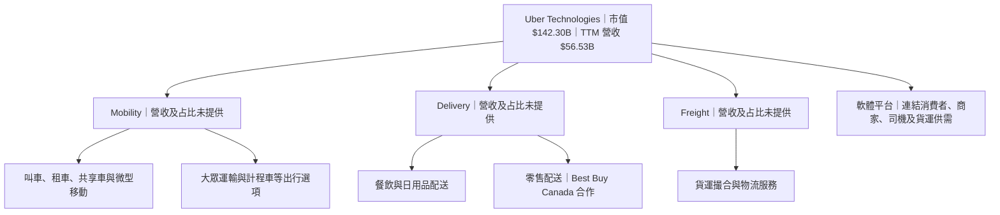
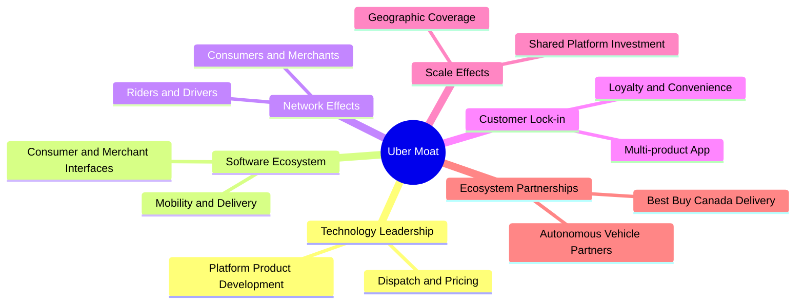
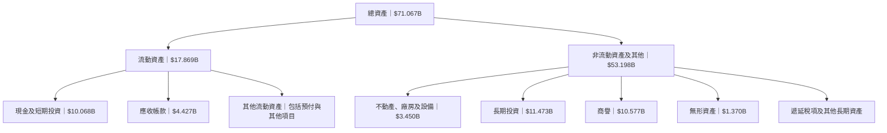
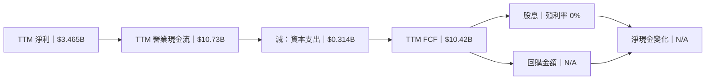
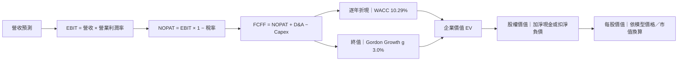
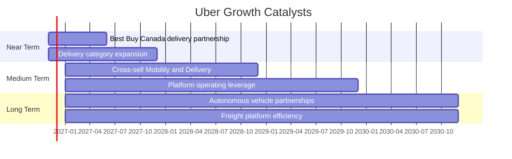
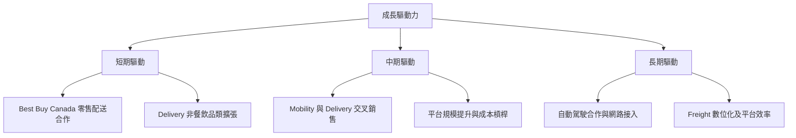
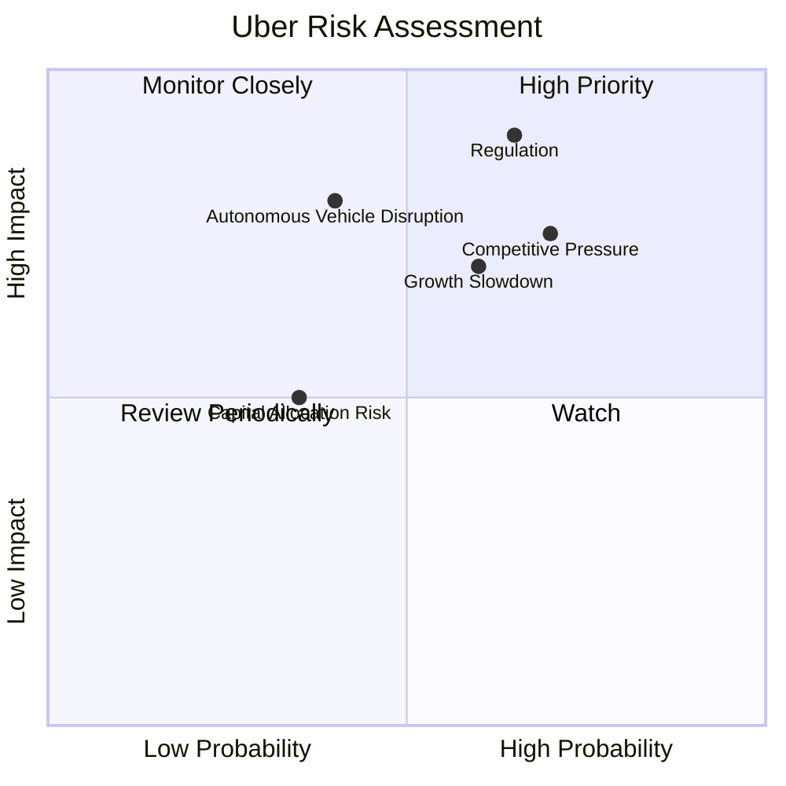
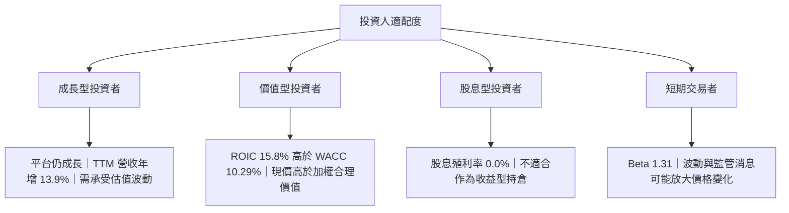

# UBER 基本面深度分析報告
> **報告日期**：2026-11-16 ｜ **語言**：繁體中文 ｜ **數據來源**：SEC 申報資料 (XBRL)、Yahoo Finance、Finviz、StockAnalysis、Roic.ai ｜ **分析師**：CFA 級機構研究

## 目錄

| # | 章節 | 核心結論 |
|---|------|----------|
| 1 | 執行摘要 | 持有；加權合理價值 $63.42，MOS -9.9% |
| 2 | 公司概覽與商業模式 | 三大平台業務共享雙邊網路，護城河主要來自規模與流動性 |
| 3 | 損益表深度分析 | TTM 營收 $56.53B、年增 13.9%；最新單季營收年增 9.6% |
| 4 | 資產負債表分析 | 淨負債 $5.60B；現金及短期投資 $10.07B |
| 5 | 現金流量深度分析 | TTM FCF $10.42B，FCF Yield 7.32% |
| 6 | 獲利能力與資本效率 | ROIC 15.8% 高於 WACC 10.29%，創造經濟價值 |
| 7 | 相對估值分析 | 高於 Lyft、低於 DoorDash 的 Forward P/E；相對自身 P/E 歷史偏高 |
| 8 | DCF 內在價值評估 | 基準 DCF 每股 $39.55；加權合理價值 $63.42 |
| 9 | 成長催化劑 | 跨品類配送、平台交叉銷售與自動駕駛合作是主要選擇權 |
| 10 | 風險矩陣 | 監管、競爭與成長放緩可能侵蝕利潤率及估值 |
| 11 | 投資建議 | 依 MOS 評級持有；等待估值折讓或營運改善確認 |

## 1. 執行摘要

截至 2026-11-13 收盤價為 **$69.69**。Uber TTM 營收 $56.53B、年增 13.9%，TTM FCF $10.42B、FCF Yield 7.32%，ROIC 15.8% 高於 WACC 10.29%；然而 DCF 基準價值為 $39.55，估值方法加權後合理價值為 $63.42，MOS 為 -9.9%。依規則 20，MOS 落在 -10% 至 10% 區間，評級為 **持有**；沒有作質化調整。

### 1.0 一頁式投資儀表板（Portfolio Manager 30 秒速讀）

| 項目 | 內容 |
|------|------|
| **投資論點（3 句）** | ① TTM 營收 $56.53B、年增 13.9%，平台仍具成長性。② TTM FCF $10.42B、FCF Yield 7.32%，現金創造能力已具規模。③ ROIC 15.8% 高於 WACC 10.29%，但加權合理價值 $63.42 低於現價 $69.69。 |
| **綜合評分** | **6.4/10**（引用 1.1；六項平均） |
| **財務健康** | 🟡 現金及短期投資 $10.07B，但淨負債為 $5.60B；流動比率 1.232。 |
| **ROIC vs WACC** | **15.8% vs 10.29%**，目前創造股東價值。 |
| **FCF 趨勢** | 🟢 TTM FCF $10.42B；FCF Yield 7.32%。 |
| **估值** | Forward P/E 15.81x ｜ EV/EBITDA 19.0x（自有歷史資料口徑）｜ FCF Yield 7.32%。 |
| **DCF 內在價值（基準）** | $39.55 ｜相對現價溢價 **76.2%**（現價 ÷ DCF − 1；第 8 章）。 |
| **安全邊際（MOS）** | **-9.9%**＝($63.42 − $69.69) ÷ $63.42；🔴 <10%，無安全邊際。 |
| **預期報酬（基準情境）** | DCF 基準價 $39.55，相對現價 **-43.2%**；此為 DCF 情境價差，不代表精確 12 個月預測。 |
| **關鍵風險（前二）** | 監管與勞動者分類變動；競爭導致營收增速、利潤率同步下滑。 |
| **評級 + 信心度** | 🟡 **持有** ｜信心：中（FCF 與 ROIC 數據支持營運面，但 DCF 與加權估值差異大）。 |

### 1.1 綜合評分卡（全報告唯一）

| 維度 | 評分（1–10） | 主要依據（引用數字與其來源章節） |
|------|--------------|----------------------------------|
| 成長性 | 7.0 | TTM 營收年增 13.9%，最新單季年增 9.6%；成長仍正向但單季低於 TTM（第 3 章）。 |
| 獲利能力 | 7.5 | TTM 營業利益率 12.4%、ROIC 15.8% 高於 WACC 10.29%；F-Score 6/8（第 6 章）。 |
| 財務健康 | 6.0 | 淨負債 $5.60B、流動比率 1.232；DSO 29 天，DIO／CCC 無可報存貨餘額（第 4 章）。 |
| 估值 | 4.0 | MOS -9.9%；P/E 40.8x 高於五年中位數 17.8x（第 7–8 章）。 |
| 護城河 | 7.5 | 多品類、雙邊平台及全球營運帶來供需流動性；但未提供市場份額與平台留存率數據（第 2 章）。 |
| 管理層與資本配置 | 6.5 | FY2025 FCF $9.76B，SBC $1.83B；股利殖利率 0%，資本配置細項不足以確認回購成效（第 3、5 章）。 |
| **綜合評分** | **6.4** | 六項算術平均：(7.0 + 7.5 + 6.0 + 4.0 + 7.5 + 6.5) ÷ 6 = 6.4167，四捨五入為 6.4。 |

### 1.2 五大投資論點 + 三大核心風險

| 類型 | 項目 | 具體依據 | 信心度 |
|------|------|----------|--------|
| 🟢 **投資論點①** | 現金創造力形成估值底盤 | TTM 營業現金流 $10.73B、資本支出 $314M、FCF $10.42B；資本支出低使現金轉換率高，但仍需監控 SBC 稀釋。 | 🟢 高 |
| 🟢 **投資論點②** | 主業仍有成長 | TTM 營收年增 13.9%；FY2025 營收 $52.02B，較 FY2024 $43.98B 增長 18.3%。 | 🟢 高 |
| 🟢 **投資論點③** | 資本回報高於資本成本 | ROIC 15.8% 對比 WACC 10.29%，利差 +5.51 個百分點。 | 🟢 高 |
| 🟢 **投資論點④** | 多業務共用平台 | Mobility、Delivery、Freight 共用消費者、商家、司機及技術平台；Best Buy Canada 合作擴充配送品類。 | 🟡 中 |
| 🟡 **投資論點⑤** | 估值較高處回落後仍有調整空間 | 股價由 2025-09 月收盤 $97.97 回落至 2026-11-13 的 $69.69；但 DCF 基準仍低於現價。 | 🟡 中 |
| 🟡 **風險①** | 需求及成長放緩 | 最新單季營收年增 9.6%，低於 TTM 13.9%；若連續放緩，現行盈餘倍數較難維持。 | 🟡 中 |
| 🔴 **風險②** | 法規與勞動者分類 | 司機身份、最低薪酬、保險及平台責任變動可能提高營運成本；資料未提供可量化的預期損失。 | 🔴 高衝擊 |
| 🔴 **風險③** | 自動駕駛與競爭 | 自動駕駛可能削弱司機供給壁壘或帶來合作機會；價值方向取決於 Uber 能否保有客戶介面及抽成能力。 | 🟡 中 |

### 1.3 快速統計卡片

| 指標 | 公司實際值（期間） | 同業中位數 | 狀態 |
|------|--------------------|------------|------|
| 營收成長（TTM） | **13.9%** | — | 🟢 |
| 營收成長（最新一季年增） | **9.6%** | 27.4% | 🟡 |
| 毛利率（TTM） | **41.4%** | 41.4% | 🟡 |
| 營業利益率（TTM） | **12.4%** | — | 🟢 |
| ROIC（TTM） | **15.8%** | — | 🟢 |
| Forward P/E | **15.81x** | 20.6x | 🟢 |
| FCF Yield（TTM） | **7.32%** | — | 🟢 |
| Piotroski F-Score | **6 / 8** | — | 🟢 |

同業中位數以 LYFT、DASH、GRAB 的已提供數據計算；三家公司最新季度營收年增中位數為 27.4%，TTM 毛利率中位數為 41.4%，Forward P/E 中位數為 20.6x。

### 1.4 投資結論

```text
╔══════════════════════════════════════════════════════════════════╗
║                    📊 投資結論摘要                               ║
╠══════════════════════════════════════════════════════════════════╣
║  評級：持有（依 MOS 評級門檻，未作質化調整）                     ║
║  價格（2026-11-13 收盤）：$69.69                                 ║
║  DCF 內在價值（基準）：$39.55（現價溢價 76.2%）                  ║
║  安全邊際 MOS：-9.9%（以加權合理價值為分母）                     ║
║  加權合理價值（8.8）：$63.42                                     ║
║  DCF 情境價值：悲觀 $22.49（-67.7%）                             ║
║    基準情境：$39.55（-43.2%）                                    ║
║    樂觀情境：$65.79（-5.6%）                                     ║
║  綜合評分：6.4/10（引用 1.1）                                    ║
║  適合投資人：可承受監管與估值波動、重視平台現金流的中長期投資人 ║
╚══════════════════════════════════════════════════════════════════╝
```

## 2. 公司概覽與商業模式

Uber Technologies, Inc. 經營 Mobility、Delivery、Freight 三大平台，覆蓋美洲、歐洲、中東、非洲及亞太地區。公司有 37,300 名員工。最新市值 $142.30B；TTM 營收 $56.53B。公司摘要未提供各部門營收及占比，因此不以推估比例繪製收入組成圖。

### 2.1 業務結構與收入來源



各板塊的營收金額、抽成率、訂單量及 EBITDA 未提供，不能判定分部盈利貢獻或計算部門收入占比。

### 2.2 市場份額

**市場份額數據未提供**，因此不繪製市場份額圖或填列比例。就已知規模而言，Uber TTM 營收為 $56.53B、TTM 成長 13.9%；同業數據顯示 DoorDash 最新單季營收年增 34.0%、Grab 年增 27.4%，Uber 最新單季年增 9.6%，其增長速度低於這兩家同業。

### 2.3 競爭護城河分析



### 2.4 護城河強度

| 護城河項目 | 強度（強／中／弱） | 證據（引用數字或事實） | 會削弱它的情況 |
|------------|--------------------|------------------------|----------------|
| 技術與撮合 | 中 | Mobility、Delivery、Freight 共用軟體平台；TTM 營收 $56.53B，但未提供留存率或撮合效率數據。 | 競爭者以補貼或更高司機報酬提升供給。 |
| 軟體生態系統 | 中 | 多類出行及配送服務置於同一應用程式，降低跨品類使用摩擦。 | 用戶多平台切換，或商家直接建立自有配送渠道。 |
| 網路效應 | 中至強 | 需求、司機與商家在平台上相互吸引；規模有助於提高可用性，但缺少活躍用戶及司機數據。 | 城市層級競爭使供需密度下降。 |
| 客戶鎖定 | 弱至中 | 多服務便利性可能提升使用頻率；未提供訂閱、留存或轉換成本資料。 | 用戶對價格敏感、容易跨平台比價。 |
| 規模效應 | 強 | 全球多區域營運、TTM 營收 $56.53B；固定技術與品牌成本可由大體量分攤。 | 本地監管或競爭導致各市場必須獨立補貼。 |
| 生態夥伴 | 中 | Best Buy Canada 成為 Uber Eats 獨家第三方配送應用；合作可延伸非餐飲品類。 | 合作未帶來足夠訂單增量，或夥伴轉向自營。 |

**1.1「護城河」評分為 7.5/10**：平台規模及多品類網路具實際商業價值，但缺少市占率、留存率及分部數據，故不以更高評分假定護城河強度。

## 3. 損益表深度分析

### 3.1 年度收入成長趨勢（近 4 年）

FY2022–FY2025 收入依序為 $31.88B、$37.28B、$43.98B、$52.02B；年增率約 16.9%、18.0%、18.3%。三年 CAGR 公式為 \((52.02 ÷ 31.88)^{1/3}-1\)，約 **17.7%**。

```text
╔══════════════════════════════════════════════════════════════════╗
║              Uber 年度收入趨勢（FY2022-FY2025）                 ║
╠══════════════════════════════════════════════════════════════════╣
║  FY2022  $31.88B  ███████████████░░░░░░░░░░░░  YoY：基期        ║
║  FY2023  $37.28B  ██████████████████░░░░░░░░░  YoY：+16.9% 🟢   ║
║  FY2024  $43.98B  █████████████████████░░░░░  YoY：+18.0% 🟢   ║
║  FY2025  $52.02B  █████████████████████████░  YoY：+18.3% 🟢   ║
╠══════════════════════════════════════════════════════════════════╣
║  FY2022-FY2025 三年收入 CAGR：約 17.7%                           ║
╚══════════════════════════════════════════════════════════════════╝
```

FY2025 收入成長 18.3% 代表平台交易活動與抽成收入持續擴張，但 TTM 成長降至 13.9%，最新單季年增再降至 9.6%，反映成長動能正在放緩。

### 3.2 季度收入趨勢分析

| 季度 | 營收 | QoQ | YoY | 備註 |
|------|------:|----:|----:|------|
| 2025 Q4 | $14.366B | +6.7% | +20.13% | 以 2025 Q3 為 QoQ 比較基期。 |
| 2026 Q1 | $13.203B | -8.1% | +14.48% | 季節性及季度組合可能影響 QoQ；YoY 仍為雙位數。 |
| 2026 Q2 | $14.191B | +7.5% | +12.17% | QoQ 回升，年增趨勢續降。 |
| 2026 Q3 | $14.766B | +4.1% | +9.6% | 最新單季年增低於 TTM 的 13.9%。 |

QoQ 公式均以本季營收 ÷ 前季營收 − 1 計算；YoY 採用單季同比數據。最新一季收入仍創四季資料中的高點，但年增減速值得跟踪。

### 3.3 利潤率演變分析

年度毛利率及營業利益率依財報金額計算；FY2025 營收採 $52.02B、毛利 $20.68B、營業利益 $5.57B。

| 利潤率指標 | FY2022 | FY2023 | FY2024 | FY2025 | 趨勢 | 評估 |
|------------|-------:|-------:|-------:|-------:|------|------|
| **毛利率** | 38.3% | 39.8% | 39.4% | 39.8% | 大致穩定 | 🟡 |
| **營業利益率** | -5.7% | 3.0% | 6.4% | 10.7% | 明顯改善 | 🟢 |
| **淨利率** | -28.7% | 5.1% | 22.4% | 19.3% | FY2024–25 高度受非營運項目影響 | 🟡 |

注：TTM 毛利率 41.4% 與年度毛利率計算口徑存在資料來源差異；本報告依年度損益表計算年度趨勢，TTM 指標則沿用資料所列 41.4%。

**利潤率演變深度解析：**營業利益率由 FY2022 -5.7% 升至 FY2025 10.7%，與營收規模擴大、費用率控制及平台業務槓桿一致；但不應將淨利率直接視為可持續營運能力，因 FY2024、FY2025 淨利與營業利益的差異顯著。FY2025 營業利益 $5.57B、淨利 $10.05B，淨利包含營業項目以外的顯著貢獻，需以現金流與營業利益率交叉檢驗。

### 3.4 費用結構分析

完整費用明細未提供，且資料不足以把營收拆成互斥且完整的費用項目，因此不繪製費用結構圓餅圖。可確認 FY2025 研發費用為 $3.40B，約為營收的 **6.5%**（$3.40B ÷ $52.02B）；其餘營運費用分項未提供。

### 3.5 季度 EPS 趨勢與盈餘品質（Quality of Earnings）

最近四季 GAAP EPS 實際值依序為 2025 Q4 $0.14、2026 Q1 $0.13、Q2 $1.17、Q3 $0.25。EPS 預估值缺失，因此不能判定超預期或不及預期；資料庫中的 EPS surprise 為 NaN，不視為有效盈餘意外數據。

| 盈餘品質項目 | 數值/佔比 | 評估 |
|--------------|-----------|------|
| 股權薪酬 SBC / 營收 | 最新四季 SBC 合計 $2.065B ÷ TTM 營收 $56.53B = **3.7%** | 🟡 SBC 是持續性股東成本；比例不低，需關注稀釋。 |
| SBC / 營業現金流 | $2.065B ÷ TTM OCF $10.73B = **19.3%** | 🟡 SBC 約占 OCF 五分之一，報告的 FCF 不等於扣除股權稀釋成本後的股東現金回報。 |
| FCF / 淨利（現金轉換率） | $10.42B ÷ TTM 淨利 $3.465B = **300.7%** | 🟢 現金流高於淨利；但淨利波動及非營運項目使比率偏高，不能簡單外推。 |
| 一次性/非經常性損益 | FY2025 淨利 $10.05B、營業利益 $5.57B；具體非營運項目拆分 N/A | 🟡 淨利明顯高於營業利益，可能受非營運或稅務項目影響，細項未提供。 |
| 有效稅率異常 | N/A（資料未提供可核對的 TTM 稅前利潤與稅費） | 🟡 不以估算稅率判定淨利品質。 |
| 資本化支出 vs 費用化 | TTM Capex $314M；資本化與費用化明細 N/A | 🟡 資本支出低，但無足夠資訊判斷是否有重要成本資本化。 |

**盈餘品質結論：**TTM FCF $10.42B 支持現金盈利能力，且現金轉換率高；但 SBC 約為收入 3.7%、OCF 19.3%，是實質稀釋成本。FY2025 淨利高於營業利益的差距亦降低單看 GAAP 淨利推估可持續盈餘的可信度。估值宜更多參考 GAAP EBIT、FCF 及稀釋股數，而非單季 EPS。

## 4. 資產負債表分析

### 4.1 資產結構分解

以下採最新 TTM 資產負債表所列 2026-09-30 數字，細項不完整，故不宣稱各項加總涵蓋全部資產。



### 4.2 流動性與營運資金分析

| 指標 | 最新 TTM | 一年前 TTM | 變化 | 解讀 |
|------|----------|------------|------|------|
| 流動比率 | 1.232 | N/A | N/A | 流動資產高於流動負債，但短期緩衝並不寬裕。 |
| DSO 應收帳款天數 | 29 天 | 28 天 | +1 天 | 收款週期略延長；幅度小，仍需追蹤應收帳款增長是否快於營收。 |
| DIO 存貨天數 | N/A | N/A | N/A | 公司未報可用存貨餘額，不適用推算。 |
| DPO 應付帳款天數 | 17 天 | N/A | N/A | 一年前資料缺失，無法判斷議價力變化。 |
| CCC 現金轉換週期 | N/A | N/A | N/A | DIO 不適用，無法計算 CCC。 |

### 4.3 債務結構分析

```text
╔══════════════════════════════════════════════════════════════════╗
║                   Uber 債務健康診斷                              ║
╠══════════════════════════════════════════════════════════════════╣
║  總債務（最新季度口徑）：$15.66B                                ║
║  現金及短期投資：          $10.07B                                ║
║  淨現金（−代表淨負債）：   -$5.60B  🟡                           ║
║  流動比率：                 1.232   🟡                            ║
║  Debt/EBITDA：              N/A（口徑及 EBITDA 配對值未提供）     ║
║  Interest Coverage：        N/A（利息費用明細未提供）             ║
╚══════════════════════════════════════════════════════════════════╝
```

### 4.4 股東權益趨勢

| 年度 | 股東權益 | 年增變化 |
|------|---------:|---------:|
| FY2022 | $7.34B | — |
| FY2023 | $11.25B | +53.3% |
| FY2024 | $21.56B | +91.6% |
| FY2025 | $27.04B | +25.4% |

股東權益上升提升帳面緩衝，但並不能替代現金流檢驗；FY2025 權益增幅低於 FY2023–24，應以後續淨利留存、回購及 SBC 對股數的淨影響進一步驗證。FY2026 Q3 股東權益未提供，故不延伸年度趨勢。

## 5. 現金流量深度分析

### 5.1 現金流量瀑布圖



淨利至 OCF 的調節項目未提供，故圖示表達現金流鏈條而非完全調節表；現金用途的回購、併購及淨現金變化資料不足。

### 5.2 FCF 轉換率趨勢

| 年度 | 淨利 | FCF | FCF / 淨利 | 解讀 |
|------|-----:|----:|-----------:|------|
| FY2022 | -$9.14B | $0.39B | 不具解讀性 | 淨利為負，不能以比例衡量轉換。 |
| FY2023 | $1.89B | $3.36B | 178.1% | FCF 高於淨利；存在非現金及營運資金影響。 |
| FY2024 | $9.86B | $6.89B | 69.9% | 淨利顯著高於 FCF，現金轉換低於 1 倍。 |
| FY2025 | $10.05B | $9.76B | 97.1% | 現金轉換接近淨利。 |
| TTM 至 2026-09-30 | $3.465B | $10.42B | 300.7% | 淨利口徑波動使比率偏高，不宜視為常態。 |

### 5.3 自由現金流趨勢

```text
╔══════════════════════════════════════════════════════════════════╗
║                  自由現金流歷史趨勢                              ║
╠══════════════════════════════════════════════════════════════════╣
║  FY2022  $0.39B  █░░░░░░░░░░░░░░░░░░░  YoY：—                  ║
║  FY2023  $3.36B  ███████░░░░░░░░░░░░░  YoY：大幅增加             ║
║  FY2024  $6.89B  ██████████████░░░░░░  YoY：+105.1%              ║
║  FY2025  $9.76B  ████████████████████  YoY：+41.7%               ║
║  TTM      $10.42B ████████████████████  FCF Yield：7.32%         ║
╚══════════════════════════════════════════════════════════════════╝
```

FY2024、FY2025 FCF 均增長，但 TTM FCF 與 FY2025 FCF 期間不同，不作為正式 YoY 比較。TTM FCF 是營業現金流 $10.73B 減資本支出 $314M，按指定口徑為 $10.42B。

### 5.4 資本配置評估

資料未提供完整回購、併購及現金留存的金額分配，不繪製會暗示比例的資本配置圓餅圖。

| 項目 | 可用資料 | 評估 |
|------|----------|------|
| Capex | TTM $314M；FY2025 $336M | 相對營收低，支持高 FCF，但無法由此推斷未來維持性資本支出。 |
| 股息 | 殖利率 0.0% | 目前不以現金股息回饋股東。 |
| SBC | FY2025 $1.83B；最新四季合計 $2.065B | 需將稀釋成本納入長期每股價值評估。 |
| 回購／併購／留存 | 分項金額 N/A | 無法評價資本配置的實際回報率。 |

## 6. 獲利能力與資本效率

### 6.1 ROE / ROA / ROIC 趨勢

| 指標 | FY2022 | FY2023 | FY2024 | FY2025 / 最新 TTM | 評估 |
|------|-------:|-------:|-------:|------------------:|------|
| ROE | N/A | N/A | N/A | 最新 TTM 12.5% | 🟡 權益乘數 2.57，含槓桿影響。 |
| ROA | N/A | N/A | N/A | 最新 TTM 6.5% | 🟡 有正向資產回報，歷史可比值未完整提供。 |
| ROIC | N/A | N/A | N/A | 最新 TTM 15.8% | 🟢 高於 WACC 10.29%。 |

**行業均值未提供**，不列對比欄。資料中另有 ROE 12.3% 的合併來源值，品質指標以程式計算 TTM ROE 12.5% 為準。

### 6.2 ROIC vs WACC 分析（核心價值創造判斷）

```text
╔══════════════════════════════════════════════════════════════════╗
║                ROIC vs WACC 深度分析                            ║
╠══════════════════════════════════════════════════════════════════╣
║  WACC（採用程式計算值）：10.29%                                 ║
║  ├── 無風險利率（10Y 美債）：5.15%                              ║
║  ├── ERP：5.00%                                                  ║
║  ├── 原始 Beta：1.31；調整後 Beta：1.21                          ║
║  ├── 股權成本：11.18%（資料列示值）                             ║
║  ├── 稅前債務成本：2.81%；稅率：21.0%                           ║
║  ├── 權重：股權 90.1%，債務 9.9%                                 ║
║  └── WACC：10.29%                                                ║
║                                                                  ║
║  ROIC（TTM）：15.8%                                              ║
║  EVA 利差 = ROIC − WACC = 15.8% − 10.29% = +5.51 個百分點       ║
║  ROIC  15.8%  ▓▓▓▓▓▓▓▓▓▓▓▓▓▓▓▓▓▓▓▓▓▓▓▓▓▓▓▓░░░░  🟢             ║
║  WACC  10.29% ▓▓▓▓▓▓▓▓▓▓▓▓▓▓▓▓▓▓▓▓░░░░░░░░░░░░  ──             ║
║  結論：目前 ROIC 高於資本成本，代表投入資本創造正經濟價值。    ║
╚══════════════════════════════════════════════════════════════════╝
```

WACC 直接採用資本成本資料列示值，不另建一組 WACC。該來源列示股權成本 11.18%；以已四捨五入的 Rf 5.15%、調整後 Beta 1.21、ERP 5.00% 直接相乘會出現小幅尾差，因此本報告以來源提供的 Ke 與 WACC 為準。債務成本採稅前 2.81%，稅後為 \(2.81\% × (1-21\%)=2.22\%\)；各權重與 WACC 以來源數值為準。

### 6.3 杜邦三因素分解

| 因素 | 數值（TTM） | 解讀 |
|------|-------------|------|
| 淨利率 | 6.1% | 獲利率有正貢獻，但會受非營運損益及稅務影響。 |
| 資產週轉率 | 0.80 | 每美元資產創造約 $0.80 營收。 |
| 權益乘數 | 2.57 | 槓桿放大 ROE，但不是唯一驅動因素。 |
| **ROE** | **12.5%** | 6.1% × 0.80 × 2.57 = 12.5%。 |

ROE 由淨利率、資產週轉及槓桿共同形成；權益乘數 2.57 顯示存在槓桿放大，但仍有 6.1% 正淨利率及 0.80 資產週轉支撐。

### 6.4 財務體質：Piotroski F-Score

**Piotroski F-Score：6 / 8**。因一項測試缺少輸入而排除，故分母不是 9；以下照列各項結果。

| 測試 | 結果 | 解讀 |
|------|------|------|
| ROA > 0 | ✅ 通過 | 最新 TTM 資產回報為正。 |
| 營業現金流 > 0 | ✅ 通過 | TTM OCF $10.73B。 |
| ROA 高於一年前 | ❌ 未通過 | 資產獲利未改善，提示獲利增長可能不及資產擴張。 |
| 營業現金流 > 淨利 | ✅ 通過 | TTM OCF 高於 TTM 淨利。 |
| 長期負債 ÷ 總資產低於一年前 | ❌ 未通過 | 槓桿相對資產未改善。 |
| 流動比率高於一年前 | ✅ 通過 | 短期流動性較一年前改善。 |
| 稀釋股數未增加 | ✅ 通過 | 品質計算比較期間的稀釋股數未增加。 |
| 毛利率高於一年前 | — 無法判定 | 缺資料，未納入 8 項分母。 |
| 資產週轉率高於一年前 | ✅ 通過 | 資產使用效率改善。 |

## 7. 相對估值分析

### 7.1 同業估值比較表格

本公司倍數採用市價與估值資料；同業數據採 Yahoo Finance 同業倍數資料。不同公司商業組合、盈餘基礎及一次性項目不同，倍數比較僅作相對參考。

| 估值指標 | **UBER** | **LYFT** | **DASH** | **GRAB** | 本公司評估 |
|----------|---------:|--------:|--------:|--------:|-----------|
| **Trailing P/E** | 40.8x | 2.5x | 71.2x | 32.4x | 🟡 高於 LYFT、GRAB，低於 DASH；差異可能包含盈餘基數與非經常項目。 |
| **Forward P/E** | 15.81x | 8.1x | 22.5x | 20.6x | 🟢 低於三家同業中位數 20.6x。 |
| **P/S Ratio** | 2.5x | 0.9x | 4.4x | 3.3x | 🟡 高於 LYFT、低於 DASH、GRAB。 |
| **EV/EBITDA** | 19.0x | 565.3x | 42.2x | 21.9x | 🟢 低於 DASH、GRAB；LYFT 倍數受 EBITDA 基數影響，參考性低。 |
| **最新單季營收年增** | 9.6% | 8.1% | 34.0% | 27.4% | 🔴 成長低於 DASH、GRAB；略高於 LYFT。 |
| **毛利率（TTM）** | 41.4% | 40.0% | 52.7% | 41.4% | 🟡 約等於 GRAB、高於 LYFT、低於 DASH。 |

### 7.2 歷史估值區間分析

```text
╔══════════════════════════════════════════════════════════════════╗
║             Uber 五年 TTM 估值區間與目前位置                     ║
╠══════════════════════════════════════════════════════════════════╣
║  P/E       範圍 12.6x ├────────●──────────┤ 122.2x              ║
║                              現值 40.8x｜歷史中位數 17.8x        ║
║                              百分位 69%｜偏高                    ║
║  P/S       範圍  1.5x ├────●────────────────┤ 6.1x              ║
║                              現值 2.5x｜歷史中位數 3.3x          ║
║                              百分位 24%｜偏低                    ║
║  EV/EBITDA 範圍 18.7x ├●────────────────────┤ 320.2x            ║
║                              現值 19.0x｜歷史中位數 40.0x        ║
║                              百分位 7%｜接近歷史低位             ║
╚══════════════════════════════════════════════════════════════════╝
```

估值訊號分歧：P/E 高於自身中位數，P/S 與 EV/EBITDA 則低於自身中位數。因不同倍數分母受淨利、營收及 EBITDA 波動影響，不能單憑其中一項判定低估。

### 7.3 情境價值（Bear / Base / Bull，照抄 DCF MODEL 的 Scenarios）

| 情境 | 第 1 年營收成長 | 期末營業利潤率 | WACC | 每股價值 | 相對現價 | 機率 | 會發生的條件 |
|------|----------------|----------------|------|----------|----------|------|--------------|
| 🔴 悲觀 | 7.0% | 5.4% | 11.29% | $22.49 | -67.7% | 25% | 需求成長低於 TTM 起點，且利潤率下滑、資本成本上升。 |
| 🟡 基準 | 13.9% | 6.4% | 10.29% | $39.55 | -43.2% | 50% | 起始成長延續 TTM 增長，之後逐年放緩至模型設定。 |
| 🟢 樂觀 | 20.9% | 7.0% | 9.29% | $65.79 | -5.6% | 25% | 成長重新加速、利潤率較基準改善且風險折現率下降。 |

### 7.4 相對估值隱含價格區間

```text
╔══════════════════════════════════════════════════════════════════╗
║                  估值方法隱含每股價值                            ║
╠══════════════════════════════════════════════════════════════════╣
║  DCF（基準）              $39.55                                 ║
║  同業 Forward P/E         $90.98                                 ║
║  分析師共識目標價         $98.23                                 ║
║                                                                  ║
║  $39.55 ───── $69.69 ───────── $90.98 ───── $98.23              ║
║  DCF價值       現價            同業P/E          分析師均值        ║
╚══════════════════════════════════════════════════════════════════╝
```

同業 Forward P/E 隱含價 $90.98，依據 LYFT、DASH、GRAB 的 Forward P/E 中位數 **20.6x** 乘 Uber Forward EPS **$4.41**。EV/EBITDA 相對估值因方法資料不可計算而排除，不自行補值；分析師共識目標價為 45 位分析師平均 $98.23。

## 8. DCF 內在價值評估（Discounted Cash Flow）

### 8.0 估值推理鏈（Thinking Logic：在算之前先想清楚）

**核心命題：**本模型將 Uber 的價值視為既有平台營收現金流的折現價值。Mobility、Delivery、Freight 各自營收占比未提供，不能把現有營收拆成具體比例；資料可確認的估值主導項為營收增長、營業利潤率、WACC 與終值假設。

- **Step 1：價值來源與主導變數。** TTM 營收 $56.53B、TTM 營業利益率 12.4%，形成現有現金流底盤；最新單季營收年增 9.6%，反映增長放緩。DCF 敏感度矩陣顯示，在模型基準附近，WACC 與永續成長率都對價值有明顯影響；終值現值占 EV 45.4%，故折現率與長期增長假設主導估值。
- **Step 2：模型選擇。**

| 決策點 | 本報告採用 | 理由（含數字） | 曾考慮但否決 | 否決理由 |
|--------|-----------|----------------|--------------|----------|
| 現金流定義 | FCFF | 以 WACC 10.29% 折現，先得 EV 再扣淨負債。 | FCFE | 會要求單獨預測融資與利息流。 |
| 預測期 N | 10 年 | DCF 模型預設 10 年，反映平台由目前增長逐步成熟。 | 更短期間 | 模型已提供 10 年逐年現金流，未提供其他模型結果。 |
| 終值方法 | Gordon Growth | 模型提供永續成長率 3.0% 與終值數值。 | 退出倍數 | DCF 模型未提供退出倍數及對應估值，不自行補造。 |
| EBIT 基礎 | GAAP EBIT | 模型採 GAAP EBIT，SBC 已列費用。 | 非 GAAP EBIT | 避免加回 SBC 後再漏算稀釋成本。 |

- **Step 3：重要假設推導鏈。**
  - **營收成長：**錨點＝TTM 營收年增 13.9%；最新單季年增 9.6% 顯示成長放緩 → 模型以 13.9% 作第一年起點，再線性衰減至第十年 3.0% → **採用模型逐年成長路徑** → 不採用最新單季 9.6% 作第一年，因模型已指定 TTM 成長為起點；不代表 13.9% 一定可維持。
  - **期末營業利潤率：**錨點＝TTM GAAP 營業利益率 12.4%；模型以過去五個財年的中位數作成熟期錨點 → **FY+10 採用 6.4%** → 不將 12.4% 永久外推，因公司增長成熟後利潤率可能回歸較低歷史水準。
  - **永續成長率：**錨點＝模型採用 3.0%；須低於 WACC 10.29% → **採用 3.0%** → 不採用接近或超過 WACC 的數值，避免終值公式失效或高估。
  - **預測期 N：**錨點＝模型提供 10 年年度預測 → **採用 10 年** → 不縮短或延長，以免自行改變模型輸出。
  - **Capex／營收：**錨點＝TTM 資本支出 $314M、TTM 營收 $56.53B，約 0.6%；模型固定約 0.6% → **採用逐年 0.6%** → 不採用更高維持性支出比例，因模型未提供其他資本支出路徑。
  - **EBIT 基礎與 SBC：**錨點＝GAAP EBIT 已含 SBC 費用 → **採用組合 (A)：GAAP EBIT、FCFF 不另扣 SBC、年稀釋率 0%** → 不另行扣 SBC 或再擴大股數，避免重複計入。
  - **D&A／營收：**錨點＝TTM 約 1.4%；採用模型的 1.4%，維持不變。
  - **營運資金：**錨點＝模型明示不建模；ΔWC 不列入 FCFF。由於沒有足夠預測資料，不另行估算。
  - **WACC：**錨點＝資本成本資料提供 10.29%；採用該值，不自建另一折現率；細節見 8.2。
  - **終值方法：**錨點＝模型使用 Gordon Growth；採 3.0% 永續成長率。退出倍數缺乏模型輸入，不以自選倍數取代。
- **Step 4：最脆弱一環。**最脆弱的是 10 年營業利潤率由 12.4% 緩降到 6.4% 的假設；若競爭使營收與利潤率一起惡化，價值會向悲觀情境 $22.49 靠攏。
- **Step 5：計算路徑圖。**



### 8.1 模型假設總表（Model Inputs）

| 假設項目 | 採用值 | 依據 / 來源 | 敏感度 |
|----------|--------|-------------|--------|
| 預測期長度 N | 10 年 | DCF 模型提供 10 個年度現金流。 | 🟡 中 |
| 營收成長路徑 | FY+1 13.9% 線性降至 FY+10 3.0% | FY+1 錨定 TTM 成長 13.9%；成熟期 3.0% 為模型設定。 | 🔴 高 |
| 營業利潤率 | FY+1 12.4% 降至 FY+10 6.4% | FY+1 採 TTM 12.4%；期末採五年財年中位數。 | 🔴 高 |
| 有效稅率 | 21.0% | DCF 模型及資本成本資料提供的預設稅率。 | 🟢 低 |
| Capex / 營收 | 約 0.6% | TTM Capex $314M ÷ TTM 營收 $56.53B 約 0.6%；模型持平。 | 🟡 中 |
| D&A / 營收 | 1.4% | DCF 模型以 TTM 為錨並持平。 | 🟢 低 |
| 營運資金變動 | 不建模 | DCF 模型明示 Working capital is not modelled。 | 🟢 低 |
| EBIT 基礎 | GAAP | DCF 模型指定 GAAP EBIT。 | 🟡 中 |
| SBC 處理 | 組合 (A)：不另扣 SBC | GAAP EBIT 已計入 SBC；FCFF 不再扣 SBC。 | 🟡 中 |
| 年稀釋率 | 0% | 組合 (A) 採固定股數；模型採 price-to-market-cap 換算。 | 🟡 中 |
| 永續成長率 g | 3.0% | DCF 模型提供；低於 WACC 10.29%。 | 🔴 高 |
| 終值方法 | Gordon Growth | 模型已提供終值及折現值；退出倍數未提供。 | 🔴 高 |
| WACC | 10.29% | 資本成本資料列示，詳見 8.2。 | 🔴 高 |

**FCFF 定義：**FCFF = NOPAT + D&A − Capex。模型不建模 ΔWC，故不加入該項；採 GAAP EBIT，且 **本模型採用 (A)，故 SBC 影響已計入一次**。

### 8.2 折現率推導（WACC）

```text
╔══════════════════════════════════════════════════════════════════╗
║                    WACC 推導（折現率）                           ║
╠══════════════════════════════════════════════════════════════════╣
║  股權成本 Ke（CAPM，採來源列示值）：11.18%                       ║
║  ├── 無風險利率 Rf（10Y 美債）：5.15%                            ║
║  ├── ERP：5.00%（資料列示假設值）                                ║
║  ├── 原始 Beta：1.31                                             ║
║  ├── 調整後 Beta：⅔ × 1.31 + ⅓ × 1 = 1.21                       ║
║  └── Ke：資料列示 11.18%（四捨五入輸入存在小幅尾差）             ║
║                                                                  ║
║  債務成本 Kd：                                                    ║
║  ├── 稅前 Kd：2.81%                                              ║
║  ├── 稅率：21.0%                                                  ║
║  └── 稅後 Kd = 2.81% × (1 − 21.0%) = 2.22%                      ║
║                                                                  ║
║  資本結構：股權權重 90.1%；債務權重 9.9%                         ║
║  WACC = 90.1% × 11.18% + 9.9% × 2.22% = 10.29%                  ║
╚══════════════════════════════════════════════════════════════════╝
```

**逐步演算及資料限制：**

1. **Ke（CAPM）**：資料列示 11.18%。輸入 Rf 5.15%、β 1.21、ERP 5.00% 以已顯示精度重算會有約 0.02 個百分點尾差，故按規定採用來源列示 Ke，不以重算值取代。
2. **稅前 Kd**：來源提供利息 ÷ 債務計算值 2.81%；利息費用及逐類平均計息負債金額未提供，不能補造分子或分母。
3. **稅後 Kd**：\(2.81\% × (1−21.0\%)=2.2199\%\)，四捨五入為 **2.22%**。
4. **權重**：股權 90.1%、債務 9.9%，合計 100%。市場市值及計息負債的可複算明細未提供，本報告照用來源權重，不以股東權益帳面值替代市值。
5. **WACC**：\(90.1\% × 11.18\% + 9.9\% × 2.22\%=10.07318\%+0.21978\%=10.29296\%\)，四捨五入為 **10.29%**。

Rf 的觀察日期未提供，ERP 為假設輸入；未另加規模／國別溢酬。第 6.2 與本節均採同一 WACC 10.29%。

### 8.3 逐年自由現金流預測（基準情境）

金額單位為 **$B**；比率按模型值列示，折現因子保留三位小數。模型每格均依指定 DCF MODEL 抄錄。

| 年度 | FY+1 | FY+2 | FY+3 | FY+4 | FY+5 | FY+6 | FY+7 | FY+8 | FY+9 | FY+10 |
|------|-----:|-----:|-----:|-----:|-----:|-----:|-----:|-----:|-----:|------:|
| 營收 | 64.41 | 72.60 | 80.96 | 89.29 | 97.40 | 105.06 | 112.04 | 118.12 | 123.10 | 126.80 |
| 營收 YoY | 13.9% | 12.7% | 11.5% | 10.3% | 9.1% | 7.9% | 6.6% | 5.4% | 4.2% | 3.0% |
| 營業利潤率 | 12.4% | 11.8% | 11.1% | 10.4% | 9.7% | 9.1% | 8.4% | 7.7% | 7.0% | 6.4% |
| EBIT（GAAP） | 8.01 | 8.54 | 8.98 | 9.30 | 9.49 | 9.52 | 9.40 | 9.11 | 8.67 | 8.07 |
| − 稅 | (1.68) | (1.79) | (1.89) | (1.95) | (1.99) | (2.00) | (1.97) | (1.91) | (1.82) | (1.69) |
| = NOPAT | 6.33 | 6.75 | 7.09 | 7.35 | 7.50 | 7.52 | 7.43 | 7.20 | 6.85 | 6.38 |
| + D&A | 0.88 | 0.99 | 1.10 | 1.21 | 1.33 | 1.43 | 1.52 | 1.61 | 1.67 | 1.72 |
| − Capex | (0.36) | (0.40) | (0.45) | (0.50) | (0.54) | (0.58) | (0.62) | (0.66) | (0.68) | (0.70) |
| − ΔWC | 未建模 | 未建模 | 未建模 | 未建模 | 未建模 | 未建模 | 未建模 | 未建模 | 未建模 | 未建模 |
| **= FCFF** | **6.85** | **7.33** | **7.75** | **8.07** | **8.28** | **8.37** | **8.33** | **8.15** | **7.84** | **7.40** |
| 折現因子 @10.29% | 0.907 | 0.822 | 0.745 | 0.676 | 0.613 | 0.556 | 0.504 | 0.457 | 0.414 | 0.375 |
| **FCFF 現值 PV** | **6.21** | **6.03** | **5.77** | **5.45** | **5.07** | **4.65** | **4.20** | **3.72** | **3.25** | **2.78** |

**預測期 FCF 現值合計：**  
\(6.21+6.03+5.77+5.45+5.07+4.65+4.20+3.72+3.25+2.78=\mathbf{47.13B}\)。

**FY+1 逐步演算：**

1. 營收：\(56.53 × (1+13.9\%)=64.39B\)，模型列示 **64.41B**；差異來自模型內部未四捨五入輸入，後續一律採模型逐年列值。
2. EBIT：\(64.41 × 12.4\%=7.987B\)，模型列示 **8.01B**；模型使用未四捨五入營收與利潤率。
3. 稅：模型列示 **1.68B**，使用模型未四捨五入 EBIT。
4. NOPAT：\(8.01−1.68=6.33B\)。
5. D&A：模型列示 **0.88B**。
6. Capex：模型列示 **0.36B**。
7. ΔWC：模型未建模，故不扣。
8. FCFF：按未四捨五入模型輸入計得 **6.85B**；列示金額的四捨五入可能造成 0.01B 尾差。
9. 折現因子：\(1÷(1+10.29\%)^1=0.907\)；PV：\(6.85×0.907=6.21B\)。

> **複算說明：**逐年模型數字以程式未四捨五入輸入計算，公開表格只顯示兩位小數；因此用顯示值反推時有小額尾差。所有估值結果及各年度數字照列模型結果，不用重算數字替換。

- 預測 FCFF 由 FY+1 $6.85B 增至 FY+10 $7.40B，十年 CAGR 約 **0.8%**；FY2022–FY2025 實際 FCF 由 $0.39B 升至 $9.76B，歷史增長受低基期影響，不宜外推為穩態 CAGR。
- FY+10 FCFF 利潤率：\(7.40÷126.80=5.8\%\)；TTM FCF 利潤率：\(10.42÷56.53=18.4\%\)。模型因營業利潤率成熟期回落而預測利潤率低於當前現金流率；同業最佳可比 FCF 利潤率未提供。
- 模型預測期間 FCFF 均為正。
- SBC 組合為 **(A)**：GAAP EBIT 已含 SBC，不另扣 SBC、不額外擴大股數。

```text
╔══════════════════════════════════════════════════════════════════╗
║            自由現金流：歷史實際 vs 模型預測                      ║
╠══════════════════════════════════════════════════════════════════╣
║  FY2023（實） $3.36B  ███████░░░░░░░░░░░░░  YoY：+761.5%       ║
║  FY2024（實） $6.89B  ██████████████░░░░░░  YoY：+105.1%       ║
║  FY2025（實） $9.76B  ████████████████████  YoY：+41.7%        ║
║  FY+1（預）   $6.85B  ██████████████░░░░░░  模型值              ║
║  FY+10（預）  $7.40B  ███████████████░░░░░  十年 FCFF CAGR ~0.8%║
╠══════════════════════════════════════════════════════════════════╣
║  歷史 FCF 受低基期影響；預測期則假設利潤率逐步回歸成熟水準。    ║
╚══════════════════════════════════════════════════════════════════╝
```

### 8.4 終值計算（Terminal Value）

**適用性檢查：**\(WACC 10.29\% > g 3.0\%\) → ✅

| 方法 | 計算式 | 終值 TV | TV 現值 | 佔總 EV 比重 |
|------|--------|---------:|--------:|-------------:|
| Gordon Growth | \(7.40 × (1+3.0\%) ÷ (10.29\%-3.0\%)\) | $104.47B | $39.22B | 45.4% |
| 退出倍數法 | N/A（DCF 模型未提供退出倍數及退出 EBITDA） | N/A | N/A | N/A |

**逐步演算：**

1. FY+10 FCFF：**$7.40B**。
2. 分子：\(7.40 × (1+3.0\%)=7.622B\)，模型依未四捨五入數值列示。
3. 分母：\(10.29\%-3.0\%=7.29\%\)；模型列示 \(7.40×1.03÷0.0729=\mathbf{104.47B}\)。
4. PV(TV)：\(104.47×0.375=\mathbf{39.22B}\)。
5. 終值占比：\(39.22÷86.35=\mathbf{45.4\%}\)。

終值占 EV 45.4%，估值仍有近半數來自預測期十年後現金流，長期假設重要，但未達 75% 高度依賴警戒線。

### 8.5 企業價值 → 每股內在價值（Bridge）

```text
╔══════════════════════════════════════════════════════════════════╗
║              企業價值 → 每股內在價值 橋接表                      ║
╠══════════════════════════════════════════════════════════════════╣
║  預測期 FCF 現值合計             +$47.13B                        ║
║  終值現值 PV(TV)                 +$39.22B                        ║
║  = 企業價值 EV                    $86.35B                        ║
║  + 淨現金（−代表淨負債）           -$5.60B                        ║
║  = 股權價值（模型列示）            $80.76B                        ║
║  每股換算：股權價值 × 股價 ÷ 市值                               ║
║  ★ DCF 基準每股價值                $39.55                        ║
║    當前股價                         $69.69                        ║
║    折溢價（現價÷DCF價值−1）         +76.2%（溢價）               ║
╚══════════════════════════════════════════════════════════════════╝
```

逐步演算：

1. **EV**：\(47.13+39.22=\mathbf{86.35B}\)。
2. **股權價值**：\(86.35+(-5.60)=80.75B\)；模型列示 **$80.76B**，屬輸入未四捨五入造成的 $0.01B 尾差，採用模型值。
3. **每股內在價值**：模型指定公式 \(80.76×69.69÷142.30=\mathbf{\$39.55}\)。模型採用價格／市值比例換算；市值及股數為已四捨五入資料，直接用四捨五入股數相除可能出現尾差。
4. **折溢價**：\(69.69÷39.55−1=76.3\%\)，模型以未四捨五入內在價值列示 **76.2%**。
5. **本節不計算 MOS**；MOS 僅在 8.8 以加權合理價值為分母。

現金及短期投資 $10.07B、總債務 $15.66B，對應淨負債約 $5.60B；取最新季度資產負債表口徑。模型每股換算使用市場價格及市值比例，未另行年化稀釋股數；與組合 (A) 固定股數假設一致。

### 8.6 敏感性分析（WACC × 永續成長率）

每格為模型提供的每股價值，括號為相對 $69.69 現價的上行／下行空間。

| g（列）／WACC（欄） | 8.29% | 9.29% | **10.29%（基準）** | 11.29% | 12.29% |
|-----------|------:|------:|------------------:|------:|------:|
| **2.0%** | $48.97（-29.7%） | $42.22（-39.4%） | $37.07（-46.8%） | $33.01（-52.6%） | $29.72（-57.4%） |
| **2.5%** | $51.40（-26.2%） | $43.86（-37.1%） | $38.23（-45.1%） | $33.85（-51.4%） | $30.35（-56.4%） |
| **3.0%（基準）** | $54.28（-22.1%） | $45.77（-34.3%） | **$39.55（-43.2%）** | $34.80（-50.1%） | $31.05（-55.4%） |
| **3.5%** | $57.77（-17.1%） | $48.00（-31.1%） | $41.06（-41.1%） | $35.87（-48.5%） | $31.83（-54.3%） |
| **4.0%** | $62.07（-10.9%） | $50.66（-27.3%） | $42.82（-38.5%） | $37.09（-46.8%） | $32.71（-53.1%） |

基準格與 8.5 的 DCF 基準價 $39.55 一致。模型未提供敏感度格子的逐年 PV 中間值，故不以自行重建的中間值替換來源矩陣。

**三情境 DCF（模型原列值）：**

| 情境 | 營收假設 | 期末營業利潤率 | WACC | 每股內在價值 | 相對現價 | 機率 |
|------|----------|----------------|------|--------------|----------|------:|
| 🔴 悲觀 | FY+1 7.0% | 5.4% | 11.29% | $22.49 | -67.7% | 25% |
| 🟡 基準 | FY+1 13.9% | 6.4% | 10.29% | $39.55 | -43.2% | 50% |
| 🟢 樂觀 | FY+1 20.9% | 7.0% | 9.29% | $65.79 | -5.6% | 25% |
| **機率加權** | — | — | — | **$41.85** | **-40.0%** | **100%** |

模型未提供各情境的 FY+10 營收、FCFF、TV 中間表格，因此不補造完整情境推導鏈。依模型的已提供機率加權值：  
\(22.49×25\%+39.55×50\%+65.79×25\%=41.845\)，模型列示 **$41.85**。

**敏感度結論：**

- **g 上升的影響：**固定基準 WACC 10.29%，g 由 2.0% 提高至 4.0%，價值由 $37.07 升至 $42.82，增加 **$5.75／15.5%**。
- **WACC 上升的影響：**固定基準 g 3.0%，WACC 由 9.29% 升至 11.29%，價值由 $45.77 降至 $34.80，減少 **$10.97／24.0%**。
- **期末營業利潤率每 +1 個百分點：**模型未提供單獨利潤率敏感度矩陣，無法精確量化，標示 **N/A**。
- 在已提供的局部矩陣變動中，WACC 兩個百分點變化的影響大於 g 兩個百分點變化；與 8.0 指出終值及折現率敏感的推理一致。

### 8.7 反推 DCF（Reverse DCF：市場在預期什麼）

固定基準輸入：WACC 10.29%、稅率 21.0%、Capex／營收採模型逐年值、營運資金不建模、預測期 10 年、股數按模型固定換算。

| 求解的變數（一次一個） | 其餘變數設定 | 市場隱含值（令 DCF = 現價） | 公司歷史實際 | 判斷 |
|------------------------|--------------|------------------------------|--------------|------|
| FY+1 營收成長率 | 其餘基準值固定 | 28.8% | TTM 成長 13.9%；最新單季 9.6% | 🔴 顯著高於當前成長錨點 |
| 固定營業利潤率 | 其餘基準值固定 | 14.1% | TTM 12.4% | 🔴 高於目前 TTM；模型未提供可比歷史最高值 |
| 永續成長率 g | 其餘基準值固定 | 未計算 | — | 模型未提供解，不能自行回推。 |
| 預測期長度 N | 其餘基準值固定 | 未計算 | — | 模型未提供 N 的反解結果。 |

程式提供年 1 成長率 28.8% 及固定營業利潤率 14.1% 兩個單一變數反解結果；未提供試算軌跡或中間點，不虛構收斂迭代表。反推結果表示，若採基準模型其他輸入，現價要求成長或固定利潤率高於當前表現。

### 8.8 估值三角驗證與安全邊際

| 估值方法 | 隱含每股價值 | 上行空間（÷現價） | 權重 | 說明 |
|----------|--------------:|-------------------:|------:|------|
| DCF（基準） | $39.55 | -43.2% | 55% | 10 年 FCFF、WACC 10.29%、g 3.0%。 |
| 同業 Forward P/E | $90.98 | +30.5% | 35% | 同業中位數 20.6x × Uber Forward EPS $4.41。 |
| 分析師共識目標價 | $98.23 | +41.0% | 10% | 45 位分析師目標均值，作為參考。 |
| 同業 EV/EBITDA | N/A | N/A | 不納入 | 方法不可計算，其權重已依模型規則分配至可用方法。 |
| **加權合理價值** | **$63.42** | **-9.0%** | **100%** | — |

**逐步演算：**

\[
39.55×55\%+90.98×35\%+98.23×10\%
=21.7525+31.843+9.823
=63.4185
\]

程式列示加權合理價值為 **$63.42**。公司類型為獲利企業，使用程式固定權重；同業 EV/EBITDA 因不可計算而未納入。

```text
╔══════════════════════════════════════════════════════════════════╗
║                  估值區間與安全邊際                              ║
╠══════════════════════════════════════════════════════════════════╣
║  $22.49 ───── $39.55 ───── $63.42 ───── $69.69 ───── $98.23     ║
║  悲觀DCF      基準DCF       加權合理值   現價          分析師均值 ║
║                                                                  ║
║  MOS = (63.42 − 69.69) ÷ 63.42 = -9.9%                          ║
║  MOS 評估：🔴 <10%，安全邊際不足                                 ║
║  上行空間 = (63.42 − 69.69) ÷ 69.69 = -9.0%                     ║
║                                                                  ║
║  買入參考區間：不高於 $57.08（MOS 達 10% 的價格上限）            ║
║  持有參考區間：$57.08 至 $70.47（MOS 約 +10% 至 -10%）            ║
║  減碼考慮區間：高於 $70.47（MOS 低於 -10%）                     ║
╚══════════════════════════════════════════════════════════════════╝
```

買入參考上限計算：\(63.42×(1−10\%)=\$57.078\)，四捨五入為 $57.08。現價高於此區間，與「持有」評級一致。

> 🔎 **程式複算（Python，依本節各項自動重算）**
>
> 加權合理價值 = $39.55 × 55% + $90.98 × 35% + $98.23 × 10% = **$63.42**（權重合計 100%）
>
> 以價格 $69.69 計：MOS = **-9.9%**，上行空間 = **-9.0%**
>
> ✅ 與本節所寫數值一致。

### 8.9 DCF 模型的局限與失效條件

- **終值依賴度：**終值現值占 EV 45.4%，主要長期假設為 FY+10 FCFF $7.40B、g 3.0% 及 WACC 10.29%。
- **最脆弱假設：**營收與利潤率若同步低於基準，模型悲觀情境價值為 $22.49；若成長與利潤率提升、WACC 下行，樂觀情境為 $65.79。
- **模型限制：**FCF 為正且 Capex 低，但 FCFF 不含營運資金變動；資料未提供各分部現金流、單位經濟性或分部利潤，因此無法以 SOTP 交叉驗證。DCF 的 GAAP EBIT 已含 SBC，但將股數固定，長期稀釋風險可能未完全反映。
- **與第 10 章連結：**監管成本上升會壓低營業利潤率；競爭補貼會拉低增長或利潤率；自動駕駛若削弱撮合抽成會影響長期 FCFF，均直接衝擊 DCF 輸入。

### 8.10 複算檢核表（Audit Trail：輸出前自我驗算）

| # | 檢核項目 | 檢查方式 | 結果 |
|---|----------|----------|------|
| 1 | 高／中敏感度假設均有推導 | 對照 8.0 Step 3 與 8.1 | ✅ |
| 2 | 每個假設均有來歷 | 8.1 依據欄逐項註明 | ✅ |
| 3 | WACC 算式及權重 | 90.1% + 9.9% = 100%；採列示 WACC | ✅（Ke 有已註明尾差） |
| 4 | Kd 分母與債務權重範圍一致 | 原始債務明細未提供，直接沿用來源 Kd 與權重 | ⚠️ 無法獨立核驗底層負債範圍 |
| 5 | WACC 與第 6.2 節一致 | 均為 10.29% | ✅ |
| 6 | 逐年數量等於 N | FY+1 至 FY+10 共 10 年 | ✅ |
| 7 | FY+1 代表年度算式 | 已列模型值與四捨五入尾差說明 | ⚠️ 顯示精度不足以逐格完全重現未四捨五入模型 |
| 8 | 預測 PV 加總 | 6.21+6.03+5.77+5.45+5.07+4.65+4.20+3.72+3.25+2.78 = 47.13 | ✅ |
| 9 | WACC > g | 10.29% > 3.0% | ✅ |
| 10 | 終值基於 FY+N 並折現 10 期 | FY+10 FCFF $7.40B；折現因子 0.375 | ✅ |
| 11 | EV 至每股價值橋接 | $47.13B + $39.22B = $86.35B；每股依模型換算 | ✅（橋接有 $0.01B 顯示尾差） |
| 12 | SBC 組合一致 | GAAP EBIT、無 SBC 扣除列、固定股數 | ✅ |
| 13 | 敏感性基準格等於 8.5 | 基準格 $39.55 | ✅ |
| 14 | 敏感性矩陣均為有效格 | 全部 WACC 均大於 g | ✅ |
| 15 | 三情境機率加總 | 25% + 50% + 25% = 100% | ✅ |
| 16 | 反推每列僅解一個變數 | 只列模型已解出的兩個變數；未提供迭代軌跡 | ⚠️ 中間試算資料未提供 |
| 17 | MOS 與折溢價基準一致 | MOS 用 $63.42；DCF 溢價用 $39.55 | ✅ |
| 18 | 報告完整至第 11 章 | 各章節均列出 | ✅ |
| 19 | 加權價值等於方法加權總和 | 算式得 $63.4185，模型列示 $63.42 | ✅ |
| 20 | 評級符合 MOS 門檻 | MOS -9.9%，評級持有 | ✅ |

**資料限制說明：**WACC 底層平均計息負債、DCF 模型未四捨五入輸入、反推 DCF 試算軌跡未提供。已明確使用來源列示數值及標示尾差，沒有自行補造缺失中間數據。

## 9. 成長催化劑

### 9.1 催化劑時間軸

以下時間區間為分析框架，並非公司財測；事件資料僅採已提供新聞及業務資訊。



### 9.2 TAM 市場規模分析

**N/A（TAM 數據未提供）。**公司 TTM 營收 $56.53B、成長 13.9%，說明現有營運規模已大，但不足以推算未滲透市場空間。Best Buy Canada 配送合作可拓展非餐飲配送品類；其市場規模、預期訂單及營收貢獻未公布。

### 9.3 成長驅動力結構圖



以上屬質化驅動因素；市場規模、訂單轉化率及各板塊營收占比尚無可引用數字。

## 10. 風險矩陣

### 10.1 風險評分矩陣

圖中座標為分析師主觀風險判斷，並非公司披露數據。



### 10.2 風險清單詳細分析

| # | 風險項目 | 發生機率 | 財務衝擊 | 風險評分 | 緩解措施 |
|---|----------|----------|----------|----------|----------|
| 1 | 🔴 **監管與勞動者分類** | 中高；無公司概率數據 | 高；可能推高保險、薪酬及合規成本，幅度 N/A | 🔴 高 | 追蹤主要市場法律變化、司機報酬及保險成本；避免假設歷史利潤率可直線外推。 |
| 2 | 🔴 **價格競爭與補貼** | 中高 | 高；可能同時壓低最新單季 9.6% 成長及 12.4% TTM 營業利益率 | 🔴 高 | 關注營收成長、單季營業利益率、優惠與供給指標；當成長下滑且利潤率收縮時降低估值。 |
| 3 | 🟡 **自動駕駛重塑供需** | 中 | 高；可能降低司機需求，也可能成為平台合作機會 | 🟡 中高 | 追蹤合作模式、平台抽成、用戶關係歸屬及單位成本變化。 |
| 4 | 🟡 **營收增長放緩** | 中 | 中高；TTM 成長 13.9%，最新單季年增 9.6% | 🟡 中高 | 連續追蹤季度 YoY；若持續低於 8% 且利潤率下降，重新檢視成長假設。 |
| 5 | 🟡 **SBC 稀釋** | 中 | 中；最新四季 SBC $2.065B，約為 TTM 營收 3.7% | 🟡 中 | 追蹤稀釋股數、SBC／營收及回購對股數的淨效果。 |
| 6 | 🟡 **淨負債及流動性** | 中 | 中；淨負債 $5.60B、流動比率 1.232 | 🟡 中 | 追蹤淨負債、利息成本與現金儲備；資料未提供利息保障倍數。 |

## 11. 投資建議

### 11.1 最終評級與評分

依加權合理價值 $63.42、現價 $69.69 計算，MOS 為 -9.9%，落在規則 20 的持有區間；**依 MOS 應為持有，未作一級調整**。1.1 綜合評分為 **6.4/10**，六項分數依序為成長性 7.0、獲利能力 7.5、財務健康 6.0、估值 4.0、護城河 7.5、管理層與資本配置 6.5。

### 11.2 合理價值與隱含報酬率

| 價值參考 | 每股價值 | 相對現價 | 機率／權重 |
|----------|---------:|---------:|-----------:|
| 加權合理價值 | $63.42 | -9.0% | 估值方法加權 100% |
| 🔴 DCF 悲觀情境 | $22.49 | -67.7% | 25% |
| 🟡 DCF 基準情境 | $39.55 | -43.2% | 50% |
| 🟢 DCF 樂觀情境 | $65.79 | -5.6% | 25% |
| DCF 機率加權參考值 | $41.85 | -40.0% | 100% 情境機率 |

### 11.3 買入時機與觸發因素

```text
╔══════════════════════════════════════════════════════════════════╗
║                  ✅ 買入觸發因素 Checklist                       ║
╠══════════════════════════════════════════════════════════════════╣
║  立即建立／增加部位前，建議多數條件符合：                        ║
║  ✅ 股價進入 $57.08 以下，對加權合理價值達至少 10% MOS          ║
║  ✅ TTM FCF 維持正值，並能在最新季報確認現金流品質               ║
║  ✅ ROIC 維持高於 WACC 10.29%                                    ║
║                                                                  ║
║  加碼觸發條件（任一項需配合估值檢查）：                          ║
║  ☐ 最新單季營收年增重新回到 13.9% 以上                          ║
║  ☐ 最新單季營業利益率由 9.8% 回升，且 FCF 不轉負                ║
║  ☐ 股價下跌但營運指標穩定，估值折讓達 MOS 10%                    ║
║                                                                  ║
║  減碼／重新檢視條件：                                             ║
║  ☐ 現價高於加權合理價值所對應的 MOS -10% 價位 $70.47             ║
║  ☐ 連續兩季單季營收年增低於 8%，且營業利益率同步收縮             ║
║  ☐ TTM FCF 轉負，或 ROIC 跌破 WACC 10.29%                        ║
║  ☐ SBC／營收持續高於目前約 3.7%，且稀釋股數重新上升              ║
╚══════════════════════════════════════════════════════════════════╝
```

上述營運門檻是分析師監控條件，不是公司財測；價格 $57.08 與 $70.47 依加權合理價值 $63.42 的 MOS ±10% 計算。

### 11.4 投資人適配度分析



### 11.5 每季財報監控清單（Quarterly Watch List）

| 監控指標 | 目前基準 | 加碼觸發 | 減碼／重估觸發 |
|----------|----------|----------|----------------|
| 營收成長 | TTM 13.9%；最新單季 YoY 9.6% | 單季 YoY 回升至 13.9% 以上，且非單一季度因素 | 連續兩季低於 8% |
| 營業利益率 | TTM 12.4%；最新單季 9.8% | 單季利潤率改善且營收仍增長 | 連續兩季低於 9.0% 或持續收縮 |
| 營業現金流 | TTM $10.73B | 維持正值且與營業利益同步 | 連續兩季 OCF 轉負 |
| FCF | TTM $10.42B；FCF Yield 7.32% | FCF 保持正值、Capex 合理 | TTM FCF 轉負 |
| Capex | TTM $314M | 若增加且帶來可驗證增長，不視為單獨利空 | Capex 上升但營收／FCF 同時惡化 |
| SBC | 最新四季合計 $2.065B；約營收 3.7% | SBC／營收下降且股數穩定 | SBC／營收持續高於 3.7% 且稀釋股數增加 |
| 淨負債 | $5.60B | 淨負債下降 | 淨負債上升且現金流轉弱 |
| ROIC | TTM 15.8% | 持續高於 WACC 10.29% | ROIC 跌破 10.29% |
| EPS／預期差 | 四季實際 EPS 可得，分析師 EPS 預估缺失 | 下一季預估及實際值可比後確認超預期 | 不以目前 NaN 預估值推斷 beat／miss |
| 財測／訂單與平台指標 | 未提供可量化基準 | 管理層財測上修且核心業務指標改善 | 財測下修、需求或供給指標轉弱 |

### 11.6 反面論證：什麼會證明論點錯誤（What Would Change My Mind）

```text
╔══════════════════════════════════════════════════════════════════╗
║              ⚠️ 論點失效條件（Disconfirming Evidence）           ║
╠══════════════════════════════════════════════════════════════════╣
║  本投資論點在下列情況成立時應重新檢視或退出：                    ║
║  ☐ 最新單季營收年增連續兩季低於 8%                               ║
║  ☐ 單季營業利益率連續兩季低於 9.0%                               ║
║  ☐ TTM FCF 轉負，或 OCF 持續低於淨利且無可解釋的營運資金原因    ║
║  ☐ ROIC 跌破 WACC 10.29%，表示資本回報不再覆蓋資本成本          ║
║  ☐ 淨負債高於目前 $5.60B 且流動比率跌破 1.0                     ║
║  ☐ SBC／營收持續高於目前約 3.7%，並伴隨稀釋股數增加             ║
║  ☐ 自動駕駛或監管變化使平台失去客戶關係、定價權或抽成能力        ║
╚══════════════════════════════════════════════════════════════════╝
```

> **免責聲明**：本報告為 AI 自動生成，僅供研究參考，不構成投資建議。投資有風險，入市需謹慎。

---

## 資料與來源

| 項目 | 內容 |
|------|------|
| 價格 | 69.69 USD，2026-11-13 收盤（Yahoo Finance 日線） |
| 財務報表 | SEC 10-Q filed 2026-11-04，最新季度 2026-09-30（FY2026 Q3） |
| 有回應的資料來源 | SEC 申報資料 (XBRL)、Yahoo Finance、Finviz、StockAnalysis、Roic.ai |
| 由程式計算 | TTM 數字、WACC、DCF 模型、估值方法與權重、加權合理價值、MOS、評級門檻、F-Score、杜邦分解、營運資金天數、綜合評分 |
| 撰寫模型 | openai / gpt-6-luna |

> 本區塊由產生報告的程式依實際取得的資料填寫，非模型撰寫。「由程式計算」的數字不是模型的估計；其餘判斷（評分、情境、策略）是模型的分析。
