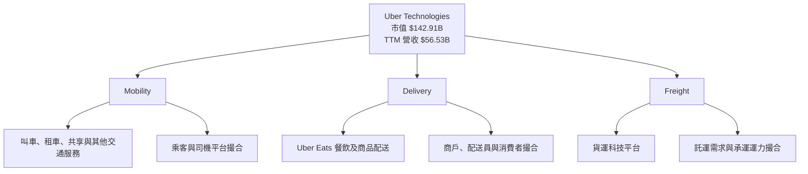
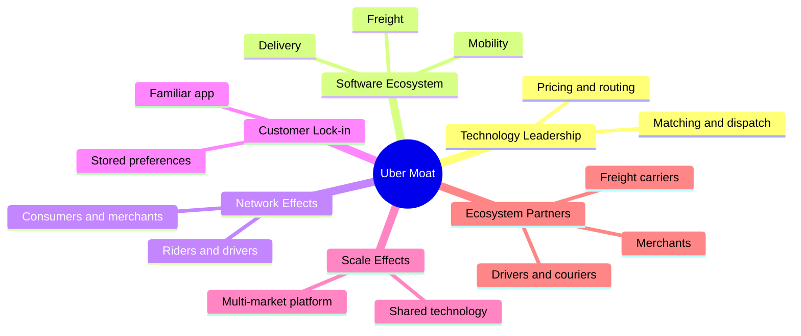
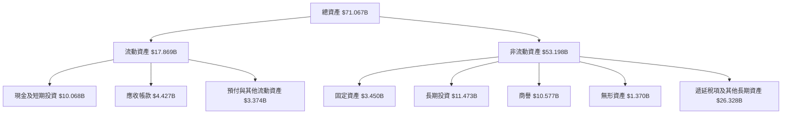
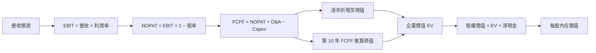
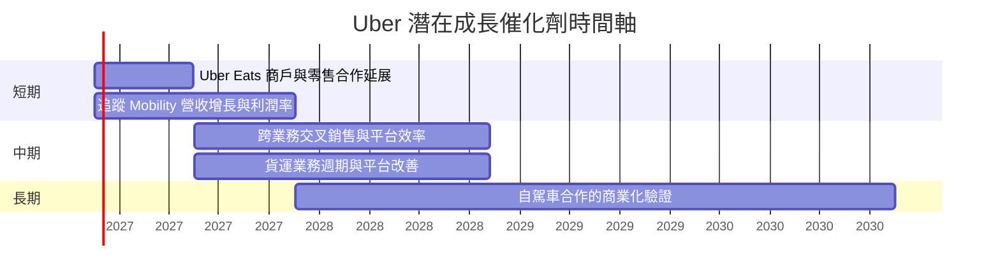
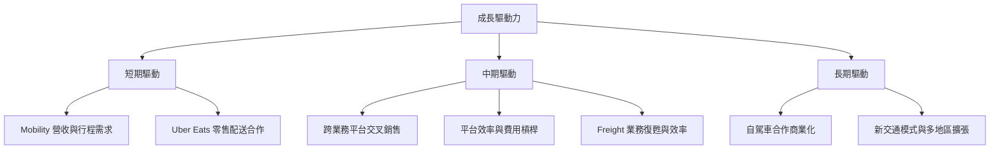
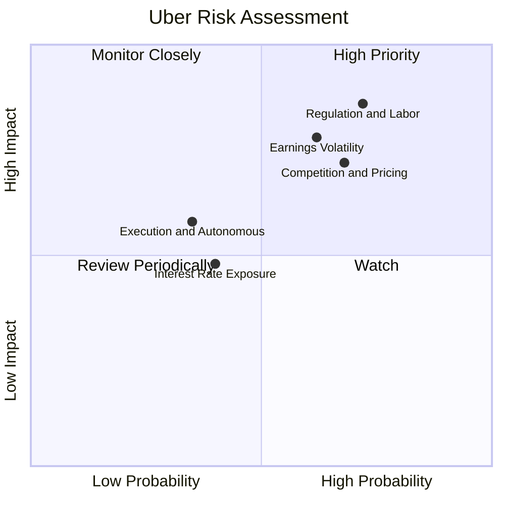
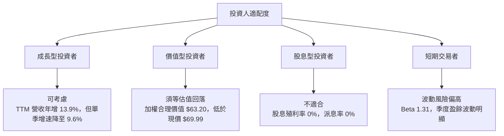

# UBER 基本面深度分析報告
> **報告日期**：2026-11-17 ｜ **語言**：繁體中文 ｜ **數據來源**：SEC 申報資料 (XBRL)、Yahoo Finance、Finviz、StockAnalysis、Roic.ai ｜ **分析師**：CFA 級機構研究

## 目錄

| # | 章節 | 核心結論 |
|---|------|----------|
| 1 | 執行摘要 | 減碼；加權合理價值 $63.20，MOS -10.7% |
| 2 | 公司概覽與商業模式 | 多邊平台與品牌網絡提供中等偏強護城河，分部營收占比未提供 |
| 3 | 損益表深度分析 | TTM 營收 $56.53B、年增 13.9%；最新單季年增 9.6% |
| 4 | 資產負債表分析 | 淨負債 $5.60B；現金及短期投資 $10.07B |
| 5 | 現金流量深度分析 | TTM FCF $10.42B，FCF Yield 7.29% |
| 6 | 獲利能力與資本效率 | ROIC 15.8% 高於 WACC 10.27%，正創造價值 |
| 7 | 相對估值分析 | 估值相對不同同業差異大；P/S 低於同業中位數 |
| 8 | DCF 內在價值評估 | 基準 DCF $39.69；加權合理價值 $63.20 |
| 9 | 成長催化劑 | Mobility、Delivery、跨業合作與自駕布局提供潛在增長選擇權 |
| 10 | 風險矩陣 | 監管與勞工分類、競爭、盈利波動為主要風險 |
| 11 | 投資建議 | 估值未提供足夠安全邊際；以財報指標設置再評估條件 |

## 1. 執行摘要

### 1.0 一頁式投資儀表板（Portfolio Manager 30 秒速讀）

| 項目 | 內容 |
|------|------|
| **投資論點（3 句）** | ① TTM 營收 $56.53B、年增 13.9%，平台規模仍在擴張。② TTM FCF $10.42B、FCF Yield 7.29%，現金生成能力已具投資價值。③ ROIC 15.8% 高於 WACC 10.27%，但加權合理價值 $63.20 低於 $69.99 現價。 |
| **綜合評分** | **6.3/10**（引用 1.1 六項平均） |
| **財務健康** | 🟡 現金及短期投資 $10.07B，惟淨負債為 $5.60B；流動比率 1.232。 |
| **ROIC vs WACC** | **15.8% vs 10.27%**；利差 +5.53 個百分點，現階段創造價值。 |
| **FCF 趨勢** | 2022–2025 年 FCF 由 $0.39B 升至 $9.76B；TTM FCF Yield 7.29%。 |
| **估值** | Forward P/E 15.88x（市場資料）；EV/EBITDA 19.1x（五年歷史估值區塊）；FCF Yield 7.29%。 |
| **DCF 內在價值（基準）** | **$39.69**；現價相對 DCF 溢價 **76.2%**（$69.99 ÷ $39.69 − 1）。 |
| **安全邊際（MOS）** | **-10.7%＝($63.20 − $69.99) ÷ $63.20**；基準為 8.8 加權合理價值，🟡／🔴交界，按門檻屬減碼。 |
| **預期報酬（基準情境 12M）** | **-9.7%**（加權合理價值相對現價的上行空間；非分析師目標價）。 |
| **關鍵風險（前二）** | 勞工分類、城市監管及保險成本；競爭與價格折讓侵蝕利潤率。 |
| **評級 + 信心度** | **🟠 減碼** ｜ 信心：中（估值模型具未來利潤率與終值假設風險）。 |

> 評級由加權合理價值 $63.20、現價 $69.99 推得 MOS -10.7%，落在 -25% 至 -10% 的減碼區間。ROIC 高於 WACC、FCF 生成能力改善，支持基本面品質；但相對合理價值的折價不足，且 DCF 基準值為 $39.69。依 MOS 應為減碼，未作質化調整。

### 1.1 綜合評分卡（全報告唯一）

| 維度 | 評分（1–10） | 主要依據（引用數字與其來源章節） |
|------|--------------|----------------------------------|
| 成長性 | 7.0 | TTM 營收年增 13.9%，最新單季年增 9.6%；增速較 2025 年全年 18.28% 放緩（第 3 章）。 |
| 獲利能力 | 7.0 | TTM 營業利益率 12.4%、ROIC 15.8% 高於 WACC 10.27%；Piotroski 6/8（第 3、6 章）。 |
| 財務健康 | 7.0 | 現金及短期投資 $10.07B、淨負債 $5.60B、流動比率 1.232（第 4 章）。 |
| 估值 | 4.0 | 加權合理價值 $63.20，MOS -10.7%；P/E 40.9x 高於五年中位數 17.8x（第 7、8 章）。 |
| 護城河 | 7.0 | 多市場平台、Mobility/Delivery/Freight 多服務及雙邊網絡；分部用戶與市場份額未提供（第 2 章）。 |
| 管理層與資本配置 | 6.0 | 2025 FCF $9.76B，SBC 約為 TTM 營收 3.65%；股息殖利率 0%，資本配置細節有限（第 3、5 章）。 |
| **綜合評分** | **6.3** | 六項算術平均＝(7+7+7+4+7+6) ÷ 6＝6.17，四捨五入至一位小數。 |

### 1.2 五大投資論點 + 三大核心風險

| 類型 | 項目 | 具體依據 | 信心度 |
|------|------|----------|--------|
| 🟢 **投資論點①** | 營收仍具擴張性 | TTM 營收 $56.53B、年增 13.9%；但最新單季年增降至 9.6%，需觀察趨勢能否穩定。 | 🟢 高 |
| 🟢 **投資論點②** | 自由現金流具規模 | TTM 營業現金流 $10.73B、資本支出 $314M，FCF $10.42B。 | 🟢 高 |
| 🟢 **投資論點③** | 資本回報超過資金成本 | ROIC 15.8% 對 WACC 10.27%，差距 +5.53 個百分點。 | 🟢 中高 |
| 🟢 **投資論點④** | 多服務平台具交叉銷售可能 | Mobility、Delivery、Freight 三個業務板塊；各板塊收入拆分未提供，不能量化協同效益。 | 🟡 中 |
| 🟢 **投資論點⑤** | 相對部分同業的銷售倍數不高 | P/S 2.5x，低於 DASH 4.3x、GRAB 3.3x；但 LYFT 為 0.9x。 | 🟡 中 |
| 🟡 **風險①** | 營收增速放緩 | 2025 年全年營收年增 18.28%，TTM 年增 13.9%，最新一季年增 9.6%；若持續下行，估值需下修。 | 🟡 中 |
| 🔴 **風險②** | 盈餘同比波動大 | 2026 Q3 淨利 $512M，較 2025 Q3 $6.626B 低 92.3%；缺少一次性項目拆解，GAAP 盈餘可預測性偏低。 | 🔴 高衝擊 |
| 🔴 **風險③** | 勞工、監管與保險責任 | 多司法管轄區的司機分類、監管規則及事故責任可能推升成本；可用數字未提供。 | 🔴 高衝擊 |

### 1.3 快速統計卡片

| 指標 | 公司實際值（期間） | 同業中位數 | 狀態 |
|------|--------------------|------------|------|
| 營收成長（TTM） | **13.9%** | — | 🟢 |
| 營收成長（最新一季年增） | **9.6%** | **27.4%** | 🔴 |
| 毛利率（TTM） | **41.4%** | **41.4%** | 🟡 |
| 營業利益率（TTM） | **12.4%** | — | 🟢 |
| ROIC（TTM） | **15.8%** | — | 🟢 |
| Forward P/E | **15.9x** | **20.4x** | 🟢 |
| FCF Yield（TTM） | **7.29%** | — | 🟢 |
| Piotroski F-Score | **6 / 8** | — | 🟢 |

> 同業中位數採 LYFT、DASH、GRAB 三家公司之中位數；成長率為最新單季年增。

### 1.4 投資結論

```text
╔══════════════════════════════════════════════════════════════════╗
║                    📊 投資結論摘要                               ║
╠══════════════════════════════════════════════════════════════════╣
║  評級：🟠 減碼（MOS -10.7%，按規則 20）                          ║
║  價格（2026-11-16 收盤）：$69.99                                 ║
║  DCF 內在價值（基準）：$39.69（現價溢價 76.2%）                 ║
║  安全邊際 MOS：-10.7%（以加權合理價值為分母）                   ║
║  加權合理價值（8.8）：$63.20                                     ║
║  DCF 情境價值：                                                  ║
║    悲觀情境：$22.56（-67.8%）                                   ║
║    基準情境：$39.69（-43.3%）                                   ║
║    樂觀情境：$66.07（-5.6%）                                    ║
║  綜合評分：6.3/10（引用 1.1）                                    ║
║  適合投資人：可承受政策、競爭與盈餘波動的長期成長型投資人       ║
╚══════════════════════════════════════════════════════════════════╝
```

## 2. 公司概覽與商業模式

### 2.1 業務結構與收入來源

Uber Technologies, Inc. 經營 Mobility、Delivery、Freight 三個平台業務，覆蓋北美、拉丁美洲、歐洲、中東非洲及亞太。分部營收、收入占比及軟體收入拆分未提供，因此圖中不推估比例。



### 2.2 市場份額

市場份額數據未提供，亦無可引用的市場規模與年份資料，故不繪製份額圖。Uber 的 TTM 營收為 $56.53B，規模高於 LYFT（依市場估值與業務特徵作質性比較），但各公司的業務組合不同；Uber 最新一季營收年增 9.6%，低於 DASH、GRAB 的最新單季年增率。

### 2.3 競爭護城河分析



### 2.4 護城河強度

| 護城河項目 | 強度（強／中／弱） | 證據（引用數字或事實） | 會削弱它的情況 |
|------------|--------------------|------------------------|----------------|
| 技術與派單 | 中 | 公司以專有應用連接消費者、司機、商戶及貨運供需；技術投入以 2025 年研發費用 $3.40B 為佐證。 | 技術被競爭者複製，或平台匹配效率無法轉化為較低成本。 |
| 軟體生態系 | 中強 | Mobility、Delivery、Freight 三條業務線提供多種使用場景。 | 跨服務交叉銷售效果不足，或各板塊長期獨立競爭。 |
| 網絡效應 | 中強 | 平台連接供需雙方，但活躍用戶、行程量與留存數據未提供。 | 司機或消費者可輕易多平台切換，且補貼可被競爭者複製。 |
| 客戶鎖定 | 中 | 多市場營運與多服務入口可增加使用便利；沒有客戶流失率或留存率數據。 | 價格差異促使消費者轉用其他平台。 |
| 規模效應 | 中 | TTM 營收 $56.53B，跨多地區經營；規模或有助分攤科技與品牌成本。 | 各地監管、保險與營運成本抵銷規模效益。 |
| 生態夥伴 | 中 | 司機、配送員、商戶及貨運承運商構成供給側；夥伴數量未提供。 | 供給端報酬不足、商戶議價或監管限制導致供給流失。 |

護城河分數引用 1.1 的 **7.0/10**：平台網絡及業務多元化提供結構性優勢，但缺少留存、份額及分部經濟數據，故不評為更高。

## 3. 損益表深度分析

### 3.1 年度收入成長趨勢（近4年）

年度營收取財務報表列示值；2025 年營收 $52.02B、2022 年 $31.88B，三年 CAGR 約 17.7%。

```text
╔══════════════════════════════════════════════════════════════════╗
║              Uber 年度收入趨勢（FY2022–FY2025）                 ║
╠══════════════════════════════════════════════════════════════════╣
║  FY2022  $31.88B  ████████████░░░░░░░░░░░░  YoY：N/A            ║
║  FY2023  $37.28B  ██████████████░░░░░░░░░░  YoY：+16.9% 🟢      ║
║  FY2024  $43.98B  █████████████████░░░░░░░  YoY：+18.0% 🟢      ║
║  FY2025  $52.02B  ████████████████████░░░░  YoY：+18.3% 🟢      ║
║                                                                  ║
║  2022–2025 三年 CAGR：約 +17.7%                                  ║
╚══════════════════════════════════════════════════════════════════╝
```

2025 年營收成長延續在 18% 左右，但 TTM 增速 13.9% 與最新單季增速 9.6% 顯示成長動能降溫。這可能反映基期提高及不同業務、地區的增長差異；由於缺少分部營收拆分，無法將減速精確歸因至特定板塊。

### 3.2 季度收入趨勢分析

| 季度 | 營收 | QoQ 成長 | YoY 成長 | 備註 |
|------|------|----------|----------|------|
| 2025 Q4 | $14.37B | +24.7% | +20.1% | QoQ 對 2025 Q3 $11.53B；YoY 對 2024 Q4 $11.96B。 |
| 2026 Q1 | $13.20B | -8.1% | +14.5% | 季節性回落；同比仍增長。 |
| 2026 Q2 | $14.19B | +7.5% | +12.2% | QoQ 回升但同比增速續降。 |
| 2026 Q3 | $14.77B | +4.1% | +9.6% | 最新一季同比減速，是後續應監控的訊號。 |

QoQ 按相鄰季營收計算；2025 Q4 與 2024 Q4 對比採用 Roic.ai 季度營收資料。TTM 營收年增 13.9% 為不同統計期間，不與單季 YoY 混用。

### 3.3 利潤率演變分析

| 利潤率指標 | FY2022 | FY2023 | FY2024 | FY2025 | 趨勢 | 評估 |
|------------|--------|--------|--------|--------|------|------|
| 毛利率 | 38.3% | 39.8% | 39.4% | 39.8% | 大致穩定 | 🟡 |
| 營業利益率 | -5.7% | 3.0% | 6.4% | 10.7% | 明顯改善 | 🟢 |
| 淨利率 | -28.7% | 5.1% | 22.4% | 19.3% | 2024–25 偏高，波動大 | 🟡 |

毛利率按年度損益表毛利除以營收計算；FY2025 毛利採年報彙總資料 $20.68B，其他來源對 FY2025 毛利數字存在差異，故年度比率需審慎看待。營業利益率由 2022 年虧損轉為 2025 年 10.7%，反映業務規模與費用槓桿改善；但 TTM 營業利益率 12.4% 高於 2025 全年，最新一季依 VERIFIED FIGURES 為 9.8%，需留意單季波動。淨利率受非營業項目、稅務及投資損益影響，不能視為純粹營運趨勢。

### 3.4 費用結構分析

細項費用結構及各項占營收比例未完整提供，無法可靠製作費用圓餅圖。可確認研發費用 2025 年為 $3.40B，2024 年為 $3.11B，年增約 9.3%；研發投入須持續轉化為更高平台效率或產品收入，否則將壓低營業槓桿。

### 3.5 季度 EPS 趨勢與盈餘品質（Quality of Earnings）

| 季度 | EPS 實際 | EPS YoY | Beat／Miss | 說明 |
|------|----------|--------|-----------|------|
| 2025 Q4 | $0.14 | -95.6% | N/A | 分析師 EPS 預期為缺失值，不能判斷超預期或不及預期。 |
| 2026 Q1 | $0.13 | -84.6% | N/A | 淨利 $263M；同比基數與非營業項目可能影響比較，明細未提供。 |
| 2026 Q2 | $1.17 | +85.5% | N/A | 淨利 $2.39B；季度波動明顯，缺少一次性損益拆解。 |
| 2026 Q3 | $0.25 | -92.0% | N/A | 淨利 $512M，低於 2025 Q3 $6.626B；原因不能由現有資料確定。 |

| 盈餘品質項目 | 數值／佔比 | 評估 |
|--------------|-----------|------|
| 股權薪酬 SBC / 營收 | 約 **3.65%**（TTM SBC 約 $2.065B ÷ $56.53B） | 🟡 SBC 是實質股東成本；雖未見稀釋股數增加的 F-Score 測試通過，仍應監控長期稀釋與回購抵銷。 |
| SBC / 營業現金流 | 約 **19.3%**（$2.065B ÷ $10.73B） | 🟡 佔比不低；GAAP 營業利益已費用化 SBC，但營業現金流會將其加回，FCF 不等同扣除 SBC 後股東現金盈餘。 |
| FCF / 淨利（現金轉換率） | 約 **300.7%**（TTM FCF $10.42B ÷ StockAnalysis TTM 淨利 $3.465B） | 🟢 現金轉換高；但淨利可能受大額非現金或非經常項目影響，不能只據此推斷品質極佳。 |
| 一次性／非經常性損益 | **未能判定**；Q3 淨利同比下降 92.3% | 🟡 季度對比顯示盈餘波動，缺少 SEC 損益項目拆解，不能指稱由某項一次性損益造成。 |
| 有效稅率異常 | **N/A**（缺少可核對 TTM 所得稅費用與稅前利潤） | N/A；無法判斷本期稅務利益是否帶動盈餘。 |
| 資本化支出 vs 費用化 | TTM Capex $314M；資本化細目 N/A | 資本支出低於 FCF，但沒有資本化項目與費用化成本明細，無法判斷是否存在成本遞延。 |

**盈餘品質結論**：現金流遠高於 TTM 淨利，且 TTM FCF 為 $10.42B，是支持盈利含金量的重要證據；但季度淨利波動、SBC 對現金流的加回效果與有效稅率資料缺漏，令 GAAP 淨利的可持續性不宜由單季數字外推。DCF 採 GAAP EBIT、固定股數，SBC 不重複扣除。

## 4. 資產負債表分析

### 4.1 資產結構分解

最新 TTM 資產負債表總資產 $71.067B。下圖採 StockAnalysis 2026-09-30 餘額；明細加總可能因四捨五入及資料源呈列分類而有差異。



### 4.2 流動性與營運資金分析

| 指標 | 最新 TTM | 一年前 TTM | 變化 | 解讀 |
|------|----------|------------|------|------|
| DSO 應收帳款天數 | 29 天 | 28 天 | +1 天 | 收款天數略增；目前變動幅度有限，但應監控應收增速是否高於營收。 |
| DIO 存貨天數 | N/A | N/A | N/A | 公司未報告相關存貨餘額，不能推算。 |
| DPO 應付帳款天數 | 17 天 | N/A | N/A | 一年前數值不可用，無法判斷供應商付款期趨勢。 |
| CCC 現金轉換週期 | N/A | N/A | N/A | 由於 DIO 缺失，CCC 不可計算。 |

| 流動性指標 | 最新可得值 | 歷史／補充 | 評估 |
|------------|------------|-----------|------|
| 流動比率 | 1.232 | 2025 年末流動資產 $13.99B、流動負債 $12.32B | 🟡 高於 1，但營運資本緩衝不算寬裕。 |
| 速動比率 | 0.999 | 最新市場資料 | 🟡 接近 1；不同資料來源的流動資產口徑可能有差異。 |
| 現金及短期投資 | $10.07B | 2025 年末 $7.63B | 🟢 流動性資源增加。 |

### 4.3 債務結構分析

```text
╔══════════════════════════════════════════════════════════════════╗
║                   Uber 債務健康診斷                              ║
╠══════════════════════════════════════════════════════════════════╣
║  總債務（採 VERIFIED 值）：$15.66B                               ║
║  現金及短期投資：            $10.07B                              ║
║  淨負債：                     $5.60B  🟡                          ║
║  Debt / EBITDA：              N/A（口徑與期末負債數據不一致）    ║
║  Interest Coverage：          N/A（利息費用資料未提供）          ║
║  現金覆蓋總債務：              64.3%（$10.07B ÷ $15.66B）         ║
╚══════════════════════════════════════════════════════════════════╝
```

資料中另有 Yahoo Finance 彙整值總債務 $17.74B、淨負債 $7.67B，與 VERIFIED FIGURES 的 $15.66B、$5.60B 不一致。本報告涉及資本成本、估值橋接及核心負債結論均依優先採用的 SEC 計算值 $15.66B 與淨負債 $5.60B；不將兩種口徑混合。

### 4.4 股東權益趨勢

```text
╔══════════════════════════════════════════════════════════════════╗
║                 Uber 歷年股東權益（年度）                         ║
╠══════════════════════════════════════════════════════════════════╣
║  2022   $7.34B   ██████░░░░░░░░░░░░░░░░                          ║
║  2023  $11.25B   █████████░░░░░░░░░░░░░                          ║
║  2024  $21.56B   █████████████████░░░░░                          ║
║  2025  $27.04B   █████████████████████░                          ║
╚══════════════════════════════════════════════════════════════════╝
```

2022–2025 年股東權益上升，2025 年末為 $27.04B。權益增長可改善帳面資本緩衝，但不等同現金累積；長期投資、商譽及遞延稅項等資產項目亦需持續檢視。

## 5. 現金流量深度分析

### 5.1 現金流量瀑布圖

TTM 淨利數據按 StockAnalysis 為 $3.465B；淨利與營業現金流之間的逐項調節表未提供，故以虛線示意流程、不補造差額。


### 5.2 FCF 轉換率趨勢

| 年度 | FCF | 淨利 | FCF／淨利 | 解讀 |
|------|-----|------|-----------|------|
| 2022 | $0.39B | -$9.14B | 比率不具經濟意義 | 淨利為負，不能以比例衡量現金轉換。 |
| 2023 | $3.36B | $1.89B | 177.8% | FCF 高於淨利，現金轉換較好。 |
| 2024 | $6.89B | $9.86B | 69.9% | 淨利較高，FCF 未同步增至同等幅度。 |
| 2025 | $9.76B | $10.05B | 97.1% | 現金與淨利接近。 |
| TTM | $10.42B | $3.465B | 約 300.7% | 以 StockAnalysis TTM 淨利計算，季度盈餘波動令比率偏高。 |

### 5.3 自由現金流趨勢

```text
╔══════════════════════════════════════════════════════════════════╗
║            自由現金流趨勢（年度實際及 TTM）                      ║
╠══════════════════════════════════════════════════════════════════╣
║  2022   $0.39B   █░░░░░░░░░░░░░░░░░░░░  FCF Yield：N/A          ║
║  2023   $3.36B   ███████░░░░░░░░░░░░░░  FCF Yield：N/A          ║
║  2024   $6.89B   ██████████████░░░░░░░  FCF Yield：N/A          ║
║  2025   $9.76B   ███████████████████░░  FCF Yield：N/A          ║
║  TTM   $10.42B   ████████████████████  FCF Yield：7.29%         ║
╚══════════════════════════════════════════════════════════════════╝
```

年度 FCF 從 2022 年 $0.39B 增至 2025 年 $9.76B，顯示營業現金流提升且資本支出相對低。年度市值殖利率未提供同期間市值，不以目前市值回填歷史殖利率。

### 5.4 資本配置評估

回購、投資、資本支出、股息與留存的現金使用明細未完整提供，因此不製作資本配置圓餅圖。可確認 2025 年 FCF $9.76B、資本支出 $336M（年度報表以現金流出列示），股息殖利率 0%、派息率 0%；SBC 2025 年 $1.83B，約為該年營收 $52.02B 的 3.5%。資本配置評估應同時考量股東稀釋成本，而非只看現金餘額。

## 6. 獲利能力與資本效率

### 6.1 ROE / ROA / ROIC 趨勢

| 指標 | 最新可得 | 歷史資料 | 評估 |
|------|----------|----------|------|
| ROE | TTM 12.5% | 2025 年市場資料約 12.3%；歷史年度口徑不完整 | 🟢 正值，但須結合權益乘數判讀。 |
| ROA | TTM 6.5% | 歷史年度資料不足以一致比較 | 🟢 有正資產回報；Piotroski 測試指出 ROA 未高於一年前。 |
| ROIC | TTM 15.8% | 可比歷史序列 N/A | 🟢 高於 WACC 10.27%。 |

未提供可核對的行業均值，故不列同業或產業均值欄。ROE、ROA 的不同資料源略有差異，採品質指標區塊的 ROE 12.5% 與市場資料 ROA 6.5% 作最新參考。

### 6.2 ROIC vs WACC 分析（核心價值創造判斷）

```text
╔══════════════════════════════════════════════════════════════════╗
║                  ROIC vs WACC 深度分析                           ║
╠══════════════════════════════════════════════════════════════════╣
║  WACC（採用值）：10.27%                                          ║
║  ├── 無風險利率（10Y 美債）：5.12%                               ║
║  ├── 股權風險溢酬 ERP：5.00%                                     ║
║  ├── Beta 原始值：1.31；調整後採用值：1.21                       ║
║  ├── 股權成本（資料區塊採用）：11.15%                            ║
║  ├── 稅前債務成本：2.81%；稅率：21.0%                            ║
║  ├── E／D 權重：90.1%／9.9%                                     ║
║  └── ✅ WACC：10.27%                                             ║
║                                                                  ║
║  ROIC（TTM）：15.8%                                              ║
║  ROIC − WACC：15.8% − 10.27% = +5.53 個百分點                   ║
║  ROIC／WACC：15.8% ÷ 10.27% = 1.54 倍                           ║
║                                                                  ║
║  結論：目前投入資本回報高於資金成本，正創造股東價值；           ║
║  若營業利潤率收縮，該利差可能快速下降。                          ║
╚══════════════════════════════════════════════════════════════════╝
```

資本成本採程式計算的 WACC **10.27%**，不得以其他資料源重新替換。原始 Beta 1.31 經公式 `⅔ × 1.31 + ⅓ × 1 = 1.21` 調整後採用。資料區塊列示股權成本 11.15%；以已四捨五入的 Beta、Rf、ERP 重算可能產生微小差異，故此處使用資料區塊指定值。ROIC 利差為 +5.53 個百分點，代表目前創造價值，但不能假設此利差永久維持。

### 6.3 杜邦三因素分解

| 因素 | 數值（TTM） | 解讀 |
|------|-------------|------|
| 淨利率 | 6.1% | 淨利潤率反映非營業及稅務項目後的結果，低於營業利益率。 |
| 資產週轉率 | 0.80 | 每單位資產創造營收的效率。 |
| 權益乘數 | 2.57 | 槓桿對 ROE 有放大作用，但不是唯一來源。 |
| **ROE** | **12.5%** | 6.1% × 0.80 × 2.57 = 12.54%，四捨五入為 12.5%。 |

依 DuPont 數據，淨利率與資產週轉率共同構成回報，權益乘數亦放大 ROE；因此不應僅以 ROE 判斷營運效率。

### 6.4 財務體質：Piotroski F-Score

Piotroski F-Score 為 **6 / 8**；毛利率測試因缺少輸入未納入分母。

| 測試 | 結果 | 解讀 |
|------|------|------|
| ROA > 0 | ✅ 通過 | TTM 資產回報為正。 |
| 營業現金流 > 0 | ✅ 通過 | TTM 營業現金流 $10.73B。 |
| ROA 高於一年前 | ❌ 未通過 | 回報率未較去年改善。 |
| 營業現金流 > 淨利 | ✅ 通過 | 現金流高於淨利，應計品質測試通過。 |
| 長期負債 ÷ 總資產低於一年前 | ❌ 未通過 | 相對負債指標未改善。 |
| 流動比率高於一年前 | ✅ 通過 | 流動性指標改善。 |
| 稀釋股數未增加 | ✅ 通過 | 品質測試期間未見稀釋股數增加。 |
| 毛利率高於一年前 | — 無法判定 | 缺少可比較輸入，不納入 8 項分母。 |
| 資產週轉率高於一年前 | ✅ 通過 | 資產使用效率改善。 |

## 7. 相對估值分析

### 7.1 同業估值比較表格

Uber 的 P/E 及 P/S 採價格與財報估值區塊；同業倍數及成長率、毛利率均採 Yahoo Finance 同業資料。不同公司一次性盈餘與資本結構差異較大，單一倍數不可直接視為公平價值。

| 估值指標 | **UBER** | **LYFT** | **DASH** | **GRAB** | UBER 評估 |
|----------|----------|---------|---------|---------|-----------|
| **Trailing P/E** | 40.9x | 2.5x | 70.4x | 32.1x | 🟡 LYFT 低倍數可能受盈餘基數影響，不能單獨比較。 |
| **Forward P/E** | 15.9x | 8.1x | 22.3x | 20.4x | 🟢 低於同業中位數 20.4x。 |
| **P/S Ratio** | 2.5x | 0.9x | 4.3x | 3.3x | 🟡 低於 DASH、GRAB，高於 LYFT。 |
| **EV/EBITDA** | 19.1x | 560.2x | 41.7x | 21.6x | 🟢 低於 DASH、GRAB；LYFT 倍數失真可能性高。 |
| **最新單季營收年增** | 9.6% | 8.1% | 34.0% | 27.4% | 🔴 UBER 增速低於 DASH、GRAB。 |
| **毛利率（TTM）** | 41.4% | 40.0% | 52.7% | 41.4% | 🟡 接近 GRAB，高於 LYFT，低於 DASH。 |

### 7.2 歷史估值區間分析

```text
╔══════════════════════════════════════════════════════════════════╗
║           UBER 五年估值位置（TTM 倍數）                          ║
╠══════════════════════════════════════════════════════════════════╣
║  P/E：      12.6x ── 中位數 17.8x ───────── 現值 40.9x ─ 122.2x  ║
║             當前百分位：69%                                       ║
║  P/S：       1.5x ─────── 現值 2.5x ─ 中位數 3.3x ───── 6.1x     ║
║             當前百分位：24%                                       ║
║  EV/EBITDA：18.7x ─ 現值 19.1x ───── 中位數 40.0x ───── 320.2x  ║
║             當前百分位：7%                                        ║
╚══════════════════════════════════════════════════════════════════╝
```

不同倍數給出不同訊號：P/E 高於自身五年中位數且處於 69 百分位；P/S 低於中位數；EV/EBITDA 位於歷史區間低端。P/E、EV/EBITDA 歷史區間極寬，反映歷史獲利波動，歷史中位數不宜機械套用。

### 7.3 情境價值（Bear / Base / Bull，照抄 DCF MODEL 的 Scenarios）

| 情境 | 第 1 年營收成長 | 期末營業利潤率 | WACC | 每股價值 | 相對現價 | 機率 | 會發生的條件 |
|------|----------------|----------------|------|----------|----------|------|--------------|
| 🔴 悲觀 | 7.0% | 5.4% | 11.27% | $22.56 | -67.8% | 25% | 平台成長減速、競爭或監管成本壓低長期利潤率，資金成本維持高位。 |
| 🟡 基準 | 13.9% | 6.4% | 10.27% | $39.69 | -43.3% | 50% | TTM 成長起步後逐年放緩，營業利潤率向模型長期中位數收斂。 |
| 🟢 樂觀 | 20.9% | 7.0% | 9.27% | $66.07 | -5.6% | 25% | 成長重新加速、規模經濟帶動利潤率，且資本成本下降。 |

三情境每股價值與假設為模型原值；情境推導細節及限制見第 8 章。

### 7.4 相對估值隱含價格區間

```text
╔══════════════════════════════════════════════════════════════════╗
║                 相對估值與現價位置                              ║
╠══════════════════════════════════════════════════════════════════╣
║  DCF 基準 $39.69 ─── 現價 $69.99 ─── Forward P/E $90.13 ─ $98.23║
║                                     分析師共識                    ║
╚══════════════════════════════════════════════════════════════════╝
```

| 方法 | 每股價值 | 相對現價 | 依據 |
|------|----------|----------|------|
| DCF（基準） | $39.69 | -43.3% | 10 年 FCFF、WACC 10.27%、永續成長 3.0%。 |
| 同業 Forward P/E | $90.13 | +28.8% | 同業中位數 Forward P/E 20.4x × UBER Forward EPS $4.41。 |
| 分析師共識目標價 | $98.23 | +40.3% | 45 位分析師平均目標價。 |

同業 EV/EBITDA 因模型未能計算而剔除；不自行補建該估值法。

## 8. DCF 內在價值評估（Discounted Cash Flow）

> DCF MODEL 的預測金額以 USD billions 計。模型表格及估值照原值引用。呈列時金額取兩位小數、百分比取一位或兩位小數、折現因子三位小數；使用已四捨五入的展示數字重算時，容許因原始未四捨五入輸入產生細小差異。

### 8.0 估值推理鏈（Thinking Logic）

**Step 1 — 價值由哪些變數決定？**  
Uber 的估值主要來自 Mobility、Delivery、Freight 三條主業的現金流底盤，以及自駕合作等尚未獨立量化的選擇權；三板塊營收占比未提供，不能為其分配收入比例。模型主導變數是營收成長、長期營業利潤率與 WACC；敏感度矩陣顯示折現率變動對每股價值的影響很大。

**Step 2 — 模型選擇**

| 決策點 | 本報告採用 | 理由（含數字） | 曾考慮但否決 | 否決理由 |
|--------|-----------|----------------|--------------|----------|
| 現金流定義 | FCFF | 使用 GAAP EBIT 推導 NOPAT，再以 WACC 折現至 EV；TTM FCF $10.42B。 | FCFE | 資本結構及債務權重納入 WACC 後，FCFF 較一致。 |
| 預測期 N | 10 年 | 模型設定營收成長由 13.9% 線性降至 3.0%，反映成熟化。 | 5 年 | 不符合既有模型，不另改年數。 |
| 終值方法 | Gordon Growth | 模型採 g=3.0%，WACC=10.27%，符合 WACC>g。 | 退出倍數 | DCF 模型未提供終值退出倍數，不能自建。 |
| EBIT 基礎 | GAAP | GAAP EBIT 逐年預測。 | 非 GAAP | 避免將 SBC 加回後又漏計其經濟成本。 |

**Step 3 — 關鍵假設推導鏈**

- **營收成長路徑**：錨點＝TTM 營收成長 13.9%、最新單季年增 9.6%、2025 全年年增 18.28% → 調整＝最新單季減速，模型仍以 TTM 增速作首年並逐年線性降至 3.0% → **採用第 1 年 13.9%、第 10 年 3.0%** → 曾考慮以最新季度 9.6% 起步，但模型已指定 13.9%，且不可擅改；因此該起步假設偏樂觀。
- **期末營業利潤率**：錨點＝TTM 營業利益率 12.4%；模型以近五個財政年度中位數作長期錨 → 調整＝競爭、監管及成熟化使利潤率逐步收斂 → **採用第 1 年 12.4% 線性降至第 10 年 6.4%** → 不採更高的長期利潤率，因沒有分部毛利及成本率證據支持。
- **WACC**：錨點＝資本成本資料的 WACC 10.27% → 調整＝不另作調整；Beta 使用調整後 1.21 → **採用 10.27%** → 否決自行以市場資料重算另一 WACC，避免與模型輸入不一致。
- **永續成長率 g**：錨點＝成熟企業長期名目成長應受經濟成長與通膨約束；模型採 **3.0%** → WACC 10.27%，保留 7.27 個百分點差距 → 不採更高 g，因會過度增加終值權重。
- **預測期 N**：錨點＝模型設定 10 年 → 用逐步成熟化表達平台規模增長的長期路徑 → **採用 10 年** → 不改成較短期間，因無另一組已計算模型可供替換。
- **Capex／營收**：錨點＝TTM Capex $314M、營收 $56.53B；模型 FY+1 至 FY+10 採 0.6% → **採用 0.6%** → 不自行提高，模型已設定依既有資本支出率，惟其長期適用性存在風險。
- **D&A／營收**：錨點＝TTM 約 1.4% → 模型固定 1.4%；資料缺少更細年度分項，按模型值採用。
- **營運資金**：模型明示未建模，非零假設。DSO 29 天、DIO N/A、DPO 17 天，無法導出完整增量營運資金；本項會使 DCF 對營運資金需求敏感。
- **EBIT 基礎、SBC 與稀釋**：模型採 GAAP EBIT，SBC 已在費用內；固定股數不再稀釋，年稀釋率 0%。採用組合 **(A)**，故 SBC 影響已計入一次；不再扣 SBC，也不另增加股數。
- **終值方法**：採 Gordon Growth，因模型給定 g=3.0% 且低於 WACC；未提供退出倍數終值，不以外部倍數取代。
- **有效稅率**：模型 21.0%，為模型預設稅率；實際 TTM 有效稅率未提供，屬模型假設值。

**Step 4 — 最脆弱環節**  
最脆弱的是長期營業利潤率與 WACC 的組合：若利潤率低於基準或 WACC 上升，終值及每股價值會下修；模型敏感度表顯示 WACC 由 10.27% 升至 11.27%、g 維持 3.0%，每股價值由 $39.69 降至 $34.91。

**Step 5 — 計算路徑圖**



### 8.1 模型假設總表（Model Inputs）

| 假設項目 | 採用值 | 依據／來源 | 敏感度 |
|----------|--------|-------------|--------|
| 預測期長度 N | 10 年 | DCF MODEL 固定預測期。 | 🟡 中 |
| 營收成長 | FY+1 13.9% → FY+10 3.0% | TTM vs prior TTM 成長 13.9%，線性降至 3.0%。 | 🔴 高 |
| 營業利潤率 | 12.4% → 6.4% | TTM 12.4%，逐步降至最近五財年中位數（含 TTM）。 | 🔴 高 |
| 有效稅率 | 21.0% | 模型預設值；實際 TTM 稅率未提供。 | 🟢 低 |
| Capex / 營收 | 0.6% | 模型採 TTM 資本支出率，並依模型規則設定。 | 🟡 中 |
| D&A / 營收 | 1.4% | 模型採 TTM 比率並固定。 | 🟢 低 |
| 營運資金變動 | 未建模 | DCF MODEL 明示 Working capital is not modelled。 | 🟢 低／模型限制 |
| EBIT 基礎 | GAAP EBIT | 逐年營業利益以 GAAP 口徑建模。 | 🟡 中 |
| SBC 處理 | 已含於 GAAP EBIT，不另扣 | 採組合 (A)。 | 🟡 中 |
| 年稀釋率 | 0% | 固定股數；與 GAAP EBIT 已含 SBC 的組合相容。 | 🟡 中 |
| 永續成長率 g | 3.0% | DCF MODEL 指定，低於 WACC 10.27%。 | 🔴 高 |
| 終值方法 | Gordon Growth | 模型直接採用。 | 🔴 高 |
| WACC | 10.27% | Cost of capital 資料，詳見 8.2。 | 🔴 高 |

**FCFF 定義**：FCFF = NOPAT + D&A − Capex。Working capital 未建模。模型採 GAAP EBIT，不另扣 SBC、不增加股數；此為 (A) 組合，故 SBC 影響已計入一次。

### 8.2 折現率推導（WACC）

```text
╔══════════════════════════════════════════════════════════════════╗
║                    WACC 推導（折現率）                           ║
╠══════════════════════════════════════════════════════════════════╣
║  股權成本 Ke（CAPM）：                                           ║
║  ├── 無風險利率 Rf（10Y 美債）：5.12%                            ║
║  ├── 市場風險溢酬 ERP：5.00%                                     ║
║  ├── 原始 Beta：1.31；調整後 Beta：1.21                          ║
║  ├── 股權成本（資料列值）：11.15%                                ║
║  └── 資料未列額外規模／國別溢酬：不另加                           ║
║                                                                  ║
║  債務成本 Kd：                                                   ║
║  ├── 稅前 Kd：2.81%                                              ║
║  ├── 稅率：21.0%                                                 ║
║  └── 稅後 Kd = 2.81% × (1 − 21.0%) = 2.22%                     ║
║                                                                  ║
║  資本結構：股權權重 90.1%；債務權重 9.9%                         ║
║  WACC = 90.1%×11.15% + 9.9%×2.81%×(1−21.0%) = 10.27%           ║
╚══════════════════════════════════════════════════════════════════╝
```

**逐步演算與資料限制**

1. **Ke（CAPM）**：資料列示 `Rf + β × ERP = 11.15%`；Beta 使用調整後 1.21。輸入值均採資本成本資料列值；採已四捨五入數字直接重算可能有小幅差異，原始未四捨五入 Beta 未提供。
2. **稅前 Kd**：資料列示利息 ÷ 債務為 2.81%；利息費用金額與計息負債平均餘額明細未提供，不能再以另一組負債重算。
3. **稅後 Kd**：`2.81% × (1 − 21.0%) = 2.22%`。
4. **權重**：資本成本資料列示 E／D 權重 90.1%／9.9%；E 採市場市值權重、D 採債務權重，非帳面股東權益。資料列示市場市值 $142.91B、債務 $15.66B，按未四捨五入數計權重。
5. **WACC**：`90.1% × 11.15% + 9.9% × 2.81% × (1 − 21.0%) = 10.27%`（依未四捨五入輸入及資料列的 WACC）。

Rf 的觀察日期未提供；ERP 5.00% 為採用假設值；無額外規模／國別溢酬。第 6.2 與本節均採同一 WACC 10.27%。由於利息及平均計息負債金額缺漏，本節保留程式計算的稅前 Kd，不反推金額。

### 8.3 逐年自由現金流預測（基準情境）

下表各數值照 DCF MODEL 原值列示。模型的營運資金未建模，因此不另列 ΔWC；GAAP EBIT 已含 SBC，無 SBC 扣除列。

| 年度 | FY+1 | FY+2 | FY+3 | FY+4 | FY+5 | FY+6 | FY+7 | FY+8 | FY+9 | FY+10 |
|------|------|------|------|------|------|------|------|------|------|-------|
| 營收 | 64.41 | 72.60 | 80.96 | 89.29 | 97.40 | 105.06 | 112.04 | 118.12 | 123.10 | 126.80 |
| 營收 YoY | 13.9% | 12.7% | 11.5% | 10.3% | 9.1% | 7.9% | 6.6% | 5.4% | 4.2% | 3.0% |
| 營業利潤率 | 12.4% | 11.8% | 11.1% | 10.4% | 9.7% | 9.1% | 8.4% | 7.7% | 7.0% | 6.4% |
| EBIT（GAAP） | 8.01 | 8.54 | 8.98 | 9.30 | 9.49 | 9.52 | 9.40 | 9.11 | 8.67 | 8.07 |
| − 稅 | (1.68) | (1.79) | (1.89) | (1.95) | (1.99) | (2.00) | (1.97) | (1.91) | (1.82) | (1.69) |
| = NOPAT | 6.33 | 6.75 | 7.09 | 7.35 | 7.50 | 7.52 | 7.43 | 7.20 | 6.85 | 6.38 |
| + D&A | 0.88 | 0.99 | 1.10 | 1.21 | 1.33 | 1.43 | 1.52 | 1.61 | 1.67 | 1.72 |
| − Capex | (0.36) | (0.40) | (0.45) | (0.50) | (0.54) | (0.58) | (0.62) | (0.66) | (0.68) | (0.70) |
| = FCFF | **6.85** | **7.33** | **7.75** | **8.07** | **8.28** | **8.37** | **8.33** | **8.15** | **7.84** | **7.40** |
| 折現因子 | 0.907 | 0.822 | 0.746 | 0.676 | 0.613 | 0.556 | 0.505 | 0.458 | 0.415 | 0.376 |
| FCFF 現值 PV | **6.21** | **6.03** | **5.78** | **5.46** | **5.08** | **4.66** | **4.20** | **3.73** | **3.25** | **2.78** |

**預測期 FCF 現值合計**：  
`$6.21 + $6.03 + $5.78 + $5.46 + $5.08 + $4.66 + $4.20 + $3.73 + $3.25 + $2.78 = $47.18B`

**逐步演算（FY+1）**

1. **營收**：公式＝前期營收 × (1 + 成長率)；代入 `$56.53B × (1 + 13.9%)`；模型列值 **$64.41B**。以已四捨五入的 $56.53B 重算為 $64.39B，差異來自模型未顯示的原始精度，故不以重算值替換模型值。
2. **EBIT**：公式＝營收 × 營業利潤率；代入 `$64.41B × 12.4%`；模型列值 **$8.01B**。
3. **稅**：公式＝EBIT × 稅率；代入 `$8.01B × 21.0%`；**$1.68B**。
4. **NOPAT**：公式＝EBIT − 稅；代入 `$8.01B − $1.68B`；**$6.33B**。
5. **D&A**：公式＝營收 × D&A／營收；代入 `$64.41B × 1.4%`；模型列值 **$0.88B**。
6. **Capex**：公式＝營收 × Capex／營收；代入 `$64.41B × 0.6%`；模型列值 **$0.36B**。
7. **ΔWC**：不建模，模型設定未納入營運資金變動，故不扣除。
8. **FCFF**：公式＝NOPAT + D&A − Capex；代入 `$6.33B + $0.88B − $0.36B = $6.85B`。
9. **折現因子與 PV**：`1 ÷ (1 + 10.27%)^1 = 0.907`；`$6.85B × 0.907 = $6.21B`。

**合理性自檢**：模型 FCFF 由 $6.85B 增至 $7.40B，九年間複合增長約 0.8%；歷史 FCF 2022–2025 變化受由低基期及盈餘恢復影響，不適合直接比較 CAGR。FY+10 FCFF 利潤率＝`$7.40B ÷ $126.80B = 5.8%`；目前 TTM FCF 利潤率＝`$10.42B ÷ $56.53B = 18.4%`。模型假設成熟期現金流利潤率大幅收斂，且沒有可引用同業最佳 FCFF 利潤率。預測期各年 FCFF 均為正。

```text
╔══════════════════════════════════════════════════════════════════╗
║            自由現金流：歷史實際 vs 模型預測                      ║
╠══════════════════════════════════════════════════════════════════╣
║  FY2023(實)   $3.36B   ███████░░░░░░░░░░░░░░  YoY：+761.5%      ║
║  FY2024(實)   $6.89B   ██████████████░░░░░░░  YoY：+105.1%      ║
║  FY2025(實)   $9.76B   ███████████████████░░  YoY：+41.7%       ║
║  FY+1 (預)    $6.85B   █████████████░░░░░░░░  模型起點          ║
║  FY+10(預)    $7.40B   ███████████████░░░░░░  模型終點          ║
╠══════════════════════════════════════════════════════════════════╣
║  ⚠️ 預測 FCF 並未延續歷史快速上升；利潤率逐年收斂，FCFF 低於   ║
║     FY2025 歷史值的原因主要是模型採用較低的成熟期營業利潤率。  ║
╚══════════════════════════════════════════════════════════════════╝
```

歷史 FCF YoY 按年度報表計算；2023 年的增幅受 2022 年低基期影響。

### 8.4 終值計算（Terminal Value）

**適用性檢查**：`WACC 10.27% vs g 3.0% → WACC > g？✅`

| 方法 | 計算式 | 終值 TV | TV 現值 | 佔總 EV 比重 |
|------|--------|---------|---------|--------------|
| Gordon Growth | `$7.40B × (1 + 3.0%) ÷ (10.27% − 3.0%)` | $104.85B | $39.46B | 45.5% |
| 退出倍數法 | DCF MODEL 未提供 | N/A | N/A | N/A |

**逐步演算（Gordon Growth）**

1. FY+10 FCFF＝**$7.40B**（取自 8.3）。
2. 分子：`$7.40B × (1 + 3.0%) = $7.62B`（模型列示終值為 $104.85B，模型使用未四捨五入輸入）。
3. 分母：`10.27% − 3.0% = 7.27%`；模型列示 `TV = $7.40B × (1 + 3.0%) ÷ (10.27% − 3.0%) = $104.85B`。
4. PV(TV)：`$104.85B × 0.376 = $39.46B`。
5. 終值佔比：`$39.46B ÷ $86.64B = 45.5%`。

模型列示的 TV 為 $104.85B，然而以表內已四捨五入的 FY+10 FCFF $7.40B、g 3.0%、WACC 10.27% 直接計算會因未四捨五入底層輸入有差異；本報告照錄模型價值，不以展示精度替換。退出倍數法因沒有模型輸出及 EBITDA 終值倍數，標為 N/A，不自行建立第二終值。

### 8.5 企業價值 → 每股內在價值（Bridge）

```text
╔══════════════════════════════════════════════════════════════════╗
║              企業價值 → 每股內在價值 橋接表                      ║
╠══════════════════════════════════════════════════════════════════╣
║  預測期 FCF 現值合計             +$47.18B                        ║
║  終值現值 PV(TV)                 +$39.46B                        ║
║  = 企業價值 EV                    $86.64B                        ║
║  + 淨現金（淨負債）               -$5.60B                         ║
║  = 股權價值（模型列值）           $81.05B                        ║
║  每股內在價值（模型列值）          $39.69                         ║
║  當前股價（2026-11-16）            $69.99                         ║
║  折溢價：69.99 ÷ 39.69 − 1         +76.2%（溢價）                ║
╚══════════════════════════════════════════════════════════════════╝
```

**逐步演算**

1. **EV**：`$47.18B + $39.46B = $86.64B`。
2. **股權價值**：`$86.64B − $5.60B = $81.04B`；DCF MODEL 列示 **$81.05B**，差額為已四捨五入金額及底層精度所致，採模型原值。
3. **每股內在價值**：模型原式為 `股權價值 × 價格 ÷ 市值`，模型列示 **$39.69**。股數及市值採模型資料所用未四捨五入值；不以市場股數 2.04B 重新替換。
4. **折溢價**：`$69.99 ÷ $39.69 − 1 = 76.2%`，以 DCF 基準價為分母。
5. **本節不計算 MOS**：MOS 僅於 8.8 以加權合理價值為分母計算。

淨負債取 2026-09-30 SEC 計算值 $5.60B；股數依 DCF MODEL 採固定股數，與 8.1 組合 (A) 一致。

### 8.6 敏感性分析（WACC × 永續成長率）

以下每股價值照 DCF MODEL 矩陣原值列示。括號為相對 $69.99 現價的上行空間，按 `(每股價值 − $69.99) ÷ $69.99` 計算並取一位小數。

| g（列）／WACC（欄） | 8.27% | 9.27% | **10.27%（基準）** | 11.27% | 12.27% |
|-----------|------:|------:|------------------:|-------:|-------:|
| 2.0% | $49.18 (-29.7%) | $42.37 (-39.5%) | $37.19 (-46.9%) | $33.10 (-52.7%) | $29.79 (-57.4%) |
| 2.5% | $51.63 (-26.2%) | $44.03 (-37.1%) | $38.36 (-45.2%) | $33.96 (-51.5%) | $30.43 (-56.5%) |
| **3.0%（基準）** | $54.55 (-22.1%) | $45.96 (-34.3%) | **$39.69 (-43.3%)** | $34.91 (-50.1%) | $31.14 (-55.5%) |
| 3.5% | $58.08 (-17.0%) | $48.22 (-31.1%) | $41.22 (-41.1%) | $35.99 (-48.6%) | $31.93 (-54.4%) |
| 4.0% | $62.44 (-10.8%) | $50.90 (-27.3%) | $42.99 (-38.6%) | $37.22 (-46.8%) | $32.81 (-53.1%) |

**逐步演算示例**：所選格 WACC **11.27% > g 3.0% ✅**。該格每股價值由模型矩陣照錄為 **$34.91**；DCF MODEL 未提供該格的預測期 PV 明細、終值與橋接中間數字，因此無法不重建模型而逐項重算，故不虛構中間值。

**三情境 DCF**

| 情境 | 第 1 年營收成長 | 期末營業利潤率 | g | WACC | 每股價值 | 相對現價 | 機率 |
|------|----------------|----------------|---|------|----------|----------|------|
| 🔴 悲觀 | 7.0% | 5.4% | 3.0%（模型基準，情境未另列） | 11.27% | $22.56 | -67.8% | 25% |
| 🟡 基準 | 13.9% | 6.4% | 3.0% | 10.27% | $39.69 | -43.3% | 50% |
| 🟢 樂觀 | 20.9% | 7.0% | 3.0%（模型基準，情境未另列） | 9.27% | $66.07 | -5.6% | 25% |
| **機率加權** | — | — | — | — | **$42.00** | **-40.0%** | **100%** |

各情境價值與概率採模型輸出。DCF MODEL 未列示悲觀、樂觀情境的 FY+10 營收、FCFF 及 TV 中間值，也未在情境欄分別標示 g；因此不能提供可稽核的完整情境推導鏈而不另建模型，這是模型披露限制。機率加權值可核對：`$22.56 × 25% + $39.69 × 50% + $66.07 × 25% = $42.00`。

**敏感度結論**

- g 由 3.0% 升至 4.0%、WACC 維持 10.27%：`$39.69 → $42.99`，增加 **$3.30／8.3%**。
- WACC 由 10.27% 升至 11.27%、g 維持 3.0%：`$39.69 → $34.91`，減少 **$4.78／12.0%**。
- 期末營業利潤率每 +1 個百分點的每股價值變動：**N/A**（模型未提供該變數的獨立敏感度矩陣，不能另建模型）。
- 已量化項目中，WACC +1 個百分點的影響大於 g +1 個百分點；這與估值對折現率及長期現金流假設高度敏感的判斷一致。

### 8.7 反推 DCF（Reverse DCF：市場在預期什麼）

DCF MODEL 僅提供兩個單變數反推結果。其餘輸入固定於基準模型，但基準固定值與反推疊代軌跡未完整提供。

| 求解的變數（一次一個） | 其餘變數設定 | 市場隱含值（令 DCF = 現價） | 公司歷史實際 | 判斷 |
|------------------------|--------------|------------------------------|--------------|------|
| 第 1 年營收成長 | 其餘維持基準；模型原文稱 year-1 growth | 28.8%（基準 13.9%） | TTM 成長 13.9%；2025 全年 18.28% | 🔴 高於近期歷史增速 |
| 固定營業利潤率 | 其餘維持基準；模型以固定利潤率求解 | 14.1% | TTM 營業利益率 12.4% | 🔴 要求高於目前水平 |
| 永續成長率 g | 未計算 | 未計算 | — | N/A |
| 預測期長度 N | 未計算 | 未計算 | — | N/A |

**疊代軌跡**：模型僅發布營收成長反推解 28.8%，沒有不同 CAGR 試算點、FY+N 營收、FCFF 或每股價值中間結果；若補造試算表將違反不得重建模型的規則，故不提供虛構軌跡。

**反推結論**：若以 DCF 基準模型其他假設不變，使現價成立，首年營收成長需達 28.8%，或固定營業利潤率需達 14.1%；兩者均高於目前 TTM 營收增長 13.9%、營業利益率 12.4%。這顯示現價要求較積極的成長或利潤率，不代表市場只押注其中一項。

### 8.8 估值三角驗證與安全邊際

| 估值方法 | 隱含每股價值 | 上行空間（÷現價） | 權重 | 說明 |
|----------|--------------|-------------------|------|------|
| DCF（基準） | $39.69 | -43.3% | 55% | 10 年 FCFF、WACC 10.27%、g 3.0%。 |
| 同業 Forward P/E | $90.13 | +28.8% | 35% | 同業中位數 20.4x × Forward EPS $4.41。 |
| 分析師共識目標價 | $98.23 | +40.3% | 10% | 45 位分析師平均目標價。 |
| **加權合理價值** | **$63.20** | **-9.7%** | **100%** | 依盈利公司固定權重計算。 |

**逐步演算**：  
`$39.69 × 55% + $90.13 × 35% + $98.23 × 10% = $21.8295 + $31.5455 + $9.823 = $63.198 ≈ $63.20`。權重合計 `55% + 35% + 10% = 100%`。公司類型為盈利公司；同業 EV/EBITDA 無法計算，模型將其剔除並按既定規則分配權重。

```text
╔══════════════════════════════════════════════════════════════════╗
║                  估值區間與安全邊際                              ║
╠══════════════════════════════════════════════════════════════════╣
║  $22.56 ───── $39.69 ───── $63.20 ───── $69.99 ───── $98.23     ║
║  悲觀DCF       基準DCF      加權合理值       現價       共識目標   ║
║                                                                  ║
║  MOS = ($63.20 − $69.99) ÷ $63.20 = -10.7%                      ║
║  上行空間 = ($63.20 − $69.99) ÷ $69.99 = -9.7%                  ║
║  建議買入區間：不高於 $56.88（以 MOS ≥10% 計算：$63.20×90%）     ║
║  合理持有區間：$56.88–$63.20；現價高於加權合理價值，宜審慎。    ║
║  減碼考慮區間：高於 $66.07 樂觀 DCF 情境值時，估值風險更高。     ║
╚══════════════════════════════════════════════════════════════════╝
```

MOS 數值只以加權合理價值 $63.20 為分母，與 1.0 儀表板一致。DCF 折溢價則以 $39.69 為分母，兩者用途不同。

> 🔎 **程式複算（Python，依本節各項自動重算）**
>
> 加權合理價值 = $39.69 × 55% + $90.13 × 35% + $98.23 × 10% = **$63.20**（權重合計 100%）
>
> 以價格 $69.99 計：MOS = **-10.7%**，上行空間 = **-9.7%**
>
> ✅ 與本節所寫數值一致。

### 8.9 DCF 模型的局限與失效條件

- **終值依賴度**：終值現值佔 EV **45.5%**，仍有近半估值來自預測期後現金流。
- **最脆弱假設**：營收首年成長 13.9% 高於最新單季 9.6%；長期利潤率由 12.4% 收斂至 6.4%。若成長與利潤率同時低於基準，悲觀模型值為 $22.56。
- **模型不確定性**：公司目前 FCF 為正，DCF 有參考價值；但淨利與季度 EPS 波動大，營運資金未建模，且模型只提供有限情境中間值，故應與相對估值交叉驗證。
- **其他局限**：使用 21% 預設稅率；缺少有效稅率明細、完全稀釋股數推導、資本化支出細節及退出倍數交叉檢查。
- **風險連結**：監管／保險成本增加會壓低營業利潤率；競爭折扣會壓低營收與利潤率；利率上升會提高 WACC，矩陣顯示 WACC +1 個百分點令價值降至 $34.91。

### 8.10 複算檢核表（Audit Trail）

| # | 檢核項目 | 檢查方式 | 結果 |
|---|----------|----------|------|
| 1 | 高／中敏感度輸入有推導理由 | 對照 8.0 與 8.1 | ✅ |
| 2 | 每項假設有依據或標示缺漏 | 檢查 8.1 依據欄 | ✅ |
| 3 | WACC 權重及公式一致 | 採用指定權重與 WACC | ✅（底層未四捨五入輸入未公開） |
| 4 | Kd 與債務權重使用同一範圍 | 使用成本資本區塊指定值；利息與平均餘額未提供 | ⚠️ 公開明細不足，採用指定 WACC |
| 5 | WACC 與第 6.2 節一致 | 兩處皆為 10.27% | ✅ |
| 6 | 預測年度數等於 N | FY+1 至 FY+10 共 10 年 | ✅ |
| 7 | FY+1 算式可複算 | 顯示值因模型未四捨五入輸入產生小差異 | ⚠️ 已披露，不替換模型值 |
| 8 | 預測期 PV 合計 | 10 年 PV 加總為 $47.18B | ✅ |
| 9 | WACC > g | 10.27% > 3.0% | ✅ |
| 10 | 終值基於 FY+N、折現 N 期 | FY+10 FCFF、折現因子 0.376 | ✅ |
| 11 | EV 到每股價值橋接 | 公開展示值相減 $86.64B−$5.60B=$81.04B；模型股權價值 $81.05B | ⚠️ 底層精度差異已標示 |
| 12 | SBC 組合相容 | GAAP EBIT、無 SBC 扣除列、固定股數 | ✅ 組合 (A) |
| 13 | 矩陣基準格等於 DCF | 10.27%／3.0% 為 $39.69 | ✅ |
| 14 | 敏感度矩陣合法格 | 公布矩陣皆 WACC > g | ✅ |
| 15 | 三情境概率與加權值 | 25%+50%+25%=100%；加權值 $42.00 | ✅ |
| 16 | 反推每列只放開一個變數 | 模型給兩個單變數答案，未提供疊代軌跡 | ⚠️ 不補造中間點 |
| 17 | MOS 與折溢價基準正確 | MOS 以 $63.20；折溢價以 $39.69 | ✅ |
| 18 | 報告完整至第 11 章 | 各章節依序列出 | ✅ |
| 19 | 加權合理價值無事後調整 | 加權總和 $63.198，四捨五入 $63.20 | ✅ |
| 20 | 評級符合 MOS | MOS -10.7%，對應減碼 | ✅ |

## 9. 成長催化劑

### 9.1 催化劑時間軸

可引用的明確產品推出日期及財務貢獻未提供；下圖為分析框架的時間分類，不代表公司財測。



近期新聞提及 Uber Eats 與 Best Buy 的節日配送合作，以及拉斯維加斯 robotaxi 布局；未提供交易規模、收入貢獻或投放時程，因此僅視為觀察項，不計入估值增量。

### 9.2 TAM 市場規模分析

**N/A（TAM 數據未提供）**。目前可量化的營運基礎為 TTM 營收 $56.53B、TTM 年增 13.9%，最新單季年增 9.6%；多業務平台及地區覆蓋提供擴張可能，但缺少可引用市場規模與滲透率，不能推算 TAM。

### 9.3 成長驅動力結構圖



## 10. 風險矩陣

### 10.1 風險評分矩陣

下列座標為研究判斷的相對機率與影響位置，不是公司財務預測。



### 10.2 風險清單詳細分析

| # | 風險項目 | 發生機率 | 財務衝擊 | 風險評分 | 緩解措施 |
|---|----------|----------|----------|----------|----------|
| 1 | 🔴 監管、司機分類與保險成本 | 中高（研究估計） | 影響毛利及營業利潤率，具體金額 N/A | 🔴 高 | 按地區跟蹤政策變動、保險費用及調整後營業成本；避免以未經驗證的成本假設納入估值。 |
| 2 | 🔴 競爭與價格折讓 | 中高（研究估計） | 最新單季營收年增 9.6%；若為保份額而促銷，利潤率可能收縮，幅度 N/A | 🔴 高 | 監控營收成長與營業利益率是否同時下滑，觀察補貼與激勵成本。 |
| 3 | 🟡 盈餘波動及非營業項目 | 中高（研究估計） | Q3 淨利同比 -92.3%；未提供一次性項目拆分 | 🔴 高衝擊 | 以多季營業利益及 FCF 為主，核對 SEC 季報的稅務、投資損益及準備金。 |
| 4 | 🟡 利率與估值風險 | 中（研究估計） | WACC 由 10.27% 升至 11.27%，模型值由 $39.69 降至 $34.91 | 🟡 中高 | 將利率與風險溢酬納入估值敏感度，避免單一折現率結論。 |
| 5 | 🟡 自駕與新業務執行 | 中（研究估計） | 商業化規模、投資額與收入均未提供，無法量化 | 🟡 中 | 只在出現可核對的訂單、交易量及單位經濟效益後，才提高估值權重。 |

## 11. 投資建議

### 11.1 最終評級與評分

按加權合理價值 $63.20 與 2026-11-16 收盤價 $69.99 計算，MOS 為 -10.7%，故依規則 20 評級為 **減碼**，不作一級質化調整。1.1 綜合評分為 **6.3/10**，六項分數依序為成長性 7.0、獲利能力 7.0、財務健康 7.0、估值 4.0、護城河 7.0、管理層與資本配置 6.0。

### 11.2 合理價值與隱含報酬率

| 估值參考 | 每股價值 | 相對現價 | 機率／權重 | 說明 |
|----------|----------|----------|------------|------|
| 加權合理價值 | $63.20 | -9.7% | 方法權重 100% | 三種估值方法加權結果。 |
| 🔴 悲觀 DCF | $22.56 | -67.8% | 25% | 成長 7.0%、期末營業利潤率 5.4%、WACC 11.27%。 |
| 🟡 基準 DCF | $39.69 | -43.3% | 50% | 成長 13.9%、期末營業利潤率 6.4%、WACC 10.27%。 |
| 🟢 樂觀 DCF | $66.07 | -5.6% | 25% | 成長 20.9%、期末營業利潤率 7.0%、WACC 9.27%。 |
| DCF 機率加權 | $42.00 | -40.0% | 100% | 情境參考，不取代 8.8 的加權合理價值。 |

### 11.3 買入時機與觸發因素

```text
╔══════════════════════════════════════════════════════════════════╗
║                  ✅ 買入觸發因素 Checklist                      ║
╠══════════════════════════════════════════════════════════════════╣
║  重新評估買入（多數條件符合）：                                  ║
║  ☐ 股價回落至 $56.88 或以下，對 $63.20 合理價值具 MOS ≥10%      ║
║  ☐ 最新單季營收年增回升至 13.9% 以上，至少回到 TTM 增速          ║
║  ☐ TTM 營業利益率維持約 12.4%，且 FCF 不低於目前 $10.42B 水平    ║
║  ☐ ROIC 持續高於 WACC 10.27%                                    ║
║                                                                  ║
║  加碼觸發條件（出現以下任一且估值合理）：                        ║
║  ☐ 股價落至 $39.69 基準 DCF 附近，且營收與利潤率未惡化          ║
║  ☐ 連續財報顯示營收加速且營業利益率同步改善                      ║
║                                                                  ║
║  減碼／重新檢視條件：                                            ║
║  ☐ 營收年增連續兩季低於 9.6%                                     ║
║  ☐ TTM 營業利益率明顯低於 12.4%，且趨勢延續                      ║
║  ☐ TTM FCF 轉負或 ROIC 跌破 WACC 10.27%                          ║
╚══════════════════════════════════════════════════════════════════╝
```

### 11.4 投資人適配度分析



### 11.5 每季財報監控清單（Quarterly Watch List）

| 監控指標 | 最新參考值 | 觸發加碼／改善訊號 | 觸發減碼／惡化訊號 |
|----------|------------|--------------------|--------------------|
| 營收成長 | TTM 13.9%；最新單季 YoY 9.6% | 單季 YoY 回到 ≥13.9% 並持續改善 | 連續兩季低於 9.6% |
| 營業利益率 | TTM 12.4%；最新季依 VERIFIED 值 9.8% | TTM 穩定或上升，且收入增長未靠大幅補貼 | TTM 持續下降並低於 9.8% |
| FCF | TTM $10.42B | 連續季度維持正值且不低於現有 TTM 水平 | TTM FCF 轉負 |
| 資本支出 | TTM $314M | 成長投資帶來可見營收或效率提升 | Capex 上升而 FCF、營業利益未改善 |
| SBC | 最近四季約 $2.065B；約 3.65% TTM 營收 | SBC／營收下降或稀釋股數維持穩定 | SBC／營收增加並伴隨股數稀釋 |
| 應收帳款 | DSO 29 天；一年前 28 天 | DSO 穩定在約 29 天 | DSO 持續上升且快於營收 |
| ROIC 與資金成本 | ROIC 15.8%；WACC 10.27% | ROIC 維持高於 10.27% | ROIC 跌破 10.27% |
| EPS／淨利 | 2026 Q3 EPS $0.25、淨利 $512M | 利潤回升且能由營業現金流支持 | 盈餘再次大幅同比下滑，且缺少可解釋項目 |
| 分部與新業務 | Mobility／Delivery／Freight 拆分未提供 | SEC／公司披露可核對的分部成長與單位經濟 | 新業務投入增加但沒有可驗證收入或現金流 |

### 11.6 反面論證：什麼會證明論點錯誤（What Would Change My Mind）

```text
╔══════════════════════════════════════════════════════════════════╗
║              ⚠️ 論點失效條件（Disconfirming Evidence）           ║
╠══════════════════════════════════════════════════════════════════╣
║  ☐ 最新單季營收年增連續兩季低於 9.6%                            ║
║  ☐ TTM 營業利益率由 12.4% 下滑並持續低於 9.8%                    ║
║  ☐ TTM FCF 轉負，或 FCF 明顯低於 $10.42B 且無短期投資解釋        ║
║  ☐ ROIC 跌破 WACC 10.27%，代表資本回報不再覆蓋資金成本          ║
║  ☐ 淨負債由 $5.60B 持續擴大，且現金及短期投資低於 $10.07B        ║
║  ☐ 股權薪酬／營收高於目前約 3.65%，並伴隨稀釋股數增加            ║
║  ☐ 勞工分類、監管或保險成本令利潤率持續收縮                      ║
╚══════════════════════════════════════════════════════════════════╝
```

> **免責聲明**：本報告為 AI 自動生成，僅供研究參考，不構成投資建議。投資有風險，入市需謹慎。

---

## 資料與來源

| 項目 | 內容 |
|------|------|
| 價格 | 69.99 USD，2026-11-16 收盤（Yahoo Finance 日線） |
| 財務報表 | SEC 10-Q filed 2026-11-04，最新季度 2026-09-30（FY2026 Q3） |
| 有回應的資料來源 | SEC 申報資料 (XBRL)、Yahoo Finance、Finviz、StockAnalysis、Roic.ai |
| 由程式計算 | TTM 數字、WACC、DCF 模型、估值方法與權重、加權合理價值、MOS、評級門檻、F-Score、杜邦分解、營運資金天數、綜合評分 |
| 撰寫模型 | openai / gpt-6-luna |

> 本區塊由產生報告的程式依實際取得的資料填寫，非模型撰寫。「由程式計算」的數字不是模型的估計；其餘判斷（評分、情境、策略）是模型的分析。
