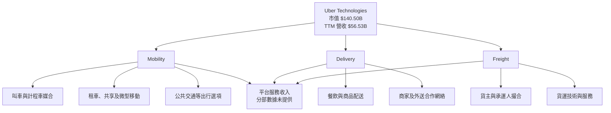
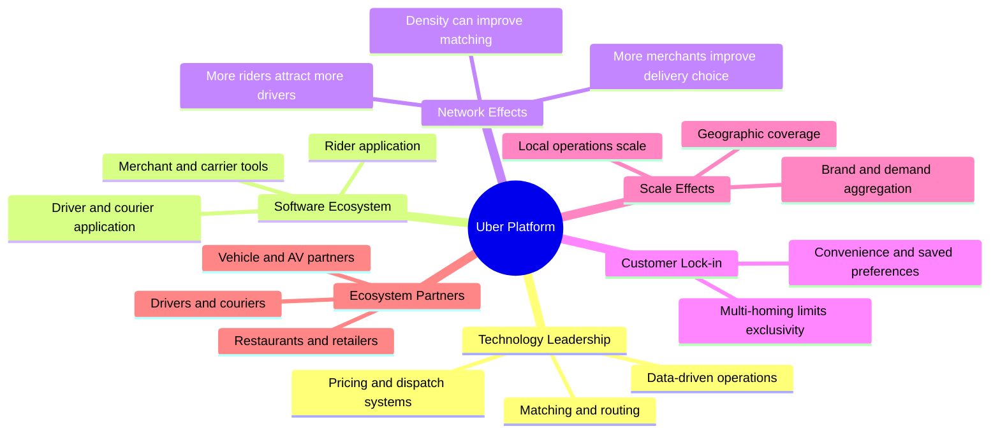
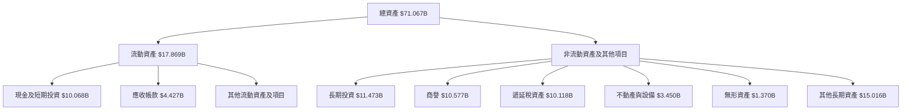
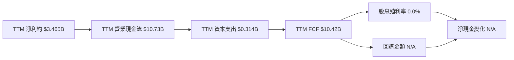
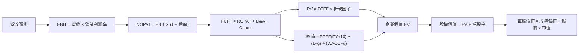
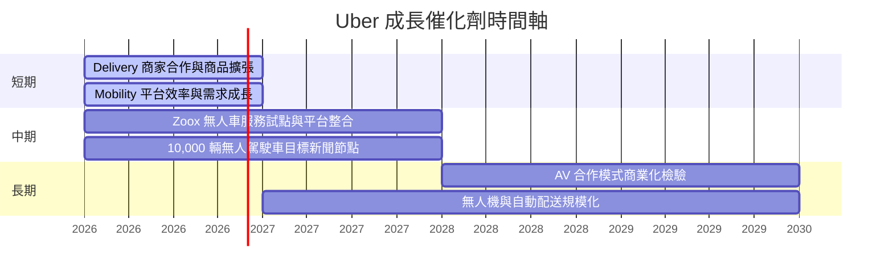
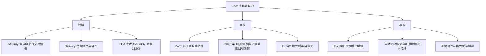
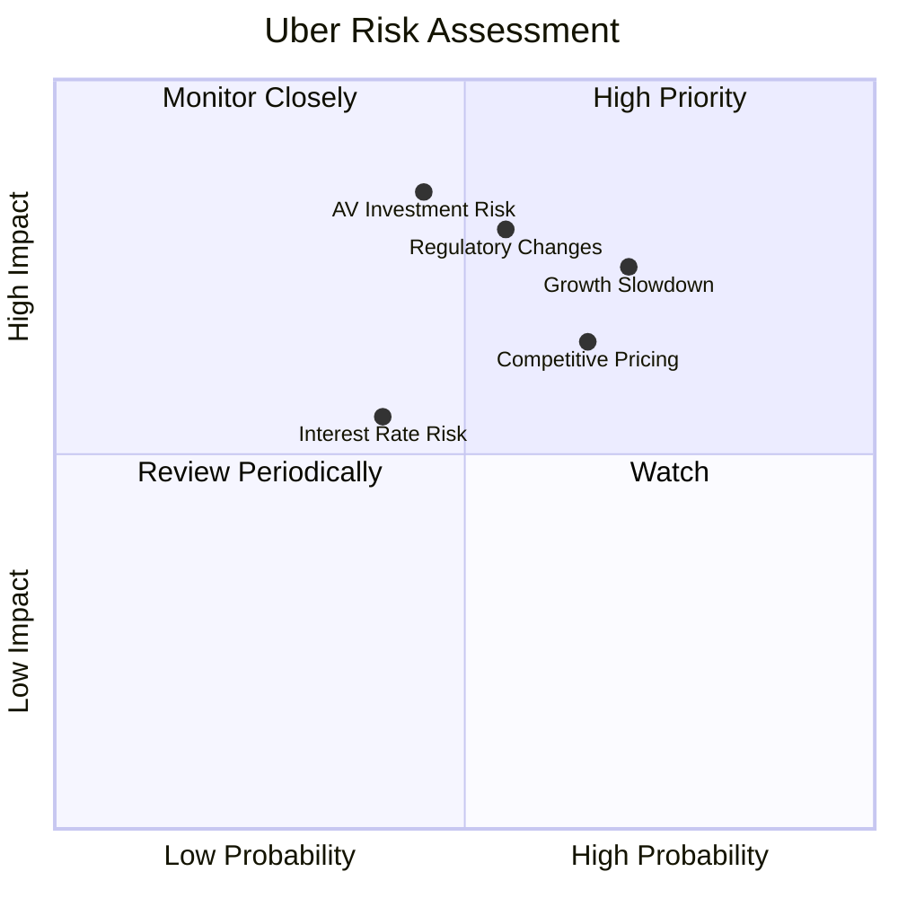
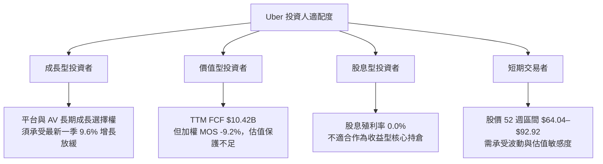

# UBER 基本面深度分析報告
> **報告日期**：2026-11-18 ｜ **語言**：繁體中文 ｜ **數據來源**：SEC 申報資料 (XBRL)、Yahoo Finance、Finviz、StockAnalysis、Roic.ai ｜ **分析師**：CFA 級機構研究

## 目錄

| # | 章節 | 核心結論 |
|---|------|----------|
| 1 | 執行摘要 | 持有；加權合理價值 $62.99，MOS -9.2% |
| 2 | 公司概覽與商業模式 | Mobility、Delivery、Freight 多邊平台；市場份額數據未提供 |
| 3 | 損益表深度分析 | TTM 營收 $56.53B、TTM 成長 13.9%；最新一季年增 9.6% |
| 4 | 資產負債表分析 | 淨負債 $5.60B；流動比率 1.232 |
| 5 | 現金流量深度分析 | TTM FCF $10.42B、FCF Yield 7.42% |
| 6 | 獲利能力與資本效率 | ROIC 15.8% 高於 WACC 10.24%，目前創造價值 |
| 7 | 相對估值分析 | 部分倍數低於自身歷史，但相對同業估值呈混合訊號 |
| 8 | DCF 內在價值評估 | 基準 DCF $39.85；加權合理價值 $62.99 |
| 9 | 成長催化劑 | AV、外送合作與自動化配送具選擇權；TAM 數據未提供 |
| 10 | 風險矩陣 | 成長放緩、AV 投資回報、估值與監管為主要風險 |
| 11 | 投資建議 | 持有；等待估值折讓及經營指標確認 |

---

## 1. 執行摘要

截至 2026-11-17 收盤，UBER 股價為 **$68.81**。公司 TTM 營收 **$56.53B**、TTM 營收年增 **13.9%**，TTM FCF **$10.42B**、FCF Yield **7.42%**；ROIC **15.8%** 高於 WACC **10.24%**，顯示目前經營資本仍創造正經濟價值。然而，基準 DCF 每股價值 **$39.85**，相對現價折溢價為 **+72.7%**（現價相對 DCF 溢價）；依估值方法加權後的合理價值為 **$62.99**，安全邊際 **MOS -9.2%**。因此，依 MOS 門檻評級為 **🟡持有**，不做一級調整：現金流品質與 ROIC 提供基本面支撐，但 DCF 對現價的解釋不足，且最新一季營收年增已降至 **9.6%**。

### 1.0 一頁式投資儀表板（Portfolio Manager 30 秒速讀）

| 項目 | 內容 |
|------|------|
| **投資論點（3 句）** | ① TTM 營收 **$56.53B**、年增 **13.9%**，平台仍在擴大交易規模。② TTM FCF **$10.42B**、FCF Yield **7.42%**，現金流轉換為估值提供支撐。③ ROIC **15.8%** 高於 WACC **10.24%**，但最新一季營收年增降至 **9.6%**，估值尚未提供足夠下檔保護。 |
| **綜合評分** | **6.2/10**（引用 1.1 評分卡） |
| **財務健康** | 🟡 現金及短期投資 **$10.07B**，總債務 **$15.66B**，淨負債 **$5.60B**；流動比率 **1.232**。 |
| **ROIC vs WACC** | **15.8% vs 10.24%**：高出 **5.56 個百分點**，目前創造股東價值。 |
| **FCF 趨勢** | 2022–2025 年度 FCF 由 **$0.39B** 升至 **$9.76B**；最新 TTM FCF **$10.42B**，FCF Yield **7.42%**。 |
| **估值** | Forward P/E **15.6x** ｜ EV/EBITDA **19.1x**（Verified historical-multiples source 為 **18.8x**，口徑略有差異）｜ FCF Yield **7.42%**。 |
| **DCF 內在價值（基準）** | **$39.85** ｜ 相對現價溢價 **72.7%**（第 8 章 DCF 基準價值） |
| **安全邊際（MOS）** | **-9.2%**＝($62.99 − $68.81) ÷ $62.99；基準為加權合理價值。🔴 <10%：缺乏安全邊際。 |
| **預期報酬（基準情境 12M）** | **-42.1%**（DCF 基準情境 $39.85 相對現價） |
| **關鍵風險（前二）** | 最新一季營收年增放緩至 **9.6%**；AV 投資與監管變化可能影響平台經濟及資本回報。 |
| **評級 + 信心度** | 🟡 **持有** ｜ 信心：中。MOS 所對應評級為持有，未作質化調整。 |

### 1.1 綜合評分卡（全報告唯一）

| 維度 | 評分（1–10） | 主要依據（引用數字與其來源章節） |
|------|--------------|----------------------------------|
| 成長性 | 6.5 | TTM 營收年增 **13.9%**，但最新一季年增 **9.6%**，且近三季年增由 **14.5%** 降至 **9.6%**（第 3 章）。 |
| 獲利能力 | 7.0 | TTM 營業利益率 **12.4%**、ROIC **15.8%**，高於 WACC **10.24%**；Piotroski F-Score **6/8**（第 3、6 章）。 |
| 財務健康 | 6.5 | 淨負債 **$5.60B**、流動比率 **1.232**、速動比率 **0.999**；短期流動性尚可但非淨現金狀態（第 4 章）。 |
| 估值 | 4.5 | 加權合理價值 **$62.99** 低於現價 **$68.81**，MOS **-9.2%**；P/E **40.2x** 高於自身五年中位數 **17.8x**（第 7、8 章）。 |
| 護城河 | 7.0 | Mobility、Delivery、Freight 多邊平台與規模具網路效應基礎；但缺少市場份額及分部營收占比數據，限制量化驗證（第 2 章）。 |
| 管理層與資本配置 | 5.5 | 2025 年 FCF **$9.76B**，年度 SBC **$1.83B**；未提供回購金額、資本回報率或管理層財測，評估保持中性（第 3、5 章）。 |
| **綜合評分** | **6.2** | 六項算術平均 **(6.5+7.0+6.5+4.5+7.0+5.5) ÷ 6 = 6.17 ≈ 6.2**。 |

### 1.2 五大投資論點 + 三大核心風險

| 類型 | 項目 | 具體依據 | 信心度 |
|------|------|----------|--------|
| 🟢 **投資論點①** | 可觀的現金流底盤 | TTM 營業現金流 **$10.73B**、資本支出 **$314M**、FCF **$10.42B**；低資本支出需求使營運現金流大部分轉為自由現金流。 | 🟢 高 |
| 🟢 **投資論點②** | ROIC 高於資本成本 | ROIC **15.8%**，WACC **10.24%**，差額 **5.56 個百分點**；若維持，新增資本投入可持續創造價值。 | 🟢 高 |
| 🟢 **投資論點③** | 多業務平台可交叉導流 | Mobility、Delivery、Freight 三個營運板塊有助於分散單一出行需求；但分部營收與利潤數據未提供，無法確認各板塊貢獻。 | 🟡 中 |
| 🟢 **投資論點④** | 歷史自由現金流改善 | 年度 FCF 自 2022 年 **$0.39B** 增至 2025 年 **$9.76B**；營運規模擴大與營業獲利改善提升現金創造能力。 | 🟢 高 |
| 🟢 **投資論點⑤** | AV 可能形成長期選擇權 | 新聞提及 2028 年目標 **10,000 輛無人駕駛車**與約 **$10B AV 投入**；若資本合作和平台導流有效，Uber 可參與 AV 供需撮合，但投資回報尚未證實。 | 🟡 中 |
| 🟡 **風險①** | 成長速度下滑 | 最新一季收入年增 **9.6%**，低於 TTM 年增 **13.9%**；若進一步下滑，市場可能下修長期營收與終值預期。 | 🟡 中 |
| 🔴 **風險②** | AV 投入回報與競爭 | 約 **$10B** 的 AV 投資相關新聞數字若代表大量資本承諾，回收期、資產所有權與責任分配都可能壓低投資回報。 | 🔴 高衝擊 |
| 🔴 **風險③** | 估值對長期假設敏感 | 基準 DCF **$39.85**，比現價低 **42.1%**；模型終值占 EV **45.7%**，WACC、成長與利潤率假設稍變即可改變估值。 | 🔴 高衝擊 |

### 1.3 快速統計卡片

| 指標 | 公司實際值（期間） | 同業中位數 | 狀態 |
|------|--------------------|------------|------|
| 營收成長（TTM） | **13.9%** | — | 🟢 |
| 營收成長（最新一季年增） | **9.6%** | **27.4%** | 🔴 |
| 毛利率（TTM） | **41.4%** | **41.4%** | 🟡 |
| 營業利益率（TTM） | **12.4%** | — | 🟢 |
| ROIC（TTM） | **15.8%** | — | 🟢 |
| Forward P/E | **15.6x** | **20.3x** | 🟢 |
| FCF Yield（TTM） | **7.42%** | — | 🟢 |
| Piotroski F-Score | **6 / 8** | — | 🟢 |

同業中位數採 LYFT、DASH、GRAB 三家公司計算；例如最新一季收入增長中位數為 **27.4%**，毛利率中位數為 **41.4%**，Forward P/E 中位數為 **20.3x**。

### 1.4 投資結論

```text
╔══════════════════════════════════════════════════════════════════╗
║                    📊 投資結論摘要                               ║
╠══════════════════════════════════════════════════════════════════╣
║  評級：🟡 持有（依 MOS 門檻，未作一級調整）                     ║
║  價格（2026-11-17 收盤）：$68.81                                 ║
║  DCF 內在價值（基準）：$39.85（現價溢價 72.7%）                 ║
║  安全邊際 MOS：-9.2%（=(加權合理價值−現價)÷加權合理價值）       ║
║  加權合理價值（8.8）：$62.99                                     ║
║  DCF 情境價值：                                                   ║
║    悲觀情境：$22.64（-67.1%）                                    ║
║    基準情境：$39.85（-42.1%）                                    ║
║    樂觀情境：$66.39（-3.5%）                                     ║
║  綜合評分：6.2/10（引用 1.1）                                    ║
║  適合投資人：能承受估值波動、看重長期平台現金流的成長型投資人    ║
╚══════════════════════════════════════════════════════════════════╝
```

---

## 2. 公司概覽與商業模式

### 2.1 業務結構與收入來源

Uber 在北美、拉丁美洲、歐洲、中東非洲及亞太地區營運，主要分為 Mobility、Delivery、Freight 三個板塊。財務資料沒有提供分部營收、各板塊占比或分部利潤，因此以下只呈現業務架構，不將未披露的占比或金額填入圖表。



Uber 的平台商業模式核心是透過應用程式撮合需求與供給、處理交易並提供相關服務。具體營收認列、平台抽成率與各業務板塊毛利資料未提供，故不臆測分部收入構成。

### 2.2 市場份額

**市場份額數據未提供**，因此不繪製市場份額圓餅圖，也不估填市場占比。作為相對規模參考，Uber TTM 營收為 **$56.53B**，最新一季營收年增 **9.6%**；同業數據顯示 DASH 最新一季年增 **34.0%**、GRAB **27.4%**、LYFT **8.1%**。各家公司業務範圍與營收認列可能不同，增速比較不能直接等同於市場份額變化。

### 2.3 競爭護城河分析



護城河主要來自供需兩側的網路密度、品牌、平台軟體與跨業務服務；但司機、商家及消費者可能同時使用競爭平台，Uber 的鎖定效應不等同於高轉換成本軟體業務。財務資料未提供活躍使用者、行程量、抽成率或留存率，故無法量化網路效應強度。

### 2.4 護城河強度

| 護城河項目 | 強度（強／中／弱） | 證據（引用數字或事實） | 會削弱它的情況 |
|------------|--------------------|------------------------|----------------|
| 技術與平台軟體 | 中 | 同一平台涵蓋 Mobility、Delivery、Freight，TTM 營收 **$56.53B**。 | 軟體容易被複製、定價與媒合品質無法保持差異。 |
| 網路效應 | 中至強 | 同時連結乘客、司機、商家及貨運供應鏈，跨地區營運可形成密度效益。 | 供給端多平台經營、用戶切換成本低，競爭者以補貼搶供需。 |
| 客戶鎖定 | 弱至中 | App 便利性與付款、偏好設定有助於重複使用，但未提供留存或轉換成本數據。 | 競品價格促銷、服務品質下降或監管改變。 |
| 規模效應 | 中 | TTM 營收及 FCF 分別達 **$56.53B**、**$10.42B**，可支持平台營運及產品投資。 | 地區性競爭、司機成本及保險成本上升。 |
| 生態夥伴 | 中 | 業務涉及司機、商家、貨運承運人及 AV 合作方；新聞提及 Deliverect 合作與 Zoox 無人車服務。 | 夥伴自建平台、改變合作條件或將流量導向其他平台。 |

1.1 護城河評分為 **7.0/10**，理由是多邊平台與規模具結構性優勢，但缺少份額、留存率、單位經濟和分部盈利數據，尚不足以評為更高。

---

## 3. 損益表深度分析

### 3.1 年度收入成長趨勢（近 4 年）

年度收入分別為 2022 年 **$31.88B**、2023 年 **$37.28B**、2024 年 **$43.98B**、2025 年 **$52.02B**。2022–2025 年 CAGR 約 **17.7%**，公式為 \((52.02 ÷ 31.88)^{1/3}-1\)。

```text
╔══════════════════════════════════════════════════════════════════╗
║              Uber 年度收入趨勢（FY2022–FY2025）                 ║
╠══════════════════════════════════════════════════════════════════╣
║  FY2022  $31.88B  ███████████████░░░░░░░░░░  基期             ║
║  FY2023  $37.28B  ██████████████████░░░░░░░  YoY: +16.95%     ║
║  FY2024  $43.98B  █████████████████████░░░░  YoY: +17.96%     ║
║  FY2025  $52.02B  █████████████████████████  YoY: +18.28%     ║
╠══════════════════════════════════════════════════════════════════╣
║  2022–2025 三年收入 CAGR：約 +17.7%                             ║
╚══════════════════════════════════════════════════════════════════╝
```

收入增速在 2023–2025 年維持約 17%–18%，但 TTM 年增 **13.9%** 及最新一季年增 **9.6%** 顯示近期增速回落。收入擴張仍為正，但市場估值若依賴高成長延續，需關注未來季度是否穩定。

### 3.2 季度收入趨勢分析

QoQ 以相鄰財報季度營收計算；YoY 為同季年增。Q3 2026 的單季年增率以財務數據中的 **9.6%** 為準，不能稱為 TTM 成長率。

| 季度 | 營收 | QoQ | YoY | 備註 |
|------|------:|----:|----:|------|
| 2025 Q4 | $14.37B | +6.7% | +20.1% | QoQ 以 2025 Q3 $13.467B 計算。 |
| 2026 Q1 | $13.20B | -8.1% | +14.5% | 年增率仍高於最新季度，但季節性可能影響 QoQ。 |
| 2026 Q2 | $14.19B | +7.5% | +12.2% | 同比增速續降。 |
| 2026 Q3 | $14.77B | +4.1% | +9.6% | 年增率低於前幾季，為近期增長放緩訊號。 |

季度收入 QoQ 以原始季度收入數值計算：Q1 2026 相對 Q4 2025 為 **-8.1%**，Q2 相對 Q1 為 **+7.5%**，Q3 相對 Q2 為 **+4.1%**。此處不以季節性調整後數值替代。

### 3.3 利潤率演變分析

以下年度毛利率與營業利益率以年度財務報表金額相除計算，四捨五入至一位小數。TTM 及最新一季營業利益率則引用 SEC 10-Q 計算資料中的標準化數值。

| 利潤率指標 | FY2022 | FY2023 | FY2024 | FY2025 | 趨勢 | 評估 |
|------------|--------|--------|--------|--------|------|------|
| **毛利率** | 38.3% | 39.8% | 39.4% | 39.8% | 近四年大致穩定，逐步改善 | 🟢 |
| **營業利益率** | -5.7% | 3.0% | 6.4% | 10.7% | 由負轉正並持續擴張 | 🟢 |
| **淨利率** | -28.7% | 5.1% | 22.4% | 19.3% | 受非營業損益與稅項波動影響，不能單看年度淨利判斷營運趨勢 | 🟡 |
| **TTM 營業利益率** | — | — | — | **12.4%** | 高於 FY2025 年度比率 | 🟢 |
| **最新一季營業利益率** | — | — | — | **9.8%** | 與 TTM 不同期間；季度值顯示盈利率未必線性上升 | 🟡 |

利潤率改善與收入擴大、平台營運槓桿及營業費用效率提升相符；年度營業利益由 2022 年 **-$1.83B** 改善至 2025 年 **$5.57B**。但最新季度營業利益為 **$1.45B**，標準化最新一季營業利益率為 **9.8%**，低於 TTM **12.4%**。此差異可能反映季度組合、費用認列及資料來源口徑，不宜將 TTM 利潤率直接視為每季穩定水準。年度淨利率受非營業項目與稅務影響尤其明顯，故評估核心趨勢應優先看營業利益與現金流。

### 3.4 費用結構分析

財務資料提供年度營收、毛利、營業利益與研發支出，但未提供足以完整拆分 TTM 費用結構的項目；因此不以不完整資料繪製看似完整的費用占比圓餅圖。可確認 FY2025 研發支出為 **$3.40B**，約占 FY2025 營收 **6.5%**（$3.40B ÷ $52.02B）；其他銷售、行銷、保險、一般行政費用的完整拆分未提供。

```text
╔══════════════════════════════════════════════════════════════════╗
║                 可確認費用項目：FY2025                         ║
╠══════════════════════════════════════════════════════════════════╣
║  研發費用：$3.40B  約占營收 6.5%                                ║
║  FY2025 營業利益：$5.57B                                         ║
║  其他費用細項：資料未提供，故不繪製推估比例                     ║
╚══════════════════════════════════════════════════════════════════╝
```

### 3.5 季度 EPS 趨勢與盈餘品質（Quality of Earnings）

EPS 預估值與實際值的歷史估算欄位為缺值，因此無法判斷過去四季是否超預期或不及預期。以下列示已公布的實際 EPS；同比變化引用財務數據，並注意前一年季度含特殊高低基數的可能性。

| 季度 | 實際 EPS | EPS YoY | EPS 預估／超預期狀態 |
|------|---------:|--------:|--------------------|
| 2025 Q4 | $0.14 | -95.6% | 預估值 N/A，不能判斷 beat/miss |
| 2026 Q1 | $0.13 | -84.6% | 預估值 N/A，不能判斷 beat/miss |
| 2026 Q2 | $1.17 | +85.5% | 預估值 N/A，不能判斷 beat/miss |
| 2026 Q3 | $0.25 | -92.0% | 預估值 N/A，不能判斷 beat/miss |

| 盈餘品質項目 | 數值／佔比 | 評估 |
|--------------|-----------|------|
| 股權薪酬 SBC / 營收 | **約 3.7%**（四季 SBC 合計約 $2.065B ÷ TTM 營收 $56.53B） | 🟡 SBC 對股東有稀釋成本；比例不低，應視為經濟成本，不只看 GAAP 淨利。 |
| SBC / 營業現金流 | **約 19.2%**（$2.065B ÷ $10.73B） | 🟡 現金流未扣除 SBC，SBC 雖非當期現金支出，仍可能稀釋每股價值。 |
| FCF / 淨利（現金轉換率） | **約 300.7%**（$10.42B ÷ TTM 淨利約 $3.465B） | 🟢 FCF 明顯高於淨利；但單期轉換率可能受營運資金及非現金項目影響。 |
| 一次性／非經常性損益 | 具體 TTM 調整項目 N/A | 🟡 年度淨利率與營業利潤率差異大，不能假定全部淨利均為可持續營運獲利。 |
| 有效稅率異常 | N/A（缺少可一致比較的 TTM 所得稅費用與稅前利潤） | 稅率是否受特殊稅務項目影響無法量化。 |
| 資本化支出 vs 費用化 | TTM Capex **$314M**；資本化軟體等細節 N/A | Capex 相對營收低，但無資本化支出明細，不能據此斷定不存在遞延成本。 |

**盈餘品質結論：** TTM FCF **$10.42B** 與營業現金流 **$10.73B** 提供強現金流佐證；但 SBC 約占營收 **3.7%**，若忽略稀釋會高估每股股東回報。另，季度 EPS 同比劇烈波動而估算值缺失，故不以季度 EPS 作為單獨估值錨。GAAP 獲利的可持續性應透過營業利潤率與每股稀釋變化共同追蹤。

---

## 4. 資產負債表分析

### 4.1 資產結構分解

最近 TTM 資產負債表資料列示總資產 **$71.067B**、流動資產 **$17.869B**。非流動資產細項包含長期投資、商譽、遞延稅資產及其他長期資產；因部分細項加總與總資產存在未列示差額，不將缺少部分自行歸類。



### 4.2 流動性與營運資金分析

| 指標 | 最新 TTM | 一年前 TTM | 變化 | 解讀 |
|------|----------|------------|------|------|
| 流動比率 | **1.232** | N/A | N/A | 流動資產高於流動負債，但緩衝有限。 |
| 速動比率 | **0.999** | N/A | N/A | 接近 1，須持續監控現金與應收回收。 |
| DSO 應收帳款天數 | **29 天** | **28 天** | **+1 天** | 應收回收略慢；單年變化幅度小，仍需觀察是否延續。 |
| DIO 存貨天數 | **N/A** | **N/A** | **N/A** | 公司未報告可用存貨餘額，依規定不推算。 |
| DPO 應付帳款天數 | **17 天** | **N/A** | **N/A** | 一年前資料缺失，無法判定付款天數方向。 |
| CCC 現金轉換週期 | **N/A** | **N/A** | **N/A** | DIO 不可計算，且前期 DPO 缺值，不填補估算值。 |

資料顯示 DSO 由 **28 天**升至 **29 天**，幅度有限，尚不足以判定收款品質明顯惡化。DPO 前期及存貨資訊缺失，不能據此推論 Uber 的供應商付款能力或現金轉換週期變化。

### 4.3 債務結構分析

資產負債表來源間存在口徑差異：標準化財務數據列示總債務 **$15.66B**、現金及短期投資 **$10.07B**、淨負債 **$5.60B**；其他整併資料列示債務 **$17.74B**、淨負債 **$7.67B**。本報告依 VERIFIED figures 的標準化口徑採用前者；不混用其他口徑重算淨負債。

```text
╔══════════════════════════════════════════════════════════════════╗
║                    Uber 債務健康診斷                            ║
╠══════════════════════════════════════════════════════════════════╣
║  總債務：           $15.66B                                     ║
║  現金及短期投資：   $10.07B                                     ║
║  淨負債：           $5.60B                                      ║
║  流動比率：         1.232                                       ║
║  速動比率：         0.999                                       ║
║  Debt/EBITDA：      N/A（標準化口徑未提供可一致配對的 EBITDA）   ║
║  利息保障倍數：     N/A（利息費用明細未提供）                   ║
║                                                                  ║
║  評估：🟡 有現金流覆蓋債務的能力，但並非淨現金公司。            ║
╚══════════════════════════════════════════════════════════════════╝
```

### 4.4 股東權益趨勢

年度股東權益從 2022 年 **$7.34B** 增至 2025 年 **$27.04B**。權益擴張反映資產負債表逐步改善，但需留意 2025 年度淨利包含非營業與稅項影響；股東權益變動不能直接等同於可持續經營獲利。

```text
╔══════════════════════════════════════════════════════════════════╗
║                 股東權益變化（年度）                            ║
╠══════════════════════════════════════════════════════════════════╣
║  FY2022  $7.34B   ███████                                       ║
║  FY2023 $11.25B   ███████████                                   ║
║  FY2024 $21.56B   █████████████████████                         ║
║  FY2025 $27.04B   ███████████████████████████                   ║
╚══════════════════════════════════════════════════════════════════╝
```

---

## 5. 現金流量深度分析

### 5.1 現金流量瀑布圖

TTM 淨利採 StockAnalysis 的 TTM **$3.465B**；不同資料庫的淨利口徑可能略有差異。股息支付率為 0%，但資料沒有提供回購總額或淨現金變化拆分，故不對缺失金額設定數字。



### 5.2 FCF 轉換率趨勢

下表年度 FCF／淨利以公布年度數字相除；當淨利為負時比例不具一般經濟意義。

| 年度 | FCF | 淨利 | FCF／淨利 | 解讀 |
|------|-----:|-----:|----------:|------|
| 2022 | $0.39B | -$9.14B | 比率不具一般意義 | 淨利為大額虧損，FCF 為正。 |
| 2023 | $3.36B | $1.89B | 約 177.9% | 現金流高於會計淨利。 |
| 2024 | $6.89B | $9.86B | 約 69.9% | 淨利高於 FCF，非現金或營運資金項目有影響。 |
| 2025 | $9.76B | $10.05B | 約 97.1% | 現金轉換接近淨利。 |
| TTM | $10.42B | 約 $3.465B | 約 300.7% | 高轉換率，但不應假定此水準永久延續。 |

### 5.3 自由現金流趨勢

| 年度 | FCF | YoY 變化 | 備註 |
|------|----:|---------:|------|
| 2022 | $0.39B | — | 低基期。 |
| 2023 | $3.36B | +761.5% | 低基期使增幅被放大。 |
| 2024 | $6.89B | +105.1% | FCF 絕對額續增。 |
| 2025 | $9.76B | +41.7% | 增幅放緩但現金流再創高位。 |
| TTM | $10.42B | N/A | 標準化 TTM FCF；FCF Yield **7.42%**。 |

```text
╔══════════════════════════════════════════════════════════════════╗
║                 自由現金流趨勢                                  ║
╠══════════════════════════════════════════════════════════════════╣
║  FY2022  $0.39B  █                                               ║
║  FY2023  $3.36B  ███████                                         ║
║  FY2024  $6.89B  ██████████████                                  ║
║  FY2025  $9.76B  ████████████████████                            ║
║  TTM    $10.42B  █████████████████████                          ║
║                                                                  ║
║  TTM FCF Yield：7.42%                                            ║
╚══════════════════════════════════════════════════════════════════╝
```

### 5.4 資本配置評估

| 資本用途 | 可取得數據 | 評估 |
|----------|------------|------|
| 資本支出 | TTM **$314M**；2025 年 **$336M** | 相較營運現金流占比低，平台模式具有低固定資產需求特徵；仍需監控未來 AV 投資是否改變資本強度。 |
| 股息 | 殖利率 **0.0%**、派息率 **0.0%** | 目前未以現金股息回饋股東。 |
| 回購 | 金額 N/A | 缺少回購金額與平均回購價格，不評估回購效率。 |
| 研發／新業務 | FY2025 研發 **$3.40B** | 投資研發及新業務可支持長期競爭力，但回報需以後續營收與利潤驗證。 |
| 留存現金及其他投資 | 期末現金及短期投資 **$10.07B** | 為財務彈性提供緩衝，但公司仍有 **$5.60B** 淨負債。 |

資本配置圓餅圖所需的回購、股息、研發以外投資及留存現金完整分配數據未提供，因此不繪製比例不完整的圓餅圖。

---

## 6. 獲利能力與資本效率

### 6.1 ROE / ROA / ROIC 趨勢

| 指標 | 可用期間 | 數值 | 評估 |
|------|----------|-----:|------|
| ROE | TTM | **12.5%** | 正值，但受權益乘數影響；杜邦分解見 6.3。 |
| ROA | TTM | **6.5%** | 正值，資產獲利能力為正。 |
| ROIC | TTM | **15.8%** | 高於 WACC **10.24%**，創造正經濟利潤。 |
| 歷年 ROE／ROA／ROIC 可比序列 | N/A | N/A | 未提供可一致比較的多年序列，不補造趨勢。 |

### 6.2 ROIC vs WACC 分析（核心價值創造判斷）

```text
╔══════════════════════════════════════════════════════════════════╗
║                ROIC vs WACC 深度分析                            ║
╠══════════════════════════════════════════════════════════════════╣
║  WACC（採用標準化資本成本數值）：10.24%                         ║
║  ├── 無風險利率（10Y 美債）：       5.10%                       ║
║  ├── 市場風險溢酬 ERP：              5.00%                       ║
║  ├── 原始 Beta：                     1.31                        ║
║  ├── 調整後 Beta（採用）：           1.21                        ║
║  ├── 股權成本（資料來源值）：        11.13%                      ║
║  ├── 稅前債務成本：                  2.81%                       ║
║  ├── 稅率：                          21.0%                       ║
║  ├── 股權／債務權重：                90.0%／10.0%                 ║
║  └── WACC（採用）：                  10.24%                      ║
║                                                                  ║
║  ROIC（TTM）：                       15.8%                       ║
║  EVA spread = ROIC − WACC：          15.8% − 10.24% = 5.56 pp    ║
║                                                                  ║
║  ROIC  15.8%  ▓▓▓▓▓▓▓▓▓▓▓▓▓▓▓▓▓▓▓▓▓▓▓▓▓▓▓▓▓▓▓▓  🟢            ║
║  WACC  10.24% ▓▓▓▓▓▓▓▓▓▓▓▓▓▓▓▓▓▓▓▓▓▓▓▓▓▓░░░░░░  ──            ║
║                                                                  ║
║  結論：ROIC 高於 WACC 5.56 個百分點，目前創造股東價值。        ║
╚══════════════════════════════════════════════════════════════════╝
```

採用 WACC 完全引用標準化資本成本資料。原始 Beta **1.31** 經調整後採用 **1.21**；該資料同時列出 CAPM 股權成本 **11.13%**。因調整後 Beta 僅呈現兩位小數，直接以四捨五入的 1.21 再計算會有細微差異，本報告不替換已計算的股權成本或 WACC。

**價值創造判斷：** ROIC **15.8%** 高於 WACC **10.24%**，spread 為 **5.56 個百分點**，代表 TTM 期間的投入資本回報高於資金成本。這是當前經營價值創造的證據，並不保證未來新投資或 AV 投資也能維持相同回報。

### 6.3 杜邦三因素分解

| 因素 | 數值（TTM） | 解讀 |
|------|-------------|------|
| 淨利率 | **6.1%** | 會計獲利占收入比率；不能單獨反映核心營運現金創造。 |
| 資產週轉率 | **0.80** | 每單位資產產生的營收，反映平台資產運用效率。 |
| 權益乘數 | **2.57** | 資產相對權益倍數，顯示財務槓桿存在但非極端。 |
| **ROE** | **12.5%** | 依 QUALITY FIGURES 原值照錄：6.1% × 0.80 × 2.57 = 12.5%（四捨五入）。 |

ROE 同時來自淨利率與資產週轉，權益乘數也提供部分放大效果；不宜將 ROE 全部歸因於槓桿。以上數值為標準化杜邦指標，依要求不重新計算或替換。

### 6.4 財務體質：Piotroski F-Score

**Piotroski F-Score：6 / 8。** 此分數是 8 項可判定測試的通過數；毛利率測試因缺少輸入未納入分母。

| 測試 | 結果 | 解讀 |
|------|------|------|
| ROA > 0 | ✅ 通過 | TTM 資產報酬為正。 |
| 營業現金流 > 0 | ✅ 通過 | TTM 營業現金流 **$10.73B**。 |
| ROA 高於一年前 | ❌ 未通過 | 獲利資產效率未優於比較期間，須觀察是否只是短期波動。 |
| 營業現金流 > 淨利（應計品質） | ✅ 通過 | 現金流高於淨利，支持獲利含金量。 |
| 長期負債 ÷ 總資產低於一年前 | ❌ 未通過 | 槓桿占比未改善，與 TTM 淨負債 **$5.60B** 相符。 |
| 流動比率高於一年前 | ✅ 通過 | 短期流動性指標改善。 |
| 稀釋股數未增加 | ✅ 通過 | 比較期間通過該測試，仍應監控 SBC 帶來的長期稀釋。 |
| 毛利率高於一年前 | — 無法判定 | 缺資料，未計入 8 項分母。 |
| 資產週轉率高於一年前 | ✅ 通過 | 資產運用效率改善。 |

F-Score **6/8** 顯示整體財務質量偏正面，但負債占比改善測試未通過，加上長期 SBC 稀釋成本仍需納入股東回報分析。

---

## 7. 相對估值分析

### 7.1 同業估值比較表格

同業倍數採 Yahoo Finance 同業資料；本公司倍數使用最新可用資料。資料來源口徑不同可能造成小幅差異。

| 估值指標 | **UBER** | **LYFT** | **DASH** | **GRAB** | UBER 評估 |
|----------|---------:|--------:|--------:|--------:|-----------|
| **Trailing P/E** | **40.2x** | 2.5x | 68.4x | 31.8x | 🟡 介於同業區間；LYFT 極低倍數可能受獲利基數影響，不能直接視為便宜基準。 |
| **Forward P/E** | **15.6x** | 8.2x | 21.6x | 20.3x | 🟢 低於同業中位數 **20.3x**，但倚賴前瞻 EPS 實現。 |
| **P/S Ratio** | **2.5x** | 0.9x | 4.2x | 3.2x | 🟢 低於 DASH、GRAB，較 LYFT 溢價。 |
| **EV/EBITDA** | **18.8x** | 555.4x | 40.5x | 21.3x | 🟢 低於 DASH、GRAB；LYFT 倍數受 EBITDA 分母影響，參考性有限。 |
| **最新一季營收 YoY** | **9.6%** | 8.1% | 34.0% | 27.4% | 🔴 UBER 增長低於三家同業中的 DASH、GRAB，但略高於 LYFT。 |
| **毛利率 TTM** | **41.4%** | 40.0% | 52.7% | 41.4% | 🟡 與 GRAB 相同，高於 LYFT，低於 DASH。 |

P/E 的同業中位數計算：Trailing P/E 三家中位數 **31.8x**；Forward P/E 中位數 **20.3x**。同業比較有業務組合、收入認列與盈利階段差異，不能只依單一倍數排序。

### 7.2 歷史估值區間分析

```text
╔══════════════════════════════════════════════════════════════════╗
║              UBER 五年歷史估值區間（TTM）                       ║
╠══════════════════════════════════════════════════════════════════╣
║  P/E：       12.6x ───────── 中位數 17.8x ───── 現值 40.2x     ║
║              五年區間 12.6x–122.2x；現值百分位 69%              ║
║                                                                  ║
║  P/S：        1.5x ─────── 現值 2.5x ─── 中位數 3.3x            ║
║              五年區間 1.5x–6.1x；現值百分位 24%                 ║
║                                                                  ║
║  EV/EBITDA： 18.7x ─ 現值 18.8x ───────── 中位數 40.0x         ║
║              五年區間 18.7x–320.2x；現值百分位 7%               ║
╚══════════════════════════════════════════════════════════════════╝
```

P/E 現值 **40.2x** 高於五年中位數 **17.8x**，但仍低於歷史極高值；P/S **2.5x** 低於中位數 **3.3x**，EV/EBITDA **18.8x** 接近五年低位區 **18.7x**。各倍數的訊號不一致：收入與 EBITDA 倍數偏低於自身歷史中位數，但 P/E 仍偏高，可能反映盈利基數及過去盈利波動。

### 7.3 情境價值（Bear / Base / Bull，照抄 DCF MODEL 的 Scenarios）

| 情境 | 第 1 年營收成長 | 期末營業利潤率 | WACC | 每股價值 | 相對現價 | 機率 | 會發生的條件 |
|------|----------------|----------------|------|----------:|----------|------:|--------------|
| 🔴 悲觀 | 7.0% | 5.4% | 11.24% | **$22.64** | **-67.1%** | 25% | 需求增速減慢、競爭或法規成本壓縮利潤率，同時資本成本上升。 |
| 🟡 基準 | 13.9% | 6.4% | 10.24% | **$39.85** | **-42.1%** | 50% | 起始成長等於 TTM 增速，之後逐步放緩，長期利潤率回到歷史中位數假設。 |
| 🟢 樂觀 | 20.9% | 7.0% | 9.24% | **$66.39** | **-3.5%** | 25% | Mobility／Delivery 需求回升、AV 或平台效率改善，並伴隨資本成本下降。 |

情境價值照錄 DCF 模型。模型沒有提供各情境逐年營收與 FCFF 展開表，因此不另行反推中間年度數字。

### 7.4 相對估值隱含價格區間

```text
╔══════════════════════════════════════════════════════════════════╗
║             相對估值方法隱含每股價值                            ║
╠══════════════════════════════════════════════════════════════════╣
║  DCF 基準：             $39.85                                   ║
║  現價：                 $68.81                                   ║
║  同業 Forward P/E：     $89.28                                   ║
║  分析師共識目標價：     $98.23                                   ║
╚══════════════════════════════════════════════════════════════════╝
```

- **同業 Forward P/E：$89.28**，依同業中位數 Forward P/E **20.3x** 乘上 UBER Forward EPS **$4.41**（20.3 × 4.41 = 約 $89.28，模型輸出值照錄）。
- **同業 EV/EBITDA：N/A**，程式標示不可計算；不另行估算或增添方法。
- **分析師共識：$98.23**，45 位分析師平均目標價，屬外部參考而非內在價值模型。

---

## 8. DCF 內在價值評估（Discounted Cash Flow）

> 本章 DCF 模型數值採標準化模型輸出並照錄；模型使用 FCFF、GAAP EBIT，DCF 金額以美元十億為單位。不同表格中顯示的取整數可能產生不超過約 1% 的尾差。

### 8.0 估值推理鏈（Thinking Logic）

**Step 1 — 價值由哪些變數決定？**

Uber 價值主要來自現有平台 Mobility、Delivery、Freight 的交易現金流，以及規模擴大後的營業利潤率；另有 AV 等新業務選擇權。分部營收占比未提供，無法把三者拆成可量化的收入權重。此模型的核心變數是預測期營收、營業利潤率與終值折現；第 8.6 敏感度顯示，在固定 WACC 下提高永續成長率會顯著提升價值，而提高 WACC 會壓低價值。

**Step 2 — 模型選擇**

| 決策點 | 本報告採用 | 理由（含數字） | 曾考慮但否決 | 否決理由 |
|--------|-----------|----------------|--------------|----------|
| 現金流定義 | FCFF | 對應 WACC 折現並估算企業價值；TTM FCF **$10.42B**。 | FCFE | DCF 模型已指定 FCFF，避免改造模型。 |
| 預測期 N | **10 年** | 模型設定十年，讓收入成長與利潤率逐步衰減至成熟假設。 | 5 年 | 不符合指定模型期間，且未提供另外建模依據。 |
| 終值方法 | Gordon Growth | 模型採永續成長率 **3.0%**、WACC **10.24%**。 | 退出倍數 | 模型沒有提供退出倍數估值，不能自造數字。 |
| EBIT 基礎 | GAAP EBIT | 模型指定 GAAP EBIT，已將 SBC 作為費用。 | 非 GAAP EBIT | 會改變模型輸出及 SBC 處理。 |

**Step 3 — 關鍵假設推導鏈**

- **營收成長**：錨點＝TTM 營收年增 **13.9%**；調整＝從第 1 年開始由 13.9% 線性降至第 10 年 3.0%，反映近期增速放緩與成熟期收斂；採用值＝FY+1 **13.9%**、FY+10 **3.0%**；曾考慮固定 13.9% 十年，但若固定增速將忽略最新一季年增已降至 **9.6%** 的訊號，故不採用。
- **期末營業利潤率**：錨點＝TTM 營業利益率 **12.4%**；調整＝模型依近五個財年中位數逐步淡化至第 10 年 **6.4%**；採用值＝FY+1 **12.4%** 至 FY+10 **6.4%**；曾考慮長期維持 12.4%，但該值未必可在競爭、保險與法規成本變化下維持，故不採用。
- **預測期 N**：錨點＝模型指定 **10 年**；調整＝以足夠期間反映成長及利潤率逐步成熟；採用值＝10 年；曾考慮 5 年，但會縮短模型既定預測期，故不採用。
- **Capex／營收**：錨點＝TTM Capex **$314M** 及模型 TTM 比率約 **0.6%**；採用值＝第 1 至第 10 年維持約 **0.6%**；曾考慮依新 AV 投資提高資本支出，但目前新聞提及的投資規模未能與財報 Capex 口徑對接，故不擅自調整。
- **永續成長率 g**：錨點＝長期成熟企業需要低於折現率；模型取 **3.0%**；採用值＝3.0%，低於 WACC 10.24%；曾考慮 4.0%，但永續成長更高會抬高終值敏感性，因此以模型值為準。
- **WACC**：錨點＝標準化成本資本計算值 **10.24%**；採用值＝10.24%；曾考慮自行改用不同 Beta 或債務權重，但標準化資料已給定 WACC，依要求不另建折現率。
- **EBIT 基礎／SBC／股數**：採 GAAP EBIT，SBC 已含於費用；固定股數，不另增加股數稀釋。曾考慮額外扣除 SBC 或稀釋股數，但這會與模型指定組合重複計入。
- **稅率**：錨點＝模型預設稅率 **21.0%**；採用值＝21.0%；實際 TTM 稅率資料不完整，不以不一致年度稅率取代。
- **D&A／營收**：錨點＝TTM 比率 **1.4%**；採用值＝固定 1.4%。
- **營運資金**：模型未建模 ΔWC。歷史營運資金變動資料不完整，按模型設定不加列，也不反推數字。

**Step 4 — 最脆弱一環**

最脆弱假設是成熟期營業利潤率及永續現金流能否維持；若增長或利潤率低於模型，估值將下修，而三情境基準值 **$39.85** 與悲觀值 **$22.64** 已展示下行幅度。

**Step 5 — 計算路徑圖**



### 8.1 模型假設總表（Model Inputs）

| 假設項目 | 採用值 | 依據／來源 | 敏感度 |
|----------|--------|-------------|--------|
| 預測期長度 N | **10 年** | DCF 模型設定；營收成長與利潤率逐年淡化。 | 🟡 中 |
| 營收成長 | FY+1 **13.9%**，FY+10 **3.0%**，線性淡化 | 起點引用 TTM 年增 **13.9%**；終點為模型成熟期假設。 | 🔴 高 |
| 營業利潤率 | FY+1 **12.4%** → FY+10 **6.4%** | 起點為 TTM 營業利益率；終點為模型指定近五年中位數。 | 🔴 高 |
| 有效稅率 | **21.0%** | 模型預設稅率；非公司可核實的長期稅務指引。 | 🟢 低 |
| Capex／營收 | 第 1 年至第 10 年 **0.6%** | 模型引用 TTM 比率，固定至預測期末。 | 🟡 中 |
| D&A／營收 | **1.4%** | 模型引用 TTM 比率並固定。 | 🟢 低 |
| 營運資金變動 | 不建模 | 模型明確未納入；營運資金變動比例 N/A。 | 🟢 低 |
| EBIT 基礎 | **GAAP EBIT** | DCF 模型指定 GAAP EBIT。 | 🟡 中 |
| SBC 處理 | 已透過 GAAP EBIT 扣除；FCFF 不再扣 SBC | 模型指定 GAAP EBIT、固定股數。 | 🟡 中 |
| 年稀釋率 | **0%（模型固定股數）** | 與 GAAP EBIT + 固定股數組合一致；不額外放大股數。 | 🟡 中 |
| 永續成長率 g | **3.0%** | DCF 模型指定，低於 WACC。 | 🔴 高 |
| 終值方法 | Gordon Growth | DCF 模型只提供該終值計算值；退出倍數未提供。 | 🔴 高 |
| WACC | **10.24%** | 標準化資本成本輸出，見 8.2。 | 🔴 高 |

本模型採用 **(A) GAAP EBIT + 固定股數**，故 SBC 影響已計入一次：GAAP EBIT 已將 SBC 作為費用，FCFF 不再減 SBC，股數亦不再逐年稀釋。模型 FCFF 定義為 **NOPAT + D&A − Capex**，不含 ΔWC。

### 8.2 折現率推導（WACC）

```text
╔══════════════════════════════════════════════════════════════════╗
║                    WACC 推導（折現率）                           ║
╠══════════════════════════════════════════════════════════════════╣
║  股權成本 Ke（CAPM，標準化資料值）：                             ║
║  ├── 無風險利率 Rf（10Y 美債）：      5.10%                      ║
║  ├── 市場風險溢酬 ERP：               5.00%                      ║
║  ├── 原始 Beta：                      1.31                       ║
║  ├── 調整後 Beta（採用）：            1.21                       ║
║  ├── 股權成本（來源提供值）：         11.13%                     ║
║  └── 規模／國別額外溢酬：             未另加                     ║
║                                                                  ║
║  債務成本：                                                      ║
║  ├── 稅前成本：                       2.81%                      ║
║  ├── 稅率：                           21.0%                      ║
║  └── 稅後 Kd = 2.81% × (1−21.0%) = 2.22%（四捨五入）           ║
║                                                                  ║
║  資本結構（標準化市值權重）：                                    ║
║  ├── 股權 E 權重：                    90.0%                      ║
║  ├── 債務 D 權重：                    10.0%                      ║
║  └── WACC：                           10.24%                     ║
╚══════════════════════════════════════════════════════════════════╝
```

逐步演算依可取得的標準化輸入如下：

1. **Ke（CAPM）**：標準化資料列示 Rf **5.10%**、調整後 Beta **1.21**、ERP **5.00%**，提供的股權成本為 **11.13%**。因 Beta 只列至兩位小數，直接以已四捨五入 Beta 計算可能產生細微差異，故不覆寫資料輸出。
2. **稅前 Kd**：資料直接提供 **2.81%**。利息費用與平均計息負債的完整逐項明細未提供，不能另行以不同負債範圍重建。
3. **稅後 Kd**：公式 = 稅前 Kd × (1 − 稅率)；代入 **2.81% × (1 − 21.0%) = 2.2199%**，取一位小數為 **2.2%**。
4. **權重**：股權權重 **90.0%**，債務權重 **10.0%**；合計 **90.0% + 10.0% = 100.0%**。市場市值及計息負債逐項對應明細未在資本成本輸入中提供，故直接引用標準化權重，不用帳面股東權益代替市值。
5. **WACC**：公式 = E 權重 × Ke + D 權重 × 稅後 Kd；代入 **90.0% × 11.13% + 10.0% × 2.2199% = 10.017% + 0.2220% = 10.239% ≈ 10.24%**。

無風險利率資料未提供觀察日細節；本報告引用其標準化數值 **5.10%**，不另行指定日期。WACC 與第 6.2 節一致，均為 **10.24%**。

### 8.3 逐年自由現金流預測（基準情境）

金額單位：**$B**。以下逐年數字、折現因子與現值照錄 DCF 模型。模型的 FCFF 不含 ΔWC；模型設定沒有提供營運資金變動明細。

| 年度 | FY+1 | FY+2 | FY+3 | FY+4 | FY+5 | FY+6 | FY+7 | FY+8 | FY+9 | FY+10 |
|------|------:|------:|------:|------:|------:|------:|------:|------:|------:|-------:|
| 營收 | 64.41 | 72.60 | 80.96 | 89.29 | 97.40 | 105.06 | 112.04 | 118.12 | 123.10 | 126.80 |
| 營收 YoY | 13.9% | 12.7% | 11.5% | 10.3% | 9.1% | 7.9% | 6.6% | 5.4% | 4.2% | 3.0% |
| 營業利潤率 | 12.4% | 11.8% | 11.1% | 10.4% | 9.7% | 9.1% | 8.4% | 7.7% | 7.0% | 6.4% |
| 營業利益 EBIT（GAAP） | 8.01 | 8.54 | 8.98 | 9.30 | 9.49 | 9.52 | 9.40 | 9.11 | 8.67 | 8.07 |
| − 稅 | (1.68) | (1.79) | (1.89) | (1.95) | (1.99) | (2.00) | (1.97) | (1.91) | (1.82) | (1.69) |
| = NOPAT | 6.33 | 6.75 | 7.09 | 7.35 | 7.50 | 7.52 | 7.43 | 7.20 | 6.85 | 6.38 |
| + D&A | 0.88 | 0.99 | 1.10 | 1.21 | 1.33 | 1.43 | 1.52 | 1.61 | 1.67 | 1.72 |
| − Capex | (0.36) | (0.40) | (0.45) | (0.50) | (0.54) | (0.58) | (0.62) | (0.66) | (0.68) | (0.70) |
| **= FCFF** | **6.85** | **7.33** | **7.75** | **8.07** | **8.28** | **8.37** | **8.33** | **8.15** | **7.84** | **7.40** |
| 折現因子 @10.24% | 0.907 | 0.823 | 0.747 | 0.677 | 0.614 | 0.557 | 0.506 | 0.459 | 0.416 | 0.377 |
| **FCFF 現值 PV** | **6.21** | **6.04** | **5.78** | **5.46** | **5.09** | **4.66** | **4.21** | **3.74** | **3.26** | **2.79** |

預測期現值合計依模型為 **$47.25B**。列示現值相加為：

**$6.21 + $6.04 + $5.78 + $5.46 + $5.09 + $4.66 + $4.21 + $3.74 + $3.26 + $2.79 = $47.24B**。

逐步演算（FY+1；表內數字均依模型取位）：

1. **營收** = TTM 營收 **$56.53B × (1 + 13.9%) = $64.41B**。
2. **EBIT** = **$64.41B × 12.4% ≈ $8.01B**（模型輸出值）。
3. **稅** = **$8.01B × 21.0% ≈ $1.68B**。
4. **NOPAT** = **$8.01B − $1.68B = $6.33B**。
5. **D&A** = **$64.41B × 1.4% ≈ $0.88B**。
6. **Capex** = **$64.41B × 0.6% ≈ $0.36B**。
7. **ΔWC**：模型未建模，故不列數值。
8. **FCFF** = **$6.33B + $0.88B − $0.36B = $6.85B**。
9. **折現因子與 PV**：折現因子 **0.907**；**$6.85B × 0.907 ≈ $6.21B**。

模型給出的第 1 年 EBIT **$8.01B** 是採模型內部未四捨五入數值計算；使用表面展示的 $64.41B 與 12.4% 重算會出現小幅取整差異。

合理性自檢：

- **預測 FCF CAGR**：FY+1 至 FY+10 的 FCFF 為 $6.85B 至 $7.40B，九年 CAGR 約 **0.9%**；歷史 FCF 從 FY2022 $0.39B 增至 FY2025 $9.76B，三年 CAGR 約 **191.9%**，但歷史數值受低基期放大，不能直接外推。
- **FY+10 FCF 利潤率**：$7.40B ÷ $126.80B = **5.8%**；模型 FY+1 約 **10.6%**；同業最佳 FCF 利潤率資料未提供，不作比較。
- 模型各年度 FCFF 均為正值；基準模型沒有負 FCF 年度。

```text
╔══════════════════════════════════════════════════════════════════╗
║            自由現金流：歷史實際 vs 模型預測                      ║
╠══════════════════════════════════════════════════════════════════╣
║  FY2023（實）  $3.36B  ███████░░░░░░░░░░░░░  YoY: +761.5%      ║
║  FY2024（實）  $6.89B  ██████████████░░░░░░  YoY: +105.1%      ║
║  FY2025（實）  $9.76B  ████████████████████  YoY: +41.7%       ║
║  FY+1（預）    $6.85B  ██████████████░░░░░░  模型值            ║
║  FY+10（預）   $7.40B  ███████████████░░░░░  模型值            ║
╠══════════════════════════════════════════════════════════════════╣
║  ⚠️ 歷史現金流快速成長含低基期效果，模型預測則採成長及利潤率淡化║
╚══════════════════════════════════════════════════════════════════╝
```

### 8.4 終值計算（Terminal Value）

**適用性檢查：** WACC **10.24%** vs g **3.0%** → **WACC > g？✅**

| 方法 | 計算式 | 終值 TV | TV 現值 | 佔總 EV 比重 |
|------|--------|---------:|--------:|-------------:|
| Gordon Growth | $7.40 × (1 + 3.0%) ÷ (10.24% − 3.0%) | **$105.28B** | **$39.73B** | **45.7%** |
| 退出倍數法 | N/A（模型未提供退出倍數及交叉驗證價值） | N/A | N/A | N/A |

逐步演算：

1. **FY+N FCFF** = FY+10 **$7.40B**。
2. **分子** = **$7.40B × (1 + 3.0%) = $7.622B**。
3. **分母** = **10.24% − 3.0% = 7.24%**；TV = **$7.622B ÷ 7.24% ≈ $105.28B**。
4. **PV(TV)** = **$105.28B × 0.377 = $39.73B**。
5. **終值佔比** = **$39.73B ÷ $86.97B = 45.7%**（依模型輸出）。

終值占企業價值 **45.7%**，低於 75% 警示值，但仍是重要價值來源。退出倍數因沒有模型輸入而不計算，不能以同業或歷史倍數自行替換。

### 8.5 企業價值 → 每股內在價值（Bridge）

```text
╔══════════════════════════════════════════════════════════════════╗
║              企業價值 → 每股內在價值 橋接表                      ║
╠══════════════════════════════════════════════════════════════════╣
║  預測期 FCF 現值合計             +$47.25B                        ║
║  終值現值 PV(TV)                 +$39.73B                        ║
║  = 企業價值 EV                    $86.97B                        ║
║  + 淨現金（負值代表淨負債）       -$5.60B                         ║
║  = 股權價值（模型輸出）           $81.38B                        ║
║  每股內在價值（模型輸出）         $39.85                          ║
║  當前股價（2026-11-17 收盤）      $68.81                          ║
║  折溢價：現價 ÷ DCF 價值 − 1      +72.7%（溢價）                ║
╚══════════════════════════════════════════════════════════════════╝
```

逐步演算：

1. **EV** = 模型預測期 PV **$47.25B + PV(TV) $39.73B = $86.98B**；模型列示 EV **$86.97B**，差異 **$0.01B**，屬展示數字四捨五入尾差，按要求保留模型輸出值。
2. **股權價值** = 模型 EV **$86.97B − 淨負債 $5.60B = $81.37B**；模型列示 **$81.38B**，相差 **$0.01B**，為模型內部未取整值造成。
3. **每股內在價值** = 模型公式 **股權價值 × 價格 ÷ 市值**；代入模型數值 **$81.38B × $68.81 ÷ $140.50B ≈ $39.85**。此處依模型指定的公式照錄，不另以不一致的稀釋股數替代。
4. **折溢價** = **$68.81 ÷ $39.85 − 1 = 72.7%**；現價相對 DCF 基準價值為溢價。
5. **本節不計算 MOS**；MOS 固定以第 8.8 節加權合理價值為分母，避免混用估值基準。

模型橋接以標準化淨負債 **$5.60B** 為準；財報股數及市場市值資料並未在 DCF 橋接中以傳統股權價值除股數方式呈現，模型採用「股權價值 × 價格 ÷ 市值」的明示公式。股數採固定股數處理，與 8.1 的 SBC 組合 (A) 相容。

### 8.6 敏感性分析（WACC × 永續成長率）

以下格值全部照錄 DCF 模型。上行空間以格內價值相對現價 **$68.81** 計算後四捨五入。

| g（列）／WACC（欄） | 8.24% | 9.24% | **10.24%（基準）** | 11.24% | 12.24% |
|-----------|------:|------:|------------------:|------:|------:|
| **2.0%** | $49.41 (-28.2%) | $42.55 (-38.2%) | $37.33 (-45.8%) | $33.21 (-51.7%) | $29.88 (-56.6%) |
| **2.5%** | $51.90 (-24.6%) | $44.23 (-35.7%) | $38.51 (-44.0%) | $34.07 (-50.5%) | $30.53 (-55.6%) |
| **3.0%（基準）** | $54.85 (-20.3%) | $46.17 (-32.9%) | **$39.85 (-42.1%)** | $35.04 (-49.1%) | $31.24 (-54.6%) |
| **3.5%** | $58.44 (-15.1%) | $48.46 (-29.6%) | $41.40 (-39.8%) | $36.13 (-47.5%) | $32.03 (-53.5%) |
| **4.0%** | $62.87 (-8.6%) | $51.18 (-25.6%) | $43.19 (-37.2%) | $37.37 (-45.7%) | $32.92 (-52.2%) |

矩陣示範格：選擇 **WACC 9.24% > g 3.5% ✅**。標準化模型提供該格每股價值 **$48.46**。矩陣所需的新折現率下預測期 PV 與 TV 中間值未提供；由於嚴格限定不得重建模型，本報告不臆造中間 EV 或現金流現值。結果與矩陣格值完全照錄。

**三情境 DCF（營運假設與折現率均變動）**

| 情境 | 營收 CAGR／第 1 年成長 | 期末營業利潤率 | 永續成長 g | WACC | 每股內在價值 | 相對現價 | 主觀機率 |
|------|----------------------:|----------------:|-----------:|-----:|--------------:|----------:|----------:|
| 🔴 悲觀 | 7.0% | 5.4% | DCF 模型基準 g；未另列情境值 | 11.24% | **$22.64** | -67.1% | 25% |
| 🟡 基準 | 13.9% | 6.4% | 3.0% | 10.24% | **$39.85** | -42.1% | 50% |
| 🟢 樂觀 | 20.9% | 7.0% | DCF 模型基準 g；未另列情境值 | 9.24% | **$66.39** | -3.5% | 25% |
| **機率加權** | — | — | — | — | **$42.18** | **-38.7%** | **100%** |

情境模型未提供逐情境 FY+10 收入、FCFF、TV 的完整中間表，因此只能照錄情境每股價值及明示的成長、利潤率、WACC 假設，不虛構未提供的逐步推導數字。機率加權計算為：

**$22.64 × 25% + $39.85 × 50% + $66.39 × 25% = $42.1825 ≈ $42.18**，機率合計 **25% + 50% + 25% = 100%**。此值僅作情境參考，不取代第 8.8 節加權合理價值。

敏感度結論（依模型矩陣）：

- **g 每 +1pp（3.0% 至 4.0%，WACC 10.24% 固定）**：$39.85 → $43.19，增加 **$3.34**，相對基準約 **+8.4%**。
- **WACC 每 +1pp（10.24% 至 11.24%，g 3.0% 固定）**：$39.85 → $35.04，下降 **$4.81**，相對基準約 **-12.1%**。
- **期末營業利潤率每 +1pp**：敏感度矩陣未提供單獨改變利潤率的數值，**N/A**；不以情境間同時改變營收與 WACC 的差額冒充單變數彈性。
- 在可直接量化的矩陣內，WACC +1pp 的負面影響幅度大於 g +1pp 的正面影響；這與 8.0 指出折現率、終值成長及營業利潤率為主要估值變數的判斷一致。

### 8.7 反推 DCF（Reverse DCF：市場在預期什麼）

反推結果照錄標準化模型：固定其他輸入於基準值，一次只解一個變數。

| 求解的變數（一次一個） | 其餘變數設定 | 市場隱含值（令 DCF = 現價） | 公司歷史實際 | 判斷 |
|------------------------|--------------|------------------------------|--------------|------|
| 年 1 營收成長 | 其他基準假設固定 | **28.2%** | TTM 年增 **13.9%** | 🔴 高於目前成長，市場價格要求較快增長。 |
| 固定營業利潤率 | 其他基準假設固定 | **13.8%** | TTM **12.4%**；模型由 12.4% 降至 6.4% | 🔴 要求較基準模型更高且持續的利潤率。 |
| 永續成長率 g | 未提供反推結果 | 未計算 | — | N/A |
| 預測期 N | 未提供反推結果 | 未計算 | — | N/A |

反推求解的數值與逐級試算軌跡未提供，不可自行建模或宣稱特定收斂級距。已知反推值顯示：若其他基準條件不變，當前價格要求年 1 營收成長約 **28.2%**，或固定營業利益率約 **13.8%**；兩者均高於基準模型的部分輸入，意味現價需要比基準 DCF 更樂觀的長期營運結果。

### 8.8 估值三角驗證與安全邊際

| 估值方法 | 隱含每股價值 | 上行空間（÷現價） | 權重 | 說明 |
|----------|--------------:|-------------------:|------:|------|
| DCF（基準） | **$39.85** | **-42.1%** | **55%** | 十年 FCFF、WACC 10.24%、永續成長 3.0%。 |
| 同業 Forward P/E | **$89.28** | **+29.7%** | **35%** | 同業中位數倍數 **20.3x** × UBER Forward EPS **$4.41**。 |
| 分析師共識目標價 | **$98.23** | **+42.8%** | **10%** | 45 位分析師平均目標價。 |
| **加權合理價值** | **$62.99** | **-8.5%** | **100%** | 獲利型公司的固定方法權重。 |

逐步演算：

**加權合理價值 = $39.85 × 55% + $89.28 × 35% + $98.23 × 10%  
= $21.9175 + $31.2480 + $9.8230  
= $62.9885 ≈ $62.99**。

權重合計 **55% + 35% + 10% = 100%**。公司類型為「獲利型」；同業 EV/EBITDA 因不可計算而未納入，程式已將權重按固定規則分配至可用方法，本報告不另改權重。

```text
╔══════════════════════════════════════════════════════════════════╗
║                  估值區間與安全邊際                              ║
╠══════════════════════════════════════════════════════════════════╣
║  $22.64 ───── $39.85 ───── $62.99 ───── $68.81 ───── $98.23     ║
║  悲觀DCF       基準DCF       加權合理值     現價       共識目標價  ║
║                                                                  ║
║  安全邊際 MOS = ($62.99 − $68.81) ÷ $62.99 = -9.2%              ║
║  MOS 評估：🔴 <10%：無安全邊際                                   ║
║  上行空間 = ($62.99 − $68.81) ÷ $68.81 = -8.5%                  ║
║                                                                  ║
║  買入區間（MOS ≥10%）：最高約 $56.69；低端不另指定              ║
║  合理持有區間：依情境及基本面確認，不設定模型外數值              ║
║  減碼考慮：若價格持續高於加權合理價值且經營指標轉弱              ║
╚══════════════════════════════════════════════════════════════════╝
```

MOS 與上行空間使用不同分母，計算分別為 **-9.2%** 與 **-8.5%**；MOS 只以加權合理價值 **$62.99** 為基準。

> 🔎 **程式複算（Python，依本節各項自動重算）**
>
> 加權合理價值 = $39.85 × 55% + $89.28 × 35% + $98.23 × 10% = **$62.99**（權重合計 100%）
>
> 以價格 $68.81 計：MOS = **-9.2%**，上行空間 = **-8.5%**
>
> ✅ 與本節所寫數值一致。

### 8.9 DCF 模型的局限與失效條件

- **終值依賴度：** PV(TV) 為 **$39.73B**，約占 EV **45.7%**；長期成長及折現率仍會顯著影響價值。
- **最脆弱假設：** 預測期初營收成長與長期利潤率。模型基準價 **$39.85**，悲觀情境 **$22.64**；若需求與利潤率同時走弱，折現價值可能接近悲觀情境。
- **FCF 口徑限制：** 模型不建模營運資金，且以 GAAP EBIT、固定股數處理 SBC。若未來營運資金需求上升，DCF 可能高估 FCFF；若 SBC 稀釋提高，固定股數假設也可能高估每股價值。
- **資本投入風險：** TTM Capex **$314M** 及模型 Capex／營收約 **0.6%**，不一定涵蓋所有新技術投資或合作成本；AV 投資若加大，資本需求可能高於模型假設。
- **風險矩陣連結：** 監管和司機成本可能影響營業利潤率；需求及競爭可能影響營收成長；利率上升會提高 WACC、壓低終值。
- **適用性：** Uber TTM FCF 為正，DCF 有一定參考性；但季度 EPS 波動、非營業項目及股權薪酬意味著需同時參照現金流、相對估值與每股稀釋指標。

### 8.10 複算檢核表（Audit Trail）

| # | 檢核項目 | 檢查方式 | 結果 |
|---|----------|----------|------|
| 1 | 所有高／中敏感度輸入有推導鏈 | 對照 8.0 與 8.1；模型限制下已列明錨點、採用值及替代假設理由。 | ✅ |
| 2 | 每個假設都有來歷 | 8.1 依據欄列示 TTM、模型假設或資料缺口。 | ✅ |
| 3 | WACC 算式與權重 | 90%+10%=100%；按給定 Ke、Kd 與權重重算為約 10.24%。 | ✅ |
| 4 | Kd 分母與債務權重範圍一致 | 逐項平均計息負債與債務權重明細未提供，直接採標準化輸出；不能獨立核對負債範圍。 | ⚠️ |
| 5 | WACC 與第 6.2 節同值 | 兩處均採 **10.24%**。 | ✅ |
| 6 | 逐年數量 = N、無省略年度 | 8.3 列示 FY+1 至 FY+10 共十年。 | ✅ |
| 7 | FY+1 代表年度算式 | 按展示數字計算，模型使用未取整數值，展示值有小幅尾差。 | ✅ |
| 8 | 預測期 PV 合計 | 顯示列加總 **$47.24B**，模型總額 **$47.25B**，差 **$0.01B**，小於 1%。 | ✅ |
| 9 | WACC > g | 10.24% > 3.0%。 | ✅ |
| 10 | 終值以 FY+10 FCFF、折現 10 期 | 模型基礎為 FY+10 FCFF **$7.40B**，折現因子 **0.377**。 | ✅ |
| 11 | EV → 每股價值橋接 | EV、股權價值顯示有 $0.01B 取整尾差；每股價值引用模型 $39.85。 | ✅ |
| 12 | SBC 組合一致 | GAAP EBIT、無 SBC 二次扣除、固定股數，符合組合 (A)。 | ✅ |
| 13 | 矩陣基準格 = DCF 基準值 | g 3.0%、WACC 10.24% 對應 **$39.85**。 | ✅ |
| 14 | 敏感度矩陣有效性 | 所列矩陣均為 WACC > g。 | ✅ |
| 15 | 情境機率與加權值 | 25%+50%+25%=100%；加權值約 **$42.18**。 | ✅ |
| 16 | 反推每列只放開一個變數 | 僅照錄模型已求出的兩個單變數反推值；其他未計算。 | ✅ |
| 17 | MOS 與折溢價基準 | MOS 以 $62.99；折溢價以 DCF $39.85；定義分開。 | ✅ |
| 18 | 報告完整至第 11 章 | 11 個章節均列示。 | ✅ |
| 19 | 加權合理價值核對 | $39.85×55%+$89.28×35%+$98.23×10%=$62.9885≈$62.99。 | ✅ |
| 20 | 評級符合 MOS 門檻 | MOS **-9.2%** 落在 -10% 至 +10%，對應持有。 | ✅ |

資料中的資本成本明細沒有完整提供平均計息負債及市場市值權重的逐項底稿，因此 WACC 第 2、4 步無法以獨立資產負債明細完全覆核；本報告按要求採用標準化 WACC **10.24%**，未另行改建模型。PV、EV 及股權價值展示數字出現約 **$0.01B** 的四捨五入尾差，均已明確揭露，未將模型輸出替換成另一組估值。

---

## 9. 成長催化劑

### 9.1 催化劑時間軸

具體季度時點未提供，以下以公司新聞揭露的年份與中長期類別呈現，不假設未披露的商業化日期。



### 9.2 TAM 市場規模分析

**N/A（TAM 數據未提供）**。財務資料與新聞沒有提供可核實、帶來源及年份的 Mobility、Delivery、Freight 或 AV TAM 數字，因此不提供市場規模與滲透率估算。Uber TTM 營收為 **$56.53B**、TTM 年增 **13.9%**，最新一季年增 **9.6%**；未來增長空間需以營收成長、用戶／交易量、分部利潤率和新業務商業化結果驗證。

### 9.3 成長驅動力結構圖



---

## 10. 風險矩陣

### 10.1 風險評分矩陣

以下機率與衝擊座標為分析判斷，不是財務報表數字；圖表數字用於相對排序，不代表精確統計概率。



### 10.2 風險清單詳細分析

| # | 風險項目 | 發生機率 | 財務衝擊 | 風險評分 | 緩解措施 |
|---|----------|----------|----------|----------|----------|
| 1 | 🔴 **收入增速持續放緩** | 中高；目前最新一季增長 **9.6%** | 若連續降至低個位數，收入及長期終值假設可能下修；具體收入損失幅度 N/A。 | 🔴 8/10 | 追蹤季度收入 YoY、交易量、活躍用戶及各分部數據；若連兩季低於 8%，重新評估成長假設。 |
| 2 | 🔴 **AV 投資回報不確定** | 中 | 新聞提及約 **$10B** AV 投資及 2028 年 **10,000 輛**目標；若投資超支或合作條件不利，可能提高成本並壓低 ROIC。 | 🔴 8/10 | 以實際資本支出、合作支出、AV 服務收入、單位經濟及 ROIC 衡量，不以車隊目標單獨當作價值證據。 |
| 3 | 🔴 **監管、司機分類與保險成本** | 中 | 可能增加每趟成本、限制定價或降低平台抽成；財務數據未量化相關敏感度。 | 🔴 8/10 | 持續追蹤主要市場法規及營業利益率；若 TTM 營業利益率低於 10% 並連續兩季惡化，重估估值。 |
| 4 | 🟡 **競爭與價格促銷** | 中高 | UBER 最新一季收入年增 **9.6%**，低於 DASH **34.0%**、GRAB **27.4%**；若競爭迫使降價，毛利與營業利潤率可能收縮。 | 🟡 7/10 | 比較同業增長、毛利率及自身營業利益率；同步觀察補貼成本與用戶留存。 |
| 5 | 🟡 **估值及利率敏感度** | 中 | WACC 每上升 1 個百分點，模型矩陣價值由 **$39.85** 降至 **$35.04**，約下降 **12.1%**。 | 🟡 7/10 | 分期建立曝險、保留估值緩衝；追蹤 10 年期美債殖利率與市場風險溢酬。 |
| 6 | 🟡 **SBC 與股數稀釋** | 中 | 四季 SBC 約 **$2.065B**，約占營收 **3.7%**、營業現金流 **19.2%**。 | 🟡 6/10 | 追蹤稀釋股數、SBC／營收及回購是否足以抵銷稀釋；以每股 FCF 而非總 FCF 評估回報。 |

---

## 11. 投資建議

### 11.1 最終評級與評分

依加權合理價值 **$62.99** 與現價 **$68.81** 計算，MOS 為 **-9.2%**，落在持有門檻；**依 MOS 應為持有，未作一級調整**。公司品質綜合評分為 **6.2/10**，六項評分依序為成長性 **6.5**、獲利能力 **7.0**、財務健康 **6.5**、估值 **4.5**、護城河 **7.0**、管理層與資本配置 **5.5**。

### 11.2 合理價值與隱含報酬率

| 方法／情境 | 每股價值 | 相對現價 $68.81 | 機率 |
|------------|---------:|-----------------:|------:|
| 加權合理價值 | **$62.99** | **-8.5%** | — |
| 🔴 悲觀 DCF | **$22.64** | **-67.1%** | 25% |
| 🟡 基準 DCF | **$39.85** | **-42.1%** | 50% |
| 🟢 樂觀 DCF | **$66.39** | **-3.5%** | 25% |
| DCF 情境機率加權（參考） | **$42.18** | **-38.7%** | 100% |

加權合理價值 **$62.99** 為全報告唯一 MOS 基準；DCF 基準價 **$39.85** 僅用於 DCF 折溢價與情境分析。此區分避免把單一 DCF 結果誤當成加權合理價值。

### 11.3 買入時機與觸發因素

```text
╔══════════════════════════════════════════════════════════════════╗
║                  ✅ 買入觸發因素 Checklist                      ║
╠══════════════════════════════════════════════════════════════════╣
║  目前策略：持有觀察，不以單一股價波動作為加碼依據              ║
║                                                                  ║
║  重新評估加碼條件（多數符合）：                                  ║
║  ☐ 股價進入 MOS 至少 10% 的估值區間；以 $62.99 合理價值計，       ║
║     對應價格約不高於 $56.69                                     ║
║  ☐ 最新一季營收年增回升至 12% 以上，且連續兩季維持              ║
║  ☐ TTM 營業利益率維持 12% 以上，未見連續收縮                    ║
║  ☐ TTM FCF 維持正值，且 FCF Yield 不低於 7.42%                  ║
║  ☐ ROIC 維持高於 WACC 10.24%                                     ║
║                                                                  ║
║  減碼／重新檢視條件（出現任一）：                                ║
║  ☐ 營收年增連續兩季低於 8%                                       ║
║  ☐ TTM 營業利益率低於 10% 且連續兩季惡化                        ║
║  ☐ TTM FCF 轉負，或 SBC／營收顯著高於目前約 3.7%                ║
║  ☐ ROIC 跌破 WACC 10.24%                                         ║
║  ☐ AV 投資擴張但無相應收入、單位經濟或回報改善                  ║
╚══════════════════════════════════════════════════════════════════╝
```

買入價格條件以加權合理價值 **$62.99** 計算：MOS ≥10% 的最高買入價為 **$62.99 × (1−10%) = $56.69**。此價格是估值條件推導，不是另一個獨立目標價；若公司基本面下修，合理價值本身也須重估。

### 11.4 投資人適配度分析



### 11.5 每季財報監控清單（Quarterly Watch List）

| 監控指標 | 目前基準 | 加碼觀察門檻 | 減碼／重估門檻 |
|----------|----------|--------------|----------------|
| 營收 YoY | 最新一季 **9.6%**；TTM **13.9%** | 連續兩季回到 **12% 以上** | 連續兩季低於 **8%** |
| 營業利益率 | TTM **12.4%**；最新一季 **9.8%** | TTM 維持至少 **12%**，且季度趨勢不惡化 | TTM 低於 **10%** 並連續兩季下滑 |
| 營業現金流 | TTM **$10.73B** | 維持正值並隨收入成長 | 明顯下降且無法由營運資金解釋 |
| FCF | TTM **$10.42B** | 保持正值、FCF Yield 不低於 **7.42%** | 轉負或連續兩季大幅下滑 |
| Capex | TTM **$314M** | 新投資帶來可見收入或效率改善 | Capex 急升但回報和營收未改善 |
| SBC／營收 | 約 **3.7%** | 持平或下降，稀釋股數受控 | 比率持續上升或稀釋明顯加速 |
| ROIC vs WACC | **15.8% vs 10.24%** | ROIC 持續高於 WACC | ROIC 跌破 WACC |
| 流動性 | 流動比率 **1.232**、速動比率 **0.999** | 維持穩定，現金及短投不惡化 | 流動比率跌破 1 且淨負債增加 |
| AV／新業務 | 新聞提及 2028 年 10,000 輛目標 | 公布可核實商業化收入、成本及回報 | 投資擴大而收入與 ROIC 無改善 |
| 管理層展望 | 提供資料未列管理層財測 | 財測與實際營收、利潤率一致 | 財測下修或連續未達成 |

### 11.6 反面論證：什麼會證明論點錯誤（What Would Change My Mind）

```text
╔══════════════════════════════════════════════════════════════════╗
║              ⚠️ 論點失效條件（Disconfirming Evidence）           ║
╠══════════════════════════════════════════════════════════════════╣
║  ☐ 最新一季營收年增連續兩季低於 8%，且沒有可辨識的業務修復路徑   ║
║  ☐ TTM 營業利益率由目前 12.4% 降至 10% 以下並持續惡化           ║
║  ☐ TTM FCF 轉負，或 FCF Yield 長期低於目前 7.42%                 ║
║  ☐ ROIC 跌破 WACC 10.24%，代表新增資本投入開始摧毀價值           ║
║  ☐ SBC／營收長期高於目前約 3.7%，且稀釋股數不受控               ║
║  ☐ AV 投入擴大，但未在可核實期間產生收入、效率或 ROIC 改善       ║
║  ☐ 淨負債持續上升、流動比率跌破 1，且營運現金流同步轉弱          ║
╚══════════════════════════════════════════════════════════════════╝
```

> **免責聲明**：本報告為 AI 自動生成，僅供研究參考，不構成投資建議。投資有風險，入市需謹慎。

---

## 資料與來源

| 項目 | 內容 |
|------|------|
| 價格 | 68.81 USD，2026-11-17 收盤（Yahoo Finance 日線） |
| 財務報表 | SEC 10-Q filed 2026-11-04，最新季度 2026-09-30（FY2026 Q3） |
| 有回應的資料來源 | SEC 申報資料 (XBRL)、Yahoo Finance、Finviz、StockAnalysis、Roic.ai |
| 由程式計算 | TTM 數字、WACC、DCF 模型、估值方法與權重、加權合理價值、MOS、評級門檻、F-Score、杜邦分解、營運資金天數、綜合評分 |
| 撰寫模型 | openai / gpt-6-luna |

> 本區塊由產生報告的程式依實際取得的資料填寫，非模型撰寫。「由程式計算」的數字不是模型的估計；其餘判斷（評分、情境、策略）是模型的分析。
