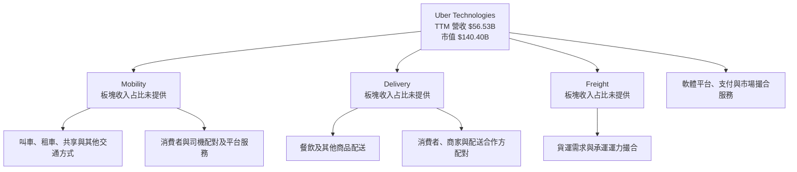
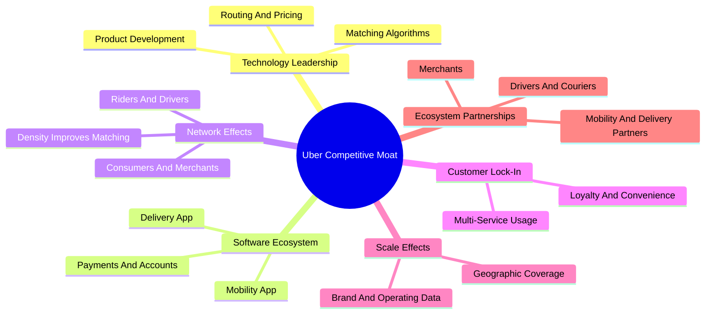
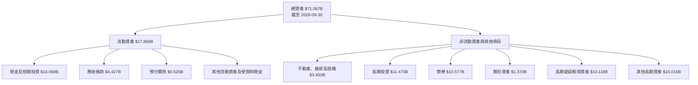
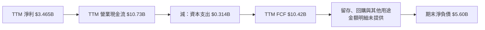
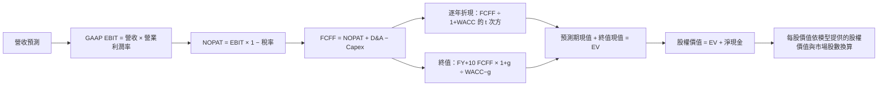
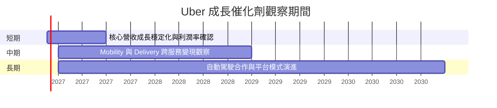
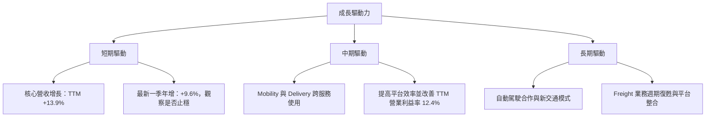
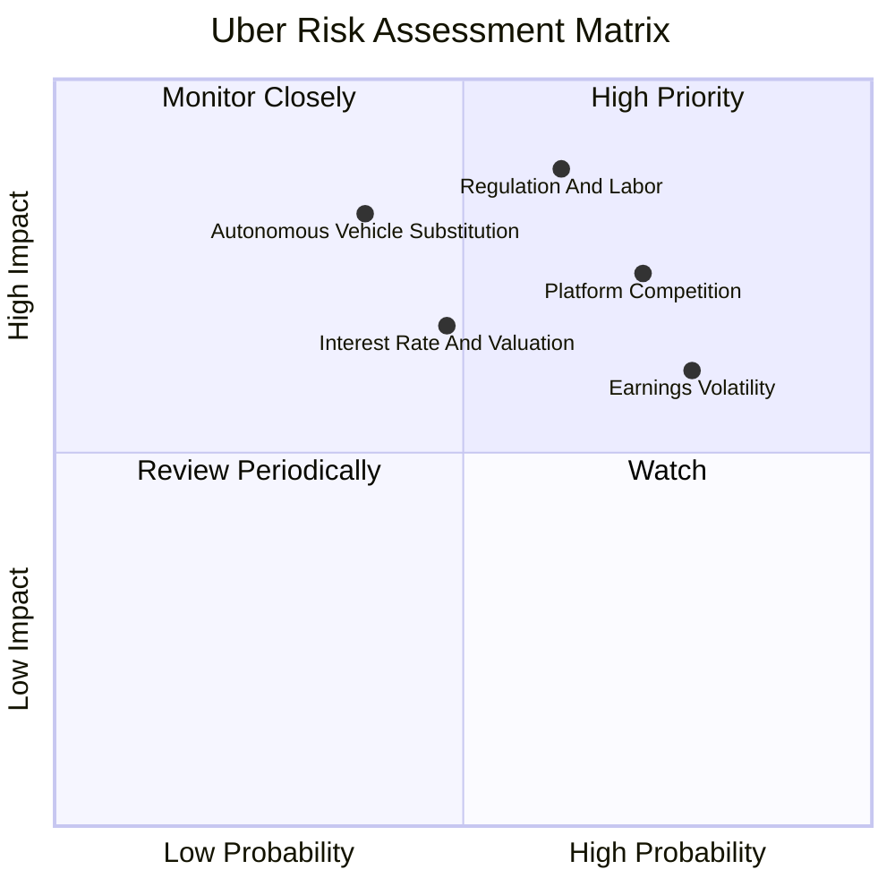
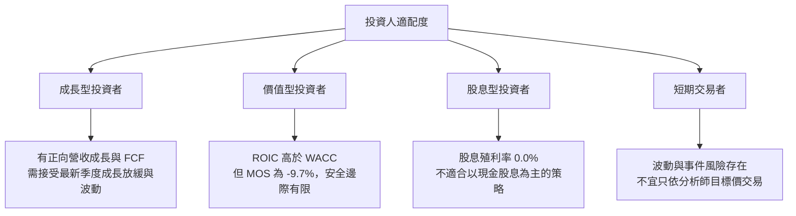

# UBER 基本面深度分析報告
> **報告日期**：2026-11-19 ｜ **語言**：繁體中文 ｜ **數據來源**：SEC 申報資料 (XBRL)、Yahoo Finance、Finviz、StockAnalysis、Roic.ai ｜ **分析師**：CFA 級機構研究

## 目錄

| # | 章節 | 核心結論 |
|---|------|----------|
| 1 | 執行摘要 | 持有；加權合理價值 $62.70，MOS -9.7% |
| 2 | 公司概覽與商業模式 | 多邊平台有網路效應；各板塊收入占比未提供 |
| 3 | 損益表深度分析 | TTM 營收 $56.53B、成長 13.9%；TTM 營業利益率 12.4% |
| 4 | 資產負債表分析 | 淨負債 $5.60B；流動比率 1.232 |
| 5 | 現金流量深度分析 | TTM FCF $10.42B，FCF Yield 7.42% |
| 6 | 獲利能力與資本效率 | ROIC 15.8% 高於 WACC 10.20%，目前創造價值 |
| 7 | 相對估值分析 | 同業估值分歧大；自身 P/E 高於五年中位數 |
| 8 | DCF 內在價值評估 | 基準 DCF 每股 $40.04；加權合理價值 MOS -9.7% |
| 9 | 成長催化劑 | 需求、交叉銷售與自動駕駛合作是觀察重點 |
| 10 | 風險矩陣 | 監管、平台競爭與利潤波動為主要風險 |
| 11 | 投資建議 | 持有；等待估值或營運指標提供更好的風險報酬比 |

---

## 1. 執行摘要

截至 2026-11-18 收盤，UBER 股價為 **$68.76**。公司 TTM 營收 $56.53B、TTM 成長 13.9%，TTM 營業利益率 12.4%，營業現金流 $10.73B、FCF $10.42B，ROIC 15.8% 高於 WACC 10.20%。然而，基準 DCF 每股價值為 $40.04，且 DCF 對長期假設敏感；三種估值方法加權後合理價值為 $62.70，MOS 為 -9.7%。依 MOS 門檻應為**持有**，故不作質化調整。

### 1.0 一頁式投資儀表板

| 項目 | 內容 |
|------|------|
| **投資論點（3 句）** | ① TTM 營收成長 13.9%，但最新一季年增降至 9.6%，需確認成長放緩是否止穩。② TTM FCF $10.42B、FCF Yield 7.42%，顯示營運具現金創造能力。③ ROIC 15.8% 高於 WACC 10.20%，但加權合理價值 $62.70 低於現價 $68.76。 |
| **綜合評分** | **6.3/10**（引用 1.1） |
| **財務健康** | 🟡 現金及短期投資 $10.07B，總債務 $15.66B，淨負債 $5.60B；流動比率 1.232。 |
| **ROIC vs WACC** | 15.8% vs 10.20%；目前創造股東價值。 |
| **FCF 趨勢** | 歷年 FCF 上升至 TTM $10.42B；FCF Yield 7.42%。 |
| **估值** | Forward P/E 15.6x（市場資料）；EV/EBITDA 18.8x（自身歷史序列）；FCF Yield 7.42%。 |
| **DCF 內在價值（基準）** | $40.04；相對 DCF 折價／溢價為 **溢價 71.7%**（現價相對 DCF）。 |
| **安全邊際（MOS）** | **-9.7%**＝($62.70 − $68.76) ÷ $62.70；🔴低於 10%，無安全邊際。 |
| **預期報酬（基準情境 12M）** | **-8.8%**（以加權合理價值 $62.70 相對現價計算，非短期保證報酬）。 |
| **關鍵風險（前二）** | 最新一季 EPS 年增 -92.0%；競爭、監管與自動駕駛替代風險。 |
| **評級 + 信心度** | 🟡 **持有** ｜ 信心：中 |

### 1.1 綜合評分卡（全報告唯一）

| 維度 | 評分（1–10） | 主要依據（引用數字與其來源章節） |
|------|--------------|----------------------------------|
| 成長性 | 7.0 | TTM 營收成長 13.9%，最新一季年增 9.6%，成長仍正但放緩（第 3 章） |
| 獲利能力 | 7.5 | TTM 營業利益率 12.4%；ROIC 15.8% 高於 WACC 10.20%；F-Score 6/8（第 3、6 章） |
| 財務健康 | 6.5 | 淨負債 $5.60B、流動比率 1.232、現金及短期投資 $10.07B（第 4 章） |
| 估值 | 4.0 | MOS -9.7%；P/E 40.2x 高於自身五年中位數 17.8x（第 7、8 章） |
| 護城河 | 7.0 | 多邊平台、品牌及全球服務網絡；但市場份額與各板塊收入占比未提供（第 2 章） |
| 管理層與資本配置 | 6.0 | TTM FCF $10.42B，年度 SBC 約 $1.83B（FY2025）；未提供完整回購與資本配置明細（第 5 章） |
| **綜合評分** | **6.3** | 六項算術平均：$(7.0+7.5+6.5+4.0+7.0+6.0)÷6=6.3$ |

### 1.2 五大投資論點 + 三大核心風險

| 類型 | 項目 | 具體依據 | 信心度 |
|------|------|----------|--------|
| 🟢 **投資論點①** | 現金流規模已具投資支撐力 | TTM OCF $10.73B、Capex $314M、FCF $10.42B，FCF Yield 7.42%。 | 🟢 高 |
| 🟢 **投資論點②** | 營業槓桿改善 | FY2022 營業利益 -$1.83B，FY2025 達 $5.57B；TTM 營業利益率 12.4%。 | 🟢 高 |
| 🟢 **投資論點③** | 資本回報高於資本成本 | ROIC 15.8% 對 WACC 10.20%，差距 5.6 個百分點。 | 🟢 高 |
| 🟢 **投資論點④** | 收入仍維持雙位數 TTM 成長 | TTM 營收 $56.53B，TTM 成長 13.9%。 | 🟡 中 |
| 🟢 **投資論點⑤** | 估值方法存在分歧，提供情境而非單點判斷 | DCF $40.04、同業 Forward P/E $88.16、分析師共識 $98.23。 | 🟡 中 |
| 🟡 **風險①** | 盈餘波動與非營運項目可能影響 GAAP 盈餘 | 最新一季淨利 $512M，EPS 年增 -92.0%；前一季淨利 $2.394B。 | 🟡 中 |
| 🔴 **風險②** | 競爭與監管壓力 | 同業 Lyft、DoorDash、Grab 均有不同成長／估值特徵；監管成本可能壓低平台利潤率。 | 🔴 高衝擊 |
| 🟡 **風險③** | DCF 基準值低於現價 | DCF $40.04，較 $68.76 現價低 41.8%；估值對 WACC、終值高度敏感。 | 🟡 中 |

### 1.3 快速統計卡片

| 指標 | 公司實際值（期間） | 同業中位數 | 狀態 |
|------|--------------------|------------|------|
| 營收成長（TTM） | **13.9%** | — | 🟢 |
| 營收成長（最新一季年增） | **9.6%** | 27.4% | 🟡 |
| 毛利率（TTM） | **41.4%** | 41.4% | 🟡 |
| 營業利益率（TTM） | **12.4%** | — | 🟢 |
| ROIC（TTM） | **15.8%** | — | 🟢 |
| Forward P/E | **15.6x**（市場估值資料） | 20.0x | 🟢 |
| FCF Yield（TTM） | **7.42%** | — | 🟢 |
| Piotroski F-Score | **6 / 8** | — | 🟢 |

同業中位數按 Peer multiples 的三家公司中位數計算；Forward P/E 中位數為 20.0x，最新一季營收成長中位數為 27.4%，毛利率中位數為 41.4%。

### 1.4 投資結論

```text
╔══════════════════════════════════════════════════════════════════╗
║                    📊 投資結論摘要                               ║
╠══════════════════════════════════════════════════════════════════╣
║  評級：持有（依 MOS 門檻；未作質化調整）                         ║
║  價格（2026-11-18 收盤）：$68.76                                 ║
║  DCF 內在價值（基準）：$40.04（現價溢價 71.7%）                 ║
║  安全邊際 MOS：-9.7%（＝($62.70−$68.76)÷$62.70）               ║
║  加權合理價值（8.8）：$62.70                                     ║
║  DCF 情境價值：                                                   ║
║    悲觀情境：$22.73（-66.9%）                                    ║
║    基準情境：$40.04（-41.8%）                                    ║
║    樂觀情境：$66.76（-2.9%）                                     ║
║  綜合評分：6.3/10（引用 1.1）                                    ║
║  適合投資人：可承受平台競爭與估值波動的成長型、長線投資人        ║
╚══════════════════════════════════════════════════════════════════╝
```

---

## 2. 公司概覽與商業模式

### 2.1 業務結構與收入來源

公司資料列出 Mobility、Delivery、Freight 三個板塊，但未提供各板塊營收金額或占比，因此不以推估比例繪製收入占比圖。公司 TTM 營收為 $56.53B。



Uber 的核心經濟模式是以應用程式匹配供需，透過平台費用與相關服務獲利；交易量、供需密度、用戶留存及激勵支出會共同決定營收與利潤率。區塊層級收入占比、交易抽成率及各板塊營業利益均未提供，不能據此斷言哪一板塊是當期主要利潤來源。

### 2.2 市場份額

**市場份額數據未提供**，因此不製作市場份額圖表或估算比例。以營收規模而言，Uber TTM 營收 $56.53B、TTM 成長 13.9%；Peer multiples 中 Lyft 最新一季營收年增 8.1%，而 DoorDash 與 Grab 分別為 34.0% 與 27.4%。但三者業務組合不同，這些成長率不能直接視為同一市場的份額變化。

### 2.3 競爭護城河分析



### 2.4 護城河強度

| 護城河項目 | 強度（強／中／弱） | 證據（引用數字或事實） | 會削弱它的情況 |
|------------|--------------------|------------------------|----------------|
| 技術與平台撮合 | 中 | 公司同時經營 Mobility、Delivery、Freight；TTM 營收 $56.53B。 | 競爭者在定價、派單或服務品質上形成持續優勢。 |
| 網路效應 | 中至強 | 多邊平台需要消費者、司機／配送方與商家共同參與。 | 激勵支出升高、供給方多平台化或用戶更換成本降低。 |
| 品牌與規模 | 中 | 業務涵蓋多個地區與交通服務；公司員工 37,300 人。 | 當地法規限制、品牌受損或本地競爭者採取補貼策略。 |
| 客戶鎖定 | 中 | Mobility 與 Delivery 可形成跨服務使用情境，但未提供交叉銷售、留存率數據。 | 用戶因價格或服務品質迅速切換。 |
| 生態夥伴 | 中 | 司機、商家及其他運輸方式為平台供給來源。 | 供應方議價能力提高，或合作模式受法規改變。 |

1.1「護城河」評分 7.0/10 的理由是：多邊平台和跨服務網絡具規模基礎，但缺少市場份額、留存及各板塊經濟性數據，故不給更高分。

---

## 3. 損益表深度分析

### 3.1 年度收入成長趨勢（近 4 年）

FY2022 至 FY2025 營收資料為 $31.88B、$37.28B、$43.98B、$52.02B。FY2022 至 FY2025 三年 CAGR 約 17.8%：$(52.02÷31.88)^{1/3}-1$。

```text
╔══════════════════════════════════════════════════════════════════╗
║             Uber 年度收入趨勢（FY2022-FY2025）                   ║
╠══════════════════════════════════════════════════════════════════╣
║  FY2022  $31.88B  ████████████░░░░░░░░░░░░  YoY：—              ║
║  FY2023  $37.28B  ██████████████░░░░░░░░░░  YoY：+16.9%         ║
║  FY2024  $43.98B  █████████████████░░░░░░░  YoY：+18.0%         ║
║  FY2025  $52.02B  ████████████████████░░░░  YoY：+18.3%         ║
║                                                                  ║
║  📊 FY2022-FY2025 三年收入 CAGR：約 +17.8%                       ║
╚══════════════════════════════════════════════════════════════════╝
```

FY2025 年增 18.3%，但最新 TTM 成長 13.9%，最新一季年增 9.6%，呈現逐步放緩。這可能反映基期提高或單季成長正常化；未提供行程量、總預訂額或價格／交易量拆分，不能確定放緩是需求、價格或產品組合所致。

### 3.2 季度收入趨勢分析

| 季度 | 營收（$B） | QoQ | YoY | 備註 |
|------|-----------:|----:|----:|------|
| 2025 Q4 | 14.366 | +6.7% | +20.1% | QoQ 依 2025 Q3 營收 $13.467B 計算；YoY 取 StockAnalysis 季度成長率。 |
| 2026 Q1 | 13.203 | -8.1% | +14.5% | QoQ 依 2025 Q4 計算；季節性可能影響比較。 |
| 2026 Q2 | 14.191 | +7.5% | +12.2% | 營收較 Q1 回升，但年增率延續下滑。 |
| 2026 Q3 | 14.766 | +4.1% | +9.6% | YoY 使用最新季度核實數值；不可視為 TTM 成長。 |

QoQ 為相鄰季度營收的算術比較，未經季節性調整。最新季度營收仍創表列四季高點，但 YoY 從 2025 Q4 的 20.1% 降至 2026 Q3 的 9.6%，投資上應區分「規模仍增加」與「成長速度放緩」。

### 3.3 利潤率演變分析

| 利潤率指標 | FY2022 | FY2023 | FY2024 | FY2025 | 趨勢 | 評估 |
|------------|--------|--------|--------|--------|------|------|
| **毛利率** | 38.3% | 39.8% | 39.4% | 39.8% | 大致穩定 | 🟡 |
| **營業利益率** | -5.7% | 3.0% | 6.4% | 10.7% | 持續改善 | 🟢 |
| **淨利率** | -28.7% | 5.1% | 22.4% | 19.3% | 受非營業與稅務項目影響 | 🟡 |

年度毛利率按年度收入與毛利計算；2025 年使用年度損益表 $20.68B 毛利與 $52.02B 營收。另有 StockAnalysis 年度毛利數據不同，故此處標明依年度損益表口徑。TTM 核實毛利率為 41.4%，TTM 營業利益率為 12.4%；最新單季營業利益率核實值為 9.8%。季度資料另有不同來源顯示 Q3 2026 營業利益 $1.447B、營收 $14.766B，兩者比率約 9.8%，故本報告採核實的最新季度數值而非其他合併欄位所列 12.4%。

營業利益率由 2022 年負值轉正並提升，顯示收入擴張後平台成本吸收改善；但淨利率並非平滑改善，FY2024、FY2025 淨利率遠高於營業利益率，說明非營業項目、稅項與其他損益對 GAAP 淨利影響較大，估值不宜只看單年淨利。

### 3.4 費用結構分析

完整費用細目未提供，故不製作費用比例圓餅圖。已知 FY2025 研發費用為 $3.40B，營業利益為 $5.57B；研發費用約為營收的 6.5%（$3.40B÷$52.02B）。薪酬、銷售行銷、保險及其他費用的完整拆分未提供，不能將未列項目推算成費用結構。

### 3.5 季度 EPS 趨勢與盈餘品質（Quality of Earnings）

| 季度 | EPS 實際 | EPS 年增 | 預期／超預期資料 |
|------|---------:|--------:|-----------------|
| 2025 Q4 | $0.14 | -95.58% | EPS 預期值 N/A，無法判定超預期或不及預期 |
| 2026 Q1 | $0.13 | -84.57% | EPS 預期值 N/A，無法判定 |
| 2026 Q2 | $1.17 | +85.46% | EPS 預期值 N/A，無法判定 |
| 2026 Q3 | $0.25 | -91.97% | EPS 預期值 N/A，無法判定 |

| 盈餘品質項目 | 數值／佔比 | 評估 |
|--------------|-----------|------|
| 股權薪酬 SBC / 營收 | 估計約 3.7%：四季 SBC $2.065B ÷ TTM 營收 $56.53B | 🟡 SBC 對股東報酬有實質成本；四季 SBC 合計是依季度列值加總。 |
| SBC / 營業現金流 | 估計約 19.3%：$2.065B ÷ $10.73B | 🟡 雖未直接等同現金支出，但代表現金流品質須扣除稀釋成本考量。 |
| FCF / 淨利（現金轉換率） | 約 300.7%：$10.42B ÷ TTM 淨利 $3.465B | 🟢 現金流高於淨利；但淨利可能受非營業項目波動影響。 |
| 一次性／非經常性損益 | 最新季度 EPS 年減 92.0%；其他一次性項目明細 N/A | 🟡 單季 EPS 波動顯著，缺少足夠明細辨別各項損益來源。 |
| 有效稅率異常 | N/A（未提供可核實的 TTM 現金及 GAAP 有效稅率） | 稅務對單季淨利的影響無法量化。 |
| 資本化支出 vs 費用化 | TTM Capex $314M；資本化政策與費用化細項 N/A | 不應把低 Capex 直接等同低再投資需求；資本化明細未提供。 |

盈餘品質整體為**現金流較有支撐、GAAP EPS 波動較大**。SBC 不能因其非現金性而忽略：FY2025 SBC $1.83B，約占當年收入 3.5%；長期若股數持續增加，會稀釋每股經濟利益。DCF 採 GAAP EBIT，模型不再額外扣 SBC，但股數使用固定股數，這是估值假設而非對未來稀釋風險的否認。

---

## 4. 資產負債表分析

### 4.1 資產結構分解

最新 TTM 資產負債表列示總資產 $71.067B。下圖只呈現已列明的資產項目，其他長期資產等項目保留原數，不作未提供項目拆分。



流動資產細項與總額之間可能因受限制現金及其他項目分類而存在分類口徑差異；上圖各項目是資產負債表列值，不以逐項相加取代報表總額。

### 4.2 流動性與營運資金分析

| 指標 | 最新 TTM | 一年前 TTM | 變化 | 解讀 |
|------|----------|------------|------|------|
| DSO 應收帳款天數 | 29 天 | 28 天 | +1 天 | 應收周轉略慢；單年度差距小，須觀察後續趨勢。 |
| DIO 存貨天數 | N/A | N/A | N/A | 公司未報告相應存貨餘額，不能補估。 |
| DPO 應付帳款天數 | 17 天 | N/A | N/A | 一年前數據缺失，無法比較供應商付款週期。 |
| CCC 現金轉換週期 | N/A | N/A | N/A | 因 DIO 缺失，不填算現金轉換週期。 |

流動比率 1.232、速動比率 0.999，顯示短期資產大致可覆蓋流動負債，但速動比率接近 1，流動性緩衝不是特別寬裕。短期流動性仍須同時考慮平台支付、保險相關負債與資金用途；本報告未取得各項負債到期明細。

### 4.3 債務結構分析

同一批資料中的市場資料欄位列總債務 $17.74B、淨負債 $7.67B；SEC 10-Q 核實區塊列總債務 $15.66B、現金及短期投資 $10.07B、淨負債 $5.60B。依規則，本報告核心分析採 SEC 核實數值；前者視為來源／口徑差異，不混用。

```text
╔══════════════════════════════════════════════════════════════════╗
║                   Uber 債務健康診斷                              ║
╠══════════════════════════════════════════════════════════════════╣
║  總債務：          $15.66B                                       ║
║  現金及短期投資：  $10.07B                                       ║
║  淨負債：           $5.60B  🟡                                  ║
║  TTM 營業現金流：  $10.73B                                       ║
║  總債務 / TTM OCF：1.46x（15.66÷10.73）                         ║
║  Debt / EBITDA：   N/A（核實區塊未提供一致口徑 EBITDA）          ║
║  利息保障倍數：     N/A（利息費用明細未提供）                    ║
╚══════════════════════════════════════════════════════════════════╝
```

公司有充足現金流覆蓋債務，但仍是淨負債，而不是淨現金公司。債務到期結構、固定／浮動利率分布及契約條款未提供，故不對再融資風險作無根據量化。

### 4.4 股東權益趨勢

```text
╔══════════════════════════════════════════════════════════════════╗
║                   Uber 股東權益變化                              ║
╠══════════════════════════════════════════════════════════════════╣
║  FY2022  $7.34B   ██████░░░░░░░░░░░░░░░░░░░░░                   ║
║  FY2023  $11.25B  ██████████░░░░░░░░░░░░░░░░░                   ║
║  FY2024  $21.56B  ██████████████████░░░░░░░░                   ║
║  FY2025  $27.04B  ███████████████████████░░░                   ║
║                                                                  ║
║  FY2022-FY2025 權益增加：$19.70B                                ║
╚══════════════════════════════════════════════════════════════════╝
```

股東權益逐年增加，但帳面權益受累計盈餘、股權薪酬及其他綜合損益影響，不能單獨視為資本回報指標。

---

## 5. 現金流量深度分析

### 5.1 現金流量瀑布圖

季度／年度分紅與回購金額未提供，故流程圖只呈現有數字的現金流環節，不虛構資本回饋金額。



### 5.2 FCF 轉換率趨勢

| 年度 | FCF（$B） | 淨利（$B） | FCF / 淨利 | 解讀 |
|------|----------:|-----------:|-----------:|------|
| FY2022 | 0.39 | -9.14 | -4.3% | 淨利為負，比例不宜作常態比較。 |
| FY2023 | 3.36 | 1.89 | 177.8% | FCF 高於淨利，反映營運資金及非現金項目作用。 |
| FY2024 | 6.89 | 9.86 | 69.9% | 淨利轉換為現金低於前一年。 |
| FY2025 | 9.76 | 10.05 | 97.1% | FCF 接近淨利。 |
| TTM | 10.42 | 3.465 | 300.7% | TTM 淨利口徑波動較大，該比率不宜視為穩態。 |

### 5.3 自由現金流趨勢

| 期間 | FCF（$B） | YoY | FCF Yield |
|------|----------:|----:|----------:|
| FY2022 | 0.39 | — | — |
| FY2023 | 3.36 | +761.5% | — |
| FY2024 | 6.89 | +105.1% | — |
| FY2025 | 9.76 | +41.7% | — |
| TTM | 10.42 | N/A | 7.42% |

```text
╔══════════════════════════════════════════════════════════════════╗
║                  Uber 自由現金流趨勢                             ║
╠══════════════════════════════════════════════════════════════════╣
║  FY2022  $0.39B   █░░░░░░░░░░░░░░░░░░░░                         ║
║  FY2023  $3.36B   ███████░░░░░░░░░░░░░                           ║
║  FY2024  $6.89B   ██████████████░░░░░░                           ║
║  FY2025  $9.76B   ███████████████████░                           ║
║  TTM     $10.42B  ████████████████████  Yield：7.42%             ║
╚══════════════════════════════════════════════════════════════════╝
```

近年 FCF 上升，部分來自營業現金流由 FY2022 $0.642B 增至 FY2025 $10.10B。資本支出相對營業現金流較小，TTM Capex $314M；但不能因此推論未來成長不需投入，尤其平台技術、保險及市場拓展成本未必都列為資本支出。

### 5.4 資本配置評估

回購、分紅、併購及現金留存的完整金額分配未提供，故不製作資本配置圓餅圖。可確認 FY2025 SBC 為 $1.83B，FY2025 Capex 約 $336M（年度現金流資料以支出列示為負）；股息殖利率為 0%。目前現金流數據支持再投資與資產負債表管理能力，但無法由資料判斷管理層是否以最佳方式配置所有 FCF。

---

## 6. 獲利能力與資本效率

### 6.1 ROE / ROA / ROIC 趨勢

| 指標 | FY2023 | FY2024 | FY2025 | 最新 TTM | 評估 |
|------|-------:|-------:|-------:|---------:|------|
| ROE | N/A | N/A | N/A | 12.5% | 以核實區塊 TTM 數值為準；來源欄位另有 12.3% 差異。 |
| ROA | N/A | N/A | N/A | N/A | 歷史序列未提供一致核實值。 |
| ROIC | N/A | N/A | N/A | 15.8% | 高於 WACC 10.20%，目前資本回報高於資本成本。 |

### 6.2 ROIC vs WACC 分析（核心價值創造判斷）

```text
╔══════════════════════════════════════════════════════════════════╗
║                ROIC vs WACC 深度分析                            ║
╠══════════════════════════════════════════════════════════════════╣
║  WACC 來源：程式計算的資本成本區塊                               ║
║  ├── 無風險利率（10Y 美債）：5.07%                               ║
║  ├── 市場風險溢酬 ERP：5.00%                                     ║
║  ├── Beta 原始值：1.31；調整後採用：1.21                         ║
║  ├── 股權成本（採用值）：11.09%                                  ║
║  ├── 稅前債務成本：2.81%；稅率：21.0%                            ║
║  ├── 股權 / 債務權重：90.0% / 10.0%                             ║
║  └── ✅ WACC：10.20%                                             ║
║                                                                  ║
║  ROIC（TTM）：15.8%                                               ║
║  EVA 利差 = ROIC − WACC = 15.8% − 10.20% = +5.6 個百分點       ║
║                                                                  ║
║  ROIC  15.8%  ▓▓▓▓▓▓▓▓▓▓▓▓▓▓▓▓░░░░  🟢                         ║
║  WACC  10.2%  ▓▓▓▓▓▓▓▓▓▓░░░░░░░░░░  ──                         ║
║  EVA    +5.6pp ███████████░░░░░░░░░  🟢                         ║
╠══════════════════════════════════════════════════════════════════╣
║  結論：ROIC 高於 WACC，依核實 TTM 指標判斷公司目前創造價值。    ║
║  ROIC / WACC = 15.8% ÷ 10.20% = 1.55x                           ║
╚══════════════════════════════════════════════════════════════════╝
```

以採用值計算：股權成本的來源區塊直接列 11.09%；債務成本稅後為 $2.81\%×(1-21.0\%)=2.22\%$。WACC 為 $90.0\%×11.09\%+10.0\%×2.22\%=10.20\%$（四捨五入）。以呈現的 Rf、調整後 Beta、ERP 直接相乘會得到 $5.07\%+1.21×5.00\%=11.12\%$，與成本資本來源列示的 11.09% 有 0.03 個百分點差異；本報告依要求採用來源 WACC 10.20%，不自行替換。

### 6.3 杜邦三因素分解

| 因素 | 數值（TTM） | 解讀 |
|------|-------------|------|
| 淨利率 | 6.1% | 來源提供值；單季非營業或稅務波動可能令淨利率不穩。 |
| 資產週轉率 | 0.80 | 平台以相對輕資產模式運營，但仍需觀察資產擴張與營收同步性。 |
| 權益乘數 | 2.57 | 財務槓桿對 ROE 有貢獻，但不是唯一來源。 |
| **ROE** | **12.5%** | 6.1% × 0.80 × 2.57 = 12.54%，四捨五入為 12.5%。 |

依核實杜邦數據，ROE 是淨利率、資產週轉與槓桿共同作用，權益乘數 2.57 表示槓桿不可忽略；但營業現金流為正及 ROIC 高於 WACC，表示價值創造並非僅由帳面槓桿推動。

### 6.4 財務體質：Piotroski F-Score

核實分數為 **6/8**；毛利率測試因缺少輸入未計入分母，因此不是 6/9。

| 測試 | 結果 | 解讀 |
|------|------|------|
| ROA > 0 | ✅ 通過 | TTM 資產回報為正。 |
| 營業現金流 > 0 | ✅ 通過 | TTM OCF $10.73B。 |
| ROA 高於一年前 | ❌ 未通過 | 資產獲利改善未能在比較期通過。 |
| 營業現金流 > 淨利（應計品質） | ✅ 通過 | 現金流高於淨利。 |
| 長期負債 ÷ 總資產低於一年前 | ❌ 未通過 | 槓桿相對資產未改善。 |
| 流動比率高於一年前 | ✅ 通過 | 流動比率改善。 |
| 稀釋股數未增加 | ✅ 通過 | 核實比較期間通過；不代表未來不會稀釋。 |
| 毛利率高於一年前 | — 無法判定 | 缺少必要資料，未納入分母。 |
| 資產週轉率高於一年前 | ✅ 通過 | 資產利用效率通過比較測試。 |

F-Score 6/8 表示盈利與現金流面多數測試通過，但負債比例與 ROA 比較未通過。對高現金流平台而言，需持續檢驗現金流是否伴隨負債風險下降，以及股數變化是否持續受控。

---

## 7. 相對估值分析

### 7.1 同業估值比較表格

| 估值指標 | **UBER** | **LYFT** | **DASH** | **GRAB** | UBER 評估 |
|----------|--------:|--------:|--------:|--------:|-----------|
| **Trailing P/E** | 40.2x | 2.6x | 69.2x | 31.4x | 🟡 同業差異大；LYFT 倍數可能受獲利基數影響。 |
| **Forward P/E** | 15.6x | 8.6x | 21.9x | 20.0x | 🟢 低於 DASH、GRAB，但高於 LYFT。 |
| **P/S Ratio** | 2.5x | 1.0x | 4.3x | 3.2x | 🟡 高於 LYFT、低於 DASH 與 GRAB。 |
| **EV/EBITDA** | 18.8x | 588.2x | 41.0x | 21.0x | 🟢 低於 DASH、GRAB；LYFT 數值極高，可能由 EBITDA 分母偏低造成。 |
| **最新季度營收年增** | 9.6% | 8.1% | 34.0% | 27.4% | 🔴 UBER 成長低於 DASH、GRAB。 |
| **毛利率（TTM）** | 41.4% | 40.0% | 52.7% | 41.4% | 🟡 與 GRAB 相同，高於 LYFT、低於 DASH。 |

本公司 Forward P/E 使用市場估值資料 15.6x；Peer multiples 提供的同業 Forward P/E 中位數為 20.0x。倍數比較須配合成長差異：UBER 最新季度營收年增 9.6%，低於 DASH 34.0% 與 GRAB 27.4%，因此低於同業中位數的 Forward P/E 有一定基本面解釋，不能單看便宜倍數判定低估。

### 7.2 歷史估值區間分析

```text
╔══════════════════════════════════════════════════════════════════╗
║              UBER 五年歷史估值區間（TTM）                        ║
╠══════════════════════════════════════════════════════════════════╣
║  P/E：       12.6x ├────────中位數 17.8x────────● 40.2x────122.2x║
║               當前百分位：69%                                    ║
║  P/S：        1.5x ├──────● 2.5x──中位數 3.3x───────────6.1x     ║
║               當前百分位：24%                                    ║
║  EV/EBITDA： 18.7x ● 18.8x──中位數 40.0x──────────────320.2x   ║
║               當前百分位：7%                                     ║
╚══════════════════════════════════════════════════════════════════╝
```

P/E 40.2x 高於五年中位數 17.8x、位於歷史第 69 百分位；但 EV/EBITDA 18.8x 接近五年區間低端，P/S 2.5x 低於中位數 3.3x。不同倍數的結論相反，原因在於公司近期獲利與 EBITDA 基數發生變化，且過去區間曾包含極端高值。

### 7.3 情境價值（照抄 DCF MODEL 的 Scenarios）

| 情境 | 第 1 年營收成長 | 期末營業利潤率 | WACC | 每股價值 | 相對現價 | 機率 | 會發生的條件 |
|------|----------------|----------------|------|----------|----------|------|--------------|
| 🔴 悲觀 | 7.0% | 5.4% | 11.20% | $22.73 | -66.9% | 25% | 成長降速且競爭、監管或成本壓力使長期利潤率低於基準。 |
| 🟡 基準 | 13.9% | 6.4% | 10.20% | $40.04 | -41.8% | 初期延續 TTM 成長、之後逐步放緩，長期利潤率回落至五年中位水準。 |
| 🟢 樂觀 | 20.9% | 7.0% | 9.20% | $66.76 | -2.9% | 需求、跨服務變現與成本效率優於基準，且資本成本下降。 |

### 7.4 相對估值隱含價格區間

```text
╔══════════════════════════════════════════════════════════════════╗
║                 估值方法每股價值比較                            ║
╠══════════════════════════════════════════════════════════════════╣
║  DCF 基準 $40.04 ───── 現價 $68.76 ── 同業 Forward P/E $88.16  ║
║                                  └── 分析師共識 $98.23           ║
╚══════════════════════════════════════════════════════════════════╝
```

- **DCF 基準 $40.04**：10 年 FCFF、WACC 10.20%、永續成長率 3.0%。
- **同業 Forward P/E $88.16**：同業中位數 Forward P/E 20.0x × UBER Forward EPS $4.41。
- **分析師共識 $98.23**：45 位分析師平均目標價，為外部參考，不是基本面現金流模型。
- 同業 EV/EBITDA 方法因無法計算而排除，權重依估值方法規則重新分配，並已反映在固定權重表。

---

## 8. DCF 內在價值評估（Discounted Cash Flow）

### 8.0 估值推理鏈（Thinking Logic）

**Step 1 — 價值由哪些變數決定？**  
本模型將價值拆為 Mobility、Delivery、Freight 的整體平台現金流，但各板塊營收占比未提供，因此不能分別量化「現有主業、第二曲線、新業務選擇權」；可直接驗證的核心變數是營收成長、營業利潤率及 WACC／終值。敏感度矩陣顯示 WACC 與終值成長率會顯著影響每股價值，與此判斷一致。

**Step 2 — 模型選擇**

| 決策點 | 本報告採用 | 理由（含數字） | 曾考慮但否決 | 否決理由 |
|--------|-----------|----------------|--------------|----------|
| 現金流定義 | FCFF | 對應 WACC 折現並先計算企業價值；TTM FCF $10.42B。 | FCFE | 直接以股權成本折現會忽略資本結構變化。 |
| 預測期 N | 10 年 | DCF MODEL 固定採 10 年，涵蓋成長逐步成熟的期間。 | 5 年 | 不能完整呈現成長率由 13.9% 淡化至 3.0% 的路徑。 |
| 終值方法 | Gordon Growth | 永續成長率 3.0%，低於 WACC 10.20%。 | 只採退出倍數 | 模型已指定 Gordon Growth；不可自行替換。 |
| EBIT 基礎 | GAAP EBIT | 預測期營業利潤率按 GAAP 口徑。 | 非 GAAP EBIT | 未提供一致的調整後 EBIT 序列，避免將 SBC 加回。 |

**Step 3 — 關鍵假設推導鏈**

- **營收成長**：錨點＝TTM 成長 13.9%；調整＝預測由 13.9% 線性降至第 10 年 3.0%，反映最新單季年增 9.6% 低於 TTM；**採用第 1 年 13.9%、第 10 年 3.0%**；否決固定維持 13.9%，因其不符合最近單季成長放緩訊號。
- **期末營業利潤率**：錨點＝TTM 營業利益率 12.4%；調整＝逐年淡化至過去五個財年中位數（含 TTM）的 6.4%；**採用 6.4%**；否決長期維持 12.4%，因模型採用歷史中位數回歸而非永久延伸當前高利潤率。
- **永續成長率 g**：錨點＝長期成熟企業需低於經濟長期名目成長假設；**採用 3.0%**，且低於 WACC 10.20%；否決高於 3.0% 的長期增長設定，避免終值占比與遠期假設過度膨脹。
- **預測期 N**：錨點＝模型固定 10 年；**採用 10 年**；否決縮短至 5 年，因會改變既定模型輸入及終值起算年。
- **Capex／營收**：錨點＝TTM Capex $314M ÷ TTM 營收 $56.53B，約 0.6%；**採用第 1 至第 10 年 0.6%**；否決提高至 1.1×D&A 的較高值，因模型規則在 TTM Capex 比率低於該門檻時維持現值。
- **EBIT 基礎與 SBC**：採 GAAP EBIT，內含 SBC 費用；模型不再從 FCFF 扣 SBC，並採固定股數。否決非 GAAP EBIT 加回 SBC，因會改變 DCF MODEL 已提供的模型口徑。
- **年稀釋率**：錨點＝模型組合 A 固定股數；**採用 0% 額外稀釋**；否決額外放大股數，因 GAAP EBIT 已含 SBC 費用，避免再重複計算 SBC 成本。
- **終值方法**：錨點＝模型採 Gordon Growth；**採用永續成長率 3.0%**；否決只用退出倍數，因模型沒有提供退出倍數作為主要終值的替代指示。
- **WACC**：錨點＝成本資本區塊列示 10.20%；**採用 10.20%**；否決另行重估 WACC，因規則要求直接引用程式計算的資本成本值。

**Step 4 — 最脆弱一環**  
最脆弱假設是長期利潤率與終值現金流：終值現值占企業價值 45.8%，若營收或利潤率不能按模型路徑實現，估值將下降；敏感度矩陣基準附近每增加 1 個百分點 WACC，價值約下降 $4.86（以 9.2% 至 10.2% 差額比較）。

**Step 5 — 計算路徑圖**



### 8.1 模型假設總表（Model Inputs）

| 假設項目 | 採用值 | 依據／來源 | 敏感度 |
|----------|--------|-------------|--------|
| 預測期長度 N | 10 年 | DCF MODEL 固定預測期間；TTM 營收 $56.53B。 | 🟡 中 |
| 營收成長 | 第 1 年 13.9% 線性淡化至第 10 年 3.0% | TTM vs prior TTM 成長 13.9%；單季 YoY 9.6%。 | 🔴 高 |
| 營業利潤率 | 第 1 年 12.4% 至第 10 年 6.4% | TTM 營業利益率 12.4%；模型指定五年中位數 6.4%。 | 🔴 高 |
| 有效稅率 | 21.0% | 成本資本／DCF 模型預設稅率；非公司核實實際稅率。 | 🟢 低 |
| Capex / 營收 | 0.6% | TTM Capex $314M ÷ 營收 $56.53B 約 0.6%。 | 🟡 中 |
| D&A / 營收 | 1.4% | DCF MODEL 採 TTM 1.4%，固定。 | 🟢 低 |
| 營運資金變動 | 未建模 | DCF MODEL 明列 Working capital is not modelled；ΔWC 不得填入推估數字。 | 🟢 低 |
| EBIT 基礎 | GAAP | 模型使用 GAAP EBIT。 | 🟡 中 |
| SBC 處理 | SBC 已含 GAAP EBIT，不再減 SBC | DCF MODEL 明確採組合 A。 | 🟡 中 |
| 年稀釋率 | 0% | 固定股數；SBC 已計入 GAAP 費用，與組合 A 相容。 | 🟡 中 |
| 永續成長率 g | 3.0% | DCF MODEL 指定；低於 WACC 10.20%。 | 🔴 高 |
| 終值方法 | Gordon Growth | DCF MODEL 直接採用。 | 🔴 高 |
| WACC | 10.20% | 成本資本區塊核實值。 | 🔴 高 |

FCFF 定義為模型指定的 **NOPAT + D&A − Capex**，ΔWC 不納入，不能與含營運資金變動的其他 FCFF 定義混用。本模型採用 **(A) GAAP EBIT + 固定股數**，故 SBC 影響已計入一次。

### 8.2 折現率推導（WACC）

```text
╔══════════════════════════════════════════════════════════════════╗
║                    WACC 推導（折現率）                           ║
╠══════════════════════════════════════════════════════════════════╣
║  股權成本 Ke（CAPM，採來源列示值）：11.09%                       ║
║  ├── 無風險利率 Rf：5.07%                                        ║
║  ├── ERP：5.00%                                                   ║
║  ├── 原始 Beta：1.31；調整後 Beta：1.21                          ║
║  └── Ke 來源列示：11.09%                                         ║
║                                                                  ║
║  債務成本 Kd：                                                     ║
║  ├── 稅前 Kd：2.81%                                               ║
║  ├── 稅率：21.0%                                                  ║
║  └── 稅後 Kd = 2.81% × (1−21.0%) = 2.22%                        ║
║                                                                  ║
║  資本結構（來源列示權重）：                                       ║
║  ├── 股權權重 E：90.0%                                           ║
║  ├── 債務權重 D：10.0%                                           ║
║  └── ✅ WACC = 90.0%×11.09% + 10.0%×2.22% = 10.20%              ║
╚══════════════════════════════════════════════════════════════════╝
```

逐步演算：

1. **Ke**：來源列示採用值為 11.09%；展示輸入直接相乘為 $5.07\%+1.21×5.00\%=11.12\%$，與來源值差 0.03 個百分點，屬輸入四捨五入／底層精度差異；WACC 採來源值。
2. **稅前 Kd**：來源列示 $利息÷債務=2.81\%$；利息費用與平均計息負債絕對值未提供，無法重建其分子與分母。
3. **稅後 Kd**：$2.81\%×(1-21.0\%)=2.2199\%\approx2.22\%$。
4. **權重**：採用來源列示股權 90.0%、債務 10.0%，合計 100.0%；市值基礎股權金額與債務權重的底層精確計算沒有在成本資本區塊列示。
5. **WACC**：$90.0\%×11.09\%+10.0\%×2.22\%=9.981\%+0.222\%=10.203\%\approx10.20\%$。

Rf 日期未在資本成本欄位列出，僅標示 10Y Treasury 5.07%；ERP 5.00% 為假設值（依據：成本資本計算採用值）。未另加規模／國別溢酬。為遵守核實數值優先原則，第 6.2 節與本節均採 WACC 10.20%。

### 8.3 逐年自由現金流預測（基準情境）

金額單位為 $B。逐年數字照錄 DCF MODEL。模型未列 ΔWC 數值，FCFF 使用該模型定義，不添加獨立 ΔWC 列。

| 年度 | FY+1 | FY+2 | FY+3 | FY+4 | FY+5 | FY+6 | FY+7 | FY+8 | FY+9 | FY+10 |
|------|-----:|-----:|-----:|-----:|-----:|-----:|-----:|-----:|-----:|------:|
| 營收 | 64.41 | 72.60 | 80.96 | 89.29 | 97.40 | 105.06 | 112.04 | 118.12 | 123.10 | 126.80 |
| 營收 YoY | 13.9% | 12.7% | 11.5% | 10.3% | 9.1% | 7.9% | 6.6% | 5.4% | 4.2% | 3.0% |
| 營業利潤率 | 12.4% | 11.8% | 11.1% | 10.4% | 9.7% | 9.1% | 8.4% | 7.7% | 7.0% | 6.4% |
| EBIT | 8.01 | 8.54 | 8.98 | 9.30 | 9.49 | 9.52 | 9.40 | 9.11 | 8.67 | 8.07 |
| − 稅 | (1.68) | (1.79) | (1.89) | (1.95) | (1.99) | (2.00) | (1.97) | (1.91) | (1.82) | (1.69) |
| = NOPAT | 6.33 | 6.75 | 7.09 | 7.35 | 7.50 | 7.52 | 7.43 | 7.20 | 6.85 | 6.38 |
| + D&A | 0.88 | 0.99 | 1.10 | 1.21 | 1.33 | 1.43 | 1.52 | 1.61 | 1.67 | 1.72 |
| − Capex | (0.36) | (0.40) | (0.45) | (0.50) | (0.54) | (0.58) | (0.62) | (0.66) | (0.68) | (0.70) |
| **= FCFF** | **6.85** | **7.33** | **7.75** | **8.07** | **8.28** | **8.37** | **8.33** | **8.15** | **7.84** | **7.40** |
| 折現因子 @10.20% | 0.907 | 0.823 | 0.747 | 0.678 | 0.615 | 0.558 | 0.507 | 0.460 | 0.417 | 0.379 |
| **FCFF 現值 PV** | **6.22** | **6.04** | **5.79** | **5.47** | **5.09** | **4.67** | **4.22** | **3.75** | **3.27** | **2.80** |

預測期現值加總：  
$6.22+6.04+5.79+5.47+5.09+4.67+4.22+3.75+3.27+2.80=$47.32B$。

**FY+1 逐步演算示範**：  
1. 營收：模型基礎 $56.53B×(1+13.9\%)$；依未四捨五入模型底層計算，輸出為 **$64.41B**。用呈現的兩位小數輸入直接重算為 $64.39B，差異 $0.02B，來自底層輸入精度。  
2. EBIT：模型輸出 **$8.01B**；顯示值 $64.41B×12.4\%= $7.99B，差異來自未四捨五入利潤率／營收。  
3. 稅：$8.01B×21.0\%=$1.6821B≈$1.68B。  
4. NOPAT：$8.01B−$1.68B=$6.33B。  
5. D&A：模型輸出 $0.88B。  
6. Capex：模型輸出 $0.36B。  
7. ΔWC：模型未建模，不另扣。  
8. FCFF：$6.33B+$0.88B−$0.36B=$6.85B。  
9. 折現因子：$1÷(1+10.20\%)^1=0.907$；PV：$6.85B×0.907=$6.21B，模型因底層未四捨五入數值列為 $6.22B。

**合理性自檢**
- 預測期 FCF 從 FY+1 $6.85B 到 FY+10 $7.40B，九年 CAGR 約 0.9%；FY2022 至 FY2025 歷史 FCF CAGR 約 192%（受 FY2022 低基期影響），不可外推。模型預測平緩，主要反映利潤率逐年回落。
- FY+10 FCFF 利潤率：$7.40÷$126.80=5.8%；目前 TTM FCF／營收約 $10.42÷$56.53=18.4%。預測現金利潤率較低，主要因模型將營業利潤率降至 6.4%。
- 預測各年 FCFF 均為正；FCFF 於 FY+6 達 $8.37B 後逐年下降，因收入成長減速且利潤率收斂。

```text
╔══════════════════════════════════════════════════════════════════╗
║            自由現金流：歷史實際 vs 模型預測                      ║
╠══════════════════════════════════════════════════════════════════╣
║  FY2023（實） $3.36B  ███████░░░░░░░░░░░░░  YoY：+761.5%         ║
║  FY2024（實） $6.89B  ██████████████░░░░░░  YoY：+105.1%         ║
║  FY2025（實） $9.76B  ███████████████████░  YoY：+41.7%          ║
║  FY+1（預）   $6.85B  █████████████░░░░░░░  模型值                ║
║  FY+10（預）  $7.40B  ███████████████░░░░░  模型值                ║
╠══════════════════════════════════════════════════════════════════╣
║  ⚠️ 歷史 FCF 高成長受低基期影響；模型預測為低幅增長後回落。      ║
╚══════════════════════════════════════════════════════════════════╝
```

### 8.4 終值計算（Terminal Value）

**適用性檢查**：WACC 10.20% vs g 3.0% → **WACC > g ✅**

| 方法 | 計算式 | 終值 TV | TV 現值 | 佔總 EV 比重 |
|------|--------|---------|---------|--------------|
| Gordon Growth | 7.40 × 1.03 ÷ (10.20%−3.0%) | $105.77B | $40.04B | 45.8% |
| 退出倍數法 | N/A | N/A | N/A | N/A |

逐步演算：
1. FY+N FCFF = FY+10 **$7.40B**。
2. 分子：$7.40B×(1+3.0\%)=$7.622B≈$7.62B$。
3. 分母：$10.20\%−3.0\%=7.20\%$；TV = $7.622B÷7.20\%=$105.86B；模型採未四捨五入輸入列值 **$105.77B**。
4. PV(TV)：模型值 **$105.77B×0.379=$40.04B**（依未四捨五入折現因子）。
5. 終值占比：$40.04B÷$87.35B=45.8\%$。

退出倍數法未由模型提供，且禁止自行另建，因此不計算。終值占 EV 45.8%，並非超過 75%，但仍是估值的重要部分。

### 8.5 企業價值 → 每股內在價值（Bridge）

```text
╔══════════════════════════════════════════════════════════════════╗
║              企業價值 → 每股內在價值 橋接表                      ║
╠══════════════════════════════════════════════════════════════════╣
║  預測期 FCF 現值合計             +$47.32B                        ║
║  終值現值 PV(TV)                 +$40.04B                        ║
║  = 企業價值 EV                    $87.35B（模型列值）             ║
║  + Net cash（負數代表淨負債）     -$5.60B                         ║
║  = 股權價值                       $81.76B（模型列值）             ║
║  每股價值（模型換算）             $40.04                          ║
║  當前股價                         $68.76                          ║
║  折溢價：現價÷DCF價值−1           +71.7%（現價溢價）              ║
╚══════════════════════════════════════════════════════════════════╝
```

逐步演算：
1. EV：$47.32B+$40.04B=$87.36B；模型依未四捨五入內部值列示 $87.35B，差異 $0.01B。
2. 股權價值：模型列示 $87.35B−$5.60B=$81.76B；以展示值直接相減為 $81.75B，$0.01B 為四捨五入差異。
3. 每股內在價值：模型換算方式為「股權價值 × 股價 ÷ 市值」，模型列值為 **$40.04**；這不同於直接用四捨五入股權價值除以約 2.04B 股數，故以程式模型值為準。
4. 折溢價：$(68.76÷40.04)-1=71.7\%$。
5. 本節不計算 MOS；MOS 只按 8.8 的加權合理價值計算。

股數資料：市場資料列流通股數 2.04B；DCF 模型採固定股數，股權價值換算一行則明確採用市值與股價的比例。現金及債務均採 2026-09-30 核實值的淨負債 -$5.60B。

### 8.6 敏感性分析（WACC × 永續成長率）

| g（列）／WACC（欄） | 8.20% | 9.20% | **10.20%（基準）** | 11.20% | 12.20% |
|-----------|------:|------:|-------------------:|------:|------:|
| 2.0% | $49.68（-27.7%） | $42.75（-37.8%） | $37.48（-45.5%） | $33.34（-51.5%） | $29.99（-56.4%） |
| 2.5% | $52.20（-24.1%） | $44.45（-35.4%） | $38.68（-43.8%） | $34.21（-50.2%） | $30.63（-55.5%） |
| 3.0% | $55.21（-19.7%） | $46.42（-32.5%） | **$40.04（-41.8%）** | $35.18（-48.8%） | $31.35（-54.4%） |
| 3.5% | $58.85（-14.4%） | $48.74（-29.1%） | $41.61（-39.5%） | $36.28（-47.2%） | $32.16（-53.2%） |
| 4.0% | $63.36（-7.9%） | $51.51（-25.1%） | $43.42（-36.9%） | $37.54（-45.4%） | $33.06（-51.9%） |

**逐步演算示範：WACC 9.20%、g 3.0%，有效格，9.20% > 3.0% ✅**  
DCF MODEL 敏感度矩陣列示該格每股價值 **$46.42**。模型逐年現金流不變、折現率改為 9.20%，重算企業價值及股權價值；詳細中間 PV 項目未在核實模型輸出中列示，故不另造中間數值。相對現價：$(46.42÷68.76)-1=-32.5\%$。

**三情境 DCF（改變營運假設）**

| 情境 | 營收成長假設 | 期末營業利潤率 | 永續成長 g | WACC | 每股價值 | 相對現價 | 機率 |
|------|--------------|----------------|------------|------|----------:|----------:|-----:|
| 🔴 悲觀 | 第 1 年 7.0% | 5.4% | 模型未另列，沿用情境模型設定 | 11.20% | $22.73 | -66.9% | 25% |
| 🟡 基準 | 第 1 年 13.9% | 6.4% | 3.0% | 10.20% | $40.04 | -41.8% | 50% |
| 🟢 樂觀 | 第 1 年 20.9% | 7.0% | 模型未另列，沿用情境模型設定 | 9.20% | $66.76 | -2.9% | 25% |

逐情境現金流推導鏈的完整逐年營收與 FCFF 不在情境輸出中列示；依規則直接引用 DCF MODEL 的情境價格，不自行重建情境模型或補造中間值。成立條件分別為：悲觀情境需要營收成長降速與利潤率低於基準；基準情境要求 TTM 成長起點延續但利潤率回歸；樂觀情境要求成長、利潤率均高於基準且 WACC 下移。

機率加權：$22.73×25\%+$40.04×50\%+$66.76×25\%=$42.3925≈$42.39$；情境輸出列示機率加權值 $42.39。

**敏感度結論**
- g 由 2.0% 升至 4.0%（WACC 10.20%）：$37.48→$43.42，增加 $5.94，約 +15.8%。
- WACC 由 9.20% 升至 11.20%（g 3.0%）：$46.42→$35.18，下降 $11.24，約 -24.2%。
- 期末營業利潤率每 +1 個百分點：DCF 模型未提供該變數的獨立敏感度數值，故 **N/A（無法依既有矩陣單獨量化）**。
- 在可量化的兩項中，WACC 變化幅度影響較大；與 8.0 所指出的終值、資本成本敏感性一致。

### 8.7 反推 DCF（Reverse DCF）

已提供的反推結果僅包含「第 1 年營收成長」與「固定營業利潤率」兩種單變數解；其他變數不推估。

| 求解變數（一次一個） | 其餘固定條件 | 市場隱含值 | 公司歷史實際／基準 | 判斷 |
|----------------------|--------------|------------:|--------------------|------|
| 第 1 年營收成長 | 其他假設維持基準 | 28.1% | TTM 13.9%；基準 DCF 13.9% | 🔴 若維持高成長起點，市場價格才接近 DCF 所需。 |
| 固定營業利潤率 | 其他假設維持基準 | 13.7% | TTM 12.4%，基準終值 6.4% | 🔴 隱含利潤率高於 TTM，且遠高於模型期末假設。 |
| 永續成長率 g | 未提供解 | 未計算 | 基準 3.0% | N/A |
| 高成長持續年數 N | 未提供解 | 未計算 | 基準 10 年 | N/A |

模型只提供求解結果，沒有迭代試算表或每次試算的營收、FCFF 明細，因此不虛構逐步收斂表。反推結果表示，若以基準利潤率路徑估值，要支撐現價需更高的初期營收成長或更高、且長期維持的利潤率；市場對未來成長／盈利持較積極預期。

### 8.8 估值三角驗證與安全邊際

| 估值方法 | 隱含每股價值 | 上行空間（÷現價） | 權重 | 說明 |
|----------|--------------:|-------------------:|------:|------|
| DCF（基準） | $40.04 | -41.8% | 55% | 10 年 FCFF、WACC 10.20%、g 3.0%。 |
| 同業 Forward P/E | $88.16 | +28.2% | 35% | Peer 中位數 20.0x × UBER Forward EPS $4.41。 |
| 分析師共識目標價 | $98.23 | +42.9% | 10% | 45 位分析師平均目標價。 |
| **加權合理價值** | **$62.70** | **-8.8%** | **100%** | 公司類型為 profitable；EV/EBITDA 因無法計算而剔除。 |

加權合理價值完整算式：  
$40.04×55\%+$88.16×35\%+$98.23×10\%=$22.022+$30.856+$9.823=$62.701≈$62.70$。三項權重合計 100%；金額四捨五入至美分。

- **MOS**：$(62.70−68.76)÷62.70=-9.7\%$。
- **上行空間**：$(62.70−68.76)÷68.76=-8.8\%$。
- **DCF 折溢價**：$68.76÷40.04−1=+71.7\%$，表示現價相對 DCF 基準有溢價。
- 依 MOS 門檻，-10% 至 +10% 為持有。

```text
╔══════════════════════════════════════════════════════════════════╗
║                  估值區間與安全邊際                              ║
╠══════════════════════════════════════════════════════════════════╣
║  $22.73 ─── $40.04 ─── $62.70 ─── $68.76 ─── $98.23             ║
║  悲觀DCF      基準DCF    加權合理值    現價       分析師共識       ║
║                                                                  ║
║  安全邊際 MOS = (62.70 − 68.76) ÷ 62.70 = -9.7%                 ║
║  MOS 評估：🔴 <10% 無                                            ║
║  上行空間 = (62.70 − 68.76) ÷ 68.76 = -8.8%                    ║
║                                                                  ║
║  建議買入區間：無（評級為持有，不以未提供估值模型創造買入價）    ║
║  合理持有參考：加權合理價值附近，需以季度基本面更新              ║
║  減碼考慮：估值顯著高於加權合理價值且成長未改善時重新評估        ║
╚══════════════════════════════════════════════════════════════════╝
```

> 🔎 **程式複算（Python，依本節各項自動重算）**
>
> 加權合理價值 = $40.04 × 55% + $88.16 × 35% + $98.23 × 10% = **$62.70**（權重合計 100%）
>
> 以價格 $68.76 計：MOS = **-9.7%**，上行空間 = **-8.8%**
>
> ✅ 與本節所寫數值一致。

### 8.9 DCF 模型的局限與失效條件

- **終值依賴度**：終值現值占 EV 45.8%，近半 EV 來自預測期後現金流。
- **最脆弱假設**：WACC 與 g。基準敏感度中，WACC 從 9.20% 升至 11.20% 時，價值由 $46.42 降至 $35.18；g 從 2.0% 升至 4.0% 時，價值由 $37.48 升至 $43.42。
- **現金流定義限制**：模型不計 ΔWC，且假設 Capex／營收固定約 0.6%；若營運資金需求或資本投入上升，模型價值可能偏高。
- **SBC 限制**：模型採 GAAP EBIT 並固定股數，已避免 SBC 重複扣除，但固定股數假設不能反映未來可能發生的淨稀釋。
- **適用性**：公司 TTM FCF 為正，DCF 可作為參考；但單季 EPS 年增 -92.0%、淨利波動較大，DCF 不宜單獨決定投資結論，應與相對估值及平台營運指標併用。
- **與風險矩陣連結**：監管／勞動成本上升會壓低營業利潤率；競爭補貼會侵蝕現金流；利率上升會抬高 WACC；自動駕駛替代風險可能壓低長期成長與終值。

### 8.10 複算檢核表（Audit Trail）

| # | 檢核項目 | 檢查方式 | 結果 |
|---|----------|----------|------|
| 1 | 所有高／中敏感度輸入都有推導 | 對照 8.0 Step 3 與 8.1 | ✅ 已列出各項採用值、錨點與替代假設。 |
| 2 | 每個假設都有來歷 | 檢查 8.1 依據欄 | ✅ 缺資料項目明確標示未建模／N/A。 |
| 3 | WACC 五步算式齊全且相乘相加正確 | 權重合計、加權計算 | ✅ 採用 90%／10%，WACC 算得 10.20%；Ke 顯示輸入有 0.03pp 精度差異，已揭露。 |
| 4 | Kd 分母與債務權重 D 範圍一致 | 核對利息與計息負債明細 | ⚠️ Kd 來源列值可引用，但利息、平均計息負債及債務權重底層金額未提供，無法完全重建。 |
| 5 | WACC 與第 6.2 節同值 | 比較兩處 | ✅ 均為 10.20%。 |
| 6 | 逐年欄數等於 N、無省略 | 核對 FY+1 至 FY+10 | ✅ 共 10 年。 |
| 7 | 代表年度算式可複算 | 以已四捨五入輸入重算 FY+1 | ⚠️ 顯示精度會造成營收、EBIT、PV 的小額尾差，已逐項揭露。 |
| 8 | 預測期 PV 加總 | 加總十年 PV | ✅ $47.32B。 |
| 9 | WACC > g | 10.20% 對 3.0% | ✅ |
| 10 | 終值以 FY+10、折現 10 期 | 檢查模型終值輸出 | ✅ 採 FY+10 FCFF 與第 10 年折現因子。 |
| 11 | EV → 每股價值橋接 | 核對模型橋接列 | ⚠️ 展示值相加有 $0.01B 四捨五入尾差；每股價值依模型列值照錄。 |
| 12 | SBC 三要素組合相容 | GAAP EBIT、無 SBC 列、0% 稀釋 | ✅ 組合 A。 |
| 13 | 敏感性基準格等於 8.5 | 比較基準值 | ✅ $40.04。 |
| 14 | 矩陣格有效性 | 檢查各 WACC > g | ✅ 全部列示格均有效。 |
| 15 | 情境機率與加權 | 25%+50%+25% | ✅ 100%，加權值 $42.39。 |
| 16 | 反推每列只放開一變數 | 檢查提供解項目 | ✅ 僅列出核實有解的兩項；未提供者標示未計算。 |
| 17 | MOS 與折溢價基準一致 | 8.8、1.0、8.5 核對 | ✅ MOS 用 $62.70；DCF 折溢價用 $40.04。 |
| 18 | 報告完整至第 11 章 | 檢查章節 | ✅ |
| 19 | 加權合理價值等於加權總和 | 重算三項加權 | ✅ $62.701≈$62.70。 |
| 20 | 評級符合 MOS 門檻 | MOS -9.7% | ✅ 持有。 |

---

## 9. 成長催化劑

### 9.1 催化劑時間軸

公司未提供可量化的產品上線日期或特定催化事件時點，因此以下以投資觀察期間分類，不代表管理層指引。



短期重點是確認最新季度營收年增 9.6% 是否止穩，以及季度營業利益率 9.8% 是否回升。中長期需觀察平台能否維持成長同時不以高額激勵換取交易量；現有資料未提供相關投入金額。

### 9.2 TAM 市場規模分析

**N/A（TAM 數據未提供）**。目前可引用的公司規模指標為 TTM 營收 $56.53B、TTM 成長 13.9%，最新一季年增 9.6%。這表示仍有成長空間，但沒有可引用 TAM 數值及年份，不能量化滲透率。

### 9.3 成長驅動力結構圖



---

## 10. 風險矩陣

### 10.1 風險評分矩陣

下列座標為質化風險排序，不是公司財務預測值；圖表名稱依語法使用英文。



### 10.2 風險清單詳細分析

| # | 風險項目 | 發生機率 | 財務衝擊 | 風險評分 | 緩解措施 |
|---|----------|----------|----------|----------|----------|
| 1 | 🔴 監管及勞動分類 | 中高 | 高；成本上升可能侵蝕 12.4% TTM 營業利益率 | 🔴 高 | 追蹤地區法規、司機成本與保險費用；監控營業利潤率。 |
| 2 | 🔴 平台競爭與激勵支出 | 高 | 高；可能令最新季度 9.6% 營收成長進一步放慢或利潤率收縮 | 🔴 高 | 追蹤營收、毛利率及營業利潤率，不以交易量單一指標判斷。 |
| 3 | 🟡 盈餘波動及非營業損益 | 高 | 中高；最新一季 EPS 年減 92.0% | 🟡 高 | 對照營業利益、OCF、FCF 與淨利，分辨營運改善及非經常因素。 |
| 4 | 🟡 自動駕駛替代 | 中 | 高；長期可能改變平台供需與抽成能力 | 🟡 中高 | 觀察商業化模式、合作關係、成本與市場可用性，避免將新聞等同實際財務貢獻。 |
| 5 | 🟡 估值與利率風險 | 中 | 中高；WACC 每升約 1 個百分點，敏感性矩陣顯示估值下行 | 🟡 中高 | 以 8.8 加權價值及 DCF 敏感度管理持倉，不以分析師目標價作唯一依據。 |

---

## 11. 投資建議

### 11.1 最終評級與評分

依加權合理價值 $62.70 與 2026-11-18 收盤價 $68.76 計算，MOS 為 -9.7%，符合規則 20 的**持有**區間，未作一級調整。綜合評分為 **6.3/10**；六項分數分別為成長性 7.0、獲利能力 7.5、財務健康 6.5、估值 4.0、護城河 7.0、管理層與資本配置 6.0。

### 11.2 合理價值與隱含報酬率

| 估值依據 | 每股價值 | 相對現價 | 機率／權重 |
|----------|---------:|---------:|-----------:|
| 加權合理價值（8.8） | $62.70 | -8.8% | 估值方法加權 100% |
| 悲觀 DCF 情境 | $22.73 | -66.9% | 25% |
| 基準 DCF 情境 | $40.04 | -41.8% | 50% |
| 樂觀 DCF 情境 | $66.76 | -2.9% | 25% |
| DCF 機率加權值（參考） | $42.39 | -38.3% | 100% |

加權合理價值來自 DCF 55%、同業 Forward P/E 35%、分析師共識 10%。情境 DCF 與加權合理價值是不同方法，不能互相替代；兩者皆顯示現價附近的安全邊際有限。

### 11.3 買入時機與觸發因素

```text
╔══════════════════════════════════════════════════════════════════╗
║                  ✅ 買入觸發因素 Checklist                      ║
╠══════════════════════════════════════════════════════════════════╣
║  立即提高持倉前，建議多數條件成立：                              ║
║  ☐ 最新一季營收年增回升至 13.9% 以上並持續至少兩季               ║
║  ☐ 單季營業利益率回升至 12.4% 附近，且並非一次性項目造成         ║
║  ☐ TTM FCF 維持正值且不低於目前 $10.42B                          ║
║                                                                  ║
║  加碼觸發條件：                                                  ║
║  ☐ 股價回到加權合理價值 $62.70 附近或以下，且基本面未惡化        ║
║  ☐ ROIC 持續高於 WACC 10.20%，並維持正 FCF                       ║
║                                                                  ║
║  減碼／重新評估條件：                                            ║
║  ☐ 最新季度營收年增連續兩季低於 9.6%                             ║
║  ☐ TTM 營業利益率由 12.4% 明顯回落，或 FCF 轉負                  ║
║  ☐ ROIC 跌至 WACC 10.20% 以下                                    ║
╚══════════════════════════════════════════════════════════════════╝
```

以上是研究監控門檻，不代表保證股價會在觸發時反應；決策時應同步檢視下一期 SEC 申報資料及管理層指引。

### 11.4 投資人適配度分析



### 11.5 每季財報監控清單（Quarterly Watch List）

| 監控指標 | 最新基準 | 加碼／正向觸發 | 減碼／負向觸發 |
|----------|----------|---------------|---------------|
| 營收年增 | 最新季度 9.6%；TTM 13.9% | 單季年增恢復至 13.9% 以上並延續 | 連續兩季低於 9.6% |
| 營業利益率 | TTM 12.4%；最新季度核實 9.8% | 單季回到 12.4% 附近且營運現金流同步改善 | TTM 持續下降或單季利潤率再收縮 |
| OCF | TTM $10.73B | 維持正值並隨營收增長 | TTM 明顯下降或轉負 |
| FCF | TTM $10.42B | 正值且維持在目前水平附近 | 轉負或連續下降 |
| Capex | TTM $314M | 資本投入增加並能轉化為可觀察回報 | 投入增加但營收／FCF未改善 |
| SBC | 最近四季合計約 $2.065B | SBC／營收比率下降且股數不增加 | SBC 增長快於營收，造成每股價值稀釋 |
| ROIC 與 WACC | 15.8% vs 10.20% | ROIC 維持高於 WACC | ROIC 跌破 WACC |
| EPS 與淨利 | 最新季度 EPS $0.25，年減 92.0% | EPS 改善並由營業利益及現金流支持 | EPS 波動加劇而營業現金流轉弱 |
| 管理層財測 | N/A（未提供數值） | 財測維持或上調且實際結果跟進 | 下修成長或獲利目標 |

### 11.6 反面論證：什麼會證明論點錯誤（What Would Change My Mind）

```text
╔══════════════════════════════════════════════════════════════════╗
║              ⚠️ 論點失效條件（Disconfirming Evidence）           ║
╠══════════════════════════════════════════════════════════════════╣
║  ☐ 最新季度營收年增連續兩季低於 9.6%，且沒有利潤率補償          ║
║  ☐ TTM 營業利益率由 12.4% 持續下滑，並連續兩季低於 9.8%         ║
║  ☐ TTM FCF 轉負，或由目前 $10.42B 明顯下降且原因不是一次性投入   ║
║  ☐ ROIC 跌破 WACC 10.20%，代表新增資本不再創造經濟價值          ║
║  ☐ SBC／營收高於目前約 3.7% 且稀釋股數持續增加                  ║
║  ☐ 淨負債由 $5.60B 持續擴大，同時 OCF 無法覆蓋債務及再投資需求  ║
║  ☐ 自動駕駛或監管變化造成平台抽成能力、供給或需求結構性惡化      ║
╚══════════════════════════════════════════════════════════════════╝
```

> **免責聲明**：本報告為 AI 自動生成，僅供研究參考，不構成投資建議。投資有風險，入市需謹慎。

---

## 資料與來源

| 項目 | 內容 |
|------|------|
| 價格 | 68.76 USD，2026-11-18 收盤（Yahoo Finance 日線） |
| 財務報表 | SEC 10-Q filed 2026-11-04，最新季度 2026-09-30（FY2026 Q3） |
| 有回應的資料來源 | SEC 申報資料 (XBRL)、Yahoo Finance、Finviz、StockAnalysis、Roic.ai |
| 由程式計算 | TTM 數字、WACC、DCF 模型、估值方法與權重、加權合理價值、MOS、評級門檻、F-Score、杜邦分解、營運資金天數、綜合評分 |
| 撰寫模型 | openai / gpt-6-luna |

> 本區塊由產生報告的程式依實際取得的資料填寫，非模型撰寫。「由程式計算」的數字不是模型的估計；其餘判斷（評分、情境、策略）是模型的分析。
