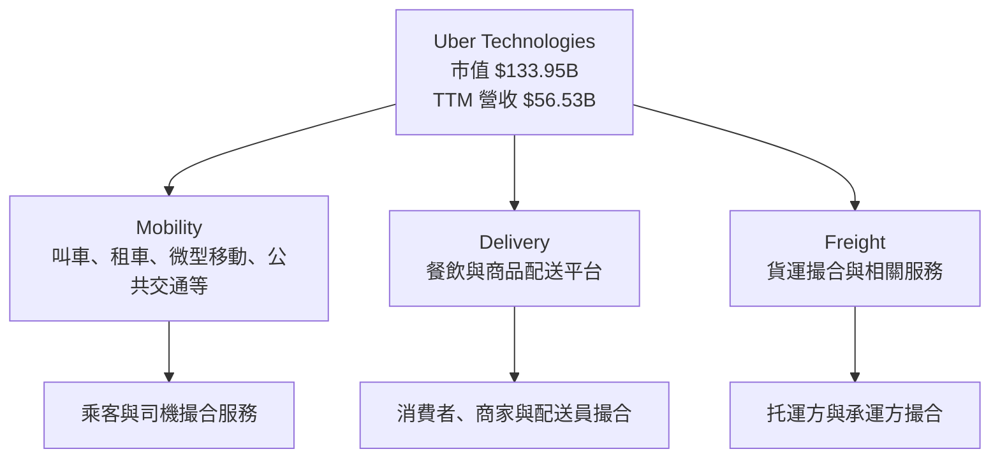
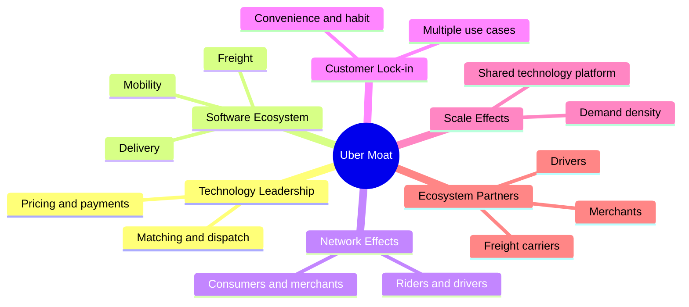
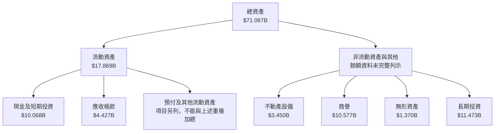
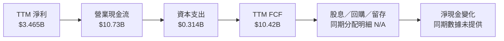
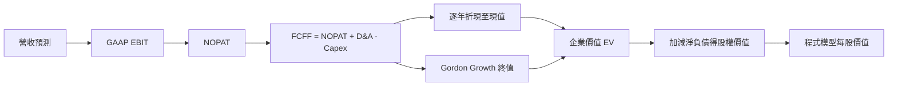
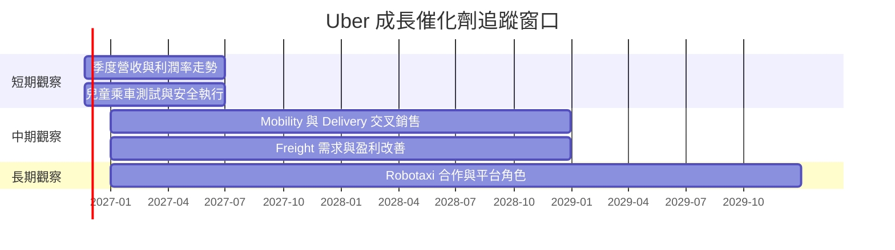
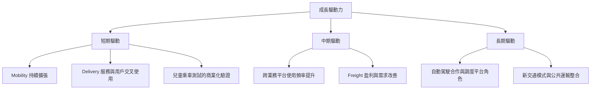
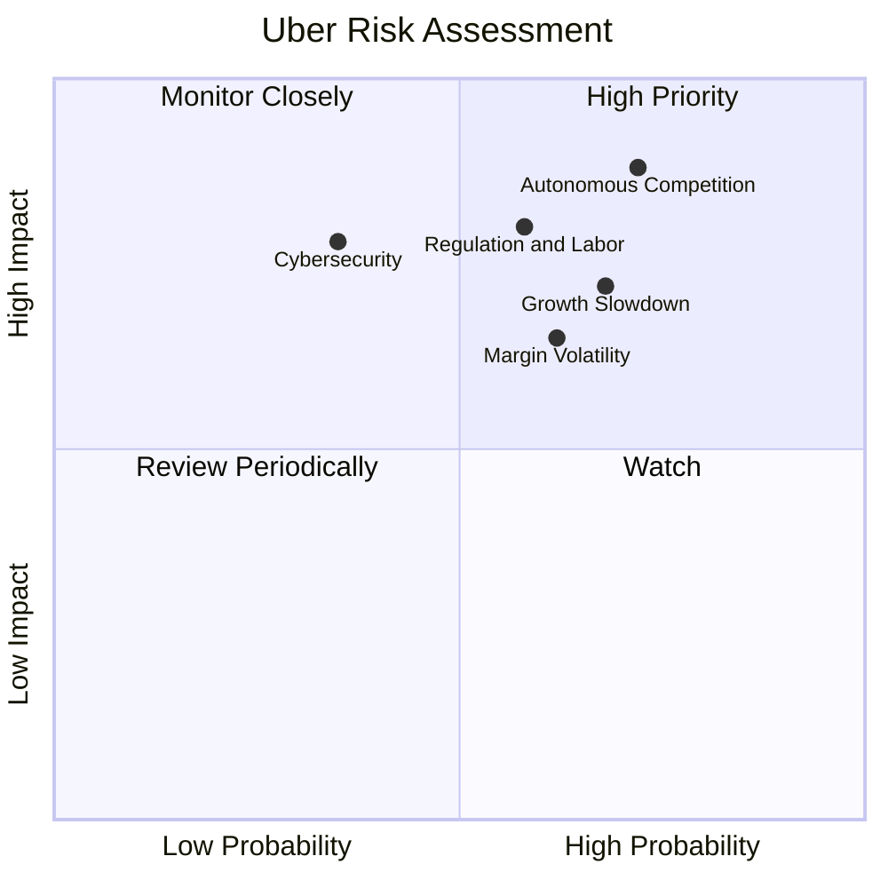
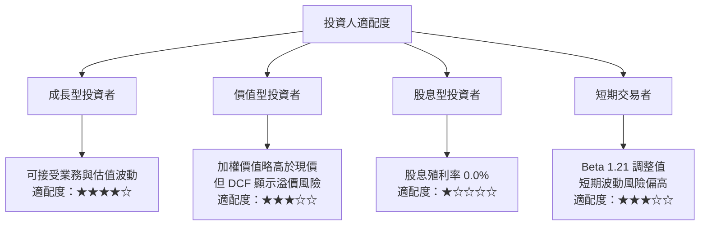

# UBER 基本面深度分析報告
> **報告日期**：2026-11-20 ｜ **語言**：繁體中文 ｜ **數據來源**：SEC 申報資料 (XBRL)、Yahoo Finance、Finviz、StockAnalysis、Roic.ai ｜ **分析師**：CFA 級機構研究

## 目錄

| # | 章節 | 核心結論 |
|---|------|----------|
| 1 | 執行摘要 | 買入；加權合理價值 $73.33；MOS +10.5% |
| 2 | 公司概覽與商業模式 | Mobility、Delivery、Freight 多邊平台；網路效應是主要護城河 |
| 3 | 損益表深度分析 | TTM 營收 $56.53B、年增 13.9%；最新季年增放緩至 9.6% |
| 4 | 資產負債表分析 | 淨負債 $5.60B；現金及短期投資 $10.07B |
| 5 | 現金流量深度分析 | TTM FCF $10.42B、FCF Yield 7.78% |
| 6 | 獲利能力與資本效率 | ROIC 15.8% 高於 WACC 10.15%，目前創造價值 |
| 7 | 相對估值分析 | 同業估值分歧大；Uber P/S 低於自身五年中位數 |
| 8 | DCF 內在價值評估 | 基準 DCF $40.32/股；高於現價的合理價值需依賴其他估值方法 |
| 9 | 成長催化劑 | Mobility、Delivery 交叉銷售及自動駕駛合作是主要觀察方向 |
| 10 | 風險矩陣 | 自動駕駛競爭、監管與利潤率回落是主要風險 |
| 11 | 投資建議 | 買入；以 $73.33 加權合理價值及定量監控門檻執行 |

---

## 1. 執行摘要

截至 2026-11-19 收盤，Uber 股價為 **$65.60**。TTM 營收 **$56.53B**、年增 **13.9%**，TTM FCF **$10.42B**、FCF Yield **7.78%**，ROIC **15.8%** 高於 WACC **10.15%**；但基準 DCF 價值僅 **$40.32/股**，低於現價，且最新季度營收年增率已降至 **9.6%**。依程式計算的多方法加權合理價值 **$73.33**，MOS **+10.5%**，依評級門檻為 **買入**。這項評級反映加權價值相對現價僅提供有限緩衝，並非基準 DCF 顯示明顯低估。

### 1.0 一頁式投資儀表板（Portfolio Manager 30 秒速讀）

| 項目 | 內容 |
|------|------|
| **投資論點（3 句）** | ① TTM 營收年增 **13.9%**，平台仍在擴張。② TTM FCF **$10.42B**、FCF Yield **7.78%**，現金產生能力明確。③ ROIC **15.8%** 高於 WACC **10.15%**，但基準 DCF **$40.32** 顯著低於股價。 |
| **綜合評分** | **6.5/10**（引用 1.1 評分卡） |
| **財務健康** | 🟡 現金及短期投資 $10.07B，但總債務 $15.66B，淨負債 $5.60B |
| **ROIC vs WACC** | **15.8% vs 10.15%**；目前創造股東價值 |
| **FCF 趨勢** | 歷年上升；TTM FCF Yield **7.78%** |
| **估值** | Forward P/E **14.9x**（市場數據）；EV/EBITDA **18.0x**（自身估值歷史口徑）；FCF Yield **7.78%** |
| **DCF 內在價值（基準）** | **$40.32**；現價相對 DCF 溢價 **+62.7%**，即 $65.60 ÷ $40.32 − 1 |
| **安全邊際（MOS）** | **+10.5%**＝($73.33 − $65.60) ÷ $73.33；🟡 有限，基準為 8.8 加權合理價值 |
| **預期報酬（基準情境 12M）** | DCF 基準情境相對現價 **−38.5%**；加權合理價值上行空間 **+11.8%**。兩者為不同估值口徑，不應混用 |
| **關鍵風險（前二）** | 自動駕駛／Robotaxi 侵蝕核心乘車需求；最新季營收成長降速及營業利潤率低於 TTM |
| **評級 + 信心度** | 🟢 **買入** ｜ 信心：中 |

### 1.1 綜合評分卡（全報告唯一）

| 維度 | 評分（1–10） | 主要依據（引用數字與其來源章節） |
|------|--------------|----------------------------------|
| 成長性 | 7.0 | TTM 營收年增 13.9%，最新季度年增 9.6%（第 3 章）；近期增速放緩 |
| 獲利能力 | 7.0 | TTM 營業利益率 12.4%、ROIC 15.8% 高於 WACC 10.15%，F-Score 6/8（第 6 章） |
| 財務健康 | 7.0 | 淨負債 $5.60B、現金 $10.07B、Piotroski 6/8（第 4、6 章） |
| 估值 | 5.0 | MOS +10.5%，但 DCF $40.32 低於現價；P/E 38.4x 高於自身五年中位數 17.8x（第 7、8 章） |
| 護城河 | 7.0 | 多邊平台與跨業務使用場景形成網路效應，但市場份額及分部營收未提供（第 2 章） |
| 管理層與資本配置 | 6.0 | TTM FCF 高、稀釋股數測試通過；SBC 仍約佔 TTM 營收 3.7%，股息殖利率 0%（第 3、5 章） |
| **綜合評分** | **6.5** | 六項算術平均：(7+7+7+5+7+6) ÷ 6 = **6.5** |

### 1.2 五大投資論點 + 三大核心風險

| 類型 | 項目 | 具體依據 | 信心度 |
|------|------|----------|--------|
| 🟢 **投資論點①** | 現金流規模可觀 | TTM 營業現金流 $10.73B，資本支出 $314M，FCF $10.42B；低資本支出支撐現金轉換（第 5 章） | 🟢 高 |
| 🟢 **投資論點②** | 資本回報高於資本成本 | ROIC 15.8% 對 WACC 10.15%，利差 +5.65 個百分點（第 6 章） | 🟢 高 |
| 🟢 **投資論點③** | 收入仍在成長 | TTM 營收年增 13.9%，2025 財年營收年增 18.28%（第 3 章） | 🟢 中高 |
| 🟢 **投資論點④** | 多業務平台可提高使用頻率 | Mobility、Delivery、Freight 共用技術與用戶入口；各分部收入比例未提供（第 2 章） | 🟡 中 |
| 🟢 **投資論點⑤** | 加權估值略高於現價 | 加權合理價值 $73.33，較 $65.60 上行 11.8%（第 8 章） | 🟡 中 |
| 🟡 **風險①** | DCF 與市價分歧 | 基準 DCF $40.32，相對現價折價 38.5%（以現價為分母）；顯示估值倚賴較高增長或較高相對倍數 | 🔴 高衝擊 |
| 🔴 **風險②** | 成長降速與利潤波動 | 最新季營收年增 9.6%，低於 TTM 13.9%；最新季營業利益率 9.8%，低於 TTM 12.4% | 🔴 高衝擊 |
| 🟡 **風險③** | 自動駕駛與平台監管 | Tesla Cybercab 進入 Dallas 的新聞顯示競爭方向；監管可能影響司機分類及成本，未有量化財務衝擊資料 | 🟡 中 |

### 1.3 快速統計卡片

同業中位數依 LYFT、DASH、GRAB 的 Peer multiples 計算；Forward P/E 中位數為 18.7x，最新季營收成長中位數為 27.4%，毛利率中位數為 41.4%。

| 指標 | 公司實際值（期間） | 同業中位數 | 狀態 |
|------|--------------------|------------|------|
| 營收成長（TTM） | **13.9%** | — | 🟢 |
| 營收成長（最新一季年增） | **9.6%** | **27.4%** | 🟡 |
| 毛利率（TTM） | **41.4%** | **41.4%** | 🟡 |
| 營業利益率（TTM） | **12.4%** | — | 🟢 |
| ROIC（TTM） | **15.8%** | — | 🟢 |
| Forward P/E | **14.9x**（市場數據） | **18.7x**（Peer multiples） | 🟢 |
| FCF Yield（TTM） | **7.78%** | — | 🟢 |
| Piotroski F-Score | **6 / 8** | — | 🟢 |

### 1.4 投資結論

```text
╔══════════════════════════════════════════════════════════════════╗
║                    📊 投資結論摘要                               ║
╠══════════════════════════════════════════════════════════════════╣
║  評級：買入（MOS 門檻直接判定，未作一級調整）                    ║
║  價格（2026-11-19 收盤）：$65.60                                 ║
║  DCF 內在價值（基準）：$40.32（現價溢價 +62.7%）                 ║
║  安全邊際 MOS：+10.5%（＝($73.33−$65.60)÷$73.33）               ║
║  加權合理價值（8.8）：$73.33                                     ║
║  DCF 情境價值：                                                   ║
║    悲觀情境：$22.87（−65.1%）                                    ║
║    基準情境：$40.32（−38.5%）                                    ║
║    樂觀情境：$67.31（+2.6%）                                     ║
║  綜合評分：6.5/10（引用 1.1）                                    ║
║  適合投資人：可承受估值與自動駕駛競爭風險的成長型、長線投資人    ║
╚══════════════════════════════════════════════════════════════════╝
```

---

## 2. 公司概覽與商業模式

### 2.1 業務結構與收入來源

公司資料顯示 Uber 經營 Mobility、Delivery、Freight 三個分部。分部營收、佔比及各細項收入沒有提供，因此不臆測收入拆分；已知公司市值 **$133.95B**、TTM 營收 **$56.53B**。



平台以軟體撮合、支付與需求管理為核心，但財務數據未提供各分部營收、抽成率或分部利潤，故不以總營收替代平台交易額。

### 2.2 市場份額

市場份額數據未提供，故不繪製市場份額圖，也不給出滲透率比例。以營收衡量，Uber TTM 營收為 **$56.53B**、年增 **13.9%**；同業 GRAB 最新季度營收年增 27.4%、DASH 年增 34.0%，顯示這些公司的近期成長速度較高，但業務地域與組合不同，不能直接視為市場份額變化。

### 2.3 競爭護城河分析



### 2.4 護城河強度

| 護城河項目 | 強度（強／中／弱） | 證據（引用數字或事實） | 會削弱它的情況 |
|------------|--------------------|------------------------|----------------|
| 技術與撮合 | 中 | 跨 Mobility、Delivery、Freight 提供撮合與支付；TTM 營收 $56.53B | 競爭者提供更低成本的撮合，或技術差異不足 |
| 網路效應 | 中至強 | 乘客／司機及消費者／商家雙邊互動；但活躍用戶及交易量數據未提供 | 司機供給不足、補貼競爭或用戶轉換成本低 |
| 規模效應 | 中 | TTM FCF $10.42B，可支持平台投資；分部單位經濟數據未提供 | 需求密度下滑、保險或司機成本上升 |
| 跨業務生態 | 中 | 三個業務分部共享平台，但各分部營收與交叉銷售數據未提供 | 業務拓展未提升留存或利潤，反而增加複雜度 |
| 客戶鎖定 | 弱至中 | 用戶可透過同一平台使用多種服務，但缺少留存率與轉換成本資料 | 競爭平台促銷、服務品質下降 |
| 生態夥伴 | 中 | 司機、商家、承運方構成供給端 | 勞工分類改變、夥伴議價能力提高 |

**1.1 護城河評分 7.0/10**：平台規模、雙邊網路與多業務入口提供結構優勢，但分部經濟、留存率及市場份額等量化證據缺漏，限制評分上限。

---

## 3. 損益表深度分析

### 3.1 年度收入成長趨勢（近 4 年）

2022 至 2025 財年營收分別為 **$31.88B、$37.28B、$43.98B、$52.02B**。三年 CAGR 依 `(52.02 ÷ 31.88)^(1/3) − 1` 計算約 **17.7%**。

```text
╔══════════════════════════════════════════════════════════════════╗
║             Uber 年度收入趨勢（FY2022-FY2025）                   ║
╠══════════════════════════════════════════════════════════════════╣
║  FY2022  $31.88B  ████████████████░░░░░░░░  YoY：—              ║
║  FY2023  $37.28B  ██████████████████░░░░░░  YoY：+16.95%  🟢    ║
║  FY2024  $43.98B  █████████████████████░░░  YoY：+17.96%  🟢    ║
║  FY2025  $52.02B  █████████████████████████  YoY：+18.28%  🟢   ║
║  📊 FY2022-FY2025 三年營收 CAGR：約 +17.7%                       ║
╚══════════════════════════════════════════════════════════════════╝
```

2025 年營收增長延續，較 2024 年增加約 **$8.04B**。但 FY2026 最新季度年增降至 9.6%，因此不能把近年年度增長率直接外推為未來增長率。

### 3.2 季度收入趨勢分析

| 季度 | 營收 | QoQ | YoY | 備註 |
|------|------:|----:|----:|------|
| 2025 Q4 | $14.37B | +6.3% | +20.13% | QoQ 與 2025 Q3 比較 |
| 2026 Q1 | $13.20B | −8.1% | +14.48% | 季節性回落；年增仍高於 TTM 最新季 |
| 2026 Q2 | $14.19B | +7.5% | +12.17% | 季度恢復成長 |
| 2026 Q3 | $14.77B | +4.1% | +9.6% | 營收創近四季高點，但 YoY 持續放緩 |

QoQ 由相鄰季度營收計算，例如 Q3 2026：`14.766 ÷ 14.191 − 1 = 4.1%`。年增率依季度比較資料引用。成長減速意味平台可能已進入較大的收入基數；後續需分辨是成熟市場放緩，還是需求、定價或競爭因素造成。

### 3.3 利潤率演變分析

| 利潤率指標 | FY2022 | FY2023 | FY2024 | FY2025 | 趨勢 | 評估 |
|------------|-------:|-------:|-------:|-------:|------|------|
| **毛利率** | 38.3% | 39.8% | 39.4% | 39.8% | 大致穩定、略升 | 🟡 |
| **營業利益率** | −5.7% | 3.0% | 6.4% | 10.7% | 持續改善 | 🟢 |
| **淨利率（FY2025）** | — | — | — | 19.3% | 受非營業及稅務項目影響，不宜視為常態 | 🟡 |

毛利率按年度財務表所列毛利除以營收計算；TTM 毛利率另由資料源提供為 **41.4%**，口徑及季度組成不同，不與年度值混為一談。營業利益率由 FY2022 的營業虧損轉為 FY2025 約 10.7%，反映營收規模擴大與營業費用槓桿改善。TTM 營業利益率 **12.4%**，但最新季度資料列示 **9.8%**；另有市場資料欄位報為 12.4%，本報告依 VERIFIED FIGURES 的最新季度口徑採用 9.8%，並視其為季度獲利率波動訊號。

### 3.4 費用結構分析

費用明細未提供足以構成可核對的完整費用分類，因此不繪製 pie chart，以免將毛利、研發費用及營業利益混作互斥費用項目。已知 FY2025 研發費用 **$3.40B**，約為年度營收 $52.02B 的 **6.5%**；但銷售、行政、保險及其他成本的完整拆分未提供。

### 3.5 季度 EPS 趨勢與盈餘品質（Quality of Earnings）

| 季度 | EPS 實際值 | EPS 年增 | EPS 預估／實際驚喜 |
|------|-----------:|--------:|-------------------|
| 2025 Q4 | $0.14 | −95.58% | N/A，估計值與實際值未提供 |
| 2026 Q1 | $0.13 | −84.57% | N/A，估計值與實際值未提供 |
| 2026 Q2 | $1.17 | +85.46% | N/A，估計值與實際值未提供 |
| 2026 Q3 | $0.25 | −91.97% | N/A，估計值與實際值未提供 |

過去四季 EPS 驚喜資料均為 NaN，無法可靠判定超預期或不及預期。EPS 與淨利在季度間波動很大；例如 2026 Q3 淨利 **$512M**，低於 Q2 的 **$2.39B**，因此應以營業獲利與現金流確認盈餘持續性。

| 盈餘品質項目 | 數值／佔比 | 評估 |
|--------------|-----------|------|
| 股權薪酬 SBC / 營收 | 約 **3.7%**；TTM SBC 約 $2.065B ÷ $56.53B | 🟡 SBC 是持續性股東成本；近期股數未增加的測試通過，但仍須監控回購是否抵銷稀釋 |
| SBC / 營業現金流 | 約 **19.3%**；$2.065B ÷ $10.73B | 🟡 佔現金流量度的比例不可忽略 |
| FCF / 淨利（現金轉換率） | 約 **300.7%**；$10.42B ÷ TTM 淨利 $3.465B | 🟢 現金流高於淨利，但淨利波動使比率偏高 |
| 一次性／非經常性損益 | 歷史淨利顯著波動；逐項非經常性損益金額 N/A | 🟡 FY2025 淨利 $10.05B 與 TTM 淨利 $3.465B 差異大，不宜單看年度高點 |
| 有效稅率異常 | N/A（TTM 實際有效稅率未提供） | 無法判斷當期盈餘是否由稅務利益帶動 |
| 資本化支出 vs 費用化 | TTM Capex $314M；資本化支出明細 N/A | 資本支出偏低，但無法僅憑總額判定費用是否適當資本化 |

TTM SBC 以季度現金流表四季披露額 $591M、$550M、$473M、$451M 合計估算。**結論：**FCF 對淨利轉換率高，但股權薪酬與季度淨利波動降低 GAAP 淨利作為單一估值錨點的可靠度；估值應更重視正常化營業利益與現金流。

---

## 4. 資產負債表分析

### 4.1 資產結構分解

最新季度總資產為 **$71.067B**，流動資產 **$17.869B**。非流動資產合計未在該區塊以同一口徑完整列出，以下僅展示有明確金額的資產項目，不補齊未提供項目。



### 4.2 流動性與營運資金分析

| 指標 | 最新 TTM | 一年前 TTM | 變化 | 解讀 |
|------|----------|------------|------|------|
| DSO 應收帳款天數 | 29 天 | 28 天 | +1 天 | 收款天數略升，尚不能據此推斷重大回款惡化 |
| DIO 存貨天數 | N/A | N/A | N/A | 公司未報告此項存貨餘額 |
| DPO 應付帳款天數 | 17 天 | N/A | N/A | 前期數據缺漏，無法判斷供應商付款趨勢 |
| CCC 現金轉換週期 | N/A | N/A | N/A | DIO 缺漏，不能自行填補 |

FY2026 Q3 流動比率 **1.232**、速動比率 **0.999**，代表流動資產略高於流動負債，但速動資產緩衝較有限。現金及短期投資 **$10.07B** 是重要流動性支撐。

### 4.3 債務結構分析

```text
╔══════════════════════════════════════════════════════════════════╗
║                   Uber 債務健康診斷                              ║
╠══════════════════════════════════════════════════════════════════╣
║  總債務：          $15.66B  ████████████████████  🟡             ║
║  現金+短期投資：   $10.07B  █████████████░░░░░░░  🟢             ║
║  淨負債：           $5.60B  ███████░░░░░░░░░░░░░  🟡             ║
║  Debt/EBITDA：N/A（同口徑 EBITDA 未提供）                         ║
║  利息保障倍數：N/A（利息費用與 EBIT 同期值未提供）                ║
╚══════════════════════════════════════════════════════════════════╝
```

債務與現金數據按 VERIFIED FIGURES 引用；其他市場資料另列總債務 $17.74B、淨負債 $7.67B，與 SEC 口徑數字不一致。本報告遵循統一財務口徑採用 **總債務 $15.66B、淨負債 $5.60B**，不混合兩組資料。

### 4.4 股東權益趨勢

| 財年 | 股東權益 | 年增變化 |
|------|--------:|--------:|
| 2022 | $7.34B | — |
| 2023 | $11.25B | +$3.91B |
| 2024 | $21.56B | +$10.31B |
| 2025 | $27.04B | +$5.48B |

股東權益持續增加，但 FY2024、FY2025 淨利亦受非營業項目影響；不能把權益增加全歸因於核心營運獲利。

---

## 5. 現金流量深度分析

### 5.1 現金流量瀑布圖

最新 TTM 淨利、股息及回購的完整同期流量沒有提供，故只畫有可引用數字的現金流步驟。



### 5.2 FCF 轉換率趨勢

| 財年 | FCF | 淨利 | FCF / 淨利 | 解讀 |
|------|----:|----:|-----------:|------|
| 2022 | $0.39B | −$9.14B | 不具可比性 | 淨利為負，比例失真 |
| 2023 | $3.36B | $1.89B | 約 178.1% | 現金流高於淨利 |
| 2024 | $6.89B | $9.86B | 約 69.9% | 淨利顯著高於 FCF，非現金項目及營運資金可能影響 |
| 2025 | $9.76B | $10.05B | 約 97.1% | 現金轉換接近淨利 |
| TTM 至 2026 Q3 | $10.42B | $3.465B | 約 300.7% | 淨利低於常態季度水平，比例偏高 |

### 5.3 自由現金流趨勢

| 期間 | FCF | 觀察 |
|------|----:|------|
| 2022 | $0.39B | 由現金流表列示 |
| 2023 | $3.36B | 年增，現金產生能力改善 |
| 2024 | $6.89B | 延續改善 |
| 2025 | $9.76B | 高於前期 |
| TTM 至 2026 Q3 | $10.42B | FCF Yield 7.78% |

FCF 上升幅度高於收入增長，可能反映營業槓桿與營運資金改善；TTM Capex 僅 **$314M**，使 FCF 對營業現金流的轉換率很高。若未來為自動駕駛、保險或平台基建增加投資，現有 FCF Yield 未必可原樣延續。

### 5.4 資本配置評估

股息殖利率 **0.0%**、派息率 **0.0%**；年度 SBC FY2025 **$1.83B**。回購、股息以外的投資與留存現金完整分配明細未提供，因此不繪製資本配置比例圓餅圖。

| 資本配置項目 | 已知數據 | 評估 |
|--------------|----------|------|
| 資本支出 | TTM $314M | 相對 TTM 營收低，支撐高 FCF；未來投資需求仍需觀察 |
| 股息 | 殖利率 0.0% | 現金回報目前非股息 |
| SBC | FY2025 $1.83B；TTM 四季約 $2.065B | 持續稀釋成本，需要結合股數及回購判讀 |
| 回購 | 金額 N/A | 無法評估回購是否完全抵銷 SBC |
| 投資／留存 | 金額 N/A | 分項資料不足，不作比例推定 |

---

## 6. 獲利能力與資本效率

### 6.1 ROE / ROA / ROIC 趨勢

可比年度歷史 ROIC、ROE、ROA 序列不完整，避免用不同來源與期間拼接。最新 TTM 指標如下：

| 指標 | 最新值 | 評估 |
|------|------:|------|
| ROE（TTM，品質數據） | 12.5% | 正值；杜邦分解見 6.3 |
| ROA（TTM） | 6.5% | 正值；Piotroski ROA 同比未通過 |
| ROIC（TTM） | 15.8% | 高於 WACC 10.15%，目前具正經濟利潤 |
| 行業均值對比 | N/A（可比行業均值未提供） | 不以臆測值填補 |

### 6.2 ROIC vs WACC 分析（核心價值創造判斷）

```text
╔══════════════════════════════════════════════════════════════════╗
║                ROIC vs WACC 深度分析                            ║
╠══════════════════════════════════════════════════════════════════╣
║  WACC（採用程式計算資本成本）：10.15%                            ║
║  ├── 無風險利率（10Y 美債）：5.05%                               ║
║  ├── 市場風險溢酬（假設）：5.00%                                 ║
║  ├── 原始 Beta：1.31；調整後 Beta：1.21                         ║
║  ├── 股權成本：11.08%（成本資本資料列示值）                      ║
║  ├── 稅前債務成本：2.81%；稅後約 2.22%                           ║
║  ├── 股權／債務權重：89.5%／10.5%                                ║
║  └── ✅ WACC：10.15%                                             ║
║                                                                  ║
║  ROIC（TTM）：15.8%                                              ║
║  EVA spread = ROIC − WACC = 15.8% − 10.15% = +5.65pp             ║
║  ROIC 15.8%  ▓▓▓▓▓▓▓▓▓▓▓▓▓▓▓▓░░░░  🟢                           ║
║  WACC 10.15% ▓▓▓▓▓▓▓▓▓▓░░░░░░░░░░  ──                           ║
║  📊 結論：ROIC 高於 WACC，現階段創造股東價值                    ║
╚══════════════════════════════════════════════════════════════════╝
```

WACC 直接採用資本成本資料的 **10.15%**，不另建估值折現率。其權重算式為 `89.5% × 11.08% + 10.5% × 2.81% × (1−21.0%) = 9.9166% + 0.2329% = 10.1495%`，四捨五入為 10.15%。成本資本表列示的 CAPM 組成若用已四捨五入數字重算，`5.05% + 1.21 × 5.00% = 11.10%`，與表列 Ke 11.08% 有 0.02 個百分點差異；本報告保留程式提供的 Ke 與 WACC，不自行替換。

ROIC 超額報酬代表現有資本配置產生正的經濟價值，但若最新季利潤率下降持續，ROIC 可能回落。由於缺少完整投入資本明細，不自行重算 ROIC 或 EVA 金額。

### 6.3 杜邦三因素分解

| 因素 | 數值（TTM） | 解讀 |
|------|-------------|------|
| 淨利率 | 6.1% | 獲利率正值，但季度淨利波動大 |
| 資產週轉率 | 0.80 | 每單位資產創造營收能力 |
| 權益乘數 | 2.57 | 槓桿提高 ROE，仍非唯一驅動因素 |
| **ROE** | **12.5%** | 6.1% × 0.80 × 2.57 = 約 12.5% |

依提供的 DuPont 分解，權益乘數推升 ROE；但營運淨利率與資產週轉率同樣重要，不能只將 ROE 歸因於槓桿。

### 6.4 財務體質：Piotroski F-Score

Piotroski F-Score **6/8**；有一項毛利率測試缺資料而未納入分母，故不是 6/9。

| 測試 | 結果 | 解讀 |
|------|------|------|
| ROA > 0 | ✅ 通過 | TTM 資產報酬為正 |
| 營業現金流 > 0 | ✅ 通過 | TTM OCF $10.73B |
| ROA 高於一年前 | ❌ 未通過 | 資產回報改善未能延續 |
| 營業現金流 > 淨利 | ✅ 通過 | 有利於現金盈餘品質 |
| 長期負債／總資產低於一年前 | ❌ 未通過 | 槓桿相對資產的改善不足 |
| 流動比率高於一年前 | ✅ 通過 | 短期流動性指標改善 |
| 稀釋股數未增加 | ✅ 通過 | 最新測試期間未見稀釋股數增加 |
| 毛利率高於一年前 | — 無法判定 | 缺少可比較輸入，未計分 |
| 資產週轉率高於一年前 | ✅ 通過 | 資產使用效率測試通過 |

---

## 7. 相對估值分析

### 7.1 同業估值比較表格

Uber 的 Peer multiples 欄位採 VERIFIED FIGURES；Forward P/E 另列市場數據 14.9x，估值方法中採用的 peer median 為 18.7x。

| 估值指標 | **UBER** | **LYFT** | **DASH** | **GRAB** | 本公司評估 |
|----------|---------:|---------:|---------:|---------:|-----------|
| **Trailing P/E** | 38.4x | 2.5x | 65.2x | 29.3x | 🟡 LYFT 盈利基數及一次性因素令倍數不宜直接比較 |
| **Forward P/E** | 14.9x | 8.3x | 20.6x | 18.7x | 🟢 低於同業中位數 18.7x |
| **P/S Ratio** | 2.4x | 0.9x | 4.0x | 3.0x | 🟢 低於 DASH、GRAB；但業務組合不同 |
| **EV/EBITDA** | 18.0x | 562.7x | 38.5x | 19.1x | 🟡 LYFT 倍數異常高；DASH、GRAB 中位數 28.8x |
| **最新季營收年增** | 9.6% | 8.1% | 34.0% | 27.4% | 🔴 Uber 增長低於 DASH、GRAB |
| **毛利率（TTM）** | 41.4% | 40.0% | 52.7% | 41.4% | 🟡 約與同業中位數相當 |

同業倍數會受獲利基數、地區及業務組合影響。LYFT EV/EBITDA 562.7x 對中位數有極大干擾，因此估值方法區塊採用 DASH、GRAB 的 EV/EBITDA 中位數 **28.8x**。

### 7.2 歷史估值區間分析

```text
╔══════════════════════════════════════════════════════════════════╗
║             UBER 五年歷史估值位置（TTM 倍數）                    ║
╠══════════════════════════════════════════════════════════════════╣
║  P/E：        12.6x ── 中位數 17.8x ── 現值 38.4x ── 122.2x     ║
║                                      百分位：62%                 ║
║  P/S：         1.5x ── 現值 2.4x ─── 中位數 3.3x ── 6.1x        ║
║                                      百分位：19%                 ║
║  EV/EBITDA：  18.7x ── 現值 18.0x ── 中位數 40.0x ── 320.2x    ║
║                                      百分位：0%                  ║
╚══════════════════════════════════════════════════════════════════╝
```

P/E 高於五年中位數，反映目前盈利基數與歷史週期差異；P/S 位於自身歷史較低區域。EV/EBITDA 的現值低於歷史區間下限附近，可能同時反映經營獲利改善及歷史期間高波動，不能單以百分位判定低估。

### 7.3 情境價值（Bear / Base / Bull，照抄 DCF MODEL 的 Scenarios）

| 情境 | 第 1 年營收成長 | 期末營業利潤率 | WACC | 每股價值 | 相對現價 | 機率 | 會發生的條件 |
|------|----------------|----------------|------|----------|----------|------|--------------|
| 🔴 悲觀 | 7.0% | 5.4% | 11.15% | $22.87 | −65.1% | 25% | 成長低於 TTM 13.9%，規模效益未能抵銷競爭及成本 |
| 🟡 基準 | 13.9% | 6.4% | 10.15% | $40.32 | −38.5% | 50% | 第一年度沿用 TTM 成長，長期利潤率回落至模型設定 |
| 🟢 樂觀 | 20.9% | 7.0% | 9.15% | $67.31 | +2.6% | 25% | 成長加速、期末利潤率高於基準且折現率下降 |

情境中間年度收入與 FCFF 未在情境資料中提供，故不反推並冒充為模型輸出。

### 7.4 相對估值隱含價格區間

```text
╔══════════════════════════════════════════════════════════════════╗
║                 相對估值每股價值與現價位置                       ║
╠══════════════════════════════════════════════════════════════════╣
║  $40.32       $65.60       $82.27       $98.23      $107.25      ║
║  基準 DCF      現價         Forward P/E  分析師共識  EV/EBITDA   ║
╚══════════════════════════════════════════════════════════════════╝
```

- **同業 Forward P/E：$82.27**；採同業中位數 **18.7x × Forward EPS $4.41**。
- **同業 EV/EBITDA：$107.25**；採 DASH、GRAB 中位數 **28.8x**，套用 TTM EBITDA 並加回淨現金；完整 EBITDA 及橋接輸入沒有在估值方法表逐項列示，故不另行重建。
- 分析師共識目標價 **$98.23**，45 位分析師平均值，作參考而非核心現金流依據。

---

## 8. DCF 內在價值評估（Discounted Cash Flow）

### 8.0 估值推理鏈（Thinking Logic）

**Step 1 — 價值來源及主導變數**

Uber 的估值主要來自 Mobility、Delivery、Freight 現有平台現金流、跨業務使用帶來的成長，以及自動駕駛相關選擇權；各分部營收佔比未提供，不能量化拆分。DCF 敏感度矩陣顯示終值成長率及 WACC 對每股價值影響顯著；而模型假設的營業利潤率由 TTM 12.4% 下降至第十年 6.4%，期末利潤率與折現率是重要風險變數。

**Step 2 — 模型選擇**

| 決策點 | 本報告採用 | 理由（含數字） | 曾考慮但否決 | 否決理由 |
|--------|-----------|----------------|--------------|----------|
| 現金流定義 | FCFF | 以 WACC 10.15% 折現，求企業價值 | FCFE | 欠缺逐年債務融資變化假設 |
| 預測期 N | 10 年 | 採用程式模型設定，反映平台由成長向成熟的漸進過程 | 5 年 | 不能直接替換既定模型期間 |
| 終值方法 | Gordon Growth | 模型提供永續成長率 3.0% 與終值 | 退出倍數 | DCF 模型未提供終值退出倍數及對應結果 |
| EBIT 基礎 | GAAP EBIT | TTM GAAP 營業利益率 12.4% | 非 GAAP EBIT | 避免把 SBC 加回後漏計股東成本 |

**Step 3 — 關鍵假設推導鏈**

- **營收成長**：錨點＝TTM 營收年增 13.9% → 最新季度年增 9.6% 顯示短期放緩，但模型由 13.9% 線性遞減至 3.0% → 採用第 1 年 13.9%、第 10 年 3.0% → 否決十年固定 13.9%，因會忽略成長成熟與基期擴大。
- **期末營業利潤率**：錨點＝TTM 12.4%，近年營業利潤率逐年改善 → 模型假設回歸近五年中位數 6.4% → 採用第 1 年 12.4% 至第 10 年 6.4% → 否決維持 12.4%，因最新季營業利益率 9.8% 顯示波動。
- **永續成長率 g**：錨點＝模型固定採用 3.0%，且低於 WACC 10.15% → 作為成熟平台長期名目成長假設 → 採用 3.0% → 否決高於 3.0%的主估值設定，因長期假設需受宏觀名目成長限制；矩陣另呈現 2.0%–4.0%敏感度。
- **預測期 N**：錨點＝模型十年逐年預測 → 用足夠期間呈現成長率與利潤率逐步收斂 → 採用 10 年 → 否決直接縮至五年，因會改變指定模型與終值起點。
- **Capex／營收**：錨點＝TTM Capex $314M、模型首年及末年均為 0.6% → 模型按既定比例延續 → 採用 0.6% → 否決另行提高，因模型已明確設定且不得重建。
- **EBIT 基礎與 SBC**：錨點＝採 GAAP EBIT，模型註明 SBC 已是費用 → SBC 不再扣第二次 → 採用 GAAP EBIT、固定股數、年稀釋率 0% → 否決再扣 SBC 或再稀釋股數，避免重複計成本。
- **WACC**：錨點＝資本成本資料列示 10.15% → 直接用於一致性折現 → 採用 10.15% → 否決自行改用市場資料 Beta 或另一套資本成本估算，避免與模型不一致。
- **最脆弱一環**：長期 EBIT 利潤率與終值假設；若未達模型預測，企業價值下滑，敏感度與悲觀情境均顯示每股價值可能遠低於現價。

**Step 4 — 計算路徑**



### 8.1 模型假設總表（Model Inputs）

| 假設項目 | 採用值 | 依據／來源 | 敏感度 |
|----------|--------|------------|--------|
| 預測期長度 N | 10 年 | DCF MODEL 指定十年逐年預測 | 🟡 中 |
| 營收成長 | 第 1 年 13.9% → 第 10 年 3.0% | TTM 營收成長 13.9%，線性遞減 | 🔴 高 |
| 營業利潤率 | 第 1 年 12.4% → 第 10 年 6.4% | TTM 起點；終點採近五年中位數 | 🔴 高 |
| 有效稅率 | 21.0% | 模型預設稅率；非公司實際有效稅率 | 🟢 低 |
| Capex／營收 | 0.6% | 模型列示 TTM 基準比例，維持於 0.6% | 🟡 中 |
| D&A／營收 | 1.4% | 模型列示 TTM 比例，固定 | 🟢 低 |
| 營運資金變動 | 未建模 | DCF MODEL 明示未建模 | 🟢 低 |
| EBIT 基礎 | GAAP EBIT | 模型採 GAAP 營業利益 | 🟡 中 |
| SBC 處理 | 不再扣除 | SBC 已包含在 GAAP EBIT 費用中 | 🟡 中 |
| 年稀釋率 | 0%／固定股數 | 模型組合 A | 🟡 中 |
| 永續成長率 g | 3.0% | 模型設定；低於 WACC | 🔴 高 |
| 終值方法 | Gordon Growth | 模型提供 Gordon Growth 計算 | 🔴 高 |
| WACC | 10.15% | 資本成本程式計算值 | 🔴 高 |

本模型採 **(A) GAAP EBIT + 固定股數**，故 SBC 影響已計入一次；FCFF 不另扣 SBC，股數不逐年擴大。模型定義 `FCFF = NOPAT + D&A − Capex`，營運資金未建模。

### 8.2 折現率推導（WACC）

```text
╔══════════════════════════════════════════════════════════════════╗
║                    WACC 推導（折現率）                           ║
╠══════════════════════════════════════════════════════════════════╣
║  股權成本 Ke（採用程式列示值）：11.08%                           ║
║  ├── 無風險利率 Rf：5.05%                                        ║
║  ├── ERP：5.00%（假設值，資本成本資料列示）                      ║
║  ├── 原始 Beta：1.31；調整 Beta：1.21                            ║
║  ├── 調整方式：⅔ × 1.31 + ⅓ × 1 = 1.207 ≈ 1.21                 ║
║  └── 列示 Ke：11.08%（使用資本成本資料值）                       ║
║                                                                  ║
║  債務成本：                                                      ║
║  ├── 稅前 Kd：2.81%                                              ║
║  ├── 稅率：21.0%                                                 ║
║  └── 稅後 Kd = 2.81% × (1−21.0%) = 2.2199% ≈ 2.22%             ║
║                                                                  ║
║  資本權重：股權 89.5%；債務 10.5%                               ║
║  WACC = 89.5%×11.08% + 10.5%×2.81%×(1−21.0%)                   ║
║       = 9.9166% + 0.2329% = 10.1495% ≈ 10.15%                   ║
╚══════════════════════════════════════════════════════════════════╝
```

1. **Ke**：程式列示 **11.08%**。以展示後的數字直接計算，`5.05% + 1.21 × 5.00% = 11.10%`，有 0.02 個百分點呈現差異；採用官方列示 Ke，不以四捨五入輸入覆蓋。
2. **稅前 Kd**：採用程式列示 **2.81%**；利息費用及平均計息負債金額未提供，不能獨立複算。
3. **稅後 Kd**：`2.81% × (1−21.0%) = 2.2199% ≈ 2.22%`。
4. **權重**：採用資本成本區塊列示股權 **89.5%**、債務 **10.5%**，合計 100%；市值及債務權重的原始組成金額未由該區塊提供，不反推。
5. **WACC**：`89.5% × 11.08% + 10.5% × 2.81% × 79.0% = 9.9166% + 0.2329% = 10.1495% ≈ 10.15%`。

無風險利率的具體觀察日期未提供；不另加規模或國別溢酬。第 6.2 與本節均使用 **10.15%**。

### 8.3 逐年自由現金流預測（基準情境）

金額單位為 **$B**；折現因子保留三位小數。模型預測期為十年，表內數字照模型輸出。

| 年度 | FY+1 | FY+2 | FY+3 | FY+4 | FY+5 | FY+6 | FY+7 | FY+8 | FY+9 | FY+10 |
|------|------:|------:|------:|------:|------:|------:|------:|------:|------:|-------:|
| 營收 | 64.41 | 72.60 | 80.96 | 89.29 | 97.40 | 105.06 | 112.04 | 118.12 | 123.10 | 126.80 |
| 營收 YoY | 13.9% | 12.7% | 11.5% | 10.3% | 9.1% | 7.9% | 6.6% | 5.4% | 4.2% | 3.0% |
| 營業利潤率 | 12.4% | 11.8% | 11.1% | 10.4% | 9.7% | 9.1% | 8.4% | 7.7% | 7.0% | 6.4% |
| EBIT（GAAP） | 8.01 | 8.54 | 8.98 | 9.30 | 9.49 | 9.52 | 9.40 | 9.11 | 8.67 | 8.07 |
| − 稅 | (1.68) | (1.79) | (1.89) | (1.95) | (1.99) | (2.00) | (1.97) | (1.91) | (1.82) | (1.69) |
| NOPAT | 6.33 | 6.75 | 7.09 | 7.35 | 7.50 | 7.52 | 7.43 | 7.20 | 6.85 | 6.38 |
| + D&A | 0.88 | 0.99 | 1.10 | 1.21 | 1.33 | 1.43 | 1.52 | 1.61 | 1.67 | 1.72 |
| − Capex | (0.36) | (0.40) | (0.45) | (0.50) | (0.54) | (0.58) | (0.62) | (0.66) | (0.68) | (0.70) |
| = FCFF | **6.85** | **7.33** | **7.75** | **8.07** | **8.28** | **8.37** | **8.33** | **8.15** | **7.84** | **7.40** |
| 折現因子 | 0.908 | 0.824 | 0.748 | 0.679 | 0.617 | 0.560 | 0.508 | 0.461 | 0.419 | 0.380 |
| FCFF 現值 PV | **6.22** | **6.04** | **5.80** | **5.48** | **5.11** | **4.69** | **4.23** | **3.76** | **3.28** | **2.81** |

**預測期現值加總：** `$6.22 + $6.04 + $5.80 + $5.48 + $5.11 + $4.69 + $4.23 + $3.76 + $3.28 + $2.81 = $47.42B`。

**FY+1 逐步演算：**

1. 營收：`$56.53B × (1 + 13.9%) = $64.39B`；模型逐年表列 **$64.41B**，差異來自未四捨五入的底層輸入。
2. EBIT：`$64.41B × 12.4% = $7.987B`，模型列示 **$8.01B**；逐項展示數字經四捨五入，底層未四捨五入值未提供。
3. 稅：模型列示 **$1.68B**。
4. NOPAT：模型列示 **$6.33B**。
5. D&A：模型列示 **$0.88B**。
6. Capex：模型列示 **$0.36B**。
7. ΔWC：模型未建模。
8. FCFF：`$6.33B + $0.88B − $0.36B = $6.85B`。
9. 折現：`$6.85B × 0.908 = $6.22B`（依未四捨五入折現因子及現金流的模型 PV）。

合理性自檢：歷史 FY2022–FY2025 FCF 由 $0.39B 增至 $9.76B，期間 CAGR 對低基數極敏感，不能作穩定基準；模型 FCFF 由 FY+1 $6.85B 至 FY+10 $7.40B，九年間增長約 0.8% CAGR。FY+10 FCFF 利潤率為 `7.40 ÷ 126.80 = 5.8%`；目前 TTM FCF 利潤率為 `10.42 ÷ 56.53 = 18.4%`。兩者定義與資本週期不同，模型長期利潤率回落對價值保守。預測期間 FCFF 均為正。

```text
╔══════════════════════════════════════════════════════════════════╗
║            自由現金流：歷史實際 vs 模型預測                      ║
╠══════════════════════════════════════════════════════════════════╣
║  FY2023(實)  $3.36B  ███████░░░░░░░░░░░░░                        ║
║  FY2024(實)  $6.89B  ██████████████░░░░░░                        ║
║  FY2025(實)  $9.76B  ████████████████████                        ║
║  FY+1 (預)   $6.85B  ██████████████░░░░░░                        ║
║  FY+10(預)   $7.40B  ███████████████░░░░░                        ║
╠══════════════════════════════════════════════════════════════════╣
║  模型預測 FCF 並未延續歷史急升斜率，長期假設趨向成熟化。        ║
╚══════════════════════════════════════════════════════════════════╝
```

### 8.4 終值計算（Terminal Value）

**適用性檢查：** `WACC 10.15% vs g 3.0% → WACC > g？✅`

| 方法 | 計算式 | 終值 TV | TV 現值 | 佔總 EV 比重 |
|------|--------|---------|---------|--------------|
| Gordon Growth | 模型列示：7.40 × (1+3.0%) ÷ (10.15%−3.0%) | $106.53B | $40.51B | 46.1% |
| 退出倍數法 | N/A（DCF MODEL 未提供終值退出倍數及計算結果） | N/A | N/A | N/A |

**逐步演算及精度說明：**

1. FY+10 FCFF：模型列示 **$7.40B**。
2. 以表內已四捨五入數字計算分子：`$7.40B × 1.03 = $7.622B`。
3. 分母：`10.15% − 3.0% = 7.15%`。以展示數字重算 TV 為 `$7.622B ÷ 7.15% = $106.60B`，與模型列示 **$106.53B** 有差異；應是底層未四捨五入輸入所致，該精確輸入未提供，因此保留模型原值，不把兩者寫成相等。
4. 模型列示 PV(TV) **$40.51B**；其表列終值現值佔 EV **46.1%**。
5. 退出倍數法所需倍數及模型輸出未提供，不臆測補算。

### 8.5 企業價值 → 每股內在價值（Bridge）

```text
╔══════════════════════════════════════════════════════════════════╗
║              企業價值 → 每股內在價值 橋接表                      ║
╠══════════════════════════════════════════════════════════════════╣
║  預測期 FCF 現值合計              +$47.42B                       ║
║  終值現值 PV(TV)                  +$40.51B                       ║
║  = 企業價值 EV                     $87.93B                       ║
║  + 淨現金（負值即淨負債）           −$5.60B                       ║
║  = 股權價值（模型列示）             $82.34B                       ║
║  每股內在價值（模型列示）           $40.32                        ║
║  2026-11-19 收盤價                  $65.60                        ║
║  折溢價：現價÷DCF價值−1             +62.7%（溢價）                ║
╚══════════════════════════════════════════════════════════════════╝
```

模型提供的橋接數字為 EV **$87.93B**、淨現金欄 **−$5.60B**、股權價值 **$82.34B**；以展示後的數字相加，`$87.93B − $5.60B = $82.33B`，與模型列示股權價值相差 $0.01B，屬未四捨五入底層數據差異。模型每股計算依原式列示為 **$40.32**，不以其他股數口徑替代。

折溢價：`$65.60 ÷ $40.32 − 1 = +62.7%`。此為現價相對 DCF 基準價的溢價，不是安全邊際；本節不計算 MOS。模型以 GAAP EBIT、固定股數及 DCF 列示的 equity-to-market-cap／price 方式得出每股價值；模型未列明可直接核驗的稀釋股數、現金和總債務分項橋接，僅提供淨現金 −$5.60B。

### 8.6 敏感性分析（WACC × 永續成長率）

下表每格直接引用 DCF MODEL；括號為相對現價 $65.60 的上行空間，依 `(每股價值 ÷ 65.60) − 1` 計算。

| g（列）／WACC（欄） | 8.15% | 9.15% | **10.15%（基準）** | 11.15% | 12.15% |
|-----------|------:|------:|------------------:|------:|------:|
| 2.0% | $50.10 (−23.6%) | $43.06 (−34.4%) | $37.72 (−42.5%) | $33.53 (−48.9%) | $30.14 (−54.1%) |
| 2.5% | $52.67 (−19.7%) | $44.79 (−31.7%) | $38.94 (−40.6%) | $34.41 (−47.5%) | $30.80 (−53.0%) |
| 3.0% | $55.74 (−15.0%) | $46.80 (−28.7%) | **$40.32 (−38.5%)** | $35.40 (−46.0%) | $31.53 (−51.9%) |
| 3.5% | $59.48 (−9.3%) | $49.17 (−25.0%) | $41.92 (−36.1%) | $36.52 (−44.3%) | $32.34 (−50.7%) |
| 4.0% | $64.11 (−2.3%) | $52.00 (−20.7%) | $43.77 (−33.3%) | $37.80 (−42.4%) | $33.26 (−49.3%) |

**矩陣格示範：WACC 9.15% > g 3.0% ✅**。此格每股價值 **$46.80** 為程式模型已計算輸出；對應預測期 PV、終值 PV 及橋接細項未提供，故不能在不重建模型的情況下逐項重算該格。

**三情境 DCF**

| 情境 | 營收假設 | 期末營業利潤率 | WACC | 每股內在價值 | 相對現價 | 主觀機率 |
|------|----------|----------------|------|--------------|----------|----------|
| 🔴 悲觀 | 第 1 年 7.0% | 5.4% | 11.15% | $22.87 | −65.1% | 25% |
| 🟡 基準 | 第 1 年 13.9% | 6.4% | 10.15% | $40.32 | −38.5% | 50% |
| 🟢 樂觀 | 第 1 年 20.9% | 7.0% | 9.15% | $67.31 | +2.6% | 25% |
| **機率加權** | — | — | — | **$42.71** | **−34.9%** | 100% |

逐情境的 FY+10 營收、FCFF 與終值中間值未列於情境資料，故只引用可核對的假設與每股價值，不虛構中間推導值。機率加權：`$22.87 × 25% + $40.32 × 50% + $67.31 × 25% = $42.705 ≈ $42.71`。

敏感度可直接量化的項目：

- **g +1pp（3% 至 4%，WACC 10.15%）**：`$43.77 − $40.32 = +$3.45`，約 **+8.6%**。
- **WACC +1pp（10.15% 至 11.15%，g 3.0%）**：`$35.40 − $40.32 = −$4.92`，約 **−12.2%**。
- **期末營業利潤率 +1pp**：N/A（敏感度矩陣未提供此單一變數計算）。
- 矩陣顯示 WACC 每上升 1 個百分點對估值影響較大；符合資本成本與終值折現對長期平台價值的重要性。

### 8.7 反推 DCF（Reverse DCF：市場在預期什麼）

固定基準值為 WACC **10.15%**、稅率 **21.0%**、Capex／營收 **0.6%**、營運資金不建模、預測期 **10 年**；固定股數方式依模型組合 A。模型已提供兩個單變數反推結果：

| 求解的變數（一次一個） | 其餘變數設定 | 市場隱含值 | 公司歷史實際／基準 | 判斷 |
|------------------------|--------------|-------------|--------------------|------|
| 第 1 年營收成長 | 其餘基準假設固定 | **26.6%** | TTM 成長 13.9% | 🔴 現價要求成長顯著高於近期 TTM |
| 固定營業利潤率 | 其餘基準假設固定 | **13.0%** | 基準由 12.4% 降至 6.4% | 🔴 高於基準利潤率路徑 |
| 永續成長率 g | 未計算 | N/A | — | 模型未提供 |
| 預測期 N | 未計算 | N/A | 基準 10 年 | 模型未提供 |

模型未提供營收 CAGR 逐級試算的收斂軌跡，也未提供反推的中間收入及 FCFF 數字，故不能補造迭代表。**反推結論：**若只依 DCF 基準結構，股價要求的成長率或持續利潤率須高於基準假設；投資者應把季度營收成長及營業利潤率作為驗證市場預期的主要指標。

### 8.8 估值三角驗證與安全邊際

| 估值方法 | 隱含每股價值 | 上行空間（÷現價） | 權重 | 說明 |
|----------|--------------:|-------------------:|------:|------|
| DCF（基準） | $40.32 | −38.5% | 40% | 10 年 FCFF、WACC 10.15%、g 3.0% |
| 同業 Forward P/E | $82.27 | +25.4% | 25% | 同業中位數 18.7x × Forward EPS 4.41 |
| 同業 EV/EBITDA | $107.25 | +63.5% | 25% | 同業中位數 28.8x、TTM EBITDA 並加回淨現金 |
| 分析師共識目標價 | $98.23 | +49.7% | 10% | 45 位分析師平均目標價 |
| **加權合理價值** | **$73.33** | **+11.8%** | **100%** | — |

加權合理價值完整算式：`$40.32 × 40% + $82.27 × 25% + $107.25 × 25% + $98.23 × 10% = $16.128 + $20.5675 + $26.8125 + $9.823 = $73.331 ≈ $73.33`。估值方法套用的公司類型為 **profitable**；沒有方法被剔除。

安全邊際：`($73.33 − $65.60) ÷ $73.33 = $7.73 ÷ $73.33 = 10.5%`。  
上行空間：`($73.33 − $65.60) ÷ $65.60 = $7.73 ÷ $65.60 = 11.8%`。

```text
╔══════════════════════════════════════════════════════════════════╗
║                  估值區間與安全邊際                              ║
╠══════════════════════════════════════════════════════════════════╣
║  $22.87 ─── $40.32 ─── $65.60 ─── [$73.33] ─── $107.25         ║
║  悲觀DCF     基準DCF     現價       加權合理值      相對估值高值  ║
║                                                                  ║
║  MOS = ($73.33−$65.60)÷$73.33 = +10.5%                          ║
║  MOS 評估：🟡 有限；上行空間 = +11.8%                            ║
║  買入區間的 MOS≥10% 數學上限：$73.33×90% = $66.00               ║
║  現價 $65.60 位於該門檻內；此為估值條件，不是價格保證。          ║
╚══════════════════════════════════════════════════════════════════╝
```

> 🔎 **程式複算（Python，依本節各項自動重算）**
>
> 加權合理價值 = $40.32 × 40% + $82.27 × 25% + $107.25 × 25% + $98.23 × 10% = **$73.33**（權重合計 100%）
>
> 以價格 $65.60 計：MOS = **+10.5%**，上行空間 = **+11.8%**
>
> ✅ 與本節所寫數值一致。

### 8.9 DCF 模型的局限與失效條件

- **終值依賴度：**PV(TV) 佔 EV **46.1%**，估值近半由 FY+10 之後的現金流假設決定。
- **最脆弱假設：**WACC 與永續成長率；基準 DCF $40.32，WACC 增 1 個百分點、g 維持 3.0% 時降至 $35.40。成長與利潤率組合改變亦會造成很大情境差距，悲觀值為 $22.87。
- **模型適用性：**公司 TTM FCF 為正且 $10.42B，但歷史季度淨利波動大、模型不納入營運資金變化；因此應以相對估值、正常化獲利及分部數據交叉檢驗。
- **與風險矩陣連結：**自動駕駛競爭可能壓低收入成長與利潤率；司機分類或保險監管可能提高營運成本；需求放緩可能使第 1 年營收成長低於 13.9%。

### 8.10 複算檢核表（Audit Trail）

| # | 檢核項目 | 檢查方式 | 結果 |
|---|----------|----------|------|
| 1 | 所有高／中敏感度輸入有推導 | 逐項檢查 8.0、8.1 | ✅ 已交代錨點、採用值與替代值 |
| 2 | 每個假設都有來歷 | 檢查依據欄 | ✅ 缺資料處明示 |
| 3 | WACC 算式及權重 | 權重加總、重算 WACC | ✅ 權重 100%；WACC 算至 10.15%；Ke 存在 0.02pp 顯示差 |
| 4 | Kd 分母與債務權重範圍一致 | 檢查原始借款範圍 | ⚠️ 原始計息負債金額未提供，只能引用程式 Kd 與權重 |
| 5 | WACC 與第 6.2 同值 | 兩節比對 | ✅ 均為 10.15% |
| 6 | 預測年度數等於 N | 計數十年欄位 | ✅ FY+1 至 FY+10 |
| 7 | FY+1 代表年度可複算 | 用展示後數字重算 | ⚠️ 模型底層未四捨五入輸入未提供，展示值有小幅差異 |
| 8 | 預測期 PV 加總 | 逐項加總 | ✅ $47.42B |
| 9 | WACC > g | 10.15% 比 3.0% | ✅ |
| 10 | 終值使用 FY+N 並折現 N 期 | 檢查模型設定 | ✅ 模型列示十年期 |
| 11 | EV 至每股橋接 | 重算展示值 | ⚠️ EV 減淨負債為 $82.33B，模型列 $82.34B；保留模型原值 |
| 12 | SBC 組合相容 | GAAP、無 −SBC、股數固定 | ✅ 組合 A |
| 13 | 敏感度基準格等於 DCF | 比較 $40.32 | ✅ |
| 14 | 矩陣有效格 | 檢查 WACC 均高於 g | ✅ |
| 15 | 三情境機率與加權值 | 25%+50%+25%；重算 | ✅ 100%；$42.71 |
| 16 | 反推單變數及迭代軌跡 | 檢查已提供反推值 | ⚠️ 單變數結果提供，但迭代軌跡缺漏 |
| 17 | MOS、折溢價基準一致 | 比對 1.0、8.5、8.8 | ✅ MOS 10.5%；DCF 溢價 62.7% |
| 18 | 報告輸出至第 11 章 | 檢查章節 | ✅ |
| 19 | 加權價值等於加總 | 逐項乘權重再加總 | ✅ $73.331，四捨五入 $73.33 |
| 20 | 評級符合 MOS 門檻 | MOS +10.5% 對照規則 | ✅ 買入 |

未能由展示值完全復算的差異，均因模型底層未四捨五入數字或關鍵原始輸入未提供；本報告保留程式提供的 DCF、WACC 與估值結果，降低 DCF 推導精度的信心度，不以自建模型覆蓋。

---

## 9. 成長催化劑

### 9.1 催化劑時間軸

下列時間軸為分析追蹤窗口，不代表公司已公告確切交付日期。



短期核心驗證指標是季度營收年增能否止跌，以及最新季度營業利益率 **9.8%** 能否回升。近期新聞提及 Uber 測試 10 歲兒童乘車服務，但未披露營收貢獻或全面推出時間。

### 9.2 TAM 市場規模分析

**N/A（TAM 數據未提供）**。Uber TTM 營收 **$56.53B**、成長率 **13.9%**，但沒有可引用的總可服務市場規模、各分部市場規模或滲透率資料，故不推估 TAM。

### 9.3 成長驅動力結構圖



上述為質化催化劑；各分部營收、單位經濟及新產品貢獻資料未提供，應以未來分部披露驗證，而非預先計入估值。

---

## 10. 風險矩陣

### 10.1 風險評分矩陣

機率與衝擊座標為研究判斷的定性分布，不代表統計模型輸出。



### 10.2 風險清單詳細分析

| # | 風險項目 | 發生機率 | 財務衝擊 | 風險評分 | 緩解措施 |
|---|----------|----------|----------|----------|----------|
| 1 | 🔴 **Robotaxi／自動駕駛競爭** | 中高；概率量化資料未提供 | 高；可能壓低 Mobility 需求及抽成，收入影響 N/A | 🔴 高 | 追蹤合作模式、核心乘車量與平台調度角色；不要把自駕選擇權預先當作確定收入 |
| 2 | 🔴 **勞工分類與監管** | 中高；未提供量化概率 | 高；成本提高可能侵蝕 12.4% TTM 營業利潤率 | 🔴 高 | 監控不同地區法規與保險成本，維持資本與流動性緩衝 |
| 3 | 🟠 **成長降速** | 中高；最新季年增 9.6% | 中高；低於 TTM 13.9% 將壓低 DCF 成長假設 | 🟠 中高 | 逐季監控營收、交易量、客單價與分部成長 |
| 4 | 🟡 **利潤率回落／波動** | 中；最新季度營業利益率 9.8%，TTM 12.4% | 中高；估值對長期利潤率敏感 | 🟡 中高 | 追蹤保險、獎勵、營運費用與 SBC 變化 |
| 5 | 🟡 **現金流及營運資金口徑風險** | 中 | 中；模型未納入 ΔWC，現金流可能偏高估 | 🟡 中 | 追蹤應收款、現金流轉換及資本支出變化 |

---

## 11. 投資建議

### 11.1 最終評級與評分

依 8.8 的 MOS **+10.5%**，規則 20 對應 **買入**；未作質化調整。綜合評分引用 1.1 的 **6.5/10**，六項分數為成長性 7.0、獲利能力 7.0、財務健康 7.0、估值 5.0、護城河 7.0、管理層與資本配置 6.0。DCF 基準價低於現價，故買入判斷仰賴多方法估值及 FCF 持續性，信心度為中。

### 11.2 合理價值與隱含報酬率

| 方法／情境 | 每股價值 | 相對 2026-11-19 收盤價 $65.60 | 機率 |
|------------|---------:|--------------------------------:|-----:|
| 加權合理價值 | $73.33 | +11.8% | — |
| 悲觀 DCF | $22.87 | −65.1% | 25% |
| 基準 DCF | $40.32 | −38.5% | 50% |
| 樂觀 DCF | $67.31 | +2.6% | 25% |
| DCF 機率加權（參考） | $42.71 | −34.9% | 100% |

### 11.3 買入時機與觸發因素

```text
╔══════════════════════════════════════════════════════════════════╗
║                  ✅ 買入觸發因素 Checklist                      ║
╠══════════════════════════════════════════════════════════════════╣
║  立即買入／維持持有的條件：                                      ║
║  ✅ 股價不高於加權合理價值 MOS 10% 門檻 $66.00                   ║
║  ✅ TTM FCF 維持正值，且目前為 $10.42B                           ║
║  ✅ ROIC 維持高於 WACC 10.15%                                    ║
║                                                                  ║
║  加碼觸發條件（需同時驗證基本面）：                              ║
║  ☐ 最新季度營收年增回升至 TTM 成長率 13.9% 或以上               ║
║  ☐ 最新季度營業利益率回升至 TTM 12.4% 附近                      ║
║  ☐ 股價回落而 FCF、ROIC 未惡化，估值折價擴大                    ║
║                                                                  ║
║  減碼／重新評估觸發條件：                                        ║
║  ☐ 營收年增連續兩季低於 9.6%                                    ║
║  ☐ ROIC 跌破 WACC 10.15%                                         ║
║  ☐ TTM FCF 轉負或淨負債持續擴大                                  ║
║  ☐ 自動駕駛替代造成 Mobility 需求或抽成率實質下滑               ║
╚══════════════════════════════════════════════════════════════════╝
```

### 11.4 投資人適配度分析



### 11.5 每季財報監控清單（Quarterly Watch List）

| 指標 | 最新基準 | 觸發加碼 | 觸發減碼／重新評估 |
|------|---------|----------|--------------------|
| 營收成長 | 最新季 YoY 9.6%；TTM 13.9% | YoY 回升至 13.9% 以上 | 連續兩季低於 9.6% |
| 營業利益率 | TTM 12.4%；最新季 VERIFIED 數據 9.8% | 回升至 12.4% 附近或以上 | 持續低於 9.8% 且無合理解釋 |
| FCF | TTM $10.42B | FCF 保持正值且同比增加 | TTM FCF 轉負 |
| FCF Yield | 7.78% | 價格下跌、收益率上升而基本面不變 | FCF Yield 下滑且 FCF 同時減少 |
| ROIC vs WACC | 15.8% vs 10.15% | ROIC 維持正利差 | ROIC ≤ 10.15% |
| 現金與債務 | 現金 $10.07B、淨負債 $5.60B | 淨負債下降 | 淨負債上升且 FCF 轉弱 |
| SBC | TTM 約 $2.065B、約佔營收 3.7% | SBC 佔營收下降、稀釋股數不增 | SBC 佔營收持續上升或股數稀釋加速 |
| 分部成長及財測 | Mobility、Delivery、Freight 詳細基準 N/A | 各分部穩定成長且利潤改善 | 任一核心分部連續減速且成本上升 |

### 11.6 反面論證：什麼會證明論點錯誤（What Would Change My Mind）

```text
╔══════════════════════════════════════════════════════════════════╗
║              ⚠️ 論點失效條件（Disconfirming Evidence）           ║
╠══════════════════════════════════════════════════════════════════╣
║  ☐ 最新季度營收年增連續兩季低於 9.6%                            ║
║  ☐ TTM 營業利益率較 12.4% 收縮超過 2 個百分點                   ║
║  ☐ TTM FCF 轉負，或 FCF 由 $10.42B 持續下滑                     ║
║  ☐ ROIC 跌破 WACC 10.15%，代表資本回報不再覆蓋資本成本          ║
║  ☐ SBC／營收由目前約 3.7% 持續上升，且稀釋股數開始增加          ║
║  ☐ Robotaxi 競爭令 Mobility 成長或平台經濟性出現持續性下滑      ║
║  ☐ 加權估值方法的關鍵同業倍數失效，合理價值下修至現價以下        ║
╚══════════════════════════════════════════════════════════════════╝
```

> **免責聲明**：本報告為 AI 自動生成，僅供研究參考，不構成投資建議。投資有風險，入市需謹慎。

---

## 資料與來源

| 項目 | 內容 |
|------|------|
| 價格 | 65.60 USD，2026-11-19 收盤（Yahoo Finance 日線） |
| 財務報表 | SEC 10-Q filed 2026-11-04，最新季度 2026-09-30（FY2026 Q3） |
| 有回應的資料來源 | SEC 申報資料 (XBRL)、Yahoo Finance、Finviz、StockAnalysis、Roic.ai |
| 由程式計算 | TTM 數字、WACC、DCF 模型、估值方法與權重、加權合理價值、MOS、評級門檻、F-Score、杜邦分解、營運資金天數、綜合評分 |
| 撰寫模型 | openai / gpt-6-luna |

> 本區塊由產生報告的程式依實際取得的資料填寫，非模型撰寫。「由程式計算」的數字不是模型的估計；其餘判斷（評分、情境、策略）是模型的分析。
