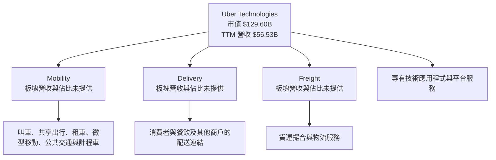
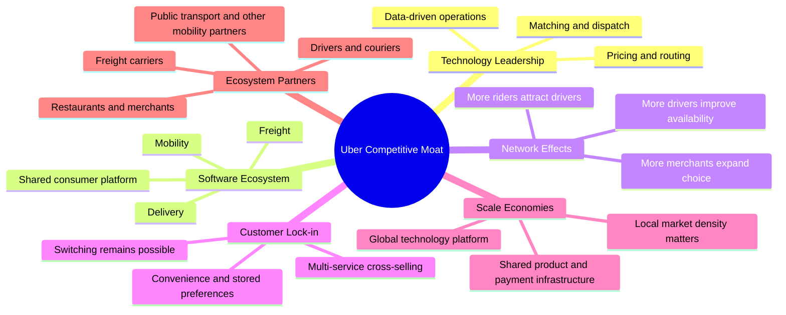
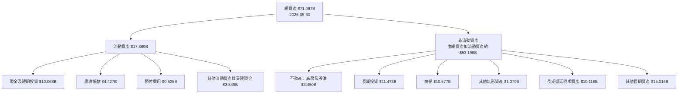
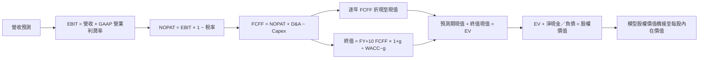
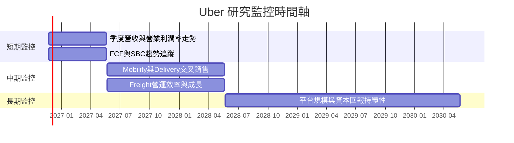
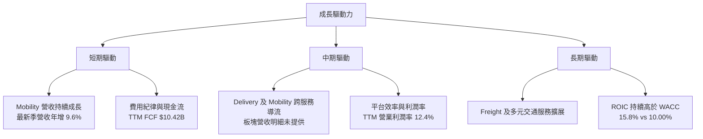
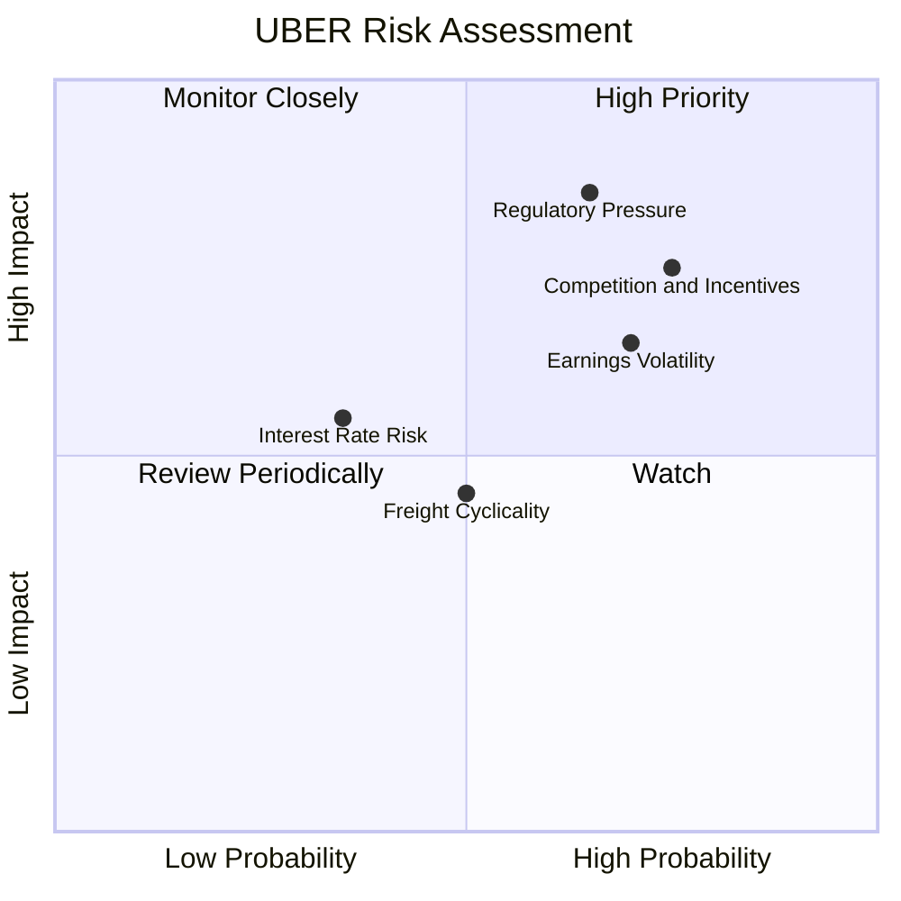
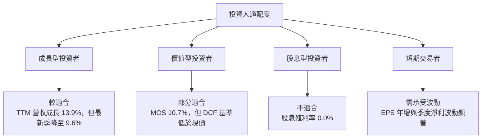

# UBER 基本面深度分析報告
> **報告日期**：2026-11-21 ｜ **語言**：繁體中文 ｜ **數據來源**：SEC 申報資料 (XBRL)、Yahoo Finance、Finviz、StockAnalysis、Roic.ai ｜ **分析師**：CFA 級機構研究

## 目錄

| # | 章節 | 核心結論 |
|---|------|----------|
| 1 | 執行摘要 | 買入；加權合理價值 $71.08，MOS +10.7% |
| 2 | 公司概覽與商業模式 | 多邊平台具網路效應，但市場份額數據未提供 |
| 3 | 損益表深度分析 | TTM 營收 $56.53B、成長 13.9%；最新季營業利潤率 9.8% |
| 4 | 資產負債表分析 | 淨負債 $5.60B；現金及短期投資 $10.07B |
| 5 | 現金流量深度分析 | TTM FCF $10.42B、FCF Yield 8.04% |
| 6 | 獲利能力與資本效率 | ROIC 15.8% 高於 WACC 10.00%，創造價值 |
| 7 | 相對估值分析 | 相對估值分歧；相較自身歷史 P/S 偏低、P/E 高於中位數 |
| 8 | DCF 內在價值評估 | 基準 DCF $41.20；加權合理價值 $71.08 |
| 9 | 成長催化劑 | 業務交叉銷售與平台效率是主要觀察方向；TAM 數據未提供 |
| 10 | 風險矩陣 | 監管、競爭與獲利波動為主要風險 |
| 11 | 投資建議 | 買入；買入區間上限需不低於現價，並追蹤利潤率與 FCF |

---

## 1. 執行摘要

Uber 的 TTM 營收為 **$56.53B**、TTM 成長 **13.9%**，TTM 營業利益率 **12.4%**，ROIC **15.8%** 高於 WACC **10.00%**，且 TTM FCF 為 **$10.42B**、FCF Yield **8.04%**。另一方面，2026 年第三季單季營收年增放慢至 **9.6%**，單季營業利益率為 **9.8%**；基準 DCF 每股價值 **$41.20** 低於 2026-11-20 收盤價 **$63.47**，但由 DCF、同業相對估值及分析師共識加權得出的合理價值為 **$71.08**。依 MOS **+10.7%** 門檻，評級為**買入**；DCF 與相對估值的分歧、以及單季營收增速與營業利益率下降，使信心度為中等。

### 1.0 一頁式投資儀表板（Portfolio Manager 30 秒速讀）

| 項目 | 內容 |
|------|------|
| **投資論點（3 句）** | ① TTM 營收 $56.53B、年增 13.9%，平台仍具擴張動能。② TTM FCF $10.42B、FCF Yield 8.04%，現金創造能力為估值支撐。③ ROIC 15.8% 高於 WACC 10.00%，但最新季營收年增降至 9.6%、單季營業利潤率 9.8%，需留意成長與利潤率趨勢。 |
| **綜合評分** | **7.0/10**（引用 1.1 評分卡） |
| **財務健康** | 🟡 現金及短期投資 $10.07B，但總債務 $15.66B，淨負債 $5.60B。 |
| **ROIC vs WACC** | **15.8% vs 10.00%**（創造股東價值，利差 5.8 個百分點） |
| **FCF 趨勢** | TTM FCF $10.42B；TTM FCF Yield **8.04%**。 |
| **估值** | Forward P/E **14.4x** ｜ EV/EBITDA **17.4x** ｜ FCF Yield **8.04%** |
| **DCF 內在價值（基準）** | **$41.20** ｜ 現價相對 DCF 溢價 **+54.1%** |
| **安全邊際（MOS）** | **+10.7%**＝($71.08 − $63.47) ÷ $71.08（加權合理價值基準）｜ 🟡 有限 |
| **預期報酬（基準情境 12M）** | **+12.0%**（加權合理價值相對現價上行空間，不是 DCF 基準情境報酬） |
| **關鍵風險（前二）** | 單季營收成長放緩；自動駕駛與叫車、外送競爭可能壓縮抽成與利潤率。 |
| **評級 + 信心度** | 🟢 **買入** ｜ 信心：中 |

> DCF 折溢價採固定定義：($63.47 ÷ $41.20) − 1 = **+54.1%**。MOS 使用加權合理價值 $71.08 為分母，與 DCF 折溢價分母不同。

### 1.1 綜合評分卡（全報告唯一）

| 維度 | 評分（1–10） | 主要依據（引用數字與其來源章節） |
|------|--------------|----------------------------------|
| 成長性 | 7.5 | TTM 營收成長 13.9%，但最新一季年增 9.6%（第 3 章），增速有放緩跡象。 |
| 獲利能力 | 8.0 | TTM 營業利益率 12.4%、ROIC 15.8% 高於 WACC 10.00%，F-Score 6/8（第 6 章）。 |
| 財務健康 | 6.5 | 淨負債 $5.60B、流動比率 1.232；DSO 29 天，DIO 與 CCC N/A（第 4 章）。 |
| 估值 | 6.0 | MOS +10.7%，P/E 高於自身五年中位數；DCF 基準價低於現價（第 7–8 章）。 |
| 護城河 | 7.5 | Mobility、Delivery 與 Freight 跨市場平台可形成網路效應；市場份額與留存數據未提供（第 2 章）。 |
| 管理層與資本配置 | 6.5 | FY2025 FCF $9.76B，SBC $1.83B；股息殖利率 0%，回購金額與資本配置細項未提供（第 5 章）。 |
| **綜合評分** | **7.0** | 六項算術平均：(7.5 + 8.0 + 6.5 + 6.0 + 7.5 + 6.5) ÷ 6 = 7.0。 |

### 1.2 五大投資論點 + 三大核心風險

| 類型 | 項目 | 具體依據 | 信心度 |
|------|------|----------|--------|
| 🟢 **投資論點①** | 平台營收仍成長 | TTM 營收 $56.53B，TTM 年增 13.9%；最新季單季年增 9.6%，仍為正成長但增速下降。 | 🟢 高 |
| 🟢 **投資論點②** | 現金流轉化能力佳 | TTM 營業現金流 $10.73B、資本支出 $314M、FCF $10.42B。 | 🟢 高 |
| 🟢 **投資論點③** | 資本回報高於資金成本 | ROIC 15.8%，高於 WACC 10.00%，差距 5.8 個百分點。 | 🟢 高 |
| 🟢 **投資論點④** | 資產負債表有現金緩衝 | 現金及短期投資 $10.07B，雖不足以覆蓋 $15.66B 總債務，仍提供流動性緩衝。 | 🟡 中 |
| 🟢 **投資論點⑤** | 相對估值支持有上行空間 | 同業 Forward P/E 法估值 $77.21、EV/EBITDA 法 $101.93；加權合理價值 $71.08。 | 🟡 中 |
| 🟡 **風險①** | 成長放緩 | 最新季營收年增 9.6%，低於 TTM 成長 13.9%；若持續減速，估值倍數可能下修。 | 🟡 中 |
| 🔴 **風險②** | 單季盈餘波動 | Q3 2026 淨利 $512M，年減 92.3%；EPS 年減 92.0%，同比基期與非營運項目影響大。 | 🔴 高衝擊 |
| 🔴 **風險③** | 估值方法差異大 | 基準 DCF $41.20，低於現價；相對估值與分析師共識高於現價。 | 🔴 高衝擊 |

### 1.3 快速統計卡片

| 指標 | 公司實際值（期間） | 同業中位數 | 狀態 |
|------|--------------------|------------|------|
| 營收成長（TTM） | **13.9%** | — | 🟢 |
| 營收成長（最新一季年增） | **9.6%** | **27.4%** | 🟡 |
| 毛利率（TTM） | **41.4%** | **41.4%** | 🟡 |
| 營業利益率（TTM） | **12.4%** | — | 🟢 |
| ROIC（TTM） | **15.8%** | — | 🟢 |
| Forward P/E | **14.4x** | **17.5x** | 🟢 |
| FCF Yield（TTM） | **8.04%** | — | 🟢 |
| Piotroski F-Score | **6 / 8** | — | 🟢 |

> 同業中位數依據 Peer multiples 區塊的 LYFT、DASH、GRAB 計算。最新季營收成長中位數為 27.4%；毛利率中位數為 41.4%；Forward P/E 中位數為 17.5x。

### 1.4 投資結論

```text
╔══════════════════════════════════════════════════════════════════╗
║                    📊 投資結論摘要                               ║
╠══════════════════════════════════════════════════════════════════╣
║  評級：買入（依 MOS +10.7% 的規則 20 門檻）                      ║
║  價格（2026-11-20 收盤）：$63.47                                 ║
║  DCF 內在價值（基準）：$41.20（現價溢價 +54.1%）                ║
║  安全邊際 MOS：+10.7%（＝($71.08−$63.47)÷$71.08）              ║
║  加權合理價值（8.8）：$71.08                                     ║
║  DCF 情境價值：                                                   ║
║    悲觀情境：$23.30（-63.3%）                                    ║
║    基準情境：$41.20（-35.1%）                                    ║
║    樂觀情境：$69.04（+8.8%）                                     ║
║  綜合評分：7.0/10（引用 1.1）                                    ║
║  適合投資人：能承受估值分歧與季節性盈餘波動的中長期投資人        ║
╚══════════════════════════════════════════════════════════════════╝
```

---

## 2. 公司概覽與商業模式

### 2.1 業務結構與收入來源

公司資料指出 Uber 分為 Mobility、Delivery、Freight 三個業務板塊，但沒有提供各板塊營收或佔比，因此下圖只呈現已知公司營收與業務分類，不推估板塊比例。



### 2.2 市場份額

市場份額數據未提供，因此不推估或繪製市佔比例。Uber TTM 營收為 **$56.53B**，TTM 成長 **13.9%**；與提供的直接同業相比，最新季成長 **9.6%** 低於 DASH 的 34.0% 與 GRAB 的 27.4%，略高於 LYFT 的 8.1%。

### 2.3 競爭護城河分析



### 2.4 護城河強度

| 護城河項目 | 強度（強／中／弱） | 證據（引用數字或事實） | 會削弱它的情況 |
|------------|--------------------|------------------------|----------------|
| 技術與平台 | 中 | 公司營運專有應用程式，涵蓋 Mobility、Delivery、Freight；研發費 FY2025 為 $3.40B。 | 技術差異不足以抵銷價格競爭或平台故障。 |
| 網路效應 | 中至強 | 同時連結消費者、司機、配送人員、商戶與承運商，平台跨業務使用可能提高密度。具體活躍用戶與留存指標未提供。 | 地方市場供需失衡、司機轉投競品或消費者多平台比價。 |
| 軟體生態系統 | 中 | 三個板塊共享品牌與部分平台能力；各板塊收入佔比未提供。 | 板塊間協同低於預期、產品體驗割裂。 |
| 客戶鎖定 | 弱至中 | 使用便利與多服務入口可能降低使用摩擦；沒有用戶留存或切換率資料。 | 使用者可低成本切換，折扣促銷可能提高流失。 |
| 規模效應 | 中 | TTM 營收 $56.53B，員工 37,300 人；跨地區營運可攤提技術與品牌成本。 | 監管要求因地而異，地方營運與保險成本可能抵銷規模優勢。 |
| 生態夥伴 | 中 | 業務依賴司機、餐飲商戶、承運商等合作網絡。 | 夥伴議價力上升、勞動分類或佣金限制。 |

1.1「護城河」評分為 **7.5/10**，主要依據為跨板塊平台與網路效應潛力；因市場份額、留存與單位經濟性資料未提供，並未給予更高評分。

---

## 3. 損益表深度分析

### 3.1 年度收入成長趨勢（近 4 年）

年度營收以財報列示值計算 YoY。2022 至 2025 年營收由 $31.88B 增至 $52.02B，2025 年成長放慢至 18.3%，但仍高於成熟低成長企業常見的單位數增長；不把四年趨勢外推為未來保證。

```text
╔══════════════════════════════════════════════════════════════════╗
║              Uber 年度收入趨勢（FY2022-FY2025）                 ║
╠══════════════════════════════════════════════════════════════════╣
║  FY2022  $31.88B  ███████████████              YoY：基期 N/A    ║
║  FY2023  $37.28B  ██████████████████           YoY：+16.9% 🟢   ║
║  FY2024  $43.98B  ██████████████████████       YoY：+18.0% 🟢   ║
║  FY2025  $52.02B  ██████████████████████████   YoY：+18.3% 🟢   ║
╠══════════════════════════════════════════════════════════════════╣
║  FY2022–FY2025 營收 CAGR：約 +17.7%（依年度營收計算）           ║
╚══════════════════════════════════════════════════════════════════╝
```

**計算說明**：FY2023 成長率 = ($37.28B ÷ $31.88B) − 1 ≈ 16.9%；FY2024 = ($43.98B ÷ $37.28B) − 1 ≈ 18.0%；FY2025 = ($52.02B ÷ $43.98B) − 1 ≈ 18.3%。三年 CAGR = ($52.02B ÷ $31.88B)^(1/3) − 1 ≈ 17.7%。

### 3.2 季度收入趨勢分析

| 季度 | 營收 | QoQ 成長 | YoY 成長 | 備註 |
|------|------|----------|----------|------|
| 2025 Q4 | $14.37B | — | 20.1% | 相較 2024 Q4 $11.96B；QoQ 基準季度資料未完整提供。 |
| 2026 Q1 | $13.20B | -8.1% | 14.5% | 季節性回落；YoY 成長仍為雙位數。 |
| 2026 Q2 | $14.19B | +7.5% | 12.2% | 較 Q1 回升；年增率低於 2025 Q2 的 18.2%。 |
| 2026 Q3 | $14.77B | +4.1% | 9.6% | QoQ 續增但 YoY 進一步放緩。 |

QoQ 公式為本季營收 ÷ 前季營收 − 1；例如 2026 Q3 = ($14.766B ÷ $14.191B) − 1 ≈ 4.1%。YoY 率採 StockAnalysis 單季數據，2026 Q3 為 9.65%，與已核實的最新季度年增 **9.6%** 一致。

### 3.3 利潤率演變分析

| 利潤率指標 | FY2022 | FY2023 | FY2024 | FY2025 | 趨勢 | 評估 |
|------------|--------|--------|--------|--------|------|------|
| **毛利率** | 38.3% | 39.8% | 39.4% | 39.7% | 大致穩定 | 🟡 |
| **營業利益率** | -5.7% | 3.0% | 6.4% | 10.7% | 連續改善 | 🟢 |
| **淨利率** | -28.7% | 5.1% | 22.4% | 19.3% | 2024–25 受非營業項目影響 | 🟡 |

計算以年度損益表所列毛利、營業利益與淨利除以營收。FY2025 營業利益率 = $5.57B ÷ $52.02B ≈ 10.7%；而 TTM 營業利益率為 **12.4%**，高於 FY2025，顯示近四季營運獲利改善。最新季度營業利益率依核實數據為 **9.8%**，低於 TTM；季度資料顯示營業利益由 2026 Q1 $1.92B、Q2 $1.89B 降至 Q3 $1.45B。毛利率未呈現同等幅度擴張，表示營業槓桿改善更可能來自營運費用率、平台規模及費用控制，而非單純毛利率大幅上升。年度淨利率受非營業項目與稅務影響，不能直接視為核心經營利潤率。

### 3.4 費用結構分析

年度研發費用可由資料核實，但完整營運費用細項與同期間總費用拆分未提供，不能把未列示費用補成比例，也不繪製 pie chart。

```text
╔══════════════════════════════════════════════════════════════════╗
║                已提供之費用數據：研發費用                       ║
╠══════════════════════════════════════════════════════════════════╣
║  FY2022  $2.80B                                                  ║
║  FY2023  $3.16B                                                  ║
║  FY2024  $3.11B                                                  ║
║  FY2025  $3.40B                                                  ║
║                                                                  ║
║  FY2025 研發費用／營收 = $3.40B ÷ $52.02B ≈ 6.5%                ║
║  其他完整費用分類：數據未提供                                    ║
╚══════════════════════════════════════════════════════════════════╝
```

### 3.5 季度 EPS 趨勢與盈餘品質（Quality of Earnings）

最近四季 EPS 實際值可由淨利及每股資料取得；但分析師 EPS 預估值均為缺漏，因此**無法判定超預期或不及預期**。

| 季度 | EPS 實際 | EPS 年增 | 淨利 | 盈餘表現 |
|------|----------|----------|------|----------|
| 2025 Q4 | $0.14 | -95.6% | $296M | 預估值 N/A，無法判定 beat/miss；同比大幅下降。 |
| 2026 Q1 | $0.13 | -84.6% | $263M | 預估值 N/A；淨利較低。 |
| 2026 Q2 | $1.17 | +85.5% | $2.39B | 預估值 N/A；季度淨利波動明顯。 |
| 2026 Q3 | $0.25 | -92.0% | $512M | 預估值 N/A；年增率受 2025 Q3 高基期影響。 |

| 盈餘品質項目 | 數值/佔比 | 評估 |
|--------------|-----------|------|
| 股權薪酬 SBC / 營收 | TTM SBC 估算 $2.065B ÷ TTM 營收 $56.53B = **3.65%** | 🟡 SBC 是真實股東成本；此比率仍代表持續稀釋或回購抵銷的經濟成本。 |
| SBC / 營業現金流 | $2.065B ÷ $10.73B = **19.2%** | 🟡 現金流中有相當部分來自加回非現金 SBC；不能把全部營業現金流等同於無稀釋成本的股東現金。 |
| FCF / 淨利（現金轉換率） | $10.42B ÷ $3.465B = **3.01x** | 🟢 高於 1 倍；但淨利受季度非營業與稅務波動影響，倍數較高不代表可持續的正常化水準。 |
| 一次性/非經常性損益 | FY2025 淨利 $10.05B、營業利益 $5.57B；差額來源細項未提供 | 🟡 淨利顯著高於營業利益，非營業項目與稅務項目需拆解，不能假設均為經常性。 |
| 有效稅率異常 | N/A（未提供可一致核對的 TTM 稅費與稅前利潤） | 🟡 FY2025 淨利與營業利益差距顯著，須進一步檢視稅務利益／投資損益。 |
| 資本化支出 vs 費用化 | TTM 資本支出 $314M；資本化研發明細 N/A | 🟡 資本支出相對 TTM 營收低，但不能據此判斷平台研發是否有費用遞延。 |

SBC TTM 以最近四季明列數字合計：$591M + $550M + $473M + $451M = $2.065B。現金轉換率使用 TTM FCF 與 TTM 淨利；資料表 TTM 淨利為 $3.465B。整體看 FCF 含金量有支持，但 SBC 佔營收約 3.65%，股東報酬必須扣除稀釋成本後衡量；淨利的稅務與非營業波動亦降低單季 EPS 的代表性。

---

## 4. 資產負債表分析

### 4.1 資產結構分解



其他流動資產與受限現金 $2.849B = $0.525B 預付費用 + $0.616B 受限現金 + $2.233B 其他流動資產；由列示資產分項加總可能因四捨五入或財報分類而與總額有尾差。

### 4.2 流動性與營運資金分析

| 指標 | 最新 TTM | 一年前 TTM | 變化 | 解讀 |
|------|----------|------------|------|------|
| 流動比率 | 1.232 | N/A | N/A | 流動資產高於流動負債，但未達非常寬裕的倍數。 |
| 速動比率 | 0.999 | N/A | N/A | 接近 1 倍；現金與應收等速動資產對短期負債覆蓋能力尚可。 |
| DSO 應收帳款天數 | 29 天 | 28 天 | +1 天 | 收款週期略延長；幅度不大，原因資料未提供。 |
| DIO 存貨天數 | N/A | N/A | N/A | 公司未報列相應存貨餘額；不得推算。 |
| DPO 應付帳款天數 | 17 天 | N/A | N/A | 一年前數據缺漏，無法判斷供應商付款條件變化。 |
| CCC 現金轉換週期 | N/A | N/A | N/A | DIO 缺漏，不能計算。 |

### 4.3 債務結構分析

財務數據中不同來源的總債務口徑不一致；本報告依核實數據採用 **總債務 $15.66B、現金及短期投資 $10.07B、淨負債 $5.60B**，不混用其他區段不同口徑的 $17.74B。

```text
╔══════════════════════════════════════════════════════════════════╗
║                   Uber 債務健康診斷                              ║
╠══════════════════════════════════════════════════════════════════╣
║  總債務：             $15.66B  ████████████████████              ║
║  現金及短期投資：     $10.07B  █████████████                    ║
║  淨負債：              $5.60B  ███████                          ║
║                                                                  ║
║  Debt/EBITDA：N/A（核實數據未提供可一致使用的 TTM EBITDA）        ║
║  Interest Coverage：N/A（利息費用與利息保障倍數未提供）          ║
║  流動比率：1.232；速動比率：0.999                                ║
║                                                                  ║
║  評估：現金不足以覆蓋全部債務，但淨負債相對 TTM FCF $10.42B 可管理║
╚══════════════════════════════════════════════════════════════════╝
```

淨負債 $5.60B 相當於 TTM FCF 的約 0.54 倍（$5.60B ÷ $10.42B）；這只是以淨負債與單年 FCF 的量級比較，並非債務到期或償債能力預測。

### 4.4 股東權益趨勢

```text
╔══════════════════════════════════════════════════════════════════╗
║                Uber 年度股東權益變化                            ║
╠══════════════════════════════════════════════════════════════════╣
║  FY2022  $7.34B   ███████                                        ║
║  FY2023  $11.25B  ███████████                                    ║
║  FY2024  $21.56B  █████████████████████                          ║
║  FY2025  $27.04B  ███████████████████████████                    ║
╠══════════════════════════════════════════════════════════════════╣
║  FY2022–FY2025 權益上升；可能受累積獲利與其他權益變動共同影響   ║
╚══════════════════════════════════════════════════════════════════╝
```

股東權益由 FY2022 $7.34B 增至 FY2025 $27.04B。各年增量與留存盈餘、其他綜合損益、回購及 SBC 的拆解未完整提供，不將變化單一歸因於某項資本配置。

---

## 5. 現金流量深度分析

### 5.1 現金流量瀑布圖

股息殖利率與派息率均為 0.0%；回購金額未提供，因此不在現金流瀑布中編造分配金額。


淨利到營業現金流之間的調節包含非現金費用、營運資金與其他調整；此處不把差額全數歸因於 SBC。TTM FCF 按規定採用營業現金流減資本支出的口徑。

### 5.2 FCF 轉換率趨勢

| 財年 | FCF | 淨利 | FCF / 淨利 | 解讀 |
|------|-----|------|------------|------|
| 2022 | $0.39B | -$9.14B | -4.3% | 淨利為負，比例失去常規可比性；FCF 已轉正。 |
| 2023 | $3.36B | $1.89B | 177.8% | 現金流高於會計淨利，反映非現金項目與營運資金影響。 |
| 2024 | $6.89B | $9.86B | 69.9% | 淨利含較大非營業或稅務影響可能性，現金轉換低於 1 倍。 |
| 2025 | $9.76B | $10.05B | 97.1% | FCF 接近淨利，兩者轉換較平衡。 |
| TTM 至 2026-09-30 | $10.42B | $3.465B | 300.7% | TTM 淨利波動拉低分母，不能直接外推。 |

### 5.3 自由現金流趨勢

```text
╔══════════════════════════════════════════════════════════════════╗
║              自由現金流：歷史實際與 TTM                          ║
╠══════════════════════════════════════════════════════════════════╣
║  FY2022  $0.39B   █                                               ║
║  FY2023  $3.36B   ███████                                         ║
║  FY2024  $6.89B   ██████████████                                  ║
║  FY2025  $9.76B   ████████████████████                            ║
║  TTM     $10.42B  █████████████████████                           ║
╠══════════════════════════════════════════════════════════════════╣
║  TTM FCF Yield：8.04% ｜ TTM FCF = OCF $10.73B − Capex $0.314B   ║
╚══════════════════════════════════════════════════════════════════╝
```

圖中歷史年度 FCF 取現金流量表；TTM FCF 使用核實數據值。數字的四捨五入可能令營業現金流減資本支出與 FCF 出現尾差；按核實數據原值採用 $10.42B。

### 5.4 資本配置評估

完整回購、投資及現金留存配置金額未提供，故不繪製分配比例圓餅圖。

| 資本配置項目 | 可核實數據 | 評估 |
|--------------|------------|------|
| 資本支出 | TTM $314M | 佔 TTM 營收比例低；但資本支出不等同全部再投資需求。 |
| 股權薪酬 | FY2025 $1.83B；TTM 按季度明列數字合計 $2.065B | 需要將稀釋成本納入每股價值評估。 |
| 股息 | 殖利率 0.0%、派息率 0.0% | 未以現金股息回饋股東。 |
| 股票回購 | 金額 N/A | 資料未提供，無法判斷回購是否抵銷 SBC。 |
| 留存現金／併購 | N/A | 具體資本配置金額未提供。 |

---

## 6. 獲利能力與資本效率

### 6.1 ROE / ROA / ROIC 趨勢

| 指標 | FY2022 | FY2023 | FY2024 | FY2025 | 最新 TTM | 評估 |
|------|--------|--------|--------|--------|----------|------|
| ROE | N/A | N/A | N/A | N/A | 12.5% | 歷史年度口徑未提供可一致比較數列。 |
| ROA | N/A | N/A | N/A | N/A | 6.5% | 最新 TTM 為正；同比是否改善未通過 F-Score 測試。 |
| ROIC | N/A | N/A | N/A | N/A | **15.8%** | 高於 WACC 10.00%，呈現正經濟利差。 |

### 6.2 ROIC vs WACC 分析（核心價值創造判斷）

WACC 依資本成本數據採用 **10.00%**；Beta 使用調整後 1.21。此處將稅後 Kd 展示為輸入推導結果，並保持 WACC 與 DCF 相同。

```text
╔══════════════════════════════════════════════════════════════════╗
║                ROIC vs WACC 深度分析                             ║
╠══════════════════════════════════════════════════════════════════╣
║  WACC 估算：                                                      ║
║  ├── 無風險利率（10Y 美債）：       4.91%                        ║
║  ├── 市場風險溢酬 ERP：              5.00%                        ║
║  ├── Beta 原始值／調整後：           1.31／1.21                   ║
║  ├── 股權成本（來源值）：            10.94%                       ║
║  ├── 稅前債務成本：                  2.81%                        ║
║  ├── 稅後 Kd：                       2.81%×(1−21.0%) = 2.22%     ║
║  ├── 資本結構：股權 89.2%，債務 10.8%                            ║
║  └── ✅ 採用 WACC：                  10.00%                       ║
║                                                                  ║
║  ROIC（TTM）：                     15.8%                         ║
║  WACC：                            10.00%                        ║
║  EVA 利差 = 15.8% − 10.00% =      +5.8 個百分點                 ║
║                                                                  ║
║  ROIC  15.8%  ▓▓▓▓▓▓▓▓▓▓▓▓▓▓▓▓░░░░  高於資金成本               ║
║  WACC  10.0%  ▓▓▓▓▓▓▓▓▓▓░░░░░░░░░░  折現率                     ║
║                                                                  ║
║  結論：ROIC/WACC = 15.8%÷10.00% = 1.58 倍，現階段創造價值      ║
╚══════════════════════════════════════════════════════════════════╝
```

資本成本數據列示股權成本 10.94%；但直接以顯示的 Rf 4.91%、調整後 Beta 1.21、ERP 5.00% 計算，結果為 4.91% + 1.21 × 5.00% = 10.96%，差異 0.02 個百分點，可能來自底層未四捨五入輸入。WACC 依規則採用核實數據原值 **10.00%**，不另建立替代 WACC。ROIC 高於 WACC 表示目前投入資本回報高於資本成本，但若最新季度獲利率下滑延續，ROIC 仍可能回落。

### 6.3 杜邦三因素分解

| 因素 | 數值（TTM） | 解讀 |
|------|-------------|------|
| 淨利率 | 6.1% | 淨利受非營業項目與稅務波動影響，不能單獨代表核心營運。 |
| 資產週轉率 | 0.80 | 每 1 美元資產對應約 0.80 美元營收。 |
| 權益乘數 | 2.57 | 存在財務槓桿，但 ROE 不完全由槓桿驅動。 |
| **ROE** | **12.5%** | 6.1% × 0.80 × 2.57 ≈ 12.5%。 |

依質量指標提供的杜邦數值原樣引用。ROE 由淨利率、資產週轉率與權益乘數共同形成；因淨利率與資產週轉率乘積約 4.9%，再由 2.57 倍權益乘數放大，槓桿有貢獻但不是唯一來源。

### 6.4 財務體質：Piotroski F-Score

**Piotroski F-Score：6 / 8**。其中一項測試缺少輸入，故分母為 8；毛利率測試標示為無法判定，不能將其視作通過或未通過。

| 測試 | 結果 | 解讀 |
|------|------|------|
| ROA > 0 | ✅ 通過 | 盈利能力為正。 |
| 營業現金流 > 0 | ✅ 通過 | TTM 營業現金流 $10.73B。 |
| ROA 高於一年前 | ❌ 未通過 | 資產報酬率同比未改善，反映資產增長或獲利變化需追蹤。 |
| 營業現金流 > 淨利（應計品質） | ✅ 通過 | 表示現金流高於會計淨利，現金確認度較佳。 |
| 長期負債 ÷ 總資產低於一年前 | ❌ 未通過 | 相對負債負擔未改善。 |
| 流動比率高於一年前 | ✅ 通過 | 流動性指標相較一年前改善。 |
| 稀釋股數未增加 | ✅ 通過 | 此測試期間稀釋股數未增加；仍需監控 SBC 佔營收比率。 |
| 毛利率高於一年前 | — 無法判定 | 缺資料，不補值。 |
| 資產週轉率高於一年前 | ✅ 通過 | 資產使用效率同比改善。 |

---

## 7. 相對估值分析

### 7.1 同業估值比較表格

同業倍數直接引用 Peer multiples；Uber 自身倍數取財務估值區段與歷史估值資料，數字按各來源的精度呈現。

| 估值指標 | **UBER** | **LYFT** | **DASH** | **GRAB** | UBER 評估 |
|----------|----------|---------|---------|---------|-----------|
| **Trailing P/E** | 37.1x | 2.4x | 63.3x | 27.5x | 🟡 同業差異大；LYFT 低倍數可能受盈利基數影響。 |
| **Forward P/E** | 14.4x | 8.0x | 20.0x | 17.5x | 🟢 低於三家同業中位數 17.5x。 |
| **P/S Ratio** | 2.3x | 0.9x | 3.9x | 2.8x | 🟡 高於 LYFT、低於 DASH 與 GRAB；近同業中間偏低。 |
| **EV/EBITDA** | 17.4x | 546.9x | 37.3x | 17.4x | 🟢 遠低於 DASH；LYFT 倍數異常高，參考價值有限。 |
| **最新一季營收年增** | 9.6% | 8.1% | 34.0% | 27.4% | 🔴 低於兩家高成長同業，略高於 LYFT。 |
| **毛利率（TTM）** | 41.4% | 40.0% | 52.7% | 41.4% | 🟡 與 GRAB 相同，高於 LYFT、低於 DASH。 |

相對估值法中 Forward P/E 同業中位數為 17.5x；EV/EBITDA 的估值方法使用 DASH 與 GRAB 中位數 27.4x，按價值方法區塊指定口徑，不以含極端值的 LYFT 倍數替代。

### 7.2 歷史估值區間分析

```text
╔══════════════════════════════════════════════════════════════════╗
║                UBER 歷史估值位置（TTM）                         ║
╠══════════════════════════════════════════════════════════════════╣
║  P/E        12.6x ├────────中位數 17.8x────────●37.1x────122.2x ║
║                                      現值百分位：54%             ║
║  P/S         1.5x ├──●2.3x──中位數 3.3x───────────────6.1x       ║
║                  現值百分位：19%                                 ║
║  EV/EBITDA  18.7x ├●17.4x?────────中位數 40.0x────────320.2x    ║
║                  現值百分位：0%                                  ║
╚══════════════════════════════════════════════════════════════════╝
```

EV/EBITDA 歷史區間最低值為 18.7x，核實數據現值為 17.4x，低於所列區間下界；因此圖中「●」僅表示現值在歷史中位數左側，不代表它落於歷史區間內。自身歷史數據顯示 P/E 高於中位數 17.8x、百分位 54%；P/S 低於中位數 3.3x、百分位 19%；EV/EBITDA 目前低於歷史中位數 40.0x。

### 7.3 情境價值（Bear / Base / Bull，照抄 DCF MODEL 的 Scenarios）

| 情境 | 第 1 年營收成長 | 期末營業利潤率 | WACC | 每股價值 | 相對現價 | 機率 | 會發生的條件 |
|------|----------------|----------------|------|----------|----------|------|--------------|
| 🔴 悲觀 | 7.0% | 5.4% | 11.00% | $23.30 | -63.3% | 25% | 成長下滑、競爭或監管成本持續侵蝕利潤，資金成本上升。 |
| 🟡 基準 | 13.9% | 6.4% | 10.00% | $41.20 | -35.1% | 50% | 營收起始增長延續核實 TTM 成長，之後增長與利潤率逐步收斂。 |
| 🟢 樂觀 | 20.9% | 7.0% | 9.00% | $69.04 | +8.8% | 25% | 成長顯著高於目前 TTM，平台擴張與成本效率同步改善。 |

三情境數值來自基準 DCF 情境模型；「會發生的條件」為對各情境營運含義的解讀，並非公司指引。

### 7.4 相對估值隱含價格區間

```text
╔══════════════════════════════════════════════════════════════════╗
║          同業相對估值與分析師共識：每股價值                     ║
╠══════════════════════════════════════════════════════════════════╣
║  $41.20       $63.47       $77.21        $98.16       $101.93    ║
║  DCF 基準      現價         Forward P/E   分析師共識   EV/EBITDA  ║
╚══════════════════════════════════════════════════════════════════╝
```

| 方法 | 每股價值 | 依據 |
|------|----------|------|
| 同業 Forward P/E | $77.21 | 同業中位數 17.5x × UBER Forward EPS $4.41。 |
| 同業 EV/EBITDA | $101.93 | DASH、GRAB 同業中位數 27.4x × TTM EBITDA，再加回淨現金／扣除淨負債。 |
| 分析師共識 | $98.16 | 46 位分析師平均目標價。 |

相對估值法顯示每股價值高於現價；但同業 EV/EBITDA 估值依賴成熟盈利倍數可持續，且不同公司業務組合差異明顯，應與 DCF 一併看待。

---

## 8. DCF 內在價值評估（Discounted Cash Flow）

> 本章依已計算的 DCF MODEL 原值呈現；不另建模型或改動預測數字。金額以美元十億計，逐年表格採用模型列示精度，模型底層可能保留更多小數，導致顯示數字重算有小幅四捨五入尾差。

### 8.0 估值推理鏈（Thinking Logic：在算之前先想清楚）

**Step 1 — 價值由哪些變數決定？**  
本 DCF 主要將 Uber 的價值拆為 Mobility、Delivery、Freight 三項主業現金流；各板塊營收佔比與新業務選擇權價值未提供，因此不拆分板塊估值。現有 TTM 營收為 $56.53B，TTM FCF $10.42B。模型的敏感度矩陣顯示永續成長率與 WACC 對價值影響大，營運利潤率也影響終值現金流；在固定的 10 年預測期下，**折現率與終值假設是估值的主要敏感變數**。

**Step 2 — 模型選擇**

| 決策點 | 本報告採用 | 理由（含數字） | 曾考慮但否決 | 否決理由 |
|--------|-----------|----------------|--------------|----------|
| 現金流定義 | FCFF | 以企業現金流折現至 EV，配合 WACC；TTM FCF $10.42B。 | FCFE | 債務與現金應在企業價值轉股權價值時橋接。 |
| 預測期 N | 10 年 | 原模型逐年列 FY+1 至 FY+10，成長率由 13.9% 線性降至 3.0%。 | 5 年 | 與既定 DCF 模型不符，且不得自行重建。 |
| 終值方法 | Gordon Growth | 原模型用 FY+10 FCFF、永續成長 3.0% 與 WACC 10.00%。 | 退出倍數法 | DCF 模型未提供退出倍數與相應終值，不自行補值。 |
| EBIT 基礎 | GAAP EBIT | 原模型明確採 GAAP EBIT。 | 非 GAAP EBIT | 避免將 SBC 加回後再以股數或現金流方式處理。 |

**Step 3 — 關鍵假設推導鏈**

- **營收路徑（高敏感）**：錨點＝TTM 營收成長 13.9%，TTM 營收 $56.53B → 調整＝模型由第一年 13.9% 逐年線性淡化至第十年 3.0%，反映高成長逐步成熟 → **採用 FY+1 13.9%、FY+10 3.0%** → 曾考慮全十年維持 13.9%，但這會遠高於成熟期長期成長假設且不符合模型既定路徑，故不採用。
- **期末營業利潤率（高敏感）**：錨點＝TTM 營業利益率 12.4% → 調整＝模型將利潤率降至近五財年中位水準 → **採用 FY+1 12.4%、FY+10 6.4%** → 曾考慮維持 12.4%，但與模型採用的歷史中位數收斂假設不一致，故否決。
- **永續成長率 g（高敏感）**：錨點＝模型取 3.0%，且公司長期名目成長不應長期大幅高於經濟規模 → 調整＝採取成熟企業穩定成長假設 → **採用 3.0%** → 曾考慮高於 3.0%，但會使終值對遠期增長依賴加深，且必須低於 WACC，故不採用。
- **預測期 N（中敏感）**：錨點＝模型完整提供 10 年逐年預測 → 調整＝採用該模型可見度，不自行延長或縮短 → **採用 10 年** → 曾考慮較短期間，但會偏離既定 DCF 輸入，故否決。
- **Capex／營收（中敏感）**：錨點＝TTM 資本支出 $314M ÷ TTM 營收 $56.53B 約 0.6% → 調整＝模型維持約 0.6%，與資料中的近期資本支出率相符 → **採用 0.6%** → 曾考慮較高資本支出率，但沒有可核實的未來指引支持，故不改原模型值。
- **GAAP EBIT 與 SBC（中敏感）**：錨點＝FY2025 SBC $1.83B、TTM SBC 估算 $2.065B → 調整＝採用 GAAP EBIT，因 SBC 已作費用入帳 → **採用組合 (A)：GAAP EBIT、不另扣 SBC、固定股數／年稀釋率 0%** → 否決非 GAAP 加回後再另扣或再稀釋，因會改變模型定義並可能重複計算。
- **年稀釋率（中敏感）**：錨點＝模型明定固定股數，稀釋成本已透過 GAAP 費用納入 → **採用 0% 額外稀釋** → 曾考慮逐年放大股數，但會與組合 (A) 不相容，故否決。
- **終值方法（高敏感）**：錨點＝FY+10 FCFF $7.40B，模型採 Gordon Growth → **採用 Gordon Growth** → 曾考慮退出倍數交叉驗證，但缺模型所需退出倍數與計算輸入，不能自行填入。
- **WACC（高敏感）**：錨點＝資本成本資料採用 WACC 10.00% → 調整＝不另行推算或替換 → **採用 10.00%** → 曾考慮用單一 CAPM 算式直接替代，但來源 WACC 已固定，且輸入呈現有 0.02 個百分點的股權成本尾差，故維持原值。
- **稅率（低敏感）**：錨點與採用值均為 21.0%，模型採預設稅率。
- **D&A／營收（低敏感）**：錨點與採用值均為 TTM 1.4%，模型維持不變。
- **ΔWC／營收增額**：模型未建模營運資金變化，沒有可代入的比率；本報告不補值，FCFF 按模型定義為 NOPAT + D&A − Capex。

**Step 4 — 最脆弱的一環**  
最脆弱的是遠期利潤率、WACC 與永續成長率共同決定的終值：終值現值佔 EV **46.8%**；若資金成本由 10% 升至 11%、g 維持 3%，模型敏感度表的每股價值由 $41.20 降至 $36.08。

**Step 5 — 計算路徑圖**



### 8.1 模型假設總表（Model Inputs）

| 假設項目 | 採用值 | 依據 / 來源 | 敏感度 |
|----------|--------|-------------|--------|
| 預測期長度 N | 10 年 | DCF MODEL 列出 FY+1 至 FY+10。 | 🟡 中 |
| 營收成長路徑 | FY+1 13.9% → FY+10 3.0% | TTM vs prior TTM 成長率 13.9%；模型線性淡化。 | 🔴 高 |
| 營業利潤率 | FY+1 12.4% → FY+10 6.4% | TTM 營業利益率 12.4%；期末收斂至模型所用近五年中位數。 | 🔴 高 |
| 有效稅率 | 21.0% | DCF 模型預設稅率。 | 🟢 低 |
| Capex / 營收 | 約 0.6% | TTM 資本支出 $314M ÷ TTM 營收 $56.53B 約 0.6%；模型持平。 | 🟡 中 |
| D&A / 營收 | 1.4% | DCF 模型採用 TTM 比率並持平。 | 🟢 低 |
| 營運資金變動 / 營收增額 | 未建模 | DCF MODEL 明確未建模營運資金；不填臆測值。 | 🟢 低 |
| EBIT 基礎 | GAAP | DCF MODEL 明確採 GAAP EBIT。 | 🟡 中 |
| 股權薪酬 SBC 處理 | 不額外扣除 SBC | GAAP EBIT 已費用化 SBC，採組合 (A)。 | 🟡 中 |
| 年稀釋率（股數） | 0% 額外稀釋 | 組合 (A)：固定股數，SBC 成本已反映在費用。 | 🟡 中 |
| 永續成長率 g | 3.0% | DCF MODEL 原值，低於 WACC 10.00%。 | 🔴 高 |
| 終值方法 | Gordon Growth | 原模型提供此方法；未提供退出倍數終值。 | 🔴 高 |
| WACC | 10.00% | 資本成本區塊與 DCF MODEL 原值。 | 🔴 高 |

**現金流定義**：使用 FCFF，對應 WACC 折現並得出企業價值。  
**SBC 防重複說明**：本模型採用 **(A)**，GAAP EBIT 已含 SBC 費用，因此 FCFF 不再減 SBC，股數不額外稀釋。

### 8.2 折現率推導（WACC）

```text
╔══════════════════════════════════════════════════════════════════╗
║                    WACC 推導（折現率）                           ║
╠══════════════════════════════════════════════════════════════════╣
║  股權成本 Ke（CAPM）：                                            ║
║  ├── 無風險利率 Rf：                 4.91%                       ║
║  ├── 市場風險溢酬 ERP：              5.00%                       ║
║  ├── 原始 Beta：                     1.31                        ║
║  ├── 調整後 Beta：                   ⅔×1.31 + ⅓×1 = 1.21         ║
║  ├── 規模／國別溢酬：                0.00%（未另加）             ║
║  └── Ke（來源列示）：                10.94%                       ║
║                                                                  ║
║  債務成本 Kd：                                                    ║
║  ├── 稅前 Kd：                       2.81%                        ║
║  ├── 稅率：                          21.0%                        ║
║  └── 稅後 Kd = 2.81%×(1−21.0%) =  2.22%                         ║
║                                                                  ║
║  資本結構（來源列示權重）：                                       ║
║  ├── 股權 E 權重：                   89.2%                        ║
║  ├── 債務 D 權重：                   10.8%                        ║
║  └── ✅ 採用 WACC：                 10.00%                        ║
╚══════════════════════════════════════════════════════════════════╝
```

**來源與算式檢查：**

1. **Ke（CAPM）**：依來源列示值採用 **10.94%**。以表中已四捨五入的數字重算：4.91% + 1.21 × 5.00% = **10.96%**；與來源值相差 0.02 個百分點，推測由底層未四捨五入輸入造成，本報告不替換來源 Ke。
2. **稅前 Kd**：核實資本成本資料直接提供 **2.81%**，利息費用與平均計息負債的完整明細未提供，因此不能按要求另行還原分子、分母。
3. **稅後 Kd**：2.81% × (1 − 21.0%) = 2.2199% ≈ **2.22%**。
4. **權重**：股權 89.2% + 債務 10.8% = **100.0%**。股權市值及債務口徑的原始推導細節未在資本成本區塊列出，故沿用程式計算權重，不以帳面權益重算。
5. **WACC**：89.2% × 10.94% + 10.8% × 2.2199% = 9.75848% + 0.2397492% = **9.9982292% ≈ 10.00%**。採用值依核實資料為 **10.00%**。

Rf 來源為資料列示的 10 年期美國公債利率 4.91%；其觀察日期未提供，不能補寫日期。Beta 原始值 1.31 由 Yahoo Finance 列示，採用調整值 1.21，使用 ⅔ × 原始 Beta + ⅓ × 1 的調整。ERP 5.00% 為資本成本計算假設；未另加規模或國別溢酬。WACC 與第 6.2 節及 DCF 模型一致。

### 8.3 逐年自由現金流預測（基準情境）

以下逐年數字依 DCF MODEL 原值照列，金額單位為 $B。營運資金變化未建模；FCFF = NOPAT + D&A − Capex。

| 年度 | FY+1 | FY+2 | FY+3 | FY+4 | FY+5 | FY+6 | FY+7 | FY+8 | FY+9 | FY+10 |
|------|------|------|------|------|------|------|------|------|------|-------|
| 營收 | 64.41 | 72.60 | 80.96 | 89.29 | 97.40 | 105.06 | 112.04 | 118.12 | 123.10 | 126.80 |
| 營收 YoY | 13.9% | 12.7% | 11.5% | 10.3% | 9.1% | 7.9% | 6.6% | 5.4% | 4.2% | 3.0% |
| 營業利潤率 | 12.4% | 11.8% | 11.1% | 10.4% | 9.7% | 9.1% | 8.4% | 7.7% | 7.0% | 6.4% |
| 營業利益 EBIT（GAAP） | 8.01 | 8.54 | 8.98 | 9.30 | 9.49 | 9.52 | 9.40 | 9.11 | 8.67 | 8.07 |
| − 稅（21.0%） | (1.68) | (1.79) | (1.89) | (1.95) | (1.99) | (2.00) | (1.97) | (1.91) | (1.82) | (1.69) |
| = NOPAT | 6.33 | 6.75 | 7.09 | 7.35 | 7.50 | 7.52 | 7.43 | 7.20 | 6.85 | 6.38 |
| + D&A | 0.88 | 0.99 | 1.10 | 1.21 | 1.33 | 1.43 | 1.52 | 1.61 | 1.67 | 1.72 |
| − Capex | (0.36) | (0.40) | (0.45) | (0.50) | (0.54) | (0.58) | (0.62) | (0.66) | (0.68) | (0.70) |
| **= FCFF** | **6.85** | **7.33** | **7.75** | **8.07** | **8.28** | **8.37** | **8.33** | **8.15** | **7.84** | **7.40** |
| 折現因子 @10.00% | 0.909 | 0.826 | 0.751 | 0.683 | 0.621 | 0.565 | 0.513 | 0.467 | 0.424 | 0.386 |
| **FCFF 現值 PV** | **6.23** | **6.06** | **5.82** | **5.51** | **5.14** | **4.73** | **4.27** | **3.80** | **3.32** | **2.85** |

**預測期 FCF 現值合計**：  
$6.23 + $6.06 + $5.82 + $5.51 + $5.14 + $4.73 + $4.27 + $3.80 + $3.32 + $2.85 = **$47.73B**；模型原列合計 **$47.74B**。差額 $0.01B，約 0.02%，來自年度現值顯示至兩位小數而合計使用底層精度；依模型原列採用 **$47.74B**。

**FY+1 逐步演算**（使用模型列示值；底層數字四捨五入可能產生小額尾差）：

1. **營收** = $56.53B × (1 + 13.9%) = $56.53B × 1.139 = **$64.41B**
2. **EBIT** = $64.41B × 12.4% = **$7.99B**（模型以底層未四捨五入營收列示 EBIT **$8.01B**；模型值優先）
3. **稅** = $8.01B × 21.0% = **$1.68B**
4. **NOPAT** = $8.01B − $1.68B = **$6.33B**
5. **+ D&A** = $64.41B × 1.4% ≈ **$0.88B**
6. **− Capex** = $64.41B × 0.6% ≈ **$0.36B**
7. **− ΔWC** = **$0.00B（模型未建模，按模型 FCFF 定義不列營運資金項）**
8. **FCFF** = $6.33B + $0.88B − $0.36B = **$6.85B**
9. **折現因子** = 1 ÷ (1 + 10.00%)^1 = 0.9091 ≈ **0.909**；PV = $6.85B × 0.909 ≈ **$6.23B**

> 第 2 步以展示值計算 $64.41B × 12.4% 約 $7.99B，與模型原值 $8.01B 有約 0.3% 差距，屬於模型使用未四捨五入數值的結果；原模型逐年數字照列，不作修改。

**合理性自檢**

- 模型 FY+1 至 FY+10 FCFF 由 $6.85B 增至 $7.40B，端點 CAGR 約 **0.8%**；FY2022 至 FY2025 年度 FCF 由 $0.39B 增至 $9.76B，歷史高成長主要受低基期影響，兩者不能直接對比為同一穩態增長。
- FY+10 FCFF 利潤率 = $7.40B ÷ $126.80B ≈ **5.8%**；目前 TTM FCF 利潤率 = $10.42B ÷ $56.53B ≈ **18.4%**。差異主要因模型採 GAAP EBIT、利潤率由 12.4% 淡化至 6.4%，且採用的 FCFF 預測不等於現有 TTM FCF 口徑；同業最佳 FCF 利潤率資料未提供。
- 模型預測各年 FCFF 均為正值，最低為 FY+1 $6.85B，無負現金流年度。

```text
╔══════════════════════════════════════════════════════════════════╗
║            自由現金流：歷史實際 vs 模型預測                      ║
╠══════════════════════════════════════════════════════════════════╣
║  FY2023（實） $3.36B  ███████                                    ║
║  FY2024（實） $6.89B  ██████████████                             ║
║  FY2025（實） $9.76B  ████████████████████                       ║
║  FY+1（預）   $6.85B  ██████████████                             ║
║  FY+10（預）  $7.40B  ███████████████                            ║
╠══════════════════════════════════════════════════════════════════╣
║  預測期 FCFF 端點 CAGR 約 0.8%；歷史高增長含低基期效應           ║
╚══════════════════════════════════════════════════════════════════╝
```

### 8.4 終值計算（Terminal Value）

**適用性檢查**：`WACC 10.00% vs g 3.0% → WACC > g？✅`

模型只提供 Gordon Growth 終值，沒有退出倍數或成熟期 EBITDA 倍數輸入；依資料完整性要求，不自行建構退出倍數法結果。

| 方法 | 計算式 | 終值 TV | TV 現值 | 佔總 EV 比重 |
|------|--------|---------|---------|--------------|
| Gordon Growth | FY+10 FCFF × (1+g) ÷ (WACC−g) | $108.85B | $41.97B | 46.8% |
| 退出倍數法 | N/A（DCF MODEL 未提供退出倍數輸入） | N/A | N/A | N/A |

**逐步演算**

1. **FY+N 的 FCFF** = FY+10 **$7.40B**
2. **分子** = $7.40B × (1 + 3.0%) = $7.40B × 1.03 = **$7.622B**
3. **分母** = 10.00% − 3.0% = **7.00%**；以顯示值重算 $7.622B ÷ 7.00% ≈ $108.89B。模型原值為 **$108.85B**，約 0.04% 差距來自未四捨五入底層輸入；採用模型原值。
4. **PV(TV)** = 模型 TV $108.85B × FY+10 折現因子 0.386 = **$41.97B**（模型原列；以顯示值乘算為約 $42.02B，差異反映底層未四捨五入折現因子）。
5. **終值佔比** = $41.97B ÷ $89.71B = **46.8%**。

終值現值佔 EV 46.8%，未超過 75% 警戒門檻，但仍是企業價值的重要部分；任何長期利潤率、WACC 或 g 偏差都會顯著改變 DCF。

### 8.5 企業價值 → 每股內在價值（Bridge）

```text
╔══════════════════════════════════════════════════════════════════╗
║              企業價值 → 每股內在價值 橋接表                      ║
╠══════════════════════════════════════════════════════════════════╣
║  預測期 FCF 現值合計             +$47.74B                        ║
║  終值現值 PV(TV)                 +$41.97B                        ║
║  ─────────────────────────────────────────────                  ║
║  = 企業價值 EV                    $89.71B                        ║
║  + 淨現金（負數代表淨負債）       -$5.60B                        ║
║  = 股權價值（模型原列）            $84.12B                        ║
║                                                                  ║
║  每股內在價值（模型原列）          $41.20                         ║
║  當前股價（2026-11-20 收盤）       $63.47                         ║
║  折溢價（現價÷DCF價值−1）          +54.1% 溢價                   ║
╚══════════════════════════════════════════════════════════════════╝
```

1. **EV** = $47.74B + $41.97B = **$89.71B**
2. **股權價值** = $89.71B − $5.60B = $84.11B，以顯示精度計；模型原列 **$84.12B**，相差 $0.01B（約 0.01%），採模型原值。
3. **每股內在價值**：模型原列橋接公式為 `equity value × price ÷ market cap`，計算結果 **$41.20**。資料未提供 DCF 模型採用的精確稀釋股數及市值底層未四捨五入數據，因此不以 $84.12B 除以市場資料的 2.04B 股自行替換模型每股值。
4. **折溢價** = ($63.47 ÷ $41.20) − 1 = **+54.1%**。
5. **本節不計算 MOS**：安全邊際只在 8.8 以加權合理價值為分母計算。

股數來歷：市場資料列示流通股約 2.04B 股，但 DCF 模型每股橋接使用 `股權價值 × 價格 ÷ 市值` 的模型公式，原始未四捨五入股數未列示。本模型採組合 (A)，不額外放大股數。現金與債務依核實 TTM 數據採現金及短期投資 $10.07B、總債務 $15.66B，淨負債 $5.60B。

### 8.6 敏感性分析（WACC × 永續成長率）

以下每股價值直接引用模型矩陣；上行空間以 `(矩陣價值 − $63.47) ÷ $63.47` 計算。基準格粗體標示。

| g（列）／WACC（欄） | 8.00% | 9.00% | **10.00%（基準）** | 11.00% | 12.00% |
|-----------|------:|------:|-------------------:|------:|------:|
| **2.0%** | $51.37（-19.1%） | $44.00（-30.7%） | $38.45（-39.4%） | $34.11（-46.3%） | $30.61（-51.8%） |
| **2.5%** | $54.12（-14.7%） | $45.84（-27.8%） | $39.73（-37.4%） | $35.03（-44.8%） | $31.30（-50.7%） |
| **3.0%** | $57.42（-9.5%） | $47.98（-24.4%） | **$41.20（-35.1%）** | $36.08（-43.2%） | $32.07（-49.5%） |
| **3.5%** | $61.45（-3.2%） | $50.51（-20.4%） | $42.88（-32.4%） | $37.26（-41.3%） | $32.92（-48.1%） |
| **4.0%** | $66.48（+4.7%） | $53.54（-15.6%） | $44.85（-29.3%） | $38.61（-39.2%） | $33.88（-46.6%） |

**矩陣重算示範**：矩陣輸入中的年度 FCFF 與模型假設不變，折現率改變時，原模型矩陣值為唯一可引用結果。由於底層逐年未四捨五入 FCFF、每股橋接股數及模型完整程式輸入未公開，無法以已列顯示值精確重建任一非基準格；不虛構中間 PV 或終值。基準格依模型為 $41.20，與 8.5 一致。

**三情境 DCF（改變營運假設）**

| 情境 | 營收 CAGR／第 1 年成長 | 期末營業利潤率 | 永續成長 g | WACC | 每股內在價值 | 相對現價 | 主觀機率 |
|------|------------------------|----------------|------------|------|--------------|----------|----------|
| 🔴 悲觀 | 7.0% | 5.4% | 3.0%（模型情境未另列，依基準模型設定） | 11.00% | $23.30 | -63.3% | 25% |
| 🟡 基準 | 13.9% | 6.4% | 3.0% | 10.00% | $41.20 | -35.1% | 50% |
| 🟢 樂觀 | 20.9% | 7.0% | 3.0%（模型情境未另列，依基準模型設定） | 9.00% | $69.04 | +8.8% | 25% |
| **機率加權** | — | — | — | — | **$43.68** | **-31.2%** | 100% |

情境模型只提供成長、期末利潤率、WACC、價值與機率，未提供各情境 FY+10 營收、FCFF、TV 的逐項輸出；因此依規則直接引用已算結果，不自行推導新的情境現金流鏈。機率加權：$23.30 × 25% + $41.20 × 50% + $69.04 × 25% = $5.825 + $20.60 + $17.26 = **$43.685 ≈ $43.68**。

**敏感度結論**

- **g 每 +1pp**：由 g 2.0% 時 $38.45 升至 g 3.0% 時 $41.20，增加 $2.75，即約 **+7.2%**；這是取指定矩陣 10% WACC 欄相鄰兩個整數百分點作比較。
- **WACC 每 +1pp**：g 3.0% 下，由 WACC 10.00% 的 $41.20 降至 11.00% 的 $36.08，減少 $5.12，即約 **-12.4%**。
- **期末營業利潤率每 +1pp**：模型敏感度矩陣未單獨提供利潤率敏感度，**N/A（未提供）**，不自行建模。
- 結論：在已提供的矩陣比較中，WACC 變動對基準估值的影響大於 g；與 8.0 指出折現率與終值假設是主要敏感變數一致。

### 8.7 反推 DCF（Reverse DCF：市場在預期什麼）

| 求解的變數（一次一個） | 其餘變數設定 | 市場隱含值（令 DCF = 現價） | 公司歷史實際 | 判斷 |
|------------------------|--------------|------------------------------|--------------|------|
| 年 1 營收成長率 | 其餘採基準模型假設 | **25.1%** | TTM 成長 13.9%；FY2022–FY2025 CAGR 約 17.7% | 🔴 高於近期歷史增長 |
| 固定營業利潤率 | 其餘採基準模型假設 | **12.2%** | TTM 營業利潤率 12.4%；模型基準由 12.4% 降至 6.4% | 🟡 接近目前 TTM，但高於基準期末利潤率 |
| 永續成長率 g | 未提供求解值 | 未計算 | — | N/A |
| 高成長持續年數 N | 未提供求解值 | 未計算 | — | N/A |

固定基準輸入為 WACC 10.00%、稅率 21.0%、Capex／營收約 0.6%、營運資金未建模、預測期 10 年，股數依模型固定。原始 Reverse DCF 只提供兩個變數的解，未提供疊代軌跡或試算表；故無法聲稱以某個級距試算收斂，也不補列其他未解變數。

**反推結論**：若只放開年 1 營收成長率，要以現價 $63.47 使 DCF 價值相等，模型要求 **25.1%**，高於 TTM 13.9% 及 FY2022–FY2025 約 17.7% 的營收 CAGR；這代表現價已隱含較積極的短期成長預期。反向只放開固定營業利潤率時，市場隱含 **12.2%**，接近當前 TTM 12.4%，但遠高於模型期末 6.4% 的收斂假設。

### 8.8 估值三角驗證與安全邊際

| 估值方法 | 隱含每股價值 | 上行空間（÷現價） | 權重 | 說明 |
|----------|--------------|-------------------|------|------|
| DCF（基準） | $41.20 | -35.1% | 40% | 10 年 FCFF、WACC 10.00%、永續成長率 3.0%。 |
| 同業 Forward P/E | $77.21 | +21.6% | 25% | 同業中位數 17.5x × UBER Forward EPS $4.41。 |
| 同業 EV/EBITDA | $101.93 | +60.6% | 25% | 同業中位數 27.4x × TTM EBITDA，再按淨負債橋接。 |
| 分析師共識目標價 | $98.16 | +54.7% | 10% | 46 位分析師平均目標價。 |
| **加權合理價值** | **$71.08** | **+12.0%** | **100%** | 程式固定權重；公司類型為 profitable。 |

**加權演算**：  
$41.20 × 40% + $77.21 × 25% + $101.93 × 25% + $98.16 × 10%  
= $16.48 + $19.3025 + $25.4825 + $9.816  
= **$71.081 ≈ $71.08**。權重合計 40% + 25% + 25% + 10% = **100%**。沒有方法被剔除。

```text
╔══════════════════════════════════════════════════════════════════╗
║                  估值區間與安全邊際                              ║
╠══════════════════════════════════════════════════════════════════╣
║  $23.30 ─────── $41.20 ─────── $63.47 ─────── [$71.08] ──$101.93║
║  悲觀 DCF       基準 DCF        現價          加權合理值  EV/EBITDA║
║                                                                  ║
║  MOS = ($71.08 − $63.47) ÷ $71.08 = +10.7%                       ║
║  評估：🟡 有限（10%–25%）                                       ║
║  上行空間 = ($71.08 − $63.47) ÷ $63.47 = +12.0%                ║
║                                                                  ║
║  建議買入區間：$63.47 – $63.47（參考 MOS ≥10% 的價格上限）      ║
║  合理持有區間：$63.47 – $71.08                                   ║
║  減碼考慮區間：高於 $101.93，需再檢視成長與估值假設             ║
╚══════════════════════════════════════════════════════════════════╝
```

建議買入區間上限設為現價 $63.47，而非低於現價，與買入評級一致。MOS 分子為 $71.08 − $63.47 = $7.61；MOS = $7.61 ÷ $71.08 = **10.7%**。上行空間 = $7.61 ÷ $63.47 = **12.0%**。

> 🔎 **程式複算（Python，依本節各項自動重算）**
>
> 加權合理價值 = $41.20 × 40% + $77.21 × 25% + $101.93 × 25% + $98.16 × 10% = **$71.08**（權重合計 100%）
>
> 以價格 $63.47 計：MOS = **+10.7%**，上行空間 = **+12.0%**
>
> ✅ 與本節所寫數值一致。

### 8.9 DCF 模型的局限與失效條件

- **終值依賴度**：終值現值佔 EV **46.8%**，約一半企業價值取決於 FY+10 後的穩態假設。
- **最脆弱的假設**：WACC、永續成長率及期末利潤率。WACC 由 10% 增至 11%、g 仍為 3% 時，模型價值降至 **$36.08**；悲觀情境價值為 **$23.30**。
- **每股橋接限制**：DCF 模型股權價值 $84.12B 與每股價值 $41.20 的橋接採用價格／市值比例；未提供模型精確股數與底層精度，無法只用報表顯示的 2.04B 股完全重建。
- **資料精度限制**：逐年數據只列兩位小數；例如 PV 年度顯示值合計 $47.73B，模型原列 $47.74B。差距低於 1%，但模型原值與展示精度不能視為完全相同。
- **適用性**：公司目前 TTM FCF 為正且規模大，DCF 可作參考；但過去淨利波動大、季度 EPS 年增大幅波動，需交叉使用 Forward P/E 與 EV/EBITDA。
- **與第 10 章風險連結**：監管／司機供給壓力會壓縮營業利潤率；競爭加劇會降低成長率及終值；利率上升會提高 WACC 並直接降低 DCF 價值。

### 8.10 複算檢核表（Audit Trail：輸出前自我驗算）

| # | 檢核項目 | 檢查方式 | 結果 |
|---|----------|----------|------|
| 1 | 所有 🔴高 / 🟡中敏感度輸入有四段式推導 | 對照 8.0 Step 3；逐項列出營收、利潤率、g、N、Capex、SBC、稀釋、終值、WACC。 | ✅ |
| 2 | 每個假設都有來歷 | 8.1 依據欄逐項列示；營運資金標示未建模。 | ✅ |
| 3 | WACC 五步算式齊全且相乘相加正確 | 權重合計 100%；使用來源 Ke、稅後 Kd 算得約 10.00%。 | ⚠️ Ke 直接重算有 0.02pp 尾差，已揭露並沿用來源值。 |
| 4 | Kd 分母與權重 D 為同一範圍 | 原始平均計息負債與期末債務構成未提供，無法獨立核對。 | ⚠️ 未提供明細，沿用程式權重與債務成本。 |
| 5 | WACC 與第 6.2 節同值 | 均採 10.00%。 | ✅ |
| 6 | 逐年表格年度數等於 N，且無省略 | FY+1 至 FY+10 共 10 年。 | ✅ |
| 7 | 代表年度九步算式可複算 | 展示值重算存在小幅尾差，已指出底層精度差異。 | ⚠️ |
| 8 | 預測期 PV 加總誤差 ≤1% | 顯示列加總 $47.73B；模型原值 $47.74B，差 0.02%。 | ✅ |
| 9 | WACC > g | 10.00% > 3.0%。 | ✅ |
| 10 | 終值以 FY+N 現金流並折現 N 期 | FY+10 FCFF $7.40B，折現因子 0.386。 | ✅ |
| 11 | 橋接 EV → 每股價值無跳步 | EV $89.71B，淨負債 -$5.60B；股權價值與每股值有 $0.01B 尾差及未公開股數精度。 | ⚠️ 已揭露，沿用模型原值。 |
| 12 | SBC 三要素組合相容 | GAAP EBIT、無 SBC 扣除列、固定股數／0% 額外稀釋。 | ✅ |
| 13 | 敏感性基準格等於 8.5 | 10% WACC、3% g 對應 $41.20。 | ✅ |
| 14 | 矩陣只列有效 WACC > g 格 | 全部矩陣格均滿足 WACC > g。 | ✅ |
| 15 | 三情境機率相加 = 100%，加權正確 | 25% + 50% + 25% = 100%；加權約 $43.68。 | ✅ |
| 16 | 反推每列只放開一個變數且有軌跡 | 來源只列兩個解，未提供逐步試算軌跡。 | ⚠️ 已註明，不偽造迭代數據。 |
| 17 | MOS 與折溢價分母正確 | MOS 用 $71.08；DCF 折溢價用 $41.20；1.0 與 8.8 MOS 一致。 | ✅ |
| 18 | 報告完整至第 11 章 | 已完整列示至投資建議。 | ✅ |
| 19 | 加權合理價值無事後調整 | 各方法加權合計 $71.081，四捨五入 $71.08。 | ✅ |
| 20 | 評級符合 MOS 門檻 | MOS +10.7% 對應買入。 | ✅ |

需特別注意的是，模型以已四捨五入數字重算時，個別行列出現小幅尾差；本報告未擅自調整模型原值，而是明示差異。DCF 推導信心因此低於估值三角驗證的整體信心。

---

## 9. 成長催化劑

### 9.1 催化劑時間軸

以下是投資研究監控時間軸，不代表公司已公布的財報日或正式催化劑日期。



### 9.2 TAM 市場規模分析

**N/A（TAM 數據未提供）**。公司 TTM 營收為 $56.53B、TTM 成長 13.9%，但營運涵蓋交通、配送與貨運，缺乏可引用的 TAM 金額、年份與滲透率數據。成長空間可透過營收增長、板塊成長與跨服務使用情況追蹤，不以未經來源支持的市場規模推估。

### 9.3 成長驅動力結構圖



---

## 10. 風險矩陣

### 10.1 風險評分矩陣

下列機率與衝擊座標為研究分析師的定性評估，不是公司披露的財務預測。



### 10.2 風險清單詳細分析

| # | 風險項目 | 發生機率 | 財務衝擊 | 風險評分 | 緩解措施 |
|---|----------|----------|----------|----------|----------|
| 1 | 🔴 **監管與勞動分類** | 中高（分析師估計 60%） | 高；可能提高司機成本、降低抽成與毛利 | 🔴 8/10 | 追蹤主要市場法規、保險成本、司機供給及管理層成本指引。 |
| 2 | 🔴 **競爭與促銷支出** | 高（分析師估計 70%） | 中高；若以折扣換成長，利潤率與 FCF 可能下滑 | 🔴 7/10 | 監控最新季營收年增 9.6%、TTM 營業利益率 12.4% 與 FCF。 |
| 3 | 🟠 **盈餘與稅務波動** | 高（分析師估計 65%） | 中高；Q3 2026 EPS 年減 92.0%、淨利年減 92.3% | 🟠 7/10 | 以 TTM FCF、GAAP 營業利益及經常性稅率評估，不只看單季 EPS。 |
| 4 | 🟡 **利率與估值敏感度** | 中（分析師估計 35%） | 中；WACC 由 10% 至 11% 時，基準 DCF 由 $41.20 降至 $36.08 | 🟡 5/10 | 以 WACC／g 敏感度矩陣檢查估值安全空間。 |
| 5 | 🟡 **Freight 週期與板塊混合** | 中（分析師估計 50%） | 中；板塊營收及利潤明細未提供，難以量化整體影響 | 🟡 5/10 | 財報追蹤各板塊收入、毛利與交易量披露。 |

---

## 11. 投資建議

### 11.1 最終評級與評分

依加權合理價值 $71.08、現價 $63.47 計得 MOS **+10.7%**，依規則 20 評級為**買入**；不作質化調整。綜合評分為 **7.0/10**，引用 1.1 的六項分數：成長性 7.5、獲利能力 8.0、財務健康 6.5、估值 6.0、護城河 7.5、管理層與資本配置 6.5。

### 11.2 合理價值與隱含報酬率

| 估值項目 | 每股價值 | 相對現價 | 機率／權重 | 解讀 |
|----------|----------|----------|-----------|------|
| 加權合理價值 | $71.08 | +12.0% | 100% | 估值方法加權後的合理價值；MOS +10.7%。 |
| 悲觀 DCF 情境 | $23.30 | -63.3% | 25% | 低增長、低期末利潤率、高 WACC。 |
| 基準 DCF 情境 | $41.20 | -35.1% | 50% | DCF 基準假設下價值低於現價。 |
| 樂觀 DCF 情境 | $69.04 | +8.8% | 25% | 高增長、較高期末利潤率與較低 WACC。 |
| DCF 機率加權情境參考 | $43.68 | -31.2% | 100% | 情境加權值只作背景參考，不替代 8.8 加權合理價值。 |

### 11.3 買入時機與觸發因素

```text
╔══════════════════════════════════════════════════════════════════╗
║                  ✅ 買入觸發因素 Checklist                       ║
╠══════════════════════════════════════════════════════════════════╣
║  分批買入／維持部位的條件：                                      ║
║  ✅ 現價 $63.47 低於加權合理價值 $71.08                           ║
║  ✅ TTM FCF 維持正值，且 FCF Yield 不低於目前 8.04%               ║
║  ✅ ROIC 維持高於 WACC 10.00%                                    ║
║                                                                  ║
║  加碼觸發條件（出現以下任一，且基本面未惡化）：                   ║
║  ☐ 最新季營收年增回升至 13.9% 或以上                              ║
║  ☐ 單季營業利益率回到或高於 TTM 12.4%                            ║
║  ☐ FCF 持續高於 $10.42B TTM 水準並有營收支持                     ║
║                                                                  ║
║  減碼／重新檢視條件：                                            ║
║  ☐ 最新季營收年增連續兩季低於 9.6%                                ║
║  ☐ TTM 營業利益率低於 10.0%，且 ROIC 接近或跌破 WACC              ║
║  ☐ TTM FCF 轉負，或 SBC／營收高於目前估算 3.65% 且稀釋增加       ║
║  ☐ 股價遠超加權合理價值 $71.08，且基本面未同步上修               ║
╚══════════════════════════════════════════════════════════════════╝
```

上述門檻以目前核實數據作監控基準，不代表公司指引或無條件交易信號。

### 11.4 投資人適配度分析



### 11.5 每季財報監控清單（Quarterly Watch List）

| 監控指標 | 目前基準 | 觸發加碼 | 觸發減碼／重新檢視 |
|----------|----------|----------|--------------------|
| 最新季度營收年增 | 9.6% | 回升至 13.9% 或以上，且未依賴大幅促銷 | 連續兩季低於 9.6% |
| TTM 營收成長 | 13.9% | 維持或加速，並由營收而非單純會計變動帶動 | 持續下滑且低於最新季度成長趨勢 |
| 營業利益率 | TTM 12.4%；最新季度 9.8% | 最新季回升至 12.4% 或以上 | TTM 降至 10.0% 以下或連續收縮 |
| 營業現金流 | TTM $10.73B | 維持正成長並與營收成長相符 | 明顯低於淨利且連續下滑 |
| FCF | TTM $10.42B | 維持或高於目前水準 | 轉負或 FCF Yield 大幅低於 8.04% |
| 資本支出 | TTM $314M | 投資增加且伴隨可驗證的現金流回報 | 資本支出增加但營收、FCF 未改善 |
| SBC / 營收 | TTM 估算 3.65% | 比率下降、稀釋股數維持穩定 | 比率上升且稀釋股數增加 |
| 淨負債 | $5.60B | 淨負債下降並維持流動性 | 淨負債增長快於 FCF |
| 財測與板塊披露 | 板塊營收細項未提供 | 分部成長與利潤率披露改善 | 關鍵板塊惡化而總體數字掩蓋趨勢 |

### 11.6 反面論證：什麼會證明論點錯誤（What Would Change My Mind）

```text
╔══════════════════════════════════════════════════════════════════╗
║              ⚠️ 論點失效條件（Disconfirming Evidence）            ║
╠══════════════════════════════════════════════════════════════════╣
║  本投資論點在下列情況成立時應重新檢視或退出：                    ║
║  ☐ 最新季度營收年增連續兩季低於目前 9.6%                         ║
║  ☐ TTM 營業利益率低於 10.0%，且無法在後續兩季改善                ║
║  ☐ TTM FCF 轉負，或營業現金流持續低於淨利                        ║
║  ☐ ROIC 跌破 WACC 10.00%，代表價值創造優勢消失                   ║
║  ☐ SBC／營收高於目前估算 3.65%，且稀釋股數增加                   ║
║  ☐ 淨負債升高而 FCF 同步下滑，償債彈性轉弱                       ║
║  ☐ 監管或競爭事件造成持續性成本上升、利潤率下降                  ║
╚══════════════════════════════════════════════════════════════════╝
```

> **免責聲明**：本報告為 AI 自動生成，僅供研究參考，不構成投資建議。投資有風險，入市需謹慎。

---

## 資料與來源

| 項目 | 內容 |
|------|------|
| 價格 | 63.47 USD，2026-11-20 收盤（Yahoo Finance 日線） |
| 財務報表 | SEC 10-Q filed 2026-11-04，最新季度 2026-09-30（FY2026 Q3） |
| 有回應的資料來源 | SEC 申報資料 (XBRL)、Yahoo Finance、Finviz、StockAnalysis、Roic.ai |
| 由程式計算 | TTM 數字、WACC、DCF 模型、估值方法與權重、加權合理價值、MOS、評級門檻、F-Score、杜邦分解、營運資金天數、綜合評分 |
| 撰寫模型 | openai / gpt-6-luna |

> 本區塊由產生報告的程式依實際取得的資料填寫，非模型撰寫。「由程式計算」的數字不是模型的估計；其餘判斷（評分、情境、策略）是模型的分析。
