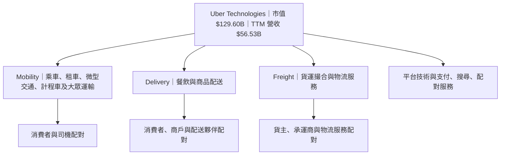
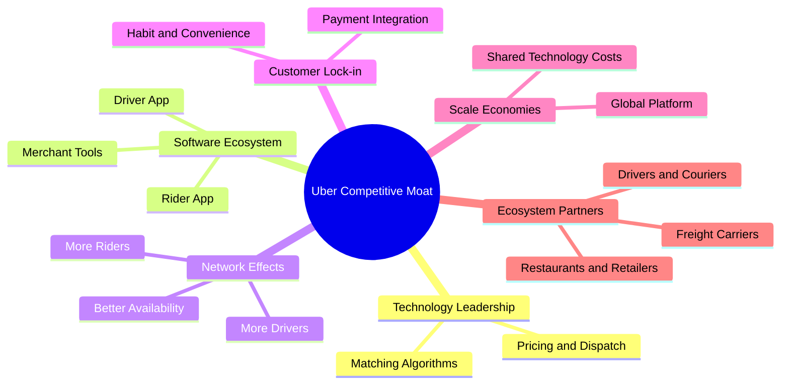
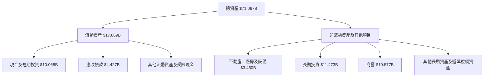
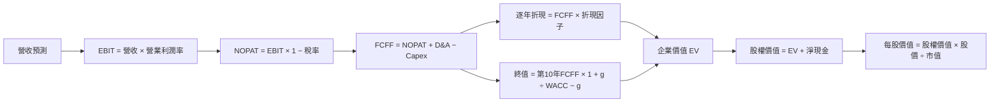
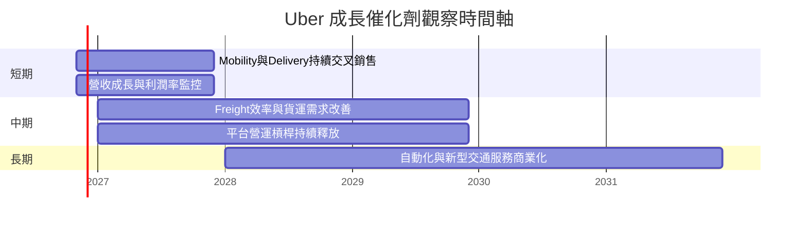
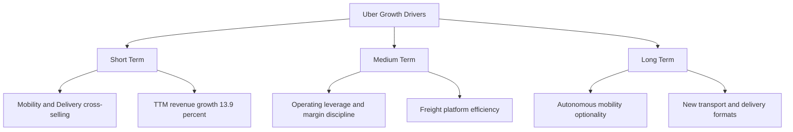
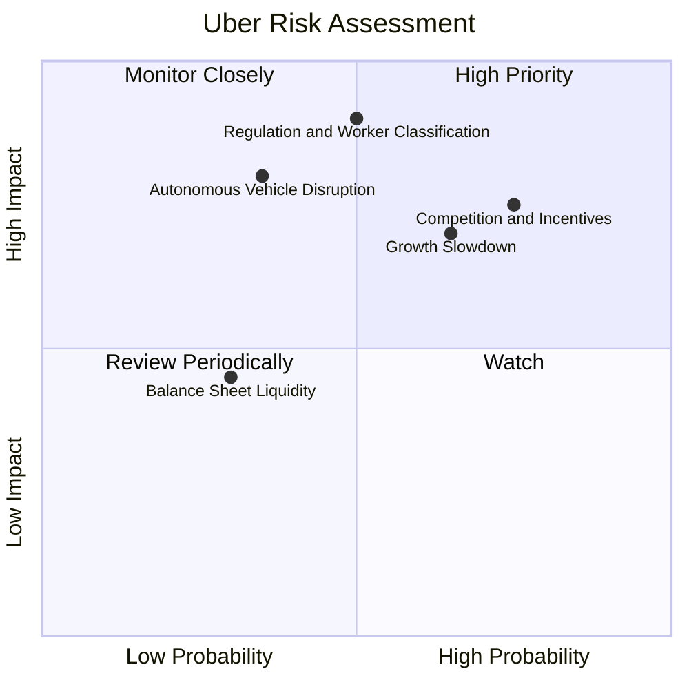
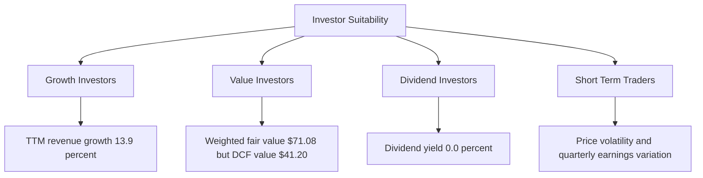

# UBER 基本面深度分析報告
> **報告日期**：2026-11-22 ｜ **語言**：繁體中文 ｜ **數據來源**：SEC 申報資料 (XBRL)、Yahoo Finance、Finviz、StockAnalysis、Roic.ai ｜ **分析師**：CFA 級機構研究

## 目錄

| # | 章節 | 核心結論 |
|---|------|----------|
| 1 | 執行摘要 | 買入；加權合理價值 $71.08；MOS +10.7% |
| 2 | 公司概覽與商業模式 | 多邊平台與規模效應構成護城河，但市場份額數據未提供 |
| 3 | 損益表深度分析 | TTM 營收 $56.53B、年增 13.9%；最新一季營業利潤率 9.8% |
| 4 | 資產負債表分析 | 淨負債 $5.60B；流動比率 1.232，流動性尚可 |
| 5 | 現金流量深度分析 | TTM FCF $10.42B、FCF Yield 8.04%；現金轉換能力高 |
| 6 | 獲利能力與資本效率 | ROIC 15.8% 高於 WACC 10.00%，創造價值 |
| 7 | 相對估值分析 | 同業估值分歧大；相對自身歷史 P/S 偏低、P/E 偏高 |
| 8 | DCF 內在價值評估 | 基準 DCF $41.20/股；估值高度依賴長期假設 |
| 9 | 成長催化劑 | Mobility、Delivery 跨業務交叉銷售與新技術仍有成長選擇權 |
| 10 | 風險矩陣 | 主要風險為競爭、監管與 DCF 假設落差 |
| 11 | 投資建議 | 依 MOS 評級買入；以利潤率、FCF 與競爭指標作季度監控 |

## 1. 執行摘要

2026-11-20 收盤價為 **$63.47**。Uber TTM 營收 **$56.53B**，TTM 年增 **13.9%**，TTM FCF **$10.42B**，FCF Yield **8.04%**，ROIC **15.8%** 高於 WACC **10.00%**；但基準 DCF 價值為 **$41.20/股**，低於現價。四種估值方法加權後合理價值為 **$71.08/股**，MOS 為 **+10.7%**，依規則 20 評級為 **買入**。DCF 基準值與加權合理價值差距大，顯示相對估值與分析師共識對合理價值貢獻顯著，估值信心不宜過度樂觀。

### 1.0 一頁式投資儀表板

| 項目 | 內容 |
|------|------|
| **投資論點（3 句）** | ① TTM 營收年增 **13.9%**，平台交易規模仍在擴張。② TTM FCF **$10.42B**、FCF Yield **8.04%**，提供內部資金與估值支撐。③ ROIC **15.8%** 高於 WACC **10.00%**，當前經營回報高於資本成本，但 DCF 基準價僅 **$41.20**，反映長期利潤率假設風險。 |
| **綜合評分** | **6.5/10**（引用 1.1） |
| **財務健康** | 🟡 現金及短期投資 **$10.07B**，但總債務 **$15.66B**、淨負債 **$5.60B**；流動比率 **1.232** |
| **ROIC vs WACC** | **15.8% vs 10.00%**；目前創造股東價值 |
| **FCF 趨勢** | 上升；TTM FCF Yield **8.04%** |
| **估值** | Forward P/E **14.4x** ｜ EV/EBITDA **17.4x**（歷史估值數據）｜ FCF Yield **8.04%** |
| **DCF 內在價值（基準）** | **$41.20** ｜現價相對 DCF 溢價 **+54.1%** |
| **安全邊際（MOS）** | **+10.7%**＝（加權合理價值 **$71.08** − 現價 **$63.47**）÷ **$71.08**｜🟡 有限 |
| **預期報酬（基準情境 12M）** | **+12.0%**（加權合理價值相對現價） |
| **關鍵風險（前二）** | 平台補貼與競爭壓縮利潤率；監管與司機分類規則改變成本結構 |
| **評級 + 信心度** | 🟢 **買入** ｜信心：中 |

### 1.1 綜合評分卡（全報告唯一）

| 維度 | 評分（1–10） | 主要依據（引用數字與其來源章節） |
|------|--------------|----------------------------------|
| 成長性 | 7.0 | TTM 營收年增 **13.9%**，但最新一季年增放緩至 **9.6%**（第 3 章） |
| 獲利能力 | 7.0 | TTM 營業利益率 **12.4%**、ROIC **15.8%** 高於 WACC；F-Score **6/8**（第 6 章） |
| 財務健康 | 6.0 | 淨負債 **$5.60B**、流動比率 **1.232**；DSO 29 天（第 4 章） |
| 估值 | 5.0 | MOS **10.7%**；現價較 DCF 基準值溢價 **54.1%**（第 7–8 章） |
| 護城河 | 8.0 | 多邊平台、跨業務配對及規模效應；營收達 **$56.53B**，但市場份額數據未提供（第 2 章） |
| 管理層與資本配置 | 6.0 | FY2025 SBC **$1.83B**，約為營收 **3.5%**；股息殖利率 **0%**，資本配置細項有限（第 3、5 章） |
| **綜合評分** | **6.5** | 六項算術平均：**(7+7+6+5+8+6) ÷ 6 = 6.5** |

### 1.2 五大投資論點 + 三大核心風險

| 類型 | 項目 | 具體依據 | 信心度 |
|------|------|----------|--------|
| 🟢 **投資論點①** | 平台仍有成長 | TTM 營收 **$56.53B**、年增 **13.9%**；即使最新一季年增降至 **9.6%**，仍為正成長 | 🟢 高 |
| 🟢 **投資論點②** | 現金流產出良好 | TTM OCF **$10.73B**、Capex **$314M**、FCF **$10.42B**；低資本支出模式支持現金轉換 | 🟢 高 |
| 🟢 **投資論點③** | 資本回報高於成本 | ROIC **15.8%** 對 WACC **10.00%**，利差 **5.8 個百分點** | 🟢 高 |
| 🟢 **投資論點④** | 多業務平台可交叉銷售 | Mobility、Delivery、Freight 共用消費者與商戶觸達能力；各板塊營收占比未提供 | 🟡 中 |
| 🟢 **投資論點⑤** | 加權估值仍有上行 | 加權合理價值 **$71.08**，較現價上行空間 **12.0%** | 🟡 中 |
| 🟡 **風險①** | 最新季度成長減速 | 最新一季營收年增 **9.6%**，低於 TTM 年增 **13.9%**；若進一步減速，估值成長溢價可能收縮 | 🟡 中 |
| 🔴 **風險②** | 盈餘季度波動大 | Q3 2026 淨利 **$512M**，年增 **-92.3%**；需區分營運趨勢與非營運項目影響 | 🔴 高衝擊 |
| 🔴 **風險③** | DCF 對長期假設敏感 | 基準 DCF **$41.20**，比現價低 **35.1%**（以現價為分母）；終值占 EV **46.8%** | 🔴 高衝擊 |

### 1.3 快速統計卡片

| 指標 | 公司實際值（期間） | 同業中位數 | 狀態 |
|------|--------------------|------------|------|
| 營收成長（TTM） | **13.9%** | — | 🟢 |
| 營收成長（最新一季年增） | **9.6%** | **27.4%**（LYFT、DASH、GRAB 中位數） | 🟡 |
| 毛利率（TTM） | **41.4%** | **41.4%** | 🟡 |
| 營業利益率（TTM） | **12.4%** | — | 🟢 |
| ROIC（TTM） | **15.8%** | — | 🟢 |
| Forward P/E | **14.4x** | **17.5x** | 🟢 |
| FCF Yield（TTM） | **8.04%** | — | 🟢 |
| Piotroski F-Score | **6 / 8** | — | 🟢 |

### 1.4 投資結論

```text
╔══════════════════════════════════════════════════════════════════╗
║                    📊 投資結論摘要                               ║
╠══════════════════════════════════════════════════════════════════╣
║  評級：買入（依 MOS 評級規則）                                    ║
║  價格（2026-11-20 收盤）：$63.47                                 ║
║  DCF 內在價值（基準）：$41.20（現價相對 DCF 溢價 +54.1%）        ║
║  安全邊際 MOS：+10.7%（以加權合理價值 $71.08 為分母）            ║
║  加權合理價值（8.8）：$71.08                                     ║
║  DCF 情境價值：                                                   ║
║    悲觀情境：$23.30（-63.3%）                                    ║
║    基準情境：$41.20（-35.1%）                                    ║
║    樂觀情境：$69.04（+8.8%）                                     ║
║  綜合評分：6.5/10（引用 1.1）                                    ║
║  適合投資人：可承受波動、看重平台長期現金流成長的投資人          ║
╚══════════════════════════════════════════════════════════════════╝
```

## 2. 公司概覽與商業模式

### 2.1 業務結構與收入來源

Uber 經營 Mobility、Delivery、Freight 三大平台。公司 TTM 營收為 **$56.53B**，但各板塊營收金額及占比未提供，因此不推算板塊比例或繪製比例圖。



Uber 的平台模式主要透過交易撮合、支付與軟體服務創造收入；財務資料未提供各板塊軟體收入的獨立數字。營收規模及跨區域經營有利於分攤技術與行銷成本，但利潤表現仍受司機供給、促銷和監管成本影響。

### 2.2 市場份額

市場份額數據未提供。以營收及成長率衡量，Uber TTM 營收 **$56.53B**、年增 **13.9%**；與同業比較，最新一季 Uber 營收年增 **9.6%**，低於 DoorDash 的 **34.0%**、Grab 的 **27.4%**，略高於 Lyft 的 **8.1%**。收入規模較大並不必然代表每一市場的份額或獲利優勢。

### 2.3 競爭護城河分析



### 2.4 護城河強度

| 護城河項目 | 強度（強／中／弱） | 證據（引用數字或事實） | 會削弱它的情況 |
|------------|--------------------|------------------------|----------------|
| 網路效應 | 強 | 乘客、司機、商戶與配送夥伴在同一平台互相提高匹配機會；TTM 營收 **$56.53B** | 競爭者用補貼爭取供需兩側，或市場轉向自有平台 |
| 規模效應 | 強 | 覆蓋多區域及多業務，研發費 FY2025 **$3.40B** 可支撐多項產品共用 | 合規與保險成本上升，規模未能轉化為單位成本下降 |
| 軟體生態系統 | 中至強 | Mobility、Delivery、Freight 共用應用、支付和配對能力 | 使用者多平台切換，服務差異化不足 |
| 客戶鎖定 | 中 | 使用便利性與平台習慣可帶來重複交易；留存率數據未提供 | 乘客對價格敏感、司機同時使用多平台 |
| 技術領先 | 中 | 配對、定價及派遣屬平台核心能力；量化技術成效數據未提供 | 自動駕駛或新平台改變供需匹配方式 |
| 生態夥伴 | 中 | 司機、商戶、承運商共同擴大服務範圍 | 夥伴議價力提高，或改用競爭平台 |

1.1「護城河」評分 **8.0/10**，依據是網路效應、跨業務平台及規模，但市場份額與留存率等直接量化證據不足。

## 3. 損益表深度分析

### 3.1 年度收入成長趨勢（近 4 年）

FY2022–FY2025 營收由 **$31.88B** 增至 **$52.02B**，三年累計 CAGR 約 **17.8%**（以年度營收計算）。2025 年增幅較 2024 年小幅增加；TTM 年增 **13.9%** 則顯示最新成長低於前幾年年度增速。

```text
╔══════════════════════════════════════════════════════════════════╗
║              Uber 年度收入趨勢（FY2022-FY2025）                 ║
╠══════════════════════════════════════════════════════════════════╣
║  FY2022  $31.88B  ███████████████░░░░░░░░░░░  YoY: —           ║
║  FY2023  $37.28B  ██████████████████░░░░░░░░  YoY: +16.9%     ║
║  FY2024  $43.98B  █████████████████████░░░░░  YoY: +18.0%     ║
║  FY2025  $52.02B  █████████████████████████░  YoY: +18.3%     ║
║                                                                  ║
║  三年累計 CAGR：約 +17.8%                                         ║
╚══════════════════════════════════════════════════════════════════╝
```

### 3.2 季度收入趨勢分析

| 季度 | 營收（$B） | QoQ 成長 | YoY 成長 | 備註 |
|------|-----------:|---------:|---------:|------|
| 2025 Q4 | 14.37 | — | 20.1% | QoQ 基期缺少 2025 Q3 以前完整同口徑數據，未列 |
| 2026 Q1 | 13.20 | -8.1% | 14.5% | 季節性與季度組合可能影響環比 |
| 2026 Q2 | 14.19 | +7.5% | 12.2% | 年增仍正，但低於前兩季 |
| 2026 Q3 | 14.77 | +4.1% | 9.6% | 最新一季年增放緩，須監控需求與競爭 |

QoQ 以相鄰季度營收計算；年增率採季度資料列示值。最新一季營收仍增加，但年增率從 2025 Q3 的 **20.37%** 降至 2026 Q3 的 **9.65%**，代表成長動能正在正常化，後續估值更依賴利潤率與現金流改善。

### 3.3 利潤率演變分析

| 利潤率指標 | FY2022 | FY2023 | FY2024 | FY2025 | 趨勢 | 評估 |
|------------|-------:|-------:|-------:|-------:|------|------|
| **毛利率** | 38.3% | 39.8% | 39.4% | 39.8% | 整體穩定 | 🟢 |
| **營業利益率** | -5.7% | 3.0% | 6.4% | 10.7% | 持續改善 | 🟢 |
| **淨利率** | -28.7% | 5.1% | 22.4% | 19.3% | FY2024–25 明顯高於營業利潤率 | 🟡 |

年度利潤率以年度損益表收入、毛利、營業利益及淨利計算，四捨五入至一位小數。營業利益率由 FY2022 虧損轉為 FY2025 **10.7%**，與平台規模擴大及營運槓桿一致；但 FY2024、FY2025 淨利率遠高於營業利潤率，顯示淨利受非營業項目及稅務影響，不能直接視為純營運獲利能力。最新季度營業利益率按指定 TTM 數據為 **9.8%**，低於 TTM **12.4%**，須避免將單季波動與 TTM 趨勢混為一談。

### 3.4 費用結構分析

缺少完整、同期間的費用明細以形成可核對的費用占比，因此不製作費用結構圓餅圖。已知 FY2025 研發費用為 **$3.40B**，約為 FY2025 營收 **$52.02B** 的 **6.5%**；這代表公司仍投入資源維護平台及拓展產品，但不代表全部研發支出均可轉化為新增收入。

### 3.5 季度 EPS 趨勢與盈餘品質（Quality of Earnings）

過去四季實際 EPS 估計值欄為缺漏，不能判斷超預期或不及預期；以下列示可取得的每股盈餘與公司公布的年增率。

| 季度 | EPS 實際值 | EPS YoY | 超預期／不及預期 |
|------|-----------:|-------:|------------------|
| 2025 Q4 | $0.14 | -95.6% | N/A（EPS 預期值未提供） |
| 2026 Q1 | $0.13 | -84.6% | N/A（EPS 預期值未提供） |
| 2026 Q2 | $1.17 | +85.5% | N/A（EPS 預期值未提供） |
| 2026 Q3 | $0.25 | -92.0% | N/A（EPS 預期值未提供） |

| 盈餘品質項目 | 數值／佔比 | 評估 |
|--------------|-----------|------|
| 股權薪酬 SBC / 營收 | TTM SBC **$2.065B** ÷ TTM 營收 **$56.53B**＝**3.7%** | 🟡 SBC 不是現金支出，但有股權稀釋成本 |
| SBC / 營業現金流 | **$2.065B ÷ $10.73B = 19.2%** | 🟡 佔 OCF 比例有意義，應列入股東回報評估 |
| FCF / 淨利（現金轉換率） | TTM FCF **$10.42B** ÷ TTM 淨利 **$3.465B**＝**3.0x** | 🟢 現金流高於會計淨利；淨利季度波動較大 |
| 一次性／非經常性損益 | 存在不確定性；FY2025 淨利 **$10.05B** 高於營業利益 **$5.57B** | 🟡 需核對非營業及稅務項目明細，不能全部當作持續營運獲利 |
| 有效稅率異常 | N/A（可比較的 TTM 現金稅率未提供） | 🟡 不以缺漏資料推定稅務利益 |
| 資本化支出 vs 費用化 | TTM Capex **$314M**；資本化與費用化明細 N/A | 🟡 Capex 低，但不能據此判定成本未被資本化 |

TTM SBC 以可取得的四季 SBC 相加：**$591M + $550M + $473M + $451M = $2.065B**。FCF 高於淨利，且 Piotroski 測試顯示 OCF 高於淨利，支持現金盈餘品質；但 SBC 仍造成稀釋成本，年度與季度淨利波動亦提醒投資人不宜只用單季 EPS 外推。

## 4. 資產負債表分析

### 4.1 資產結構分解

TTM 總資產為 **$71.067B**。下列明細採 2026-09-30 資產負債表；部分資產項目加總與總資產可能因分類、其他項目及資料來源口徑而有差異，不作反推調整。



### 4.2 流動性與營運資金分析

| 指標 | 最新 TTM | 一年前 TTM | 變化 | 解讀 |
|------|---------:|-----------:|------:|------|
| 流動比率 | **1.232** | N/A | N/A | 短期資產高於短期負債，但緩衝並非非常寬裕 |
| 速動比率 | **0.999** | N/A | N/A | 接近 1，流動性依賴應收回收與現金管理 |
| DSO 應收帳款天數 | **29 天** | **28 天** | **+1 天** | 收款天數略升，應收帳款控制仍需追蹤 |
| DIO 存貨天數 | **N/A** | **N/A** | **N/A** | 公司未報告存貨餘額，不推算 |
| DPO 應付帳款天數 | **17 天** | **N/A** | **N/A** | 無法比較年度變化 |
| CCC 現金轉換週期 | **N/A** | **N/A** | **N/A** | 存貨與前期 DPO 缺漏，依原品質數據保留 N/A |

DSO 由 **28 天**升至 **29 天**，變化幅度小；沒有足夠資料判斷是收款條件、業務組合或季節性所致。DIO 和 CCC 不可推估，因公司未報告存貨餘額。

### 4.3 債務結構分析

```text
╔══════════════════════════════════════════════════════════════════╗
║                   Uber 債務健康診斷                              ║
╠══════════════════════════════════════════════════════════════════╣
║  總債務：             $15.66B   ███████████████░░░░░             ║
║  現金及短期投資：     $10.07B   ██████████░░░░░░░░░             ║
║  淨負債：              $5.60B   🟡                               ║
║  流動比率：             1.232   🟡                               ║
║  Debt/EBITDA：          N/A（計息負債及 EBITDA 口徑有差異）       ║
║  利息保障倍數：         N/A（利息費用明細未提供）                 ║
╚══════════════════════════════════════════════════════════════════╝
```

採用指定的 TTM 淨負債 **$5.60B**、債務 **$15.66B** 與現金加短期投資 **$10.07B**。其他來源另列總債務 **$17.74B**、淨負債 **$7.67B**，與指定口徑不一致；本報告的核心估值採用經核定的數字，並將口徑差異列為資料限制。

### 4.4 股東權益趨勢

| 年度 | 股東權益（$B） | 年增 |
|------|---------------:|----:|
| 2022 | 7.34 | — |
| 2023 | 11.25 | +53.3% |
| 2024 | 21.56 | +91.6% |
| 2025 | 27.04 | +25.4% |

FY2022–FY2025 權益增加，反映累積獲利及資本結構改善；不過淨利包含非營業與稅務因素，權益增加不能單獨用來判斷營運獲利品質。

## 5. 現金流量深度分析

### 5.1 現金流量瀑布圖

FY2025 可得 OCF、Capex、FCF 和 SBC；股息、回購及淨現金變化的完整同期間金額未提供，因此不填入估計值。


### 5.2 FCF 轉換率趨勢

| 年度 | FCF（$B） | 淨利（$B） | FCF / 淨利 | 解讀 |
|------|---------:|---------:|-----------:|------|
| 2022 | 0.39 | -9.14 | 不具解讀性 | 淨利為負，比例失去一般經濟意義 |
| 2023 | 3.36 | 1.89 | 1.78x | FCF 高於淨利 |
| 2024 | 6.89 | 9.86 | 0.70x | 現金轉換低於會計獲利 |
| 2025 | 9.76 | 10.05 | 0.97x | 現金流與淨利接近 |
| TTM | 10.42 | 3.465 | 3.01x | TTM 淨利較低，轉換率受季度盈餘波動影響 |

### 5.3 自由現金流趨勢

```text
╔══════════════════════════════════════════════════════════════════╗
║                 自由現金流：歷史實際                              ║
╠══════════════════════════════════════════════════════════════════╣
║  FY2022  $0.39B   █░░░░░░░░░░░░░░░░░░░  YoY：—                 ║
║  FY2023  $3.36B   ███████░░░░░░░░░░░░░  YoY：大幅增加           ║
║  FY2024  $6.89B   ██████████████░░░░░░  YoY：+105.1%            ║
║  FY2025  $9.76B   ████████████████████  YoY：+41.7%             ║
║  TTM     $10.42B  █████████████████████ FCF Yield：8.04%        ║
╚══════════════════════════════════════════════════════════════════╝
```

年度 FCF 從 FY2022 **$390M** 增至 FY2025 **$9.76B**，反映營運現金流擴張快於資本支出。TTM FCF **$10.42B** 是 OCF **$10.73B** 扣除 Capex **$314M**，並非其他自由現金流口徑。

### 5.4 資本配置評估

| 配置項目 | 可得數據 | 評估 |
|----------|---------|------|
| 資本支出 | FY2025 **$336M**；TTM **$314M** | 相較現金流低，平台模式資本密集度有限 |
| SBC | FY2025 **$1.83B** | 對股東而言是稀釋成本，需與回購一併評估 |
| 股息 | 殖利率 **0.0%** | 無股息回報 |
| 回購、投資、留存現金 | N/A（完整資本配置金額未提供） | 不繪製比例圖，避免虛構配置占比 |

## 6. 獲利能力與資本效率

### 6.1 ROE / ROA / ROIC 趨勢

| 指標 | 最新可得值 | 歷史趨勢 | 評估 |
|------|-----------:|----------|------|
| ROE | TTM **12.5%** | 過去年度同口徑序列未提供 | 🟢 有獲利能力，但受權益基數與淨利波動影響 |
| ROA | TTM **6.5%** | F-Score 測試顯示 ROA 未高於一年前 | 🟡 資產回報為正，但近期未改善 |
| ROIC | TTM **15.8%** | 可比年度序列未提供 | 🟢 高於 10.00% WACC |
| 行業均值對比 | N/A（可比同口徑行業數據未提供） | — | 不以非來源數據替代 |

### 6.2 ROIC vs WACC 分析（核心價值創造判斷）

```text
╔══════════════════════════════════════════════════════════════════╗
║                ROIC vs WACC 深度分析                            ║
╠══════════════════════════════════════════════════════════════════╣
║  WACC（指定資本成本資料）：10.00%                               ║
║  ├── 無風險利率（10Y美債）：   4.91%                             ║
║  ├── 股權風險溢酬 ERP：        5.00%                             ║
║  ├── Beta（原始／調整後）：    1.31／1.21                       ║
║  ├── 股權成本：                10.94%                            ║
║  ├── 稅前債務成本：            2.81%                             ║
║  ├── 股權／債務權重：          89.2%／10.8%                      ║
║  └── WACC：                    10.00%                            ║
║                                                                  ║
║  ROIC（TTM）：                 15.8%                             ║
║  價值利差：                    15.8% − 10.00% = 5.8 個百分點    ║
║                                                                  ║
║  ROIC  15.8%  ▓▓▓▓▓▓▓▓▓▓▓▓▓▓▓▓░░░░  🟢                         ║
║  WACC  10.0%  ▓▓▓▓▓▓▓▓▓▓░░░░░░░░░░  ──                         ║
║                                                                  ║
║  結論：ROIC 高於 WACC，當前投入資本創造經濟價值                 ║
╚══════════════════════════════════════════════════════════════════╝
```

資本成本採指定輸入值；其中調整後 Beta 為 **⅔ × 1.31 + ⅓ = 1.21**（小數位依來源列示）。股權成本 **4.91% + 1.21 × 5.00% = 10.96%**，來源列示成本為 **10.94%**，差異來自中間數字精度；此處以來源列示的 **10.94%** 為準。稅前 Kd **2.81%**，稅率 **21.0%**，稅後 Kd 約 **2.22%**；以指定權重代入，**89.2% × 10.94% + 10.8% × 2.22% ≈ 10.00%**。由於成本資本資料沒有提供該利率的逐項負債餘額推導，按規則採用指定 WACC，不另建一套 WACC。

### 6.3 杜邦三因素分解

| 因素 | 數值（TTM） | 解讀 |
|------|-------------|------|
| 淨利率 | **6.1%** | 淨利率為正，但季度淨利波動較大 |
| 資產週轉率 | **0.80** | 每單位資產產生約 0.80 單位營收 |
| 權益乘數 | **2.57** | 槓桿提高 ROE，但非唯一驅動來源 |
| **ROE** | **12.5%** | **6.1% × 0.80 × 2.57 = 12.5%** |

ROE 由淨利率、資產周轉及槓桿共同推動；權益乘數為 **2.57**，表示資本結構有槓桿，但正 ROIC 高於 WACC，價值創造不只是槓桿效果。

### 6.4 財務體質：Piotroski F-Score

Piotroski F-Score 為 **6/8**；由於一項毛利率測試缺少輸入，測試分母為 8，而非 9。

| 測試 | 結果 | 解讀 |
|------|------|------|
| ROA > 0 | ✅ 通過 | 資產回報為正 |
| 營業現金流 > 0 | ✅ 通過 | 現金營運能力為正 |
| ROA 高於一年前 | ❌ 未通過 | 近期資產回報未改善 |
| 營業現金流 > 淨利 | ✅ 通過 | 應計品質測試通過 |
| 長期負債 ÷ 總資產低於一年前 | ❌ 未通過 | 槓桿相對資產沒有改善 |
| 流動比率高於一年前 | ✅ 通過 | 短期流動性相對改善 |
| 稀釋股數未增加 | ✅ 通過 | 近期股數測試通過 |
| 毛利率高於一年前 | — 無法判定 | 缺資料，未計入分母 |
| 資產週轉率高於一年前 | ✅ 通過 | 資產使用效率改善 |

## 7. 相對估值分析

### 7.1 同業估值比較表格

同業數據採 Yahoo Finance 同業倍數；Uber 的 Forward P/E、Trailing P/E 及 P/S 採提供的估值資料。不同公司的非經常性項目與會計口徑差異，會使單一倍數比較失真。

| 估值指標 | **Uber** | **Lyft** | **DoorDash** | **Grab** | 本公司評估 |
|----------|---------:|---------:|-------------:|---------:|-----------|
| **Trailing P/E** | **37.3x** | 2.4x | 63.3x | 27.5x | 🟡 Uber 在同業中間；Lyft 極低可能反映獲利基數差異 |
| **Forward P/E** | **14.4x** | 8.0x | 20.0x | 17.5x | 🟢 低於三家同業中位數 **17.5x** |
| **P/S Ratio** | **2.3x** | 0.9x | 3.9x | 2.8x | 🟡 高於 Lyft、低於 DASH 和 GRAB |
| **EV/EBITDA** | **17.4x** | 546.9x | 37.3x | 17.4x | 🟢 Uber 與 GRAB 接近；Lyft 倍數受 EBITDA 基數影響 |
| **最新一季營收年增** | **9.6%** | 8.1% | 34.0% | 27.4% | 🔴 低於 DASH、GRAB |
| **毛利率（TTM）** | **41.4%** | 40.0% | 52.7% | 41.4% | 🟡 與 GRAB 相當，低於 DASH |

### 7.2 歷史估值區間分析

| 指標 | 當前 | 5 年中位數 | 5 年範圍 | 當前百分位 | 解讀 |
|------|------:|-----------:|---------:|-----------:|------|
| P/E | 37.1x | 17.8x | 12.6x–122.2x | 54% | 高於中位數，但在歷史區間中段 |
| P/S | 2.3x | 3.3x | 1.5x–6.1x | 19% | 低於歷史中位數，較自身歷史偏低 |
| EV/EBITDA | 17.4x | 40.0x | 18.7x–320.2x | 0% | 顯示目前倍數低於歷史區間下限，可能受歷史獲利分母劇烈變動影響 |

```text
╔══════════════════════════════════════════════════════════════════╗
║                  P/E 歷史估值位置                                ║
╠══════════════════════════════════════════════════════════════════╣
║  12.6x ────────────────── 17.8x ───────── [37.1x] ─────────122.2x║
║  5年低點                   中位數             現值       5年高點   ║
║  當前百分位：54%                                               ║
╚══════════════════════════════════════════════════════════════════╝
```

### 7.3 情境價值（Bear / Base / Bull）

以下情境價值與假設照列 DCF 模型；情境並非單純改變折現率，也包含營收成長、期末營業利潤率和 WACC 的變動。

| 情境 | 第 1 年營收成長 | 期末營業利潤率 | WACC | 每股價值 | 相對現價 | 機率 | 會發生的條件 |
|------|----------------:|---------------:|-----:|---------:|---------:|-----:|--------------|
| 🔴 悲觀 | 7.0% | 5.4% | 11.00% | **$23.30** | -63.3% | 25% | 成長放緩、競爭及監管成本壓低長期利潤率 |
| 🟡 基準 | 13.9% | 6.4% | 10.00% | **$41.20** | -35.1% | 50% | 近期 TTM 成長逐步下滑，長期利潤率向歷史中位數收斂 |
| 🟢 樂觀 | 20.9% | 7.0% | 9.00% | **$69.04** | +8.8% | 25% | 平台交易加速，規模效應支撐較高利潤率，資本成本降低 |

### 7.4 相對估值隱含價格區間

```text
╔══════════════════════════════════════════════════════════════════╗
║           相對估值方法回推價值與現價位置                         ║
╠══════════════════════════════════════════════════════════════════╣
║  DCF（基準）             $41.20   ───── 現價 $63.47              ║
║  同業 Forward P/E        $77.21   ────────────                  ║
║  同業 EV/EBITDA         $101.93   ─────────────────────         ║
║  分析師共識              $98.16   ───────────────────           ║
╚══════════════════════════════════════════════════════════════════╝
```

| 方法 | 每股價值 | 相對現價 | 估值依據 |
|------|---------:|---------:|----------|
| 同業 Forward P/E | **$77.21** | +21.6% | 同業中位數 **17.5x** × Uber Forward EPS **$4.41** |
| 同業 EV/EBITDA | **$101.93** | +60.6% | DASH、GRAB 中位數 **27.4x** × TTM EBITDA，再加淨現金 |
| 分析師共識 | **$98.16** | +54.7% | 46 位分析師平均目標價 |

## 8. DCF 內在價值評估（Discounted Cash Flow）

### 8.0 估值推理鏈（Thinking Logic）

**Step 1 — 價值由哪些變數決定？**  
本模型把價值視為 Mobility、Delivery、Freight 等既有平台現金流與長期終值的合計；目前各板塊營收占比未提供，不能宣稱某一業務占比或單獨量化第二成長曲線。模型敏感度主要由 WACC、永續成長率與長期營業利潤率決定；g 從 **2.0%** 到 **4.0%** 時，基準 WACC 下每股價值由 **$38.45** 變為 **$44.85**。

**Step 2 — 模型選擇**

| 決策點 | 本報告採用 | 理由（含數字） | 曾考慮但否決 | 否決理由 |
|--------|-----------|----------------|--------------|----------|
| 現金流定義 | FCFF | 以 WACC 折現企業現金流，模型輸出為 EV | FCFE | 債務及資本結構口徑混雜，FCFF 與指定 DCF 模型一致 |
| 預測期 N | 10 年 | 模型以 10 年營收與利潤率逐步收斂 | 5 年 | 會更早將主要價值交給終值 |
| 終值方法 | Gordon Growth | 模型已列出 g **3.0%**、WACC **10.00%** | 退出倍數終值 | DCF 模型未提供獨立退出倍數終值輸出，不另建模型 |
| EBIT 基礎 | GAAP EBIT | 模型指定 GAAP EBIT，TTM 營業利潤率 **12.4%** | 非 GAAP EBIT | 會將 SBC 加回，需另處理 SBC 成本 |

**Step 3 — 關鍵假設推導鏈**

- **營收成長**：錨點＝TTM 年增 **13.9%** → 模型假設自第 1 年 **13.9%** 線性降至第 10 年 **3.0%** → 採用 10 年遞減成長路徑 → 曾考慮延續 20.9% 樂觀情境，但最新一季年增僅 **9.6%**，不採為基準。
- **期末營業利潤率**：錨點＝TTM **12.4%** → 模型逐步回落至近五年中位數 **6.4%** → 採用第 10 年 **6.4%** → 不採用持續維持 12.4%，因成熟期競爭和價格壓力可能使利潤率收斂。
- **永續成長率 g**：錨點＝長期名目經濟增長的常見估值約束，但未提供公司專屬長期預測 → 採用模型 **3.0%**，低於 WACC **10.00%** → 不採用更高永續成長率，以避免終值過度擴張。
- **預測期 N**：錨點＝模型預測表列出 FY+1 至 FY+10 → 採用 **10 年** → 不改用較短期間，因不符指定模型輸出。
- **Capex／營收**：錨點＝TTM Capex **$314M**、TTM 營收 **$56.53B**，比率約 **0.6%** → 模型維持 **0.6%** → 不以缺資料自行設定較高資本投入。
- **EBIT 基礎、SBC 與年稀釋率**：採用組合 **(A)**：GAAP EBIT 已扣 SBC，不另扣 SBC，股數固定，年稀釋率 **0%**。股數稀釋風險已由 GAAP 費用處理方式納入一次，不再重複扣減。
- **WACC**：錨點＝指定資本成本資料 WACC **10.00%** → 不作自行替換 → 採用 **10.00%** → 不另以自建 CAPM 數字覆寫指定折現率。
- **ΔWC**：模型明確未建模營運資金變化；不自行補值。
- **最脆弱一環**：長期利潤率及終值假設；若長期利潤率無法維持模型路徑，DCF 價值會下降，應對照 8.6 敏感性矩陣及悲觀情境。

**Step 4 — 計算路徑圖**



### 8.1 模型假設總表（Model Inputs）

| 假設項目 | 採用值 | 依據／來源 | 敏感度 |
|----------|--------|-------------|--------|
| 預測期長度 N | **10 年** | 指定 DCF 預測表列出 FY+1 至 FY+10 | 🟡 中 |
| 營收成長 | 第 1 年 **13.9%**，第 10 年 **3.0%**，線性遞減 | TTM 年增 **13.9%**；終點依模型假設 | 🔴 高 |
| 營業利潤率 | 第 1 年 **12.4%** → 第 10 年 **6.4%** | TTM **12.4%**，終點為近 5 年中位數 | 🔴 高 |
| 有效稅率 | **21.0%** | 模型採預設稅率，非公司已核實的有效稅率 | 🟢 低 |
| Capex／營收 | 第 1 年至第 10 年 **0.6%** | TTM **$314M ÷ $56.53B** 約為 **0.6%** | 🟡 中 |
| D&A／營收 | **1.4%** | 模型採 TTM 比例 | 🟢 低 |
| 營運資金變動 | 未建模 | 指定模型明確不含 ΔWC | 🟢 低 |
| EBIT 基礎 | GAAP | 模型採 GAAP EBIT | 🟡 中 |
| SBC 處理 | 組合 **(A)**，不另扣 SBC | GAAP EBIT 已含 SBC 費用 | 🟡 中 |
| 年稀釋率 | **0%** | 固定股數；與組合 (A) 一致 | 🟡 中 |
| 永續成長率 g | **3.0%** | DCF 模型採用值；低於 WACC | 🔴 高 |
| 終值方法 | Gordon Growth | 模型提供 Gordon Growth 終值 | 🔴 高 |
| WACC | **10.00%** | 指定資本成本數據 | 🔴 高 |

FCFF 定義為 **NOPAT + D&A − Capex**；因模型未建模營運資金，這裡不再減 ΔWC。**本模型採用 (A)，故 SBC 影響已計入一次。**

### 8.2 折現率推導（WACC）

```text
╔══════════════════════════════════════════════════════════════════╗
║                    WACC 推導（折現率）                           ║
╠══════════════════════════════════════════════════════════════════╣
║  股權成本 Ke（CAPM，指定數據）：                                  ║
║  ├── 無風險利率 Rf（10Y 美債）：      4.91%                      ║
║  ├── 市場風險溢酬 ERP：               5.00%                      ║
║  ├── 原始 Beta／調整後 Beta：          1.31／1.21                 ║
║  ├── 規模／國別溢酬：                  0.00%（未另加）             ║
║  └── 指定股權成本：                   10.94%                     ║
║                                                                  ║
║  債務成本 Kd：                                                     ║
║  ├── 稅前 Kd（利息 ÷ 債務）：          2.81%                     ║
║  ├── 稅率：                            21.0%                     ║
║  └── 稅後 Kd：                         2.81% × (1−21.0%) = 2.22%║
║                                                                  ║
║  指定資本結構權重：股權 89.2%，債務 10.8%                         ║
║  指定 WACC：                         10.00%                     ║
╚══════════════════════════════════════════════════════════════════╝
```

1. **Ke**：指定計算值 **10.94%**；按列示輸入直接代入為 **4.91% + 1.21 × 5.00% = 10.96%**，與指定值相差 **0.02 個百分點**，屬未四捨五入輸入精度差異；後續採用來源指定 Ke **10.94%**。
2. **稅前 Kd**：指定值 **2.81%**；利息費用與平均計息負債的逐項金額未提供，因此不反推。
3. **稅後 Kd**：**2.81% × (1 − 21.0%) = 2.22%**。
4. **權重**：股權 **89.2%**、債務 **10.8%**；合計 **89.2% + 10.8% = 100.0%**。底層市值和計息負債逐項計算資料未提供，採用指定權重。
5. **WACC**：**89.2% × 10.94% + 10.8% × 2.22% = 9.7605% + 0.2398% = 10.0003% ≈ 10.00%**。

權重與 Kd 的債務定義未提供可逐項稽核餘額，故不宣稱已用單一負債範圍重新推導；第 6.2 與本章均依指定值採用 **WACC 10.00%**。

### 8.3 逐年自由現金流預測（基準情境）

單位：**$B**。下表逐年照列 DCF 模型輸出；金額及比率取至模型列示精度。原模型未納入 ΔWC，因此未列該項。

| 年度 | FY+1 | FY+2 | FY+3 | FY+4 | FY+5 | FY+6 | FY+7 | FY+8 | FY+9 | FY+10 |
|------|-----:|-----:|-----:|-----:|-----:|-----:|-----:|-----:|-----:|------:|
| 營收 | 64.41 | 72.60 | 80.96 | 89.29 | 97.40 | 105.06 | 112.04 | 118.12 | 123.10 | 126.80 |
| 營收 YoY | 13.9% | 12.7% | 11.5% | 10.3% | 9.1% | 7.9% | 6.6% | 5.4% | 4.2% | 3.0% |
| 營業利潤率 | 12.4% | 11.8% | 11.1% | 10.4% | 9.7% | 9.1% | 8.4% | 7.7% | 7.0% | 6.4% |
| EBIT（GAAP） | 8.01 | 8.54 | 8.98 | 9.30 | 9.49 | 9.52 | 9.40 | 9.11 | 8.67 | 8.07 |
| − 稅 | (1.68) | (1.79) | (1.89) | (1.95) | (1.99) | (2.00) | (1.97) | (1.91) | (1.82) | (1.69) |
| NOPAT | 6.33 | 6.75 | 7.09 | 7.35 | 7.50 | 7.52 | 7.43 | 7.20 | 6.85 | 6.38 |
| + D&A | 0.88 | 0.99 | 1.10 | 1.21 | 1.33 | 1.43 | 1.52 | 1.61 | 1.67 | 1.72 |
| − Capex | (0.36) | (0.40) | (0.45) | (0.50) | (0.54) | (0.58) | (0.62) | (0.66) | (0.68) | (0.70) |
| **FCFF** | **6.85** | **7.33** | **7.75** | **8.07** | **8.28** | **8.37** | **8.33** | **8.15** | **7.84** | **7.40** |
| 折現因子 @10.00% | 0.909 | 0.826 | 0.751 | 0.683 | 0.621 | 0.565 | 0.513 | 0.467 | 0.424 | 0.386 |
| **FCFF 現值 PV** | **6.23** | **6.06** | **5.82** | **5.51** | **5.14** | **4.73** | **4.27** | **3.80** | **3.32** | **2.85** |

預測期 FCF 現值合計：  
**$6.23 + $6.06 + $5.82 + $5.51 + $5.14 + $4.73 + $4.27 + $3.80 + $3.32 + $2.85 = $47.73B**。  
模型列示總和為 **$47.74B**；兩者相差 **$0.01B**，源自各年度 PV 四捨五入。後續估值橋接依模型原列 **$47.74B**。

**逐步演算（FY+1）**：模型輸出以內部未四捨五入輸入計算，以下列示數字已四捨五入；因此部分以表內兩位小數重新相乘會有尾差，估值本身沿用模型原值。

1. **營收**：公式為前期營收 × (1 + 成長率)；代入模型基期 **$56.53B**、成長率標示 **13.9%**，模型輸出 **$64.41B**。
2. **EBIT**：公式為營收 × 營業利潤率；模型輸出 **$8.01B**。
3. **稅**：公式為 EBIT × 21.0%；模型輸出 **$1.68B**。
4. **NOPAT**：公式為 EBIT − 稅；模型輸出 **$6.33B**。
5. **D&A**：公式為營收 × D&A／營收；模型輸出 **$0.88B**。
6. **Capex**：公式為營收 × Capex／營收；模型輸出 **$0.36B**。
7. **ΔWC**：模型不建模營運資金，故不扣減。
8. **FCFF**：**$6.33B + $0.88B − $0.36B = $6.85B**。
9. **折現與 PV**：**1 ÷ (1 + 10.00%)¹ = 0.909**；**$6.85B × 0.909 = $6.23B**。

**合理性自檢**
- 預測期 FCFF 由 **$6.85B** 增至 **$7.40B**，九年間 CAGR 約 **0.9%**；歷史 FY2022–FY2025 FCF 由 **$0.39B** 升至 **$9.76B**，受極低基期影響，不適合直接與成熟期模型增速比較。
- FY+10 FCFF 利潤率為 **$7.40B ÷ $126.80B = 5.8%**，低於目前 TTM FCF 利潤率 **$10.42B ÷ $56.53B = 18.4%**；模型假設利潤率回落，偏保守但不代表現金流一定可維持。
- 所有預測年度 FCFF 為正；模型沒有納入營運資金投資。

```text
╔══════════════════════════════════════════════════════════════════╗
║            自由現金流：歷史實際 vs 模型預測                      ║
╠══════════════════════════════════════════════════════════════════╣
║  FY2023(實)  $3.36B  ██████░░░░░░░░░░░░░░  YoY：—             ║
║  FY2024(實)  $6.89B  ██████████████░░░░░░  YoY：+105.1%       ║
║  FY2025(實)  $9.76B  ████████████████████  YoY：+41.7%        ║
║  FY+1 (預)   $6.85B  ██████████████░░░░░░  模型值              ║
║  FY+10(預)   $7.40B  ███████████████░░░░░  FCF CAGR 約 +0.9%  ║
╠══════════════════════════════════════════════════════════════════╣
║  預測較歷史增速大幅收斂，主要反映營收與營業利潤率淡出假設       ║
╚══════════════════════════════════════════════════════════════════╝
```

### 8.4 終值計算（Terminal Value）

**適用性檢查：WACC 10.00% vs g 3.0% → WACC > g？✅**

| 方法 | 計算式 | 終值 TV | TV 現值 | 佔總 EV 比重 |
|------|--------|--------:|--------:|-------------:|
| Gordon Growth | **7.40 × (1 + 3.0%) ÷ (10.00% − 3.0%)** | **$108.85B** | **$41.97B** | **46.8%** |
| 退出倍數法 | N/A（指定 DCF 模型未提供可照抄的退出倍數終值） | N/A | N/A | N/A |

模型列示算式與結果如下；模型金額以未四捨五入輸入計算，顯示到兩位小數：  
**$7.40B × (1 + 3.0%) ÷ (10.00% − 3.0%) = $108.85B**；  
**$108.85B × 0.386 = $41.97B**。  
模型列示終值現值占 EV **46.8%**，低於 75% 警示線，但仍有近半企業價值取決於終值假設。

### 8.5 企業價值 → 每股內在價值（Bridge）

```text
╔══════════════════════════════════════════════════════════════════╗
║              企業價值 → 每股內在價值 橋接表                      ║
╠══════════════════════════════════════════════════════════════════╣
║  預測期 FCF 現值合計            +$47.74B                         ║
║  終值現值 PV(TV)                +$41.97B                         ║
║  ─────────────────────────────────────────────                  ║
║  = 企業價值 EV                    $89.71B                        ║
║  + 淨現金（負值代表淨負債）        -$5.60B                        ║
║  = 股權價值                       $84.12B                        ║
║  每股價值（模型指定換算）          $41.20                         ║
║    當前股價（2026-11-20）          $63.47                         ║
║    折溢價（現價÷DCF價值−1）        +54.1%（溢價）                 ║
╚══════════════════════════════════════════════════════════════════╝
```

1. **EV**：**$47.74B + $41.97B = $89.71B**。
2. **股權價值**：EV 加淨現金（負值代表淨負債）；模型列示 **$89.71B − $5.60B = $84.12B**。顯示數字直接相減為 **$84.11B**，差異 **$0.01B** 為底層未四捨五入數字所致，沿用指定模型的 **$84.12B**。
3. **每股內在價值**：模型指定公式 **股權價值 × 價格 ÷ 市值 = $41.20/股**。
4. **折溢價**：**$63.47 ÷ $41.20 − 1 = +54.1%**，表示現價相對 DCF 基準價溢價。
5. 本節不計算 MOS；MOS 僅使用第 8.8 節加權合理價值為分母。

股數方面，模型使用股權價值乘以價格再除以市值的指定轉換方式；模型沒有列出稀釋股數作為獨立除數，也未提供完整股數精度。債務、現金採指定 TTM 淨負債 **-$5.60B**；股數固定，與組合 (A) 一致。

### 8.6 敏感性分析（WACC × 永續成長率）

表格數值照列模型敏感度矩陣；括號為相對 **$63.47** 現價的上行空間／下跌幅度。

| g／WACC | 8.00% | 9.00% | **10.00%（基準）** | 11.00% | 12.00% |
|---------|------:|------:|------------------:|-------:|-------:|
| 2.0% | $51.37 (-19.1%) | $44.00 (-30.7%) | $38.45 (-39.4%) | $34.11 (-46.3%) | $30.61 (-51.8%) |
| 2.5% | $54.12 (-14.7%) | $45.84 (-27.8%) | $39.73 (-37.4%) | $35.03 (-44.8%) | $31.30 (-50.7%) |
| **3.0%（基準）** | $57.42 (-9.5%) | $47.98 (-24.4%) | **$41.20 (-35.1%)** | $36.08 (-43.2%) | $32.07 (-49.5%) |
| 3.5% | $61.45 (-3.2%) | $50.51 (-20.4%) | $42.88 (-32.4%) | $37.26 (-41.3%) | $32.92 (-48.1%) |
| 4.0% | $66.48 (+4.7%) | $53.54 (-15.6%) | $44.85 (-29.3%) | $38.61 (-39.2%) | $33.88 (-46.6%) |

**逐步演算示例：WACC 9.00%、g 3.0%（非基準有效格）**  
所選格 **WACC 9.00% > g 3.0% ✅**。  
模型矩陣列示每股價值 **$47.98**；模型未提供該格的逐年 PV、終值及橋接中間表，不能在不重建模型的前提下逐項重新推算，故不補造中間數字。

**三情境 DCF**

| 情境 | 營收成長 | 期末營業利潤率 | 永續 g | WACC | 每股內在價值 | 相對現價 | 主觀機率 |
|------|---------:|---------------:|------:|-----:|-------------:|---------:|---------:|
| 🔴 悲觀 | 第 1 年 7.0% | 5.4% | 模型情境未另列 | 11.00% | $23.30 | -63.3% | 25% |
| 🟡 基準 | 第 1 年 13.9% | 6.4% | 3.0% | 10.00% | $41.20 | -35.1% | 50% |
| 🟢 樂觀 | 第 1 年 20.9% | 7.0% | 模型情境未另列 | 9.00% | $69.04 | +8.8% | 25% |
| **機率加權** | — | — | — | — | **$43.68** | **-31.2%** | **100%** |

依模型提供的機率加權結果：**$23.30 × 25% + $41.20 × 50% + $69.04 × 25% = $43.685 ≈ $43.68**。情境完整逐年推導鏈未在模型輸出中提供，依規則不另建情境 DCF。

**敏感度結論**
- **g 每 +1 個百分點**：WACC 10.00% 時，g 2.5% 價值 **$39.73**，g 3.5% 為 **$42.88**；變動 **+$3.15/股**，約 **+7.9%**（以 $39.73 為基準）。
- **WACC 每 +1 個百分點**：g 3.0% 時，WACC 10.00% **$41.20**，11.00% **$36.08**；變動 **-$5.12/股**，約 **-12.4%**。
- **期末營業利潤率每 +1 個百分點**：N/A（敏感度矩陣未提供此項單變量試算）。
- 在可量化的 g 與 WACC 變數中，WACC 變動造成的每股影響較大；期末利潤率的影響無法由現有矩陣確認。

### 8.7 反推 DCF（Reverse DCF：市場在預期什麼）

反推結果採用模型提供的逐一求解值，其餘變數固定在基準情境；模型未提供疊代軌跡，故不自行重建迭代表。

| 求解的變數（一次一個） | 其餘變數設定 | 市場隱含值（令 DCF = 現價） | 公司歷史實際 | 判斷 |
|------------------------|--------------|------------------------------:|--------------|------|
| 第 1 年營收成長率 | 其他輸入固定基準值 | **25.1%** | TTM 成長 **13.9%** | 🔴 高於基準假設，市場需要更快成長 |
| 固定營業利潤率 | 其他輸入固定基準值 | **12.2%** | TTM 營業利潤率 **12.4%** | 🟡 接近目前 TTM 水平 |
| 永續成長率 g | 未計算 | 未計算 | — | N/A（模型未提供解） |
| 預測期 N | 未計算 | 未計算 | — | N/A（模型未提供解） |

反推 DCF 的營收成長率收斂軌跡未提供，不能以未知試算值補表。模型顯示，要由營收成長率單一變數解釋現價，市場隱含第 1 年成長 **25.1%**，高於 TTM **13.9%**；若改由固定利潤率解釋，則需約 **12.2%**，接近現有 TTM **12.4%**。這表示現價需要高成長延續，或營業利潤率不明顯下滑。

### 8.8 估值三角驗證與安全邊際

| 估值方法 | 隱含每股價值 | 上行空間（÷現價） | 權重 | 說明 |
|----------|--------------:|------------------:|-----:|------|
| DCF（基準） | $41.20 | -35.1% | 40% | 10 年 FCFF、WACC 10.00%、g 3.0% |
| 同業 Forward P/E | $77.21 | +21.6% | 25% | 同業中位數 17.5x × Forward EPS $4.41 |
| 同業 EV/EBITDA | $101.93 | +60.6% | 25% | 同業中位數 27.4x × TTM EBITDA，加淨現金 |
| 分析師共識目標價 | $98.16 | +54.7% | 10% | 46 位分析師平均目標價 |
| **加權合理價值** | **$71.08** | **+12.0%** | **100%** | 營利企業固定方法權重 |

加權合理價值計算：  
**$41.20 × 40% + $77.21 × 25% + $101.93 × 25% + $98.16 × 10%**  
**= $16.48 + $19.3025 + $25.4825 + $9.816 = $71.081 ≈ $71.08**。  
方法適用於「profitable」公司類型；四項方法均已列入，未剔除方法。

```text
╔══════════════════════════════════════════════════════════════════╗
║                  估值區間與安全邊際                              ║
╠══════════════════════════════════════════════════════════════════╣
║  $23.30 ─── $63.47 ─── [$71.08] ─── $41.20 ─── $69.04           ║
║  悲觀DCF      現價       加權合理值    基準DCF      樂觀DCF        ║
║                                                                  ║
║  安全邊際 MOS = ($71.08 − $63.47) ÷ $71.08 = +10.7%             ║
║  MOS 評估：🟡 有限                                               ║
║  上行空間 = ($71.08 − $63.47) ÷ $63.47 = +12.0%                 ║
║                                                                  ║
║  建議買入區間：$57.00–$63.97（估計操作區間；上限對應 MOS 10%）  ║
║  合理持有區間：$63.97–$71.08                                    ║
║  減碼考慮區間：高於 $69.04 樂觀 DCF 情境價值                    ║
╚══════════════════════════════════════════════════════════════════╝
```

買入區間上限的算式為 **$71.08 × (1 − 10%) = $63.97**；因此現價 **$63.47** 略低於此門檻。區間下限 **$57.00** 為分析師操作區間估計，不是模型輸出的內在價值。

> 🔎 **程式複算（Python，依本節各項自動重算）**
>
> 加權合理價值 = $41.20 × 40% + $77.21 × 25% + $101.93 × 25% + $98.16 × 10% = **$71.08**（權重合計 100%）
>
> 以價格 $63.47 計：MOS = **+10.7%**，上行空間 = **+12.0%**
>
> ✅ 與本節所寫數值一致。

### 8.9 DCF 模型的局限與失效條件

- **終值依賴度**：終值現值占 EV **46.8%**，近半企業價值取決於 FY+10 之後的現金流。
- **最脆弱假設**：營收成長由 **13.9%** 線性降至 **3.0%**，以及營業利潤率由 **12.4%** 降至 **6.4%**；若市場競爭使利潤率更低，現值低於基準 **$41.20**。
- **模型不含營運資金變動**：應收帳款及營運資金需求可能影響真實 FCFF，現有模型無法量化此影響。
- **盈餘和現金流口徑限制**：FCF 歷史快速上升，但 FY2022 基期低；高歷史增幅不應外推為未來長期增速。
- **與第 10 章風險的連結**：價格競爭將壓低營業利潤率，監管成本可能推高稅前成本及 WACC，需求放緩則削弱營收成長；三者均會下修 DCF。

### 8.10 複算檢核表（Audit Trail）

| # | 檢核項目 | 檢查方式 | 結果 |
|---|----------|----------|------|
| 1 | 高／中敏感度輸入是否有推導鏈 | 逐項列示錨點、採用值及替代考量；未有細節者明確指出 | ⚠️ 部分受底層資料限制 |
| 2 | 每項假設是否有來歷 | 8.1 依據欄逐項列示 | ✅ |
| 3 | WACC 算式與權重合計 | 權重 89.2% + 10.8% = 100%；採指定 10.00% | ⚠️ Ke 輸入顯示精度造成 0.02pp 尾差 |
| 4 | Kd 分母與 WACC 債務權重負債範圍一致 | 利息與平均計息負債明細未提供 | ⚠️ 無法逐項驗證 |
| 5 | WACC 與第 6.2 節同值 | 兩處均採 10.00% | ✅ |
| 6 | 逐年年度數等於 N 且無省略 | FY+1 至 FY+10 共 10 年 | ✅ |
| 7 | FY+1 代表年度可複算 | 使用模型列示值；部分輸入僅有四捨五入精度 | ⚠️ 中間精度未提供 |
| 8 | 預測期 PV 加總 | 列示數字合計 $47.73B；模型原值 $47.74B | ⚠️ $0.01B 四捨五入尾差 |
| 9 | WACC > g | 10.00% > 3.0% | ✅ |
| 10 | 終值基於 FY+N 並折現 10 期 | 模型採 FY+10 FCFF、折現因子 0.386 | ✅ |
| 11 | EV 與股權價值橋接 | 模型列值因未四捨五入底層輸入有 $0.01B 差異 | ⚠️ 保留模型指定結果 |
| 12 | SBC 組合相容 | GAAP EBIT、無 SBC 額外扣除、固定股數 | ✅ |
| 13 | 敏感度矩陣基準格等於 DCF | 基準格 **$41.20** | ✅ |
| 14 | 敏感度矩陣有效格 | 全矩陣 WACC 均高於 g | ✅ |
| 15 | 情境機率合計 | 25% + 50% + 25% = 100% | ✅ |
| 16 | 反推每列僅解一變數 | 模型提供兩項逐一求解值，但未提供疊代軌跡 | ⚠️ |
| 17 | MOS 與折溢價基準一致 | MOS 採 $71.08；折溢價採 $41.20 | ✅ |
| 18 | 報告輸出至第 11 章 | 全部 11 章列示 | ✅ |
| 19 | 加權合理價值等於加權總和 | 未四捨五入總和 $71.081，列示 $71.08 | ✅ |
| 20 | 評級符合 MOS 門檻 | MOS 10.7%，評級買入 | ✅ |

計算尾差來自模型只提供兩位小數的年度輸出；估值依指定原始模型結果列示，未另行改動或自建 DCF。

## 9. 成長催化劑

### 9.1 催化劑時間軸



時間軸為質化觀察項目，不代表公司公布的正式財測或已確認時程。

### 9.2 TAM 市場規模分析

N/A（TAM 數據未提供）。Uber TTM 營收 **$56.53B**、年增 **13.9%**，顯示公司仍有營收擴張；然而缺少可引用的總可服務市場規模與滲透率，故不填入 TAM 金額或市場占比。

### 9.3 成長驅動力結構圖



其中營收成長 **13.9%** 為已觀察數字；自動化與新型服務屬質化成長選擇權，財務數據未提供可量化收入貢獻。

## 10. 風險矩陣

### 10.1 風險評分矩陣

下圖機率與衝擊座標為分析師定性估計，不是公司公布的概率或財務預測。



### 10.2 風險清單詳細分析

| # | 風險項目 | 發生機率 | 財務衝擊 | 風險評分 | 緩解措施 |
|---|----------|----------|----------|----------|----------|
| 1 | 🔴 **競爭與補貼** | 中高（分析估計 60%） | 高；可侵蝕交易利潤及營業利潤率 | 🔴 7.5/10 | 追蹤 Mobility、Delivery 成長與利潤率；避免只以交易量擴張 |
| 2 | 🔴 **監管與司機分類** | 中（分析估計 50%） | 高；可能增加薪酬、保險及合規成本 | 🔴 7.5/10 | 追蹤主要市場法規、保險成本、司機供給與服務價格 |
| 3 | 🟡 **營收成長減速** | 中高（分析估計 65%） | 中高；最新一季年增已降至 **9.6%** | 🟡 7.0/10 | 連續追蹤季度年增率及需求、供給配對狀況 |
| 4 | 🟡 **自動駕駛替代或平台議價改變** | 中（分析估計 35%） | 潛在高；可能改變司機供給與平台抽成結構 | 🟡 6.5/10 | 觀察合作、資本承諾與商業化數據，不預先計入未實現收益 |
| 5 | 🟡 **淨負債與流動性** | 低至中（分析估計 30%） | 中；淨負債 **$5.60B**，流動比率 **1.232** | 🟡 4.5/10 | 追蹤淨負債、利息覆蓋與流動資產變化 |

以上風險概率與評分為分析師定性估計，不能當作統計預測。

## 11. 投資建議

### 11.1 最終評級與評分

MOS **+10.7%** 落在 **10%–25%** 區間，依規則 20 評級為 **買入**，沒有作一級調整。綜合評分為 **6.5/10**，引用 1.1 六項分數：成長性 **7.0**、獲利能力 **7.0**、財務健康 **6.0**、估值 **5.0**、護城河 **8.0**、管理層與資本配置 **6.0**。

### 11.2 合理價值與隱含報酬率

| 估值 | 每股價值 | 相對現價 | 權重／機率 |
|------|---------:|---------:|----------:|
| 加權合理價值 | **$71.08** | **+12.0%** | — |
| 悲觀 DCF 情境 | **$23.30** | **-63.3%** | 25% |
| 基準 DCF 情境 | **$41.20** | **-35.1%** | 50% |
| 樂觀 DCF 情境 | **$69.04** | **+8.8%** | 25% |
| DCF 機率加權參考值 | **$43.68** | **-31.2%** | 100% |

### 11.3 買入時機與觸發因素

```text
╔══════════════════════════════════════════════════════════════════╗
║                  ✅ 買入觸發因素 Checklist                      ║
╠══════════════════════════════════════════════════════════════════╣
║  立即買入觸發條件（多數符合）：                                  ║
║  ✅ 價格不高於加權合理價值 MOS 10% 對應上限 $63.97              ║
║  ✅ TTM FCF 維持正值；目前為 $10.42B                             ║
║  ✅ ROIC 維持高於 WACC；目前 15.8% vs 10.00%                    ║
║                                                                  ║
║  加碼觸發條件（符合一項或以上）：                                ║
║  ☐ 最新一季營收年增回升至 13.9% 以上                            ║
║  ☐ 最新季度營業利益率回到 TTM 12.4% 附近且 FCF 不轉弱           ║
║  ☐ 淨負債較 $5.60B 持續下降                                     ║
║                                                                  ║
║  減碼／停損觸發條件（符合一項或以上）：                          ║
║  ☐ 營收年增連續兩季低於 5%                                      ║
║  ☐ 營業利益率較 TTM 12.4% 下滑超過 3 個百分點                  ║
║  ☐ TTM FCF 轉負，或 ROIC 跌至 WACC 10.00% 以下                 ║
╚══════════════════════════════════════════════════════════════════╝
```

### 11.4 投資人適配度分析



- **成長型投資者**：可考慮，但要接受最新一季營收年增 **9.6%** 的放緩訊號。
- **價值型投資者**：加權價值較現價高 **12.0%**，但 DCF 基準值低於現價，宜保留安全緩衝。
- **股息型投資者**：不適配，股息殖利率 **0.0%**。
- **短期交易者**：季度 EPS 年增波動大，短期價格可能受到財報與市場預期影響。

### 11.5 每季財報監控清單（Quarterly Watch List）

| 監控指標 | 當前基準 | 加碼觸發 | 減碼／重新檢視觸發 |
|----------|---------:|----------|--------------------|
| 營收年增率 | TTM **13.9%**；最新季 **9.6%** | 最新季年增回到 **13.9%** 以上 | 連續兩季低於 **5%** |
| 營業利益率 | TTM **12.4%**；最新季 **9.8%** | 最新季回到 TTM 水準附近 | 低於 **9.4%**，即較 TTM 低 3 個百分點以上 |
| OCF | TTM **$10.73B** | 持續增長且高於淨利 | TTM 轉為負值 |
| FCF | TTM **$10.42B** | 維持正值且不低於近期趨勢 | 轉負 |
| Capex | TTM **$314M** | Capex 增加伴隨營收及營運能力提升 | Capex 大幅升高但營收與 FCF 無改善 |
| ROIC 對 WACC | **15.8% vs 10.00%** | ROIC 維持在 WACC 以上 | ROIC 跌破 **10.00%** |
| 淨負債 | **$5.60B** | 持續下降 | 持續攀升且利息保障惡化 |
| EPS 與非營業項目 | 最新季 EPS **$0.25**；YoY **-92.0%** | 核心營運改善且 EPS 波動收斂 | 淨利再次大幅惡化且無法以非經常項目解釋 |

### 11.6 反面論證：什麼會證明論點錯誤（What Would Change My Mind）

```text
╔══════════════════════════════════════════════════════════════════╗
║              ⚠️ 論點失效條件（Disconfirming Evidence）           ║
╠══════════════════════════════════════════════════════════════════╣
║  本投資論點在下列情況成立時應重新檢視或退出：                    ║
║  ☐ 最新季度營收年增連續兩季低於 5%                               ║
║  ☐ TTM 營業利益率低於 9.4%，即較現有 12.4% 收縮逾 3 pp         ║
║  ☐ TTM FCF 轉負，或 FCF／淨利持續低於 1.0x                      ║
║  ☐ ROIC 跌破 WACC 10.00%，公司由創造價值轉為無法覆蓋資本成本   ║
║  ☐ 淨負債較 $5.60B 持續增加，且流動比率跌破 1.0                ║
║  ☐ 競爭或監管成本導致上述成長、利潤率或現金流門檻失守            ║
╚══════════════════════════════════════════════════════════════════╝
```

> **免責聲明**：本報告為 AI 自動生成，僅供研究參考，不構成投資建議。投資有風險，入市需謹慎。

---

## 資料與來源

| 項目 | 內容 |
|------|------|
| 價格 | 63.47 USD，2026-11-20 收盤（Yahoo Finance 日線） |
| 財務報表 | SEC 10-Q filed 2026-11-04，最新季度 2026-09-30（FY2026 Q3） |
| 有回應的資料來源 | SEC 申報資料 (XBRL)、Yahoo Finance、Finviz、StockAnalysis、Roic.ai |
| 由程式計算 | TTM 數字、WACC、DCF 模型、估值方法與權重、加權合理價值、MOS、評級門檻、F-Score、杜邦分解、營運資金天數、綜合評分 |
| 撰寫模型 | openai / gpt-6-luna |

> 本區塊由產生報告的程式依實際取得的資料填寫，非模型撰寫。「由程式計算」的數字不是模型的估計；其餘判斷（評分、情境、策略）是模型的分析。
