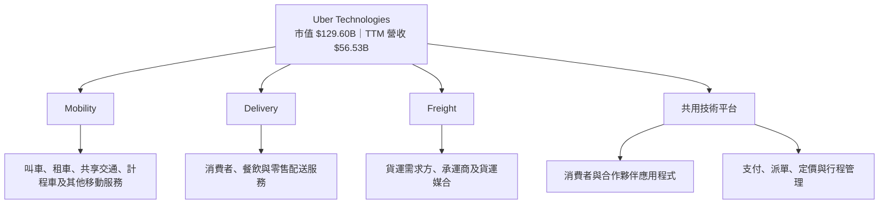
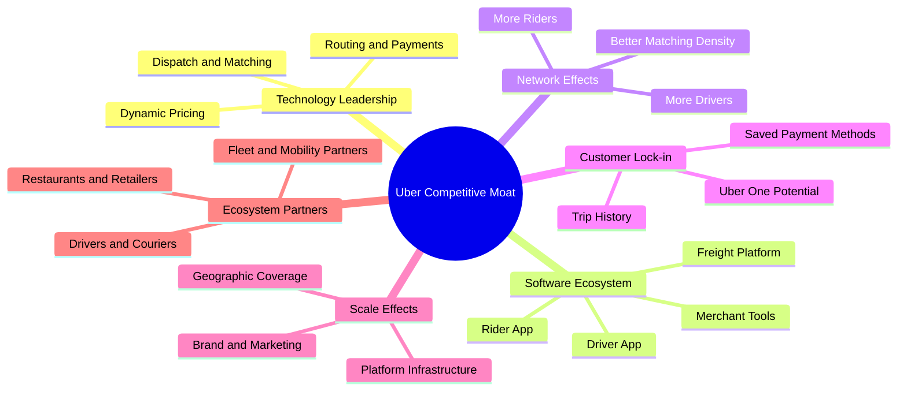
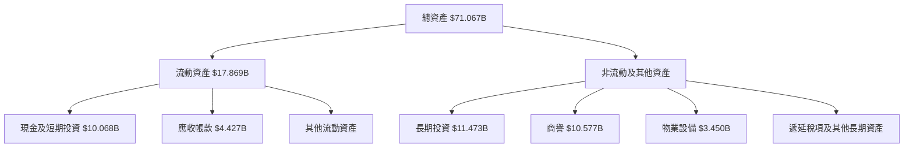
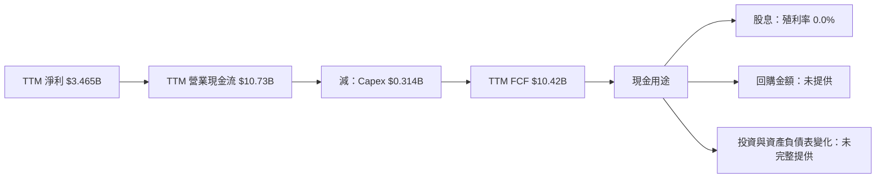
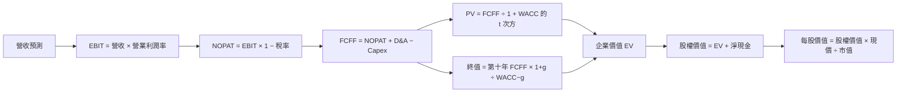
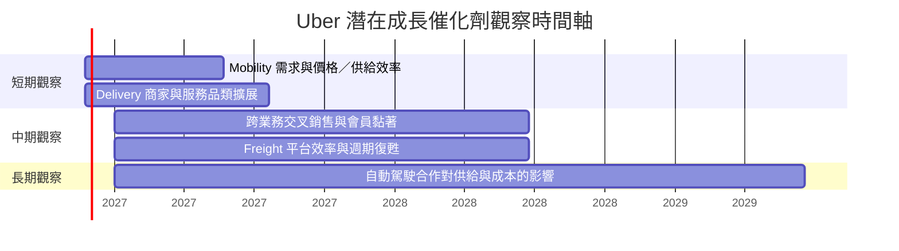
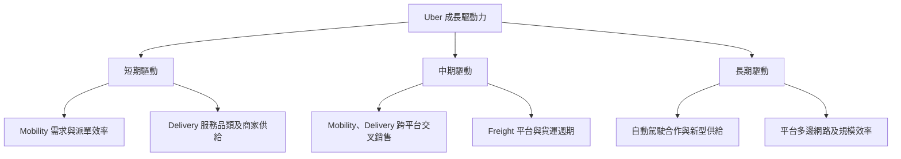
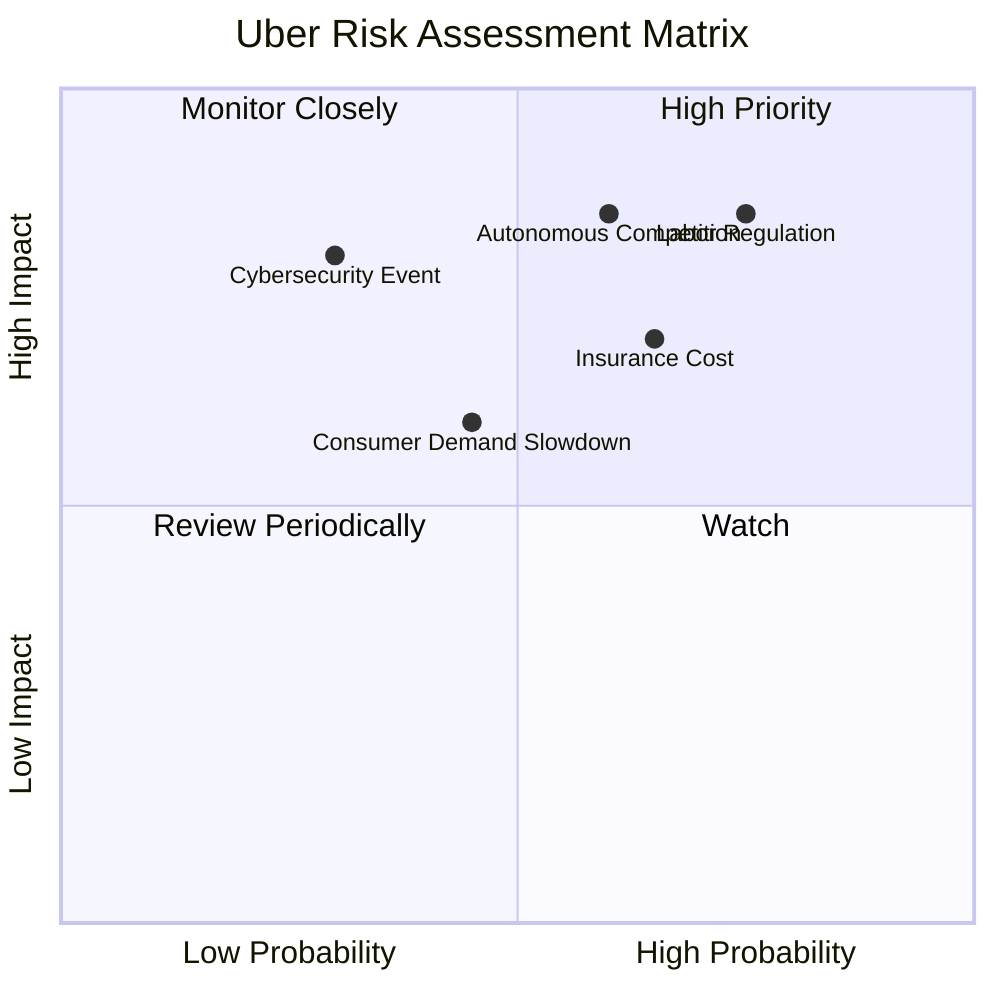
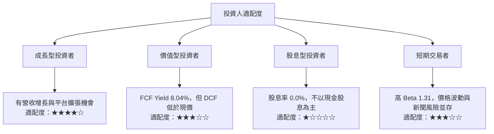

# UBER 基本面深度分析報告
> **報告日期**：2026-11-23 ｜ **語言**：繁體中文 ｜ **數據來源**：SEC 申報資料 (XBRL)、Yahoo Finance、Finviz、StockAnalysis、Roic.ai ｜ **分析師**：CFA 級機構研究

## 目錄

| # | 章節 | 核心結論 |
|---|------|----------|
| 1 | 執行摘要 | 買入；加權合理價值 $71.08，MOS 10.7% |
| 2 | 公司概覽與商業模式 | 多邊平台網路效應明確，但市場份額與分部收入比例未提供 |
| 3 | 損益表深度分析 | TTM 營收 $56.53B、年增 13.9%；最新一季營收年增 9.6% |
| 4 | 資產負債表分析 | 依 SEC 驗證口徑為淨負債 $5.60B；流動性尚可，口徑需留意 |
| 5 | 現金流量深度分析 | TTM FCF $10.42B、FCF Yield 8.04%；現金轉換高於淨利 |
| 6 | 獲利能力與資本效率 | ROIC 15.8% 高於 WACC 10.00%，目前仍創造價值 |
| 7 | 相對估值分析 | Forward P/E 14.4x；低於 DASH、GRAB，但高於 LYFT |
| 8 | DCF 內在價值評估 | DCF 基準每股 $41.20；加權合理價值 $71.08 |
| 9 | 成長催化劑 | Mobility、Delivery、平台交叉銷售及自動駕駛合作具潛在催化作用 |
| 10 | 風險矩陣 | 勞動監管、無人駕駛競爭與需求／保險成本為主要風險 |
| 11 | 投資建議 | 買入；現價略低於加權合理價值，應以營運里程碑追蹤 |

---

## 1. 執行摘要

UBER 的 TTM 營收為 **$56.53B、年增 13.9%**，TTM 營業利益率為 **12.4%**，TTM FCF 為 **$10.42B**；ROIC **15.8%** 高於 WACC **10.00%**，反映現階段投入資本仍創造正經濟利潤。另一方面，基準 DCF 每股價值 **$41.20** 低於 2026-11-20 收盤價 **$63.47**，但四種方法加權後合理價值為 **$71.08**，安全邊際（MOS）為 **10.7%**。依 MOS 門檻，評級為 **買入**；DCF 與相對估值差距較大，因此這項評級的信心度為中等，而非高。

### 1.0 一頁式投資儀表板（Portfolio Manager 30 秒速讀）

| 項目 | 內容 |
|------|------|
| **投資論點（3 句）** | ① TTM 營收年增 13.9%，顯示平台需求仍在擴張。② TTM FCF $10.42B、FCF Yield 8.04%，現金創造能力強於單看 GAAP 淨利。③ ROIC 15.8% 高於 WACC 10.00%，但 DCF 基準價 $41.20 顯示現價對長期利潤假設仍敏感。 |
| **綜合評分** | **6.8/10**（引用 1.1 評分卡） |
| **財務健康** | 🟡 現金及短期投資 $10.07B，驗證口徑總債務 $15.66B，淨負債 $5.60B。 |
| **ROIC vs WACC** | **15.8% vs 10.00%**；目前創造股東價值。 |
| **FCF 趨勢** | 2022–2025 年逐步上升；TTM FCF Yield **8.04%**。 |
| **估值** | Forward P/E **14.4x** ｜ EV/EBITDA **17.4x**（估值歷史口徑）｜ FCF Yield **8.04%** |
| **DCF 內在價值（基準）** | **$41.20** ｜ 現價相對 DCF 溢價 **54.1%** |
| **安全邊際（MOS）** | **+10.7%**＝($71.08 − $63.47) ÷ $71.08；基準為 8.8 加權合理價值。🟡 有限 |
| **預期報酬（基準情境 12M）** | 以加權合理價值衡量，上行空間 **+12.0%**；非保證的 12 個月報酬預測。 |
| **關鍵風險（前二）** | 勞動者分類及監管成本；自動駕駛競爭改變平台抽成與供給關係。 |
| **評級 + 信心度** | 🟢 **買入** ｜ 信心：中 |

### 1.1 綜合評分卡（全報告唯一）

| 維度 | 評分（1–10） | 主要依據（引用數字與其來源章節） |
|------|--------------|----------------------------------|
| 成長性 | 7.5 | TTM 營收年增 13.9%，最新一季營收年增 9.6%；但年增率由前期高位回落（第 3 章）。 |
| 獲利能力 | 7.5 | TTM 營業利益率 12.4%、ROIC 15.8% 高於 WACC 10.00%，F-Score 為 6/8（第 6 章）。 |
| 財務健康 | 6.0 | 現金及短期投資 $10.07B，淨負債 $5.60B；流動比率 1.232，CCC 因存貨資料缺漏無法計算（第 4 章）。 |
| 估值 | 5.5 | MOS 10.7%；Forward P/E 14.4x，然而 DCF 基準價 $41.20 低於現價，方法間分歧偏大（第 7–8 章）。 |
| 護城河 | 7.0 | Mobility、Delivery、Freight 多邊平台與全球營運版圖具網路效應；分部營收和市場份額數據未提供（第 2 章）。 |
| 管理層與資本配置 | 7.0 | 2025 年 FCF $9.76B、SBC $1.83B；稀釋股數測試通過，但股息率為 0%，回購數據未提供（第 5 章）。 |
| **綜合評分** | **6.8** | 六項算術平均：(7.5 + 7.5 + 6.0 + 5.5 + 7.0 + 7.0) ÷ 6 = **6.75 ≈ 6.8**。 |

### 1.2 五大投資論點 + 三大核心風險

| 類型 | 項目 | 具體依據 | 信心度 |
|------|------|----------|--------|
| 🟢 **投資論點①** | 平台營收仍在成長 | TTM 營收 $56.53B、年增 13.9%；最新一季年增 9.6%，即使增速放緩仍為正。 | 🟢 高 |
| 🟢 **投資論點②** | 自由現金流具規模 | TTM 營業現金流 $10.73B、資本支出 $314M，TTM FCF $10.42B。 | 🟢 高 |
| 🟢 **投資論點③** | 資本回報高於資本成本 | ROIC 15.8% 對 WACC 10.00%，利差約 5.8 個百分點。 | 🟢 中高 |
| 🟢 **投資論點④** | 負債可由現金流支應 | 現金及短期投資 $10.07B，淨負債 $5.60B；TTM FCF 約為淨負債的 1.9 倍。 | 🟢 中 |
| 🟡 **投資論點⑤** | 相對估值不算昂貴 | Forward P/E 14.4x，低於 DASH 20.0x、GRAB 17.5x；但同業獲利與成長結構不同。 | 🟡 中 |
| 🟡 **風險①** | 勞動與平台監管 | 若司機被重新分類為雇員，薪酬、福利與保險成本可能推高營業費用；相關量化曝險未提供。 | 🟡 中 |
| 🔴 **風險②** | 自動駕駛平台替代 | Tesla Cybercab 等自動駕駛服務可能改變車輛供給、派單與平台抽成；目前無可靠量化資料衡量影響。 | 🔴 高衝擊 |
| 🟡 **風險③** | 盈餘波動及一次性因素 | 最新一季 EPS 年減 92.0%，TTM 淨利率 6.1%；年報淨利包含重大非營業／稅務波動。 | 🟡 中高 |

### 1.3 快速統計卡片

| 指標 | 公司實際值（期間） | 同業中位數 | 狀態 |
|------|--------------------|------------|------|
| 營收成長（TTM） | **13.9%** | — | 🟢 |
| 營收成長（最新一季年增） | **9.6%** | **27.4%**（LYFT、DASH、GRAB 中位數） | 🟡 |
| 毛利率（TTM） | **41.4%** | **41.4%** | 🟡 |
| 營業利益率（TTM） | **12.4%** | — | 🟢 |
| ROIC（TTM） | **15.8%** | — | 🟢 |
| Forward P/E | **14.4x** | **17.5x** | 🟢 |
| FCF Yield（TTM） | **8.04%** | — | 🟢 |
| Piotroski F-Score | **6 / 8** | — | 🟢 |

### 1.4 投資結論

```text
╔══════════════════════════════════════════════════════════════════╗
║                    📊 投資結論摘要                               ║
╠══════════════════════════════════════════════════════════════════╣
║  評級：買入（MOS 10.7%，且 ROIC 15.8% > WACC 10.00%）            ║
║  價格（2026-11-20 收盤）：$63.47                                 ║
║  DCF 內在價值（基準）：$41.20（現價溢價 54.1%）                 ║
║  安全邊際 MOS：+10.7%（＝($71.08−$63.47)÷$71.08）               ║
║  加權合理價值（8.8）：$71.08                                     ║
║  DCF 情境價值：                                                   ║
║    悲觀情境：$23.30（相對現價 -63.3%）                          ║
║    基準情境：$41.20（相對現價 -35.1%）                          ║
║    樂觀情境：$69.04（相對現價 +8.8%）                           ║
║  綜合評分：6.8/10（引用 1.1）                                    ║
║  適合投資人：可承受監管與競爭不確定性的成長型、長線投資人        ║
╚══════════════════════════════════════════════════════════════════╝
```

---

## 2. 公司概覽與商業模式

### 2.1 業務結構與收入來源

Uber Technologies, Inc. 經營 Mobility、Delivery、Freight 三個平台板塊，連接消費者、司機／配送合作夥伴、商家與貨運需求方。財務資料未提供各分部營收、佔比與分部利潤，因此不以估算比例製作分部收入圖。



### 2.2 市場份額

市場份額數據未提供，因此不列市場份額或市場滲透率。以公司規模觀察，Uber TTM 營收為 $56.53B，最新一季營收年增 9.6%；同業資料顯示 LYFT、DASH、GRAB 最新一季營收年增分別為 8.1%、34.0%、27.4%。Uber 營收規模較大，但最新季度成長落後 DASH 與 GRAB。

### 2.3 競爭護城河分析



### 2.4 護城河強度

| 護城河項目 | 強度（強／中／弱） | 證據（引用數字或事實） | 會削弱它的情況 |
|------------|--------------------|------------------------|----------------|
| 技術與派單 | 中 | 公司以自有應用程式連接多類服務，TTM 營收 $56.53B，具平台規模。 | 競爭者在派單、價格或自動駕駛技術上取得優勢。 |
| 軟體生態系統 | 中 | Mobility、Delivery、Freight 共用應用程式與支付基礎設施。 | 消費者多平台使用、商家與司機可低成本轉換。 |
| 網路效應 | 中至強 | 需求密度與供給密度可能改善等候時間及媒合效率；具體地區網路效應數據未提供。 | 競爭者補貼或地方市場分散使供需網絡無法持續累積。 |
| 客戶鎖定 | 弱至中 | 對消費者存在支付、歷史行程與使用習慣，但沒有留存率或客戶轉換成本數據。 | 乘客主要依價格選平台，或其他超級應用提升替代性。 |
| 規模效應 | 中 | 37300 名員工、覆蓋多個區域與三個營運板塊。 | 法規要求增加固定成本，或規模未能轉化為單位成本優勢。 |
| 生態夥伴 | 中 | 依賴司機、配送員、商家及貨運承運商的多邊合作。 | 供給方議價能力上升，或勞動者分類改變成本結構。 |

護城河評分 **7.0/10** 的依據是多邊網路與跨業務平台的實際規模，但缺少市場份額、留存率與單位經濟數據，故不採更高評價。

---

## 3. 損益表深度分析

### 3.1 年度收入成長趨勢（近 4 年）

年度營收以 SEC／StockAnalysis 歷史財務資料為據。2022–2025 年營收 CAGR 為 \((52.02 ÷ 31.88)^{1/3}-1\)，約 **17.7%**。

```text
╔══════════════════════════════════════════════════════════════════╗
║              Uber 年度收入趨勢（FY2022-FY2025）                 ║
╠══════════════════════════════════════════════════════════════════╣
║  FY2022  $31.88B  ████████████░░░░░░░░░░░░  起點               ║
║  FY2023  $37.28B  ██████████████░░░░░░░░░░  YoY: +16.9% 🟢     ║
║  FY2024  $43.98B  █████████████████░░░░░░░  YoY: +18.0% 🟢     ║
║  FY2025  $52.02B  ████████████████████░░░░  YoY: +18.3% 🟢     ║
║                                                                  ║
║  2022–2025 營收 CAGR：約 +17.7%                                  ║
╚══════════════════════════════════════════════════════════════════╝
```

2023–2025 年營收增速約 17%–18%，反映叫車與配送平台使用量、交易活動與服務範圍擴大。TTM 成長率為 13.9%，低於 FY2025 年增 18.3%；最新一季年增 9.6%，顯示基期擴大後的增速正在降溫，未來營運槓桿能否延續，取決於交易量、價格／抽成與成本控制能否抵銷成長放緩。

### 3.2 季度收入趨勢分析

| 季度 | 營收 | QoQ 成長 | YoY 成長 | 備註 |
|------|------:|---------:|---------:|------|
| 2025 Q4 | $14.37B | +24.6% | +20.1% | QoQ 以 2025 Q3 $13.467B 為比較基準，具有季節性影響。 |
| 2026 Q1 | $13.20B | -8.1% | +14.5% | 季度回落，但仍高於 2025 Q1 $11.533B。 |
| 2026 Q2 | $14.19B | +7.5% | +12.2% | 環比恢復增長，年增率仍較前期低。 |
| 2026 Q3 | $14.77B | +4.1% | +9.6% | 營收續增，但單季年增率進一步放緩。 |

QoQ 計算依序為 \((13.203÷14.366)-1=-8.1\%\)、\((14.191÷13.203)-1=7.5\%\)、\((14.766÷14.191)-1=4.1\%\)。Q4 2025 QoQ 成長約 24.6%，因前一季基數較低且季節性較強，不宜直接視為趨勢性成長速度。

### 3.3 利潤率演變分析

| 利潤率指標 | FY2022 | FY2023 | FY2024 | FY2025 | 趨勢 | 評估 |
|------------|-------:|-------:|-------:|-------:|------|------|
| **毛利率** | 38.3% | 39.8% | 39.4% | 39.8% | 緩步改善後大致持平 | 🟡 |
| **營業利益率** | -5.7% | 3.0% | 6.4% | 10.7% | 顯著改善 | 🟢 |
| **淨利率** | -28.7% | 5.1% | 22.4% | 19.3% | 2024–2025 受非營業／稅務因素影響，波動大 | 🟡 |

年度毛利率依年度毛利除以年度營收計算。營業利益率由 FY2022 的 -5.7% 回升至 FY2025 的 10.7%，改善主要與營收規模擴大、費用紀律及營運效率提高相符；但不能僅憑歷史趨勢假設利潤率會持續擴張。TTM 營業利益率為 12.4%，而最新季度按 SEC 驗證數據為 9.8%，顯示單季獲利率較 TTM 水準低；季度收入成長放緩時，需追蹤保險、激勵、行銷及技術費用的變化。

### 3.4 費用結構分析

營收成本、研發、銷售與管理費用的完整 TTM 分項未提供，無法以實際數字繪製費用占比圓餅圖。可確認 FY2025 研發費用為 **$3.40B**，相當於該年營收 $52.02B 的約 **6.5%**；這是依年度數字計算的比率，不代表全部費用結構。

### 3.5 季度 EPS 趨勢與盈餘品質（Quality of Earnings）

| 季度 | EPS 實際值 | EPS 年增 | EPS 預期／驚喜 |
|------|-----------:|---------:|----------------|
| 2025 Q4 | $0.14 | -95.6% | 預期值 N/A；無法判斷是否超預期 |
| 2026 Q1 | $0.13 | -84.6% | 預期值 N/A；無法判斷是否超預期 |
| 2026 Q2 | $1.17 | +85.5% | 預期值 N/A；無法判斷是否超預期 |
| 2026 Q3 | $0.25 | -92.0% | 預期值 N/A；無法判斷是否超預期 |

提供的 EPS 預估欄位為空值，故不能把任何一季標為「超預期」或「不及預期」。單季 EPS 波動遠高於營收波動，反映非營業項目、稅項及其他損益可能使 EPS 不適合單獨作為經營趨勢指標。

| 盈餘品質項目 | 數值／佔比 | 評估 |
|--------------|------------|------|
| 股權薪酬 SBC / 營收 | TTM SBC 約 $2.065B ÷ TTM 營收 $56.53B = **3.65%** | 🟡 SBC 是真實股東成本；稀釋股數測試通過，但 SBC 仍降低每股盈餘的經濟含金量。 |
| SBC / 營業現金流 | $2.065B ÷ $10.73B = **19.3%** | 🟡 現金流中加回 SBC 的比例不低，應與股數稀釋一起觀察。 |
| FCF / 淨利（現金轉換率） | TTM FCF $10.42B ÷ TTM 淨利 $3.465B = **約 300.7%** | 🟢 現金流遠高於會計淨利；淨利偏低時此比率會被放大，不能單獨外推。 |
| 一次性／非經常性損益 | 有波動跡象；逐項金額 N/A | FY2024 淨利 $9.86B、FY2025 $10.05B，但 FY2025 營業利益為 $5.57B；非營業項目與稅務調節細目未提供。 |
| 有效稅率異常 | N/A | 稅費明細不足，不能判定 TTM 有效稅率或稅務利益金額。 |
| 資本化支出 vs 費用化 | TTM Capex $314M；資本化政策細節 N/A | Capex 低不等於沒有資本化或遞延成本，需查閱 SEC 10-Q 附註。 |

**盈餘品質結論：**TTM FCF 高於 TTM 淨利，顯示現金產生能力不弱；但淨利與 EPS 波動大、SBC 相當於營收 3.65%，且年度淨利與營業利益差距明顯。基準估值採 GAAP EBIT，避免加回 SBC 而忽略其股東成本；對淨利倍數的解讀則應保留折扣。

---

## 4. 資產負債表分析

### 4.1 資產結構分解

截至 2026-09-30，StockAnalysis 列示總資產 **$71.067B**，流動資產 **$17.869B**。細項以報表列示數值呈現；各類資產合計可能因未列出的項目與四捨五入而不等於總額。



### 4.2 流動性與營運資金分析

| 指標 | 最新值 | 歷史比較 | 評估 |
|------|-------:|----------|------|
| 流動比率 | 1.232 | FY2025 年末流動資產 $13.99B ÷ 流動負債 $12.32B，約 1.14 | 🟢 流動資產高於流動負債，但短期償債能力不是無風險。 |
| 速動比率 | 0.999 | 一年前 N/A | 🟡 接近 1，仍需留意現金流穩定性。 |
| 現金及短期投資 | $10.07B | FY2025 年末 $7.633B | 🟢 現金資產增長，提供營運緩衝。 |

**營運資金天數（QUALITY FIGURES 原值）：**

| 指標 | 最新 TTM | 一年前 TTM | 變化 | 解讀 |
|------|---------:|-----------:|------:|------|
| DSO 應收帳款天數 | 29 天 | 28 天 | +1 天 | 應收回收略慢；僅一日變化，需連續觀察。 |
| DIO 存貨天數 | N/A | N/A | N/A | 公司沒有相應存貨餘額，不能推算。 |
| DPO 應付帳款天數 | 17 天 | N/A | N/A | 一年前資料不足，無法判斷供應商付款條件趨勢。 |
| CCC 現金轉換週期 | N/A | N/A | N/A | DIO 缺資料，依原計算口徑 CCC 不可得。 |

### 4.3 債務結構分析

以 SEC 申報資料驗證口徑：現金及短期投資 $10.07B，總債務 $15.66B，淨負債 $5.60B。其他市場資料列示總債務 $17.74B、淨負債 $7.67B，與驗證數據口徑不同；本報告依題定規則使用驗證數值，兩組數據不混用。

```text
╔══════════════════════════════════════════════════════════════════╗
║                   Uber 債務健康診斷                              ║
╠══════════════════════════════════════════════════════════════════╣
║  總債務：          $15.66B  ████████████████████  驗證口徑       ║
║  現金及短期投資：  $10.07B  █████████████░░░░░░░  流動性緩衝     ║
║  淨負債：           $5.60B  ███████░░░░░░░░░░░░░  🟡 可管理     ║
║                                                                  ║
║  Debt/EBITDA：N/A（需同口徑總債務與 EBITDA；目前來源有差異）     ║
║  Interest Coverage：N/A（利息費用與利息保障倍數未提供）         ║
║  流動比率：1.232                                                   ║
╚══════════════════════════════════════════════════════════════════╝
```

### 4.4 股東權益趨勢

| 財年 | 股東權益 | YoY 變化 |
|------|---------:|---------:|
| FY2022 | $7.34B | — |
| FY2023 | $11.25B | +53.3% |
| FY2024 | $21.56B | +91.6% |
| FY2025 | $27.04B | +25.4% |

股東權益上升，部分來自累積獲利；但權益帳面值不應與市值或企業價值混為一談。FY2025 年末權益資料與季度資料的口徑不同，估值與 WACC 權重採用市值而非帳面權益。

```text
╔══════════════════════════════════════════════════════════════════╗
║                    股東權益趨勢                                  ║
╠══════════════════════════════════════════════════════════════════╣
║  FY2022  $7.34B   █████░░░░░░░░░░░░░░░                         ║
║  FY2023  $11.25B  ████████░░░░░░░░░░░░                         ║
║  FY2024  $21.56B  ████████████████░░░░                         ║
║  FY2025  $27.04B  ████████████████████                         ║
╚══════════════════════════════════════════════════════════════════╝
```

---

## 5. 現金流量深度分析

### 5.1 現金流量瀑布圖

淨利與營業現金流的 TTM 口徑分別為 $3.465B 與 $10.73B。回購、股息及淨現金變化的最新 TTM 分配資料未提供，因此以未量化節點呈現，不虛構金額。



### 5.2 FCF 轉換率趨勢

| 財年 | FCF | 淨利 | FCF / 淨利 | 解讀 |
|------|----:|-----:|-----------:|------|
| FY2022 | $0.390B | -$9.141B | 不具解讀性 | 淨利為負，正 FCF 比率失去一般比較意義。 |
| FY2023 | $3.36B | $1.89B | 約 178% | 現金流高於淨利。 |
| FY2024 | $6.89B | $9.86B | 約 70% | 淨利包含非現金／非營業因素的可能性較高。 |
| FY2025 | $9.76B | $10.05B | 約 97% | 現金轉換接近淨利。 |
| TTM | $10.42B | $3.465B | 約 301% | 淨利較低且可能受稅務及非營業波動影響，不能視為常態倍數。 |

### 5.3 自由現金流趨勢

2022–2025 年 FCF 由 $0.390B 增至 $9.76B。TTM FCF 為 $10.42B，反映現金流能力持續擴大；資料未提供各年度市值對應的歷史 FCF Yield，故不補列。

```text
╔══════════════════════════════════════════════════════════════════╗
║                 自由現金流歷史趨勢                               ║
╠══════════════════════════════════════════════════════════════════╣
║  FY2022  $0.390B  █░░░░░░░░░░░░░░░░░░░░                       ║
║  FY2023  $3.36B   ███████░░░░░░░░░░░░░                         ║
║  FY2024  $6.89B   ██████████████░░░░░░                         ║
║  FY2025  $9.76B   ███████████████████░                         ║
║  TTM     $10.42B  ████████████████████  FCF Yield 8.04%        ║
╚══════════════════════════════════════════════════════════════════╝
```

### 5.4 資本配置評估

股息率為 0.0%，FY2025 資本支出 $336M、SBC $1.83B；回購金額、投資支出拆分與資本返還總額未提供，不以比例圖推算。

| 項目 | 可得數據 | 評估 |
|------|----------|------|
| 資本支出 | FY2025 $336M；TTM $314M | 相對 TTM 營收較低，但資本化政策和租賃資產影響需參照申報附註。 |
| 股息 | 殖利率 0.0% | 不適合以股息收入為主要回報來源。 |
| 股權薪酬 | FY2025 $1.83B；TTM 約 $2.065B | 對人才激勵有用，但造成稀釋成本。 |
| 回購 | N/A | 缺乏回購金額與股數變動的完整資本配置資料。 |
| 留存現金／投資 | N/A | 沒有足夠資料拆分留存現金及併購／投資用途。 |

---

## 6. 獲利能力與資本效率

### 6.1 ROE / ROA / ROIC 趨勢

| 指標 | FY2022 | FY2023 | FY2024 | FY2025／TTM | 評估 |
|------|-------:|-------:|-------:|------------:|------|
| ROE | N/A | N/A | N/A | 12.5%（TTM 驗證值） | 存在槓桿貢獻；年度可比序列未提供。 |
| ROA | N/A | N/A | N/A | 6.5%（其他資料來源）；F-Score 測試另按其固定口徑 | 正值，但不能與驗證區塊外的口徑混算。 |
| ROIC | N/A | N/A | N/A | **15.8%（TTM 驗證值）** | 高於 WACC 10.00%，目前創造經濟價值。 |

行業均值未提供，因此不列無來源的同業均值。其他資料來源 ROE 為 12.3%，驗證數值為 12.5%；本報告品質分析與 ROIC 判斷採驗證數字。

### 6.2 ROIC vs WACC 分析（核心價值創造判斷）

Cost of capital 資料給定 WACC **10.00%**，ROIC **15.8%**。因此 EVA 利差為 **+5.8 個百分點**。下圖直接使用已提供的資本成本及 ROIC，不重建另一個 WACC。

```text
╔══════════════════════════════════════════════════════════════════╗
║                ROIC vs WACC 深度分析                            ║
╠══════════════════════════════════════════════════════════════════╣
║  WACC 組成（Cost of capital，程式計算）：                        ║
║  ├── 無風險利率 Rf（10Y 美債）：4.91%                           ║
║  ├── 市場風險溢酬 ERP：5.00%                                     ║
║  ├── Beta 原始值 1.31；採用調整後 Beta 1.21                     ║
║  ├── 股權成本（提供值）：10.94%                                  ║
║  ├── 稅前債務成本：2.81%；稅後約 2.22%                          ║
║  ├── 資本結構：股權 89.2%，債務 10.8%                           ║
║  └── ✅ WACC：10.00%                                              ║
║                                                                  ║
║  ROIC（TTM，驗證值）：15.8%                                      ║
║  EVA 利差 = ROIC − WACC = 15.8% − 10.00% = +5.8pp              ║
║                                                                  ║
║  ROIC  15.8%  ▓▓▓▓▓▓▓▓▓▓▓▓▓▓▓▓░░░░  🟢                         ║
║  WACC  10.0%  ▓▓▓▓▓▓▓▓▓▓░░░░░░░░░░  ──                         ║
║                                                                  ║
║  結論：ROIC/WACC = 15.8% ÷ 10.00% = 1.58 倍；目前創造價值。   ║
╚══════════════════════════════════════════════════════════════════╝
```

**WACC 口徑說明：**原始 Beta 1.31，調整後 Beta 按資料提供的公式 \(⅔×1.31+⅓\) 使用 1.21。CAPM 成本及 WACC 以已計算數值為準；資料未提供無風險利率的觀察日期、債務利息金額與平均計息負債，因此無法獨立重算每個底層輸入。成本資本區塊所列成本股權 10.94%，與以展示後四捨五入數字直接計算的 4.91% + 1.21 × 5.00% 有約 0.02 個百分點差異，WACC 採用區塊給定的 10.00%。

### 6.3 杜邦三因素分解

| 因素 | 數值（TTM） | 解讀 |
|------|-------------|------|
| 淨利率 | 6.1% | 淨利率受非營業損益及稅項波動影響。 |
| 資產週轉率 | 0.80 | 表示每單位資產形成相應營收；使用驗證區塊原值。 |
| 權益乘數 | 2.57 | 財務槓桿提高 ROE，但不是極低槓桿結構。 |
| **ROE** | **12.5%** | 6.1% × 0.80 × 2.57 ≈ 12.5%；按 QUALITY FIGURES 原列。 |

ROE 是獲利能力與資產週轉率共同作用的結果，2.57 倍權益乘數亦有貢獻；不能把 ROE 全部歸因於營運利潤改善。

### 6.4 財務體質：Piotroski F-Score

Piotroski F-Score 為 **6 / 8**。原品質資料有九項測試，但毛利率測試因缺資料不計入分母，故依原結果列為 6/8。

| 測試 | 結果 | 解讀 |
|------|------|------|
| ROA > 0 | ✅ 通過 | 獲利為正。 |
| 營業現金流 > 0 | ✅ 通過 | TTM 營業現金流為正，金額 $10.73B。 |
| ROA 高於一年前 | ❌ 未通過 | 獲利資產效率未呈改善。 |
| 營業現金流 > 淨利（應計品質） | ✅ 通過 | 現金流高於淨利，支持盈餘現金轉換。 |
| 長期負債 ÷ 總資產低於一年前 | ❌ 未通過 | 槓桿指標沒有改善，需留意負債走勢。 |
| 流動比率高於一年前 | ✅ 通過 | 流動比率相較一年前改善。 |
| 稀釋股數未增加 | ✅ 通過 | 測試期間未見稀釋股數增加。 |
| 毛利率高於一年前 | — 無法判定 | 缺少相同口徑必要輸入，未列入分母。 |
| 資產週轉率高於一年前 | ✅ 通過 | 資產週轉效率改善。 |

---

## 7. 相對估值分析

### 7.1 同業估值比較

本公司倍數採財務數據估值區塊；同業數字採 Yahoo Finance Peer multiples。P/E 與 EV/EBITDA 可能受到不同一次性損益、資本結構及獲利品質影響，不能單獨視為公平價值結論。

| 估值指標 | **UBER** | **LYFT** | **DASH** | **GRAB** | 本公司評估 |
|----------|---------:|---------:|---------:|---------:|-----------|
| **Trailing P/E** | 37.1x | 2.4x | 63.3x | 27.5x | 🟡 UBER 位於 LYFT 與 DASH 之間；LYFT 倍數極低不代表可直接比較。 |
| **Forward P/E** | 14.4x | 8.0x | 20.0x | 17.5x | 🟢 低於 DASH、GRAB，中位數 17.5x。 |
| **P/S Ratio** | 2.3x | 0.9x | 3.9x | 2.8x | 🟡 低於 DASH、GRAB，但高於 LYFT。 |
| **EV/EBITDA** | 17.4x | 546.9x | 37.3x | 17.4x | 🟢 低於 DASH；LYFT 倍數異常高，不適合作一般中位數比較。 |
| **最新一季營收年增** | 9.6% | 8.1% | 34.0% | 27.4% | 🟡 Uber 成長慢於 DASH、GRAB。 |
| **毛利率（TTM）** | 41.4% | 40.0% | 52.7% | 41.4% | 🟡 與 GRAB 相近，低於 DASH。 |

### 7.2 歷史估值區間分析

```text
╔══════════════════════════════════════════════════════════════════╗
║              UBER 歷史估值位置（TTM 倍數）                       ║
╠══════════════════════════════════════════════════════════════════╣
║  P/E        12.6x ───── 中位數 17.8x ───── 現值 37.1x ───── 122.2x║
║  現值百分位：54%                                                ║
║                                                                  ║
║  P/S         1.5x ───── 現值 2.3x ───── 中位數 3.3x ───── 6.1x  ║
║  現值百分位：19%                                                ║
║                                                                  ║
║  EV/EBITDA  18.7x ───── 現值 17.4x ───── 中位數 40.0x ─── 320.2x║
║  現值百分位：0%                                                 ║
╚══════════════════════════════════════════════════════════════════╝
```

按五年歷史資料，P/E 37.1x 高於中位數 17.8x，處於 54 百分位；P/S 2.3x 低於中位數 3.3x，處於 19 百分位；EV/EBITDA 現值 17.4x 低於中位數 40.0x，處於 0 百分位。不同倍數給出不同訊號，部分來自公司獲利由虧轉盈後的歷史基期失真。

### 7.3 情境價值（DCF MODEL Scenarios）

| 情境 | 第 1 年營收成長 | 期末營業利潤率 | WACC | 每股價值 | 相對現價 | 機率 | 會發生的條件 |
|------|----------------:|---------------:|-----:|---------:|---------:|-----:|--------------|
| 🔴 悲觀 | 7.0% | 5.4% | 11.00% | $23.30 | -63.3% | 25% | 成長放緩且競爭、監管或保險成本壓抑利潤率。 |
| 🟡 基準 | 13.9% | 6.4% | 10.00% | $41.20 | -35.1% | 50% | 營收增長由目前 TTM 水準逐步降速，成熟期利潤率回落至模型設定。 |
| 🟢 樂觀 | 20.9% | 7.0% | 9.00% | $69.04 | +8.8% | 25% | 成長高於目前 TTM 水準，平台規模與成本效率抵銷競爭壓力。 |

模型給定機率加權值 **$43.68**，但 8.8 估值權重規則指定使用基準 DCF 值，不以機率加權情境取代基準價。

### 7.4 相對估值隱含價格區間

```text
╔══════════════════════════════════════════════════════════════════╗
║              估值方法隱含每股價值                                ║
╠══════════════════════════════════════════════════════════════════╣
║  $41.20 ───── 現價 $63.47 ───── $77.21 ───── $98.16 ─── $101.93║
║  基準 DCF       ●             Forward P/E   分析師共識   EV/EBITDA║
╚══════════════════════════════════════════════════════════════════╝
```

| 方法 | 每股價值 | 依據 |
|------|---------:|------|
| DCF（基準） | $41.20 | 10 年 FCFF、WACC 10.00%、永續成長率 3.0%。 |
| 同業 Forward P/E | $77.21 | 同業中位數 17.5x × UBER Forward EPS $4.41。 |
| 同業 EV/EBITDA | $101.93 | DASH、GRAB 中位數 27.4x × TTM EBITDA，並加回淨現金／扣除淨負債。 |
| 分析師共識目標價 | $98.16 | 46 位分析師平均目標價。 |

相對估值與分析師共識顯著高於 DCF，反映兩類方法採用市場倍數或預期 EPS；DCF 則對長期利潤率與折現率更敏感。估值分歧本身是風險，不宜只採用最高目標價。

---

## 8. DCF 內在價值評估（Discounted Cash Flow）

### 8.0 估值推理鏈（Thinking Logic）

**Step 1 — 價值來源與主導變數**

模型把 Uber 價值拆為現有 Mobility 主業的現金流底盤、Delivery 與 Freight 的交叉銷售／擴張，以及新型出行服務的選擇權；但財務資料沒有分部營收與佔比，不能把各來源量化拆分。模型顯示價值對 **WACC、永續成長率與營業利潤率**敏感，終值現值佔 EV 46.8%，因此長期利潤率與折現率會主導估值。

**Step 2 — 模型選擇**

| 決策點 | 本報告採用 | 理由 | 曾考慮但否決 | 否決理由 |
|--------|-----------|------|--------------|----------|
| 現金流定義 | FCFF | 使用 GAAP EBIT，對應企業價值與 WACC 折現。 | FCFE | 債務與資本結構影響估值，企業口徑更適合本模型。 |
| 預測期 N | 10 年 | DCF MODEL 指定 10 年，反映營收與利潤率逐步成熟。 | 5 年 | 不符合程式模型，且更難呈現成熟期轉換。 |
| 終值方法 | Gordon Growth | 模型直接提供永續成長法與終值。 | 退出倍數法 | 未提供預測期末 EBITDA 及指定退出倍數計算結果，不另建第二套模型。 |
| EBIT 基礎 | GAAP | 模型明確採 GAAP EBIT，已費用化 SBC。 | 非 GAAP EBIT | 可能加回 SBC，若不扣回會高估股東經濟收益。 |

**Step 3 — 關鍵假設推導鏈**

- **營收成長**：錨點＝TTM 營收成長 13.9%；模型以此作第一年起點，並線性降至第十年 3.0%，反映公司由高成長平台走向成熟的合理化方向。採用第一年 13.9%、第十年 3.0%；未採用 20.9% 作基準，因該數字只屬樂觀情境，會要求成長重新加速。
- **期末營業利潤率**：錨點＝TTM GAAP 營業利益率 12.4%；模型由 12.4% 逐年降至過去五個財政年度中位數 6.4%，反映歷史成熟期和競爭壓力。採用 6.4%；未採用持續維持 12.4%，因模型設定的五年歷史中位數較低。
- **永續成長率 g**：錨點＝模型使用 3.0%；該數值低於 WACC 10.00%，終值公式有效。採用 3.0%；未採用更高永續成長，以避免長期增長假設過度主導價值。
- **預測期 N**：錨點＝模型指定 10 年；採用 10 年，讓營收增長由 13.9% 漸降到 3.0%，且營業利潤率由 12.4% 漸降至 6.4%。未改用其他年限，因必須遵守模型輸出。
- **Capex / 營收**：錨點＝TTM 資本支出 $314M、模型年 1 至年 10 均約 0.6%；模型採用 0.6%。未自行調高，因程式模型假設維持現有資本支出強度；若未來再投資需求提高，估值會下降。
- **GAAP EBIT、SBC 與股數**：錨點＝模型聲明 GAAP EBIT 已把 SBC 計為費用；採固定股數、不再額外稀釋，亦不在 FCFF 再扣 SBC。未採非 GAAP EBIT，避免 SBC 被加回後漏記。
- **有效稅率**：模型採 21.0%，依成本資本輸入的預設稅率；實際有效稅率資料未提供，故視為模型假設，而非當期實際稅率。
- **D&A / 營收**：模型以 TTM 1.4% 固定；未提供獨立 TTM D&A 數值供重新驗證，直接採用模型值。
- **營運資金**：模型明確不建模 ΔWC；沒有用反推的營運資金數字補入 FCFF。
- **終值方法**：採 Gordon Growth，因模型提供 FCFF 與 g；未採退出倍數作獨立交叉驗證，因所需的期末 EBITDA 與模型指定倍數輸出未提供。
- **WACC**：採用程式給定 10.00%；不自行重算或調整，以符合統一折現率要求。

**Step 4 — 最脆弱一環**

最脆弱的是終值前的長期利潤率路徑與 10.00% WACC；模型顯示 g、WACC 改變會使 DCF 每股價值落在約 $30.61–$66.48 的敏感度區間，並且基準 DCF 僅 $41.20，低於現價。

**Step 5 — 計算路徑圖**



### 8.1 模型假設總表（Model Inputs）

| 假設項目 | 採用值 | 依據／來源 | 敏感度 |
|----------|--------|-------------|--------|
| 預測期長度 N | 10 年 | DCF MODEL 指定年數，FY+1 至 FY+10。 | 🟡 中 |
| 營收成長路徑 | FY+1 13.9% 線性降至 FY+10 3.0% | 起點為 TTM 成長 13.9%；終點由模型假設。 | 🔴 高 |
| 營業利潤率 | FY+1 12.4% 降至 FY+10 6.4% | TTM 營業利益率及過去五年中位數（模型提供）。 | 🔴 高 |
| 有效稅率 | 21.0% | Cost of capital 預設值；非實際有效稅率。 | 🟢 低 |
| Capex / 營收 | 0.6%（年 1 至年 10） | DCF MODEL；TTM Capex $314M。 | 🟡 中 |
| D&A / 營收 | 1.4% | DCF MODEL 的 TTM 比例。 | 🟢 低 |
| 營運資金變動 | 不建模 | DCF MODEL 明示 Working capital is not modelled。 | 🟢 低 |
| EBIT 基礎 | GAAP | DCF MODEL 明示 GAAP EBIT。 | 🟡 中 |
| SBC 處理 | 不再扣 SBC | SBC 已含於 GAAP EBIT。 | 🟡 中 |
| 股數稀釋 | 固定、不另稀釋 | 模型組合 A；沒有額外年度股數稀釋。 | 🟡 中 |
| 永續成長率 g | 3.0% | DCF MODEL；小於 WACC 10.00%。 | 🔴 高 |
| 終值方法 | Gordon Growth | 模型已列終值計算。 | 🔴 高 |
| WACC | 10.00% | Cost of capital 區塊原值。 | 🔴 高 |

本模型採用 **(A) GAAP EBIT + 固定股數**，故 SBC 影響已計入一次；FCFF 不再扣 SBC，亦不額外提高股數。FCFF 定義為 **NOPAT + D&A − Capex**，依程式模型設定不扣 ΔWC。

### 8.2 折現率推導（WACC）

```text
╔══════════════════════════════════════════════════════════════════╗
║                    WACC 推導（折現率）                           ║
╠══════════════════════════════════════════════════════════════════╣
║  股權成本 Ke（CAPM，採用資料提供的計算值）：                     ║
║  ├── 無風險利率 Rf（10Y 美債）：4.91%                           ║
║  ├── ERP：5.00%                                                  ║
║  ├── Beta 原始值 1.31；調整後 Beta 1.21                          ║
║  ├── 規模／國別溢酬：未提供，未另加                              ║
║  └── Ke（提供值）：10.94%                                       ║
║                                                                  ║
║  債務成本 Kd：                                                   ║
║  ├── 稅前 Kd（提供值）：2.81%                                   ║
║  ├── 稅率：21.0%                                                 ║
║  └── 稅後 Kd = 2.81% × (1 − 21.0%) = 2.22%                     ║
║                                                                  ║
║  資本結構（提供權重）：股權 89.2%，債務 10.8%                   ║
║  └── ✅ WACC（指定採用值）：10.00%                               ║
╚══════════════════════════════════════════════════════════════════╝
```

逐步演算與可核對程度：

1. **Ke（CAPM）**：按提供的已計算 Ke 原值為 **10.94%**。展示輸入直接代入為 4.91% + 1.21 × 5.00% = 10.96%；與提供 Ke 有約 0.02 個百分點差異，應屬底層未四捨五入輸入差異。依規則不以重算值替換已提供值。
2. **稅前 Kd**：**2.81%**，為 Cost of capital 提供值。利息費用金額與平均計息負債金額未提供，不能另外反推。
3. **稅後 Kd**：2.81% × (1 − 21.0%) = 2.2199% ≈ **2.22%**。
4. **權重**：股權 89.2%；債務 10.8%；89.2% + 10.8% = **100.0%**。區塊未提供用於重新計算權重的完整市值／計息負債口徑表，故直接採用提供權重。
5. **WACC**：89.2% × 10.94% + 10.8% × 2.2199% = 9.7565% + 0.2397% = **9.9962% ≈ 10.00%**。

本節與第 6.2 節一致採 **WACC 10.00%**。Rf 觀察日未提供；不能補寫未經資料確認的日期。

### 8.3 逐年自由現金流預測（基準情境）

以下逐年數值依 DCF MODEL 原表照錄，單位為 **$B**；金額取兩位小數，折現因子取三位小數。模型輸出數字由未四捨五入的內部值計算，表中呈現值可能存在數個百分點以下的小數尾差。

| 年度 | FY+1 | FY+2 | FY+3 | FY+4 | FY+5 | FY+6 | FY+7 | FY+8 | FY+9 | FY+10 |
|------|-----:|-----:|-----:|-----:|-----:|-----:|-----:|-----:|-----:|------:|
| 營收 | 64.41 | 72.60 | 80.96 | 89.29 | 97.40 | 105.06 | 112.04 | 118.12 | 123.10 | 126.80 |
| 營收 YoY | 13.9% | 12.7% | 11.5% | 10.3% | 9.1% | 7.9% | 6.6% | 5.4% | 4.2% | 3.0% |
| 營業利潤率 | 12.4% | 11.8% | 11.1% | 10.4% | 9.7% | 9.1% | 8.4% | 7.7% | 7.0% | 6.4% |
| EBIT（GAAP） | 8.01 | 8.54 | 8.98 | 9.30 | 9.49 | 9.52 | 9.40 | 9.11 | 8.67 | 8.07 |
| − 稅 | (1.68) | (1.79) | (1.89) | (1.95) | (1.99) | (2.00) | (1.97) | (1.91) | (1.82) | (1.69) |
| = NOPAT | 6.33 | 6.75 | 7.09 | 7.35 | 7.50 | 7.52 | 7.43 | 7.20 | 6.85 | 6.38 |
| + D&A | 0.88 | 0.99 | 1.10 | 1.21 | 1.33 | 1.43 | 1.52 | 1.61 | 1.67 | 1.72 |
| − Capex | (0.36) | (0.40) | (0.45) | (0.50) | (0.54) | (0.58) | (0.62) | (0.66) | (0.68) | (0.70) |
| **= FCFF** | **6.85** | **7.33** | **7.75** | **8.07** | **8.28** | **8.37** | **8.33** | **8.15** | **7.84** | **7.40** |
| 折現因子 @10.00% | 0.909 | 0.826 | 0.751 | 0.683 | 0.621 | 0.565 | 0.513 | 0.467 | 0.424 | 0.386 |
| **FCFF 現值 PV** | **6.23** | **6.06** | **5.82** | **5.51** | **5.14** | **4.73** | **4.27** | **3.80** | **3.32** | **2.85** |

預測期現值合計依模型提供值為 **$47.74B**。直接把表內已四捨五入 PV 相加為 6.23 + 6.06 + 5.82 + 5.51 + 5.14 + 4.73 + 4.27 + 3.80 + 3.32 + 2.85 = **$47.73B**；與模型總和 $47.74B 相差 $0.01B，屬逐年項目四捨五入所致，估值沿用模型總和。

**FY+1 代表年度演算：**

1. **營收**：模型以未四捨五入的 TTM 成長輸入計算，輸出 **$64.41B**；表列 13.9% 為四捨五入顯示值。
2. **EBIT**：模型輸出 **$8.01B**，基礎為 GAAP EBIT；表列營收與利潤率均已四捨五入，無法從顯示精度完全重建底層數值。
3. **稅**：$8.01B × 21.0% = $1.6821B ≈ **$1.68B**。
4. **NOPAT**：模型列示 EBIT $8.01B − 稅 $1.68B = **$6.33B**。
5. **D&A**：模型輸出 **$0.88B**；依 DCF 模型，D&A / 營收採 TTM 1.4% 並以未四捨五入數據計算。
6. **Capex**：模型輸出 **$0.36B**；Capex / 營收依模型約 0.6%。
7. **ΔWC**：**不建模**，所以沒有營運資金扣除列。
8. **FCFF**：模型輸出 $6.85B；按表列已取兩位小數的 NOPAT、D&A、Capex 相加相減為 $6.33 + $0.88 − $0.36 = $6.85B。
9. **折現因子與 PV**：1 ÷ (1 + 10.00%)¹ = 0.90909… ≈ **0.909**；$6.85B × 0.909 ≈ **$6.23B**。

**合理性自檢：**

- 預測 FCFF 由 $6.85B 增至 $7.40B，9 年累計 CAGR 約 \((7.40÷6.85)^{1/9}-1=0.9\%\)；歷史 FCF 2022–2025 增長快速但受低基期影響，模型假設偏向「營收成長、利潤率下降」而非 FCF 高速外推。
- FY+10 FCFF 利潤率 = $7.40B ÷ $126.80B = **5.8%**。目前 TTM FCF 利潤率 = $10.42B ÷ $56.53B = **18.4%**；同業最佳值在可得資料中沒有同口徑 FCF margin，故不比較。模型的成熟期現金利潤率低於目前，具保守性。
- 模型各年 FCFF 均為正；但這依賴營業利潤率維持正值及資本支出比例偏低的假設。

```text
╔══════════════════════════════════════════════════════════════════╗
║            自由現金流：歷史實際 vs 模型預測                      ║
╠══════════════════════════════════════════════════════════════════╣
║  FY2023(實)  $3.36B  ███████░░░░░░░░░░░░░  YoY 約 +762%*       ║
║  FY2024(實)  $6.89B  ██████████████░░░░░░  YoY 約 +105%         ║
║  FY2025(實)  $9.76B  ████████████████████  YoY 約 +42%          ║
║  FY+1 (預)   $6.85B  ██████████████░░░░░░                       ║
║  FY+10(預)   $7.40B  ███████████████░░░░░                       ║
╠══════════════════════════════════════════════════════════════════╣
║  *FY2023 的同比受 FY2022 低基期影響；預測值為模型輸出。         ║
╚══════════════════════════════════════════════════════════════════╝
```

### 8.4 終值計算（Terminal Value）

**適用性檢查：**WACC **10.00%** vs g **3.0%** → WACC > g？✅

| 方法 | 計算式 | 終值 TV | TV 現值 | 佔總 EV 比重 |
|------|--------|--------:|--------:|-------------:|
| Gordon Growth | 7.40 × (1 + 3.0%) ÷ (10.00% − 3.0%) | $108.85B | $41.97B | 46.8% |
| 退出倍數法 | N/A（模型未提供期末 EBITDA 與指定退出倍數結果） | N/A | N/A | N/A |

**逐步演算：**

1. FY+10 FCFF = **$7.40B**。
2. 分子：$7.40B × (1 + 3.0%) = **$7.622B**。
3. 分母：10.00% − 3.0% = **7.00%**；TV = $7.622B ÷ 0.070 = **$108.89B**。模型按未四捨五入底層 FCFF 計算並列示 **$108.85B**，兩者的約 $0.04B 差異來自表列 FCFF 四捨五入。
4. PV(TV)：模型列示 $108.85B × 第十年折現因子 0.386 = **$41.97B**；未四捨五入折現因子用於模型計算。
5. 終值佔比：$41.97B ÷ $89.71B = **46.8%**。

退出倍數法缺少模型輸出，本報告不自行建立倍數估值。

### 8.5 企業價值 → 每股內在價值（Bridge）

```text
╔══════════════════════════════════════════════════════════════════╗
║              企業價值 → 每股內在價值 橋接表                      ║
╠══════════════════════════════════════════════════════════════════╣
║  預測期 FCF 現值合計            +$47.74B                         ║
║  終值現值 PV(TV)                +$41.97B                         ║
║  ─────────────────────────────────────────────                  ║
║  = 企業價值 EV                    $89.71B                        ║
║  + 淨現金（− = 淨負債）            -$5.60B                        ║
║  = 股權價值（模型輸出）            $84.12B                        ║
║  每股價值：股權價值×價格÷市值       $41.20                         ║
║  當前股價（2026-11-20 收盤）        $63.47                         ║
║  折溢價（現價÷DCF內在價值−1）       +54.1% 溢價                    ║
╚══════════════════════════════════════════════════════════════════╝
```

**逐步演算與口徑：**

1. **EV**：$47.74B + $41.97B = **$89.71B**。
2. **股權價值**：模型橋接採 EV $89.71B 加淨現金（負數，代表淨負債）-$5.60B，模型列示 **$84.12B**；直接按兩位小數相減為 $84.11B，$0.01B 差異來自底層未四捨五入數值，依規則保留模型原值。
3. **每股 DCF 價值**：模型指定公式為股權價值 × 股價 ÷ 市值，代入 $84.12B × $63.47 ÷ $129.60B = **$41.20**。
4. **折溢價**：$63.47 ÷ $41.20 − 1 = **+54.1%**，表示現價高於 DCF 基準值。
5. **本節不計算 MOS**：MOS 只以 8.8 加權合理價值為分母。

股權價值的淨負債調整採截至 2026-09-30 的驗證口徑；每股價值使用 DCF MODEL 原指定的「股權價值 × 股價 ÷ 市值」方法。模型沒有直接列出完全可核對的稀釋股數，未另行推算替代每股價值。

### 8.6 敏感性分析（WACC × 永續成長率）

| g（列）／WACC（欄） | 8.00% | 9.00% | **10.00%（基準）** | 11.00% | 12.00% |
|-----------|------:|------:|-------------------:|-------:|-------:|
| 2.0% | $51.37（-19.1%） | $44.00（-30.7%） | $38.45（-39.4%） | $34.11（-46.3%） | $30.61（-51.8%） |
| 2.5% | $54.12（-14.7%） | $45.84（-27.8%） | $39.73（-37.4%） | $35.03（-44.8%） | $31.30（-50.7%） |
| 3.0% | $57.42（-9.5%） | $47.98（-24.4%） | **$41.20（-35.1%）** | $36.08（-43.2%） | $32.07（-49.5%） |
| 3.5% | $61.45（-3.2%） | $50.51（-20.4%） | $42.88（-32.4%） | $37.26（-41.3%） | $32.92（-48.1%） |
| 4.0% | $66.48（+4.7%） | $53.54（-15.6%） | $44.85（-29.3%） | $38.61（-39.2%） | $33.88（-46.6%） |

**非基準格逐步演算說明：**選格 WACC **9.00% > g 3.0% ✅**。該格每股價值 **$47.98** 是 DCF MODEL 直接提供的敏感度結果。模型沒有提供此格的逐年折現 PV、終值現值及完整股權橋接中間數字，依「不得另建模型」要求，不重建其計算過程。

**三情境 DCF（營運假設與 WACC 均變動）**

| 情境 | 第 1 年營收成長 | 期末營業利潤率 | g | WACC | 每股內在價值 | 相對現價 | 機率 |
|------|----------------:|---------------:|--:|-----:|-------------:|---------:|-----:|
| 🔴 悲觀 | 7.0% | 5.4% | N/A（情境區塊未另列） | 11.00% | $23.30 | -63.3% | 25% |
| 🟡 基準 | 13.9% | 6.4% | 3.0% | 10.00% | $41.20 | -35.1% | 50% |
| 🟢 樂觀 | 20.9% | 7.0% | N/A（情境區塊未另列） | 9.00% | $69.04 | +8.8% | 25% |
| **機率加權** | — | — | — | — | **$43.68** | **-31.2%** | **100%** |

每一情境的每股價值均照錄程式模型；情境區塊沒有逐年營收、期末 FCFF 與情境終值等中間輸出，故無法提供可複算的完整三條數字鏈，亦不另行推算。機率加權值依模型為 **$43.68**。

**敏感度結論：**

- g 從 2.5% 升至 3.5%，在 WACC 10.00% 下內在價值由 $39.73 升至 $42.88：+$3.15，約 +7.9%。
- WACC 從 9.00% 升至 11.00%，在 g 3.0% 下價值由 $47.98 降至 $36.08：-$11.90，約 -24.8%。
- 營業利潤率每 +1 個百分點的價值彈性：**N/A（敏感度矩陣未提供該項）**。
- 在已提供的矩陣範圍內，折現率變動造成的價值影響明顯；這與 8.0 指出估值依賴長期折現和終值假設一致。

### 8.7 反推 DCF（Reverse DCF：市場在預期什麼）

DCF MODEL 提供兩項單一變數反推結果，其餘假設固定於基準模型；沒有提供可重現的逐次迭代軌跡，故不虛構收斂試算點。

| 求解的變數（一次一個） | 其餘變數設定 | 市場隱含值 | 公司歷史／基準 | 判斷 |
|------------------------|--------------|------------:|---------------|------|
| 第一年營收成長 | 利潤率、WACC、g 及其他條件固定為基準 | 25.1% | 基準 13.9%；TTM 成長 13.9% | 🔴 現價要求較高的短期成長。 |
| 固定營業利潤率 | 營收成長及其他條件固定為基準 | 12.2% | 基準由 12.4% 降至 6.4% | 🔴 要求長期維持接近目前水準的利潤率。 |
| 永續成長率 g | 其他條件固定為基準 | 未計算 | 基準 3.0% | N/A（模型未提供解）。 |
| 預測期長度 N | 其他條件固定為基準 | 未計算 | 基準 10 年 | N/A（模型未提供解）。 |

**反推結論：**以其餘基準假設固定時，現價需要模型第一年營收成長升至 25.1%，或長期固定營業利潤率約 12.2%；前者高於目前 TTM 營收成長 13.9%，後者接近目前 TTM 營業利益率 12.4%，而模型基準假設是利潤率逐年降至 6.4%。因此股價隱含的經營預期高於基準 DCF 的長期利潤路徑。

### 8.8 估值三角驗證與安全邊際

| 估值方法 | 隱含每股價值 | 上行空間（÷現價） | 權重 | 說明 |
|----------|--------------:|-------------------:|-----:|------|
| DCF（基準） | $41.20 | -35.1% | 40% | 10 年 FCFF、WACC 10.00%、g 3.0%。 |
| 同業 Forward P/E | $77.21 | +21.6% | 25% | 同業中位數 17.5x × UBER Forward EPS $4.41。 |
| 同業 EV/EBITDA | $101.93 | +60.6% | 25% | DASH、GRAB 中位數 27.4x × TTM EBITDA，調整淨負債。 |
| 分析師共識目標價 | $98.16 | +54.7% | 10% | 46 位分析師平均目標價。 |
| **加權合理價值** | **$71.08** | **+12.0%** | **100%** | **Profitable 公司類型固定權重。** |

加權合理價值計算：

\[
\$41.20\times40\%+\$77.21\times25\%+\$101.93\times25\%+\$98.16\times10\%
\]
\[
=\$16.48+\$19.3025+\$25.4825+\$9.816=\$71.081\approx\mathbf{\$71.08}
\]

權重合計 40% + 25% + 25% + 10% = **100%**。公司類型為 profitable；模型列出的四種方法均保留，沒有剔除方法。

```text
╔══════════════════════════════════════════════════════════════════╗
║                  估值區間與安全邊際                              ║
╠══════════════════════════════════════════════════════════════════╣
║  $23.30 ── $63.47 ── [$71.08] ── $41.20 ── $69.04             ║
║  悲觀DCF     現價      加權合理值    基準DCF    樂觀DCF          ║
║                                                                  ║
║  MOS = ($71.08 − $63.47) ÷ $71.08 = +10.7%                     ║
║  MOS 評估：🟡 有限                                               ║
║  上行空間 = ($71.08 − $63.47) ÷ $63.47 = +12.0%                ║
║                                                                  ║
║  建議買入區間：$23.30 – $63.97（MOS 約 10% 以上；情境價非底部）║
║  合理持有區間：$63.97 – $71.08                                  ║
║  減碼考慮區間：高於 $69.04 的樂觀 DCF 情境價，需重新檢視       ║
╚══════════════════════════════════════════════════════════════════╝
```

其中 MOS 計算為 ($71.08 − $63.47) ÷ $71.08 = **10.7%**；上行空間為 ($71.08 − $63.47) ÷ $63.47 = **12.0%**。買入區間上限 $63.97 對應價格不高於加權合理價值的 90%，即 $71.08 × 90% = $63.97；區間下限 $23.30 為悲觀情境值而非技術支撐或保證底價。

> 🔎 **程式複算（Python，依本節各項自動重算）**
>
> 加權合理價值 = $41.20 × 40% + $77.21 × 25% + $101.93 × 25% + $98.16 × 10% = **$71.08**（權重合計 100%）
>
> 以價格 $63.47 計：MOS = **+10.7%**，上行空間 = **+12.0%**
>
> ✅ 與本節所寫數值一致。

### 8.9 DCF 模型的局限與失效條件

- **終值依賴度：**終值現值佔 EV **46.8%**，低於 75% 警戒門檻，但仍近半企業價值取決於第十年後的持續經營假設。
- **最脆弱假設：**WACC 與長期成長率。基準 DCF 為 $41.20；敏感度矩陣在 WACC 12.00%、g 2.0% 時降至 $30.61，在 WACC 8.00%、g 4.0% 時升至 $66.48。
- **營業利潤率路徑：**模型由 TTM 12.4% 降至第十年 6.4%；若競爭或法規使利潤率低於該路徑，價值下行；若可持續維持接近 12.2%，反推結果暗示較高價值。
- **模型適用性：**公司目前 FCF 為正，DCF 可使用；但 TTM FCF $10.42B 與淨利 $3.465B 差距大，年度 EPS 波動亦大，應與相對估值及現金流品質交叉檢查。
- **與第 10 章風險連結：**自動駕駛替代可壓低營收成長和利潤率；勞動者分類可能提高營運成本；事故／保險成本變化可能侵蝕 EBIT 與 FCF。

### 8.10 複算檢核表（Audit Trail）

| # | 檢核項目 | 檢查方式 | 結果 |
|---|----------|----------|------|
| 1 | 所有高／中敏感度輸入有推導說明 | 對照 8.0 Step 3 與 8.1 | 🟡 有推導；部分缺少底層實際資料，已標明模型值。 |
| 2 | 每個假設都有來歷 | 檢查 8.1 依據欄 | ✅ 有列明模型或財務數據依據。 |
| 3 | WACC 五步及加權算式 | 權重 89.2% + 10.8%；重算 WACC | 🟡 加權約 10.00%；Ke 展示輸入與提供值有 0.02pp 小差異。 |
| 4 | Kd 分母與權重 D 口徑一致 | 檢查利息、平均計息負債及債務定義 | 🟡 原始利息與平均餘額未提供，無法獨立核驗。 |
| 5 | WACC 與第 6.2 節同值 | 比對兩節 | ✅ 均為 10.00%。 |
| 6 | 逐年表格年度數等於 N、無省略 | 數 FY+1 至 FY+10 | ✅ 共 10 年，無省略年度。 |
| 7 | FY+1 代表年度可複算 | 使用已四捨五入輸入重算 | 🟡 部分底層輸入未公開精確位數，模型數字照錄。 |
| 8 | 預測 PV 合計 | 加總表列 PV 與模型合計 | 🟡 表列相加 $47.73B；模型原值 $47.74B，差 $0.01B，屬四捨五入。 |
| 9 | WACC > g | 比較 10.00% 與 3.0% | ✅ 成立。 |
| 10 | 終值基於 FY+10 並折現 10 期 | 核對模型終值及折現因子 | ✅ 模型使用 FY+10 FCFF 及 10 年折現。 |
| 11 | Bridge 算式與每股值 | 檢查 EV、淨負債及 per-share 公式 | 🟡 顯示值有 $0.01B 尾差；每股價值照錄模型。 |
| 12 | SBC 組合相容 | GAAP EBIT、無 SBC 扣除列、固定股數 | ✅ 組合 A。 |
| 13 | 敏感度矩陣基準格 | 對照 8.5 | ✅ $41.20。 |
| 14 | WACC ≤ g 格子處理 | 掃描矩陣各格 | ✅ 全部矩陣格 WACC > g。 |
| 15 | 三情境機率合計 | 25% + 50% + 25% | ✅ 100%；機率加權值照錄 $43.68。 |
| 16 | 反推每列只放開一個變數 | 檢查模型反推結果 | 🟡 兩項變數有解；未提供迭代軌跡及其餘變數解。 |
| 17 | MOS 與折溢價基準一致 | MOS 用 8.8；折溢價用 8.5 | ✅ MOS 10.7%；DCF 折溢價 +54.1%。 |
| 18 | 報告完整至第 11 章 | 檢查章節 | ✅ 已完整列出 11 章。 |
| 19 | 加權合理價值加總 | 重算四項方法權重 | ✅ 加權總和 $71.081，顯示 $71.08。 |
| 20 | 評級符合 MOS 門檻 | MOS 10.7% 對照規則 | ✅ 買入；未作質化調整。 |

---

## 9. 成長催化劑

### 9.1 催化劑時間軸

以下時間區間為分析框架，不代表公司已公布具體財務指引或確切上市日期。



### 9.2 TAM 市場規模分析

N/A（TAM 數據未提供）。公司 TTM 營收為 $56.53B、年增 13.9%，可確認平台業務仍在擴張，但沒有可引用的市場總額或滲透率，不能推算 TAM 或市場份額。

### 9.3 成長驅動力結構圖



短期驗證重點是營收成長是否穩定在正值、營業利益率能否維持，以及 FCF 是否繼續正向；中長期則需觀察跨業務使用、供給成本和自動駕駛合作是否真正改善單位經濟性。現有資料不足以把這些催化劑量化成增量收入。

---

## 10. 風險矩陣

### 10.1 風險評分矩陣

以下座標為研究分析的定性排序，並非歷史統計所得的精確發生機率。



### 10.2 風險清單詳細分析

風險評分是分析判斷，非由已提供財務資料計算的客觀機率；下表量化門檻屬監控假設。

| # | 風險項目 | 發生機率 | 財務衝擊 | 風險評分 | 緩解措施 |
|---|----------|----------|----------|----------|----------|
| 1 | 🔴 **勞動者分類與平台監管** | 中高（分析估計 60%–75%） | 高；若營業利益率收縮 2 個百分點，對 $56.53B TTM 營收的營業利益影響約為 $1.13B | 🔴 高 | 分區追蹤法規、保險與合作夥伴成本；監控營業利益率和每趟經濟性。 |
| 2 | 🔴 **自動駕駛及新型競爭** | 中（分析估計 45%–60%） | 高；可能影響 Mobility 抽成、需求與司機供給，但分部收入未提供，不能精確量化 | 🔴 高 | 追蹤合作夥伴覆蓋、車隊利用率、價格競爭與 Mobility 利潤率。 |
| 3 | 🟠 **保險與事故成本** | 中高（分析估計 50%–65%） | 中高；可能壓縮 12.4% TTM 營業利益率 | 🟠 中高 | 追蹤保險準備、理賠成本與季度營業費用；若營業利益率持續低於 9%，重新評估。 |
| 4 | 🟡 **需求放緩與消費者價格敏感** | 中（分析估計 35%–50%） | 中高；最新一季營收年增 9.6%，低於 TTM 13.9% | 🟡 中 | 每季檢查營收年增、交易頻率及價格／激勵變化。 |
| 5 | 🟡 **資安、資料與平台中斷** | 低至中（分析估計 20%–35%） | 低機率但高衝擊；直接財務暴露 N/A | 🟡 中 | 追蹤重大資安事件、監管申報、停機和客戶流失指標。 |

---

## 11. 投資建議

### 11.1 最終評級與評分

依 8.8 加權合理價值 $71.08 與 2026-11-20 收盤價 $63.47 計算，MOS 為 **10.7%**，依規則 20 評級為 **買入**，沒有質化調整。綜合評分為 **6.8/10**；六項分數為成長性 7.5、獲利能力 7.5、財務健康 6.0、估值 5.5、護城河 7.0、管理層與資本配置 7.0。

### 11.2 合理價值與隱含報酬率

| 估值基準 | 每股價值 | 相對 $63.47 現價 | 機率／權重 | 解讀 |
|----------|---------:|-----------------:|-----------:|------|
| 加權合理價值 | $71.08 | +12.0% 上行 | 權重 100% | MOS 10.7%，對應買入評級。 |
| 悲觀 DCF | $23.30 | -63.3% | 25% | 低成長、較低期末利潤率及較高 WACC。 |
| 基準 DCF | $41.20 | -35.1% | 50% | 模型基準情境，顯著低於現價。 |
| 樂觀 DCF | $69.04 | +8.8% | 25% | 要求營收成長高於基準且 WACC 下降。 |
| DCF 機率加權（參考） | $43.68 | -31.2% | 100% 情境加權 | 只作 DCF 情境參考，不替代 8.8 加權合理價值。 |

### 11.3 買入時機與觸發因素

```text
╔══════════════════════════════════════════════════════════════════╗
║                  ✅ 買入觸發因素 Checklist                      ║
╠══════════════════════════════════════════════════════════════════╣
║  立即買入觸發條件（多數符合）：                                  ║
║  ✅ 現價 $63.47 低於加權合理價值 $71.08                          ║
║  ✅ MOS 10.7%，符合買入門檻                                      ║
║  ✅ ROIC 15.8% 高於 WACC 10.00%                                  ║
║  ✅ TTM FCF $10.42B，FCF Yield 8.04%                             ║
║                                                                  ║
║  加碼觸發條件（出現以下任一）：                                  ║
║  ☐ 股價跌至約 $63.97 以下且基本面未惡化，MOS 達 10% 或以上      ║
║  ☐ 最新一季營收年增回升至 13.9% 或以上                          ║
║  ☐ TTM 營業利益率維持 12.4% 附近且 FCF 不低於 $10.42B           ║
║                                                                  ║
║  減碼／停損觸發條件（出現以下任一）：                            ║
║  ☐ 連續兩季營收年增低於 5%                                       ║
║  ☐ 營業利益率連續兩季低於 9.0%                                   ║
║  ☐ TTM FCF 轉負，或 ROIC 跌至 WACC 10.00% 以下                  ║
║  ☐ 監管變化證實需承擔重大新增固定人事及保險成本                  ║
╚══════════════════════════════════════════════════════════════════╝
```

以上監控門檻是分析建議，不是公司財測或保證觸發點。

### 11.4 投資人適配度分析



### 11.5 每季財報監控清單（Quarterly Watch List）

| 監控指標 | 最新基準 | 加碼觸發 | 減碼／重新評估 |
|----------|---------:|----------|----------------|
| 合併營收年增 | 最新一季 9.6%；TTM 13.9% | 連續兩季回升至 13.9% 或以上 | 連續兩季低於 5% |
| 營業利益率 | TTM 12.4%；最新一季驗證值 9.8% | 單季回到 12.0% 以上且營收續增 | 連續兩季低於 9.0% |
| TTM FCF | $10.42B | 維持正值且高於 $10.42B | TTM 轉負或連續下滑 |
| FCF Yield | 8.04% | 股價回落且 FCF 未惡化，收益率提高 | FCF Yield 下降且估值倍數擴張 |
| SBC / 營收 | TTM 約 3.65% | SBC 占比下降且股數穩定 | SBC 占比升至 5% 以上或股數持續增加 |
| 淨負債 | $5.60B | 淨負債下降且 FCF 穩定 | 淨負債上升而 FCF 下降 |
| Mobility／Delivery／Freight 分部表現 | 分部數值未提供 | 取得分部成長與利潤率資料後判斷 | 任一核心板塊持續萎縮或利潤率惡化 |
| 管理層財測 | 本資料未提供 | 財測上修且實際營運同步改善 | 財測下修或連續未達成 |

### 11.6 反面論證：什麼會證明論點錯誤（What Would Change My Mind）

```text
╔══════════════════════════════════════════════════════════════════╗
║              ⚠️ 論點失效條件（Disconfirming Evidence）           ║
╠══════════════════════════════════════════════════════════════════╣
║  ☐ 合併營收年增連續兩季低於 5%，且非季節性因素可解釋            ║
║  ☐ TTM 營業利益率由 12.4% 下滑至 9.0% 以下並持續兩季            ║
║  ☐ TTM FCF 轉負，或營業現金流連續兩季低於資本支出               ║
║  ☐ ROIC 跌破 WACC 10.00%，代表公司不再覆蓋資本成本              ║
║  ☐ SBC／營收升至 5% 以上且稀釋股數持續增加                       ║
║  ☐ 勞動分類或保險成本使營業利益率下降超過 2 個百分點             ║
║  ☐ Mobility 的自動駕駛替代造成核心需求或平台定價能力持續下降     ║
╚══════════════════════════════════════════════════════════════════╝
```

若上述條件發生，尤其是 ROIC 低於 WACC、FCF 轉負，或營收與營業利益率同步惡化，應重新評估「平台規模可轉為現金流」的核心投資論點。

> **免責聲明**：本報告為 AI 自動生成，僅供研究參考，不構成投資建議。投資有風險，入市需謹慎。

---

## 資料與來源

| 項目 | 內容 |
|------|------|
| 價格 | 63.47 USD，2026-11-20 收盤（Yahoo Finance 日線） |
| 財務報表 | SEC 10-Q filed 2026-11-04，最新季度 2026-09-30（FY2026 Q3） |
| 有回應的資料來源 | SEC 申報資料 (XBRL)、Yahoo Finance、Finviz、StockAnalysis、Roic.ai |
| 由程式計算 | TTM 數字、WACC、DCF 模型、估值方法與權重、加權合理價值、MOS、評級門檻、F-Score、杜邦分解、營運資金天數、綜合評分 |
| 撰寫模型 | openai / gpt-6-luna |

> 本區塊由產生報告的程式依實際取得的資料填寫，非模型撰寫。「由程式計算」的數字不是模型的估計；其餘判斷（評分、情境、策略）是模型的分析。
