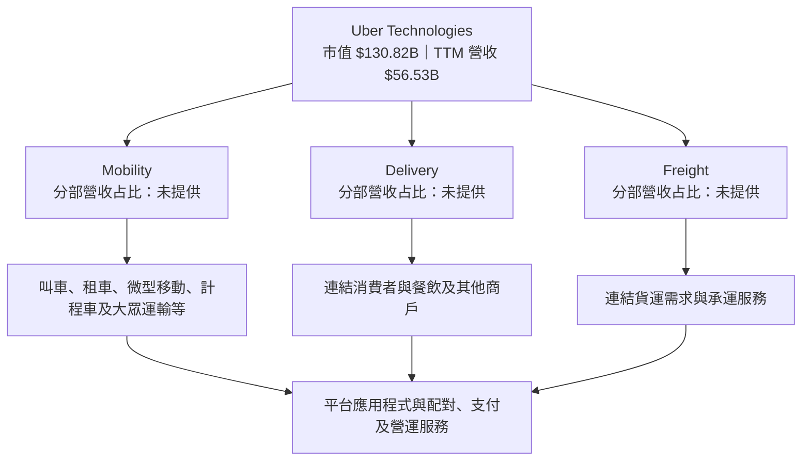
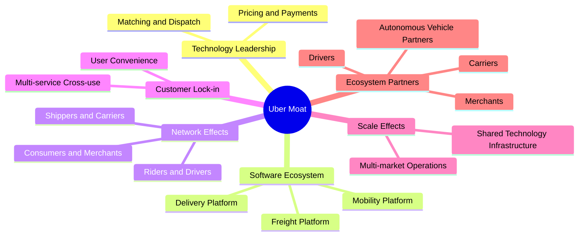
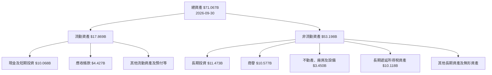
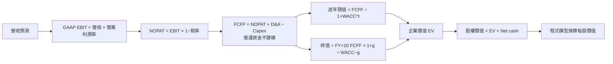
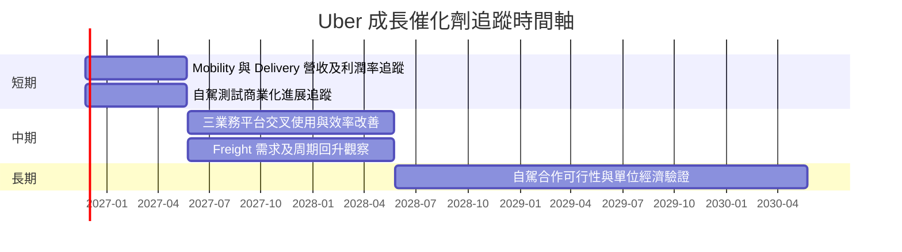
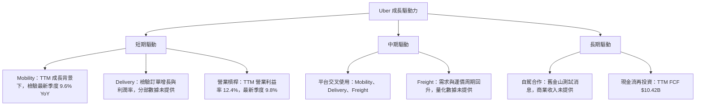
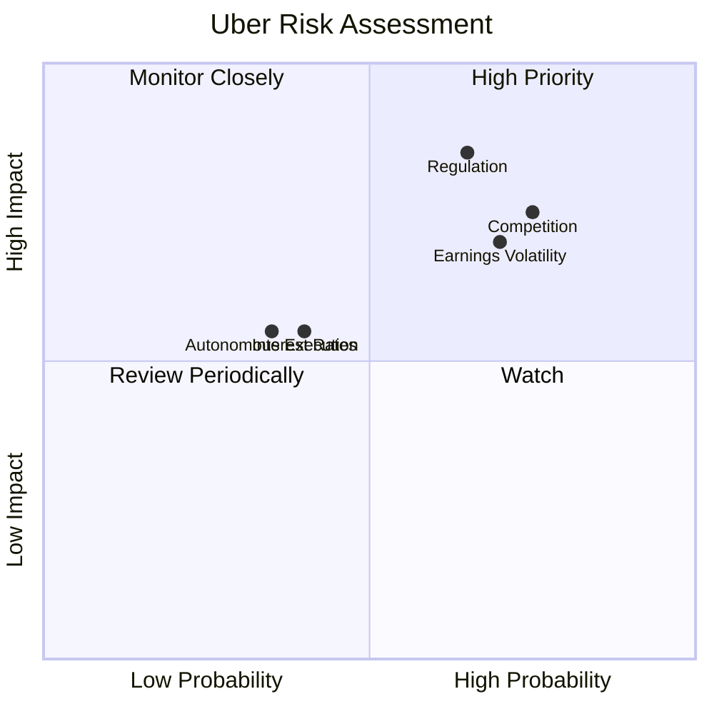
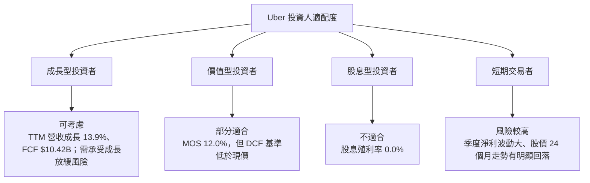

# UBER 基本面深度分析報告
> **報告日期**：2026-11-24 ｜ **語言**：繁體中文 ｜ **數據來源**：SEC 申報資料 (XBRL)、Yahoo Finance、Finviz、StockAnalysis、Roic.ai ｜ **分析師**：CFA 級機構研究

## 目錄

| # | 章節 | 核心結論 |
|---|------|----------|
| 1 | 執行摘要 | 買入；加權合理價值 $72.80；MOS +12.0% |
| 2 | 公司概覽與商業模式 | 多邊平台具網路效應，但缺少分部營收與市場份額數據 |
| 3 | 損益表深度分析 | TTM 營收 $56.53B、年增 13.9%；最新季營業利益率低於 TTM |
| 4 | 資產負債表分析 | 淨負債 $5.60B；短期流動性尚可，營運資金數據部分缺漏 |
| 5 | 現金流量深度分析 | TTM FCF $10.42B、FCF Yield 7.97%，現金轉換明顯高於淨利 |
| 6 | 獲利能力與資本效率 | ROIC 15.8% 高於 WACC 10.01%，目前仍創造股東價值 |
| 7 | 相對估值分析 | 倍數較 LYFT 高、較 DASH 低；相較自身歷史 P/E 偏高、P/S 偏低 |
| 8 | DCF 內在價值評估 | DCF 基準價值 $41.12；加權合理價值 $72.80，MOS +12.0% |
| 9 | 成長催化劑 | Mobility、Delivery 與自駕合作具選擇權；TAM 金額未提供 |
| 10 | 風險矩陣 | 監管、競爭與獲利波動為主要風險 |
| 11 | 投資建議 | 買入；建議買入區間 $58.24–$64.07，並以營運門檻持續檢驗 |

---

## 1. 執行摘要

截至 **2026-11-23 收盤價 $64.07**，Uber TTM 營收為 **$56.53B、年增 13.9%**，TTM FCF 為 **$10.42B**、FCF Yield 為 **7.97%**，ROIC **15.8%** 高於 WACC **10.01%**。但最新季度營業利益率為 **9.8%**，低於 TTM **12.4%**；基準 DCF 每股價值僅 **$41.12**，相對現價代表 **35.8% 下行**。四種估值方法按固定權重得出的加權合理價值為 **$72.80**，MOS **+12.0%**，故依規則 20 評級為**買入**，不是強烈買入：價值創造與現金流提供支撐，但估值緩衝有限，且 DCF 基準偏低。

### 1.0 一頁式投資儀表板（Portfolio Manager 30 秒速讀）

| 項目 | 內容 |
|------|------|
| **投資論點（3 句）** | ① TTM 營收 $56.53B、年增 13.9%，平台仍在擴張。② TTM FCF $10.42B、FCF Yield 7.97%，現金創造已具規模。③ ROIC 15.8% 高於 WACC 10.01%，但最新季度營業利益率 9.8% 低於 TTM 12.4%，須關注利潤率能否穩定。 |
| **綜合評分** | **6.6/10**（引用 1.1 評分卡） |
| **財務健康** | 🟡 現金及短期投資 $10.07B、淨負債 $5.60B，流動比率 1.232；不是淨現金公司。 |
| **ROIC vs WACC** | **15.8% vs 10.01%**；目前創造價值，差距 5.79 個百分點。 |
| **FCF 趨勢** | 歷年 FCF 上升；最新 TTM FCF Yield **7.97%**。 |
| **估值** | Forward P/E **14.5355625x** ｜ EV/EBITDA **17.6x**（自身歷史口徑）｜ FCF Yield **7.97%** |
| **DCF 內在價值（基準）** | **$41.12** ｜現價相對 DCF 溢價 **+55.8%**（現價÷DCF價值−1；DCF 模型另列價值相對現價低 35.8%） |
| **安全邊際（MOS）** | **+12.0%**＝($72.80 − $64.07) ÷ $72.80｜🟡 有限；基準為加權合理價值。 |
| **預期報酬（基準情境 12M）** | 以加權合理價值作參考：上行空間 **+13.6%**；DCF 基準情境為 **−35.8%**，兩者反映估值方法差異。 |
| **關鍵風險（前二）** | ① 競爭、補貼及監管壓力侵蝕單位經濟。② 淨利與最新季度 EPS 大幅波動，季度盈餘的可持續性需確認。 |
| **評級 + 信心度** | 🟢 **買入** ｜信心：中 |

### 1.1 綜合評分卡（全報告唯一）

| 維度 | 評分（1–10） | 主要依據（引用數字與其來源章節） |
|------|--------------|----------------------------------|
| 成長性 | 7.0 | TTM 營收年增 13.9%，最新季度年增 9.6%；第 3.1–3.2 節。 |
| 獲利能力 | 7.0 | TTM 營業利益率 12.4%、ROIC 15.8% 高於 WACC 10.01%、F-Score 6/8；第 3、6 節。 |
| 財務健康 | 6.5 | 淨負債 $5.60B、現金及短期投資 $10.07B、流動比率 1.232；第 4 節。 |
| 估值 | 5.5 | MOS +12.0%；P/E 37.5x 高於自身五年中位數 17.8x，但 P/S 2.3x 低於中位數 3.3x；第 7–8 節。 |
| 護城河 | 7.5 | Mobility、Delivery、Freight 多邊平台與全球業務網絡；但未提供分部收入、份額或留存率量化資料；第 2 節。 |
| 管理層與資本配置 | 6.0 | 2025 年資本支出 $336M、SBC $1.83B，尚無足夠數據量化回購與投資回報；第 5 節。 |
| **綜合評分** | **6.6** | 六項算術平均：(7.0 + 7.0 + 6.5 + 5.5 + 7.5 + 6.0) ÷ 6 = **6.58，四捨五入 6.6**。 |

### 1.2 五大投資論點 + 三大核心風險

| 類型 | 項目 | 具體依據 | 信心度 |
|------|------|----------|--------|
| 🟢 **投資論點①** | 營收仍保持雙位數 TTM 成長 | TTM 營收 $56.53B，年增 13.9%；但最新一季年增降至 9.6%，成長是否再加速仍待驗證。 | 🟢 高 |
| 🟢 **投資論點②** | 自由現金流規模具投資支撐 | TTM FCF $10.42B，FCF Yield 7.97%；營業現金流 $10.73B，資本支出 $314M。 | 🟢 高 |
| 🟢 **投資論點③** | 資本回報高於資本成本 | ROIC 15.8%，WACC 10.01%，利差 +5.79 個百分點。 | 🟢 高 |
| 🟢 **投資論點④** | 多產品平台可提高跨服務使用機會 | 公司經營 Mobility、Delivery、Freight；可交叉觸及乘客、商戶與承運需求，但分部收入未提供。 | 🟡 中 |
| 🟢 **投資論點⑤** | 歷史現金流有明顯改善 | 年度 FCF 從 2022 年 $0.39B 增至 2025 年 $9.76B；經營現金流轉化改善，但不能據此推定未來維持同速。 | 🟡 中 |
| 🟡 **風險①** | 估值方法分歧大 | DCF 基準 $41.12，低於現價；相對估值方法約 $78.90–$107.23，估值對長期利潤率及折現率敏感。 | 🔴 高衝擊 |
| 🔴 **風險②** | 季度盈餘波動及比較基期失真 | Q3 2026 淨利 $512M，較 Q3 2025 的 $6.626B 下降 92.3%；資料未提供足夠拆解，不能視為核心營運同步崩落或已完全消除一次性因素。 | 🔴 高 |
| 🟡 **風險③** | 競爭與監管成本 | 平台需要維持司機供給、乘客價格與商戶經濟性；若佣金、保險或合規成本增加，利潤率可能收縮。 | 🟡 中 |

### 1.3 快速統計卡片

| 指標 | 公司實際值（期間） | 同業中位數 | 狀態 |
|------|--------------------|------------|------|
| 營收成長（TTM） | **13.9%** | — | 🟢 |
| 營收成長（最新一季年增） | **9.6%** | **27.4%**（LYFT、DASH、GRAB 中位數） | 🟡 |
| 毛利率（TTM） | **41.4%** | **41.4%** | 🟡 |
| 營業利益率（TTM） | **12.4%** | — | 🟢 |
| ROIC（TTM） | **15.8%** | — | 🟢 |
| Forward P/E | **14.5355625x** | **17.9x** | 🟢 |
| FCF Yield（TTM） | **7.97%** | — | 🟢 |
| Piotroski F-Score | **6 / 8**（原區塊列 6/8；九項中一項缺資料、另兩項未通過） | — | 🟡 |

> 同業最新季營收成長中位數為 27.4%，主要受 DASH 34.0% 與 GRAB 27.4% 拉高；Uber 的 9.6% 低於三家同業。此差異不代表同口徑的市占或盈利能力比較。

### 1.4 投資結論

```text
╔══════════════════════════════════════════════════════════════════╗
║                    📊 投資結論摘要                               ║
╠══════════════════════════════════════════════════════════════════╣
║  評級：買入（MOS +12.0%，ROIC 15.8% 高於 WACC 10.01%）           ║
║  價格（2026-11-23 收盤）：$64.07                                 ║
║  DCF 內在價值（基準）：$41.12（現價溢價 +55.8%）                 ║
║  安全邊際 MOS：+12.0%（＝($72.80−$64.07)÷$72.80）                ║
║  加權合理價值（8.8）：$72.80                                     ║
║  DCF 情境價值：                                                   ║
║    悲觀情境：$23.26（相對現價 −63.7%）                           ║
║    基準情境：$41.12（相對現價 −35.8%）                           ║
║    樂觀情境：$68.89（相對現價 +7.5%）                            ║
║  綜合評分：6.6/10（引用 1.1）                                    ║
║  適合投資人：能承受估值分歧與季度盈餘波動的長線成長型投資人      ║
╚══════════════════════════════════════════════════════════════════╝
```

---

## 2. 公司概覽與商業模式

### 2.1 業務結構與收入來源

Uber 經營 Mobility、Delivery、Freight 三個業務板塊。資料未提供各分部營收或占比，因此不虛構分部金額或比例。公司市值為 **$130.82B**，TTM 營收 **$56.53B**。



**商業模式含義**：平台透過撮合需求與供給、收取服務相關收入來形成營收；規模增加有機會改善匹配效率和固定成本吸收。但各分部抽成率、訂單量、活躍用戶與每筆交易貢獻未提供，無法把營收成長直接等同於單位經濟改善。

### 2.2 市場份額

市場份額數據未提供，亦沒有可引用的年份或來源數字，故不繪製份額圖、不填市場占比。Uber 的 TTM 營收為 $56.53B、TTM 成長 13.9%，規模高於所列同業營收數據的可得範圍，但缺少同業營收絕對額，無法據此推算市場份額。

### 2.3 競爭護城河分析



### 2.4 護城河強度

| 護城河項目 | 強度（強／中／弱） | 證據（引用數字或事實） | 會削弱它的情況 |
|------------|--------------------|------------------------|----------------|
| 網路效應 | 中 | Mobility、Delivery、Freight 均依賴供需撮合；TTM 營收 $56.53B。用戶、商戶、司機數據未提供。 | 競爭者補貼、供給端轉換成本低、平台供需失衡。 |
| 軟體與平台 | 中 | 三個業務板塊共用科技平台；研發費用 FY2025 為 $3.40B。 | 研發支出未轉化為更高留存、效率或利潤。 |
| 規模效應 | 中 | 業務覆蓋多個地區；TTM FCF $10.42B，具一定平台現金流規模。 | 當地法規、保險及司機激勵成本抵銷規模優勢。 |
| 多產品生態 | 中 | Mobility、Delivery、Freight 提供跨業務延伸空間。分部收入未提供，協同效益無法量化。 | 各服務單位經濟不佳，或跨售不能提高留存與貢獻。 |
| 技術及自駕合作 | 弱至中 | 新聞資料提及 Uber、Lucid、Nuro 在舊金山進行無人駕駛測試；尚無財務貢獻數字。 | 商業化延遲、監管限制或合作經濟性不佳。 |

護城河評分 **7.5/10** 的理由是平台規模與多邊網路具結構性優勢，但缺少用戶、留存、份額與分部回報數字，證據尚不足以判定護城河強度已可穩定轉化為持續超額利潤。

---

## 3. 損益表深度分析

### 3.1 年度收入成長趨勢（近 4 年）

年度營收資料為 2022–2025 年。YoY 依相鄰年度計算；2022 年相對 2021 年成長率取 StockAnalysis 列示的 82.62%。2022–2025 三年 CAGR 約 17.8%。

```text
╔══════════════════════════════════════════════════════════════════╗
║              Uber 年度收入趨勢（FY2022–FY2025）                  ║
╠══════════════════════════════════════════════════════════════════╣
║  FY2022  $31.88B  ███████████████░░░░░░░░░░░  YoY: +82.62% 🟢  ║
║  FY2023  $37.28B  █████████████████░░░░░░░░░  YoY: +16.95% 🟢  ║
║  FY2024  $43.98B  ████████████████████░░░░░░  YoY: +17.96% 🟢  ║
║  FY2025  $52.02B  ████████████████████████░░  YoY: +18.28% 🟢  ║
║                                                                  ║
║  📊 FY2022–FY2025 三年營收 CAGR：約 17.8%                        ║
╚══════════════════════════════════════════════════════════════════╝
```

FY2025 營收 $52.02B，較 2024 年 $43.98B 增加約 $8.04B。連續三年約 17%–18% 的增長顯示恢復性成長已延續，但最新季度增速放緩，未來預測不應直接外推過去 CAGR。

### 3.2 季度收入趨勢分析

QoQ＝當季營收÷前季營收−1；YoY 依同一季度對照去年同期。金額取 SEC 申報資料／StockAnalysis 季度資料，四捨五入至 $0.01B。

| 季度 | 營收 | QoQ | YoY | 備註 |
|------|------:|----:|----:|------|
| Q4 2025 | $14.37B | +8.1% | +20.1% | QoQ 以 Q3 2025 $13.467B 為基數。 |
| Q1 2026 | $13.20B | −8.1% | +14.5% | 季節性回落；仍高於去年同期。 |
| Q2 2026 | $14.19B | +7.5% | +12.2% | QoQ 回升，但 YoY 繼續放緩。 |
| Q3 2026 | $14.77B | +4.1% | +9.6% | 最新季度 YoY 低於 Q1、Q2 及 2025 年各季。 |

近四季營收 QoQ 均呈季節性波動，YoY 從 Q4 2025 的 20.1% 降至 Q3 2026 的 9.6%。這是應關注的成長降速訊號；若未來主要來自基期變高，仍可接受，但若伴隨訂單、活躍用戶或市場份額下降，將直接削弱 DCF 的成長假設。

### 3.3 利潤率演變分析

毛利率以年度損益表毛利÷營收計算；營業利益率以營業利益÷營收計算。年度金額與 TTM 數據來自不同呈列來源，故不把兩者強行拼成同一序列。

| 利潤率指標 | FY2022 | FY2023 | FY2024 | FY2025 | 趨勢 | 評估 |
|------------|-------:|-------:|-------:|-------:|------|------|
| **毛利率** | 38.3% | 39.8% | 39.4% | 39.8% | 相對穩定，FY2025 較 FY2022 高約 1.5pp | 🟡 |
| **營業利益率** | −5.7% | 3.0% | 6.4% | 10.7% | 由負轉正並改善 | 🟢 |
| **淨利率** | −28.7% | 5.1% | 22.4% | 19.3% | FY2024–25 高於營業利潤率，反映非營業項目對淨利有顯著影響可能性 | 🟡 |
| **TTM 營業利益率** | — | — | — | **12.4%** | 最新季度口徑為 **9.8%** | 🟡 |

> FY2022–FY2025 年度毛利率使用年度財務數據。TTM 營業利益率 12.4%、最新季度 9.8% 使用 SEC 10-Q VERIFIED FIGURES；另一財務摘要列示最新季度 12.4%，與 VERIFIED FIGURES 不一致，本文以最新季度 9.8% 為準。

**利潤率演變深度解析**：營業利益率從 FY2022 的 −5.7% 升至 FY2025 的 10.7%，並與營收由 $31.88B 增至 $52.02B 同步，符合規模擴張與成本吸收改善的可能性。但現有數據沒有提供分部抽成率、保險成本或激勵支出拆解，因此不能把改善全部歸因於定價或效率。最新季度營業利益率 9.8% 低於 TTM 12.4%，是近期利潤率是否見頂的關鍵檢驗點。

### 3.4 費用結構分析

缺少同一期間完整、可相加的費用項目明細（例如銷售及行政、保險、交易成本、研發及其他營業費用），因此不繪製會暗示費用比例的 pie chart。可確認 FY2025 研發費用 **$3.40B**，約為該年營收 $52.02B 的 **6.5%**；這只是研發費用占營收，不代表其占全部費用比例。

### 3.5 季度 EPS 趨勢與盈餘品質（Quality of Earnings）

EPS 預估欄位四季均為 NaN，故無法判斷超預期或不及預期；不能以實際 EPS 變化代替盈餘 surprise。

| 季度 | EPS 實際 | EPS 預估／超預期狀態 | 淨利 |
|------|---------:|-----------------------|-----:|
| Q4 2025 | $0.14 | N/A（預估資料缺漏） | $296M |
| Q1 2026 | $0.13 | N/A（預估資料缺漏） | $263M |
| Q2 2026 | $1.17 | N/A（預估資料缺漏） | $2.39B |
| Q3 2026 | $0.25 | N/A（預估資料缺漏） | $512M |

| 盈餘品質項目 | 數值／佔比 | 評估 |
|--------------|-----------|------|
| 股權薪酬 SBC / 營收 | TTM SBC 約 $2.065B ÷ $56.526B = **3.7%** | 🟡 SBC 對股東經濟報酬仍有成本；DCF 以 GAAP EBIT 含列費用處理。 |
| SBC / 營業現金流 | $2.065B ÷ $10.73B = **19.2%** | 🟡 SBC 規模約為營業現金流近五分之一；若以現金流估值，需留意非現金加回對股東稀釋的遮蔽。 |
| FCF / 淨利（現金轉換率） | $10.42B ÷ $3.465B = **300.7%** | 🟢 現金流高於 TTM 淨利；但分母受到 2025 高淨利及季度波動影響，比例不宜直接外推。 |
| 一次性／非經常性損益 | **可能存在重大期間波動；具體項目 N/A** | 2025 年淨利 $10.05B，而 TTM 淨利 $3.465B；Q3 2026 年淨利 YoY −92.3%。缺乏申報項目拆解，不將差異直接歸類為特定一次性項目。 |
| 有效稅率異常 | **N/A**（DCF 稅率採 21.0% 假設） | 實際有效稅率未提供；不能判定年度稅益或稅負是否美化盈餘。 |
| 資本化支出 vs 費用化 | TTM 資本支出 **$314M**；資本化政策細節 N/A | 資本支出規模相對營收低，但缺少資本化開發支出、租賃資產等明細，不能據此斷言未遞延成本。 |

**盈餘品質結論**：TTM FCF $10.42B 高於 TTM 淨利 $3.465B，營業現金流也通過 F-Score 的應計品質測試，現金流支持獲利的證據偏正面。另一方面，SBC 約占營收 3.7%、占營業現金流 19.2%，且淨利季間波動巨大。評估經濟盈餘時應以 GAAP EBIT／現金流並行，而不是單看 EPS 或將 SBC 完全視為無成本。

---

## 4. 資產負債表分析

### 4.1 資產結構分解

以下為 2026-09-30 資產資料。流動資產及非流動資產以總資產減流動資產計算；細項為來源所列，因四捨五入及分類可能存在尾差。



### 4.2 流動性與營運資金分析

| 指標 | 最新 TTM／2026-09-30 | 一年前 TTM／2025-09-30 | 變化 | 解讀 |
|------|----------------------:|------------------------:|------|------|
| 流動比率 | **1.232** | N/A | N/A | 流動資產高於流動負債，但不是非常寬裕的倍數。 |
| 速動比率 | **0.999** | N/A | N/A | 接近 1；流動性仍需依賴應收款回收及營運現金流。 |
| DSO 應收帳款天數 | **29 天** | **28 天** | **+1 天** | 收款時間輕微延長；僅憑一天差異不能判定信用風險惡化。 |
| DIO 存貨天數 | **N/A** | **N/A** | N/A | 公司未報告此項存貨餘額，不補值。 |
| DPO 應付帳款天數 | **17 天** | **N/A** | N/A | 一年前缺少可計算資料，不能比較供應商付款期變化。 |
| CCC 現金轉換週期 | **N/A** | **N/A** | N/A | DIO 缺值，依品質指標照列 N/A，不自行補算。 |

流動資產 $17.869B、流動負債 $14.506B（StockAnalysis 2026-09-30）顯示短期資產高於短期負債；但品質指標流動比率為 1.232，與直接以該組流動資產及負債計算的比率口徑不完全一致，本文照抄程式品質指標，不混用重算值。應收帳款天數從 28 天至 29 天，暫時只顯示輕微變化。

### 4.3 債務結構分析

此節採 VERIFIED FIGURES 的同一期口徑：現金及短期投資 $10.07B、總債務 $15.66B、淨負債 $5.60B。資料中另有 $17.74B 總債務及淨負債 $7.67B 的其他彙整口徑，與 SEC 驗證數據不一致，故不混合計算。

```text
╔══════════════════════════════════════════════════════════════════╗
║                   Uber 債務健康診斷                              ║
╠══════════════════════════════════════════════════════════════════╣
║  總債務：          $15.66B  ███████████████░░░░░  🟡             ║
║  現金及短期投資：  $10.07B  ██████████░░░░░░░░░░  🟢             ║
║  淨負債：           $5.60B  ██████░░░░░░░░░░░░░░  🟡             ║
║                                                                  ║
║  總債務／EBITDA：   N/A（同一期、同口徑 EBITDA 未提供）           ║
║  利息保障倍數：    N/A（利息費用明細未提供）                     ║
║  判斷：有足夠現金抵銷部分債務，但並非淨現金；持續產生 FCF 是關鍵 ║
╚══════════════════════════════════════════════════════════════════╝
```

### 4.4 股東權益趨勢

年度股東權益由 2022 年 $7.34B 增至 2025 年 $27.04B。此變化包含累積獲利、股權薪酬及其他權益變動，不能全數解讀成現金累積。

```text
╔══════════════════════════════════════════════════════════════════╗
║                 Uber 年度股東權益變化                             ║
╠══════════════════════════════════════════════════════════════════╣
║  FY2022  $7.34B   ██████░░░░░░░░░░░░░░░░░░                       ║
║  FY2023  $11.25B  ██████████░░░░░░░░░░░░░░                       ║
║  FY2024  $21.56B  ███████████████████░░░░░                       ║
║  FY2025  $27.04B  ████████████████████████                       ║
╚══════════════════════════════════════════════════════════════════╝
```

---

## 5. 現金流量深度分析

### 5.1 現金流量瀑布圖

各節點保留財務數據有提供的數字；股息、回購及淨現金變化明細未提供，故不填造數字。


### 5.2 FCF 轉換率趨勢

| 年度 | FCF | 淨利 | FCF／淨利 | 解讀 |
|------|----:|-----:|----------:|------|
| FY2022 | $0.390B | −$9.141B | 不具經濟意義 | 淨利為負，直接除法比率會失真。 |
| FY2023 | $3.36B | $1.89B | 約 177.8% | 現金流高於淨利。 |
| FY2024 | $6.89B | $9.86B | 約 69.9% | 淨利高於自由現金流。 |
| FY2025 | $9.76B | $10.05B | 約 97.1% | 現金轉換接近淨利。 |
| TTM 至 2026-09-30 | $10.42B | $3.465B | 約 300.7% | 淨利受期間波動影響，比例不可視為常態。 |

年際比率波動主要是淨利變動幅度大於現金流。FY2024 的現金轉換率偏低、TTM 則偏高；分析時應一起追蹤經營現金流、稅項與非現金損益，而非單獨外推某一年比例。

### 5.3 自由現金流趨勢

```text
╔══════════════════════════════════════════════════════════════════╗
║              自由現金流：歷史實際                                ║
╠══════════════════════════════════════════════════════════════════╣
║  FY2022  $0.39B  █░░░░░░░░░░░░░░░░░░░  FCF Yield：N/A           ║
║  FY2023  $3.36B  ███████░░░░░░░░░░░░░  FCF Yield：N/A           ║
║  FY2024  $6.89B  ██████████████░░░░░░  FCF Yield：N/A           ║
║  FY2025  $9.76B  ███████████████████░  FCF Yield：N/A           ║
║  TTM     $10.42B ████████████████████  FCF Yield：7.97%         ║
╚══════════════════════════════════════════════════════════════════╝
```

年度市值與各年度 FCF Yield 的同口徑序列未提供，故不填年度殖利率。TTM FCF 按指定定義為營業現金流減資本支出，即 $10.73B − $0.314B，程式列示 **$10.42B**；其與逐項四捨五入的 $10.416B 有尾數差異。

### 5.4 資本配置評估

資本配置各用途（回購、併購、股息、留存現金）的完整金額未提供，不繪製 pie chart。

| 項目 | 可得數據 | 評估 |
|------|----------|------|
| 資本支出 | TTM $314M；FY2025 $336M | 相對營收規模低；但不能只由資本支出判斷總再投資需求。 |
| 股權薪酬 | FY2025 $1.83B；TTM 約 $2.065B（由四季季度數據加總） | 需持續衡量每股價值成長是否超過稀釋成本。 |
| 股息 | 股息殖利率 0.0% | 未見現金股息回報。 |
| 回購 | 金額 N/A | 數據未提供，不能推定回購已抵銷 SBC。 |
| 留存與投資 | 分項金額 N/A | 需看後續資本配置披露與投資回報。 |

---

## 6. 獲利能力與資本效率

### 6.1 ROE / ROA / ROIC 趨勢

歷史 ROE、ROA、ROIC 的完整年度同口徑序列未提供，因此不補造歷年數字；下表呈現可確認的 TTM 指標。

| 指標 | 最新可得值 | 歷史趨勢資料 | 評估 |
|------|----------:|--------------|------|
| ROE（TTM） | **12.5%** | DuPont 品質指標 | 🟡 有正回報，但包含 2.57 倍權益乘數。 |
| ROA（TTM） | **6.5%** | 單一期間數字 | 🟡 正值，資產回報仍有提升空間。 |
| ROIC（TTM） | **15.8%** | 單一期間數字 | 🟢 高於 10.01% WACC，創造正經濟價值。 |
| 行業均值 | — | 未提供可核實來源 | 不列全欄 N/A 或自行估計。 |

### 6.2 ROIC vs WACC 分析（核心價值創造判斷）

WACC 與資本成本組成採 Cost of capital 程式計算數據；WACC 直接採用 **10.01%**。資本成本區塊未提供 10 年期利率觀測日期細節，故只記錄其提供值，不另加日期假設。

```text
╔══════════════════════════════════════════════════════════════════╗
║                ROIC vs WACC 深度分析                             ║
╠══════════════════════════════════════════════════════════════════╣
║  WACC（依資本成本資料）：                                         ║
║  ├── 無風險利率 Rf：              4.92%                          ║
║  ├── ERP：                        5.00%                          ║
║  ├── 原始 Beta：                  1.31                           ║
║  ├── 調整後 Beta：                1.21 = ⅔×1.31 + ⅓×1.00          ║
║  ├── 提供的股權成本 Ke：          10.94%                         ║
║  ├── 稅前債務成本：               2.81%                          ║
║  ├── 稅後債務成本：               2.81%×(1−21%) = 2.22%          ║
║  ├── 股權／債務權重：             89.3%／10.7%                    ║
║  └── 採用 WACC：                  10.01%                         ║
║                                                                  ║
║  ROIC（TTM）：                   15.8%                           ║
║  EVA 利差：                      15.8%−10.01% = +5.79pp          ║
║                                                                  ║
║  ROIC  15.8%  ▓▓▓▓▓▓▓▓▓▓▓▓▓▓▓▓▓▓▓▓▓▓▓▓▓▓▓▓▓▓ 🟢               ║
║  WACC  10.01% ▓▓▓▓▓▓▓▓▓▓▓▓▓▓▓▓▓▓▓▓░░░░░░░░░ ──                ║
║                                                                  ║
║  結論：ROIC 約為 WACC 的 1.58 倍，現階段創造股東價值。          ║
╚══════════════════════════════════════════════════════════════════╝
```

**一致性與輸入檢核**：資料列示 Ke 10.94%，但以其同列 Rf 4.92%、調整後 Beta 1.21、ERP 5.00% 直接代入 CAPM，得到 `4.92% + 1.21×5.00% = 10.97%`，與列示的 10.94% 相差 0.03pp。本文依指定規則採用資料列示的 WACC 10.01%，不重算取代。另未提供利息費用絕對額、平均計息負債明細與市值權重的完整底層計算，故不另建 WACC 模型。ROIC 與 WACC 的同值在第 8 章沿用。

### 6.3 杜邦三因素分解

| 因素 | 數值（TTM） | 解讀 |
|------|-------------|------|
| 淨利率 | **6.1%** | 淨利受非營業項目及期間波動影響，不宜單獨外推。 |
| 資產週轉率 | **0.80** | 每單位資產產生約 0.80 單位營收。 |
| 權益乘數 | **2.57** | 槓桿對 ROE 有一定放大作用。 |
| **ROE** | **12.5%** | 品質指標列示：6.1% × 0.80 × 2.57 = 約 12.5%。 |

ROE 並非只由淨利率驅動，權益乘數也有放大作用。程式列示的各項已四捨五入，相乘的尾差屬顯示精度造成，不自行重算替換。

### 6.4 財務體質：Piotroski F-Score

品質指標列示 **6/8**；九項測試中毛利率測試因缺資料未計，八項可判定測試為六項通過、兩項未通過。

| 測試 | 結果 | 解讀 |
|------|------|------|
| ROA > 0 | ✅ 通過 | TTM 資產報酬為正。 |
| 營業現金流 > 0 | ✅ 通過 | TTM 營業現金流 $10.73B。 |
| ROA 高於一年前 | ❌ 未通過 | 資產回報沒有改善；需留意盈餘與資產擴張速度。 |
| 營業現金流 > 淨利（應計品質） | ✅ 通過 | TTM 營業現金流高於 TTM 淨利。 |
| 長期負債 ÷ 總資產低於一年前 | ❌ 未通過 | 槓桿比例變化未改善。 |
| 流動比率高於一年前 | ✅ 通過 | 短期流動性較一年前改善。 |
| 稀釋股數未增加 | ✅ 通過 | 測試期內股數未增加；不代表 SBC 不具經濟成本。 |
| 毛利率高於一年前 | — 無法判定 | 缺少可用輸入，未納入分母。 |
| 資產週轉率高於一年前 | ✅ 通過 | 資產週轉效率較一年前改善。 |

6/8 顯示現金流、流動性及股數變化等項目偏正面，但 ROA 與長期負債比率未通過，並且毛利率比較缺值。它是財務體質的篩檢，不等同於盈餘預測或風險免疫。

---

## 7. 相對估值分析

### 7.1 同業估值比較表格

公司自身 P/E、P/S 及 EV/EBITDA 採估值資料與 VERIFIED FIGURES 的自身歷史序列；Peer 數字逐項照列 Yahoo Finance 同業倍數。Uber Forward P/E 採估值區塊值。

| 估值指標 | **UBER** | **LYFT** | **DASH** | **GRAB** | 本公司評估 |
|----------|---------:|--------:|--------:|--------:|-----------|
| **Trailing P/E** | 37.5x | 2.4x | 67.0x | 28.1x | 🟡 同業間盈利基數差異大，不宜單看低倍數排名。 |
| **Forward P/E** | 14.5355625x | 7.9x | 21.2x | 17.9x | 🟢 低於 DASH、GRAB，但高於 LYFT。 |
| **P/S Ratio** | 2.3x | 0.9x | 4.1x | 2.9x | 🟡 高於 LYFT，低於 DASH 與 GRAB。 |
| **EV/EBITDA** | 17.6x | 537.3x | 39.6x | 18.0x | 🟢 低於 DASH、接近 GRAB；LYFT 倍數受 EBITDA 分母影響極大。 |
| **最新季度營收成長 YoY** | 9.6% | 8.1% | 34.0% | 27.4% | 🔴 UBER 低於 DASH、GRAB；略高於 LYFT。 |
| **毛利率 TTM** | 41.4% | 40.0% | 52.7% | 41.4% | 🟡 與 GRAB 相同，低於 DASH。 |

同業估值的可比性有限：LYFT 的 EV/EBITDA 537.3x 顯示 EBITDA 分母相對估值不穩，P/E 也可能受單期盈餘影響；DASH、GRAB 成長較快。Uber 的估值位置需與其更成熟的營收規模、獲利率及現金流一併衡量。

### 7.2 歷史估值區間分析

```text
╔══════════════════════════════════════════════════════════════════╗
║              UBER 五年估值區間及目前位置                        ║
╠══════════════════════════════════════════════════════════════════╣
║  P/E：     12.6x ───────── 17.8x中位數 ───────── 122.2x          ║
║            現值 37.5x｜歷史百分位 62%                            ║
║                                                                  ║
║  P/S：      1.5x ─────────  3.3x中位數 ─────────   6.1x          ║
║            現值  2.3x｜歷史百分位 19%                            ║
║                                                                  ║
║  EV/EBITDA：18.7x ─────── 40.0x中位數 ───────── 320.2x          ║
║            現值 17.6x｜歷史百分位 0%                             ║
╚══════════════════════════════════════════════════════════════════╝
```

P/E 37.5x 高於五年中位數 17.8x，處於歷史 62 百分位；P/S 2.3x 低於中位數 3.3x、處於 19 百分位；EV/EBITDA 17.6x 低於歷史範圍下緣 18.7x，而程式列示百分位為 0%。各倍數受盈利與企業價值口徑變動影響，不能只用某一個歷史百分位作買賣判斷。

### 7.3 情境價值（Bear / Base / Bull，照抄 DCF MODEL 的 Scenarios）

| 情境 | 第 1 年營收成長 | 期末營業利潤率 | WACC | 每股價值 | 相對現價 | 機率 | 會發生的條件 |
|------|----------------:|----------------:|-----:|----------:|----------:|-----:|--------------|
| 🔴 悲觀 | 7.0% | 5.4% | 11.01% | $23.26 | −63.7% | 25% | 需求及交易增速低於基準，競爭或監管成本壓低長期利潤率，資本成本上升。 |
| 🟡 基準 | 13.9% | 6.4% | 10.01% | $41.12 | −35.8% | 50% | 近期 TTM 成長短期延續後逐步減速，利潤率依模型收斂至 6.4%。 |
| 🟢 樂觀 | 20.9% | 7.0% | 9.01% | $68.89 | +7.5% | 25% | 營收增速回升、成本效率支撐較高期末利潤率，資本成本下降。 |

程式列示機率加權 DCF 為 **$43.60（相對現價 −32.0%）**，僅作情境參考；依固定規則，第 8.8 節加權合理價值使用基準 DCF，而非機率加權 DCF。

### 7.4 相對估值隱含價格區間

```text
╔══════════════════════════════════════════════════════════════════╗
║                相對估值與共識每股價值                            ║
╠══════════════════════════════════════════════════════════════════╣
║  $41.12 ── 現價 $64.07 ── $78.90 ── $98.16 ── $107.23           ║
║  DCF基準       ●       Forward P/E  分析師共識   EV/EBITDA       ║
╚══════════════════════════════════════════════════════════════════╝
```

| 方法 | 每股價值 | 依據 |
|------|---------:|------|
| 同業 Forward P/E | **$78.90** | LYFT、DASH、GRAB Forward P/E 中位數 **17.9x** × UBER Forward EPS **$4.41**。 |
| 同業 EV/EBITDA | **$107.23** | DASH、GRAB 中位數 **28.8x** × UBER TTM EBITDA，再加淨現金；本公司為淨負債，方法按程式模型所列值照用。 |
| 分析師共識 | **$98.16** | 46 位分析師平均目標價。 |

相對估值法均高於現價，尤其 EV/EBITDA 法；但這些結果仰賴同業倍數可轉移至 UBER，且資料未提供其完整 EBITDA、稀釋股數與橋接細節，應將其視為交叉驗證而非獨立精確目標價。

---

## 8. DCF 內在價值評估（Discounted Cash Flow）

### 8.0 估值推理鏈（Thinking Logic：在算之前先想清楚）

#### Step 1 — 價值由哪些變數決定？

模型核心是 **Mobility、Delivery、Freight 的現金流底盤，加上營收增長、GAAP 營業利潤率與折現率共同決定的長期現金流價值**。各分部營收占比未提供，不能量化拆成「主業占比」或新業務占比。DCF 敏感度矩陣顯示價值對 WACC 和永續成長率均高度敏感；營收增長與利潤率則在情境分析中一同驅動價值。

#### Step 2 — 模型選擇

| 決策點 | 本報告採用 | 理由（含數字） | 曾考慮但否決 | 否決理由 |
|--------|-----------|----------------|--------------|----------|
| 現金流定義 | FCFF | 對應 WACC 折現並先求企業價值；TTM FCF $10.42B。 | FCFE | 模型固定以企業自由現金流和 WACC 計算。 |
| 預測期 N | **10 年** | 模型既定期限；TTM 營收 $56.53B、預測至 FY+10。 | 5 年 | 不能替換程式指定的 10 年模型。 |
| 終值方法 | Gordon Growth | 終值成長率 g 3.0%，WACC 10.01%，符合 WACC > g。 | 僅退出倍數 | DCF MODEL 已採 Gordon Growth；未提供可直接複算的退出倍數終值模型。 |
| EBIT 基礎 | GAAP EBIT | FCFF 模型明確以 GAAP EBIT 建模，SBC 已含費用。 | 非 GAAP EBIT | 加回 SBC 後另扣 SBC 不屬此模型。 |

#### Step 3 — 關鍵假設推導鏈

- **營收成長**：錨點＝TTM Revenue growth **13.9%**，最新季度 YoY **9.6%**、低於前三個季度；調整＝短期採用 TTM 成長為起點，並逐年線性降至第 10 年 **3.0%**；**採用 FY+1 13.9%、FY+10 3.0%**；曾考慮以最新季度 9.6% 為第一年，但模型採用程式既定的 TTM 起點，不能另改模型。
- **營業利潤率**：錨點＝TTM 12.4%，最新季度 9.8%；調整＝模型按近五財年中位數（含 TTM）逐年收斂，反映成熟期利潤率未必維持當前 TTM 水準；**採用 12.4% 降至 6.4%**；曾考慮以最新季度 9.8% 起步，但會改動基準模型，故否決。
- **永續成長率 g**：錨點＝長期名目成長的一般參考約 3%–4%（非本公司財測）；調整＝採用區間低端以控制終值膨脹，且低於 WACC 10.01%；**採用 3.0%**；曾考慮 4.0%，但敏感度矩陣顯示內在價值由 $41.12 增至 $44.76，故不把較高終值假設設為基準。
- **預測期 N**：錨點＝模型指定 10 年；調整＝十年可顯示增長由當前水準逐步收斂至成熟期；**採用 10 年**；曾考慮 5 年，但不符合程式模型的既定期限。
- **Capex／營收**：錨點＝TTM 資本支出 $314M ÷ TTM 營收 $56.53B，約 0.6%；**採用 0.6%**；較高資本支出比例未採用，因模型按 TTM 值延續並依既定規則處理。
- **GAAP EBIT、SBC 與稀釋**：錨點＝模型明列 GAAP EBIT；SBC 已列為費用。**採用組合 (A)：GAAP EBIT + 固定股數，不另減 SBC，年稀釋率 0%**；若另扣 SBC 或再擴大股數會重複計入股東薪酬成本，故否決。
- **WACC**：錨點＝資本成本資料所列 WACC **10.01%**；採用此值，不另計替代 WACC；區塊列示 Ke 10.94%、Kd 稅前 2.81%、權重 E/D 89.3%/10.7%。由於 CAPM 顯示輸入間有 0.03pp 尾差，及債務明細不足，採用值照列，不自行修正。
- **有效稅率**：錨點＝程式模型 **21.0%**；採用 21.0%，實際稅率序列未提供。
- **D&A／營收**：錨點＝TTM **1.4%**；模型固定採 1.4%。
- **營運資金**：模型明確不建模 ΔWC，未將缺失的營運資金變動靜默設成其他數字；此為模型簡化，而非對實際 WC 的判斷。

#### Step 4 — 最脆弱的一環

最脆弱的是長期利潤率與終值假設：基準 DCF 終值現值占 EV **46.7%**，若長期利潤率、g 或 WACC 偏離，內在價值會明顯改變；敏感度矩陣在基準 g 3.0% 下，WACC 由 10.01% 升至 11.01%，價值由 $41.12 降至 $36.02。

#### Step 5 — 計算路徑圖



### 8.1 模型假設總表（Model Inputs）

| 假設項目 | 採用值 | 依據／來源 | 敏感度 |
|----------|--------|-------------|--------|
| 預測期長度 **N** | **10 年** | DCF MODEL 指定；由 FY+1 至 FY+10。 | 🟡 中 |
| 營收成長 | FY+1 **13.9%**，FY+10 **3.0%**，逐年線性遞減 | 起點為 TTM vs prior TTM 13.9%；FY+10 採模型終值銜接假設。 | 🔴 高 |
| 營業利潤率 | **12.4% → 6.4%** | TTM 12.4% 起步；模型採近五財年中位數（含 TTM）作期末值。 | 🔴 高 |
| 有效稅率 | **21.0%** | 程式預設稅率；實際有效稅率序列未提供。 | 🟢 低 |
| Capex／營收 | **0.6%** | TTM Capex $314M，模型使用比率約 0.6%，並維持至 FY+10。 | 🟡 中 |
| D&A／營收 | **1.4%** | 模型以 TTM 比率固定。 | 🟢 低 |
| 營運資金變動 | **不建模** | DCF MODEL 明示 working capital is not modelled；不補設數值。 | 🟢 低 |
| EBIT 基礎 | **GAAP EBIT** | DCF MODEL 指明 GAAP EBIT。 | 🟡 中 |
| SBC 處理 | **GAAP EBIT 含 SBC 費用，不再另扣** | 採組合 (A)，固定股數。 | 🟡 中 |
| 年稀釋率 | **0%** | 組合 (A) 固定股數；程式每股換算採價格及市值比例。 | 🟡 中 |
| 永續成長率 g | **3.0%** | DCF MODEL 指定；低於 WACC 10.01%。 | 🔴 高 |
| 終值方法 | **Gordon Growth** | DCF MODEL 使用 FCFF(FY+10)×(1+g)/(WACC−g)。 | 🔴 高 |
| WACC | **10.01%** | 資本成本資料直接指定；第 6.2 節同值。 | 🔴 高 |

**FCFF 定義與 SBC 防重複**：本模型採 FCFF，計算為 NOPAT + D&A − Capex；營運資金不建模。**本模型採用 (A)：GAAP EBIT + 固定股數，SBC 影響已計入一次**，不另減 SBC，也不對股數施加年稀釋率。

### 8.2 折現率推導（WACC）

```text
╔══════════════════════════════════════════════════════════════════╗
║                    WACC 推導（折現率）                           ║
╠══════════════════════════════════════════════════════════════════╣
║  股權成本 Ke（CAPM，依資料列示）：                                ║
║  ├── 無風險利率 Rf：                  4.92%                      ║
║  ├── 市場風險溢酬 ERP：               5.00%                      ║
║  ├── 原始 Beta：                      1.31                       ║
║  ├── 調整方式：                       ⅔×1.31 + ⅓×1.00 = 1.21     ║
║  ├── 調整後 Beta：                    1.21                       ║
║  ├── 額外規模／國別溢酬：             0.00%（未另加）             ║
║  └── 資料列示 Ke：                    10.94%                     ║
║                                                                  ║
║  債務成本 Kd：                                                   ║
║  ├── 稅前 Kd：                        2.81%                      ║
║  ├── 稅率：                           21.0%                      ║
║  └── 稅後 Kd：                        2.81%×(1−21%) = 2.22%      ║
║                                                                  ║
║  資本結構：                                                       ║
║  ├── 股權權重 E：                     89.3%                      ║
║  ├── 債務權重 D：                     10.7%                      ║
║  └── 採用 WACC：                      10.01%                     ║
╚══════════════════════════════════════════════════════════════════╝
```

**逐步演算（WACC，按資料列示輸入）**

1. **Ke（CAPM）**：直接代入數字可得 `4.92% + 1.21 × 5.00% = 10.97%`。資本成本資料另列 Ke **10.94%**；兩者有 0.03pp 差異，本文照規則採用資料列示的 Ke **10.94%**，不以重算值覆蓋。
2. **稅前 Kd**：資料列示為 **2.81%**，利息費用及平均計息負債絕對額未提供，不能重建其分子分母。
3. **稅後 Kd**：`2.81% × (1 − 21.0%) = 2.2199% ≈ 2.22%`。
4. **權重**：程式列示 E 權重 **89.3%**、D 權重 **10.7%**；`89.3% + 10.7% = 100.0%`。市值與計息負債口徑底層明細未提供，照列既定權重。
5. **WACC**：`89.3% × 10.94% + 10.7% × 2.2199% = 9.76742% + 0.23753% = 10.00495% ≈ 10.01%`。採用值與第 6.2 節一致。

> Rf 的具體市場觀測日期、利息費用金額、平均計息負債與市值權重底層明細未在 SEC 申報摘要中提供；因此本節依指定資本成本輸入原值引用，不另造基礎資料。

### 8.3 逐年自由現金流預測（基準情境）

金額單位為 USD billions；折現因子保留三位小數。DCF MODEL 的 ΔWC 未建模，故不設該列。SBC 不另扣，依組合 (A)。

| 年度 | FY+1 | FY+2 | FY+3 | FY+4 | FY+5 | FY+6 | FY+7 | FY+8 | FY+9 | FY+10 |
|------|-----:|-----:|-----:|-----:|-----:|-----:|-----:|-----:|-----:|------:|
| 營收 | 64.41 | 72.60 | 80.96 | 89.29 | 97.40 | 105.06 | 112.04 | 118.12 | 123.10 | 126.80 |
| 營收 YoY | 13.9% | 12.7% | 11.5% | 10.3% | 9.1% | 7.9% | 6.6% | 5.4% | 4.2% | 3.0% |
| 營業利潤率 | 12.4% | 11.8% | 11.1% | 10.4% | 9.7% | 9.1% | 8.4% | 7.7% | 7.0% | 6.4% |
| 營業利益 EBIT（GAAP） | 8.01 | 8.54 | 8.98 | 9.30 | 9.49 | 9.52 | 9.40 | 9.11 | 8.67 | 8.07 |
| − 稅（21.0%） | (1.68) | (1.79) | (1.89) | (1.95) | (1.99) | (2.00) | (1.97) | (1.91) | (1.82) | (1.69) |
| = NOPAT | 6.33 | 6.75 | 7.09 | 7.35 | 7.50 | 7.52 | 7.43 | 7.20 | 6.85 | 6.38 |
| + D&A | 0.88 | 0.99 | 1.10 | 1.21 | 1.33 | 1.43 | 1.52 | 1.61 | 1.67 | 1.72 |
| − Capex | (0.36) | (0.40) | (0.45) | (0.50) | (0.54) | (0.58) | (0.62) | (0.66) | (0.68) | (0.70) |
| **= FCFF** | **6.85** | **7.33** | **7.75** | **8.07** | **8.28** | **8.37** | **8.33** | **8.15** | **7.84** | **7.40** |
| 折現因子 @10.01% | 0.909 | 0.826 | 0.751 | 0.683 | 0.621 | 0.564 | 0.513 | 0.466 | 0.424 | 0.385 |
| **FCFF 現值 PV** | **6.23** | **6.06** | **5.82** | **5.51** | **5.14** | **4.72** | **4.27** | **3.80** | **3.32** | **2.85** |

**預測期 FCF 現值合計**：  
`$6.23 + $6.06 + $5.82 + $5.51 + $5.14 + $4.72 + $4.27 + $3.80 + $3.32 + $2.85 = $47.72B`。  
DCF MODEL 列示未四捨五入合計 **$47.71B**；以表格兩位小數相加為 $47.72B，差異 $0.01B，屬逐年取位尾差。

**逐步演算（FY+1，沿用模型列示與精度）**

1. **營收**：`$56.53B × (1 + 13.9%) = $64.39B`，模型以其未四捨五入基數／精度列示 **$64.41B**；此處顯示的起點與成長率相乘有約 $0.02B 尾差，照抄模型年度值。
2. **EBIT**：`$64.41B × 12.4% = $7.987B ≈ $8.01B`（模型未四捨五入利潤率／營收）。
3. **稅**：`$8.01B × 21.0% = $1.682B ≈ $1.68B`。
4. **NOPAT**：`$8.01B − $1.68B = $6.33B`。
5. **D&A**：`$64.41B × 1.4% = $0.902B`；模型列示 **$0.88B**，反映未四捨五入輸入／模型計算口徑差異。
6. **Capex**：`$64.41B × 0.6% = $0.386B`；模型列示 **$0.36B**，同樣存在展示數與底層精度差異。
7. **ΔWC**：DCF MODEL 明示不建模，沒有此項現金流調整。
8. **FCFF**：按模型列示組成，`$6.33B + $0.88B − $0.36B = $6.85B`。
9. **折現及 PV**：`1 ÷ (1 + 10.01%)^1 = 0.909`；`$6.85B × 0.909 = $6.23B`。

> FY+1 營收及 D&A／Capex 在表內為兩位小數，與顯示的比率直接相乘有小額差異，反映程式模型使用未四捨五入底層輸入。依要求不以顯示值自行改寫模型數字。

**合理性自檢**
- 預測 FCF：FY+1 $6.85B 至 FY+10 $7.40B，九年端點 CAGR 約 **0.9%**；歷史 FCF 2022–2025 從 $0.39B 至 $9.76B，因基期極低，CAGR 不具穩健比較意義。
- FY+10 FCFF 利潤率：`$7.40B ÷ $126.80B = 5.8%`；目前 TTM FCF margin 約 `$10.42B ÷ $56.53B = 18.4%`。同業最佳 FCFF margin 未提供，不能作同業最佳比較。
- 預測期各年 FCFF 均為正；FCFF 由 FY+6 的 $8.37B 逐步降至 FY+10 的 $7.40B，主要反映營業利潤率下降快於營收增長帶來的效應。

```text
╔══════════════════════════════════════════════════════════════════╗
║            自由現金流：歷史實際 vs 模型預測                      ║
╠══════════════════════════════════════════════════════════════════╣
║  FY2023(實)  $3.36B  ███████░░░░░░░░░░░░░                        ║
║  FY2024(實)  $6.89B  ██████████████░░░░░░                        ║
║  FY2025(實)  $9.76B  ███████████████████░                        ║
║  FY+1 (預)   $6.85B  █████████████░░░░░░░                        ║
║  FY+10(預)   $7.40B  ███████████████░░░░░                        ║
╠══════════════════════════════════════════════════════════════════╣
║  ⚠️ 模型預測的期末 FCF 低於 FY2025 實際值；主要假設是利潤率收斂  ║
╚══════════════════════════════════════════════════════════════════╝
```

### 8.4 終值計算（Terminal Value）

**適用性檢查**：`WACC 10.01% vs g 3.0% → WACC > g？✅`

| 方法 | 計算式 | 終值 TV | TV 現值 | 佔總 EV 比重 |
|------|--------|---------:|--------:|-------------:|
| Gordon Growth | FCFF(FY+10) × (1+g) ÷ (WACC−g) | **$108.65B** | **$41.84B** | **46.7%** |
| 退出倍數法 | DCF MODEL 未提供期末 EBITDA 倍數與退出倍數估值 | **N/A（模型未提供）** | **N/A** | **N/A** |

**逐步演算（Gordon Growth）**

1. **FY+10 FCFF**：**$7.40B**，取自 8.3 最後一欄。
2. **分子**：`$7.40B × (1 + 3.0%) = $7.622B`，顯示精度下約 **$7.62B**。
3. **分母**：`10.01% − 3.0% = 7.01%`；DCF MODEL 列示 `7.40 × 1.03 ÷ (10.01%−3.0%) = $108.65B`。用顯示值直接計算為 `$7.622B ÷ 0.0701 = $108.73B`；與模型列示差異來自未四捨五入輸入，故照抄程式計算值 **$108.65B**。
4. **PV(TV)**：`$108.65B × 0.385 = $41.83B`；模型列示 **$41.84B**，差異來自底層未四捨五入折現因子及 TV。
5. **終值佔比**：`$41.84B ÷ $89.55B = 46.7%`。

終值占企業價值 46.7%，估值仍有約一半來自預測期現金流，但期末成長、利潤率和折現率仍對估值有重大影響。退出倍數法所需 FY+10 EBITDA 退出倍數未由 DCF MODEL 提供，本報告不另設估值假設。

### 8.5 企業價值 → 每股內在價值（Bridge）

```text
╔══════════════════════════════════════════════════════════════════╗
║              企業價值 → 每股內在價值 橋接表                      ║
╠══════════════════════════════════════════════════════════════════╣
║  預測期 FCF 現值合計             +$47.71B                        ║
║  終值現值 PV(TV)                 +$41.84B                        ║
║  ─────────────────────────────────────────────                  ║
║  = 企業價值 EV                    $89.55B                        ║
║  + 淨現金／（淨負債）             −$5.60B                         ║
║  = 股權價值（模型列示）           $83.96B                         ║
║  ─────────────────────────────────────────────                  ║
║  每股換算：股權價值×價格÷市值     $41.12                         ║
║  當前股價（2026-11-23 收盤）       $64.07                         ║
║  折溢價（現價÷DCF價值−1）          +55.8% 溢價                    ║
╚══════════════════════════════════════════════════════════════════╝
```

**逐步演算（橋接）**

1. **EV**：`$47.71B + $41.84B = $89.55B`。
2. **股權價值**：以程式列示淨負債 −$5.60B，`$89.55B + (−$5.60B) = $83.95B`；DCF MODEL 列示 **$83.96B**，差異 $0.01B 為模型未四捨五入尾差，照抄模型值。
3. **每股內在價值**：程式指定換算式 `股權價值 × 價格 ÷ 市值`，即 `$83.96B × $64.07 ÷ $130.82B = $41.12`。
4. **折溢價**：`$64.07 ÷ $41.12 − 1 = +55.8%`。DCF MODEL 的 −35.8% 是 `(DCF價值÷現價−1)`，不是折溢價指標；本報告折溢價依指定定義呈現。
5. **本節不計算 MOS**：MOS 僅以第 8.8 節加權合理價值為分母。

**股數與資產負債表來歷**：DCF MODEL 指定 GAAP EBIT、固定股數、不再稀釋；市場資料列示流通股數約 2.04B。DCF 模型的每股換算須照抄其 `equity value × price ÷ market cap` 公式，不以 2.04B 直接除以股權價值替換。現金與債務淨額採最新驗證數據所列淨負債 $5.60B。

### 8.6 敏感性分析（WACC × 永續成長率）

下表每格為程式提供的每股價值；括號內上行／下行以現價 $64.07 計算，百分比保留一位小數。基準格照 DCF MODEL **$41.12** 粗體標示。

| g（列）／WACC（欄） | 8.01% | 9.01% | **10.01%（基準）** | 11.01% | 12.01% |
|-----------|------:|------:|-------------------:|-------:|-------:|
| 2.0% | $51.26（−20.0%） | $43.92（−31.4%） | $38.39（−40.1%） | $34.06（−46.8%） | $30.57（−52.3%） |
| 2.5% | $53.99（−15.7%） | $45.75（−28.6%） | $39.66（−38.1%） | $34.98（−45.4%） | $31.26（−51.2%） |
| 3.0% | $57.27（−10.6%） | $47.87（−25.3%） | **$41.12（−35.8%）** | $36.02（−43.8%） | $32.02（−50.0%） |
| 3.5% | $61.27（−4.4%） | $50.39（−21.4%） | $42.80（−33.2%） | $37.19（−42.0%） | $32.87（−48.7%） |
| 4.0% | $66.27（+3.4%） | $53.40（−16.7%） | $44.76（−30.1%） | $38.53（−39.9%） | $33.83（−47.2%） |

**逐步演算（選取非基準有效格）**：`所選格 WACC 9.01% > g 3.0% ✅`。DCF MODEL 未提供此敏感度格的逐年折現中間值，且要求不得另建 DCF，因此不以手工重算取代程式提供的 **$47.87**。可確認的逐項結果為：該格價值 **$47.87**；`$47.87 ÷ $64.07 − 1 = −25.3%`。此處缺少逐年 PV、TV 及橋接輸入，不能宣稱已完成完整矩陣格的獨立複算。

**三情境 DCF（照 DCF MODEL Scenarios）**

| 情境 | 營收成長假設 | 期末營業利潤率 | g | WACC | 每股內在價值 | 相對現價 | 機率 |
|------|--------------|----------------:|--:|-----:|--------------:|---------:|-----:|
| 🔴 悲觀 | 第 1 年 7.0% | 5.4% | 3.0%（基準模型；情境區塊未另列 g，未另改值） | 11.01% | $23.26 | −63.7% | 25% |
| 🟡 基準 | 第 1 年 13.9% | 6.4% | 3.0% | 10.01% | $41.12 | −35.8% | 50% |
| 🟢 樂觀 | 第 1 年 20.9% | 7.0% | 3.0%（基準模型；情境區塊未另列 g，未另改值） | 9.01% | $68.89 | +7.5% | 25% |
| **機率加權** | — | — | — | — | **$43.60** | **−32.0%** | **100%** |

DCF MODEL 未逐情境列出 FY+10 營收、FCFF 及終值的中間算式，因此本報告不虛構情境推導鏈。情境成立條件分別見第 7.3 節。機率加權可複算：`$23.26×25% + $41.12×50% + $68.89×25% = $43.5975 ≈ $43.60`。

**敏感度結論**
- **g +1pp**：基準 WACC 10.01% 下，g 從 3.0% 升至 4.0%，價值由 $41.12 變為 $44.76，增加 **$3.64、約 +8.9%**。
- **WACC +1pp**：g 3.0% 下，WACC 從 10.01% 升至 11.01%，價值由 $41.12 降至 $36.02，減少 **$5.10、約 −12.4%**。
- **期末營業利潤率每 +1pp**：DCF MODEL 未提供單變數敏感度，**N/A**，不補算。
- 在已提供的矩陣中，WACC 每 +1pp 的價值變動幅度大於 g 每 +1pp；但營收增長與利潤率也會影響現金流，資料不足以量化完整排序。這與 8.0 指出長期現金流與折現率主導價值的判斷一致。

### 8.7 反推 DCF（Reverse DCF：市場在預期什麼）

固定基準輸入為 WACC **10.01%**、稅率 **21.0%**、Capex／營收基準比率 **0.6%**、營運資金不建模、預測期 **10 年**、股數採組合 (A) 固定股數。DCF MODEL 只解出兩個變數；其餘欄位不自行反推。

| 求解的變數（一次一個） | 其餘變數設定 | 市場隱含值（令 DCF = 現價） | 公司歷史實際 | 判斷 |
|------------------------|--------------|------------------------------|--------------|------|
| 未來營收成長，放開第 1 年成長率 | 其餘模型參數維持基準 | **第 1 年 25.4%** | TTM 成長 13.9%；最新一季 YoY 9.6% | 🔴 高於近期已實現增長，對成長加速有要求。 |
| 固定營業利潤率 | 其他變數維持基準 | **12.4%**（固定利潤率） | TTM 12.4%；基準模型逐步降至 6.4% | 🟡 市場價格相當於利潤率不下滑的假設。 |
| 永續成長率 g | 未提供單變數解 | **未計算** | — | N/A。 |
| 預測期長度 N | 未提供單變數解 | **未計算** | — | N/A。 |

程式輸出僅提供反推結果，沒有 CAGR 疊代軌跡、各試算點的終年營收／FCFF 與股價；依不得另建模型的規則，不虛構試算表。可得出的可查核訊息是：若採基準模型其他參數，市場價格要求第一年營收成長達 25.4%，高於 TTM 13.9%；另一個單變數解則是固定營業利潤率 12.4%，即假定目前 TTM 利潤率不向模型期末值收斂。

### 8.8 估值三角驗證與安全邊際

| 估值方法 | 隱含每股價值 | 上行空間（÷現價） | 權重 | 說明 |
|----------|--------------:|-------------------:|-----:|------|
| DCF（基準） | $41.12 | −35.8% | 40% | 10 年 FCFF、WACC 10.01%、g 3.0%。 |
| 同業 Forward P/E | $78.90 | +23.1% | 25% | 同業中位數 17.9x × Forward EPS $4.41。 |
| 同業 EV/EBITDA | $107.23 | +67.4% | 25% | 同業中位數 28.8x × TTM EBITDA，加淨負債橋接。 |
| 分析師共識目標價 | $98.16 | +53.2% | 10% | 46 位分析師平均值。 |
| **加權合理價值** | **$72.80** | **+13.6%** | **100%** | 盈利公司類型的固定權重；方法與權重均照列。 |

**逐步演算（權重）**：  
`$41.12×40% + $78.90×25% + $107.23×25% + $98.16×10%`  
`= $16.448 + $19.725 + $26.8075 + $9.816`  
`= $72.7965 ≈ $72.80`；權重 `40%+25%+25%+10%=100%`。

**MOS 與上行空間**：  
`MOS = ($72.80 − $64.07) ÷ $72.80 = $8.73 ÷ $72.80 = 12.0%`。  
`上行空間 = ($72.80 − $64.07) ÷ $64.07 = $8.73 ÷ $64.07 = 13.6%`。  
評級依 MOS 門檻為**買入**；ROIC 15.8% 高於 WACC 10.01%。未作質化調級。

```text
╔══════════════════════════════════════════════════════════════════╗
║                  估值區間與安全邊際                              ║
╠══════════════════════════════════════════════════════════════════╣
║  $23.26 ── $41.12 ── $64.07 ── [$72.80] ── $107.23              ║
║  悲觀DCF     基準DCF      現價      加權合理值   同業EV/EBITDA     ║
║                                                                  ║
║  安全邊際 MOS = ($72.80−$64.07)÷$72.80 = +12.0%                 ║
║  MOS 評估：🟡 10%–25% 有限                                       ║
║  上行空間 = ($72.80−$64.07)÷$64.07 = +13.6%                     ║
║                                                                  ║
║  建議買入區間：$58.24 – $64.07                                   ║
║  合理持有區間：$64.07 – $72.80                                   ║
║  減碼考慮區間：高於 $107.23（高於所列相對估值最高值）            ║
╚══════════════════════════════════════════════════════════════════╝
```

買入區間下限 `$72.80×(1−20%) = $58.24`，即加權合理價值折價 20%；上限設為現價，符合買入評級買入區間上限不得低於現價的規則。

> 🔎 **程式複算（Python，依本節各項自動重算）**
>
> 加權合理價值 = $41.12 × 40% + $78.90 × 25% + $107.23 × 25% + $98.16 × 10% = **$72.80**（權重合計 100%）
>
> 以價格 $64.07 計：MOS = **+12.0%**，上行空間 = **+13.6%**
>
> ✅ 與本節所寫數值一致。

### 8.9 DCF 模型的局限與失效條件

- **終值依賴度**：終值現值占 EV **46.7%**，估值近半仍取決於 FY+10 後的現金流延續。
- **最脆弱假設**：WACC 及長期營業利潤率。基準 g 3.0% 下，WACC 升至 11.01% 時每股價值由 $41.12 降至 $36.02；悲觀情境在營收成長 7.0%、期末利潤率 5.4%、WACC 11.01% 時價值為 $23.26。
- **模型適用性**：公司 TTM FCF 為正且 $10.42B，DCF 有一定使用基礎；但 TTM 淨利與季度淨利波動大，且營運資金被排除、分部數據與資本化支出明細缺失，因此應同時參考 P/E、EV/EBITDA 及現金流轉換。
- **與第 10 章風險連結**：監管與保險成本會壓低營業利潤率；競爭補貼可能降低成長與毛利；利率上升推高 WACC；自駕商業化若不及預期，將削弱長期成長選擇權，但其現金流未列入基準 DCF。

### 8.10 複算檢核表（Audit Trail：輸出前自我驗算）

| # | 檢核項目 | 檢查方式 | 結果 |
|---|----------|----------|------|
| 1 | 所有 🔴高／🟡中敏感度輸入都有完整四段式推導 | 對照 8.0 Step 3；已列主要假設，資料無法支持之替代數字未杜撰。 | ⚠️ 部分受資料缺漏限制 |
| 2 | 每個假設都有來歷 | 8.1 逐項列依據；缺項明列未提供。 | ✅ |
| 3 | WACC 五步算式及相乘相加 | 權重合計 100%；CAPM 列示 Ke 與輸入重算相差 0.03pp，已揭露並照採用 WACC。 | ⚠️ 輸入存在 0.03pp 差異 |
| 4 | Kd 分母與權重 D 範圍一致 | 債務底層明細未提供，無法獨立確認計息負債範圍。 | ⚠️ 未能獨立核對 |
| 5 | WACC 與第 6.2 節同值 | 兩處均 10.01%。 | ✅ |
| 6 | 逐年表格年度數等於 N，無省略 | FY+1 至 FY+10，10 欄完整。 | ✅ |
| 7 | FY+1 九步算式可複算 | FCFF 以模型列示組成可核：6.33+0.88−0.36=6.85；部分上游展示值有未四捨五入差異。 | ⚠️ |
| 8 | 預測期 PV 逐項相加 | 表內加總 $47.72B，模型列示 $47.71B，差 $0.01B。 | ✅（尾差 <1%） |
| 9 | WACC > g | 10.01% > 3.0%。 | ✅ |
| 10 | 終值以 FY+N FCFF 為基礎、折現 N 期 | FY+10 FCFF $7.40B，折現因子 0.385。 | ✅ |
| 11 | 橋接算式 | EV $89.55B 可由 $47.71B+$41.84B 得出；股權價值與 EV 減淨負債有 $0.01B 尾差。 | ⚠️ |
| 12 | SBC 組合經濟相容 | GAAP EBIT；不另扣 SBC；固定股數／0% 年稀釋，符合組合 (A)。 | ✅ |
| 13 | 敏感性基準格等於 DCF 基準值 | 矩陣 $41.12，橋接 $41.12。 | ✅ |
| 14 | 矩陣格有效性 | 所有 WACC 皆高於所有 g。 | ✅ |
| 15 | 情境機率及加權算式 | 25%+50%+25%=100%；加權 $43.60。 | ✅ |
| 16 | 反推 DCF 每列只放開一變數 | 僅列模型已提供兩個單變數解；未捏造疊代軌跡。 | ⚠️ 模型未提供軌跡 |
| 17 | MOS 與折溢價定義 | MOS 以 $72.80；DCF 折溢價以 $41.12；1.0 與 8.8 MOS 均 12.0%。 | ✅ |
| 18 | 報告完整至第 11 章 | 11 章均輸出。 | ✅ |
| 19 | 加權合理價值等於加權加總 | 精確加總 $72.7965，顯示 $72.80。 | ✅ |
| 20 | 評級符合 MOS 門檻 | MOS 12.0%，評級買入；未作調級。 | ✅ |

需留意模型輸出經四捨五入後，FY+1 部分營收、D&A、Capex 與橋接加總存在小額尾差；本報告已揭露，並依規則原值引用程式模型，不以缺少底層精度的數字私自改寫。

---

## 9. 成長催化劑

### 9.1 催化劑時間軸

催化劑時間為研究追蹤期間，不代表公司已公布特定推出日期。



### 9.2 TAM 市場規模分析

**N/A（TAM 數據未提供）**。公司營收 TTM 為 $56.53B，年增 13.9%，但沒有市場總額、滲透率或各分部營收，故無法估算 TAM 或市場滲透率。近期可追蹤的是季度營收成長是否止跌，以及利潤率能否在競爭下維持。

### 9.3 成長驅動力結構圖



催化劑是否兌現，應由分部增長、每筆交易貢獻、保險成本、活躍用戶及現金流等數據確認；目前部分指標未提供，不能把合作新聞直接視為已變現增長。

---

## 10. 風險矩陣

### 10.1 風險評分矩陣

以下位置為定性風險排序，並非歷史統計機率；不提供可驗證的精確發生機率，因此圖中不填造百分比。



### 10.2 風險清單詳細分析

| # | 風險項目 | 發生機率 | 財務衝擊 | 風險評分 | 緩解措施 |
|---|----------|----------|----------|----------|----------|
| 1 | 🔴 **監管、司機分類與保險成本** | 中高；沒有統計機率資料 | 可能壓低營業利潤率；可量化門檻：TTM 12.4% 若連續回落並接近或低於最新季度 9.8%，須重估利潤率假設。 | 🔴 高 | 追蹤 SEC 申報中訴訟、保險成本及各地監管；拆分單位成本變化。 |
| 2 | 🔴 **價格競爭及供需補貼** | 中高；同業成長率分化 | UBER 最新季成長 9.6%，低於 DASH 34.0% 與 GRAB 27.4%；若成長靠補貼維持，利潤率可能受壓。 | 🔴 高 | 每季監控營收成長、營業利益率、促銷成本與 FCF。 |
| 3 | 🟠 **盈餘與非營業項目波動** | 高；已有大幅季度波動 | Q3 2026 淨利 $512M，YoY −92.3%；若市場以單期 EPS 評估，可能增加估值波動。 | 🟠 中高 | 將營業利益、經營現金流與淨利分開評估；確認一次性項目。 |
| 4 | 🟡 **利率上升及折現率風險** | 中 | WACC 10.01% 上升 1pp，基準 DCF 由 $41.12 降至 $36.02。 | 🟡 中 | 追蹤美債殖利率、公司債成本及估值敏感度。 |
| 5 | 🟡 **自駕合作商業化不確定** | 中；收入貢獻未提供 | 若測試未轉為可獲利服務，長期選擇權價值落空；基準 DCF 未單列自駕收入。 | 🟡 中 | 以實際部署城市、完成訂單、事故率及每單成本作投資門檻。 |

---

## 11. 投資建議

### 11.1 最終評級與評分

依加權合理價值 $72.80、現價 $64.07 計算的 MOS 為 **12.0%**，符合規則 20 的**買入**門檻；ROIC 15.8% 高於 WACC 10.01%，支持目前仍創造價值。綜合評分為 **6.6/10**，直接引用第 1.1 節，不另行評分；未依質化因素調整評級。

### 11.2 合理價值與隱含報酬率

| 估值情境 | 每股價值 | 相對現價 | 機率／權重 | 使用方式 |
|----------|---------:|---------:|------------:|----------|
| 加權合理價值 | **$72.80** | **+13.6%** 上行空間 | 固定估值方法權重 100% | MOS 基準；MOS +12.0%。 |
| 🔴 DCF 悲觀 | $23.26 | −63.7% | 25% | 低增長、較低期末利潤率、較高 WACC。 |
| 🟡 DCF 基準 | $41.12 | −35.8% | 50% | DCF MODEL 基準假設。 |
| 🟢 DCF 樂觀 | $68.89 | +7.5% | 25% | 較高初期成長、較高期末利潤率、較低 WACC。 |
| DCF 機率加權參考 | $43.60 | −32.0% | 100% 情境加權 | 僅作參考；第 8.8 節加權合理價值仍採基準 DCF。 |

### 11.3 買入時機與觸發因素

```text
╔══════════════════════════════════════════════════════════════════╗
║                  ✅ 買入觸發因素 Checklist                      ║
╠══════════════════════════════════════════════════════════════════╣
║  立即買入觸發條件（多數符合）：                                  ║
║  ✅ 股價不高於 $64.07，且加權合理價值仍維持約 $72.80            ║
║  ✅ ROIC 維持高於 WACC 10.01%                                   ║
║  ✅ TTM FCF 維持正值，且營業現金流高於資本支出                   ║
║                                                                  ║
║  加碼觸發條件（出現以下任一並經財報確認）：                      ║
║  ☐ 最新季度營收 YoY 回升至 13.9% 以上                           ║
║  ☐ 最新季度營業利益率回到或高於 TTM 12.4%                       ║
║  ☐ DCF 假設外的現金流改善得到分部與單位經濟數據確認             ║
║                                                                  ║
║  減碼／重新評估觸發條件（出現以下任一）：                        ║
║  ☐ ROIC 跌至 WACC 10.01% 以下                                   ║
║  ☐ TTM FCF 轉負，或營業現金流連續下降                           ║
║  ☐ 最新季度營業利益率低於 9.8% 且持續收縮                       ║
║  ☐ 股價明顯高於 $72.80 加權合理價值，但基本面未上修             ║
╚══════════════════════════════════════════════════════════════════╝
```

上述營收與利潤率門檻是研究監控線，不是公司財測；觸發後仍應核對 SEC 申報及管理層解釋。

### 11.4 投資人適配度分析



### 11.5 每季財報監控清單（Quarterly Watch List）

| 監控指標 | 現況／基準 | 觸發加碼門檻 | 觸發減碼／重新評估門檻 |
|----------|------------|--------------|------------------------|
| 營收成長 | TTM 13.9%；最新季 YoY 9.6% | 最新季 YoY 回升至 13.9% 以上且非單季基期效應 | 連續兩季低於 9.6%，並伴隨平台需求指標轉弱 |
| 營業利益率 | TTM 12.4%；最新季 9.8% | 最新季恢復至 12.4% 或以上 | 連續兩季低於 9.8% |
| 營業現金流 | TTM $10.73B | 維持正值且高於 TTM 資本支出 | TTM 轉負或連續兩季下降 |
| 自由現金流 | TTM $10.42B；Yield 7.97% | FCF 增長且營收現金轉換保持正值 | FCF 轉負或大幅落後淨利、且無合理營運資金原因 |
| Capex | TTM $314M | 投資增加伴隨營收或營運效率改善 | Capex 上升但 FCF 持續下降 |
| SBC | FY2025 $1.83B；TTM 約 $2.065B | SBC／營收持續下降或股數不增加 | SBC／營收顯著高於目前約 3.7%，且每股價值未同步增加 |
| 分部成長與利潤 | 分部營收、利潤資料未提供 | 申報資料開始提供可核實分部改善 | 主要分部增長與利潤率同時惡化 |
| 財測與管理層展望 | 無可引用財測數字 | 管理層展望支持營收及利潤率改善 | 下修成長／獲利展望，且市場價格未反映 |

### 11.6 反面論證：什麼會證明論點錯誤（What Would Change My Mind）

```text
╔══════════════════════════════════════════════════════════════════╗
║              ⚠️ 論點失效條件（Disconfirming Evidence）           ║
╠══════════════════════════════════════════════════════════════════╣
║  本投資論點在下列情況成立時應重新檢視或退出：                    ║
║  ☐ 最新季度營收 YoY 連續兩季低於 9.6%                            ║
║  ☐ 最新季度營業利益率連續兩季低於 9.8%                           ║
║  ☐ TTM FCF 轉負，或 FCF／淨利長期低於 100% 且沒有明確原因        ║
║  ☐ ROIC 跌破 WACC 10.01%                                         ║
║  ☐ 淨負債持續增加，且現金流不足以維持資本配置                    ║
║  ☐ SBC／營收明顯高於目前約 3.7%，但稀釋股數及每股價值未改善      ║
║  ☐ 自駕或其他新業務投入增加，卻未披露可量化的訂單、收入或回報    ║
╚══════════════════════════════════════════════════════════════════╝
```

> **免責聲明**：本報告為 AI 自動生成，僅供研究參考，不構成投資建議。投資有風險，入市需謹慎。

---

## 資料與來源

| 項目 | 內容 |
|------|------|
| 價格 | 64.07 USD，2026-11-23 收盤（Yahoo Finance 日線） |
| 財務報表 | SEC 10-Q filed 2026-11-04，最新季度 2026-09-30（FY2026 Q3） |
| 有回應的資料來源 | SEC 申報資料 (XBRL)、Yahoo Finance、Finviz、StockAnalysis、Roic.ai |
| 由程式計算 | TTM 數字、WACC、DCF 模型、估值方法與權重、加權合理價值、MOS、評級門檻、F-Score、杜邦分解、營運資金天數、綜合評分 |
| 撰寫模型 | openai / gpt-6-luna |

> 本區塊由產生報告的程式依實際取得的資料填寫，非模型撰寫。「由程式計算」的數字不是模型的估計；其餘判斷（評分、情境、策略）是模型的分析。
