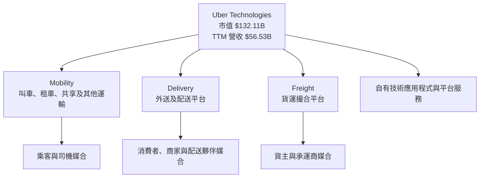
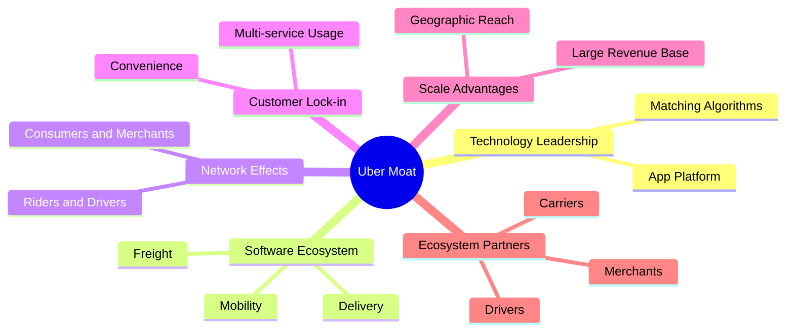
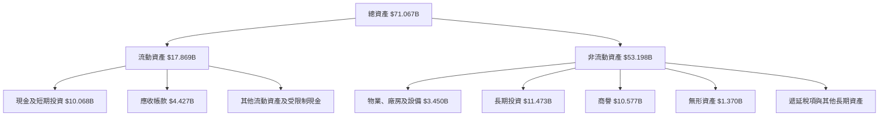
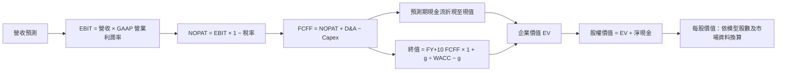
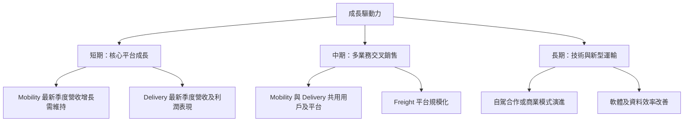
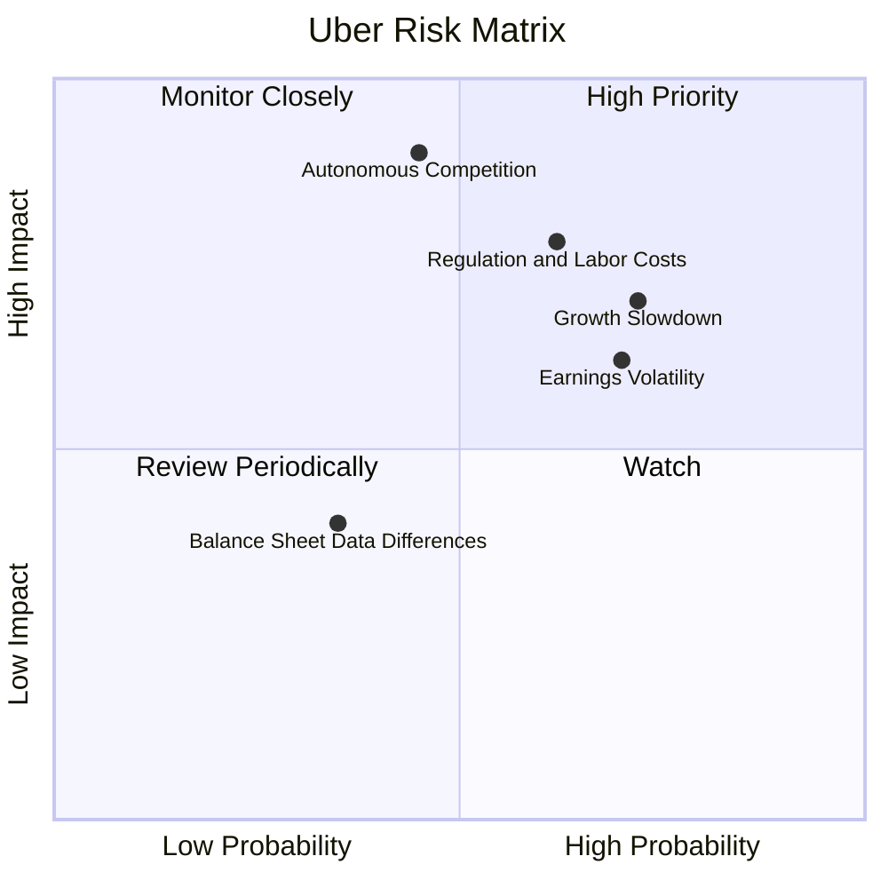
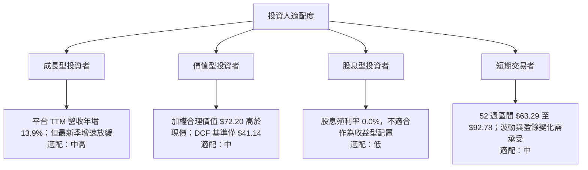

# UBER 基本面深度分析報告
> **報告日期**：2026-11-25 ｜ **語言**：繁體中文 ｜ **數據來源**：SEC 申報資料 (XBRL)、Yahoo Finance、Finviz、StockAnalysis、Roic.ai ｜ **分析師**：CFA 級機構研究

## 目錄

| # | 章節 | 核心結論 |
|---|------|----------|
| 1 | 執行摘要 | 買入；加權合理價值 $72.20；MOS 10.4% |
| 2 | 公司概覽與商業模式 | Mobility、Delivery、Freight 平台具雙邊網路效應，但分部收入占比未提供 |
| 3 | 損益表深度分析 | TTM 營收 $56.53B、年增 13.9%；最新一季年增放緩至 9.6% |
| 4 | 資產負債表分析 | 淨負債 $5.60B；流動性可用但債務口徑資料存在來源差異 |
| 5 | 現金流量深度分析 | TTM FCF $10.42B、FCF Yield 7.89%；現金轉換高於會計淨利 |
| 6 | 獲利能力與資本效率 | ROIC 15.8% 高於 WACC 10.01%，現階段創造股東價值 |
| 7 | 相對估值分析 | 同業估值分歧大；Uber 的 P/S 低於 DoorDash、高於 Lyft |
| 8 | DCF 內在價值評估 | 基準 DCF $41.14；加權合理價值 $72.20，兩者差異反映估值方法分歧 |
| 9 | 成長催化劑 | Mobility、Delivery 與平台交叉銷售提供成長空間；TAM 數字未提供 |
| 10 | 風險矩陣 | 自駕替代、競爭及獲利波動是主要風險 |
| 11 | 投資建議 | 依 MOS 評級買入；建議以財報成長、利潤率和 FCF 作為追蹤門檻 |

## 1. 執行摘要

### 1.0 一頁式投資儀表板（Portfolio Manager 30 秒速讀）

| 項目 | 內容 |
|------|------|
| **投資論點（3 句）** | ① TTM 營收 $56.53B、年增 13.9%，平台仍在擴大規模。② TTM FCF $10.42B、FCF Yield 7.89%，現金創造力已具投資價值。③ ROIC 15.8% 高於 WACC 10.01%，目前資本回報高於資金成本。 |
| **綜合評分** | **6.3/10**（引用 1.1 評分卡） |
| **財務健康** | 🟡 現金及短期投資 $10.07B，淨負債 $5.60B；流動比率 1.232、速動比率 0.999。 |
| **ROIC vs WACC** | **15.8% vs 10.01%**：創造價值，利差 5.79 個百分點。 |
| **FCF 趨勢** | 歷年 FCF 增長，TTM FCF Yield **7.89%**；但最新季度淨利波動大。 |
| **估值** | Forward P/E **14.68x** ｜ EV/EBITDA **18.02x** ｜ FCF Yield **7.89%** |
| **DCF 內在價值（基準）** | **$41.14** ｜ 現價相對 DCF 溢價 **57.3%**（現價 ÷ DCF 價值 − 1） |
| **安全邊際（MOS）** | **+10.4%**＝($72.20 − $64.70) ÷ $72.20；🟡有限。基準為第 8.8 節加權合理價值。 |
| **預期報酬（基準情境 12M）** | 加權合理價值對現價上行空間 **+11.6%**；此為估值比較，不是保證報酬。 |
| **關鍵風險（前二）** | 自駕與平台競爭改變供需結構；最新一季營收增速放緩且淨利同比大幅下滑。 |
| **評級 + 信心度** | 🟢 **買入** ｜ 信心：中 |

### 1.1 綜合評分卡（全報告唯一）

| 維度 | 評分（1–10） | 主要依據（引用數字與其來源章節） |
|------|--------------|----------------------------------|
| 成長性 | 7.0 | TTM 營收年增 13.9%，最新一季單季年增 9.6%，增長有放緩跡象（第 3 章）。 |
| 獲利能力 | 7.0 | TTM 營業利益率 12.4%、ROIC 15.8%、Piotroski 6/8（第 3、6 章）。 |
| 財務健康 | 6.0 | 現金及短期投資 $10.07B，淨負債 $5.60B，流動比率 1.232（第 4 章）。 |
| 估值 | 5.0 | 加權 MOS 10.4%，但 DCF 基準價 $41.14 低於現價 $64.70（第 7、8 章）。 |
| 護城河 | 7.0 | 多業務平台、雙邊供需網路與跨業務交叉銷售具規模優勢；分部與市場份額數據未提供（第 2 章）。 |
| 管理層與資本配置 | 6.0 | 2025 年 FCF $9.76B；稀釋股數測試通過，但資本回報／回購配置細節未提供（第 5、6 章）。 |
| **綜合評分** | **6.3** | 六項算術平均：(7.0 + 7.0 + 6.0 + 5.0 + 7.0 + 6.0) ÷ 6 = 6.3。 |

### 1.2 五大投資論點 + 三大核心風險

| 類型 | 項目 | 具體依據 | 信心度 |
|------|------|----------|--------|
| 🟢 **投資論點①** | 平台營收仍成長 | TTM 營收 $56.53B、TTM 年增 13.9%；收入規模持續擴大，可攤薄平台固定成本。 | 🟢 高 |
| 🟢 **投資論點②** | FCF 已形成估值支撐 | TTM 營業現金流 $10.73B、資本支出 $314M、FCF $10.42B；FCF Yield 7.89%。 | 🟢 高 |
| 🟢 **投資論點③** | 資本回報高於資金成本 | ROIC 15.8% 對 WACC 10.01%，正利差 5.79 個百分點。 | 🟢 高 |
| 🟢 **投資論點④** | 估值方法加權後仍有溫和折價 | 加權合理價值 $72.20，相對 $64.70 收盤價，上行空間 11.6%。 | 🟡 中 |
| 🟢 **投資論點⑤** | 現金轉換高於淨利 | TTM FCF $10.42B，TTM 淨利 $3.465B；現金流為淨利約 3.01 倍。 | 🟡 中 |
| 🟡 **風險①** | 成長放緩與盈餘基期波動 | 最新一季營收年增 9.6%；淨利年增 -92.3%，市場對盈餘穩定性的能見度偏低。 | 🟡 中 |
| 🔴 **風險②** | 自駕與競爭可能削弱平台價值 | 新聞資料提及多家自駕競爭者測試，但未提供可量化的 Uber 市占或商業化時程。 | 🔴 高衝擊 |
| 🟡 **風險③** | 淨負債及財務資料口徑差異 | 經核實淨負債為 $5.60B；另一市場資料欄列總債務 $17.74B、淨負債 $7.67B，需以 SEC 申報口徑追蹤。 | 🟡 中 |

### 1.3 快速統計卡片

| 指標 | 公司實際值（期間） | 同業中位數 | 狀態 |
|------|--------------------|------------|------|
| 營收成長（TTM） | **13.9%** | — | 🟢 |
| 營收成長（最新一季年增） | **9.6%** | 27.4% | 🔴 |
| 毛利率（TTM） | **41.4%** | 41.4% | 🟡 |
| 營業利益率（TTM） | **12.4%** | — | 🟢 |
| ROIC（TTM） | **15.8%** | — | 🟢 |
| Forward P/E | **14.68x** | 17.6x | 🟢 |
| FCF Yield（TTM） | **7.89%** | — | 🟢 |
| Piotroski F-Score | **6 / 8** | — | 🟢 |

> 同業中位數採 LYFT、DASH、GRAB 的 Peer multiples 區塊數值；營收成長中位數為三家公司最新一季 YoY 中位數 27.4%，毛利率中位數 41.4%，Forward P/E 中位數 17.6x。

### 1.4 投資結論

```
╔══════════════════════════════════════════════════════════════════╗
║                    📊 投資結論摘要                               ║
╠══════════════════════════════════════════════════════════════════╣
║  評級：買入（依 MOS 10.4% 落在 10%–25% 買入區間；未作質化調整） ║
║  價格（2026-11-24 收盤）：$64.70                                 ║
║  DCF 內在價值（基準）：$41.14（現價溢價 57.3%）                  ║
║  安全邊際 MOS：+10.4%（＝(加權合理價值−現價)÷加權合理價值）     ║
║  加權合理價值（8.8）：$72.20                                     ║
║  DCF 情境價值：                                                   ║
║    悲觀情境：$23.28（-64.0%）                                    ║
║    基準情境：$41.14（-36.4%）                                    ║
║    樂觀情境：$68.94（+6.5%）                                     ║
║  綜合評分：6.3/10（引用 1.1）                                    ║
║  適合投資人：可承受估值分歧、關注平台現金流與長期成長的投資人   ║
╚══════════════════════════════════════════════════════════════════╝
```

## 2. 公司概覽與商業模式

### 2.1 業務結構與收入來源

Uber 透過 Mobility、Delivery、Freight 三個部門經營平台；財務資料未提供各部門營收或占比，因此不以推估金額填入圖中。



### 2.2 市場份額

市場份額數據未提供，故不作市占率圖表或比例推估。公司 TTM 營收為 $56.53B、年增 13.9%；最新一季營收年增 9.6%，低於 DASH 的 34.0% 及 GRAB 的 27.4%，但高於 LYFT 的 8.1%。不同公司市場及業務組合不完全相同，營收增速差異不能直接等同市占變化。

### 2.3 競爭護城河分析



### 2.4 護城河強度

| 護城河項目 | 強度（強／中／弱） | 證據（引用數字或事實） | 會削弱它的情況 |
|------------|--------------------|------------------------|----------------|
| 網路效應 | 中 | Mobility、Delivery、Freight 均依賴平台供需媒合；TTM 營收 $56.53B。 | 競爭者以補貼爭取司機、商家或消費者，或供需兩側多平台化。 |
| 規模效應 | 中 | TTM FCF $10.42B，具一定平台經營與投資能力。 | 監管成本、保險與激勵支出上升，抵銷交易密度效益。 |
| 軟體生態系統 | 中 | 多種出行、配送及貨運服務由應用程式連接；部門交叉使用數據的程度未提供。 | 產品差異化不足、平台轉換成本下降。 |
| 技術與資料 | 中 | 自有技術平台是營運基礎；研發支出 2025 年 $3.40B。 | 自駕、競爭平台或監管使技術投入不能轉化為經濟回報。 |
| 客戶鎖定 | 弱至中 | 便利性可能提高使用頻率，但未提供留存率、訂閱數或客戶終身價值。 | 消費者價格敏感、跨平台切換容易。 |
| 生態夥伴 | 中 | 司機、商家與承運商提供平台供給；平台交易依賴夥伴參與。 | 勞動者分類規則改變、夥伴議價力上升或供給流失。 |

1.1「護城河」評分為 7.0/10，依據是多邊平台與規模帶來的網路效應，但欠缺留存率、市占率及分部貢獻數據，故未評為更高。

## 3. 損益表深度分析

### 3.1 年度收入成長趨勢（近 4 年）

FY2022 至 FY2025 營收由 $31.88B 增至 $52.02B，三年 CAGR 約 17.8%；CAGR 公式為 \((52.02 ÷ 31.88)^{1/3}-1\)。

```
╔══════════════════════════════════════════════════════════════════╗
║              Uber 年度收入趨勢（FY2022-FY2025）                  ║
╠══════════════════════════════════════════════════════════════════╣
║  FY2022  $31.88B  ███████████████░░░░░░░░░░░  基期              ║
║  FY2023  $37.28B  ██████████████████░░░░░░░░  YoY: +16.9% 🟢   ║
║  FY2024  $43.98B  █████████████████████░░░░░  YoY: +18.0% 🟢   ║
║  FY2025  $52.02B  █████████████████████████░  YoY: +18.3% 🟢   ║
║  三年累計 CAGR：約 +17.8%                                        ║
╚══════════════════════════════════════════════════════════════════╝
```

FY2025 營收年增 18.3%，但 TTM 年增已降至 13.9%，最新一季年增為 9.6%。此趨勢代表公司仍在成長，但短期增速已低於近年全年水平；估值能否維持取決於交易量、價格與新業務能否補足增速差距。

### 3.2 季度收入趨勢分析

QoQ 以相鄰季度營收計算；YoY 使用同季比較，Q3 2026 YoY 亦與資料所列單季年增率一致。

| 季度 | 營收 | QoQ | YoY | 備註 |
|------|------:|----:|----:|------|
| 2025 Q4 | $14.37B | — | 20.1% | 依 StockAnalysis 季度營收成長欄。 |
| 2026 Q1 | $13.20B | -8.1% | 14.5% | QoQ 受季節性及季度組合影響，不宜單獨外推。 |
| 2026 Q2 | $14.19B | +7.5% | 12.2% | 營收回升，但年增率仍較前幾季低。 |
| 2026 Q3 | $14.77B | +4.1% | 9.6% | 季度營收創此表區間高點，年增速度持續放緩。 |

### 3.3 利潤率演變分析

| 利潤率指標 | FY2022 | FY2023 | FY2024 | FY2025 | 趨勢 | 評估 |
|------------|-------:|-------:|-------:|-------:|------|------|
| 毛利率 | 38.3% | 39.8% | 39.4% | 39.8% | 大致穩定 | 🟡 |
| 營業利益率 | -5.7% | 3.0% | 6.4% | 10.7% | 明顯改善 | 🟢 |
| 淨利率 | -28.7% | 5.1% | 22.4% | 19.3% | 受非營業與稅務影響，波動大 | 🟡 |

毛利率依年度損益表所列毛利除以營收計算；營業利益率與淨利率亦以年度營收為分母。FY2025 營業利益率改善至 10.7%，年度營業利益由 FY2024 的 $2.80B 增至 $5.57B，顯示收入增長搭配費用槓桿。相較之下，淨利率受非營業項目、投資損益及稅務因素影響較大，FY2025 淨利 $10.05B 高於營業利益 $5.57B，不能簡單視為全部來自可重複營運獲利。

TTM 營業利益率為 12.4%，但最新季度營業利益率按核實資料為 9.8%。季度利潤率低於 TTM，顯示不能只依累計期末數字判斷近期趨勢。

### 3.4 費用結構分析

財務資料提供年度研發費用（FY2025 $3.40B），但未提供一致的完整費用明細，無法可靠分解營業成本、銷售及管理費用與其他項目占比。因此不繪製會誤導的費用圓餅圖。研發費用是可確認的投入之一，需持續檢視是否帶來產品效率或增量現金流。

### 3.5 季度 EPS 趨勢與盈餘品質（Quality of Earnings）

| 季度 | EPS 實際值 | YoY EPS 成長 | 預估與驚喜 |
|------|-----------:|-------------:|------------|
| 2025 Q4 | $0.14 | -95.6% | EPS 預估值缺失，不能判定超預期或不及預期。 |
| 2026 Q1 | $0.13 | -84.6% | EPS 預估值缺失，不能判定超預期或不及預期。 |
| 2026 Q2 | $1.17 | +85.5% | EPS 預估值缺失，不能判定超預期或不及預期。 |
| 2026 Q3 | $0.25 | -92.0% | EPS 預估值缺失，不能判定超預期或不及預期。 |

| 盈餘品質項目 | 數值／佔比 | 評估 |
|--------------|------------|------|
| 股權薪酬 SBC / 營收 | 約 **3.7%**；TTM SBC 約 $2.065B ÷ TTM 營收 $56.53B | 🟡 SBC 仍是顯著股東成本；以歷史股數變化判斷，Piotroski 稀釋股數測試通過，但不代表 SBC 無稀釋代價。 |
| SBC / 營業現金流 | 約 **19.2%**；$2.065B ÷ $10.73B | 🟡 若 SBC 持續高於營收增長，長期股東每股經濟利益會被稀釋。 |
| FCF / 淨利（現金轉換率） | 約 **300.7%**；$10.42B ÷ TTM 淨利 $3.465B | 🟢 現金流明顯高於當期淨利，但兩者期間與一次性損益敏感度需留意。 |
| 一次性／非經常性損益 | 具重大影響可能；無法由現有資料拆分金額 | 🟡 FY2025 淨利 $10.05B 明顯高於營業利益 $5.57B，須回查 SEC 申報的非營業與稅務調節表。 |
| 有效稅率異常 | N/A（未提供可核實 TTM 有效稅率） | N/A，不能推定淨利改善源自稅務利益。 |
| 資本化支出 vs 費用化 | TTM Capex $314M；資本化研發細目未提供 | 🟡 Capex 相對營收低，但不能據此推定所有技術投入均已費用化。 |

**盈餘品質結論：**營業現金流及 FCF 支持獲利具有現金含量；但淨利受到非營業與稅務項目影響，EPS 季度波動也大。估值宜重視 FCF 與營業利益，而非單以 P/E 或單季 EPS 外推。

## 4. 資產負債表分析

### 4.1 資產結構分解

以下按 FY2026 Q3 StockAnalysis 資產負債表列示金額；各項四捨五入，財務資料中長期資產明細合計可能受其他項目與口徑影響。



### 4.2 流動性與營運資金分析

| 指標 | 最新值 | 歷史／變化 | 評估 |
|------|------:|-------------|------|
| 流動比率 | 1.232 | FY2025 年末流動資產 $13.99B、流動負債 $12.32B；最新季度流動資產 $17.869B | 🟡 高於 1，但緩衝不算寬。 |
| 速動比率 | 0.999 | 最新市場資料列示 | 🟡 接近 1，需看應收帳款回收及受限制現金可用性。 |

營運資金天數照抄品質指標：

| 指標 | 最新 TTM | 一年前 TTM | 變化 | 解讀 |
|------|----------|------------|------|------|
| DSO 應收帳款天數 | 29 天 | 28 天 | +1 天 | 🟡 收款時間略延長；幅度有限，但應追蹤應收帳款增速。 |
| DIO 存貨天數 | N/A | N/A | N/A | 公司未報告可用存貨餘額，不應推算。 |
| DPO 應付帳款天數 | 17 天 | N/A | N/A | 一年前缺少可比值，無法判斷議價力變化。 |
| CCC 現金轉換週期 | N/A | N/A | N/A | 因 DIO 不適用，不能補算 CCC。 |

### 4.3 債務結構分析

財務核實口徑的現金、債務與淨負債如下；不將其他資料來源中口徑不同的債務數字混合使用。

```
╔══════════════════════════════════════════════════════════════════╗
║                   Uber 債務健康診斷                              ║
╠══════════════════════════════════════════════════════════════════╣
║  總債務：        $15.66B  ███████████████████░  核實口徑          ║
║  現金及短期投資：$10.07B  ████████████░░░░░░░  現金緩衝          ║
║  淨負債：         $5.60B  ███████░░░░░░░░░░░░  🟡 可管理但非淨現金║
║                                                                  ║
║  流動比率：       1.232x  🟡                                  ║
║  速動比率：       0.999x  🟡                                  ║
║  Debt/EBITDA：    N/A（不同來源 EBITDA／債務口徑不一致）         ║
║  利息保障倍數：   N/A（利息費用細項未提供）                      ║
╚══════════════════════════════════════════════════════════════════╝
```

核實數據列示總債務 $15.66B、現金及短期投資 $10.07B、淨負債 $5.60B（因四捨五入，現金減債務與核實淨負債可能相差 $0.01B）。另有市場資料列總債務 $17.74B、淨負債 $7.67B；應以後續 SEC 10-Q 的債務範圍與租賃分類調和。

### 4.4 股東權益趨勢

```
╔══════════════════════════════════════════════════════════════════╗
║                   股東權益年度趨勢                               ║
╠══════════════════════════════════════════════════════════════════╣
║  FY2022  $ 7.34B  █████░░░░░░░░░░░░░░░░░░░░                    ║
║  FY2023  $11.25B  █████████░░░░░░░░░░░░░░░░                    ║
║  FY2024  $21.56B  █████████████████░░░░░░░░                    ║
║  FY2025  $27.04B  █████████████████████░░░░░                    ║
╚══════════════════════════════════════════════════════════════════╝
```

股東權益自 FY2022 的 $7.34B 升至 FY2025 的 $27.04B。權益上升提高了資產負債表緩衝，但並不等同現金增加；其中可能包含累積獲利及其他權益變動。

## 5. 現金流量深度分析

### 5.1 現金流量瀑布圖

未提供同期間淨利至現金流的完整調節項，也未提供足以將 FCF 分配至回購、股息、投資與現金變動的完整資料。以下只呈現可核實的現金流項目，不推估股東回報金額。


### 5.2 FCF 轉換率趨勢

| 年度 | FCF | 淨利 | FCF / 淨利 | 解讀 |
|------|----:|-----:|-----------:|------|
| 2022 | $0.39B | -$9.14B | 不具經濟意義 | 淨利為負，不能以比率比較。 |
| 2023 | $3.36B | $1.89B | 177.8% | 現金流高於淨利。 |
| 2024 | $6.89B | $9.86B | 69.9% | 淨利高於 FCF，非現金或非營業項目影響需追蹤。 |
| 2025 | $9.76B | $10.05B | 97.1% | 現金轉換接近 1 倍。 |
| TTM | $10.42B | $3.465B | 約 300.7% | TTM FCF 顯著高於 TTM 淨利，期間損益波動使比例偏高。 |

### 5.3 自由現金流趨勢

```
╔══════════════════════════════════════════════════════════════════╗
║                Uber 自由現金流歷史趨勢                            ║
╠══════════════════════════════════════════════════════════════════╣
║  FY2022  $0.39B  █░░░░░░░░░░░░░░░░░░░░  FCF Yield：N/A          ║
║  FY2023  $3.36B  ███████░░░░░░░░░░░░░  FCF Yield：N/A          ║
║  FY2024  $6.89B  ██████████████░░░░░░  FCF Yield：N/A          ║
║  FY2025  $9.76B  ███████████████████░  FCF Yield：N/A          ║
║  TTM     $10.42B ████████████████████  FCF Yield：7.89% 🟢     ║
╚══════════════════════════════════════════════════════════════════╝
```

FCF 由 FY2022 的 $0.39B 增至 FY2025 的 $9.76B；FY2025 年增約 41.7%。TTM FCF 達 $10.42B，支持估值不完全依賴遠期成長。不過年度 FCF Yield 未提供，故不以市場資本額反算歷史殖利率。

### 5.4 資本配置評估

| 項目 | 已知數據 | 評估 |
|------|----------|------|
| 資本支出 | TTM $314M；FY2025 年度現金流量表列 $336M | 🟢 相較 TTM FCF 規模低；但資產輕型不代表無需技術、保險或營運投入。 |
| 研發 | FY2025 $3.40B | 🟡 需觀察研發能否轉化為效率提升與平台收入。 |
| 股息 | 殖利率 0.0% | 🟡 現金回報主要不是股息。 |
| 回購、併購、留存現金 | 金額分配未提供 | N/A，不能繪製資本配置圓餅圖或假設比例。 |

## 6. 獲利能力與資本效率

### 6.1 ROE / ROA / ROIC 趨勢

| 指標 | 可核實數值 | 期間 | 評估 |
|------|------------|------|------|
| ROE | 12.5% | TTM，品質指標；其他資料源列 12.3% | 🟡 正值，但受淨利項目及槓桿影響。 |
| ROA | 6.5% | TTM | 🟢 資產產生正報酬。 |
| ROIC | 15.8% | TTM | 🟢 高於 WACC 10.01%。 |
| 歷年 ROIC／ROE／ROA 可比序列 | N/A | 歷史期間口徑不完整 | 不補造歷史數列。 |

### 6.2 ROIC vs WACC 分析（核心價值創造判斷）

```
╔══════════════════════════════════════════════════════════════════╗
║                ROIC vs WACC 深度分析                             ║
╠══════════════════════════════════════════════════════════════════╣
║  WACC（採用核實資本成本資料）：                                   ║
║  ├── 無風險利率（10Y 美債）：           4.90%                    ║
║  ├── 市場風險溢酬 ERP：                  5.00%                    ║
║  ├── 原始 Beta：                         1.31                     ║
║  ├── 調整後 Beta：                       1.21                     ║
║  ├── 股權成本 Ke：                      10.93%                   ║
║  ├── 稅前債務成本：                      2.81%                   ║
║  ├── 股權／債務權重：                    89.4%／10.6%             ║
║  └── ✅ WACC：                           10.01%                   ║
║                                                                  ║
║  ROIC（TTM，核實值）：                  15.8%                    ║
║  經濟價值利差：                         15.8% − 10.01%            ║
║                                           = +5.79 個百分點        ║
║                                                                  ║
║  ROIC 15.8%  ▓▓▓▓▓▓▓▓▓▓▓▓▓▓▓▓░░░░  高於資金成本                ║
║  WACC 10.01% ▓▓▓▓▓▓▓▓▓▓░░░░░░░░░░  折現率                      ║
║                                                                  ║
║  📊 結論：ROIC 高於 WACC，現階段創造股東價值；若利差收窄，估值 ║
║     應下修。ROIC/WACC = 15.8% ÷ 10.01% ≈ 1.58 倍。              ║
╚══════════════════════════════════════════════════════════════════╝
```

Beta 調整方式為 \((2/3 × 1.31) + (1/3 × 1)=1.21\)。股權成本為 \(4.90\% + 1.21 × 5.00\%=10.93\%\)。債務成本經稅後調整後約 2.22%；依核實權重，WACC 為 \(89.4\%×10.93\% + 10.6\%×2.22\% \approx 10.01\%\)。依程式提供的 WACC 採用值為 10.01%，本報告不另建 WACC。

ROIC 減 WACC 的 5.79 個百分點表示目前投入資本回報高於資金成本；此判斷依賴 TTM ROIC 計算口徑，若營業利潤率持續低於 TTM 水準，價值創造幅度會下降。

### 6.3 杜邦三因素分解

| 因素 | 數值（TTM） | 解讀 |
|------|-------------|------|
| 淨利率 | 6.1% | 會受非營業及稅務項目影響。 |
| 資產週轉率 | 0.80 | 平台業務相較重資產公司資產週轉較快。 |
| 權益乘數 | 2.57 | 槓桿對 ROE 有放大作用。 |
| **ROE** | **12.5%** | 6.1% × 0.80 × 2.57 ≈ 12.5%；淨利率與資產週轉均有貢獻，並非純粹靠槓桿。 |

### 6.4 財務體質：Piotroski F-Score

**Piotroski F-Score：6 / 8**。品質計算中有一項毛利率測試因缺少輸入未納入，因此分母為 8，不以 9 為分母重算。

| 測試 | 結果 | 解讀 |
|------|------|------|
| ROA > 0 | ✅ 通過 | TTM 資產報酬為正。 |
| 營業現金流 > 0 | ✅ 通過 | TTM 營業現金流 $10.73B。 |
| ROA 高於一年前 | ❌ 未通過 | 資產獲利能力未較一年前改善。 |
| 營業現金流 > 淨利（應計品質） | ✅ 通過 | 現金流高於淨利，應計品質測試通過。 |
| 長期負債 ÷ 總資產低於一年前 | ❌ 未通過 | 槓桿相對資產未改善。 |
| 流動比率高於一年前 | ✅ 通過 | 流動性指標改善。 |
| 稀釋股數未增加 | ✅ 通過 | 股數測試通過，但不代表 SBC 沒有經濟成本。 |
| 毛利率高於一年前 | — 無法判定 | 缺少計算所需資料，未納入分母。 |
| 資產週轉率高於一年前 | ✅ 通過 | 資產使用效率改善。 |

## 7. 相對估值分析

### 7.1 同業估值比較表格

公司估值欄採市場資料；同業倍數直接採 Yahoo Finance Peer multiples。Uber Forward P/E 與核實區塊 P/E 取值口徑略有差別，以下沿用市場估值欄的 14.68x。

| 估值指標 | **Uber** | **LYFT** | **DASH** | **GRAB** | Uber 評估 |
|----------|---------:|---------:|---------:|---------:|-----------|
| **Trailing P/E** | 38.06x | 2.4x | 66.4x | 27.7x | 🟡 介於同業，LYFT 的低倍數受獲利基數影響。 |
| **Forward P/E** | 14.68x | 7.9x | 21.0x | 17.6x | 🟢 低於 DASH、GRAB；但仍高於 LYFT。 |
| **P/S Ratio** | 2.34x | 0.9x | 4.1x | 2.8x | 🟡 低於 DASH、GRAB，高於 LYFT。 |
| **EV/EBITDA** | 18.02x | 534.4x | 39.3x | 17.6x | 🟢 接近 GRAB、低於 DASH；LYFT 倍數受 EBITDA 分母偏低影響。 |
| **最新一季營收 YoY** | 9.6% | 8.1% | 34.0% | 27.4% | 🔴 Uber 低於 DASH、GRAB，略高於 LYFT。 |
| **毛利率（TTM）** | 41.4% | 40.0% | 52.7% | 41.4% | 🟡 與 GRAB 相同，低於 DASH。 |

### 7.2 歷史估值區間分析

```
╔══════════════════════════════════════════════════════════════════╗
║                Uber 五年估值區間（TTM 倍數）                      ║
╠══════════════════════════════════════════════════════════════════╣
║  P/E：        12.6x ───── 中位數 17.8x ───────── 現值 37.8x     ║
║               範圍上限 122.2x；現值百分位 62%                    ║
║  P/S：         1.5x ───────── 現值 2.3x ─ 中位數 3.3x ─ 6.1x   ║
║               現值百分位 19%                                     ║
║  EV/EBITDA：  18.7x ───────── 現值 17.7x ─ 中位數 40.0x       ║
║               範圍上限 320.2x；現值百分位 0%                    ║
╚══════════════════════════════════════════════════════════════════╝
```

相較自身歷史，P/S 低於五年中位數、EV/EBITDA 也低於中位數；但 P/E 仍高於五年中位數。這些指標受歷史獲利由虧轉盈影響，不能把單一倍數百分位直接視為便宜或昂貴的充分證據。

### 7.3 情境價值（Bear / Base / Bull，照抄 DCF MODEL）

| 情境 | 第 1 年營收成長 | 期末營業利潤率 | WACC | 每股價值 | 相對現價 | 機率 | 會發生的條件 |
|------|----------------|----------------|------|----------|----------|------|--------------|
| 🔴 悲觀 | 7.0% | 5.4% | 11.01% | $23.28 | -64.0% | 25% | 成長顯著低於 TTM 13.9%，且競爭或成本壓力使長期利潤率下降。 |
| 🟡 基準 | 13.9% | 6.4% | 10.01% | $41.14 | -36.4% | 50% | 第一年度延續 TTM 成長，之後增速與利潤率按模型逐步回落。 |
| 🟢 樂觀 | 20.9% | 7.0% | 9.01% | $68.94 | +6.5% | 25% | 成長重加速、終期利潤率高於基準，且資金成本下降。 |

### 7.4 相對估值隱含價格區間

```
╔══════════════════════════════════════════════════════════════════╗
║                   估值方法隱含每股價值                            ║
╠══════════════════════════════════════════════════════════════════╣
║  DCF 基準                 $41.14                                  ║
║  同業 Forward P/E          $77.77                                  ║
║  同業 EV/EBITDA           $105.95                                  ║
║  分析師共識目標價           $98.16                                  ║
║                                                                  ║
║  DCF 基準 $41.14 ─ 現價 $64.70 ─ 加權價值 $72.20 ─ $105.95       ║
╚══════════════════════════════════════════════════════════════════╝
```

- **同業 Forward P/E：$77.77**，採 LYFT、DASH、GRAB 同業中位數 17.6x，乘以 Uber Forward EPS $4.41。
- **同業 EV/EBITDA：$105.95**，採 DASH、GRAB 可用同業中位數 28.4x，乘以 TTM EBITDA，並按估值方法表加回淨現金調整。
- **分析師共識：$98.16**，46 位分析師平均目標價；屬外部參考，不能視為獨立內在價值證明。

## 8. DCF 內在價值評估（Discounted Cash Flow）

> 本章逐年模型、敏感度矩陣、情境及反推值依程式計算結果引用。現有資料未提供完整的 DCF 程式碼、稀釋股數及逐筆負債調節，故不另行重建模型；模型值與報價均為美元。

### 8.0 估值推理鏈（Thinking Logic：在算之前先想清楚）

**Step 1 — 價值來源與主導變數**

Uber 的內在價值主要來自現有 Mobility、Delivery 與 Freight 平台的現金流；分部營收占比未提供，無法把各業務拆成獨立估值。模型採 TTM 營收 $56.53B 作起點，之後以營收增長和 GAAP 營業利潤率推導 FCFF。從敏感度矩陣看，折現率與永續成長率都會明顯改變結果；商業面最關鍵的變數則是營收能否延續增長，以及營業利潤率能否維持。

**Step 2 — 模型選擇**

| 決策點 | 本報告採用 | 理由（含數字） | 曾考慮但否決 | 否決理由 |
|--------|-----------|----------------|--------------|----------|
| 現金流定義 | FCFF | 以 WACC 10.01% 折現並先得 EV，再扣淨負債。 | FCFE | 模型已指定 FCFF；不另改模型。 |
| 預測期 N | 10 年 | DCF 模型明確列示 FY+1 至 FY+10。 | 縮短預測期 | 與既有模型輸出不一致，不另建模型。 |
| 終值方法 | Gordon Growth | 模型以 g=3.0% 計終值，且 WACC 10.01% > g。 | 僅退出倍數 | DCF 模型未提供退出倍數計算結果，不能補造。 |
| EBIT 基礎 | GAAP EBIT | TTM GAAP 營業利益率為 12.4%；模型明定 GAAP EBIT。 | 非 GAAP EBIT | 無需額外加回 SBC，避免與股數成本重複處理。 |

**Step 3 — 關鍵假設推導鏈**

- **營收增長**：錨點＝TTM 年增 13.9%，最新一季單季 YoY 為 9.6% → 調整＝模型以 13.9% 作第 1 年起點，再線性放緩至第 10 年 3.0% → **採用值：FY+1 13.9%，FY+10 3.0%** → 不採用將 13.9% 固定十年的外推，因最新一季增速已降至 9.6%，固定高增長會忽略成熟化風險。
- **營業利潤率**：錨點＝TTM 12.4% → 調整＝模型逐年降至近五年年度中位數（含 TTM）的 6.4% → **採用值：FY+1 12.4%、FY+10 6.4%** → 不以 TTM 利潤率永續外推，因公司收入增速放緩且季度營業利益率低於 TTM。
- **預測期 N**：錨點＝模型設定 10 年 → 調整＝不更改模型，逐年呈現至 FY+10 → **採用值：10 年** → 不另採 5 年或更短模型，以免改動既有輸出。
- **Capex／營收**：錨點＝TTM 比率，模型列 FY+1 至 FY+10 均為 0.6% → 調整＝沿用模型；TTM 資本支出 $314M、營收 $56.53B → **採用值：0.6%** → 不自行把支出上調至其他同業水準，因沒有可直接比較的同業 Capex 資料。
- **永續成長率 g**：錨點＝模型採 3.0% → 調整＝此值低於 WACC 10.01%，可使用 Gordon Growth → **採用值：3.0%** → 不採高於 WACC 的數值，因公式會失效；亦不自行提高以抬升終值。
- **WACC**：錨點＝核實資本成本 10.01% → 調整＝不另作調整 → **採用值：10.01%** → 不以其他折現率取代，敏感度只引用模型矩陣。
- **EBIT 與 SBC**：錨點＝GAAP EBIT 已含 SBC 費用；FY2025 SBC $1.83B → **採用 GAAP EBIT、FCFF 不再扣 SBC、股數不另稀釋** → 不採非 GAAP 加回後再另扣或另設稀釋，避免改變指定模型設定。
- **折舊攤銷**：錨點＝TTM D&A／營收 1.4% → **採用 1.4%**，模型固定使用。
- **有效稅率與營運資金**：採模型稅率 21.0%；營運資金變動未建模，不能自行補入 ΔWC 比例。

**Step 4 — 最脆弱環節**

最脆弱環節是終值及長期利潤率：模型終值現值占 EV 46.7%，若長期營業利潤率低於 6.4% 或 WACC 上升，DCF 會進一步低於 $41.14；敏感度矩陣在 WACC 12.01%、g 3.0% 時為 $32.04。

**Step 5 — 計算路徑圖**



### 8.1 模型假設總表（Model Inputs）

| 假設項目 | 採用值 | 依據／來源 | 敏感度 |
|----------|--------|-------------|--------|
| 預測期長度 N | 10 年 | DCF 模型逐年 FY+1 至 FY+10。 | 🟡 中 |
| 營收增長 | FY+1 13.9% → FY+10 3.0% | 起點採 TTM 營收增長 13.9%，線性淡出。 | 🔴 高 |
| 營業利潤率 | FY+1 12.4% → FY+10 6.4% | 起點為 TTM，期末為模型近五年中位數。 | 🔴 高 |
| 有效稅率 | 21.0% | DCF 模型預設稅率。 | 🟢 低 |
| Capex / 營收 | FY+1 至 FY+10 皆 0.6% | 模型以 TTM 比率為錨點。 | 🟡 中 |
| D&A / 營收 | 1.4% | 模型採 TTM 比率並固定。 | 🟢 低 |
| 營運資金變動 | 未建模 | DCF 模型明確排除 working capital。 | 🟢 低 |
| EBIT 基礎 | GAAP EBIT | 模型指定 GAAP EBIT。 | 🟡 中 |
| SBC 處理 | SBC 已包含在 GAAP EBIT；不再扣除 | 模型指定組合 A。 | 🟡 中 |
| 年稀釋率 | 0%（模型假設） | 固定股數，因 SBC 已包含在 GAAP 費用中。 | 🟡 中 |
| 永續成長率 g | 3.0% | DCF 模型指定，且低於 WACC。 | 🔴 高 |
| 終值方法 | Gordon Growth | DCF 模型列出的終值方法。 | 🔴 高 |
| WACC | 10.01% | 核實資本成本資料。 | 🔴 高 |

本模型使用 FCFF，公式為 **FCFF = NOPAT + D&A − Capex**；working capital 不建模。**本模型採用 (A)：GAAP EBIT + 固定股數，故 SBC 影響已計入一次。**

### 8.2 折現率推導（WACC）

```
╔══════════════════════════════════════════════════════════════════╗
║                    WACC 推導（折現率）                           ║
╠══════════════════════════════════════════════════════════════════╣
║  股權成本 Ke（CAPM）：                                           ║
║  ├── 無風險利率 Rf：                   4.90%                    ║
║  ├── 市場風險溢酬 ERP：                 5.00%                    ║
║  ├── 原始 Beta：                        1.31                     ║
║  ├── 調整後 Beta：                      1.21                     ║
║  ├── 規模／國別溢酬：                   未另加計                 ║
║  └── Ke = 4.90% + 1.21 × 5.00% = 10.93%                        ║
║                                                                  ║
║  債務成本 Kd：                                                   ║
║  ├── 核實稅前 Kd：                       2.81%                   ║
║  ├── 稅率：                              21.0%                   ║
║  └── 稅後 Kd = 2.81% × (1 − 21.0%) = 2.22%                     ║
║                                                                  ║
║  資本權重：股權 89.4%／債務 10.6%                               ║
║  └── WACC = 89.4% × 10.93% + 10.6% × 2.22% = 10.01%            ║
╚══════════════════════════════════════════════════════════════════╝
```

**逐步演算及資料限制：**

1. **Ke** = 4.90% + 1.21 × 5.00% = **10.93%**；Beta 調整為 \(2/3×1.31+1/3×1=1.21\)。
2. **稅前 Kd** = **2.81%**，核實資本成本資料已提供該比率；利息費用與平均計息負債明細未提供，故不反推。
3. **稅後 Kd** = 2.81% × (1 − 21.0%) = **2.22%**。
4. **權重** = 股權 89.4%、債務 10.6%；兩者合計 100%。股權權重採核實資本成本資料，未以帳面股東權益替代。
5. **WACC** = 89.4% × 10.93% + 10.6% × 2.22% = 9.77% + 0.24% = **10.01%**（四捨五入）。

Rf 日期及股權市值、計息債務完整明細未在資本成本欄提供，因此本節保留核實的成本與權重，不自行另算一組 WACC。第 6.2 節與本節均採 10.01%。

### 8.3 逐年自由現金流預測（基準情境）

單位：美元十億；折現因子依模型列值保留三位小數。模型未列 ΔWC，故不增設該列。

| 年度 | FY+1 | FY+2 | FY+3 | FY+4 | FY+5 | FY+6 | FY+7 | FY+8 | FY+9 | FY+10 |
|------|------:|------:|------:|------:|------:|------:|------:|------:|------:|-------:|
| 營收 | 64.41 | 72.60 | 80.96 | 89.29 | 97.40 | 105.06 | 112.04 | 118.12 | 123.10 | 126.80 |
| 營收 YoY | 13.9% | 12.7% | 11.5% | 10.3% | 9.1% | 7.9% | 6.6% | 5.4% | 4.2% | 3.0% |
| 營業利潤率 | 12.4% | 11.8% | 11.1% | 10.4% | 9.7% | 9.1% | 8.4% | 7.7% | 7.0% | 6.4% |
| GAAP EBIT | 8.01 | 8.54 | 8.98 | 9.30 | 9.49 | 9.52 | 9.40 | 9.11 | 8.67 | 8.07 |
| − 稅 | (1.68) | (1.79) | (1.89) | (1.95) | (1.99) | (2.00) | (1.97) | (1.91) | (1.82) | (1.69) |
| = NOPAT | 6.33 | 6.75 | 7.09 | 7.35 | 7.50 | 7.52 | 7.43 | 7.20 | 6.85 | 6.38 |
| + D&A | 0.88 | 0.99 | 1.10 | 1.21 | 1.33 | 1.43 | 1.52 | 1.61 | 1.67 | 1.72 |
| − Capex | (0.36) | (0.40) | (0.45) | (0.50) | (0.54) | (0.58) | (0.62) | (0.66) | (0.68) | (0.70) |
| **= FCFF** | **6.85** | **7.33** | **7.75** | **8.07** | **8.28** | **8.37** | **8.33** | **8.15** | **7.84** | **7.40** |
| 折現因子 @10.01% | 0.909 | 0.826 | 0.751 | 0.683 | 0.621 | 0.564 | 0.513 | 0.466 | 0.424 | 0.385 |
| **FCFF 現值 PV** | **6.23** | **6.06** | **5.82** | **5.51** | **5.14** | **4.72** | **4.27** | **3.80** | **3.32** | **2.85** |

**預測期 FCF 現值合計：**  
$6.23 + $6.06 + $5.82 + $5.51 + $5.14 + $4.72 + $4.27 + $3.80 + $3.32 + $2.85 = **$47.72B**。

**逐步演算（FY+1，依模型列值）：**

1. 營收 = $56.53B × (1 + 13.9%) = **$64.41B**（模型列值）。
2. EBIT = $64.41B × 12.4% = **$8.01B**（模型列值）。
3. 稅 = $8.01B × 21.0% = **$1.68B**（模型列值）。
4. NOPAT = $8.01B − $1.68B = **$6.33B**。
5. D&A = **$0.88B**（模型列值；模型比率 1.4%）。
6. Capex = **$0.36B**（模型列值；模型比率 0.6%）。
7. ΔWC = **未建模**。
8. FCFF = $6.33B + $0.88B − $0.36B = **$6.85B**（依模型列值）。
9. 折現因子 = **0.909**；PV = $6.85B × 0.909 = **$6.23B**（依模型列值，尾差來自未四捨五入原始輸入）。

**合理性自檢：**

- FY+1 至 FY+10 FCFF 的端點 CAGR = \((7.40÷6.85)^{1/9}-1\) ≈ **0.9%**；歷史 FCF 由 FY2022 $0.39B 增至 FY2025 $9.76B，因起點極低及經營模式轉變，歷史增速不可直接與成熟期模型相比。
- FY+10 FCFF 利潤率 = $7.40B ÷ $126.80B = **5.8%**；TTM FCF／營收約 **18.4%**，但 TTM FCF 定義為營業現金流減資本支出，與模型 FCFF 口徑不同，不作同口徑優劣比較。
- 模型各年 FCFF 均為正數。

```
╔══════════════════════════════════════════════════════════════════╗
║            自由現金流：歷史實際 vs 模型預測                      ║
╠══════════════════════════════════════════════════════════════════╣
║  FY2023(實)  $3.36B  ███████░░░░░░░░░░░░░  FCF                 ║
║  FY2024(實)  $6.89B  ██████████████░░░░░░  FCF                 ║
║  FY2025(實)  $9.76B  ███████████████████░  FCF                 ║
║  TTM(實)    $10.42B  ████████████████████  FCF                 ║
║  FY+1(預)    $6.85B  █████████████░░░░░░░  FCFF                ║
║  FY+10(預)   $7.40B  ███████████████░░░░░  FCFF                ║
╠══════════════════════════════════════════════════════════════════╣
║  ⚠️ TTM FCF 與模型 FCFF 定義不同；不可直接視為同口徑趨勢。     ║
╚══════════════════════════════════════════════════════════════════╝
```

### 8.4 終值計算（Terminal Value）

**適用性檢查：**WACC 10.01% vs g 3.0% → **WACC > g ✅**

| 方法 | 計算式 | 終值 TV | TV 現值 | 佔總 EV 比重 |
|------|--------|---------|---------|--------------|
| Gordon Growth | $7.40 × (1 + 3.0%) ÷ (10.01% − 3.0%) | $108.71B | $41.89B | 46.7% |
| 退出倍數法 | N/A | N/A | N/A | N/A |

退出倍數法的終期 EBITDA 與退出倍數未列於 DCF 模型，故不自行增補。

**逐步演算：**

1. FY+10 FCFF = **$7.40B**。
2. 分子 = $7.40B × (1 + 3.0%) = **$7.62B**（模型終值以未四捨五入輸入計算）。
3. 分母 = 10.01% − 3.0% = **7.01%**；TV = **$108.71B**（依模型列值）。
4. PV(TV) = $108.71B × 0.385 = **$41.89B**（依模型列值）。
5. 終值佔比 = $41.89B ÷ $89.61B = **46.7%**。

終值占 EV 46.7%，未超過 75% 警示線，但仍是估值的重要組成。

### 8.5 企業價值 → 每股內在價值（Bridge）

```
╔══════════════════════════════════════════════════════════════════╗
║              企業價值 → 每股內在價值 橋接表                      ║
╠══════════════════════════════════════════════════════════════════╣
║  預測期 FCF 現值合計            +$47.72B                         ║
║  終值現值 PV(TV)                +$41.89B                         ║
║  ─────────────────────────────────────────────                  ║
║  = 企業價值 EV                    $89.61B                        ║
║  + 淨現金（核實值為負）             -$5.60B                       ║
║  = 股權價值                       $84.01B                        ║
║  每股價值（依 DCF 模型換算）       $41.14                         ║
║  當前股價（2026-11-24 收盤）       $64.70                         ║
║  折溢價（現價÷DCF價值−1）          +57.3%（溢價）                 ║
╚══════════════════════════════════════════════════════════════════╝
```

逐步橋接如下：

1. **EV** = $47.72B + $41.89B = **$89.61B**。
2. **股權價值** = $89.61B − $5.60B 淨負債 = **$84.01B**。
3. **每股內在價值**：DCF 模型列示 **$41.14**。模型換算式依其原列為「股權價值 × 價格 ÷ 市值」；模型所用精確股數／市值中間值未列出，因此不以展示值重建以免產生口徑差異。
4. **折溢價** = $64.70 ÷ $41.14 − 1 = **+57.3%**，即現價相對 DCF 基準價溢價。
5. 本節不計算 MOS；MOS 僅在 8.8 以加權合理價值為分母計算。

### 8.6 敏感性分析（WACC × 永續成長率）

下表每股價值照抄 DCF 模型敏感度矩陣；括號列示相對現價的上行空間，基準格加粗。

| g（列）／WACC（欄） | 8.01% | 9.01% | **10.01%（基準）** | 11.01% | 12.01% |
|-----------|------:|------:|------------------:|------:|------:|
| **2.0%** | $51.30（-20.7%） | $43.95（-32.1%） | $38.41（-40.6%） | $34.07（-47.3%） | $30.59（-52.7%） |
| **2.5%** | $54.03（-16.5%） | $45.78（-29.2%） | $39.68（-38.7%） | $35.00（-45.9%） | $31.27（-51.7%） |
| **3.0%** | $57.32（-11.4%） | $47.91（-25.9%） | **$41.14（-36.4%）** | $36.04（-44.3%） | $32.04（-50.5%） |
| **3.5%** | $61.33（-5.2%） | $50.43（-22.1%） | $42.83（-33.8%） | $37.21（-42.5%） | $32.89（-49.2%） |
| **4.0%** | $66.34（+2.5%） | $53.45（-17.4%） | $44.79（-30.8%） | $38.56（-40.4%） | $33.85（-47.7%） |

> 各格上行空間定義為（該格 DCF 價值 − $64.70）÷ $64.70，並按一位小數呈現。矩陣以模型預先計算數值為準，不另重建單格現金流。

### 8.7 反推 DCF（Reverse DCF：市場在預期什麼）

反推結果照模型列示：在其他模型假設維持基準值時，市場價格隱含第 1 年營收增長 25.7%，高於基準 13.9%；若以固定營業利潤率反推，市場隱含 12.5%，接近基準模型第 1 年 12.4%，但高於第 10 年 6.4%。

| 求解的變數（一次一個） | 固定條件 | 市場隱含值 | 公司參考值 | 判斷 |
|------------------------|----------|------------:|------------:|------|
| 第 1 年營收成長 | 其餘假設固定於基準模型 | 25.7% | TTM 13.9%；近年營收增速曾達 18.3% | 🔴 需明顯加速，市場價格較基準 DCF 樂觀。 |
| 固定營業利潤率 | 其餘假設固定於基準模型 | 12.5% | TTM 12.4%，期末基準 6.4% | 🟡 需維持接近目前 TTM 水準。 |
| 永續成長率 g | 未提供可核實的反推結果 | 未計算 | — | N/A |
| 預測期長度 N | 未提供可核實的反推結果 | 未計算 | 模型 N=10 年 | N/A |

固定輸入為 WACC 10.01%、稅率 21.0%、Capex／營收 0.6%、預測期 10 年；股數、營運資金及反推演算法的完整中間值未提供。因資料中只有最終反推結果，無法展示可複現的逐級試算軌跡，不另虛構迭代點。

**反推結論：**以純 DCF 基準支持 $64.70，Uber 需讓近端營收增長由基準 13.9% 提升至隱含 25.7%，或長期保持約 12.5% 的營業利潤率；市場價格包含對成長或利潤率的較高預期。

### 8.8 估值三角驗證與安全邊際

| 估值方法 | 隱含每股價值 | 上行空間（÷現價） | 權重 | 說明 |
|----------|--------------:|-------------------:|------:|------|
| DCF（基準） | $41.14 | -36.4% | 40% | 10 年 FCFF、WACC 10.01%、g 3.0%。 |
| 同業 Forward P/E | $77.77 | +20.2% | 25% | 同業中位數 17.6x × Forward EPS $4.41。 |
| 同業 EV/EBITDA | $105.95 | +63.8% | 25% | 同業中位數 28.4x × TTM EBITDA，依估值方法表加回淨現金。 |
| 分析師共識目標價 | $98.16 | +51.7% | 10% | 46 位分析師平均目標價。 |
| **加權合理價值** | **$72.20** | **+11.6%** | **100%** | 盈利型公司固定權重；未列其他估值方法。 |

**逐步演算：**

加權合理價值  
= $41.14 × 40% + $77.77 × 25% + $105.95 × 25% + $98.16 × 10%  
= $16.456 + $19.4425 + $26.4875 + $9.816  
= $72.202  
= **$72.20**（四捨五入至美分；後續一致引用）。

權重對應盈利型公司固定估值方法，不因主觀判斷調整。  
MOS = \((72.20−64.70)÷72.20\) = **10.4%**。  
上行空間 = \((72.20−64.70)÷64.70\) = **11.6%**。  
DCF 折溢價另以 $41.14 為分母：$64.70 ÷ $41.14 − 1 = **57.3% 溢價**。

```
╔══════════════════════════════════════════════════════════════════╗
║                  估值區間與安全邊際                              ║
╠══════════════════════════════════════════════════════════════════╣
║  $23.28 ─ $41.14 ─ $64.70 ─ [$72.20] ─ $105.95                 ║
║  悲觀DCF   基準DCF    現價    加權合理值   同業EV/EBITDA參考值   ║
║                                                                  ║
║  安全邊際 MOS = (72.20 − 64.70) ÷ 72.20 = 10.4%                ║
║  MOS 評估：🟡 有限                                               ║
║  上行空間 = (72.20 − 64.70) ÷ 64.70 = 11.6%                    ║
║                                                                  ║
║  建議買入區間：$41.14 – $64.98                                  ║
║  （上限 = $72.20 × 90%，對應 MOS 約 10%；下限以 DCF 基準參考）  ║
╚══════════════════════════════════════════════════════════════════╝
```

> 🔎 **程式複算（Python，依本節各項自動重算）**
>
> 加權合理價值 = $41.14 × 40% + $77.77 × 25% + $105.95 × 25% + $98.16 × 10% = **$72.20**（權重合計 100%）
>
> 以價格 $64.70 計：MOS = **+10.4%**，上行空間 = **+11.6%**
>
> ✅ 與本節所寫數值一致。

### 8.9 DCF 模型的局限與失效條件

- **終值依賴度**：終值現值占 EV 46.7%；估值接近一半由 FY+10 後的現金流假設決定。
- **最脆弱假設**：若 WACC 升至 12.01%、g 維持 3.0%，敏感度矩陣價值為 $32.04；若成長與利潤率同時走弱，悲觀情境為 $23.28。
- **模型局限**：DCF 假設營運資金變動不重要，但平台交易可能改變應收、應付及支付時間；另外，TTM FCF 與預測 FCFF 定義不同。
- **估值差異**：基準 DCF $41.14 低於現價，但相對估值方法區間較高；因此加權價值 $72.20 對同業倍數及分析師目標權重較敏感。
- **風險連結**：競爭或自駕替代會衝擊營收增長；法規、保險與激勵成本會壓低營業利潤率；利率上升則透過 WACC 壓低現值。

### 8.10 複算檢核表（Audit Trail）

| # | 檢核項目 | 檢查方式 | 結果 |
|---|----------|----------|------|
| 1 | 高／中敏感度輸入有推導 | 8.0 Step 3 逐項列出模型錨點及調整理由 | ✅ |
| 2 | 每個假設有來源 | 8.1 依據欄列出模型或財務數據錨點 | ✅ |
| 3 | WACC 算式及權重 | 權重 89.4% + 10.6% = 100%；採用 WACC 10.01% | ✅ |
| 4 | Kd 分母與債務權重口徑可完全核對 | 原始利息費用、平均計息債務與權重底層未提供 | ❌ |
| 5 | WACC 與第 6.2 節一致 | 兩處均採 10.01% | ✅ |
| 6 | 預測期年度數等於 N | 10 個年度 FY+1 至 FY+10，無省略 | ✅ |
| 7 | FY+1 FCFF 與 PV | 依模型列示 $6.85B、$6.23B；原始未四捨五入輸入未提供 | ✅ |
| 8 | 預測期 PV 加總 | 逐年列值加總為 $47.72B | ✅ |
| 9 | WACC > g | 10.01% > 3.0% | ✅ |
| 10 | 終值基期與折現期 | 取 FY+10 FCFF，按模型折現 10 期 | ✅ |
| 11 | EV 至每股價值橋接 | EV $89.61B、股權價值 $84.01B；每股換算採模型列值 | ⚠️ 每股換算底層股數未提供 |
| 12 | SBC 組合經濟一致 | GAAP EBIT、不再扣 SBC、固定股數 | ✅ |
| 13 | 敏感度矩陣基準格一致 | g=3.0%、WACC=10.01% 為 $41.14 | ✅ |
| 14 | 敏感度矩陣有效性 | 矩陣所列 WACC 均高於各列 g | ✅ |
| 15 | 情境機率合計 | 25% + 50% + 25% = 100% | ✅ |
| 16 | 反推每列只解一個變數 | 可核實結果僅營收成長、固定利潤率兩項 | ⚠️ 逐級迭代資料未提供 |
| 17 | MOS 與折溢價基準一致 | MOS 用 $72.20；DCF 折溢價用 $41.14 | ✅ |
| 18 | 報告完整至第 11 章 | 章節均完整列出 | ✅ |
| 19 | 加權價值算式核對 | 各方法價值乘權重合計 $72.202，顯示 $72.20 | ✅ |
| 20 | 評級符合 MOS 門檻 | MOS 10.4% 對應買入，未作調整 | ✅ |

未能完整驗證的項目為底層 Kd／股數及反推迭代資料；因此 DCF 可作估值參考，但不應視為精確到分的可獨立複現模型。

## 9. 成長催化劑

### 9.1 催化劑時間軸

資料未提供公司公布的催化劑時程、營運指引或產品上市日期，因此不以假設日期繪製 gantt。可追蹤的近端觀察點是後續季度財報所披露的 Mobility、Delivery、Freight 成長、營業利潤率及 FCF；中長期則須觀察跨業務使用與自駕合作是否轉化為可量化收入或成本節省。

### 9.2 TAM 市場規模分析

**N/A（TAM 數據未提供）**。公司 TTM 營收 $56.53B、年增 13.9%，代表已有相當經營規模；但缺少出行、外送與貨運各市場 TAM、滲透率及分部收入，不能可靠計算市場滲透空間。

### 9.3 成長驅動力結構圖



上述均為業務追蹤方向，而非已量化財測；自駕商業化收入與成本效益未提供，不能納入基準 DCF 另加選擇權價值。

## 10. 風險矩陣

### 10.1 風險評分矩陣

機率與衝擊座標為分析師定性排序，非公司披露統計值；不代表可精確估計的發生機率。



### 10.2 風險清單詳細分析

| # | 風險項目 | 發生機率 | 財務衝擊 | 風險評估 | 緩解措施 |
|---|----------|----------|----------|----------|----------|
| 1 | 🔴 **自駕與平台替代** | 中；非精確統計 | 高；影響 Mobility 需求、抽成與長期利潤率，金額未提供 | 🔴 高衝擊 | 追蹤自駕服務商合作、平台供需及自有／合作車隊經濟性；不把未量化收入納入估值。 |
| 2 | 🔴 **營收成長放緩** | 中高；最新一季 YoY 9.6%，低於 TTM 13.9% | 中高；若增長持續下滑，估值倍數與預測現金流同步受壓 | 🔴 高 | 按季度追蹤營收、交易量及核心業務增長；連續兩季低於 8%應重新評估基準。 |
| 3 | 🟡 **監管、勞動者分類及保險成本** | 中高；具持續性 | 中高；若成本上升，營業利潤率可能低於 TTM 12.4% | 🟠 中高 | 追蹤法規變動、保險費用及單位經濟性；若 TTM 營業利潤率跌破 9%，下修估值。 |
| 4 | 🟡 **盈餘與稅務／非營業波動** | 高；季度淨利同比波動顯著 | 中；影響 EPS 解讀及 P/E 穩定性 | 🟡 中 | 以營業利益與 FCF 交叉檢驗；核對 SEC 非營業損益及稅率調節。 |
| 5 | 🟡 **淨負債與資料口徑不一致** | 中 | 中；核實淨負債 $5.60B，另一市場資料列 $7.67B | 🟡 中 | 以最新 SEC 10-Q 區分借款、融資租賃及營運負債，避免混用。 |

## 11. 投資建議

### 11.1 最終評級與評分

依加權合理價值 $72.20 與 2026-11-24 收盤價 $64.70 計得 MOS 10.4%，符合買入門檻；ROIC 15.8% 高於 WACC 10.01%，支持資本回報為正。評級沒有作質化調整；綜合評分引用 1.1 為 **6.3/10**，六項分數依序為成長性 7.0、獲利能力 7.0、財務健康 6.0、估值 5.0、護城河 7.0、管理層與資本配置 6.0。

### 11.2 合理價值與隱含報酬率

| 方法／情境 | 每股價值 | 相對現價 $64.70 | 權重／機率 |
|------------|---------:|----------------:|-----------:|
| 加權合理價值 | $72.20 | +11.6% | 固定估值權重合計 100% |
| 🔴 DCF 悲觀 | $23.28 | -64.0% | 25% |
| 🟡 DCF 基準 | $41.14 | -36.4% | 50% |
| 🟢 DCF 樂觀 | $68.94 | +6.5% | 25% |
| DCF 機率加權參考值 | $43.62 | -32.6% | 依模型情境機率 |

加權合理價值來自多方法三角驗證；DCF 情境則反映現金流、利潤率與 WACC 同時變化。兩組數字目的不同，不應將機率加權 DCF 與估值方法加權值混為同一基準。

### 11.3 買入時機與觸發因素

```
╔══════════════════════════════════════════════════════════════════╗
║                  ✅ 買入觸發因素 Checklist                      ║
╠══════════════════════════════════════════════════════════════════╣
║  立即買入觸發條件（多數符合）：                                  ║
║  ✅ 股價不高於 $64.98，約對應加權價值 $72.20 的 10% MOS 門檻    ║
║  ✅ TTM ROIC 維持高於 WACC 10.01%                                ║
║  ✅ TTM FCF 維持正值且 FCF Yield 不低於目前 7.89%                ║
║                                                                  ║
║  加碼觸發條件（出現以下任一）：                                  ║
║  ☐ 最新季度營收年增回升至 13.9% 或以上，且非單一季度效果        ║
║  ☐ 營業利益率改善並接近／高於 TTM 12.4%                         ║
║  ☐ 淨負債下降，且不是以削減必要研發或平台投入換取               ║
║                                                                  ║
║  減碼／停損觸發條件（出現以下任一）：                           ║
║  ☐ 營收連續兩季年增低於 8%                                      ║
║  ☐ TTM 營業利益率跌破 9%                                        ║
║  ☐ FCF 轉負，或 ROIC 跌破 WACC 10.01%                           ║
║  ☐ 自駕或監管變化造成 Mobility 長期經濟性明顯惡化               ║
╚══════════════════════════════════════════════════════════════════╝
```

買入區間下限 $41.14 取 DCF 基準價作風險參考，上限 $64.98 依 MOS 約 10% 推導；現價 $64.70 位於區間上緣附近，因此適合分批而非一次性重倉。

### 11.4 投資人適配度分析



### 11.5 每季財報監控清單（Quarterly Watch List）

| 監控指標 | 目前參考值 | 加碼觀察門檻 | 減碼／重估門檻 | 投資意義 |
|----------|-----------:|--------------|----------------|----------|
| 營收年增 | TTM 13.9%；最新一季 9.6% | 回升至 13.9% 以上且具持續性 | 連續兩季低於 8% | 判斷平台需求與成長假設。 |
| 營業利益率 | TTM 12.4%；最新季度核實值 9.8% | 最新季度回升並接近 TTM | TTM 跌破 9% | 驗證營業槓桿與競爭成本。 |
| 營業現金流 | TTM $10.73B | 維持正成長 | TTM 轉負或連續下滑 | 反映營運現金創造力。 |
| FCF | TTM $10.42B | 維持正值且 Yield 不低於 7.89% | FCF 轉負 | 直接檢視股東可用現金。 |
| Capex | TTM $314M | 支出增加同時帶來營收／效率回報 | Capex 上升但 FCF 明顯轉弱 | 監控再投資效率。 |
| SBC | FY2025 $1.83B；最近四季合計約 $2.065B | SBC／營收下降或低於目前約 3.7% | SBC 快於營收增長並造成股數持續增加 | 評估每股報酬是否被稀釋。 |
| 淨負債 | $5.60B | 持續下降 | 淨負債增加且流動性惡化 | 追蹤資本結構及抗壓性。 |
| 自駕／監管 | 可量化資料未提供 | 合作或新規有可驗證的單位經濟效益 | 替代風險實際侵蝕交易量或利潤 | 不在未有數據前預先給予溢價。 |

### 11.6 反面論證：什麼會證明論點錯誤（What Would Change My Mind）

```
╔══════════════════════════════════════════════════════════════════╗
║              ⚠️ 論點失效條件（Disconfirming Evidence）           ║
╠══════════════════════════════════════════════════════════════════╣
║  本投資論點在下列情況成立時應重新檢視或退出：                    ║
║  ☐ 最新一季營收年增連續兩季低於 8%                               ║
║  ☐ TTM 營業利益率低於 9%，且下一季未見改善                      ║
║  ☐ TTM FCF 轉負，或營業現金流低於資本支出                       ║
║  ☐ ROIC 跌破 WACC 10.01%，並持續兩季                            ║
║  ☐ 淨負債進一步上升，流動比率跌破 1.0                           ║
║  ☐ SBC／營收持續高於目前約 3.7%，且稀釋股數轉為增加             ║
║  ☐ 自駕或監管變化造成核心 Mobility 需求或單位經濟性明顯惡化     ║
╚══════════════════════════════════════════════════════════════════╝
```

> **免責聲明**：本報告為 AI 自動生成，僅供研究參考，不構成投資建議。投資有風險，入市需謹慎。

---

## 資料與來源

| 項目 | 內容 |
|------|------|
| 價格 | 64.70 USD，2026-11-24 收盤（Yahoo Finance 日線） |
| 財務報表 | SEC 10-Q filed 2026-11-04，最新季度 2026-09-30（FY2026 Q3） |
| 有回應的資料來源 | SEC 申報資料 (XBRL)、Yahoo Finance、Finviz、StockAnalysis、Roic.ai |
| 由程式計算 | TTM 數字、WACC、DCF 模型、估值方法與權重、加權合理價值、MOS、評級門檻、F-Score、杜邦分解、營運資金天數、綜合評分 |
| 撰寫模型 | openai / gpt-6-luna |

> 本區塊由產生報告的程式依實際取得的資料填寫，非模型撰寫。「由程式計算」的數字不是模型的估計；其餘判斷（評分、情境、策略）是模型的分析。
