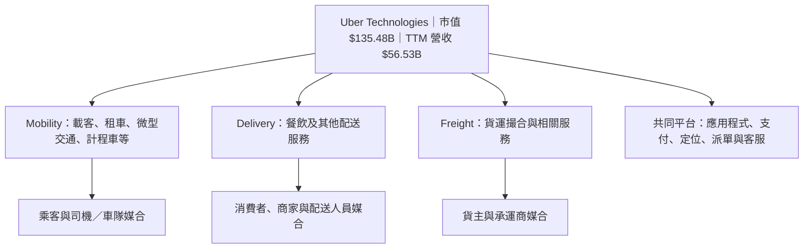
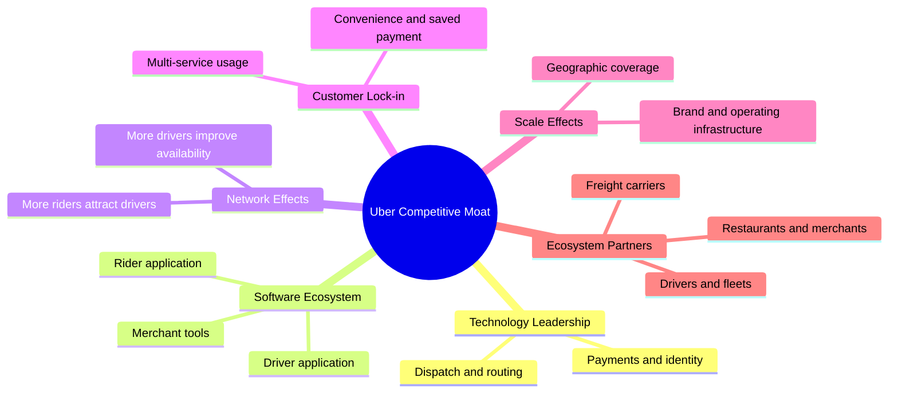
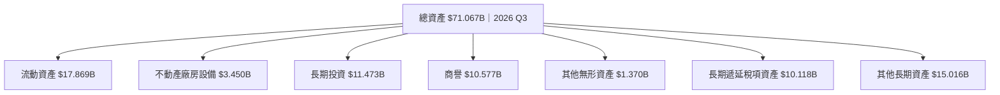
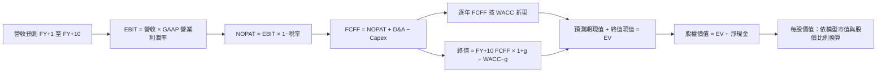
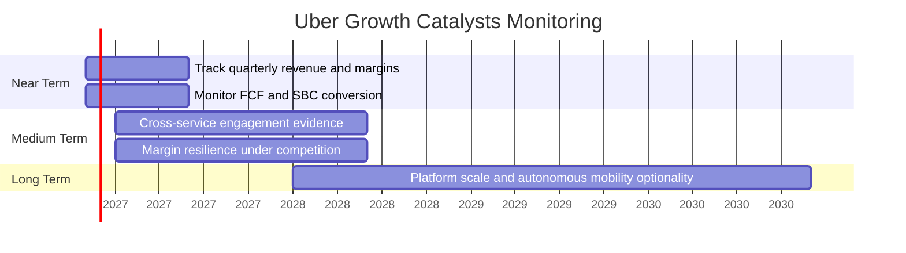
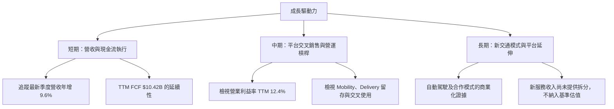
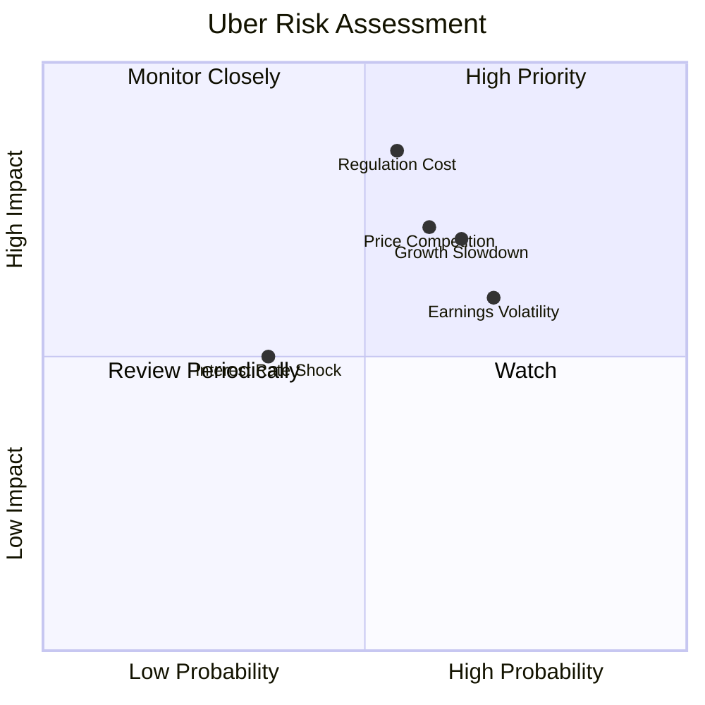
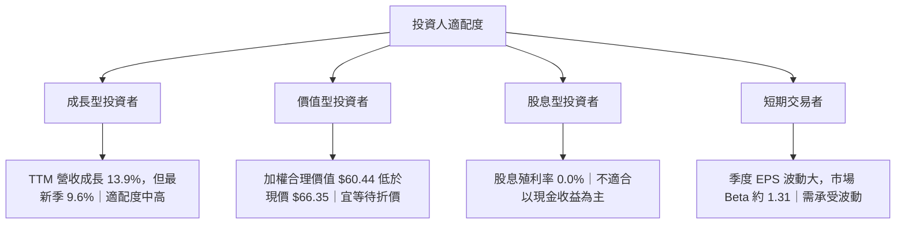

# UBER 基本面深度分析報告
> **報告日期**：2026-11-26 ｜ **語言**：繁體中文 ｜ **數據來源**：SEC 申報資料 (XBRL)、Yahoo Finance、Finviz、StockAnalysis、Roic.ai ｜ **分析師**：CFA 級機構研究

## 目錄

| # | 章節 | 核心結論 |
|---|------|----------|
| 1 | 執行摘要 | 持有；加權合理價值 $60.44，MOS -9.8% |
| 2 | 公司概覽與商業模式 | 雙邊平台與跨業務交叉銷售是主要優勢，分部營收占比未提供 |
| 3 | 損益表深度分析 | TTM 營收 $56.53B、年增 13.9%；營業利益率 TTM 12.4% |
| 4 | 資產負債表分析 | 淨負債 $5.60B；現金及短期投資 $10.07B |
| 5 | 現金流量深度分析 | TTM FCF $10.42B，FCF Yield 7.69% |
| 6 | 獲利能力與資本效率 | ROIC 15.8% 高於 WACC 9.98%，目前仍創造經濟價值 |
| 7 | 相對估值分析 | Uber 估值高於部分同業，但低於自身 P/S 五年中位數 |
| 8 | DCF 內在價值評估 | 基準 DCF $41.32；加權合理價值 $60.44，兩者不可混用 |
| 9 | 成長催化劑 | Mobility、Delivery 交叉銷售與營運槓桿；TAM 數據未提供 |
| 10 | 風險矩陣 | 監管、競爭與利潤率回落為主要風險 |
| 11 | 投資建議 | 持有；現價接近加權合理價值上緣，等待估值或基本面改善 |

---

## 1. 執行摘要

### 1.0 一頁式投資儀表板（Portfolio Manager 30 秒速讀）

| 項目 | 內容 |
|------|------|
| **投資論點（3 句）** | ① TTM 營收 $56.53B、年增 13.9%，平台仍在擴張。② TTM FCF $10.42B、FCF Yield 7.69%，現金轉換具吸引力。③ ROIC 15.8% 高於 WACC 9.98%，但加權合理價值 $60.44 低於 2026-11-25 收盤價 $66.35。 |
| **綜合評分** | **6.8/10**（引用 1.1 六項算術平均） |
| **財務健康** | 🟡 現金及短期投資 $10.07B，惟總債務 $15.66B，淨負債 $5.60B。 |
| **ROIC vs WACC** | **15.8% vs 9.98%**；利差 +5.82 個百分點，現況為創造價值。 |
| **FCF 趨勢** | TTM FCF $10.42B；FCF Yield **7.69%**。年度 FCF 由 2023 年 $3.36B 增至 2025 年 $9.76B。 |
| **估值** | Forward P/E 15.06x ｜ EV/EBITDA 18.2x（自身歷史口徑）｜ FCF Yield 7.69% |
| **DCF 內在價值（基準）** | **$41.32** ｜現價相對 DCF 基準溢價 **60.5%**（依 DCF 價值計算） |
| **安全邊際（MOS）** | **-9.8%**＝($60.44 − $66.35) ÷ $60.44；基準為 **8.8 加權合理價值 $60.44**。🔴 <10% 無 |
| **預期報酬（基準情境 12M）** | **-8.9%**（現價至加權合理價值的隱含上行空間，不是 DCF 情境報酬） |
| **關鍵風險（前二）** | 監管與司機分類／保險成本上升；單季營收成長由 20.1% 降至 9.6%。 |
| **評級 + 信心度** | 🟡 **持有** ｜信心：中；模型輸入有四捨五入差異，估值結果需以區間理解。 |

> **證據與評級**：2026-11-25 收盤價 $66.35，高於 8.8 加權合理價值 $60.44，MOS -9.8%，落在規則 20 的持有區間；ROIC 15.8% 高於 WACC 9.98%，但不足以抵銷當前估值缺乏安全邊際的問題。依 MOS 應為「持有」，未作質化調整。

### 1.1 綜合評分卡（全報告唯一）

| 維度 | 評分（1–10） | 主要依據（引用數字與其來源章節） |
|------|--------------|----------------------------------|
| 成長性 | 7.5 | TTM 營收年增 13.9%，最新一季年增 9.6%；季度成長率低於 2025 年多數季度（第 3 章）。 |
| 獲利能力 | 7.5 | TTM 營業利益率 12.4%、ROIC 15.8% 高於 WACC 9.98%；F-Score 6/8（第 6 章）。 |
| 財務健康 | 6.0 | 淨負債 $5.60B、流動比率 1.232、速動比率 0.999（第 4 章）。 |
| 估值 | 4.5 | MOS -9.8%；DCF 基準 $41.32 低於現價，但相對估值方法仍高於現價（第 7–8 章）。 |
| 護城河 | 7.5 | 雙邊平台、跨 Mobility／Delivery 交叉銷售及全球營運規模具網路效應；分部市占與營收占比未提供（第 2 章）。 |
| 管理層與資本配置 | 7.0 | 2025 年 FCF $9.76B、SBC $1.83B；稀釋股數測試通過，但回購、併購回報的完整數據不足（第 5 章）。 |
| **綜合評分** | **6.7** | 六項算術平均：(7.5+7.5+6.0+4.5+7.5+7.0) ÷ 6 = **6.7**。 |

### 1.2 五大投資論點 + 三大核心風險

| 類型 | 項目 | 具體依據 | 信心度 |
|------|------|----------|--------|
| 🟢 **投資論點①** | 平台收入仍成長 | TTM 營收 $56.53B，TTM 年增 13.9%；但最新一季年增 9.6%，須觀察減速是否持續。 | 🟢 高 |
| 🟢 **投資論點②** | 現金流轉換有韌性 | TTM OCF $10.73B、資本支出 $314M、FCF $10.42B；FCF Yield 7.69%。 | 🟢 高 |
| 🟢 **投資論點③** | 資本回報超過資本成本 | ROIC 15.8% 對 WACC 9.98%，利差 +5.82 個百分點。 | 🟢 高 |
| 🟢 **投資論點④** | 歷史營業槓桿改善 | 年營業利益由 2022 年 -$1.83B 增至 2025 年 $5.57B，營收同期由 $31.88B 增至 $52.02B。 | 🟡 中 |
| 🟢 **投資論點⑤** | 多服務平台有交叉銷售空間 | Mobility、Delivery、Freight 同屬平台架構；分部成長與會員交叉購買數據未提供，故不量化效益。 | 🟡 中 |
| 🟡 **風險①** | 營收成長減速 | 最新一季營收年增 9.6%，低於 2025 年 Q3 的 20.37%；若持續，估值倍數可能下修。 | 🟡 中 |
| 🔴 **風險②** | GAAP 盈餘波動與一次性項目 | 最新季淨利 $512M，較去年同期下降 92.3%；年度淨利與營業利益差距大，需追蹤非營業項目。 | 🔴 高衝擊 |
| 🔴 **風險③** | 監管與競爭 | 司機分類、保險與價格競爭可能同時壓縮供給、毛利及營業利益率；資料未提供可量化的監管成本拆分。 | 🟡 中 |

### 1.3 快速統計卡片

| 指標 | 公司實際值（期間） | 同業中位數 | 狀態 |
|------|--------------------|------------|------|
| 營收成長（TTM） | **13.9%** | — | 🟢 |
| 營收成長（最新一季年增） | **9.6%** | **27.4%**（LYFT、DASH、GRAB 中位數） | 🔴 |
| 毛利率（TTM） | **41.4%** | **41.4%**（三家中位數） | 🟡 |
| 營業利益率（TTM） | **12.4%** | — | 🟢 |
| ROIC（TTM） | **15.8%** | — | 🟢 |
| Forward P/E | **15.06x** | **18.1x** | 🟢 |
| FCF Yield（TTM） | **7.69%** | — | 🟢 |
| Piotroski F-Score | **6 / 8** | — | 🟢 |

### 1.4 投資結論

```text
╔══════════════════════════════════════════════════════════════════╗
║                    📊 投資結論摘要                               ║
╠══════════════════════════════════════════════════════════════════╣
║  評級：持有（依 MOS -9.8%，符合 -10% 至 +10% 門檻）              ║
║  價格（2026-11-25 收盤）：$66.35                                 ║
║  DCF 內在價值（基準）：$41.32（現價溢價 60.5%）                  ║
║  安全邊際 MOS：-9.8%（以加權合理價值為分母）                     ║
║  加權合理價值（8.8）：$60.44                                     ║
║  DCF 情境價值：                                                   ║
║    悲觀情境：$23.36（-64.8%）                                    ║
║    基準情境：$41.32（-37.7%）                                    ║
║    樂觀情境：$69.28（+4.4%）                                     ║
║  綜合評分：6.7/10（引用 1.1）                                    ║
║  適合投資人：能承受估值與季度盈餘波動的中長期成長型投資人        ║
╚══════════════════════════════════════════════════════════════════╝
```

---

## 2. 公司概覽與商業模式

### 2.1 業務結構與收入來源

公司經營 Mobility、Delivery、Freight 三個業務板塊。資料未提供各分部的營收金額、占比或單位經濟數據，因此不以推估值繪製分部比例。公司 TTM 總營收為 $56.53B，該數字包括公司按會計準則確認的收入，不等同於平台總交易額。



**分部占比與收入金額：N/A（SEC 10-Q 摘要資料未提供各分部營收明細）**。公司以平台媒合與服務網絡創造收入；未提供軟體訂閱或獨立 SaaS 收入拆分，故不把平台技術描述成獨立訂閱營收。

### 2.2 市場份額

市場份額數據未提供，故不列百分比或繪製市占圖。相對規模上，Uber TTM 營收 $56.53B，高於資料所列同業的收入規模指標並具跨區域營運；但同業收入絕對值未列，不能據此計算市占。最新一季 Uber 營收年增 9.6%，低於資料中 DoorDash 的 34.0% 與 Grab 的 27.4%，反映不同業務組合及成長階段。

### 2.3 競爭護城河分析



### 2.4 護城河強度

| 護城河項目 | 強度（強／中／弱） | 證據（引用數字或事實） | 會削弱它的情況 |
|------------|--------------------|------------------------|----------------|
| 技術與派單 | 中 | Mobility、Delivery、Freight 共用應用與媒合技術；研發支出 FY2025 $3.40B。 | 同業複製功能、服務中斷或演算法不能改善等待時間與成本。 |
| 軟體生態系統 | 中 | 多方平台串接乘客、司機、商家及承運商；各板塊收入與留存率未提供。 | 商家或司機能低成本多平台切換，平台補貼不足時供給流失。 |
| 網路效應 | 中至強 | 乘客密度可提高司機利用率，供給增加又可能改善可得性；但未提供城市層級密度數據。 | 地區市場競爭者以補貼取得雙邊流量，或監管限制平台運作。 |
| 客戶鎖定 | 中 | 跨服務使用可能提高便利性；實際多產品滲透率與留存數據未提供。 | 消費者價格敏感、容易切換至競爭平台。 |
| 規模效應 | 中至強 | TTM 營收 $56.53B、員工 37,300 人，跨多區域經營。 | 規模未能轉化為單位成本下降，或地方規範增加固定成本。 |
| 生態夥伴 | 中 | 依賴司機／車隊、商家與貨運承運商供給。 | 司機分類或保險成本變化、商家議價力上升、承運商供給不足。 |

1.1「護城河」評分 **7.5/10**，理由是多邊平台與規模形成真實競爭優勢，但缺少分部留存、網路密度與市占資料，不宜視為無條件強護城河。

---

## 3. 損益表深度分析

### 3.1 年度收入成長趨勢（近 4 年）

年度營收（SEC 年報彙整）：2022 年 $31.88B、2023 年 $37.28B、2024 年 $43.98B、2025 年 $52.02B。FY2022–FY2025 營收 CAGR 約 17.7%，依據為 \((52.02/31.88)^{1/3}-1\)。

```text
╔══════════════════════════════════════════════════════════════════╗
║              Uber 年度收入趨勢（FY2022–FY2025）                  ║
╠══════════════════════════════════════════════════════════════════╣
║  FY2022  $31.88B  ████████████░░░░░░░░░░░░░░  YoY：基期         ║
║  FY2023  $37.28B  ██████████████░░░░░░░░░░░░  YoY：+16.9% 🟢   ║
║  FY2024  $43.98B  █████████████████░░░░░░░░░  YoY：+18.0% 🟢   ║
║  FY2025  $52.02B  ████████████████████░░░░░░  YoY：+18.3% 🟢   ║
║                                                                  ║
║  FY2022–FY2025 三年營收 CAGR：約 +17.7%                          ║
╚══════════════════════════════════════════════════════════════════╝
```

2025 年營收增速高於 2023、2024 年約 18% 的水準不多，但絕對營收仍擴大。TTM 年增率則為 13.9%，低於最近完整年度成長，意味著最新幾季增長速度有所放慢。

### 3.2 季度收入趨勢分析

QoQ 依相鄰季度營收計算；YoY 只採單季同季比較，不標作 TTM。

| 季度 | 營收（$B） | QoQ | YoY | 備註 |
|------|-----------:|----:|----:|------|
| 2025 Q4 | 14.37 | +6.7% | +20.1% | 相較 2025 Q3 增長；年增仍高。 |
| 2026 Q1 | 13.20 | -8.1% | +14.5% | 季節性回落可能影響 QoQ，YoY 仍為雙位數。 |
| 2026 Q2 | 14.19 | +7.5% | +12.2% | QoQ 回升，年增較前季放緩。 |
| 2026 Q3 | 14.77 | +4.1% | +9.6% | 單季年增降至 9.6%，需檢視成長減速與基期影響。 |

季度營收連續提高，但 YoY 由 2025 Q4 的 20.1% 降到 2026 Q3 的 9.6%。若此下降主要來自較高基期，對估值影響有限；若代表出行或配送需求、交易頻率或定價能力轉弱，營收與營業槓桿將同步受壓。

### 3.3 利潤率演變分析

下表毛利率及營業利益率以年度財務數據計算，取一位小數；2026 TTM 的 12.4% 為 VERIFIED FIGURES 所列數字。

| 利潤率指標 | FY2022 | FY2023 | FY2024 | FY2025 | 趨勢 | 評估 |
|------------|-------:|-------:|-------:|-------:|------|------|
| **毛利率** | 38.3% | 39.8% | 39.4% | 39.8% | 大致持平，FY2025 小幅回升 | 🟡 |
| **營業利益率** | -5.7% | 3.0% | 6.4% | 10.7% | 持續改善，固定成本吸收與營運效率提升 | 🟢 |
| **淨利率** | -28.7% | 5.1% | 22.4% | 19.3% | FY2024–25 高於營業利益率所能單獨解釋的程度 | 🟡 |

**利潤率演變深度解析：**FY2022 至 FY2025 營業利益由 -$1.83B 增至 $5.57B，營收由 $31.88B 增至 $52.02B，顯示收入擴大同時營業成本及費用率有改善。年度毛利率則在約 38%–40% 區間，代表營業利益率擴張主要來自毛利以下的營運費用與規模槓桿，而非毛利率大幅跳升。淨利率在 FY2024、FY2025 明顯高於營業利益率，存在非營業、稅務或投資損益影響；具體拆分數據未提供，不應把淨利增長全當作核心營運成果。

**季度口徑提醒：**資料彙整區的最新季度營業利益率列為 12.4%，但 SEC／程式計算的 VERIFIED FIGURES 列出最新季度營業利益率 9.8%。本報告季度判讀採用優先數字 **9.8%**；TTM 則為 **12.4%**。兩種期間不得混用。

### 3.4 費用結構分析

完整營業成本及各項費用的 TTM 明細未提供，不能可靠繪製費用占比圓餅圖。可確認 FY2025 研發支出 **$3.40B**，約占 FY2025 營收 $52.02B 的 **6.5%**；其餘費用項目不以估算補齊。

```text
╔══════════════════════════════════════════════════════════════════╗
║                       費用結構可得數據                           ║
╠══════════════════════════════════════════════════════════════════╣
║  FY2025 營收       $52.02B                                       ║
║  FY2025 研發費用    $3.40B  約占營收 6.5%                        ║
║  其他費用分類       N/A（未提供可核對的完整費用明細）             ║
╚══════════════════════════════════════════════════════════════════╝
```

### 3.5 季度 EPS 趨勢與盈餘品質（Quality of Earnings）

| 季度 | EPS（美元） | EPS YoY | 實際 vs 預期 |
|------|------------:|--------:|--------------|
| 2025 Q4 | 0.14 | -95.58% | 預期 EPS N/A，無法判定超預期或不及預期。 |
| 2026 Q1 | 0.13 | -84.57% | 預期 EPS N/A，無法判定。 |
| 2026 Q2 | 1.18 | +85.46% | 預期 EPS N/A，無法判定。 |
| 2026 Q3 | 0.25 | -91.97% | 預期 EPS N/A，無法判定。 |

**過去四季盈餘表現：**EPS 實際值先由 2025 Q4 的 $0.14、2026 Q1 的 $0.13 升至 Q2 的 $1.18，再回落至 Q3 的 $0.25。財報 EPS 預期值缺失，不能宣稱 beat 或 miss。EPS 與淨利的年增大幅波動，尤其 2026 Q3 淨利年減 92.3%，比較基期與非營業損益可能影響較大；資料未提供足以量化分解的附註。

| 盈餘品質項目 | 數值／佔比 | 評估 |
|--------------|-----------|------|
| 股權薪酬 SBC / 營收 | 約 **3.65%**：TTM SBC $2.065B ÷ TTM 營收 $56.53B | 🟡 SBC 是真實股東成本；占比不低，會稀釋未來股東權益。 |
| SBC / 營業現金流 | 約 **19.3%**：$2.065B ÷ $10.73B | 🟡 現金流不等於扣除股權薪酬後的股東經濟回報。 |
| FCF / 淨利（現金轉換率） | 約 **300.7%**：TTM FCF $10.42B ÷ TTM 淨利 $3.465B | 🟢 現金流高於會計淨利；但受非現金項目與營運資金變動影響。 |
| 一次性／非經常性損益 | 有波動跡象；金額拆分 N/A | 🟡 FY2024、FY2025 淨利顯著高於營業利益，不能假設差額全屬一次性或核心獲利。 |
| 有效稅率異常 | N/A（缺少可比較 TTM 稅前所得與稅費明細） | 🟡 無法確認最近年度淨利是否受特殊稅務利益帶動。 |
| 資本化支出 vs 費用化 | TTM Capex $314M；資本化開發成本明細 N/A | 🟡 資本支出數字本身偏低，但不能據此判斷是否有成本資本化或遞延。 |

**盈餘品質結論：**TTM FCF $10.42B、現金轉換率約 300.7%，支持獲利有現金流背書；但 SBC 約占營收 3.65%、占 OCF 19.3%，而季度淨利變動劇烈。因缺少可核對的一次性損益與稅項拆分，估值應以 FCF 與營業獲利能力為主，避免直接以單季 EPS 外推。

---

## 4. 資產負債表分析

### 4.1 資產結構分解

FY2026 Q3 資產負債表的總資產為 $71.067B；可取得的主要類別如下。圖中不代表完整勾稽，未列項目不反推。



主要資產包括流動資產、長期投資、商譽及遞延稅項資產。長期投資與遞延稅項資產占比較值得追蹤，但資料未提供其流動性、可收回性及組成拆分，不能視同現金。

### 4.2 流動性與營運資金分析

| 指標 | 最新 TTM | 一年前 TTM | 變化 | 解讀 |
|------|----------|------------|------|------|
| DSO 應收帳款天數 | 29 天 | 28 天 | +1 天 | 輕微延長，可能反映收款組合或時點；單年變動不構成明確惡化證據。 |
| DIO 存貨天數 | N/A | N/A | N/A | 公司未報列此項存貨餘額；不應補值。 |
| DPO 應付帳款天數 | 17 天 | N/A | N/A | 一年前資料缺漏，無法判斷供應商付款週期變化。 |
| CCC 現金轉換週期 | N/A | N/A | N/A | DIO 缺失，依定義無法計算。 |

流動比率 **1.232**、速動比率 **0.999**，顯示短期資產略高於短期負債，但速動比率接近 1，流動性並非完全不受營運現金流影響。應收帳款 DSO 僅增加 1 天，暫未見明顯收款效率惡化。

### 4.3 債務結構分析

本節依 SEC／程式計算的優先數字列示：現金及短期投資 $10.07B、總債務 $15.66B、淨負債 $5.60B。其他來源彙整列示總債務 $17.74B、淨負債 $7.67B，與優先口徑不一致；估值與本報告主要財務判斷採用 $15.66B，且在模型中使用淨負債 -$5.60B。

```text
╔══════════════════════════════════════════════════════════════════╗
║                     Uber 債務健康診斷                            ║
╠══════════════════════════════════════════════════════════════════╣
║  總債務：        $15.66B  ████████████████░░░░  🟡               ║
║  現金及短期投資：$10.07B  ██████████░░░░░░░░░░  🟢               ║
║  淨負債：         $5.60B  ██████░░░░░░░░░░░░░░  🟡               ║
║  Debt / EBITDA：  約2.23x（$15.66B ÷ TTM EBITDA $7.034B）       ║
║  利息保障倍數：   N/A（利息費用／可比 EBITDA 資料未提供）        ║
║  流動比率：       1.232                                             ║
║  速動比率：       0.999                                             ║
╚══════════════════════════════════════════════════════════════════╝
```

Debt/EBITDA 約 2.23x 是以優先總債務數字及 StockAnalysis TTM EBITDA $7.034B 計算的近似值；非 VERIFIED FIGURES 指定的估值倍數，不與其 EV/EBITDA 混為一談。淨負債規模可控，但仍須以持續 FCF 支付債務及業務投資。

### 4.4 股東權益趨勢

| 年度 | 股東權益（$B） | 年增變化 | 解讀 |
|------|---------------:|----------|------|
| 2022 | 7.34 | — | 低基期。 |
| 2023 | 11.25 | +$3.91B | 權益增加，與獲利轉正及資本變化共同相關。 |
| 2024 | 21.56 | +$10.31B | 增幅顯著；淨利 $9.86B，但權益變化不等於留存盈餘單一因素。 |
| 2025 | 27.04 | +$5.48B | 持續上升，支持資產負債表改善。 |

股東權益資料來自年度資產負債表；由於季度權益值未在同一表格提供，不另畫季度趨勢，也不將權益增加全歸因於純營運留存。

---

## 5. 現金流量深度分析

### 5.1 現金流量瀑布圖


TTM 淨利低於 OCF，代表營運現金流受到非現金費用、營運資金及其他現金流調整影響。股息、回購與現金變動的完整同期分配金額未提供，不能畫出有數值的後續資金瀑布。

### 5.2 FCF 轉換率趨勢

| 年度 | FCF（$B） | 淨利（$B） | FCF / 淨利 | 評估 |
|------|----------:|-----------:|-----------:|------|
| 2022 | 0.39 | -9.14 | 不具經濟意義 | 淨利為負，不以比率判斷。 |
| 2023 | 3.36 | 1.89 | 177.8% | 現金流高於會計淨利。 |
| 2024 | 6.89 | 9.86 | 69.9% | 現金轉換低於淨利，反映非現金或營運資金等因素。 |
| 2025 | 9.76 | 10.05 | 97.1% | 接近一比一。 |
| TTM 至 2026-09-30 | 10.42 | 3.465 | 300.7% | 高轉換，但比較期間淨利有大幅波動。 |

轉換率年度變化顯著，因而不宜只用單一年份判斷盈餘品質。TTM FCF 高於淨利對現金創造有利，但若非現金調整或營運資金釋放不可持續，未來轉換率可能回落。

### 5.3 自由現金流趨勢

| 年度 | FCF（$B） | 年增率 | FCF Yield |
|------|----------:|------:|----------:|
| 2022 | 0.39 | — | N/A |
| 2023 | 3.36 | 約 +761.5% | N/A |
| 2024 | 6.89 | 約 +105.1% | N/A |
| 2025 | 9.76 | 約 +41.7% | N/A |
| TTM 至 2026-09-30 | 10.42 | — | **7.69%** |

歷史 FCF 從低基期快速增長，增速自然會隨基數擴大而下降。TTM FCF $10.42B 是 OCF $10.73B 減資本支出 $314M 的口徑；不得以其他自由現金流定義取代。

```text
╔══════════════════════════════════════════════════════════════════╗
║                    Uber 自由現金流趨勢                           ║
╠══════════════════════════════════════════════════════════════════╣
║  FY2023  $3.36B  ███████░░░░░░░░░░░░░░░░░░░                      ║
║  FY2024  $6.89B  ██████████████░░░░░░░░░░░                      ║
║  FY2025  $9.76B  ████████████████████░░░░░                      ║
║  TTM     $10.42B █████████████████████░░░                      ║
║                                                                  ║
║  TTM FCF Yield：7.69%                                             ║
╚══════════════════════════════════════════════════════════════════╝
```

### 5.4 資本配置評估

| 資本配置項目 | 可得數據 | 判讀 |
|--------------|----------|------|
| 資本支出 | TTM $314M；FY2025 $336M | 相對 TTM FCF 規模低，表示自由現金流較少受有形資產支出侵蝕；不代表沒有技術或營運投資。 |
| 股權薪酬 | FY2025 $1.83B；TTM 約 $2.065B | 對員工激勵有用，但增加股東稀釋成本。 |
| 股息 | 股息殖利率 0.0% | 未見現金股息回報。 |
| 回購 | 同期金額 N/A | 無法據此判斷回購是否抵銷 SBC 稀釋。 |
| 留存現金／併購 | 同期完整資料 N/A | 不繪製資本配置比例圖，避免虛構占比。 |

---

## 6. 獲利能力與資本效率

### 6.1 ROE / ROA / ROIC 趨勢

| 指標 | 最新可得值 | 歷史資料 | 評估 |
|------|------------:|----------|------|
| ROE（TTM） | **12.5%**（品質指標口徑） | 完整同口徑歷史序列未提供 | 🟡 正報酬，但須與權益乘數及非營業損益一併觀察。 |
| ROA（TTM） | 6.5%（財務資料彙整值） | 完整可比歷史序列未提供 | 🟡 具正獲利能力。 |
| ROIC（TTM） | **15.8%** | 歷史同口徑序列未提供 | 🟢 高於 WACC 9.98%。 |
| 行業均值 | N/A | 未提供可引用來源與同期數值 | 不作對比。 |

不同來源彙整的 ROE 有 12.3% 與 12.5% 兩個數字；本報告品質指標及 DuPont 分析依 VERIFIED FIGURES 採用 **12.5%**。ROIC 15.8% 則作為資本效率與價值創造的核心指標。

### 6.2 ROIC vs WACC 分析（核心價值創造判斷）

```text
╔══════════════════════════════════════════════════════════════════╗
║                ROIC vs WACC 深度分析                            ║
╠══════════════════════════════════════════════════════════════════╣
║  WACC（採用程式計算值）：9.98%                                   ║
║  ├── 無風險利率（10Y 美債）：4.85%（來源未提供觀測日期）         ║
║  ├── ERP：5.00%（假設值，採用資本成本輸入）                      ║
║  ├── 原始 Beta：1.31；調整後 Beta：1.21                          ║
║  ├── 股權成本：10.87%（資本成本輸入原值）                        ║
║  ├── 稅前債務成本：2.81%；稅後約 2.22%                           ║
║  ├── 股權／債務權重：89.6%／10.4%                                ║
║  └── 採用 WACC：9.98%（不另建替代 WACC）                         ║
║                                                                  ║
║  ROIC（TTM）：15.8%                                               ║
║  經濟利差：15.8% − 9.98% = +5.82 個百分點                       ║
║  結論：目前 ROIC 高於資本成本，仍在創造股東價值                  ║
║                                                                  ║
║  ROIC 15.8%  ▓▓▓▓▓▓▓▓▓▓▓▓▓▓▓▓░░░░  🟢                          ║
║  WACC  9.98% ▓▓▓▓▓▓▓▓▓▓░░░░░░░░░░  ──                          ║
╚══════════════════════════════════════════════════════════════════╝
```

資本成本來源列示原始 Beta 1.31，依 \(2/3 \times 1.31+1/3\) 得調整後 Beta 約 1.21，並指定採用股權成本 10.87%、債務成本 2.81%、權重 89.6%／10.4% 與 WACC 9.98%。因輸入的四捨五入值無法精確重現內部未四捨五入的 WACC，本報告遵照指定直接採用 **9.98%**。以 TTM ROIC 減 WACC 計算，經濟利差為 **+5.82 個百分點**；若 ROIC 長期跌破 9.98%，價值創造結論即失效。

### 6.3 杜邦三因素分解

| 因素 | 數值（TTM） | 解讀 |
|------|-------------|------|
| 淨利率 | 6.1% | 反映扣除利息、稅項及非營業項目後的淨獲利。 |
| 資產週轉率 | 0.80 | 每一美元資產產生約 0.80 美元營收。 |
| 權益乘數 | 2.57 | 資產相對權益的槓桿倍數，存在一定財務槓桿。 |
| **ROE** | **12.5%** | DuPont 指標：6.1% × 0.80 × 2.57 = 12.5%（按來源四捨五入）。 |

ROE 由淨利率、資產效率與槓桿共同推動，不是單靠高資產週轉率。權益乘數 2.57 表示槓桿有貢獻，但 ROIC 高於 WACC 才是判斷是否創造經濟價值的較直接依據。

### 6.4 財務體質：Piotroski F-Score

**Piotroski F-Score：6 / 8**。毛利率測試因缺少輸入不計入分母，故測試分母低於九項。

| 測試 | 結果 | 解讀 |
|------|------|------|
| ROA > 0 | ✅ 通過 | TTM 資產報酬為正。 |
| 營業現金流 > 0 | ✅ 通過 | TTM OCF 為 $10.73B。 |
| ROA 高於一年前 | ❌ 未通過 | 盈利能力未在同比測試中改善。 |
| 營業現金流 > 淨利（應計品質） | ✅ 通過 | OCF 高於 TTM 淨利。 |
| 長期負債 ÷ 總資產低於一年前 | ❌ 未通過 | 負債率方向未改善，應持續監測。 |
| 流動比率高於一年前 | ✅ 通過 | 短期流動性相較一年前改善。 |
| 稀釋股數未增加 | ✅ 通過 | 該項比較期間未顯示股數增加。 |
| 毛利率高於一年前 | — 無法判定 | 缺少可判定輸入，不納入分母。 |
| 資產週轉率高於一年前 | ✅ 通過 | 週轉效率同比提高。 |

---

## 7. 相對估值分析

### 7.1 同業估值比較表格

同業數字依 Yahoo Finance 提供的 Peer multiples。Uber 倍數採市場估值資料；P/E 與 EV/EBITDA 可能受 GAAP 淨利及特殊項目影響。

| 估值指標 | **Uber** | **LYFT** | **DASH** | **GRAB** | Uber 評估 |
|----------|---------:|---------:|---------:|---------:|-----------|
| **Trailing P/E** | 38.8x（同業比較來源 39.0x） | 2.5x | 69.0x | 28.4x | 🟡 位於同業分布中段；LYFT 低倍數可能受分母影響。 |
| **Forward P/E** | 15.06x | 8.3x | 21.8x | 18.1x | 🟢 低於三家中位數 18.1x。 |
| **P/S Ratio** | 2.4x | 0.9x | 4.3x | 2.9x | 🟡 低於 DASH、GRAB，高於 LYFT。 |
| **EV/EBITDA（TTM）** | 18.2x（自身歷史口徑） | 565.0x | 40.9x | 18.3x | 🟢 接近 GRAB、低於 DASH；LYFT 倍數異常高，不宜當穩定基準。 |
| **最新一季營收年增** | 9.6% | 8.1% | 34.0% | 27.4% | 🔴 Uber 成長低於 DASH、GRAB。 |
| **毛利率（TTM）** | 41.4% | 40.0% | 52.7% | 41.4% | 🟡 與 GRAB 相當，低於 DASH。 |

同業最新季營收年增中位數為 **27.4%**（LYFT、DASH、GRAB 數值排序後的中位數），但業務組合與財務口徑不同，不能單靠成長率認定估值高低。

### 7.2 歷史估值區間分析

| 倍數 | 現值 | 五年中位數 | 五年區間 | 目前百分位 | 判讀 |
|------|------:|-----------:|---------:|-----------:|------|
| P/E | 38.8x | 17.8x | 12.6x–122.2x | 62% | 高於歷史中位數，但歷史區間受早期低獲利年份影響而極寬。 |
| P/S | 2.4x | 3.3x | 1.5x–6.1x | 19% | 低於自身五年中位數，歷史位置偏低。 |
| EV/EBITDA | 18.2x | 40.0x | 18.7x–320.2x | 0% | 接近歷史區間下緣；極高的歷史倍數可能受早期 EBITDA 基數扭曲。 |

```text
╔══════════════════════════════════════════════════════════════════╗
║                  Uber 歷史估值位置（五年）                       ║
╠══════════════════════════════════════════════════════════════════╣
║  P/E        12.6x ├──────● 38.8x──────┤ 122.2x｜百分位 62%      ║
║                       中位數 17.8x                               ║
║  P/S         1.5x ├──● 2.4x──────────┤   6.1x｜百分位 19%      ║
║                       中位數 3.3x                                ║
║  EV/EBITDA  18.7x ●───────────────────┤ 320.2x｜百分位 0%       ║
║                       中位數 40.0x                               ║
╚══════════════════════════════════════════════════════════════════╝
```

### 7.3 情境價值（Bear / Base / Bull，照抄 DCF MODEL 的 Scenarios）

| 情境 | 第 1 年營收成長 | 期末營業利潤率 | WACC | 每股價值 | 相對現價 | 機率 | 會發生的條件 |
|------|----------------:|---------------:|-----:|---------:|---------:|-----:|--------------|
| 🔴 悲觀 | 7.0% | 5.4% | 10.98% | $23.36 | -64.8% | 25% | 需求放緩、競爭或監管成本上升，營收增長與成熟利潤率均低於基準。 |
| 🟡 基準 | 13.9% | 6.4% | 9.98% | $41.32 | -37.7% | 50% | 首年延續 TTM 增長，之後逐步減速，GAAP 營業利潤率回歸歷史五年中位數。 |
| 🟢 樂觀 | 20.9% | 7.0% | 8.98% | $69.28 | +4.4% | 25% | Mobility／Delivery 成長再加速，規模效益維持，風險折現率下降。 |

三情境都是 DCF 模型輸出，並非 12 個月價格目標。基準情境的 DCF 價值低於現價，而樂觀情境每股價值 $69.28 僅比現價高 4.4%，顯示即使達到樂觀假設，報酬空間仍有限。

### 7.4 相對估值隱含價格區間

```text
╔══════════════════════════════════════════════════════════════════╗
║                 估值方法與每股價值位置                           ║
╠══════════════════════════════════════════════════════════════════╣
║  $41.32 ───── $60.44 ───── $66.35 ───── $79.70 ───── $98.16    ║
║  DCF基準       加權價值       現價       同業 Forward P/E  分析師 ║
╚══════════════════════════════════════════════════════════════════╝
```

| 方法 | 每股價值 | 相對現價 | 依據 |
|------|---------:|---------:|------|
| DCF（基準） | $41.32 | -37.7% | 10 年 FCFF、WACC 9.98%、永續成長率 3.0%。 |
| 同業 Forward P/E | $79.70 | +20.1% | 同業中位數 Forward P/E 18.1x × Uber Forward EPS $4.41。 |
| 分析師共識 | $98.16 | +47.9% | 46 位分析師平均目標價。 |

同業 Forward P/E 隱含價值高於現價，但分析師共識目標價分布為 $70–$150，離散度較大；兩者與 DCF 的差距說明估值對長期利潤率假設非常敏感。

---

## 8. DCF 內在價值評估（Discounted Cash Flow）

> 本章逐年現金流、終值、敏感度與情境均依程式 DCF 模型原值列示，不以其他模型替代。模型表格數值以 $B、每股美元表示；金額取兩位小數、比率取一位小數、折現因子取三位小數。因模型內部採用未四捨五入輸入，部分以顯示值回算會出現小於 1% 的尾差，會明確指出，不自行改寫模型輸出。

### 8.0 估值推理鏈（Thinking Logic）

**Step 1 — 價值由哪些變數決定？**  
Uber 價值主要來自 Mobility 的出行媒合現金流、Delivery／Freight 等相鄰服務的增長，以及整體平台能否把規模轉成 GAAP 營業利潤。分部營收占比未提供，無法誠實地把 $56.53B TTM 營收拆成各板塊比例。模型中最主導估值的變數是 WACC 與長期營業利潤率：基準終值現值占 EV 46.9%，敏感度矩陣亦顯示 g 與 WACC 改變會明顯改變每股價值。

**Step 2 — 模型選擇**

| 決策點 | 本報告採用 | 理由（含數字） | 曾考慮但否決 | 否決理由 |
|--------|-----------|----------------|--------------|----------|
| 現金流定義 | FCFF | 以 EBIT、稅、D&A、Capex 推導，並用 WACC 折現至 EV。 | FCFE | 債務權重與資本結構已納入 WACC，FCFF 口徑一致。 |
| 預測期 N | 10 年 | 模型設定由首年營收成長 13.9% 逐步淡化至第十年 3.0%。 | 5 年 | 不能保留模型明定的十年現金流路徑。 |
| 終值方法 | Gordon Growth | 模型明定永續成長率 3.0%，低於 WACC 9.98%。 | 退出倍數 | DCF MODEL 未提供退出倍數終值，不能自行新增。 |
| EBIT 基礎 | GAAP EBIT | 模型以 GAAP 營業利益率預測。 | 非 GAAP EBIT | 會把已扣除 SBC 的支出重新加回，與原模型不相容。 |

**Step 3 — 關鍵假設四段式推導**

- **營收路徑**：錨點＝TTM 營收成長 13.9%、FY2022–FY2025 營收 CAGR 約 17.7% → 調整＝模型假設成長率從首年 13.9% 線性降至第十年 3.0%，納入增長自然成熟 → **採用模型的 FY+1 13.9%、FY+10 3.0% 路徑** → 曾考慮將 17.7% 歷史 CAGR 延續十年，但否決，因最新一季單季年增只有 9.6%，且長期維持歷史增長可能過於樂觀。
- **期末營業利潤率**：錨點＝TTM GAAP 營業利潤率 12.4%、FY2025 年度約 10.7% → 調整＝模型由 12.4% 逐年回落至近五個財年中位數 6.4%，承認競爭與成熟化 → **採用第十年 6.4%** → 曾考慮永久維持 12.4%，但因高於模型使用的歷史中位數且缺乏分部利潤數據而否決。
- **永續成長率 g**：錨點＝模型採 3.0%，且 WACC 為 9.98% → 調整＝長期名目增長不得等同高成長階段，並需低於折現率 → **採用 3.0%** → 不採 4.0% 作基準，因其會提高終值敏感度且未有長期產業增長證據支持。
- **預測期 N**：錨點＝DCF MODEL 明列 10 年，FY+1 至 FY+10 成長與利潤率逐年淡化 → 調整＝不用單一短期倍數取代逐年現金流 → **採用 10 年** → 未採 5 年，因會改變終值起算年並非原模型。
- **Capex／營收**：錨點＝TTM Capex $314M ÷ TTM 營收 $56.53B，約 0.6% → 調整＝模型以 0.6% 維持至第十年；未提供擴張性資本支出計畫 → **採用 0.6%** → 不另加固定設備投資率，以免改動既定模型。
- **EBIT 基礎、SBC 與稀釋**：錨點＝TTM SBC 約 $2.065B、FY2025 SBC $1.83B；GAAP EBIT 已含股權薪酬費用 → **採用組合 (A)：GAAP EBIT、FCFF 不再扣 SBC、固定股數、不另加年稀釋率** → 不採非 GAAP 加回 SBC 或另行扣除，避免重複計算同一成本。**本模型採用 (A)，故 SBC 影響已計入一次。**
- **WACC**：錨點＝資本成本資料明列 WACC 9.98%，股權成本 10.87%、稅前債務成本 2.81%、股權／債務權重 89.6%／10.4% → 調整＝不調整程式既定結果 → **採用 9.98%** → 不另建替代 WACC，避免與規則指定值不一致。
- **ΔWC**：錨點＝模型明確註明不建模營運資金變動 → **採用未列入 FCFF** → 不以 DSO 等天數自行推回營運資金現金流，因模型沒有該假設。
- **終值方法**：錨點＝模型以 FY+10 FCFF 與 g=3.0% 採 Gordon Growth → **採用 Gordon Growth** → 不加退出倍數交叉驗證，因模型未提供可用退出倍數。

**Step 4 — 最脆弱一環：**基準模型把營業利益率從 TTM 12.4% 降至第十年 6.4%，但營收仍延續十年成長；若利潤率或營收路徑偏離，DCF 值可朝悲觀情境 $23.36 方向下修，或在樂觀營運與較低 WACC 下至 $69.28。

**Step 5 — 計算路徑圖**



### 8.1 模型假設總表（Model Inputs）

| 假設項目 | 採用值 | 依據／來源 | 敏感度 |
|----------|--------|-------------|--------|
| 預測期長度 **N** | **10 年** | DCF MODEL 指定 FY+1 至 FY+10。 | 🟡 中 |
| 營收成長路徑 | FY+1 **13.9%**；FY+10 **3.0%**，線性淡化 | 首年錨定 TTM 年增 13.9%；末年為模型設定值。 | 🔴 高 |
| 營業利潤率路徑 | **12.4%** 降至 **6.4%** | 首年取 TTM；期末取近五財年中位數。 | 🔴 高 |
| 有效稅率 | **21.0%** | 模型指定 default tax rate。 | 🟢 低 |
| Capex／營收 | **0.6%** | TTM Capex $314M／營收 $56.53B 的約略比例；模型各年採 0.6%。 | 🟡 中 |
| D&A／營收 | **1.4%** | 模型採 TTM 比例並固定。 | 🟢 低 |
| 營運資金變動 | **未建模** | DCF MODEL 明列 working capital is not modelled。 | 🟢 低 |
| EBIT 基礎 | **GAAP EBIT** | 使用 GAAP 營業利潤率，SBC 已計入費用。 | 🟡 中 |
| 股權薪酬 SBC 處理 | **不另扣 SBC** | 採 (A)：GAAP EBIT 已含 SBC。 | 🟡 中 |
| 年稀釋率（股數） | **0%／不另稀釋** | 採 (A)，SBC 反映於費用、股數固定。 | 🟡 中 |
| 永續成長率 g | **3.0%** | DCF MODEL 指定；低於 WACC 9.98%。 | 🔴 高 |
| 終值方法 | **Gordon Growth** | DCF MODEL 明列終值公式。 | 🔴 高 |
| WACC | **9.98%** | 資本成本計算指定值。 | 🔴 高 |

本模型使用 **FCFF = NOPAT + D&A − Capex**，不列 ΔWC，也不再扣 SBC。模型每股價值轉換按原始方法使用「股權價值 × 股價 ÷ 市值」，不得以另一套股數口徑替換。

### 8.2 折現率推導（WACC）

```text
╔══════════════════════════════════════════════════════════════════╗
║                    WACC 推導（折現率）                           ║
╠══════════════════════════════════════════════════════════════════╣
║  股權成本 Ke（採資本成本資料原值）：10.87%                       ║
║  ├── 無風險利率 Rf：4.85%（利率觀測日期未提供）                  ║
║  ├── ERP：5.00%（假設值，資本成本輸入）                           ║
║  ├── 原始 Beta：1.31；調整後 Beta：1.21                          ║
║  ├── Beta 調整：⅔ × 1.31 + ⅓ × 1 = 1.2067，顯示為 1.21         ║
║  └── Ke 採用原值：10.87%（不以顯示後 Beta 重算替換）             ║
║                                                                  ║
║  債務成本：                                                       ║
║  ├── 稅前 Kd：2.81%（資本成本輸入）                              ║
║  ├── 稅率：21.0%                                                 ║
║  └── 稅後 Kd = 2.81% × (1−21.0%) = 2.2199% ≈ 2.22%              ║
║                                                                  ║
║  資本結構：                                                       ║
║  ├── 股權權重：89.6%                                             ║
║  ├── 債務權重：10.4%                                             ║
║  └── 採用 WACC：9.98%（資本成本輸入原值）                        ║
╚══════════════════════════════════════════════════════════════════╝
```

**逐步演算與資料限制**

1. **Ke（CAPM）**：輸入資料已列 Ke = **10.87%**。若直接使用顯示後 Rf、Beta、ERP，\(4.85\%+1.21\times5.00\%=10.90\%\)，與來源 Ke 相差 0.03 個百分點，故依規則採用來源原值 10.87%，差異來自 Beta 及底層輸入未四捨五入。
2. **稅前 Kd**：來源直接提供 **2.81%**，但未提供利息費用與平均計息負債的明細，不能另行重建其分子、分母。
3. **稅後 Kd**：\(2.81\%\times(1-21.0\%)=2.2199\%\)，四捨五入為 **2.22%**。
4. **權重**：來源指定股權／債務權重 **89.6%／10.4%**；兩者相加為 **100.0%**。市值 $135.48B、債務 $15.66B 可與該權重近似對照，但不據此重算或替換來源權重。
5. **WACC**：依底層未四捨五入輸入，來源指定 **9.98%**。用顯示後組成重算 \(89.6\%\times10.87\%+10.4\%\times2.22\%=9.97\%\)，與原值差 0.01 個百分點；DCF 與第 6.2 節均採用來源原值 **9.98%**。

### 8.3 逐年自由現金流預測（基準情境）

金額單位：$B。下表逐年照列模型輸出；ΔWC 不在模型中，SBC 不另扣除，因採用組合 (A)。

| 年度 | FY+1 | FY+2 | FY+3 | FY+4 | FY+5 | FY+6 | FY+7 | FY+8 | FY+9 | FY+10 |
|------|-----:|-----:|-----:|-----:|-----:|-----:|-----:|-----:|-----:|------:|
| 營收 | 64.41 | 72.60 | 80.96 | 89.29 | 97.40 | 105.06 | 112.04 | 118.12 | 123.10 | 126.80 |
| 營收 YoY | 13.9% | 12.7% | 11.5% | 10.3% | 9.1% | 7.9% | 6.6% | 5.4% | 4.2% | 3.0% |
| 營業利潤率 | 12.4% | 11.8% | 11.1% | 10.4% | 9.7% | 9.1% | 8.4% | 7.7% | 7.0% | 6.4% |
| EBIT（GAAP） | 8.01 | 8.54 | 8.98 | 9.30 | 9.49 | 9.52 | 9.40 | 9.11 | 8.67 | 8.07 |
| − 稅 | (1.68) | (1.79) | (1.89) | (1.95) | (1.99) | (2.00) | (1.97) | (1.91) | (1.82) | (1.69) |
| = NOPAT | 6.33 | 6.75 | 7.09 | 7.35 | 7.50 | 7.52 | 7.43 | 7.20 | 6.85 | 6.38 |
| + D&A | 0.88 | 0.99 | 1.10 | 1.21 | 1.33 | 1.43 | 1.52 | 1.61 | 1.67 | 1.72 |
| − Capex | (0.36) | (0.40) | (0.45) | (0.50) | (0.54) | (0.58) | (0.62) | (0.66) | (0.68) | (0.70) |
| **= FCFF** | **6.85** | **7.33** | **7.75** | **8.07** | **8.28** | **8.37** | **8.33** | **8.15** | **7.84** | **7.40** |
| 折現因子 @ WACC 9.98% | 0.909 | 0.827 | 0.752 | 0.684 | 0.622 | 0.565 | 0.514 | 0.467 | 0.425 | 0.386 |
| **FCFF 現值 PV** | **6.23** | **6.06** | **5.82** | **5.51** | **5.15** | **4.73** | **4.28** | **3.81** | **3.33** | **2.86** |

預測期 PV 合計的逐項加總：

\[
6.23+6.06+5.82+5.51+5.15+4.73+4.28+3.81+3.33+2.86=\mathbf{47.78B}
\]

**FY+1 代表年度逐步演算**

1. **營收**：以顯示值試算 \(56.53\times(1+13.9\%)=64.39B\)；模型列示 **$64.41B**。差額 $0.02B，約 0.03%，來自底層未四捨五入輸入，保留模型原值。
2. **EBIT**：模型原值 **$8.01B**；顯示營收乘顯示利潤率為 \(64.41\times12.4\%=7.99B\)，差額約 $0.02B，原因同為底層精度。
3. **稅**：\(8.01\times21.0\%=1.6821B\)，四捨五入 **$1.68B**。
4. **NOPAT**：\(8.01-1.68=\mathbf{6.33B}\)。
5. **D&A**：模型原值 **$0.88B**；若以顯示的營收與 1.4% 重算，為 \(64.41\times1.4\%=0.90B\)，顯示輸入無法完全重現模型原值。
6. **Capex**：模型原值 **$0.36B**；\(64.41\times0.6\%=0.39B\)，同樣存在顯示精度／底層計算差異。
7. **ΔWC**：**未建模**，不扣除。
8. **FCFF**：按模型已列出的四捨五入金額 \(6.33+0.88-0.36=\mathbf{6.85B}\)。
9. **折現與現值**：\(6.85\times0.909=6.22665B\)，四捨五入 **$6.23B**。

因 DCF MODEL 的假設比例與逐年輸出表部分不能以已顯示的小數位完全互相重建，本文保留模型數字並揭露差異，不以自行重算數字覆蓋原模型。

**合理性自檢**

- 預測 FCF CAGR：FY+1 $6.85B 至 FY+10 $7.40B，九年年複合增長約 **0.9%**；FY2023–FY2025 FCF 由 $3.36B 增至 $9.76B，兩年 CAGR 約 **70.4%**，歷史增速受低基期影響，不適合直接外推。
- FY+10 FCF 利潤率：\(7.40/126.80=5.8\%\)；目前 TTM FCF 利潤率：\(10.42/56.53=18.4\%\)。預測值明顯下降，模型包含利潤率收斂與營收成熟化。
- 預測期間 FCFF 均為正；末年 FCFF 低於 FY+6 高點 $8.37B，主要反映營業利潤率逐年下降。

```text
╔══════════════════════════════════════════════════════════════════╗
║            自由現金流：歷史實際 vs 模型預測                      ║
╠══════════════════════════════════════════════════════════════════╣
║  FY2023(實)  $3.36B  ███████░░░░░░░░░░░░░░░░░░                    ║
║  FY2024(實)  $6.89B  ██████████████░░░░░░░░░░                    ║
║  FY2025(實)  $9.76B  ████████████████████░░░░                    ║
║  FY+1  (預)  $6.85B  ██████████████░░░░░░░░░░                    ║
║  FY+10 (預)  $7.40B  ███████████████░░░░░░░░░                    ║
╠══════════════════════════════════════════════════════════════════╣
║  模型預測不是延續歷史低基期高速增長；FCF 利潤率由現況收斂。     ║
╚══════════════════════════════════════════════════════════════════╝
```

### 8.4 終值計算（Terminal Value）

**適用性檢查：WACC 9.98% vs g 3.0% → WACC > g？✅**

| 方法 | 計算式 | 終值 TV | TV 現值 | 佔總 EV 比重 |
|------|--------|---------|---------|--------------|
| Gordon Growth | \(7.40\times(1+3.0\%)\div(9.98\%-3.0\%)\) | $109.17B | $42.18B | 46.9% |
| 退出倍數法 | DCF MODEL 未提供退出倍數及退出 EBITDA 倍數 | N/A（不另建模型） | N/A | N/A |

**逐步演算（Gordon Growth）**

1. **FY+10 FCFF**：模型列示 **$7.40B**。
2. **分子**：\(7.40\times(1+3.0\%)=7.622B\)；依模型未四捨五入輸入列示。
3. **分母**：\(9.98\%-3.0\%=6.98\%\)；模型終值列示 **$109.17B**。
4. **終值現值**：模型列示 \(109.17\times0.386=\mathbf{42.18B}\)；直接用顯示值相乘為 $42.14B，差額約 $0.04B，反映內部未四捨五入折現因子。
5. **終值佔比**：\(42.18\div89.96=46.9\%\)。

終值占 EV 46.9%，低於 75% 警戒線，但仍是估值的重要組成。退出倍數不在原 DCF 模型輸出中，故不以同業倍數另建終值。

### 8.5 企業價值 → 每股內在價值（Bridge）

```text
╔══════════════════════════════════════════════════════════════════╗
║              企業價值 → 每股內在價值 橋接表                      ║
╠══════════════════════════════════════════════════════════════════╣
║  預測期 FCF 現值合計             +$47.78B                        ║
║  終值現值 PV(TV)                 +$42.18B                        ║
║  ─────────────────────────────────────────────                  ║
║  = 企業價值 EV                    $89.96B                        ║
║  + 淨現金（負值即淨負債）          -$5.60B                        ║
║  = 股權價值                       $84.36B                        ║
║  每股換算：股權價值 × 股價 ÷ 市值                                ║
║  ★ 每股內在價值                  $41.32                           ║
║    當前股價（2026-11-25）         $66.35                           ║
║    折溢價（現價÷DCF價值−1）       +60.5%（溢價）                  ║
║  本節不計算 MOS；MOS 僅以 8.8 加權合理價值為分母                  ║
╚══════════════════════════════════════════════════════════════════╝
```

**逐步演算**

1. **EV**：\(47.78+42.18=\mathbf{89.96B}\)。
2. **股權價值**：\(89.96+(-5.60)=\mathbf{84.36B}\)。
3. **每股內在價值**：模型規定以股權價值 × 股價 ÷ 市值換算，模型原值 **$41.32**。使用顯示的 $84.36B、$66.35、$135.48B 計算會得到約 $41.30，差異約 0.05%，依模型原值列示。
4. **折溢價**：\((66.35\div41.32)-1=+60.5\%\)，表示現價較 DCF 基準值溢價約 60.5%。
5. **本節不計算 MOS**：MOS 僅在 8.8 以加權合理價值為分母，避免混用 DCF 單一估值。

現金及債務口徑取自 2026-09-30 TTM 財務資料：現金及短期投資 $10.07B、總債務 $15.66B，淨負債 -$5.60B。模型採 GAAP EBIT 與固定股數組合 (A)，不另加年稀釋率。

### 8.6 敏感性分析（WACC × 永續成長率）

下表每股值照 DCF MODEL 原值列示；括號內為相對 $66.35 現價的上行空間。基準格為模型基準 DCF $41.32。

| g（列）／WACC（欄） | 7.98% | 8.98% | **9.98%（基準）** | 10.98% | 11.98% |
|-----------|------:|------:|------------------:|-------:|-------:|
| 2.0% | $51.55（-22.3%） | $44.14（-33.5%） | $38.55（-41.9%） | $34.19（-48.5%） | $30.68（-53.8%） |
| 2.5% | $54.32（-18.1%） | $45.98（-30.7%） | $39.84（-40.0%） | $35.12（-47.1%） | $31.37（-52.7%） |
| 3.0% | $57.65（-13.1%） | $48.14（-27.4%） | **$41.32（-37.7%）** | $36.17（-45.5%） | $32.14（-51.6%） |
| 3.5% | $61.73（-7.0%） | $50.69（-23.6%） | $43.02（-35.2%） | $37.36（-43.7%） | $33.00（-50.3%） |
| 4.0% | $66.82（+0.7%） | $53.76（-19.0%） | $45.01（-32.2%） | $38.72（-41.6%） | $33.97（-48.8%） |

**矩陣示範格：WACC 8.98% > g 3.0% ✅**。模型敏感度矩陣直接列示該格 **$48.14**。完整重建該格需以十個年度未四捨五入的 FCFF、替代折現因子及終值精確輸入重算；這些中間值未提供，且規則禁止另建 DCF，因此不虛構 PV 合計或 TV。此格仍可由讀者按原模型敏感度輸出與基準格核對。

**三情境 DCF（程式模型原值）**

| 情境 | 營收假設 | 期末營業利潤率 | g | WACC | 每股價值 | 相對現價 | 機率 |
|------|----------|---------------:|--:|-----:|---------:|---------:|-----:|
| 🔴 悲觀 | 第 1 年 7.0% | 5.4% | 基準模型 3.0% | 10.98% | $23.36 | -64.8% | 25% |
| 🟡 基準 | 第 1 年 13.9% | 6.4% | 3.0% | 9.98% | $41.32 | -37.7% | 50% |
| 🟢 樂觀 | 第 1 年 20.9% | 7.0% | 3.0% | 8.98% | $69.28 | +4.4% | 25% |
| **機率加權** | — | — | — | — | **$43.82** | **-34.0%** | **100%** |

機率加權檢核：\(23.36\times25\%+41.32\times50\%+69.28\times25\%=43.82\)。此值僅作情境參考；8.8 估值方法指定使用 DCF 基準值 $41.32，不以機率加權值替代。

**敏感度結論：**模型矩陣顯示，在 WACC 9.98% 不變時，g 由 2.0% 升至 4.0%，每股值由 $38.55 升至 $45.01，增加 **$6.46**；g 3.0% 不變時，WACC 由 8.98% 升至 10.98%，每股值由 $48.14 降至 $36.17，減少 **$11.97**。故在這組測試範圍內，折現率變化的影響大於 g 變化，與 8.0 所指認「終值及資本成本敏感」一致。期末營業利潤率每增加 1 個百分點的單獨敏感度未提供，不另造數字。

### 8.7 反推 DCF（Reverse DCF：市場在預期什麼）

固定基準輸入包括 WACC **9.98%**、稅率 **21.0%**、Capex／營收 **0.6%**、營運資金不建模、預測期 **10 年**；模型股數以價格／市值比例轉換，市場資料另列流通股數 2.04B。以下只有模型實際解出的變數列示，其餘不自行求解。

| 求解變數（一次一個） | 其餘變數設定 | 市場隱含值 | 基準模型 | 判斷 |
|--------------------|--------------|-----------:|---------:|------|
| 第 1 年營收成長 | 其他輸入固定於基準 | **26.2%** | 13.9% | 🔴 現價要求首年增長高於 TTM 增速。 |
| 固定營業利潤率 | 其他輸入固定於基準 | **12.7%** | 12.4% 起始、逐步降至 6.4% | 🔴 市場價需長期利潤率維持較高水平。 |
| 永續成長率 g | N/A（模型未提供解） | 未計算 | 3.0% | 不以同一價格方程同時求多個未知數。 |
| 預測期 N | N/A（模型未提供解） | 未計算 | 10 年 | 未提供模型解，不另迭代。 |

模型只提供反推結果，未提供 26.2% 附近的試算軌跡或每個候選 CAGR 對應的 FY+10 營收與每股值；依照不得另建模型的規定，不補造收斂表。反推含義是：若其他條件固定，市場價格需由更高的首年成長或長期更高的營業利潤率支撐。這並非絕對不可能，但最新一季年增僅 9.6%，故現價對營運改善的要求偏高。

### 8.8 估值三角驗證與安全邊際

| 估值方法 | 隱含每股價值 | 上行空間（÷現價） | 權重 | 說明 |
|----------|--------------:|-------------------:|------:|------|
| DCF（基準） | $41.32 | -37.7% | 55% | 10 年 FCFF、WACC 9.98%、g 3.0%。 |
| 同業 Forward P/E | $79.70 | +20.1% | 35% | 同業中位數 18.1x × Uber Forward EPS $4.41。 |
| 同業 EV/EBITDA | N/A | N/A | N/A | 不可計算，按方法權重規則剔除。 |
| 分析師共識目標價 | $98.16 | +47.9% | 10% | 46 位分析師平均目標價，僅作參考。 |
| **加權合理價值** | **$60.44** | **-8.9%** | **100%** | 權重依獲利企業類型固定；未計算的 EV/EBITDA 權重由其餘方法依程式規則分配。 |

逐步演算：

\[
41.32\times55\%+79.70\times35\%+98.16\times10\%
=22.726+27.895+9.816
=60.437
\rightarrow \mathbf{\$60.44}
\]

計算使用未四捨五入總和 $60.437，再按每股價值取兩位小數。權重合計 \(55\%+35\%+10\%=100\%\)。同業 EV/EBITDA 因不可計算而排除；其餘權重依固定方法分配，未自行新增估值方法。

```text
╔══════════════════════════════════════════════════════════════════╗
║                  估值區間與安全邊際                              ║
╠══════════════════════════════════════════════════════════════════╣
║  $23.36 ───── $41.32 ───── [$60.44] ───── $66.35 ───── $69.28  ║
║  悲觀DCF       基準DCF       加權合理值       現價       樂觀DCF  ║
║                                                                  ║
║  安全邊際 MOS = (60.44−66.35) ÷ 60.44 = -9.8%                   ║
║  MOS 評估：🔴 <10% 無                                            ║
║  上行空間 = (60.44−66.35) ÷ 66.35 = -8.9%                       ║
║                                                                  ║
║  建議買入區間：$0–$54.40（對應 MOS 至少 10%）                   ║
║  合理持有區間：$54.40–$66.48（約對應 MOS -10% 至 +10%）          ║
║  減碼考慮區間：高於 $66.48                                       ║
╚══════════════════════════════════════════════════════════════════╝
```

買入區間上限以 \(60.44\times(1-10\%)=\$54.40\) 推導；持有區間上緣約為 \(60.44\times(1+10\%)=\$66.48\)。現價 $66.35 接近持有區間上緣。

> 🔎 **程式複算（Python，依本節各項自動重算）**
>
> 加權合理價值 = $41.32 × 55% + $79.70 × 35% + $98.16 × 10% = **$60.44**（權重合計 100%）
>
> 以價格 $66.35 計：MOS = **-9.8%**，上行空間 = **-8.9%**
>
> ✅ 與本節所寫數值一致。

### 8.9 DCF 模型的局限與失效條件

- **終值依賴度：**終值現值占 EV **46.9%**，接近一半企業價值取決於第十年後的持續經營假設。
- **最脆弱假設：**營收成長由首年 13.9% 線性降至第十年 3.0%；營業利益率由 12.4% 回落至 6.4%。若需求下行或競爭成本上升，價值可能落向悲觀情境 **$23.36**；若成長與利潤率超出基準，樂觀情境為 **$69.28**。
- **模型不適用限制：**Uber 目前 FCFF 為正，DCF 可用；但淨利、季度 EPS 波動及非營業損益使單季盈餘外推不可靠。宜同時參照 FCF、Forward P/E、同業比較及分部經濟性。
- **模型資料限制：**營運資金未建模、退出倍數未提供、部分年度顯示值不能完全回算至模型結果，且利息費用明細不足以獨立重建 Kd。
- **與第 10 章連結：**司機分類及保險成本會影響 GAAP 營業利潤率；價格戰及需求減速會影響營收路徑；利率上升會推高 WACC，直接壓低折現價值。

### 8.10 複算檢核表（Audit Trail）

| # | 檢核項目 | 檢查方式 | 結果 |
|---|----------|----------|------|
| 1 | 所有高／中敏感度輸入有推導 | 對照 8.0 Step 3 與 8.1 | ✅ 已逐項列出；未提供年稀釋率證據時依模型採 0%。 |
| 2 | 每個假設有來歷 | 8.1 依據欄 | ✅ |
| 3 | WACC 五步與算式一致 | 比較來源原值與顯示值 | 🟡 底層精度造成 9.97% vs 原值 9.98%；保留指定值。 |
| 4 | Kd 分母與債務權重同口徑 | 查利息、平均計息債務明細 | 🟡 Kd 2.81% 與權重照來源採用；利息及平均負債明細未提供，無法獨立核對。 |
| 5 | WACC 與第 6.2 節同值 | 兩節比對 | ✅ 均為 9.98%。 |
| 6 | 逐年年度數等於 N、無省略 | 檢查預測表 | ✅ 10 年完整列出。 |
| 7 | FY+1 九步計算可複算 | 用表格顯示值重算 | 🟡 FCFF 與 PV 可重算；營收、EBIT、D&A、Capex 受模型底層未四捨五入值影響，已揭露。 |
| 8 | 預測期 PV 加總 | 逐項相加 | ✅ \(6.23+6.06+5.82+5.51+5.15+4.73+4.28+3.81+3.33+2.86=47.78\)。 |
| 9 | WACC > g | 9.98% 比 3.0% | ✅ |
| 10 | 終值基於 FY+10 並折現 10 期 | 對照模型終值列 | ✅ 模型原值；顯示折現因子造成小尾差已揭露。 |
| 11 | EV、股權價值及每股價值橋接 | 對照模型橋接 | 🟡 EV 與股權價值相加成立；每股價值使用底層市值／價格未四捨五入值，顯示數回算約有 0.05% 差異。 |
| 12 | SBC 三要素相容 | GAAP、無扣 SBC、零額外稀釋 | ✅ 採組合 (A)。 |
| 13 | 敏感性基準格等於 DCF | 比對矩陣與橋接 | ✅ 均為 $41.32。 |
| 14 | 矩陣有效格與 WACC > g | 掃描矩陣 | ✅ 所列 WACC 均高於測試 g。 |
| 15 | 情境機率與加權值 | 25%+50%+25%；加權計算 | ✅ 合計 100%，加權值 $43.82。 |
| 16 | 反推每列只解一個變數 | 對照模型輸出 | 🟡 只有兩項有解；模型未提供試算軌跡，未自行補造。 |
| 17 | MOS 基準、DCF 折溢價基準正確 | 比對 1.0、8.5、8.8 | ✅ MOS 用 $60.44；折溢價用 $41.32。 |
| 18 | 報告完整輸出至第 11 章 | 檢查章節 | ✅ |
| 19 | 加權合理價值等於方法加總 | 逐項相乘加總 | ✅ $60.437，列示 $60.44。 |
| 20 | 評級符合 MOS 門檻 | MOS -9.8% | ✅ 持有，未作一級調整。 |

需降低 DCF 精確度信心的原因，是來源只列四捨五入假設與輸出，沒有未四捨五入逐年底稿、Kd 原始分母及敏感度中間 PV。本文保留程式輸出值、不以另建模型掩蓋此限制。

---

## 9. 成長催化劑

### 9.1 催化劑時間軸

下列時間區段為研究追蹤分類，不代表公司財測或已公告交付日期。



短期催化重點是營收成長能否穩定在正增長並改善單季營業利潤；中期需觀察跨服務使用是否能轉為更高留存與利潤率；長期的自動駕駛或新型交通選擇權目前沒有可量化的財務資料，不納入基準估值。

### 9.2 TAM 市場規模分析

**N/A（TAM 數據未提供）**。Uber TTM 營收為 $56.53B、TTM 成長 13.9%，最新一季年增 9.6%，可用作公司實際規模與成長速度的參考。由於沒有可核對的 TAM 金額、來源與年份，不計算滲透率，也不推估市場規模。

### 9.3 成長驅動力結構圖



---

## 10. 風險矩陣

### 10.1 風險評分矩陣

風險位置為研究判斷，不是公司公布的機率估計；圖中文字及座標採英文，避免圖表語法問題。



### 10.2 風險清單詳細分析

| # | 風險項目 | 發生機率 | 財務衝擊 | 風險評分 | 緩解措施 |
|---|----------|----------|----------|----------|----------|
| 1 | 🔴 **監管、司機分類與保險成本** | 中（主觀） | 高；可能壓低營業利潤率，量化幅度 N/A | 🔴 8.0/10（研究判斷） | 追蹤各市場監管事件、保險成本與司機供給變化；關注 TTM 12.4% 營業利益率能否維持。 |
| 2 | 🔴 **營收成長進一步放緩** | 中高（主觀） | 高；最新一季年增 9.6%，低於 TTM 13.9% | 🔴 7.5/10（研究判斷） | 監控連續兩季單季營收成長、分部交易量及價格／交易量組合。 |
| 3 | 🟡 **價格競爭與補貼增加** | 中高（主觀） | 中高；可能削弱毛利率及每單獲利，金額 N/A | 🟠 7.0/10（研究判斷） | 同時追蹤毛利率 41.4%、最新季度營業利益率 9.8% 與現金流。 |
| 4 | 🟡 **GAAP 淨利與一次性項目波動** | 高（主觀） | 中；最新季淨利年減 92.3% | 🟠 6.5/10（研究判斷） | 以營業利益、FCF、稅項與非營業損益拆分交叉驗證。 |
| 5 | 🟡 **利率及資本成本上升** | 中（主觀） | 中；WACC 高於基準會降低 DCF，基準 WACC 為 9.98% | 🟡 5.5/10（研究判斷） | 追蹤 10 年美債利率及融資成本；評估 WACC 敏感度而不只看 P/E。 |

---

## 11. 投資建議

### 11.1 最終評級與評分

加權合理價值 **$60.44** 對 2026-11-25 收盤價 **$66.35** 得 MOS **-9.8%**，依規則 20 評級為 **持有**，不作質化調整。公司品質綜合評分為 **6.7/10**，六項分數沿用 1.1：成長性 7.5、獲利能力 7.5、財務健康 6.0、估值 4.5、護城河 7.5、管理層與資本配置 7.0。

### 11.2 合理價值與隱含報酬率

| 估值參考 | 每股價值 | 相對現價 | 機率／權重 | 解讀 |
|----------|---------:|---------:|-----------:|------|
| 加權合理價值 | **$60.44** | **-8.9%** | — | 三種估值方法的權重結果。 |
| 悲觀 DCF | $23.36 | -64.8% | 25% | 首年成長 7.0%、期末營業利潤率 5.4%、WACC 10.98%。 |
| 基準 DCF | $41.32 | -37.7% | 50% | 首年成長 13.9%、期末營業利潤率 6.4%、WACC 9.98%。 |
| 樂觀 DCF | $69.28 | +4.4% | 25% | 首年成長 20.9%、期末營業利潤率 7.0%、WACC 8.98%。 |
| 機率加權 DCF（參考） | $43.82 | -34.0% | 100% | 不取代 8.8 指定的 DCF 基準方法價值或加權合理價值。 |

### 11.3 買入時機與觸發因素

```text
╔══════════════════════════════════════════════════════════════════╗
║                  ✅ 買入觸發因素 Checklist                      ║
╠══════════════════════════════════════════════════════════════════╣
║  目前策略：持有觀察；現價 $66.35 接近合理持有區間上緣 $66.48    ║
║                                                                  ║
║  考慮建立／增加部位的條件：                                      ║
║  ☐ 股價回到 $54.40 或以下，對應加權合理價值至少 10% MOS         ║
║  ☐ 單季營收年增率企穩，不再低於最新一季的 9.6%                  ║
║  ☐ TTM FCF 維持正值，且 FCF Yield 不明顯低於目前 7.69%          ║
║  ☐ ROIC 持續高於 WACC 9.98%，營業利潤率沒有連續收縮             ║
║                                                                  ║
║  加碼觸發條件：                                                  ║
║  ☐ 財報證明營收成長加速，且不是依賴高額價格補貼                 ║
║  ☐ GAAP 營業利益與自由現金流同步改善                             ║
║                                                                  ║
║  減碼／重新評估條件：                                            ║
║  ☐ 股價高於 $66.48，且合理價值未同步上修                         ║
║  ☐ 最新一季營收年增連續兩季低於 9.6%                             ║
║  ☐ ROIC 跌破 WACC 9.98%，或 TTM FCF 轉負                         ║
╚══════════════════════════════════════════════════════════════════╝
```

### 11.4 投資人適配度分析



### 11.5 每季財報監控清單（Quarterly Watch List）

| 監控指標 | 最新基準 | 加碼觀察門檻 | 減碼／論點轉弱門檻 |
|----------|----------|--------------|--------------------|
| 單季營收年增 | 9.6% | 回升至 10% 以上且後續季度維持 | 連續兩季低於 9.6% |
| TTM 營收成長 | 13.9% | 維持雙位數 | 降至個位數且仍下滑 |
| 營業利益率 | TTM 12.4%；最新季度優先值 9.8% | 最新季度止跌並改善 | TTM 低於 10% 或單季連續收縮 |
| 毛利率 | TTM 41.4% | 穩定或上升 | 低於 40% 且持續惡化 |
| TTM FCF | $10.42B | 維持正值並能覆蓋資本支出 | FCF 轉負或大幅低於 OCF 趨勢 |
| FCF Yield | 7.69% | 價格下跌而基本面穩定時上升 | 股價上升但 FCF 未增、殖利率明顯下降 |
| SBC / 營收 | 約 3.65% | 占比下降且稀釋股數穩定 | SBC 占比持續上升或稀釋股數增加 |
| 淨負債 | $5.60B | 淨負債下降 | 淨負債增加且 FCF 同時轉弱 |
| ROIC vs WACC | 15.8% vs 9.98% | 利差維持正值 | ROIC 跌至 9.98% 以下 |
| EPS／非經常項目 | 最近四季 EPS 波動顯著 | 核心營業利益與淨利同步改善 | 淨利主要由非營業或稅務項目支撐 |
| 財測與分部資料 | 分部收入拆分未提供 | 披露可驗證的分部成長與利潤資料 | 分部成長無法支撐整體營收或現金流 |

### 11.6 反面論證：什麼會證明論點錯誤（What Would Change My Mind）

```text
╔══════════════════════════════════════════════════════════════════╗
║              ⚠️ 論點失效條件（Disconfirming Evidence）           ║
╠══════════════════════════════════════════════════════════════════╣
║  本投資論點在下列情況成立時應重新檢視或退出：                    ║
║  ☐ 單季營收年增連續兩季低於 9.6%，且沒有可信的基期解釋           ║
║  ☐ TTM 營業利益率跌破 10%，並連續兩季收縮                       ║
║  ☐ TTM FCF 轉負，或現金流惡化不能由季節性解釋                   ║
║  ☐ ROIC 跌破 WACC 9.98%，顯示資本投入開始摧毀價值               ║
║  ☐ SBC 占營收持續高於目前約 3.65%，且稀釋股數不再穩定           ║
║  ☐ 淨負債上升同時 FCF 下降，令資產負債表承壓                    ║
║  ☐ 監管、保險或司機供給變化使平台服務能力及營業利潤率下降        ║
╚══════════════════════════════════════════════════════════════════╝
```

> **免責聲明**：本報告為 AI 自動生成，僅供研究參考，不構成投資建議。投資有風險，入市需謹慎。

---

## 資料與來源

| 項目 | 內容 |
|------|------|
| 價格 | 66.35 USD，2026-11-25 收盤（Yahoo Finance 日線） |
| 財務報表 | SEC 10-Q filed 2026-11-04，最新季度 2026-09-30（FY2026 Q3） |
| 有回應的資料來源 | SEC 申報資料 (XBRL)、Yahoo Finance、Finviz、StockAnalysis、Roic.ai |
| 由程式計算 | TTM 數字、WACC、DCF 模型、估值方法與權重、加權合理價值、MOS、評級門檻、F-Score、杜邦分解、營運資金天數、綜合評分 |
| 撰寫模型 | openai / gpt-6-luna |

> 本區塊由產生報告的程式依實際取得的資料填寫，非模型撰寫。「由程式計算」的數字不是模型的估計；其餘判斷（評分、情境、策略）是模型的分析。
