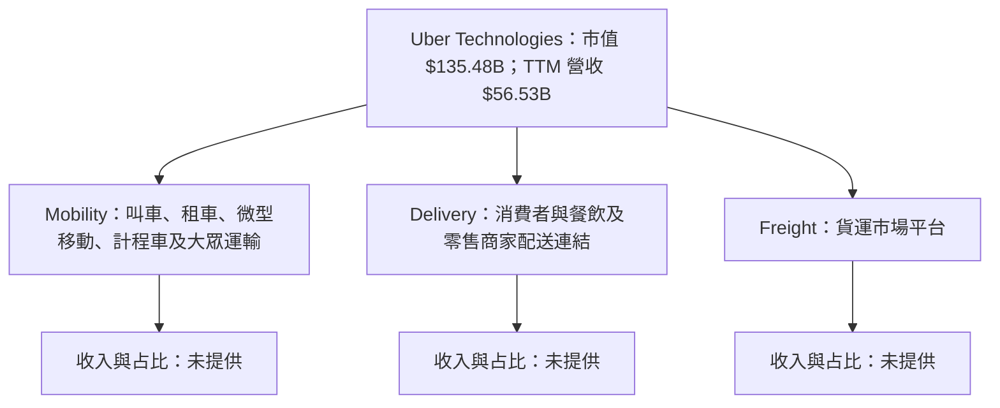
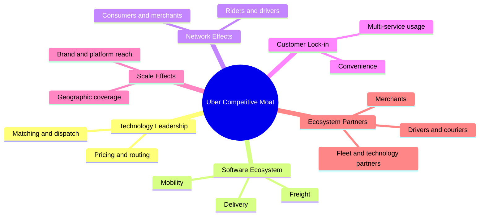
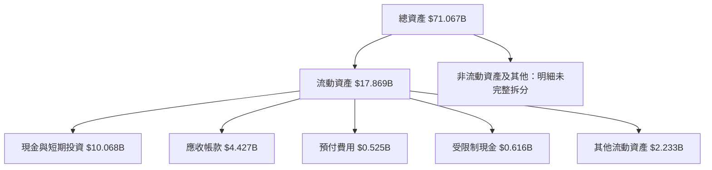
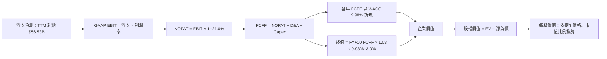
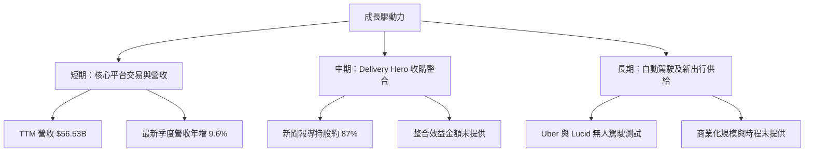
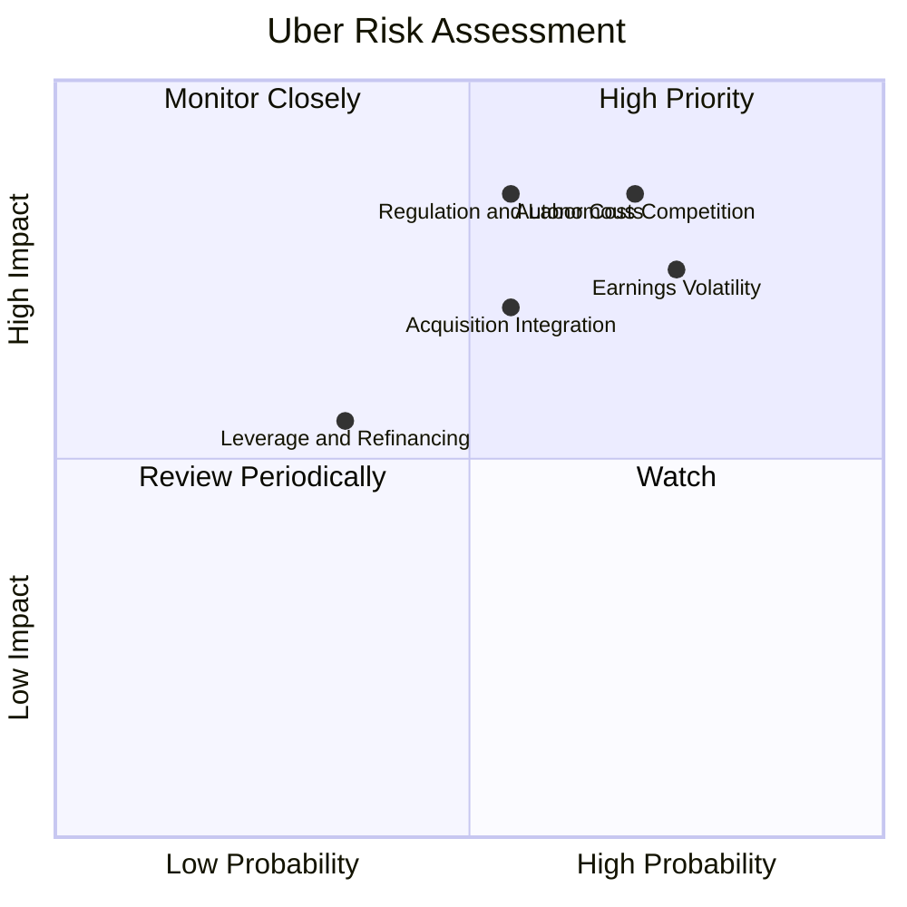
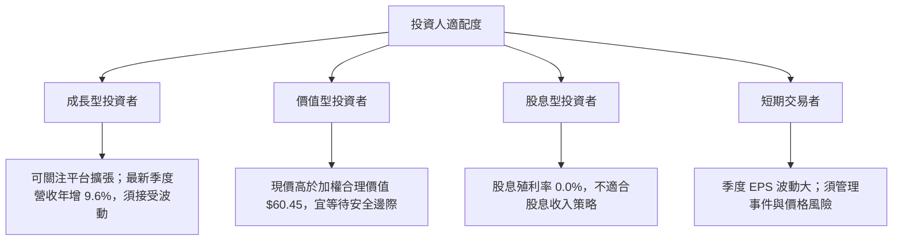

# UBER 基本面深度分析報告
> **報告日期**：2026-11-27 ｜ **語言**：繁體中文 ｜ **數據來源**：SEC 申報資料 (XBRL)、Yahoo Finance、Finviz、StockAnalysis、Roic.ai ｜ **分析師**：CFA 級機構研究

## 目錄

| # | 章節 | 核心結論 |
|---|------|----------|
| 1 | 執行摘要 | 持有；加權合理價值 $60.45，MOS -9.8% |
| 2 | 公司概覽與商業模式 | 多邊平台與網路效應提供護城河，但分部收入拆分未提供 |
| 3 | 損益表深度分析 | TTM 營收 $56.53B、年增 13.9%；最新一季單季年增 9.6% |
| 4 | 資產負債表分析 | 淨負債 $5.60B；現金與短期投資 $10.07B |
| 5 | 現金流量深度分析 | TTM FCF $10.42B，FCF Yield 7.69% |
| 6 | 獲利能力與資本效率 | ROIC 15.8% 高於 WACC 9.98%，目前仍創造價值 |
| 7 | 相對估值分析 | 同業倍數分化；自身 P/E 高於歷史中位數，P/S 低於歷史中位數 |
| 8 | DCF 內在價值評估 | 基準 DCF $41.32；終值現值占 EV 46.9% |
| 9 | 成長催化劑 | 外送併購與自動駕駛合作具潛在催化性，量化貢獻未提供 |
| 10 | 風險矩陣 | 主要風險為自動駕駛競爭、外送整合及獲利波動 |
| 11 | 投資建議 | 持有；關注回到 MOS≥10% 對應價位及營運指標 |

## 1. 執行摘要

以 2026-11-25 收盤價 **$66.35** 計，Uber TTM 營收 **$56.53B**、TTM 營收成長 **13.9%**、TTM 營業利益率 **12.4%**，TTM FCF **$10.42B**，ROIC **15.8%** 高於 WACC **9.98%**。但基準 DCF 每股價值為 **$41.32**，低於現價 37.7%；三角估值後的加權合理價值為 **$60.45**，安全邊際 **MOS -9.8%**，按估值規則評級為 **持有**。換言之，現金流與資本回報提供基本面支撐，但現價仍高於加權合理價值，且最新季度 EPS 年增大幅轉負，使短期估值安全性有限。

### 1.0 一頁式投資儀表板（Portfolio Manager 30 秒速讀）

| 項目 | 內容 |
|------|------|
| **投資論點（3 句）** | ① TTM 營收年增 13.9%，平台仍有擴張能力。② TTM FCF $10.42B、FCF Yield 7.69%，現金流轉換能力是主要支撐。③ ROIC 15.8% 高於 WACC 9.98%，但加權合理價值 $60.45 低於現價 $66.35。 |
| **綜合評分** | **6.2/10**（引用 1.1 評分卡） |
| **財務健康** | 🟡 現金與短期投資 $10.07B，淨負債 $5.60B；現金充足但仍有槓桿。 |
| **ROIC vs WACC** | **15.8% vs 9.98%**，目前創造股東價值。 |
| **FCF 趨勢** | 🟢 TTM FCF $10.42B；FCF Yield **7.69%**。 |
| **估值** | Forward P/E **15.05x** ｜ EV/EBITDA **18.446x** ｜ FCF Yield **7.69%** |
| **DCF 內在價值（基準）** | **$41.32** ｜ 現價相對 DCF 溢價 **60.6%**（折溢價以 DCF 基準值計） |
| **安全邊際（MOS）** | **-9.8%＝($60.45 − $66.35) ÷ $60.45**｜🔴 <10%：無安全邊際 |
| **預期報酬（基準情境 12M）** | DCF 基準情境相對現價 **-37.7%**；此為估值差距，不是公司公布的 12 個月價格預測。 |
| **關鍵風險（前二）** | 自動駕駛降低平台抽成能力；最新一季 EPS 年減 92.0%。 |
| **評級 + 信心度** | 🟡 **持有** ｜ 信心：中；估值模型指向折價不足，季度盈餘受非經常性因素影響的程度未能由現有資料判明。 |

### 1.1 綜合評分卡（全報告唯一）

| 維度 | 評分（1–10） | 主要依據（引用數字與其來源章節） |
|------|--------------|----------------------------------|
| 成長性 | 7 | TTM 營收年增 13.9%，但最新一季單季年增降至 9.6%（第 3 章）。 |
| 獲利能力 | 7 | TTM 營業利益率 12.4%、ROIC 15.8% 高於 WACC 9.98%；F-Score 6/8（第 6 章）。 |
| 財務健康 | 6 | 淨負債 $5.60B、現金與短期投資 $10.07B；流動比率 1.232（第 4 章）。 |
| 估值 | 4 | MOS -9.8%；P/E 38.8x 高於五年中位數 17.8x（第 7、8 章）。 |
| 護城河 | 7 | Mobility、Delivery、Freight 多邊平台、跨市場服務與供需匹配形成網路效應；分部收入及市場份額數據未提供（第 2 章）。 |
| 管理層與資本配置 | 6 | FCF 持續為正、稀釋股數測試通過；FY2025 SBC $1.83B，回購金額與資本配置目標未提供（第 3、5 章）。 |
| **綜合評分** | **6.2** | 六項算術平均：$(7+7+6+4+7+6)÷6=6.17$，四捨五入至一位小數。 |

### 1.2 五大投資論點 + 三大核心風險

| 類型 | 項目 | 具體依據 | 信心度 |
|------|------|----------|--------|
| 🟢 **投資論點①** | 規模與平台擴張 | TTM 營收 $56.53B、成長 13.9%；最新季度營收年增 9.6%，仍為正成長。 | 🟢 高 |
| 🟢 **投資論點②** | 現金流能力 | TTM OCF $10.73B、Capex $314M、FCF $10.42B；較低資本支出使現金流率高於會計淨利率。 | 🟢 高 |
| 🟢 **投資論點③** | 資本回報高於資金成本 | ROIC 15.8% 對比 WACC 9.98%，利差約 5.82 個百分點。 | 🟢 高 |
| 🟢 **投資論點④** | 服務覆蓋多元 | Mobility、Delivery、Freight 三大業務，降低對單一出行場景的依賴；各分部收入未提供。 | 🟡 中 |
| 🟢 **投資論點⑤** | 稀釋股數目前受控 | Piotroski 測試中「稀釋股數未增加」通過；但 FY2025 SBC 仍達 $1.83B。 | 🟡 中 |
| 🟡 **風險①** | 季度盈餘波動 | 2026 Q3 EPS 年減 92.0%、淨利年減 92.3%；影響原因在現有資料中未拆解。 | 🔴 高衝擊 |
| 🔴 **風險②** | 自動駕駛改變價值鏈 | Tesla Robotaxi 擴張、Uber 與 Lucid 無人駕駛測試等新聞顯示競爭正在發展；對抽成與平台地位的量化影響未提供。 | 🟡 中 |
| 🟡 **風險③** | 收購整合與負債 | 新聞稱 Uber 已取得 Delivery Hero 約 87% 股份；交易成本、融資與整合效益數據未提供。 | 🟡 中 |

### 1.3 快速統計卡片

| 指標 | 公司實際值（期間） | 同業中位數 | 狀態 |
|------|--------------------|------------|------|
| 營收成長（TTM） | **13.9%** | — | 🟢 |
| 營收成長（最新一季年增） | **9.6%** | **27.4%**（LYFT、DASH、GRAB 中位數） | 🟡 |
| 毛利率（TTM） | **41.4%** | **41.4%** | 🟡 |
| 營業利益率（TTM） | **12.4%** | — | 🟢 |
| ROIC（TTM） | **15.8%** | — | 🟢 |
| Forward P/E | **15.052826x** | **18.1x**（同業中位數） | 🟢 |
| FCF Yield（TTM） | **7.69%** | — | 🟢 |
| Piotroski F-Score | **6 / 8** | — | 🟢 |

### 1.4 投資結論

╔══════════════════════════════════════════════════════════════════╗  
║                    📊 投資結論摘要                               ║  
╠══════════════════════════════════════════════════════════════════╣  
║  評級：持有（MOS -9.8%，按規則 20）                              ║  
║  價格（2026-11-25 收盤）：$66.35                                ║  
║  DCF 內在價值（基準）：$41.32（現價溢價 60.6%）                 ║  
║  安全邊際 MOS：-9.8%＝($60.45−$66.35)÷$60.45                   ║  
║  加權合理價值（8.8）：$60.45                                     ║  
║  DCF 情境價值：                                                  ║  
║    悲觀情境：$23.36（-64.8%）                                    ║  
║    基準情境：$41.32（-37.7%）                                    ║  
║    樂觀情境：$69.28（+4.4%）                                     ║  
║  綜合評分：6.2/10（引用 1.1）                                    ║  
║  適合投資人：能承受平台競爭與季度盈餘波動、重視長期現金流者      ║  
╚══════════════════════════════════════════════════════════════════╝

## 2. 公司概覽與商業模式

### 2.1 業務結構與收入來源

公司提供 Mobility、Delivery 與 Freight 三類平台服務，連結乘客、司機、外送消費者、商家及貨運供需。SEC 10-Q 摘要未提供各分部收入、占比及軟體服務收入拆分，因此不推算比例。

### 2.2 市場份額

市場份額數據未提供，故不製作份額圖或推估比例。Uber TTM 營收 $56.53B，最新季度營收年增 9.6%；同業 LYFT、DASH、GRAB 最新季度營收成長分別為 8.1%、34.0%、27.4%。Uber 規模較大，但成長速度低於 DASH 與 GRAB。

### 2.3 競爭護城河分析

### 2.4 護城河強度

| 護城河項目 | 強度（強／中／弱） | 證據（引用數字或事實） | 會削弱它的情況 |
|------------|--------------------|------------------------|----------------|
| 網路效應 | 中至強 | Mobility 與 Delivery 需要平衡雙邊供需；TTM 營收 $56.53B 展示平台規模，但活躍用戶及行程量未提供。 | 競爭平台補貼、司機多平台接單或自動駕駛供給轉移。 |
| 軟體生態系統 | 中 | Mobility、Delivery、Freight 三業務可共用支付、身分及數據能力；分部收入與交叉使用率未提供。 | 多業務整合未提升留存或單位經濟。 |
| 規模效應 | 中 | 業務遍及多國、多區域；營收規模為 $56.53B TTM。 | 各地監管及本地競爭使規模無法轉化為更低單位成本。 |
| 客戶鎖定 | 弱至中 | 消費者可在多個叫車與外送平台間切換，數據未顯示獨家或合約鎖定。 | 價格差異、促銷或服務品質令用戶轉移。 |
| 技術領先 | 中 | 公司依賴專有應用程式與調度技術；研發支出 FY2025 為 $3.40B。 | 自動駕駛車隊自建應用或第三方技術降低平台中介價值。 |
| 生態夥伴 | 中 | 司機、外送員、商家及車隊是供應側夥伴；夥伴數量與集中度未提供。 | 勞動法規、保險成本或大型商家改採自營配送。 |

**1.1「護城河」評分為 7 分**，主要根據多邊平台與三業務結構；因缺少活躍用戶、留存、分部利潤與市場份額資料，不能把網路效應直接等同於不可替代性。

## 3. 損益表深度分析

### 3.1 年度收入成長趨勢（近4年）

年度營收依序為 2022 年 $31.88B、2023 年 $37.28B、2024 年 $43.98B、2025 年 $52.02B。年度成長率以年度營收計算；2025 年與 2022 年三年 CAGR 約 17.8%。

╔══════════════════════════════════════════════════════════════════╗  
║              Uber 年度收入趨勢（FY2022–FY2025）                  ║  
╠══════════════════════════════════════════════════════════════════╣  
║  FY2022  $31.88B  ████████████░░░░░░░░░░░░  YoY：—             ║  
║  FY2023  $37.28B  ██████████████░░░░░░░░░░  YoY：+16.9% 🟢     ║  
║  FY2024  $43.98B  █████████████████░░░░░░░  YoY：+18.0% 🟢     ║  
║  FY2025  $52.02B  ████████████████████░░░░  YoY：+18.3% 🟢     ║  
║                                                                  ║  
║  三年 CAGR = (52.02 ÷ 31.88)^(1/3) − 1 ≈ 17.8%                  ║  
╚══════════════════════════════════════════════════════════════════╝

2025 年營收增長與平台活動規模擴大相符，但分部交易量、抽成率及價格因素未提供，無法精確分解成長來源。TTM 成長 13.9% 低於 FY2025 的 18.3%，顯示近期增速較年度數據放緩。

### 3.2 季度收入趨勢分析

| 季度 | 營收（$B） | QoQ 成長 | YoY 成長 | 備註 |
|------|------------|----------|----------|------|
| 2025 Q4 | 14.366 | — | 20.13% | 年度末季營收高於前一季。 |
| 2026 Q1 | 13.203 | -8.1% | 14.48% | QoQ 公式：13.203÷14.366−1；季度營收有季節性波動可能。 |
| 2026 Q2 | 14.191 | +7.5% | 12.17% | 同比增速較前季放緩。 |
| 2026 Q3 | 14.766 | +4.1% | 9.65% | 仍成長，但 YoY 低於 2025 Q3 的 20.37%。 |

最新季度同比增速連續放緩，從 2025 Q3 的 20.37% 降至 2026 Q3 的 9.65%。這是營收動能轉弱的訊號；後續需判斷它源於基期、交易量、價格或業務組合，現有資料不足以拆分。

### 3.3 利潤率演變分析

以下年度比率以年度財報中的毛利、營業利益除以營收計算；TTM 與最新季度營業利益率則採用 SEC 10-Q 計算值。

| 利潤率指標 | FY2022 | FY2023 | FY2024 | FY2025 | TTM / 最新季度 | 趨勢與評估 |
|------------|--------|--------|--------|--------|----------------|------------|
| **毛利率** | 38.3% | 39.8% | 39.4% | 39.8% | TTM 41.4% | ↗️ TTM 改善；收入組合與直接成本影響未拆解。🟢 |
| **營業利益率** | -5.7% | 3.0% | 6.4% | 10.7% | TTM 12.4%；最新季度 9.8% | 年度改善反映營收規模上升及費用槓桿；季度 9.8% 低於 TTM。🟡 |
| **淨利率** | -28.7% | 5.1% | 22.4% | 19.3% | TTM 6.1% | FY2024–FY2025 淨利受到大額非營業或稅務項目影響的可能性高；具體調節表未提供。🟡 |

營業利益由 FY2022 的 -$1.83B 增至 FY2025 的 $5.57B，表面上顯示營業槓桿改善。FY2026 Q3 單季營業利益率為 9.8%，低於 TTM 12.4%；因此不能將歷史年度改善線性外推。淨利率較營業利益率波動大，評價 GAAP 盈餘時須留意非營業損益與所得稅影響。

### 3.4 費用結構分析

未提供完整營業費用拆項、銷售費用或管理費用占比，不製作費用結構圓餅圖。可確認 FY2025 研發費用為 $3.40B；其餘費用結構與費用率 N/A（數據未提供）。

### 3.5 季度 EPS 趨勢與盈餘品質（Quality of Earnings）

| 季度 | EPS 實際值 | EPS YoY | 超預期／不及預期 |
|------|------------|--------|-------------------|
| 2025 Q4 | $0.14 | -95.58% | 預估 EPS 未提供，不能判定。 |
| 2026 Q1 | $0.13 | -84.57% | 預估 EPS 未提供，不能判定。 |
| 2026 Q2 | $1.18 | +85.46% | 預估 EPS 未提供，不能判定。 |
| 2026 Q3 | $0.25 | -91.97% | 預估 EPS 未提供，不能判定。 |

| 盈餘品質項目 | 數值／佔比 | 評估 |
|--------------|-----------|------|
| 股權薪酬 SBC / 營收 | FY2025：$1.83B ÷ $52.017B = **3.5%** | 🟡 具有持續稀釋成本；需結合股數變化評估。 |
| SBC / 營業現金流 | FY2025：$1.83B ÷ $10.10B = **18.1%** | 🟡 非現金費用占比不低，FCF 應配合股數稀釋觀察。 |
| FCF / 淨利（現金轉換率） | TTM FCF $10.42B ÷ TTM 淨利 $3.465B = **300.7%** | 🟢 現金流明顯高於當期淨利；但淨利數據與不同資料源的期間口徑需留意。 |
| 一次性／非經常性損益 | FY2025 淨利 $10.05B；TTM 淨利 $3.465B；逐項調節表未提供 | 🟡 淨利波動顯著，無法確認一次性項目金額及來源。 |
| 有效稅率異常 | N/A（未提供所得稅費用與稅前淨利的完整 TTM 對照） | 不以預設稅率替代實際有效稅率。 |
| 資本化支出 vs 費用化 | TTM Capex $314M；資本化軟體及租賃明細未提供 | N/A；不能僅由低 Capex 推斷資本化不足或費用化恰當。 |

TTM FCF 轉換率高，支持公司具備現金生成能力；但 GAAP 淨利的年度及季度波動遠高於營收，且 SBC 對 TTM 的精確占比未由同一期數據完整列出。整體判斷：現金流含金量優於單季 EPS 表現，但投資人不應只用單一季度 EPS 推估常態盈餘。

## 4. 資產負債表分析

### 4.1 資產結構分解

截至 2026-09-30，StockAnalysis 列示總資產 $71.067B、流動資產 $17.869B；以下僅呈現已列明項目，不把未列項目反推成差額。

### 4.2 流動性與營運資金分析

| 指標 | 最新 TTM | 一年前 TTM | 變化 | 解讀 |
|------|----------|------------|------|------|
| 流動比率 | 1.232 | N/A | N/A | 當期流動資產高於流動負債，但較佳歷史比較數據未提供。 |
| 速動比率 | 0.999 | N/A | N/A | 約為 1，短期流動性尚可，仍需監看現金流。 |
| DSO 應收帳款天數 | 29 天 | 28 天 | +1 天 | 收款週期略延長；變化幅度小，成因不能由資料確認。 |
| DIO 存貨天數 | N/A | N/A | N/A | 公司未報告可供此計算的存貨餘額。 |
| DPO 應付帳款天數 | 17 天 | N/A | N/A | 一年前數據不可用，無法判斷供應商付款趨勢。 |
| CCC 現金轉換週期 | N/A | N/A | N/A | DIO 缺失，依定義不補算。 |

### 4.3 債務結構分析

VERIFIED FIGURES 採用的口徑為現金與短期投資 $10.07B、總債務 $15.66B、淨負債 $5.60B。市場資料另列總債務 $17.74B、淨負債 $7.67B，口徑有差異；下列債務診斷以 SEC 10-Q 驗證數字為準。

╔══════════════════════════════════════════════════════════════════╗  
║                   Uber 債務健康診斷                             ║  
╠══════════════════════════════════════════════════════════════════╣  
║  總債務：       $15.66B  ███████████████░░░░░  🟡               ║  
║  現金+短期投資：$10.07B  ██████████░░░░░░░░░░  🟢               ║  
║  淨負債：        $5.60B  ██████░░░░░░░░░░░░░░  🟡               ║  
║  Debt/EBITDA：  N/A（口徑與可靠 TTM EBITDA 未提供）              ║  
║  利息保障倍數： N/A（利息費用明細未提供）                         ║  
╚══════════════════════════════════════════════════════════════════╝

公司現金及短期投資約為總債務的 64.3%（$10.07B ÷ $15.66B），並非淨現金公司。未提供到期年限、固定／浮動利率及契約限制，因此不能僅根據淨負債判斷再融資風險。

### 4.4 股東權益趨勢

╔══════════════════════════════════════════════════════════════════╗  
║                Uber 年末股東權益趨勢                             ║  
╠══════════════════════════════════════════════════════════════════╣  
║  FY2022  $7.34B   █████░░░░░░░░░░░░░░░                          ║  
║  FY2023  $11.25B  ████████░░░░░░░░░░░░                          ║  
║  FY2024  $21.56B  ███████████████░░░░░                          ║  
║  FY2025  $27.04B  ████████████████████                          ║  
╚══════════════════════════════════════════════════════════════════╝

權益規模上升，但變動同時受淨利、其他綜合損益、股權薪酬與資本交易影響；現有資料不足以逐項調節。

## 5. 現金流量深度分析

### 5.1 現金流量瀑布圖

### 5.2 FCF 轉換率趨勢

| 年度 | 營業現金流 | Capex | FCF | 淨利 | FCF / 淨利 |
|------|------------|-------|-----|------|------------|
| 2022 | $0.642B | $0.252B | $0.390B | -$9.141B | 比率不具經濟解讀性（淨利為負） |
| 2023 | $3.58B | $0.223B | $3.36B | $1.89B | 約 177.8% |
| 2024 | $7.14B | $0.242B | $6.89B | $9.86B | 約 69.9% |
| 2025 | $10.10B | $0.336B | $9.76B | $10.05B | 約 97.1% |
| TTM | $10.73B | $0.314B | $10.42B | $3.465B | 約 300.7% |

2024 年 FCF 低於淨利、2025 年接近淨利；最新 TTM 轉換率高，部分原因可能是 TTM 淨利低於 FY2025，不能把 300.7% 視為永久水平。

### 5.3 自由現金流趨勢

╔══════════════════════════════════════════════════════════════════╗  
║              Uber 自由現金流：年度實際與 TTM                     ║  
╠══════════════════════════════════════════════════════════════════╣  
║  FY2022  $0.39B   █░░░░░░░░░░░░░░░░░░░                         ║  
║  FY2023  $3.36B   ███████░░░░░░░░░░░░░                         ║  
║  FY2024  $6.89B   ██████████████░░░░░░                         ║  
║  FY2025  $9.76B   ███████████████████░                         ║  
║  TTM      $10.42B  ████████████████████  FCF Yield：7.69%       ║  
╚══════════════════════════════════════════════════════════════════╝

### 5.4 資本配置評估

FY2025 資本支出 $336M；FY2025 SBC $1.83B。股息殖利率為 0%，但回購、收購支出、債務償還及留存現金的完整資本配置數據未提供。

| 資本配置項目 | 已知數據 | 評估 |
|--------------|----------|------|
| Capex | FY2025 $336M；TTM $314M | 相對現金流小，但並非公司全部再投資。 |
| 股息 | 殖利率 0.0% | 未以股息回饋股東。 |
| SBC | FY2025 $1.83B | 顯著薪酬成本，需以稀釋股數及回購共同衡量。 |
| 回購／收購／債務償還 | N/A | 明細未提供，不製作資本配置比例圖。 |

## 6. 獲利能力與資本效率

### 6.1 ROE / ROA / ROIC 趨勢

| 指標 | 歷史年度趨勢 | 最新 TTM | 評估 |
|------|--------------|----------|------|
| ROE | 可比年度序列 N/A | 12.5%（QUALITY FIGURES） | 正值；杜邦顯示資產週轉與槓桿共同影響。 |
| ROA | 可比年度序列 N/A | 6.5%（Profitability & Growth 資料） | 資產回報為正。 |
| ROIC | 可比年度序列 N/A | 15.8%（VERIFIED FIGURES） | 高於 WACC 9.98%，創造經濟價值。 |

未提供可引用的行業均值，故不加入行業對照欄。

### 6.2 ROIC vs WACC 分析（核心價值創造判斷）

公司 TTM ROIC 為 **15.8%**，WACC 為 **9.98%**，利差為 **5.82 個百分點**。以資本成本為基準，這表示當前投入資本回報高於要求報酬率；但若新投資回報低於資金成本，未來增長仍可能摧毀價值。

╔══════════════════════════════════════════════════════════════════╗  
║                ROIC vs WACC 深度分析                            ║  
╠══════════════════════════════════════════════════════════════════╣  
║  WACC 輸入（Cost of capital）                                   ║  
║  ├── 無風險利率（10Y 美債）：4.85%                              ║  
║  ├── ERP：5.00%                                                  ║  
║  ├── 原始 Beta：1.31；調整後 Beta：1.21                         ║  
║  ├── 股權成本（數據區提供）：10.87%                             ║  
║  ├── 稅前債務成本：2.81%；稅率：21.0%                           ║  
║  ├── 股權／債務權重：89.6%／10.4%                               ║  
║  └── 採用 WACC：9.98%                                           ║  
║                                                                  ║  
║  ROIC 對照（TTM）：15.8%                                         ║  
║  EVA 利差 = ROIC − WACC = 15.8% − 9.98% = +5.82 個百分點         ║  
║  ROIC  15.8%  ▓▓▓▓▓▓▓▓▓▓▓▓▓▓▓▓░░░░  🟢                         ║  
║  WACC   9.98% ▓▓▓▓▓▓▓▓▓▓░░░░░░░░░░  ──                         ║  
║  結論：TTM 資本回報高於資金成本，當前創造股東價值              ║  
╚══════════════════════════════════════════════════════════════════╝

一致性提醒：CAPM 顯示值 10.87% 與展示的 Rf、調整後 Beta、ERP 直接相乘相加所得 10.90% 有 0.03 個百分點差異；本分析不另建 WACC，而採用來源指定的 **9.98%**。債務成本 2.81% 及權重亦按來源提供值使用。

### 6.3 杜邦三因素分解

| 因素 | 數值（TTM） | 解讀 |
|------|-------------|------|
| 淨利率 | 6.1% | 淨利率較營業利益率低，顯示利息、稅項或非營業項目影響；細項未提供。 |
| 資產週轉率 | 0.80 | 每單位資產對應約 0.80 倍營收。 |
| 權益乘數 | 2.57 | 顯示一定程度財務槓桿。 |
| **ROE** | **12.5%** | 6.1% × 0.80 × 2.57 = 12.5%（按 QUALITY FIGURES 原值引用）。 |

ROE 不是單由高淨利率驅動；資產週轉與權益乘數均有貢獻。乘數 2.57 表示槓桿不可忽視，但不應將 ROE 全歸因於槓桿。

### 6.4 財務體質：Piotroski F-Score

Piotroski F-Score 為 **6 / 8**；毛利率測試因缺少輸入而排除，故分母為 8 而非 9。

| 測試 | 結果 | 解讀 |
|------|------|------|
| ROA > 0 | ✅ 通過 | TTM 資產回報為正。 |
| 營業現金流 > 0 | ✅ 通過 | TTM OCF $10.73B。 |
| ROA 高於一年前 | ❌ 未通過 | 盈利能力改善未能確認。 |
| 營業現金流 > 淨利 | ✅ 通過 | 現金流高於淨利，應計品質測試通過。 |
| 長期負債 ÷ 總資產低於一年前 | ❌ 未通過 | 槓桿相對資產的變化不利。 |
| 流動比率高於一年前 | ✅ 通過 | 短期流動性相對改善。 |
| 稀釋股數未增加 | ✅ 通過 | 近期稀釋股數測試通過，但 SBC 仍需監控。 |
| 毛利率高於一年前 | — 無法判定 | 缺少測試輸入。 |
| 資產週轉率高於一年前 | ✅ 通過 | 資產使用效率測試通過。 |

## 7. 相對估值分析

### 7.1 同業估值比較表格

本公司市場估值欄採用市場資料；同業估值依 Yahoo Finance 的 Peer multiples。數據來源口徑可能存在期間及 GAAP 差異，尤其 LYFT 的 EV/EBITDA 倍數極高。

| 估值指標 | **UBER** | **LYFT** | **DASH** | **GRAB** | UBER 評估 |
|----------|----------|---------|---------|---------|-----------|
| **Trailing P/E** | 39.029x | 2.5x | 69.0x | 28.4x | 🟡 同業離散度大，Uber 位於中間偏高。 |
| **Forward P/E** | 15.053x | 8.3x | 21.8x | 18.1x | 🟢 低於同業中位數 18.1x。 |
| **P/S Ratio** | 2.397x | 0.9x | 4.3x | 2.9x | 🟡 介於 Lyft 與 DASH／GRAB 之間。 |
| **EV/EBITDA** | 18.446x | 565.0x | 40.9x | 18.3x | 🟢 接近 GRAB，遠低於 DASH；LYFT 倍數受低 EBITDA 影響而失真。 |
| **最新季度營收年增** | 9.6% | 8.1% | 34.0% | 27.4% | 🟡 Uber 成長高於 Lyft，但低於 DASH、GRAB。 |
| **TTM 毛利率** | 41.4% | 40.0% | 52.7% | 41.4% | 🟡 與 GRAB 相同，高於 LYFT、低於 DASH。 |

### 7.2 歷史估值區間分析

╔══════════════════════════════════════════════════════════════════╗  
║                 UBER 五年估值位置（TTM）                         ║  
╠══════════════════════════════════════════════════════════════════╣  
║  P/E：       12.6x ───── 中位數 17.8x ───── 現值 38.8x ─ 122.2x ║  
║                                      百分位：62%                 ║  
║  P/S：        1.5x ─── 現值 2.4x ─── 中位數 3.3x ───── 6.1x     ║  
║                                      百分位：19%                 ║  
║  EV/EBITDA： 18.7x ─ 現值 18.2x ─── 中位數 40.0x ─── 320.2x    ║  
║                                      百分位：0%                  ║  
╚══════════════════════════════════════════════════════════════════╝

P/E 位於自身五年區間第 62 百分位，偏高於中位數；P/S 位於第 19 百分位，低於中位數。EV/EBITDA 的現值 18.2x 低於歷史區間下限 18.7x，顯示倍數資料的期間或取整可能不同；依規則照引來源數值，不自行修正。

### 7.3 情境價值（Bear / Base / Bull，照抄 DCF MODEL 的 Scenarios）

| 情境 | 第 1 年營收成長 | 期末營業利潤率 | WACC | 每股價值 | 相對現價 | 機率 | 會發生的條件 |
|------|----------------|----------------|------|----------|----------|------|--------------|
| 🔴 悲觀 | 7.0% | 5.4% | 10.98% | $23.36 | -64.8% | 25% | 增長放緩、平台競爭增加且獲利率回落，資金成本亦較高。 |
| 🟡 基準 | 13.9% | 6.4% | 9.98% | $41.32 | -37.7% | 50% | 起始增速延續 TTM，長期營業利潤率回落至模型設定值。 |
| 🟢 樂觀 | 20.9% | 7.0% | 8.98% | $69.28 | +4.4% | 25% | 需求、變現及成本效率好於基準，風險溢價下降。 |

### 7.4 相對估值隱含價格區間

╔══════════════════════════════════════════════════════════════════╗  
║              估值方法隱含每股價值與市場價格                      ║  
╠══════════════════════════════════════════════════════════════════╣  
║  $41.32 ─────── $66.35 ─────── $79.74 ─────────── $98.16        ║  
║  基準 DCF       現價            同業 Forward P/E   分析師共識     ║  
╚══════════════════════════════════════════════════════════════════╝

| 方法 | 每股價值 | 依據 |
|------|----------|------|
| DCF（基準） | $41.32 | 10 年 FCFF、WACC 9.98%、終值成長率 3.0%。 |
| 同業 Forward P/E | $79.74 | LYFT、DASH、GRAB 同業中位數 18.1x × UBER Forward EPS $4.41。 |
| 分析師共識目標價 | $98.16 | 46 位分析師平均目標價。 |

## 8. DCF 內在價值評估（Discounted Cash Flow）

> DCF 僅採用程式計算的 10 年模型。金額以美元十億計；模型假設、現金流、終值、敏感度與情境值均依提供的程式結果引用。表格因四捨五入可能產生尾差。

### 8.0 估值推理鏈（Thinking Logic）

**Step 1 — 價值來源與主導變數**

模型以 Mobility、Delivery、Freight 的平台現金流為主，但分部收入占比未提供，不能把各業務拆成獨立估值。可觀測的起點是 TTM 營收 $56.53B、營業利益率 12.4%、FCF $10.42B。價值主要取決於收入持續增長與營業利潤率能否維持；敏感度矩陣亦顯示 WACC 與永續成長率對終值敏感。

**Step 2 — 模型選擇**

| 決策點 | 本報告採用 | 理由 | 曾考慮但否決 | 否決理由 |
|--------|-----------|------|--------------|----------|
| 現金流定義 | FCFF | 使用 WACC 折現，先估企業價值，再以淨負債調整。 | FCFE | 模型已固定採用 FCFF。 |
| 預測期 N | 10 年 | DCF MODEL 指定 10 年，並逐年遞減增速與利潤率。 | 5 年 | 不符合既有模型設定，且改動會使估值不可比。 |
| 終值方法 | Gordon Growth | 模型指定永續成長率 3.0%。 | 另建退出倍數 | 沒有提供退出倍數假設與模型結果，不能自行加入。 |
| EBIT 基礎 | GAAP EBIT | GAAP EBIT 已計入 SBC 費用。 | 非 GAAP EBIT | 會改變唯一指定的 DCF 模型。 |

**Step 3 — 關鍵假設推導鏈**

- **營收成長**：錨點＝TTM 對前一 TTM 成長 13.9%；調整＝由 13.9% 線性降至 3.0%，反映成熟化；**採用首年 13.9%、第十年 3.0%**；曾考慮固定 13.9%，但否決，因十年維持目前成長未反映增速正常化。
- **營業利潤率**：錨點＝TTM 12.4%；調整＝逐年淡化至近五個財年中位數 6.4%；**採用 FY+1 12.4% 至 FY+10 6.4%**；曾考慮永久維持 12.4%，但否決，因模型明確採用歷史中位數收斂。
- **有效稅率**：錨點＝模型預設稅率 21.0%；**採用 21.0%**。實際 TTM 有效稅率資料未提供，故此為假設值（依據：模型預設值），不是公司實際有效稅率。
- **Capex／營收**：錨點＝TTM Capex $0.314B、TTM 營收 $56.53B，約 0.6%；**採用 0.6%**；曾考慮提高至 D&A 的 1.1 倍，但模型設定未要求高於該值，故採用 0.6%。
- **D&A／營收**：錨點＝TTM 比率 1.4%；**採用 1.4%**，維持不變。
- **預測期 N**：錨點＝模型指定 10 年；**採用 10 年**；曾考慮較短期間，但不改動模型輸入。
- **永續成長率 g**：錨點＝模型設定 3.0%；**採用 3.0%**，低於 WACC 9.98%；曾考慮更高成長率，但在成熟平台的長期假設下提高 g 會過度推升終值。
- **WACC**：錨點＝資本成本資料的 WACC 9.98%；**採用 9.98%**；不另計替代 WACC，避免與 ROIC 比較及程式模型不一致。
- **EBIT 基礎與 SBC**：錨點＝採用 GAAP EBIT；模型採**組合 (A)**，EBIT 已含 SBC，FCFF 不再扣 SBC，股數不額外稀釋；曾考慮在 FCFF 再扣 SBC，但會重複計算成本。
- **營運資金變動**：模型明確不建模，沒有ΔWC假設列；不可用其他數字補入。年稀釋率亦依組合 (A) 設為 0%。

**Step 4 — 最脆弱環節**

最脆弱的是中長期利潤率能否由 12.4% 淡化至 6.4%而仍維持模型現金流。若營運競爭令收入成長與利潤率同時轉弱，估值將往下；悲觀情境值為 $23.36。

**Step 5 — 計算路徑圖**

### 8.1 模型假設總表（Model Inputs）

| 假設項目 | 採用值 | 依據／來源 | 敏感度 |
|----------|--------|-------------|--------|
| 預測期長度 N | 10 年 | DCF MODEL 指定；模型由 FY+1 至 FY+10 逐年預測。 | 🟡 中 |
| 營收成長 | 首年 13.9%，第十年 3.0%，線性淡化 | 起點為 TTM 成長 13.9%；終點為模型設定的 3.0%。 | 🔴 高 |
| 營業利潤率 | FY+1 12.4% → FY+10 6.4% | TTM 12.4%；淡化至近五財年中位數 6.4%。 | 🔴 高 |
| 有效稅率 | 21.0% | 模型預設稅率；非實際 TTM 有效稅率。 | 🟢 低 |
| Capex／營收 | 0.6% | TTM Capex $0.314B ÷ TTM 營收 $56.53B 約 0.6%；模型各年固定 0.6%。 | 🟡 中 |
| D&A／營收 | 1.4% | TTM 比率，模型固定。 | 🟢 低 |
| 營運資金變動 | 不建模 | DCF MODEL 明示 Working capital is not modelled。 | 🟢 低 |
| EBIT 基礎 | GAAP EBIT | 模型使用 GAAP EBIT。 | 🟡 中 |
| SBC 處理 | 組合 (A)：GAAP EBIT、無額外扣 SBC、固定股數 | SBC 已在 GAAP 費用內；模型假設股數不再稀釋。 | 🟡 中 |
| 年稀釋率 | 0% | 與組合 (A) 相容；模型不放大股數。 | 🟡 中 |
| 永續成長率 g | 3.0% | DCF MODEL 指定；低於 WACC 9.98%。 | 🔴 高 |
| 終值方法 | Gordon Growth | 模型提供終值公式與現值；未提供退出倍數法估值。 | 🔴 高 |
| WACC | 9.98% | Cost of capital 區塊指定值。 | 🔴 高 |
| FCF 定義 | FCFF = NOPAT + D&A − Capex | 與 WACC 折現企業價值；營運資金變動不建模。 | — |

**FCFF 定義與 SBC 防呆：**本模型採用組合 **(A)**，GAAP EBIT 已扣除 SBC，故不再扣 SBC，且股數不另行稀釋；同一成本只計入一次。

### 8.2 折現率推導（WACC）

╔══════════════════════════════════════════════════════════════════╗  
║                    WACC 推導（折現率）                            ║  
╠══════════════════════════════════════════════════════════════════╣  
║  股權成本 Ke（來源提供值）：10.87%                               ║  
║  ├── 無風險利率 Rf（10Y 美債）：4.85%                            ║  
║  ├── ERP：5.00%                                                   ║  
║  ├── 原始 Beta（Yahoo）：1.31                                    ║  
║  ├── 調整 Beta：⅔×1.31＋⅓×1 = 1.21                              ║  
║  ├── 顯示值 CAPM：4.85%＋1.21×5.00% = 10.90%                    ║  
║  └── 來源列示 Ke：10.87%；不另替換程式值                         ║  
║                                                                  ║  
║  稅前債務成本 Kd：2.81%                                          ║  
║  ├── 稅率：21.0%                                                  ║  
║  └── 稅後 Kd = 2.81%×(1−21.0%) = 2.22%                          ║  
║                                                                  ║  
║  資本結構（來源提供）：股權 89.6%；債務 10.4%                    ║  
║  └── 採用 WACC：9.98%                                            ║  
╚══════════════════════════════════════════════════════════════════╝

逐步演算（採用來源指定的資本成本輸入；不另建替代 WACC）：

1. **Ke（CAPM）**：來源列示 **10.87%**。以顯示的四捨五入輸入驗算為 \(4.85\%+1.21\times5.00\%=10.90\%\)；差異 0.03 個百分點可能來自未四捨五入輸入，故保留來源 Ke。
2. **稅前 Kd**：來源列示 **2.81%**；利息費用與平均計息負債的原始明細未提供，不能重算分子與分母。
3. **稅後 Kd**：\(2.81\%\times(1-21.0\%)=2.2199\%\)，四捨五入 **2.22%**。
4. **權重**：股權 **89.6%**，債務 **10.4%**，合計 **100.0%**。權重採來源值；市值及總債務原始口徑存在不同來源差異。
5. **WACC**：來源直接提供 **9.98%**，作為第 6.2 與本章折現率；不以已四捨五入組成另算取代。用已顯示值計算的 WACC 會有約 0.01 個百分點差異，屬輸入精度差異。

### 8.3 逐年自由現金流預測（基準情境）

金額單位 $B。模型未建模 ΔWC，亦未另列 SBC 扣除；折現因子保留三位小數。

| 年度 | FY+1 | FY+2 | FY+3 | FY+4 | FY+5 | FY+6 | FY+7 | FY+8 | FY+9 | FY+10 |
|------|------|------|------|------|------|------|------|------|------|-------|
| 營收 | 64.41 | 72.60 | 80.96 | 89.29 | 97.40 | 105.06 | 112.04 | 118.12 | 123.10 | 126.80 |
| 營收 YoY | 13.9% | 12.7% | 11.5% | 10.3% | 9.1% | 7.9% | 6.6% | 5.4% | 4.2% | 3.0% |
| 營業利潤率 | 12.4% | 11.8% | 11.1% | 10.4% | 9.7% | 9.1% | 8.4% | 7.7% | 7.0% | 6.4% |
| GAAP EBIT | 8.01 | 8.54 | 8.98 | 9.30 | 9.49 | 9.52 | 9.40 | 9.11 | 8.67 | 8.07 |
| − 稅（21.0%） | (1.68) | (1.79) | (1.89) | (1.95) | (1.99) | (2.00) | (1.97) | (1.91) | (1.82) | (1.69) |
| = NOPAT | 6.33 | 6.75 | 7.09 | 7.35 | 7.50 | 7.52 | 7.43 | 7.20 | 6.85 | 6.38 |
| + D&A | 0.88 | 0.99 | 1.10 | 1.21 | 1.33 | 1.43 | 1.52 | 1.61 | 1.67 | 1.72 |
| − Capex | (0.36) | (0.40) | (0.45) | (0.50) | (0.54) | (0.58) | (0.62) | (0.66) | (0.68) | (0.70) |
| − ΔWC | 不建模 | 不建模 | 不建模 | 不建模 | 不建模 | 不建模 | 不建模 | 不建模 | 不建模 | 不建模 |
| = FCFF | 6.85 | 7.33 | 7.75 | 8.07 | 8.28 | 8.37 | 8.33 | 8.15 | 7.84 | 7.40 |
| 折現因子 @9.98% | 0.909 | 0.827 | 0.752 | 0.684 | 0.622 | 0.565 | 0.514 | 0.467 | 0.425 | 0.386 |
| FCFF 現值 PV | 6.23 | 6.06 | 5.82 | 5.51 | 5.15 | 4.73 | 4.28 | 3.81 | 3.33 | 2.86 |

**預測期 FCF 現值合計：**  
$6.23+$6.06+$5.82+$5.51+$5.15+$4.73+$4.28+$3.81+$3.33+$2.86 = **$47.78B**

**FY+1 逐步演算**（由於各輸入在模型內部以未四捨五入數值計算，展示值可能有尾差）：

1. **營收**：$56.53B × (1+13.9%) = **$64.41B**。
2. **EBIT**：$64.41B × 12.4% = **$8.01B**。
3. **稅**：$8.01B × 21.0% = **$1.68B**。
4. **NOPAT**：$8.01B − $1.68B = **$6.33B**。
5. **D&A**：$64.41B × 1.4% = **$0.88B**。
6. **Capex**：$64.41B × 0.6% = **$0.36B**。
7. **ΔWC**：模型不建模，故此列不納入現金流計算。
8. **FCFF**：$6.33B + $0.88B − $0.36B = **$6.85B**（以未四捨五入輸入計算）。
9. **折現與 PV**：\(1÷(1+9.98\%)^1=0.909\)；$6.85B × 0.909 = **$6.23B**（模型值）。

預測 FCF CAGR 約為 **0.8%**（FY+1 $6.85B 至 FY+10 $7.40B，九年間），低於歷史 FY2022–FY2025 FCF CAGR（因 FY2022 基期僅 $0.39B，約 192%），歷史增幅受低基期影響不可直接外推。FY+10 FCFF 利潤率為 $7.40B ÷ $126.80B = **5.8%**；FY+1 為 $6.85B ÷ $64.41B = **10.6%**。同業最佳 FCFF 利潤率數據未提供。預測各年 FCFF 均為正。

╔══════════════════════════════════════════════════════════════════╗  
║            自由現金流：歷史實際 vs 模型預測                      ║  
╠══════════════════════════════════════════════════════════════════╣  
║  FY2023（實） $3.36B  ███████░░░░░░░░░░░░░                        ║  
║  FY2024（實） $6.89B  ██████████████░░░░░░                        ║  
║  FY2025（實） $9.76B  ████████████████████                        ║  
║  FY+1（預）   $6.85B  ██████████████░░░░░░                        ║  
║  FY+10（預）  $7.40B  ███████████████░░░░░                        ║  
╠══════════════════════════════════════════════════════════════════╣  
║  長期預測利潤率由 12.4% 下降至 6.4%，抵消收入成長對 FCFF 的推升。║  
╚══════════════════════════════════════════════════════════════════╝

### 8.4 終值計算（Terminal Value）

適用性檢查：**WACC 9.98% vs g 3.0% → WACC > g？✅**

| 方法 | 計算式 | 終值 TV | TV 現值 | 佔總 EV 比重 |
|------|--------|---------|---------|--------------|
| Gordon Growth | $7.40 × (1+3.0%) ÷ (9.98%−3.0%) | $109.17B | $42.18B | 46.9% |
| 退出倍數法 | N/A（DCF MODEL 未提供退出倍數與估值） | N/A | N/A | N/A |

逐步演算（使用模型引用值）：

1. **FY+10 FCFF** = **$7.40B**。
2. **分子**：$7.40B × (1+3.0%)，模型列示終值計算結果為 **$109.17B**。
3. **分母**：9.98%−3.0% = **6.98%**；依模型公式，TV = **$109.17B**。
4. **PV(TV)**：$109.17B × 0.386 = **$42.18B**（採模型未四捨五入數值）。
5. **終值佔比**：$42.18B ÷ $89.96B = **46.9%**。

由展示到兩位小數的 FY+10 FCFF 與四捨五入折現因子直接重算，會與模型未四捨五入結果產生小額差異；本報告保留模型輸出，不以展示精度重建或替換終值。

### 8.5 企業價值 → 每股內在價值（Bridge）

╔══════════════════════════════════════════════════════════════════╗  
║              企業價值 → 每股內在價值 橋接表                      ║  
╠══════════════════════════════════════════════════════════════════╣  
║  預測期 FCF 現值合計           +$47.78B                          ║  
║  終值現值 PV(TV)               +$42.18B                          ║  
║  = 企業價值 EV                   $89.96B                          ║  
║  + Net cash（負值代表淨負債）   -$5.60B                          ║  
║  = 股權價值                      $84.36B                          ║  
║  每股換算                       模型使用價格／市值比例            ║  
║  ★ 每股 DCF 基準價值             $41.32                           ║  
║  當前股價（2026-11-25）          $66.35                           ║  
║  折溢價                          +60.6%（現價相對 DCF 溢價）      ║  
╚══════════════════════════════════════════════════════════════════╝

逐步演算：

1. **EV**：$47.78B + $42.18B = **$89.96B**。
2. **股權價值**：$89.96B + Net cash（-$5.60B）= **$84.36B**。
3. **每股內在價值**：模型公式為 equity value × price ÷ market cap；**$41.32**（依模型原值引用，計算採用模型所用未四捨五入數據）。
4. **折溢價**：\((現價÷DCF價值)-1=(66.35÷41.32)-1=\)**+60.6%**。
5. **本節不計算 MOS**：MOS 一律以 8.8 加權合理價值為分母，僅在 8.8 計算。

股數與市值比例依 DCF MODEL 原公式處理，不另以市場資料 2.04B 股數替代，避免改動程式模型；現金及債務調整則按模型的淨負債 $5.60B。

### 8.6 敏感性分析（WACC × 永續成長率）

格內為每股價值及相對現價上行空間；現價為 $66.35。矩陣數值照 DCF MODEL 引用。

| g（列）／WACC（欄） | 7.98% | 8.98% | **9.98%（基準）** | 10.98% | 11.98% |
|-----------|------|------|------------------|-------|-------|
| 2.0% | $51.55 (-22.3%) | $44.14 (-33.5%) | $38.55 (-41.9%) | $34.19 (-48.5%) | $30.68 (-53.8%) |
| 2.5% | $54.32 (-18.1%) | $45.98 (-30.7%) | $39.84 (-40.0%) | $35.12 (-47.1%) | $31.37 (-52.7%) |
| **3.0%（基準）** | $57.65 (-13.1%) | $48.14 (-27.4%) | **$41.32 (-37.7%)** | $36.17 (-45.5%) | $32.14 (-51.6%) |
| 3.5% | $61.73 (-7.0%) | $50.69 (-23.6%) | $43.02 (-35.1%) | $37.36 (-43.7%) | $33.00 (-50.3%) |
| 4.0% | $66.82 (+0.7%) | $53.76 (-19.0%) | $45.01 (-32.2%) | $38.72 (-41.6%) | $33.97 (-48.8%) |

逐步演算說明：矩陣來源未提供每一敏感度格的未四捨五入年度 PV 分項，因此不自行重建一格並冒充程式原值；基準格照來源為 $41.32，非基準格均按表內程式結果原值引用。若要完整獨立複算非基準格，需額外提供未四捨五入 FCFF、逐年折現因子與模型內部股數換算資料。

**三情境 DCF（程式提供每股價值與假設，未提供各情境 FY+N FCFF／TV 拆項）**

| 情境 | 營收成長假設 | 期末營業利潤率 | WACC | 每股價值 | 相對現價 | 機率 |
|------|------------|----------------|------|----------|----------|------|
| 🔴 悲觀 | 首年 7.0% | 5.4% | 10.98% | $23.36 | -64.8% | 25% |
| 🟡 基準 | 首年 13.9% | 6.4% | 9.98% | $41.32 | -37.7% | 50% |
| 🟢 樂觀 | 首年 20.9% | 7.0% | 8.98% | $69.28 | +4.4% | 25% |

三情境依模型同步改變營收成長、利潤率與 WACC；模型未提供各情境的終年營收、FCFF 與 TV 明細，故不虛構逐項推導。機率加權值可驗算：$23.36×25%+$41.32×50%+$69.28×25% = **$43.82**。

敏感度方向：在 g=3.0% 時，WACC 由 9.98% 降至 8.98%，價值由 $41.32 升至 $48.14，變動 **+$6.82／+16.5%**；WACC 升至 10.98%，價值降至 $36.17，變動 **-$5.15／-12.5%**。在 WACC 9.98% 時，g 由 2.0% 升至 3.0%，價值由 $38.55 升至 $41.32，增加 **$2.77**；由 3.0% 升至 4.0%，增至 $45.01，增加 **$3.69**。期末利潤率每增加 1 個百分點的獨立敏感度未提供，不另行估算。模型所列敏感度顯示折現率影響顯著，與 8.0 Step 1 所述終值及資本成本的重要性一致。

### 8.7 反推 DCF（Reverse DCF：市場在預期什麼）

基準固定輸入包括 WACC 9.98%、稅率 21.0%、D&A／營收 1.4%、Capex／營收 0.6%、營運資金不建模、預測期 10 年、固定股數組合 (A)。模型只列出兩項可解變數：

| 求解的變數（一次一個） | 其餘變數設定 | 市場隱含值（令 DCF = 現價） | 公司歷史／基準 | 判斷 |
|------------------------|--------------|------------------------------|--------------|------|
| 第 1 年營收成長 | 其餘假設固定於基準 | 26.2% | 基準 13.9%；近年 TTM 成長 13.9% | 🔴 高於當前增速，需要明顯加速。 |
| 固定營業利潤率 | 其餘假設固定於基準 | 12.7% | TTM 12.4%；基準模型 12.4% 降至 6.4% | 🔴 市場價格需要利潤率長期高於模型淡化路徑。 |
| 永續成長率 g | 未提供解 | 未計算 | — | N/A（模型未列）。 |
| 預測期 N | 未提供解 | 未計算 | 基準 10 年 | N/A（模型未列）。 |

模型未提供營收成長率逐點試算軌跡或收斂誤差，故不杜撰試算表。反推結果指出，以其他基準假設不變時，市場價格需要首年收入成長 26.2%，或固定營業利潤率 12.7%；前者顯著高於 13.9% TTM 成長，後者高於當前 12.4% TTM 利潤率，故現價隱含的營運要求偏積極。

### 8.8 估值三角驗證與安全邊際

| 估值方法 | 隱含每股價值 | 上行空間（÷現價） | 權重 | 說明 |
|----------|--------------|-------------------|------|------|
| DCF（基準） | $41.32 | -37.7% | 55% | 10 年 FCFF、WACC 9.98%、終值成長 3.0%。 |
| 同業 Forward P/E | $79.74 | +20.2% | 35% | 同業中位數 18.1x × Forward EPS $4.41。 |
| 分析師共識目標價 | $98.16 | +47.9% | 10% | 46 位分析師平均目標價。 |
| **加權合理價值** | **$60.45** | **-8.9%** | **100%** | — |

加權合理價值計算：  
$41.32×55%+$79.74×35%+$98.16×10%  
=$22.726+$27.909+$9.816  
= **$60.45**（未四捨五入總和為 $60.451）。

公司類型為獲利公司，估值權重依程式固定；同業 EV/EBITDA 因不可計算而剔除，其權重按原程式處理，不另增估值方法。

╔══════════════════════════════════════════════════════════════════╗  
║                  估值區間與安全邊際                              ║  
╠══════════════════════════════════════════════════════════════════╣  
║  $23.36 ── $41.32 ── $60.45 ── $66.35 ── $69.28                 ║  
║  悲觀DCF    基準DCF   加權合理值   現價      樂觀DCF              ║  
║                                                                  ║  
║  MOS = ($60.45−$66.35)÷$60.45 = -9.8%                           ║  
║  MOS 評估：🔴 <10%：無安全邊際                                   ║  
║  上行空間 = ($60.45−$66.35)÷$66.35 = -8.9%                      ║  
║  建議觀察買入區間：$41.32–$54.41（模型 DCF 至 MOS 10% 門檻）    ║  
╚══════════════════════════════════════════════════════════════════╝

> 🔎 **程式複算（Python，依本節各項自動重算）**
>
> 加權合理價值 = $41.32 × 55% + $79.74 × 35% + $98.16 × 10% = **$60.45**（權重合計 100%）
>
> 以價格 $66.35 計：MOS = **-9.8%**，上行空間 = **-8.9%**
>
> ✅ 與本節所寫數值一致。

### 8.9 DCF 模型的局限與失效條件

- **終值依賴度**：終值現值占 EV **46.9%**，代表近半企業價值來自 FY+10 後現金流假設。
- **最脆弱假設**：第一，營收長期淡化路徑；若競爭加速導致成長與利潤率均低於基準，悲觀情境每股價值為 $23.36。第二，WACC 與 g；基準 g=3.0%、WACC=9.98%，敏感度矩陣中 WACC 變動 1 個百分點可使基準附近估值出現明顯變化。
- **模型局限**：未建模營運資金、未提供資本結構到期表及分部現金流；以 GAAP EBIT 與固定股數處理 SBC，代表模型把股權薪酬經濟成本視為已反映於費用，但未單獨預測未來稀釋。
- **可能失效情境**：自動駕駛令平台中介價值下降、Delivery Hero 收購整合拖累利潤、或法規及保險成本急升，均會影響營收成長及營業利潤率假設。
- **與風險矩陣連結**：自動駕駛競爭主要衝擊營收增長及營業利潤率；併購整合及槓桿則可能推高資本成本並降低可分配現金流。

### 8.10 複算檢核表（Audit Trail）

| # | 檢核項目 | 檢查方式 | 結果 |
|---|----------|----------|------|
| 1 | 所有高／中敏感度輸入有推導鏈 | 逐項檢視 8.0、8.1 | ✅ |
| 2 | 每個假設有來源或明確標示假設 | 檢查 8.1 依據欄 | ✅ |
| 3 | WACC 五步算式及輸入 | 來源提供 WACC 及組成；展示值存在 0.01–0.03pp 精度差異 | ⚠️ 差異已揭露，採來源 WACC 9.98% |
| 4 | Kd 分母與權重債務範圍一致 | 原始平均計息債務明細未提供 | ⚠️ 不可獨立驗證，未另造分母 |
| 5 | WACC 與第 6.2 節相同 | 比對 | ✅ 9.98% |
| 6 | 預測年度數等於 N 且無省略 | FY+1 至 FY+10 共十年 | ✅ |
| 7 | FY+1 算式可複算 | 按展示精度驗算，模型未四捨五入輸入可能造成尾差 | ⚠️ 保留模型值 |
| 8 | 預測期 PV 相加 | 逐項加總 | ✅ $47.78B |
| 9 | WACC > g | 9.98% > 3.0% | ✅ |
| 10 | 終值以 FY+N FCFF 為基礎 | FY+10 FCFF $7.40B，折現 10 期 | ✅ |
| 11 | EV／股權價值橋接 | $47.78B+$42.18B=$89.96B；再扣淨負債 $5.60B | ✅ |
| 12 | SBC 組合合法 | GAAP EBIT、無 SBC 再扣、年稀釋率 0% | ✅ 組合 (A) |
| 13 | 敏感性矩陣基準格等於 DCF | 矩陣基準格 $41.32 | ✅ |
| 14 | 矩陣為 WACC>g 有效格 | 最低 WACC 7.98% 仍高於最高 g 4.0% | ✅ |
| 15 | 三情境機率相加 | 25%+50%+25% | ✅ 100% |
| 16 | 反推每列只放開一個變數 | 引用程式提供兩項解；未提供迭代軌跡 | ⚠️ 來源未提供試算細節 |
| 17 | MOS、折溢價基準一致 | MOS 用 $60.45；折溢價用 $41.32 | ✅ |
| 18 | 完整輸出至第 11 章 | 章節檢查 | ✅ |
| 19 | 加權合理價值與方法加總一致 | $22.726+$27.909+$9.816=$60.451 | ✅ |
| 20 | 評級符合 MOS 門檻 | MOS -9.8% 落於 -10% 至 +10% | ✅ 持有 |

需保留的資料限制：WACC 組成及股數換算的底層未四捨五入資料未提供，因此本報告依程式結果引用，並已標示不能完全獨立重算的項目。

## 9. 成長催化劑

### 9.1 催化劑時間軸

公開資料列出取得 Delivery Hero 約 87% 股份及與 Lucid 展開無人駕駛測試等事件，但沒有公司公布的商業化時程或財務里程碑日期。因此不製作含推測日期的 Gantt 圖。

| 時間範圍 | 催化劑 | 可觀察指標 |
|----------|--------|----------|
| 短期 | 核心平台需求與營收恢復加速 | 最新一季營收年增 9.6%；後續季度是否回升。 |
| 中期 | Delivery Hero 收購整合 | 收購完成、收入貢獻、費用及現金流；具體財務資料未提供。 |
| 長期 | 自動駕駛合作與新出行供給 | 測試轉商業營運、可用車隊、單位經濟；目前未提供可量化目標。 |

### 9.2 TAM 市場規模分析

N/A（TAM 數據未提供）。Uber TTM 營收為 $56.53B、年增 13.9%，仍在擴大收入規模；但無可引用的市場總額，故不估算市場滲透率或 TAM。

### 9.3 成長驅動力結構圖

## 10. 風險矩陣

### 10.1 風險評分矩陣

以下機率與衝擊位置為分析師定性評估，不是公司財務預測；圖中不標示虛構財務損失比例。

### 10.2 風險清單詳細分析

| # | 風險項目 | 發生機率 | 財務衝擊 | 風險評分 | 緩解措施 |
|---|----------|----------|----------|----------|----------|
| 1 | 🔴 自動駕駛及平台去中介化 | 中高；定性估計 | 高；可能壓低抽成與平台使用量，量化幅度未提供 | 🔴 高 | 追蹤自動駕駛合作的商業化、平台供給及相關單位經濟。 |
| 2 | 🔴 季度獲利大幅波動 | 高；2026 Q3 EPS 年減 92.0% | 高；影響盈利倍數與市場信心，持續性未知 | 🔴 高 | 追蹤季度 GAAP 淨利、營業利益率與非營業項目調節。 |
| 3 | 🟡 監管、勞工與保險成本 | 中；跨市場營運面臨政策風險 | 高；成本可能侵蝕 12.4% TTM 營業利益率 | 🟡 中高 | 按地區檢視成本、訴訟、保險及新法規披露。 |
| 4 | 🟡 Delivery Hero 收購整合 | 中；交易新聞已披露約 87% 持股 | 中高；整合費用與債務需求未提供 | 🟡 中 | 監控交易完成條件、資金來源、整合成本及現金流貢獻。 |
| 5 | 🟡 淨負債與資金成本 | 中；淨負債 $5.60B、WACC 9.98% | 中；利率上升會提高折現率與融資成本 | 🟡 中 | 追蹤債務到期分布、利率類型及現金餘額。 |

## 11. 投資建議

### 11.1 最終評級與評分

MOS 為 -9.8%，介於 -10% 至 +10%，因此依規則 20 評級為 **持有**；未作質化調整。公司品質綜合評分為 **6.2/10**，六項分數依序為成長性 7、獲利能力 7、財務健康 6、估值 4、護城河 7、管理層與資本配置 6。

### 11.2 合理價值與隱含報酬率

| 估值項目 | 每股價值 | 相對現價 | 機率／權重 |
|----------|----------|----------|-----------|
| 加權合理價值 | $60.45 | -8.9% | 方法權重合計 100% |
| DCF 悲觀情境 | $23.36 | -64.8% | 25% |
| DCF 基準情境 | $41.32 | -37.7% | 50% |
| DCF 樂觀情境 | $69.28 | +4.4% | 25% |
| 機率加權 DCF（情境參考） | $43.82 | -34.0% | 100% |

加權合理價值低於現價；基準 DCF 折價更大，而樂觀情境僅略高於現價，故目前風險報酬不支持追價。

### 11.3 買入時機與觸發因素

╔══════════════════════════════════════════════════════════════════╗  
║                  ✅ 買入觸發因素 Checklist                       ║  
╠══════════════════════════════════════════════════════════════════╣  
║  立即重新評估條件：                                              ║  
║  ☐ 股價回到 $54.41 或以下，對加權合理價值形成至少 10% MOS       ║  
║  ☐ 營收年增率停止下滑，並持續高於最新季度 9.6%                  ║  
║  ☐ 營業利益率穩定於 TTM 12.4% 附近，且 FCF 維持正值             ║  
║                                                                  ║  
║  加碼觸發條件：                                                  ║  
║  ☐ 加權合理價值上調且 MOS 達到 10% 以上                         ║  
║  ☐ ROIC 維持高於 WACC 9.98%，且淨負債未持續上升                 ║  
║                                                                  ║  
║  減碼／重新檢視條件：                                            ║  
║  ☐ 最新季度營收成長連續放緩，並伴隨營業利益率下滑               ║  
║  ☐ TTM FCF 轉負，或 ROIC 跌至 WACC 9.98% 以下                  ║  
║  ☐ 收購融資或自動駕駛競爭使股權價值假設顯著惡化                 ║  
╚══════════════════════════════════════════════════════════════════╝

上述 $54.41 約為加權合理價值 $60.45 的 90%，對應 MOS 約 10%；買入區間參考 DCF 基準價值 $41.32 至該 MOS 門檻，而非價格預測。

### 11.4 投資人適配度分析

### 11.5 每季財報監控清單（Quarterly Watch List）

| 指標 | 最新基準 | 加碼觀察條件 | 減碼／重新評估條件 |
|------|----------|--------------|---------------------|
| 營收年增 | 最新季度 9.6%；TTM 13.9% | 連續回升並重新接近 TTM 成長水準 | 連續兩季低於 9.6% |
| 營業利益率 | TTM 12.4%；最新季度 9.8% | 季度利潤率回升並穩定 | 連續兩季低於 9.8% |
| TTM FCF | $10.42B | 維持正值且現金轉換保持穩健 | TTM FCF 轉負 |
| Capex | TTM $314M | 成長投資帶來可驗證收入與現金流 | Capex 上升而 FCF 持續下降 |
| 淨負債 | $5.60B | 淨負債穩定或下降 | 淨負債持續上升且利息負擔增加 |
| ROIC／WACC | 15.8%／9.98% | ROIC 持續高於 WACC | ROIC 跌破 WACC |
| SBC | FY2025 $1.83B | SBC 占收入下降、稀釋受控 | SBC 成長快於營收或稀釋股數增加 |
| 收購整合 | 持股約 87% 的新聞資訊 | 公布可量化的整合效益與資金安排 | 整合成本、債務或現金流惡化 |
| EPS／淨利 | 2026 Q3 EPS 年減 92.0% | 季度盈餘回穩且非經常性項目透明 | 盈餘持續大幅波動且缺乏調節說明 |

### 11.6 反面論證：什麼會證明論點錯誤（What Would Change My Mind）

╔══════════════════════════════════════════════════════════════════╗  
║              ⚠️ 論點失效條件（Disconfirming Evidence）            ║  
╠══════════════════════════════════════════════════════════════════╣  
║  ☐ 最新季度營收年增連續兩季低於 9.6%                            ║  
║  ☐ 最新季度營業利益率連續兩季低於 9.8%                          ║  
║  ☐ TTM FCF 轉負，或 FCF 相對營業現金流持續顯著下降             ║  
║  ☐ ROIC 跌至 WACC 9.98% 以下，表明新增資本不再創造價值         ║  
║  ☐ 淨負債持續上升，且現金與短期投資低於總債務                   ║  
║  ☐ 自動駕駛或監管變化使營收成長及平台營業利潤率同步下滑         ║  
║  ☐ 收購整合未能產生可驗證營運貢獻，且增加融資或現金流壓力       ║  
╚══════════════════════════════════════════════════════════════════╝

> **免責聲明**：本報告為 AI 自動生成，僅供研究參考，不構成投資建議。投資有風險，入市需謹慎。

---

## 資料與來源

| 項目 | 內容 |
|------|------|
| 價格 | 66.35 USD，2026-11-25 收盤（Yahoo Finance 日線） |
| 財務報表 | SEC 10-Q filed 2026-11-04，最新季度 2026-09-30（FY2026 Q3） |
| 有回應的資料來源 | SEC 申報資料 (XBRL)、Yahoo Finance、Finviz、StockAnalysis、Roic.ai |
| 由程式計算 | TTM 數字、WACC、DCF 模型、估值方法與權重、加權合理價值、MOS、評級門檻、F-Score、杜邦分解、營運資金天數、綜合評分 |
| 撰寫模型 | openai / gpt-6-luna |

> 本區塊由產生報告的程式依實際取得的資料填寫，非模型撰寫。「由程式計算」的數字不是模型的估計；其餘判斷（評分、情境、策略）是模型的分析。
