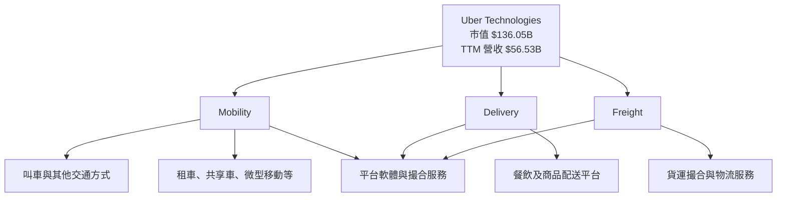
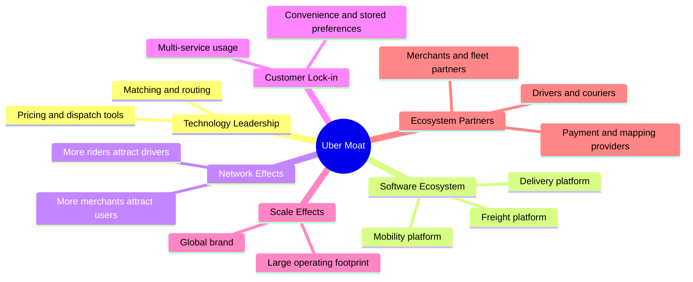
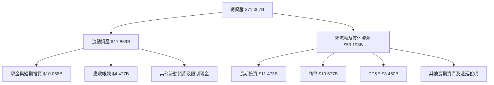
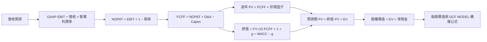
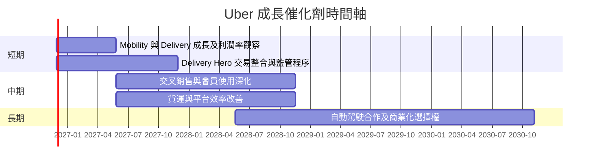
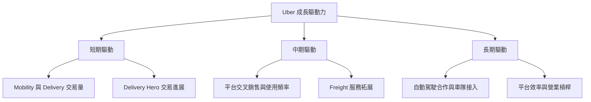
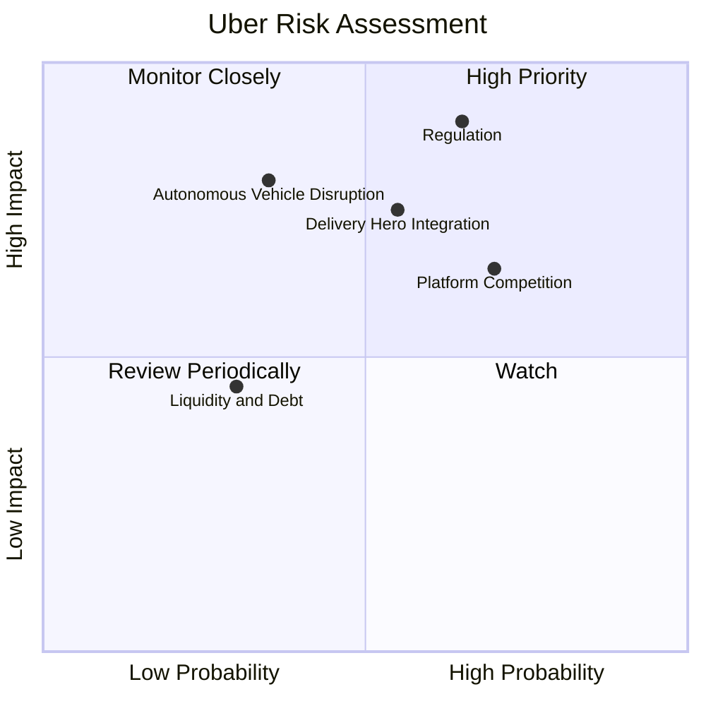
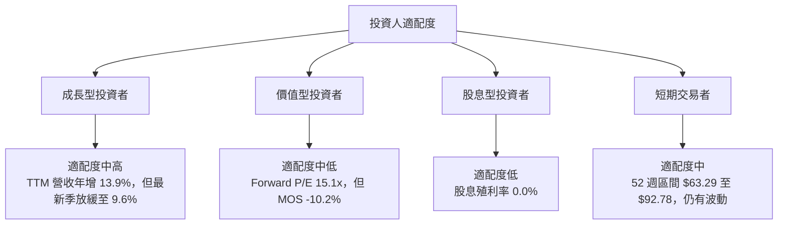

# UBER 基本面深度分析報告
> **報告日期**：2026-11-28 ｜ **語言**：繁體中文 ｜ **數據來源**：SEC 申報資料 (XBRL)、Yahoo Finance、Finviz、StockAnalysis、Roic.ai ｜ **分析師**：CFA 級機構研究

## 目錄

| # | 章節 | 核心結論 |
|---|------|----------|
| 1 | 執行摘要 | 減碼；加權合理價值 $60.47；MOS -10.2% |
| 2 | 公司概覽與商業模式 | 三大平台業務具網路效應；分部營收占比未提供 |
| 3 | 損益表深度分析 | TTM 營收 $56.53B、年增 13.9%；最近一季營收年增 9.6% |
| 4 | 資產負債表分析 | 淨負債 $5.60B；流動性可用但非淨現金公司 |
| 5 | 現金流量深度分析 | TTM FCF $10.42B，FCF Yield 7.66% |
| 6 | 獲利能力與資本效率 | ROIC 15.8% 高於 WACC 10.06%，正創造價值 |
| 7 | 相對估值分析 | Forward P/E 15.1x；同業估值與自身歷史訊號分歧 |
| 8 | DCF 內在價值評估 | 基準 DCF 每股 $40.84；加權合理價值 $60.47 |
| 9 | 成長催化劑 | Delivery Hero 交易進展、平台交叉銷售與自駕合作具催化可能 |
| 10 | 風險矩陣 | 監管、競爭與併購整合為主要風險 |
| 11 | 投資建議 | 依 MOS 評級為減碼；現價高於加權合理價值 |

---

## 1. 執行摘要

Uber 的 TTM 營收為 **$56.53B**、年增 **13.9%**，TTM 營業利益率 **12.4%**，TTM FCF **$10.42B**，FCF Yield **7.66%**；ROIC **15.8%** 高於 WACC **10.06%**，顯示主業具正向資本回報。另一方面，2026-11-27 收盤價 **$66.63** 高於 DCF 基準價值 **$40.84**；三種估值方法加權後合理價值 **$60.47**，MOS 為 **-10.2%**。因此，依 MOS 門檻評級為 **減碼**，不是因為營運現金流疲弱，而是現價相對加權價值仍有折價保護不足的問題。

### 1.0 一頁式投資儀表板（Portfolio Manager 30 秒速讀）

| 項目 | 內容 |
|------|------|
| **投資論點（3 句）** | ① TTM 營收年增 13.9%，平台需求仍在擴大。② TTM FCF $10.42B、FCF Yield 7.66%，現金創造力高。③ ROIC 15.8% 高於 WACC 10.06%，但估值加權後仍高於合理價值。 |
| **綜合評分** | **6.6/10**（引用 1.1 評分卡） |
| **財務健康** | 🟡 現金及短期投資 $10.07B，Verified total debt $15.66B，淨負債 $5.60B。 |
| **ROIC vs WACC** | **15.8% vs 10.06%**；目前創造股東價值。 |
| **FCF 趨勢** | 多年改善；TTM FCF Yield **7.66%**。 |
| **估值** | Forward P/E **15.1x** ｜ EV/EBITDA **18.2x** ｜ FCF Yield **7.66%** |
| **DCF 內在價值（基準）** | **$40.84** ｜現價相對 DCF 溢價 **63.2%**（折溢價基準為 DCF 基準價值） |
| **安全邊際（MOS）** | **-10.2%**＝($60.47 − $66.63) ÷ $60.47｜🔴 <10%：無安全邊際 |
| **預期報酬（基準情境 12M）** | **-38.7%**（DCF 基準情境價值相對現價；非時間保證） |
| **關鍵風險（前二）** | 監管／勞動力分類變化；外送競爭與大型併購整合。 |
| **評級 + 信心度** | 🟠 **減碼** ｜信心：中（估值訊號明確，營運及併購結果有不確定性） |

> DCF 折溢價算式：$66.63 ÷ $40.84 − 1 = **63.2%**。安全邊際以第 8.8 節加權合理價值為分母，並非 DCF 單一估值。

### 1.1 綜合評分卡（全報告唯一）

| 維度 | 評分（1–10） | 主要依據（引用數字與其來源章節） |
|------|--------------|----------------------------------|
| 成長性 | 7.5 | TTM 營收年增 13.9%，最新一季營收年增 9.6%；第 3 章。 |
| 獲利能力 | 7.5 | TTM 營業利益率 12.4%、ROIC 15.8% 高於 WACC 10.06%，F-Score 6/8；第 3、6 章。 |
| 財務健康 | 6.5 | 淨負債 $5.60B，流動比率 1.232；DSO 29 天；第 4 章。 |
| 估值 | 4.5 | MOS -10.2%，DCF 基準價值 $40.84；第 7、8 章。 |
| 護城河 | 7.0 | 多邊平台、網路效應及 37,300 名員工形成規模基礎；分部收入與市場份額未提供；第 2 章。 |
| 管理層與資本配置 | 6.5 | 2025 年 FCF $9.76B、SBC $1.83B；近期擬擴大 Delivery Hero 控股，增加整合與資本配置風險。 |
| **綜合評分** | **6.6** | 六項算術平均為 6.583，四捨五入至一位小數。 |

### 1.2 五大投資論點 + 三大核心風險

| 類型 | 項目 | 具體依據 | 信心度 |
|------|------|----------|--------|
| 🟢 **投資論點①** | 平台收入仍成長 | TTM 營收 $56.53B、年增 13.9%；最新一季年增 9.6%。 | 🟢 高 |
| 🟢 **投資論點②** | 現金流轉化能力提升 | TTM 營業現金流 $10.73B、資本支出 $314M，形成 TTM FCF $10.42B。 | 🟢 高 |
| 🟢 **投資論點③** | 資本回報超過資金成本 | ROIC 15.8%，高於 WACC 10.06%，利差 5.74 個百分點。 | 🟢 高 |
| 🟢 **投資論點④** | 外送與出行有交叉銷售機會 | Mobility、Delivery 共用平台與用戶觸點；財務資料未提供分部交叉銷售貢獻量。 | 🟡 中 |
| 🟢 **投資論點⑤** | 回購稀釋壓力暫未擴大 | Piotroski 股數測試顯示稀釋股數未增加；但 SBC 仍是實質股東成本。 | 🟡 中 |
| 🟡 **風險①** | 估值尚未提供足夠緩衝 | 加權合理價值 $60.47 低於現價 $66.63，MOS -10.2%。 | 🟡 中 |
| 🔴 **風險②** | 勞動力與平台監管 | 若司機被重新分類為員工，成本結構與營業利潤率可能受壓；數據未提供情境金額。 | 🔴 高衝擊 |
| 🔴 **風險③** | Delivery Hero 交易及競爭 | 新聞指出 Uber 正朝取得 87% 股權邁進，交易金額報導為 $14.8B；整合、融資及反壟斷風險上升。 | 🔴 高衝擊 |

### 1.3 快速統計卡片

| 指標 | 公司實際值（期間） | 同業中位數 | 狀態 |
|------|--------------------|------------|------|
| 營收成長（TTM） | **13.9%** | — | 🟢 正成長 |
| 營收成長（最新一季年增） | **9.6%** | 27.4% | 🟡 低於三家同業中位數 |
| 毛利率（TTM） | **41.4%** | 41.4% | 🟡 相當 |
| 營業利益率（TTM） | **12.4%** | — | 🟢 已具正向獲利 |
| ROIC（TTM） | **15.8%** | — | 🟢 高於 WACC |
| Forward P/E | **15.1x** | 18.3x | 🟢 相對偏低 |
| FCF Yield（TTM） | **7.66%** | — | 🟢 現金收益具支撐 |
| Piotroski F-Score | **6 / 8** | — | 🟢 中上；有一項測試缺資料 |

### 1.4 投資結論

╔══════════════════════════════════════════════════════════════════╗  
║                    📊 投資結論摘要                               ║  
╠══════════════════════════════════════════════════════════════════╣  
║ 評級：減碼（規則 20 依 MOS 門檻）                               ║  
║ 價格（2026-11-27 收盤）：$66.63                                 ║  
║ DCF 內在價值（基準）：$40.84（現價溢價 63.2%）                 ║  
║ 安全邊際 MOS：-10.2%（以加權合理價值 $60.47 為基準）             ║  
║ 加權合理價值（8.8）：$60.47                                     ║  
║ DCF 情境價值：悲觀 $23.13（-65.3%）｜基準 $40.84（-38.7%）      ║  
║               樂觀 $68.33（+2.6%）                              ║  
║ 綜合評分：6.6/10（引用 1.1）                                    ║  
║ 適合投資人：能承受監管、競爭及併購風險的長線成長型投資人         ║  
╚══════════════════════════════════════════════════════════════════╝

---

## 2. 公司概覽與商業模式

### 2.1 業務結構與收入來源

財務資料列出 Mobility、Delivery、Freight 三個部門，但未提供各部門營收或占比；因此不以估計比例畫分部收入圖。以下只呈現可確認的業務關係與公司規模：

Uber 的核心是利用平台撮合乘客、司機、商家與貨運供需，收入及獲利能力會受交易量、抽成、促銷、保險成本與產品組合影響。公司公布 TTM 毛利率 41.4%、營業利益率 12.4%，但資料未提供分部營收、分部利潤或交易總額，無法量化各業務對整體利潤的貢獻。

### 2.2 市場份額

市場份額數據未提供，亦無可引用的市場規模與年份，因此不以推估份額作圖。相對規模方面，Uber TTM 營收為 $56.53B，最新一季營收年增 9.6%；同業資料中 DoorDash（DASH）最新一季年增 34.0%、Grab（GRAB）年增 27.4%、Lyft（LYFT）年增 8.1%。Uber 規模較大，但本季成長低於這三家同業數據中的中位數。

### 2.3 競爭護城河分析

### 2.4 護城河強度

| 護城河項目 | 強度（強／中／弱） | 證據（引用數字或事實） | 會削弱它的情況 |
|------------|--------------------|------------------------|----------------|
| 技術與撮合 | 中 | 公司經營 Mobility、Delivery、Freight 三類平台；未提供技術投入產出的因果數據。 | 競爭者複製平台功能或自動駕駛改變撮合模式。 |
| 軟體生態系統 | 中 | 三個業務板塊可能共用平台能力；各板塊交叉使用率未提供。 | 服務品質下降或使用者轉向垂直平台。 |
| 網路效應 | 中至強 | 乘客、司機、商家多邊平台具有雙邊網路效應；營收規模達 $56.53B。 | 地區性價格戰、供需不平衡、監管限制。 |
| 客戶鎖定 | 弱至中 | 使用者可使用多種出行與外送替代品，資料未提供留存率或轉換成本。 | 競品補貼、服務體驗惡化。 |
| 規模效應 | 中 | 37,300 名員工、TTM 營收 $56.53B；尚無分部成本曲線資料可證實規模優勢幅度。 | 勞動成本、保險成本與促銷侵蝕規模效益。 |
| 生態夥伴 | 中 | 司機、外送員、商家及物流供應商構成供給端；資料未提供夥伴集中度。 | 夥伴議價能力提高或供給轉移。 |

1.1 的護城河分數為 **7.0/10**：平台網路與規模有實際營運基礎，但缺少留存率、分部利潤、份額及交叉銷售數據，不能將網路效應直接等同於穩固定價權。

---

## 3. 損益表深度分析

### 3.1 年度收入成長趨勢（近 4 年）

╔══════════════════════════════════════════════════════════════════╗  
║               Uber 年度收入趨勢（FY2022–FY2025）                ║  
╠══════════════════════════════════════════════════════════════════╣  
║ FY2022  $31.88B  ████████████░░░░░░░░░░░░  YoY：基期             ║  
║ FY2023  $37.28B  ██████████████░░░░░░░░░░  YoY：+16.9% 🟢       ║  
║ FY2024  $43.98B  █████████████████░░░░░░░  YoY：+18.0% 🟢       ║  
║ FY2025  $52.02B  ████████████████████░░░░  YoY：+18.3% 🟢       ║  
╠══════════════════════════════════════════════════════════════════╣  
║ FY2022–FY2025 營收 CAGR：約 17.7%                                ║  
╚══════════════════════════════════════════════════════════════════╝

FY2022–FY2025 CAGR 算式：$(52.02 ÷ 31.88)^{1/3} − 1 ≈ 17.7\%$。年度營收由 $31.88B 增至 $52.02B，代表平台交易規模及服務覆蓋仍擴大；但這段期間的年度成長率高於最新一季 9.6%，可能意味基期上升、成長正常化或季度波動，不能直接以歷史 CAGR 外推未來。

### 3.2 季度收入趨勢分析

| 季度 | 營收 | QoQ 成長 | YoY 成長 | 備註 |
|------|------|----------|----------|------|
| 2025 Q4 | $14.37B | 依 2025 Q3 $13.47B 計算，+6.7% | +20.1% | 季節性及年增基期影響未拆分。 |
| 2026 Q1 | $13.20B | -8.1% | +14.5% | 較前季下降，季度收入有季節波動。 |
| 2026 Q2 | $14.19B | +7.5% | +12.2% | 環比回升，但年增低於前一年同期。 |
| 2026 Q3 | $14.77B | +4.1% | +9.6% | 最新季度年增率已由 2025 Q3 的 20.4% 降至 9.6%。 |

QoQ 公式為「本季營收 ÷ 前季營收 − 1」。營收仍逐季增加，但 YoY 由 2025 Q1 的 13.8%、Q2 的 18.2%、Q3 的 20.4%、Q4 的 20.1%，降至 2026 Q1 的 14.5%、Q2 的 12.2%、Q3 的 9.6%。這種放緩可能來自高基期或交易成長轉弱；現有資料不足以判定各因素占比，後續要與交易量、總預訂額及分部營收交叉驗證。

### 3.3 利潤率演變分析

以下年度毛利率按年度損益表毛利 ÷ 營收計算；資料來源中 2025 毛利數字存在差異，表內採用年度損益表列示的 $20.68B，另以 TTM 毛利率 41.4% 作為最新參考。

| 利潤率指標 | FY2022 | FY2023 | FY2024 | FY2025 | 趨勢 | 評估 |
|------------|--------|--------|--------|--------|------|------|
| 毛利率 | 38.3% | 39.7% | 39.4% | 39.8% | 整體略升，年度來源口徑可能不同；TTM 為 41.4%。 | 🟡 |
| 營業利益率 | -5.7% | 3.0% | 6.4% | 10.7% | 由虧轉盈，規模、費用控制及營運槓桿改善。 | 🟢 |
| 淨利率 | -28.7% | 5.1% | 22.4% | 19.3% | FY2024–FY2025 受非營業或一次性項目影響，波動大於營業利潤。 | 🟡 |

年度營業利益率由 FY2022 的負 5.7% 改善至 FY2025 的 10.7%，反映收入擴張後固定成本攤薄及營運效率提升；但最新季度口徑存在差異：SEC Verified Figures 的最新一季營業利益率為 **9.8%**，而其他合併來源列示 12.4%。依嚴格數據優先規則，最新季採 9.8%，TTM 採 12.4%。若最新季利潤率低於 TTM，可能代表季度成本或產品組合不利，應追蹤下一季是否回升。

### 3.4 費用結構分析

完整營運費用明細與一致口徑的費用項目未提供，不繪製費用圓餅圖，避免以不完整損益表反推費用比例。已提供的研發費用為 FY2025 **$3.40B**，FY2024 **$3.11B**，FY2023 **$3.16B**，FY2022 **$2.80B**；FY2025 研發支出約占收入 **6.5%**（$3.40B ÷ $52.02B），支出上升可能支撐產品與平台開發，但資料未提供研發對營收或利潤的直接回報。

### 3.5 季度 EPS 趨勢與盈餘品質（Quality of Earnings）

| 盈餘品質項目 | 數值/佔比 | 評估 |
|--------------|-----------|------|
| 股權薪酬 SBC / 營收 | 近四季 SBC 約 $2.065B ÷ 營收 $56.53B = 約 3.7% | 🟡 成本具規模，GAAP 已費用化；即使股數未增加，仍有機會成本。 |
| SBC / 營業現金流 | 約 $2.065B ÷ $10.73B = 約 19.2% | 🟡 SBC 占現金流比重不低；現金流未扣 SBC，股東應將其視為經濟成本。 |
| FCF / 淨利（現金轉換率） | $10.42B ÷ TTM 淨利 $3.465B = 約 3.0x | 🟢 現金流高於會計淨利；需注意淨利可能受非現金或一次性項目影響。 |
| 一次性/非經常性損益 | 有重大波動跡象；2025 Q3 淨利 $6.626B，2026 Q3 $0.512B | 🟡 季度淨利波動明顯；逐項稅務、投資或法律損益資料未提供。 |
| 有效稅率異常 | N/A（未提供一致口徑 TTM 所得稅費用與稅前利潤） | 無法判斷近期稅務利益是否拉高淨利。 |
| 資本化支出 vs 費用化 | TTM Capex $314M；資本化明細 N/A | 資本支出低，但無法確認軟體開發成本等資本化政策。 |

最近四季 EPS 估值與實際值欄位均為 NaN，且未提供可驗證的市場一致預期，因此**不能判定過去四季超預期或不及預期**。可觀察到報表 EPS 分別為 2025 Q4 $0.14、2026 Q1 $0.13、Q2 $1.18、Q3 $0.25；季度淨利分別為 $296M、$263M、$2.394B、$512M，起伏顯著。這說明 EPS 不能只用單季值外推，應將 GAAP 營業利益及現金流並看。

**盈餘品質結論**：TTM FCF 對淨利約 3.0 倍，現金含量表面上較佳；但 SBC 約占營收 3.7%、營業現金流 19.2%，而季度淨利波動很大。DCF 採 GAAP EBIT，已把 SBC 當費用，不再額外扣 SBC；但以現金流估值時，需持續關注 SBC 對股東的經濟稀釋。

---

## 4. 資產負債表分析

### 4.1 資產結構分解

以下採 2026-09-30 StockAnalysis 資產負債表數字，總資產 $71.067B。分項不是全部資產項目的完整重分類，避免將部分明細與總計重複加總。

資產中現金及短期投資為 $10.068B，應收帳款 $4.427B；商譽 $10.577B、長期投資 $11.473B。商譽與長期投資的規模意味收購與投資價值變動可能影響資產品質，需追蹤減值及投資實現情況。

### 4.2 流動性與營運資金分析

| 指標 | 最新 TTM | 一年前 TTM | 變化 | 解讀 |
|------|----------|------------|------|------|
| DSO 應收帳款天數 | 29 天 | 28 天 | +1 天 | 收款週期略延長；變化幅度有限，但持續上升會占用現金。 |
| DIO 存貨天數 | N/A | N/A | N/A | 公司未報告相關存貨餘額，不補推。 |
| DPO 應付帳款天數 | 17 天 | N/A | N/A | 一年前資料不足，無法判斷付款週期方向。 |
| CCC 現金轉換週期 | N/A | N/A | N/A | 存貨天數與一年前 DPO 缺漏，不能計算。 |

流動性指標依財務資料：流動比率 **1.232**、速動比率 **0.999**。短期資產略高於流動負債，但速動比率接近 1，流動性尚可、緩衝並不寬裕。由於 Uber 的業務型態不以存貨為核心，DIO 未提供屬合理資料限制，不能以其他公司的口徑替代。

### 4.3 債務結構分析

╔══════════════════════════════════════════════════════════════════╗  
║                   Uber 債務健康診斷                              ║  
╠══════════════════════════════════════════════════════════════════╣  
║ 總債務（Verified）：$15.66B　　██████████████░░░░░░              ║  
║ 現金及短期投資：   $10.07B　　█████████░░░░░░░░░░░              ║  
║ 淨負債：           $5.60B　　　🟡 有淨負債                     ║  
║ 流動比率：         1.232　　　🟡 流動資產略高於流動負債         ║  
║ Quick Ratio：      0.999　　　🟡 近 1 倍                        ║  
║ Debt/EBITDA：      N/A（債務與 EBITDA 口徑資料不一致，不混算）  ║  
║ 利息保障倍數：     N/A（利息費用及一致口徑 EBIT 未提供）        ║  
╚══════════════════════════════════════════════════════════════════╝

資料來源另列總債務 $17.74B、淨負債 $7.67B，與 Verified Figures 的 $15.66B、$5.60B 不一致。本報告凡涉及核心估值與淨負債，一律採 SEC 申報計算的 Verified Figures：現金及短期投資 $10.07B、債務 $15.66B、淨負債 $5.60B。差異應在後續財報中核對債務是否包含租賃或其他負債。

### 4.4 股東權益趨勢

╔══════════════════════════════════════════════════════════════════╗  
║                   Uber 股東權益趨勢                              ║  
╠══════════════════════════════════════════════════════════════════╣  
║ FY2022  $7.34B   █████░░░░░░░░░░░░░░░░░░░░                      ║  
║ FY2023  $11.25B  ████████░░░░░░░░░░░░░░░░                      ║  
║ FY2024  $21.56B  ███████████████░░░░░░░░░                      ║  
║ FY2025  $27.04B  ████████████████████░░░░                      ║  
╚══════════════════════════════════════════════════════════════════╝

股東權益從 FY2022 $7.34B 增至 FY2025 $27.04B。權益增加與獲利改善相伴，但權益帳面增長不等於每股價值同比例增加，仍須一併觀察股數與收購造成的資產變動。

---

## 5. 現金流量深度分析

### 5.1 現金流量瀑布圖

近四季淨利加總約 $3.465B；圖中股息、回購與淨現金變化沒有可比的指定 TTM 金額，故標示未提供、不填假數。

### 5.2 FCF 轉換率趨勢

| 年度 | FCF | 淨利 | FCF / 淨利 | 解讀 |
|------|-----|------|------------|------|
| 2022 | $0.39B | -$9.14B | 不具解讀性 | 淨利為負，比例不宜解讀。 |
| 2023 | $3.36B | $1.89B | 約 1.78x | 現金流高於淨利。 |
| 2024 | $6.89B | $9.86B | 約 0.70x | 淨利高於 FCF，存在非現金或營運資金因素的可能，明細未提供。 |
| 2025 | $9.76B | $10.05B | 約 0.97x | 現金轉換接近 1 倍。 |
| TTM 至 2026-09-30 | $10.42B | $3.465B | 約 3.0x | 現金流高於淨利，但淨利期間波動大。 |

### 5.3 自由現金流趨勢

╔══════════════════════════════════════════════════════════════════╗  
║                Uber 自由現金流：歷史實際                         ║  
╠══════════════════════════════════════════════════════════════════╣  
║ FY2022  $0.39B  █░░░░░░░░░░░░░░░░░░░░░░░░                      ║  
║ FY2023  $3.36B  ████████░░░░░░░░░░░░░░░░░░                      ║  
║ FY2024  $6.89B  █████████████████░░░░░░░░                      ║  
║ FY2025  $9.76B  ████████████████████████░                      ║  
║ TTM     $10.42B FCF Yield 7.66%                                 ║  
╚══════════════════════════════════════════════════════════════════╝

FCF 由 FY2022 $0.39B 增至 FY2025 $9.76B，顯示現金創造能力顯著提升。TTM FCF 為 $10.42B，定義為營業現金流 $10.73B 減資本支出 $314M。FY2025 SBC $1.83B 約占 FCF 18.8%，提醒投資人現金流指標並未把股權薪酬當現金支出扣除。

### 5.4 資本配置評估

股息、回購與收購的同期間完整分配金額未提供，故不畫比例圓餅圖。

| 資本配置項目 | 可用數據 | 評估 |
|--------------|----------|------|
| 資本支出 | TTM $314M；FY2025 $336M | 相對營收偏低，代表資本密集度不高；需注意租賃與平台支出未必完整反映在 Capex。 |
| 研發 | FY2025 $3.40B | 約為 FY2025 營收的 6.5%，是平台投入的重要部分。 |
| 股權薪酬 | FY2025 $1.83B | 對員工激勵有用，但持續增加會稀釋股東經濟利益。 |
| 股息 | 股息殖利率 0.0% | 目前非股息收益型標的。 |
| 回購 | 分年度回購金額 N/A | 股數測試顯示未增加，但不能據此推算回購金額。 |
| 併購／投資 | Delivery Hero 交易進展見近期新聞 | 可能取得策略資產，也會引入整合、融資與監管風險。 |

---

## 6. 獲利能力與資本效率

### 6.1 ROE / ROA / ROIC 趨勢

| 指標 | 最新可用值 | 期間與趨勢 | 評估 |
|------|------------|------------|------|
| ROE | 12.5% | TTM；DuPont 同期資料 | 🟡 正值，權益乘數 2.57 有放大作用。 |
| ROA | 6.5% | TTM | 🟢 資產已產生正回報。 |
| ROIC | 15.8% | TTM | 🟢 高於 WACC。 |
| 行業均值 | 未提供 | 不作同業平均推估 | — |

### 6.2 ROIC vs WACC 分析（核心價值創造判斷）

╔══════════════════════════════════════════════════════════════════╗  
║                ROIC vs WACC 深度分析                             ║  
╠══════════════════════════════════════════════════════════════════╣  
║ WACC（採用程式計算值）：10.06%                                   ║  
║ ├─ 無風險利率：4.94%（Cost of Capital 資料）                     ║  
║ ├─ ERP：5.00%                                                     ║  
║ ├─ 原始 Beta：1.31；採用調整後 Beta：1.21                       ║  
║ ├─ 股權成本 Ke：10.96%（直接採用指定 Cost of Capital 數值）      ║  
║ ├─ 稅前債務成本：2.81%；稅率 21.0%                               ║  
║ ├─ E / D 權重：89.7% / 10.3%                                     ║  
║ └─ WACC：10.06%                                                  ║  
║                                                                  ║  
║ ROIC（TTM）：15.8%                                                ║  
║ EVA 利差：15.8% − 10.06% = +5.74 個百分點                        ║  
║ ROIC / WACC：15.8% ÷ 10.06% ≈ 1.57 倍                            ║  
║ 結論：目前 ROIC 高於資金成本，正創造經濟價值。                   ║  
╚══════════════════════════════════════════════════════════════════╝

成本資本組成直接採用指定的 Cost of Capital 數據，不另造 WACC。Beta 採調整後 1.21，調整方式為「⅔ × 原始 Beta 1.31 + ⅓」；10 年期美債殖利率日期未提供，因此不杜撰日期。CAPM 成本股權 10.96%、稅前債務成本 2.81%、稅率 21.0%、資本權重 89.7%／10.3%，指定 WACC 為 10.06%。ROIC 高於 WACC 5.74 個百分點，代表現階段公司投資回報超過資金成本；若併購使投入資本增加而回報未跟上，利差可能收窄。

### 6.3 杜邦三因素分解

| 因素 | 數值（TTM） | 解讀 |
|------|-------------|------|
| 淨利率 | 6.1% | 淨利率提供 ROE 的獲利基礎，但季度淨利波動大。 |
| 資產週轉率 | 0.80 | 資產每年約形成 0.80 倍營收。 |
| 權益乘數 | 2.57 | 財務槓桿會放大 ROE，也提高資產負債表風險。 |
| **ROE** | **12.5%** | 6.1% × 0.80 × 2.57 = 約 12.5%。 |

依 QUALITY FIGURES 原值，ROE 主要由淨利率、資產週轉及 2.57 倍權益乘數共同形成；不是單靠高槓桿，但槓桿仍對股東回報有顯著放大作用。

### 6.4 財務體質：Piotroski F-Score

**Piotroski F-Score：6 / 8**。一項測試因毛利率資料不足而不計入分母；照錄九項檢查結果如下。

| 測試 | 結果 | 解讀 |
|------|------|------|
| ROA > 0 | ✅ 通過 | 公司持續資產回報為正。 |
| 營業現金流 > 0 | ✅ 通過 | TTM 營業現金流 $10.73B。 |
| ROA 高於一年前 | ❌ 未通過 | 資產回報未呈改善，需追蹤獲利與資產擴張是否同步。 |
| 營業現金流 > 淨利 | ✅ 通過 | 顯示現金獲利高於會計淨利。 |
| 長期負債 ÷ 總資產低於一年前 | ❌ 未通過 | 槓桿負擔相對資產未改善。 |
| 流動比率高於一年前 | ✅ 通過 | 短期流動性較一年前改善。 |
| 稀釋股數未增加 | ✅ 通過 | 本期股數測試未見增加。 |
| 毛利率高於一年前 | — 無法判定 | 缺少可比輸入，不補填。 |
| 資產週轉率高於一年前 | ✅ 通過 | 資產運用效率相對改善。 |

6/8 表示基本面多項指標通過，但 ROA 與長期負債趨勢未通過，不能僅憑總分忽略資產回報與槓桿方向。

---

## 7. 相對估值分析

### 7.1 同業估值比較表格

公司估值採價格及財務資料的 Verified Figures；Forward P/E 依市場估值資料列示 15.1x。LYFT、DASH、GRAB 使用 Yahoo Finance 同業資料。

| 估值指標 | **UBER** | **LYFT** | **DASH** | **GRAB** | UBER 評估 |
|----------|---------:|--------:|--------:|--------:|-----------|
| **Trailing P/E** | 39.0x | 2.6x | 69.1x | 28.7x | 🟡 同業差異大；LYFT 盈利基數與 DASH 高倍數使比較失真。 |
| **Forward P/E** | 15.1x | 8.7x | 22.0x | 18.3x | 🟢 低於同業中位數 18.3x。 |
| **P/S Ratio** | 2.4x | 1.0x | 4.3x | 2.9x | 🟡 高於 LYFT、低於 DASH／GRAB。 |
| **EV/EBITDA** | 18.2x | 597.4x | 41.2x | 18.5x | 🟢 低於 DASH、接近 GRAB；LYFT 數值極高。 |
| **最新一季營收年增** | 9.6% | 8.1% | 34.0% | 27.4% | 🟡 低於三家同業中位數 27.4%。 |
| **毛利率 TTM** | 41.4% | 40.0% | 52.7% | 41.4% | 🟡 與 GRAB 相當，低於 DASH。 |

Forward P/E 同業中位數為 18.3x，來源是 LYFT 8.7x、DASH 22.0x、GRAB 18.3x。UBER 的 15.1x 相對不高，但這個折價需要與最新一季僅 9.6% 的營收增長一併衡量。EV/EBITDA 中 LYFT 的 597.4x 顯著偏離其餘同業，不能把平均值當合理基準；相對估值方法使用同業中位數而非平均數。

### 7.2 歷史估值區間分析

╔══════════════════════════════════════════════════════════════════╗  
║                 UBER 自身五年估值位置                            ║  
╠══════════════════════════════════════════════════════════════════╣  
║ P/E：現值 39.0x｜中位數 17.8x｜區間 12.6x–122.2x｜百分位 62%   ║  
║      12.6x ───────── 17.8x ───────●39.0x──────── 122.2x        ║  
║ P/S：現值 2.4x ｜中位數 3.3x ｜區間 1.5x–6.1x ｜百分位 19%   ║  
║ EV/EBITDA：18.2x｜中位數 40.0x｜區間 18.7x–320.2x｜百分位 0%  ║  
╚══════════════════════════════════════════════════════════════════╝

P/E 39.0x 高於五年中位數 17.8x、處於歷史第 62 百分位；P/S 2.4x 低於中位數 3.3x、處於第 19 百分位；EV/EBITDA 18.2x 低於歷史區間下端 18.7x，資料庫給定百分位 0%。不同倍數方向不一致，原因可能是利潤與收入的變化速度不同，不能單以某一倍數判定便宜或昂貴。

### 7.3 情境價值（Bear / Base / Bull，照抄 DCF MODEL 的 Scenarios）

| 情境 | 第 1 年營收成長 | 期末營業利潤率 | WACC | 每股價值 | 相對現價 | 機率 | 會發生的條件 |
|------|----------------|----------------|------|----------|----------|------|--------------|
| 🔴 悲觀 | 7.0% | 5.4% | 11.06% | $23.13 | -65.3% | 25% | 交易成長下滑、競爭促銷加劇，利潤率長期低於基準。 |
| 🟡 基準 | 13.9% | 6.4% | 10.06% | $40.84 | -38.7% | 50% | 初期延續 TTM 成長，十年後營業利潤率回落至歷史中位水準。 |
| 🟢 樂觀 | 20.9% | 7.0% | 9.06% | $68.33 | +2.6% | 25% | 平台交易增長加速、利潤率維持較高且資金成本下降。 |

情境數值均取自程式計算模型；分情境的完整逐年營收、FCFF 中間值未提供，故不自建或反推另一套模型。程式另列機率加權 DCF $43.28，但估值三角驗證採 DCF 基準值 $40.84，不能以機率加權值替代規定權重下的 DCF 輸入。

### 7.4 相對估值隱含價格區間

╔══════════════════════════════════════════════════════════════════╗  
║                  估值方法隱含每股價值                            ║  
╠══════════════════════════════════════════════════════════════════╣  
║ DCF 基準 $40.84 ── 現價 $66.63 ── Forward P/E $80.54 ── 共識 $98.16 ║  
║ 低估值錨點                       較高估值參考                   ║  
╚══════════════════════════════════════════════════════════════════╝

- **DCF 基準 $40.84**：10 年 FCFF、WACC 10.06%、永續成長率 3.0%。
- **同業 Forward P/E $80.54**：同業中位數 Forward P/E 18.3x × Uber Forward EPS $4.41；未四捨五入的倍數乘積由估值程式提供。
- **分析師共識 $98.16**：46 位分析師平均目標價。該目標價是市場預期參考，不等同於本報告內在價值。
- **同業 EV/EBITDA**：不可計算，因此不納入估值方法。

---

## 8. DCF 內在價值評估（Discounted Cash Flow）

### 8.0 估值推理鏈（Thinking Logic：在算之前先想清楚）

**Step 1 — 價值由哪些變數決定？**  
Uber 的價值主要由 Mobility、Delivery、Freight 既有平台的現金流、未來營收增長與營業利潤率共同決定；目前分部營收占比沒有可靠可引用資料，不能量化每個業務的占比。模型最敏感的變數是 WACC 與永續成長率：敏感度表顯示，在 g 3.0% 時，WACC 由 8.06% 到 12.06%，每股價值由 $56.73 降至 $31.85；在 WACC 10.06% 時，g 由 2.0% 到 4.0%，價值由 $38.15 升至 $44.41。

**Step 2 — 模型選擇**

| 決策點 | 本報告採用 | 理由（含數字） | 曾考慮但否決 | 否決理由 |
|--------|-----------|----------------|--------------|----------|
| 現金流定義 | FCFF | 以 WACC 10.06% 折現，先得企業價值，再橋接淨負債。 | FCFE | 債務成本與資本結構已納入 WACC，FCFF 與模型設定一致。 |
| 預測期 N | 10 年 | 模型已明確採 10 年，捕捉成長與利潤率正常化。 | 5 年 | 會改變既定模型，且與已核定 DCF 輸出不符。 |
| 終值方法 | Gordon Growth | 終值成長率 3.0%，低於 WACC 10.06%。 | 退出倍數 | DCF 模型未提供可稽核的退出倍數值，不自行補建。 |
| EBIT 基礎 | GAAP EBIT | 模型明示 GAAP EBIT。 | 非 GAAP EBIT | 會改變模型基礎並可能漏計 SBC。 |

**Step 3 — 關鍵假設推導鏈**

- **營收增長**：錨點為 TTM 營收成長 13.9% → 模型令第 1 年維持此成長，後續線性降至第 10 年 3.0% → **採用第 1 年 13.9%、第 10 年 3.0%** → 曾考慮把近三年約 17.7% CAGR 外推，但該歷史值高於最新一季 9.6% 年增，故模型未採更高長期增速。
- **期末營業利潤率**：錨點為 TTM GAAP 營業利益率 12.4% → 模型在十年間逐步回落至含 TTM 的近五年年度中位數 → **第 1 年 12.4%、第 10 年 6.4%** → 未採用維持 12.4% 十年的假設，因模型本身認為成熟期利潤率應正常化。
- **永續成長率 g**：模型採用 3.0%，低於 WACC 10.06%，且符合成熟公司長期名目增長不宜遠高於經濟成長的原則 → **採用 3.0%** → 未採用更高 g，因會大幅放大終值。
- **預測期 N**：模型採 10 年 → **採用 N=10** → 不另行縮短或延長，以遵守已計算模型。
- **Capex / 營收**：錨點為 TTM Capex 佔營收約 0.6% → 模型維持 0.6% → **採用 0.6%** → 未提高為 1.1 × D&A，因模型資料明列 Capex/營收 0.6%。
- **EBIT 基礎及 SBC**：模型使用 GAAP EBIT，SBC 已在費用中 → **採用組合 (A)**，FCFF 不再扣 SBC、股數不再稀釋 → 否決「非 GAAP 加回 SBC」的替代方式，避免改變模型基礎。
- **年稀釋率**：組合 (A) 明示固定股數 → **採用 0% 額外稀釋** → 不以額外股數稀釋重複計算 SBC。
- **終值方法**：模型採 Gordon Growth，起始為 FY+10 FCFF → **採用 Gordon Growth** → 退出倍數未提供，不能自行指定。
- **WACC**：採程式計算的 **10.06%**，並與 ROIC 比較使用同一數字 → 不另算或替換 WACC。

**Step 4 — 最脆弱一環**  
最脆弱的是終值假設：終值現值占企業價值 46.5%；若 WACC 上升或長期增長低於 3.0%，DCF 價值會下修，矩陣中 WACC 12.06%、g 3.0% 時每股價值為 $31.85。

**Step 5 — 計算路徑圖**

### 8.1 模型假設總表（Model Inputs）

| 假設項目 | 採用值 | 依據 / 來源 | 敏感度 |
|----------|--------|-------------|--------|
| 預測期長度 N | 10 年 | DCF MODEL 固定輸入；反映十年正常化期間。 | 🟡 中 |
| 營收成長 | 第 1 年 13.9%，線性降至第 10 年 3.0% | 第 1 年錨點為 TTM vs prior TTM 13.9%；終年為模型長期假設。 | 🔴 高 |
| 營業利潤率 | 第 1 年 12.4%，第 10 年 6.4% | 起點為 TTM 營業利益率；終值採近五年年度中位數含 TTM。 | 🔴 高 |
| 有效稅率 | 21.0% | Cost of Capital／DCF 預設稅率。 | 🟢 低 |
| Capex / 營收 | 0.6% | TTM Capex 與營收比率，模型維持至第 10 年。 | 🟡 中 |
| D&A / 營收 | 1.4% | TTM 比率，模型固定。 | 🟢 低 |
| 營運資金變動 | 未建模 | DCF MODEL 明示 Working Capital is not modelled；不假設為零後另行扣除。 | 🟢 低 |
| EBIT 基礎 | GAAP EBIT | 模型明示 GAAP EBIT。 | 🟡 中 |
| SBC 處理 | GAAP 已費用化，不再扣 SBC | 採組合 (A)，避免重複扣除。 | 🟡 中 |
| 年稀釋率 | 0% 額外稀釋 | 固定股數組合 (A)，按模型規定。 | 🟡 中 |
| 永續成長率 g | 3.0% | DCF MODEL 指定，低於 WACC。 | 🔴 高 |
| 終值方法 | Gordon Growth | DCF MODEL 明列公式；退出倍數未提供。 | 🔴 高 |
| WACC | 10.06% | Cost of Capital 指定值。 | 🔴 高 |

本模型採用 **FCFF = NOPAT + D&A − Capex**，且不建模營運資金變動。採用 **(A) GAAP EBIT + 固定股數**：SBC 已在費用中計入一次，FCFF 不另扣 SBC，股數也不再逐年放大。

### 8.2 折現率推導（WACC）

╔══════════════════════════════════════════════════════════════════╗  
║                    WACC 推導（折現率）                           ║  
╠══════════════════════════════════════════════════════════════════╣  
║ 股權成本 Ke（採用指定 Cost of Capital）                          ║  
║ ├─ 無風險利率 Rf：4.94%                                          ║  
║ ├─ ERP：5.00%                                                     ║  
║ ├─ 原始 Beta：1.31                                               ║  
║ ├─ 調整後 Beta：1.21 = ⅔ × 1.31 + ⅓                             ║  
║ ├─ 規模／國別溢酬：未提供，未另加                                 ║  
║ └─ Ke：10.96%（指定值）                                          ║  
║                                                                  ║  
║ 債務成本                                                         ║  
║ ├─ 稅前 Kd：2.81%（指定值）                                      ║  
║ ├─ 稅率：21.0%                                                    ║  
║ └─ 稅後 Kd = 2.81% × (1 − 21.0%) = 2.22%                        ║  
║                                                                  ║  
║ 資本結構                                                         ║  
║ ├─ 股權權重：89.7%                                               ║  
║ ├─ 債務權重：10.3%                                               ║  
║ └─ WACC：10.06%（採用指定值）                                    ║  
╚══════════════════════════════════════════════════════════════════╝

逐步演算（Cost of Capital 組成採用原值；利息費用、平均計息負債與 WACC 權重所用市值細節未提供，故不自行反算）：

1. **Ke（CAPM）**：指定值 **10.96%**；Beta 採調整後 1.21，原始 Beta 1.31，調整方式為 \(⅔×1.31+⅓\)。以已四捨五入輸入重算 CAPM 與指定 Ke 可能有尾差，故不替換指定 Ke。
2. **稅前 Kd**：直接採指定 **2.81%**；利息費用與平均計息負債未提供，不能獨立重算。
3. **稅後 Kd**：\(2.81\%×(1−21.0\%)=2.2199\%\)，四捨五入 **2.22%**。
4. **權重**：股權 **89.7%**，債務 **10.3%**，合計 **100.0%**；權重所用同一日期市場資本明細未提供，不另推算。
5. **WACC**：\(89.7\%×10.96\%+10.3\%×2.22\%=9.8311\%+0.2287\%=10.0598\%\)，四捨五入 **10.06%**。

### 8.3 逐年自由現金流預測（基準情境）

金額單位：$B；金額取兩位小數，折現因子三位小數。以下完全照錄 DCF MODEL 的 10 年預測。模型未納入 ΔWC，因此不另加一列；SBC 依組合 (A) 已包含在 GAAP EBIT，不另扣。

| 年度 | FY+1 | FY+2 | FY+3 | FY+4 | FY+5 | FY+6 | FY+7 | FY+8 | FY+9 | FY+10 |
|------|-----:|-----:|-----:|-----:|-----:|-----:|-----:|-----:|-----:|------:|
| 營收 | 64.41 | 72.60 | 80.96 | 89.29 | 97.40 | 105.06 | 112.04 | 118.12 | 123.10 | 126.80 |
| 營收 YoY | 13.9% | 12.7% | 11.5% | 10.3% | 9.1% | 7.9% | 6.6% | 5.4% | 4.2% | 3.0% |
| 營業利潤率 | 12.4% | 11.8% | 11.1% | 10.4% | 9.7% | 9.1% | 8.4% | 7.7% | 7.0% | 6.4% |
| EBIT（GAAP） | 8.01 | 8.54 | 8.98 | 9.30 | 9.49 | 9.52 | 9.40 | 9.11 | 8.67 | 8.07 |
| − 稅 | (1.68) | (1.79) | (1.89) | (1.95) | (1.99) | (2.00) | (1.97) | (1.91) | (1.82) | (1.69) |
| NOPAT | 6.33 | 6.75 | 7.09 | 7.35 | 7.50 | 7.52 | 7.43 | 7.20 | 6.85 | 6.38 |
| + D&A | 0.88 | 0.99 | 1.10 | 1.21 | 1.33 | 1.43 | 1.52 | 1.61 | 1.67 | 1.72 |
| − Capex | (0.36) | (0.40) | (0.45) | (0.50) | (0.54) | (0.58) | (0.62) | (0.66) | (0.68) | (0.70) |
| **FCFF** | **6.85** | **7.33** | **7.75** | **8.07** | **8.28** | **8.37** | **8.33** | **8.15** | **7.84** | **7.40** |
| 折現因子 @10.06% | 0.909 | 0.826 | 0.750 | 0.682 | 0.619 | 0.563 | 0.511 | 0.464 | 0.422 | 0.383 |
| **FCFF 現值 PV** | **6.22** | **6.05** | **5.81** | **5.50** | **5.13** | **4.71** | **4.26** | **3.79** | **3.31** | **2.84** |

**預測期 PV 合計**：  
$6.22 + $6.05 + $5.81 + $5.50 + $5.13 + $4.71 + $4.26 + $3.79 + $3.31 + $2.84 = **$47.62B**。  
模型指定合計為 **$47.61B**；差異 $0.01B，來自逐年 PV 四捨五入，低於 1% 尾差。

**FY+1 逐步演算**

1. **營收**：$56.53B × (1 + 13.9%) = **$64.41B**。
2. **EBIT**：$64.41B × 12.4% = **$7.99B**；DCF MODEL 列示 $8.01B。此差異來自模型使用未四捨五入輸入，報告依指定模型照錄 $8.01B，不以展示後的四捨五入值重建模型。
3. **稅**：模型列示 **$1.68B**（採未四捨五入 EBIT 與 21% 稅率）。
4. **NOPAT**：模型列示 **$6.33B**。
5. **D&A**：$64.41B × 約 1.4% ≈ **$0.88B**。
6. **Capex**：$64.41B × 約 0.6% ≈ **$0.36B**。
7. **ΔWC**：模型明示未建模，故不另列扣除額。
8. **FCFF**：$6.33B + $0.88B − $0.36B = **$6.85B**。
9. **折現與 PV**：折現因子 **0.909**；$6.85B × 0.909 ≈ **$6.22B**。

> 因各項展示值已取兩位小數，個別行以展示值相乘可能與模型內部未四捨五入結果出現尾差；以 DCF MODEL 已計算值為準。

**合理性自檢**

- 預測期 FCFF 由 FY+1 $6.85B 增至 FY+10 $7.40B，十年 CAGR 約 \((7.40÷6.85)^{1/9}−1≈0.9\%\)。歷史 FCF FY2022–FY2025 從 $0.39B 增至 $9.76B，因起點極低且現金流轉型，歷史 CAGR 不適合作為正常化預測比較。
- FY+10 FCF 利潤率：$7.40B ÷ $126.80B = **5.8%**；TTM FCF 利潤率：$10.42B ÷ $56.53B = **18.4%**。預測利潤率大幅低於當前 TTM，主要反映 GAAP EBIT 利潤率回落及模型未將現有現金轉換率永久外推。
- 十年 FCFF 均為正值，沒有負 FCFF 年度。

╔══════════════════════════════════════════════════════════════════╗  
║            自由現金流：歷史實際 vs 模型預測                      ║  
╠══════════════════════════════════════════════════════════════════╣  
║ FY2023（實） $3.36B  ████████░░░░░░░░░░░░░░                       ║  
║ FY2024（實） $6.89B  ████████████████░░░░░░                     ║  
║ FY2025（實） $9.76B  ██████████████████████░░                   ║  
║ FY+1（預）   $6.85B  ███████████████░░░░░░░                     ║  
║ FY+10（預）  $7.40B  █████████████████░░░░░                     ║  
╠══════════════════════════════════════════════════════════════════╣  
║ 模型預測並非延續歷史 FCF 高增，而是假設營收成長及利潤率逐步正常化 ║  
╚══════════════════════════════════════════════════════════════════╝

### 8.4 終值計算（Terminal Value）

適用性檢查：**WACC 10.06% vs g 3.0% → WACC > g？✅**

| 方法 | 計算式 | 終值 TV | TV 現值 | 佔總 EV 比重 |
|------|--------|---------|---------|--------------|
| Gordon Growth | $7.40 × (1 + 3.0%) ÷ (10.06% − 3.0%) | $107.90B | $41.38B | 46.5% |
| 退出倍數法 | N/A（模型未提供退出倍數與 FY+10 EBITDA） | N/A | N/A | N/A |

逐步演算：

1. **FY+N 的 FCFF**：FY+10 FCFF = **$7.40B**。
2. **分子**：$7.40B × (1 + 3.0%) = **$7.622B**。
3. **分母與 TV**：10.06% − 3.0% = **7.06%**；$7.622B ÷ 7.06% = **$107.90B**。
4. **PV(TV)**：$107.90B × 0.383 = **$41.38B**（使用模型未四捨五入折現值）。
5. **終值占比**：$41.38B ÷ $88.99B = **46.5%**。

### 8.5 企業價值 → 每股內在價值（Bridge）

╔══════════════════════════════════════════════════════════════════╗  
║              企業價值 → 每股內在價值 橋接表                      ║  
╠══════════════════════════════════════════════════════════════════╣  
║ 預測期 FCF 現值合計              +$47.61B                        ║  
║ 終值現值 PV(TV)                  +$41.38B                        ║  
║ = 企業價值 EV                     $88.99B                        ║  
║ + 淨現金（負值代表淨負債）        -$5.60B                        ║  
║ = 股權價值                        $83.39B                        ║  
║ 每股內在價值（依模型公式）        $40.84                         ║  
║ 當前股價（2026-11-27）            $66.63                         ║  
║ 折溢價（現價÷DCF價值−1）          +63.2%（溢價）                  ║  
╚══════════════════════════════════════════════════════════════════╝

逐步演算：

1. **EV**：$47.61B + $41.38B = **$88.99B**。
2. **股權價值**：$88.99B − $5.60B 淨負債 = **$83.39B**。
3. **每股內在價值**：模型指定公式為「股權價值 × 價格 ÷ 市值」，計算結果 **$40.84**；按要求照錄模型值，不以另一套股數除法替代。
4. **折溢價**：$66.63 ÷ $40.84 − 1 = **63.2% 溢價**。
5. **本節不計算 MOS**：MOS 只在 8.8 以加權合理價值為分母計算。

股數與橋接：模型使用固定股數邏輯，採組合 (A)，不另施年稀釋率。財務資料列示最新股份約 2.039B 股，但 DCF 的每股價值必須照錄程式所提供的「股權價值 × 價格 ÷ 市值」公式與 $40.84 結果。現金與債務橋接使用 Verified Figures 的淨負債 $5.60B，並非另一合併來源列示的 $7.67B。

### 8.6 敏感性分析（WACC × 永續成長率）

下表逐格照錄 DCF MODEL。括號為相對 $66.63 現價的上行／下行空間，依每格價值 ÷ $66.63 − 1 計算並四捨五入至一位小數。

| g（列）／WACC（欄） | 8.06% | 9.06% | **10.06%（基準）** | 11.06% | 12.06% |
|-----------|------|------|------------------|------|-------|
| **2.0%** | $50.85（-23.7%） | $43.62（-34.5%） | $38.15（-42.7%） | $33.87（-49.2%） | $30.42（-54.3%） |
| **2.5%** | $53.53（-19.7%） | $45.41（-31.9%） | $39.41（-40.9%） | $34.78（-47.8%） | $31.10（-53.3%） |
| **3.0%** | $56.73（-14.9%） | $47.50（-28.7%） | **$40.84（-38.7%）** | $35.80（-46.3%） | $31.85（-52.2%） |
| **3.5%** | $60.64（-9.0%） | $49.96（-25.0%） | $42.49（-36.2%） | $36.96（-44.5%） | $32.69（-50.9%） |
| **4.0%** | $65.51（-1.7%） | $52.91（-20.6%） | $44.41（-33.4%） | $38.28（-42.6%） | $33.63（-49.5%） |

**矩陣可複算示範限制**：DCF MODEL 提供已計算的敏感度表，但沒有列出各替代 WACC 下每一年的折現後 PV 與完整內部橋接。按「不得自行另建模型」要求，不假設未提供的中間數字；可核對的基準格為 **WACC 10.06%、g 3.0%、每股 $40.84**，對應 8.5 的基準 DCF 值。替代格只引用模型輸出。

**三情境 DCF**

| 情境 | 營收增長假設 | 期末營業利潤率 | 永續成長率 | WACC | 每股內在價值 | 相對現價 | 機率 |
|------|-------------|----------------|------------|------|--------------|----------|------|
| 🔴 悲觀 | 第 1 年 7.0% | 5.4% | N/A（情境欄未提供） | 11.06% | $23.13 | -65.3% | 25% |
| 🟡 基準 | 第 1 年 13.9% | 6.4% | 3.0% | 10.06% | $40.84 | -38.7% | 50% |
| 🟢 樂觀 | 第 1 年 20.9% | 7.0% | N/A（情境欄未提供） | 9.06% | $68.33 | +2.6% | 25% |
| **機率加權** | — | — | — | — | **$43.28** | **-35.0%** | **100%** |

情境完整中間鏈（例如各情境 FY+10 營收、FY+10 FCFF、TV）未列於 DCF MODEL，不能臆造或改建。模型已明示悲觀／基準／樂觀情境的營收成長、終期利潤率、WACC 與每股價值，故以該輸出為準。機率加權演算：$23.13 × 25% + $40.84 × 50% + $68.33 × 25% = **$43.2825，四捨五入 $43.28**。

**敏感度結論**

- g 由 2.0% 增至 3.0%（WACC 10.06%）：$38.15 → $40.84，增加 **$2.69／約 7.1%**。
- WACC 由 10.06% 增至 11.06%（g 3.0%）：$40.84 → $35.80，減少 **$5.04／約 12.3%**。
- 期末營業利潤率每增加 1 個百分點的單獨價值彈性未在 DCF MODEL 敏感度表提供，故 **N/A**，不自行重算。
- 在已提供的敏感度欄位中 WACC 變化造成的價值影響較大，與 8.0 所指出的折現率及終值假設敏感性一致。

### 8.7 反推 DCF（Reverse DCF：市場在預期什麼）

固定輸入為 WACC 10.06%、稅率 21.0%、Capex/營收 0.6%、預測期 10 年、股數採固定模型設定。ΔWC 在基準模型未建模。下表只列 DCF MODEL 有提供的反推結果；其他變數沒有反解數據，不自建求解。

| 求解的變數（一次一個） | 其餘變數設定 | 市場隱含值（令 DCF = 現價） | 公司歷史實際 | 判斷 |
|------------------------|--------------|------------------------------|--------------|------|
| 第 1 年營收成長 | 其他基準假設固定 | 26.7% | TTM 營收成長 13.9% | 🔴 高於近期實際 |
| 固定營業利潤率 | 其他基準假設固定 | 13.0% | TTM 12.4%；基準模型期末 6.4% | 🔴 高於基準長期假設 |
| 永續成長率 g | N/A（未提供解） | 未計算 | — | 不補推 |
| 高成長持續年數 N | N/A（未提供解） | 未計算 | 基準預測期 10 年 | 不補推 |

資料只提供反推值，未附營收 CAGR 的逐步試算軌跡，故不能聲稱已重建迭代表。方向性結論是：以模型其他假設固定，市場價格需要較基準更高的第 1 年營收成長 26.7%，或較高固定營業利潤率 13.0%，才能匹配現價。這些要求分別高於 TTM 營收成長 13.9% 與 TTM 營業利益率 12.4%，因此現價對營運延續性及利潤率承擔較高期待。

### 8.8 估值三角驗證與安全邊際

| 估值方法 | 隱含每股價值 | 上行空間（÷現價） | 權重 | 說明 |
|----------|--------------|-------------------|------|------|
| DCF（基準） | $40.84 | -38.7% | 55% | 10 年 FCFF、WACC 10.06%、g 3.0%。 |
| 同業 Forward P/E | $80.54 | +20.9% | 35% | 同業中位數 18.3x × 公司 Forward EPS $4.41。 |
| 分析師共識目標價 | $98.16 | +47.3% | 10% | 46 位分析師平均目標價，作參考。 |
| 同業 EV/EBITDA | N/A | N/A | N/A | 無法計算；固定權重由可計算方法依模型規則分配。 |
| **加權合理價值** | **$60.47** | **-9.2%** | **100%** | 公司類型：Profitable。 |

**加權計算**：  
$40.84 × 55% + $80.54 × 35% + $98.16 × 10%  
= $22.462 + $28.189 + $9.816  
= **$60.467 ≈ $60.47**。

計算權重合計 55% + 35% + 10% = **100%**。同業 EV/EBITDA 不可計算，故未列入；不能調整、增刪或另行分配模型已給權重。

╔══════════════════════════════════════════════════════════════════╗  
║                  估值區間與安全邊際                              ║  
╠══════════════════════════════════════════════════════════════════╣  
║ $23.13 ───── $40.84 ───── [$60.47] ───── $66.63 ───── $68.33   ║  
║ 悲觀DCF       基準DCF       加權合理值       現價         樂觀DCF ║  
║                                                                  ║  
║ 安全邊際 MOS = ($60.47 − $66.63) ÷ $60.47 = -10.2%             ║  
║ 上行空間 = ($60.47 − $66.63) ÷ $66.63 = -9.2%                  ║  
║ MOS 評估：🔴 <10%，無足夠安全邊際                              ║  
║ 建議買入區間：不設定機械式買入區間；減碼評級下不將現價視為買點 ║  
╚══════════════════════════════════════════════════════════════════╝

> MOS 以加權合理價值 $60.47 為分母，且全報告唯一採用此 MOS；折溢價則以 DCF 基準值 $40.84 為基準。

> 🔎 **程式複算（Python，依本節各項自動重算）**
>
> 加權合理價值 = $40.84 × 55% + $80.54 × 35% + $98.16 × 10% = **$60.47**（權重合計 100%）
>
> 以價格 $66.63 計：MOS = **-10.2%**，上行空間 = **-9.2%**
>
> ✅ 與本節所寫數值一致。

### 8.9 DCF 模型的局限與失效條件

- **終值依賴度**：PV(TV) 占 EV **46.5%**，代表近半企業價值由 FY+10 以後的現金流假設決定。
- **最脆弱假設**：WACC 與長期成長率；g 3.0%、WACC 12.06% 時模型價值降至 $31.85；WACC 10.06%、g 2.0% 時為 $38.15。
- **模型不含 ΔWC**：若業務擴張需要更多營運資金，模型可能高估 FCFF；反之若營運資金釋放，模型可能低估。
- **SBC 處理**：GAAP EBIT 已費用化 SBC，但股數固定不再稀釋。若未來股數因 SBC 增加，固定股數假設會高估每股價值。
- **現金與負債口徑**：資料來源債務數字存在差異；本估值依指定淨負債 -$5.60B。
- **第 10 章風險連結**：監管可能壓低營業利潤率；外送競爭可能減少營收增長；併購可能提高債務及 WACC，並使資本報酬下降。
- DCF 適用於已產生正 FCF 的企業，但 Uber 歷史淨利波動與非營業項目會降低以單年 EPS 推估的可靠性。相對估值與營運現金流應作交叉檢驗。

### 8.10 複算檢核表（Audit Trail）

| # | 檢核項目 | 檢查方式 | 結果 |
|---|----------|----------|------|
| 1 | 所有高／中敏感度輸入有完整四段式推導 | 對照 8.0、8.1；部分輸入之原始依據未公開 | ⚠️ 部分模型輸入無底層資料，已明示 |
| 2 | 每個假設都有來歷 | 8.1 逐項列示來源或模型依據 | ✅ |
| 3 | WACC 五步算式齊全且相乘相加正確 | 使用指定成本與權重，計算得 10.0598% | ✅（指定輸入） |
| 4 | Kd 分母與權重的 D 範圍一致 | 利息費用、平均計息負債及權重底層口徑未提供 | ⚠️ 無法獨立核驗 |
| 5 | WACC 與第 6.2 節同值 | 兩處均為 10.06% | ✅ |
| 6 | 逐年表格年度數等於 N，無省略 | 10 個年度欄 | ✅ |
| 7 | 代表年度九步算式可複算 | 展示值有四捨五入尾差，模型用未四捨五入輸入 | ⚠️ 以模型原值為準 |
| 8 | 預測期 PV 逐項加總 | 展示值合計 $47.62B，模型合計 $47.61B，差額 $0.01B | ✅（低於 1%） |
| 9 | WACC > g | 10.06% > 3.0% | ✅ |
| 10 | 終值以 FY+N FCFF 為基礎、折現 N 期 | FY+10 FCFF $7.40B，折現因子 0.383 | ✅ |
| 11 | EV 至每股橋接 | EV $88.99B − 淨負債 $5.60B = $83.39B；每股照錄模型 $40.84 | ⚠️ 每股公式採模型提供版本 |
| 12 | SBC 組合相容 | GAAP EBIT、無 −SBC 列、固定股數／0% 額外稀釋 | ✅ |
| 13 | 敏感度基準格等於 DCF 基準值 | 10.06%、g 3.0% 對應 $40.84 | ✅ |
| 14 | 敏感度格遵守 WACC > g | 所列矩陣格皆 WACC 高於 g | ✅ |
| 15 | 三情境機率加總 | 25% + 50% + 25% = 100%；加權價 $43.28 | ✅ |
| 16 | 反推每列只放開一個變數 | 只引用模型提供的兩個反推解；未提供迭代軌跡 | ⚠️ 無法獨立重建 |
| 17 | MOS 與折溢價分母正確 | MOS 用 $60.47；DCF 折溢價用 $40.84 | ✅ |
| 18 | 報告完整至第 11 章 | 全部 11 章均列出 | ✅ |
| 19 | 加權合理價值等於方法加權總和 | $22.462 + $28.189 + $9.816 = $60.467 | ✅ |
| 20 | 評級符合 MOS 門檻 | MOS -10.2%，落在 -25% 至 -10% 減碼區間 | ✅ |

---

## 9. 成長催化劑

### 9.1 催化劑時間軸

時間區間為分析框架，並非公司指引；財報資料未提供具體催化日期。

### 9.2 TAM 市場規模分析

**N/A（TAM 數據未提供）**。Uber TTM 營收 $56.53B、年增 13.9%，最新一季年增 9.6%；Mobility、Delivery 與 Freight 均有不同市場，但缺少可引用市場總額、年份及滲透率。營收成長空間需以各部門交易量、總預訂額、地理擴張及外送滲透率等後續揭露驗證，不能自行填入 TAM 金額。

### 9.3 成長驅動力結構圖

---

## 10. 風險矩陣

### 10.1 風險評分矩陣

機率與衝擊座標為質化判斷，不是財務報表數據；財務影響幅度未提供時不虛構百分比。

### 10.2 風險清單詳細分析

| # | 風險項目 | 發生機率 | 財務衝擊 | 風險評分 | 緩解措施 |
|---|----------|----------|----------|----------|----------|
| 1 | 🔴 **勞動力分類與監管** | 中高 | 高；影響單位成本與營業利潤率，金額未提供 | 🔴 8/10 | 追蹤主要市場法規、保險成本與營業利潤率；調整定價及供給安排。 |
| 2 | 🔴 **Delivery Hero 交易與整合** | 中 | 高；新聞報導交易規模 $14.8B，若落實可能帶來融資、監管及整合負擔 | 🔴 8/10 | 觀察最終交易條件、融資方式、監管核准、整合成本及收購後 ROIC。 |
| 3 | 🟠 **競爭與補貼** | 高 | 中高；最新季度 Uber 營收年增 9.6%，低於 DASH 34.0%、GRAB 27.4% | 🟠 7/10 | 追蹤留存、促銷強度、毛利率與地區性定價；避免以補貼換收入而犧牲利潤。 |
| 4 | 🟠 **自駕／新型交通替代** | 中低 | 高；可能改變司機供給與平台分潤模式，時間與財務影響不確定 | 🟠 6/10 | 觀察實際部署地點、訂單規模、平台抽成與合作條款。 |
| 5 | 🟡 **淨負債與流動性** | 中低 | 中；淨負債 $5.60B、流動比率 1.232、速動比率 0.999 | 🟡 5/10 | 控制收購融資，維持現金及短期投資緩衝，追蹤債務口徑差異。 |

---

## 11. 投資建議

### 11.1 最終評級與評分

加權合理價值 $60.47 低於 2026-11-27 收盤價 $66.63，MOS 為 -10.2%，依評級門檻應為 **減碼**，未作質化調整。1.1 綜合評分為 **6.6/10**，六項分數依序為成長性 7.5、獲利能力 7.5、財務健康 6.5、估值 4.5、護城河 7.0、管理層與資本配置 6.5。

### 11.2 合理價值與隱含報酬率

| 估值依據 | 每股價值 | 相對現價 | 機率／權重 |
|----------|----------|----------|------------|
| 加權合理價值 | $60.47 | -9.2% 上行空間 | 估值權重 100% |
| 悲觀 DCF 情境 | $23.13 | -65.3% | 25% |
| 基準 DCF 情境 | $40.84 | -38.7% | 50% |
| 樂觀 DCF 情境 | $68.33 | +2.6% | 25% |
| 分析師共識目標價 | $98.16 | +47.3% | 46 位分析師平均值，非本報告加權內在價值 |

### 11.3 買入時機與觸發因素

╔══════════════════════════════════════════════════════════════════╗  
║                  ✅ 買入觸發因素 Checklist                       ║  
╠══════════════════════════════════════════════════════════════════╣  
║ 重新評估買進的條件：                                             ║  
║ ☐ 股價回落至加權合理價值附近或以下，MOS 轉正並達 10%             ║  
║ ☐ 最新一季營收成長停止下滑，且連續兩季改善                       ║  
║ ☐ 營業利益率維持或高於 TTM 12.4%，並確認沒有一次性因素            ║  
║ ☐ FCF 持續為正，並釐清 SBC、資本化及營運資金的現金品質            ║  
║                                                                  ║  
║ 加碼觸發條件：                                                   ║  
║ ☐ ROIC 維持高於 WACC 10.06%，且收購後仍能維持正利差               ║  
║ ☐ Delivery Hero 交易條件清楚、融資可控且整合成本透明              ║  
║                                                                  ║  
║ 減碼／退出觸發條件：                                             ║  
║ ☐ 最新一季營收年增連續兩季低於 9.6%                              ║  
║ ☐ TTM 營業利益率跌破 9.8%，且趨勢持續惡化                        ║  
║ ☐ TTM FCF 轉負或 ROIC 跌破 WACC                                  ║  
║ ☐ 併購使淨負債明顯增加但獲利與現金流未同步改善                    ║  
╚══════════════════════════════════════════════════════════════════╝

### 11.4 投資人適配度分析

### 11.5 每季財報監控清單（Quarterly Watch List）

| 監控指標 | 最新基準 | 加碼觀察門檻 | 減碼／重新評估門檻 |
|----------|----------|--------------|--------------------|
| 營收成長 | TTM 13.9%；最新季 YoY 9.6% | 最新季 YoY 止跌並連續改善 | 連續兩季低於 9.6% |
| 營業利益率 | TTM 12.4%；Verified 最新季 9.8% | 最新季回升並接近／高於 TTM | 低於 9.8%且趨勢惡化 |
| 毛利率 | TTM 41.4% | 維持或提升且促銷成本可控 | 明顯下滑且收入仍放緩 |
| 營業現金流 | TTM $10.73B | 持續轉化為正 FCF | TTM 轉負或明顯低於獲利 |
| FCF | TTM $10.42B | 維持正值並具持續性 | 轉負或 FCF Yield 快速下降 |
| Capex | TTM $314M | 投資增長能帶動營收／利潤 | Capex 上升但收入及 FCF 未改善 |
| SBC | 近四季估計約 $2.065B | SBC 占營收下降或股數穩定 | SBC 持續快速增長或稀釋加劇 |
| 淨負債 | $5.60B（Verified） | 併購後仍維持可控 | 淨負債上升且 ROIC 下滑 |
| Delivery Hero 交易 | 新聞報導進展至 87% 股權及 $14.8B 交易規模 | 核准、融資及整合計畫透明 | 成交條件惡化、整合成本超預期 |
| 分析師預期與財測 | 共識目標價 $98.16；46 位分析師 | 營運數據支持預期，不只目標價上調 | 財測下修而估值倍數仍擴張 |

### 11.6 反面論證：什麼會證明論點錯誤（What Would Change My Mind）

╔══════════════════════════════════════════════════════════════════╗  
║              ⚠️ 論點失效條件（Disconfirming Evidence）           ║  
╠══════════════════════════════════════════════════════════════════╣  
║ 本投資論點在下列情況成立時應重新檢視或退出：                    ║  
║ ☐ 最新一季營收年增連續兩季低於 9.6%，顯示增長減速持續            ║  
║ ☐ TTM 營業利益率由 12.4% 下滑，且最新季低於 9.8% 後仍未回升      ║  
║ ☐ TTM FCF 轉負，或 FCF／淨利現金轉換率降至 1 倍以下並持續         ║  
║ ☐ ROIC 跌破 WACC 10.06%，代表資本配置開始摧毀價值                ║  
║ ☐ SBC／營收高於目前約 3.7% 且稀釋股數轉為增加                    ║  
║ ☐ 併購後淨負債增加，但營業利潤率與 ROIC 沒有改善                 ║  
╚══════════════════════════════════════════════════════════════════╝

---

> **免責聲明**：本報告為 AI 自動生成，僅供研究參考，不構成投資建議。投資有風險，入市需謹慎。

---

## 資料與來源

| 項目 | 內容 |
|------|------|
| 價格 | 66.63 USD，2026-11-27 收盤（Yahoo Finance 日線） |
| 財務報表 | SEC 10-Q filed 2026-11-04，最新季度 2026-09-30（FY2026 Q3） |
| 有回應的資料來源 | SEC 申報資料 (XBRL)、Yahoo Finance、Finviz、StockAnalysis、Roic.ai |
| 由程式計算 | TTM 數字、WACC、DCF 模型、估值方法與權重、加權合理價值、MOS、評級門檻、F-Score、杜邦分解、營運資金天數、綜合評分 |
| 撰寫模型 | openai / gpt-6-luna |

> 本區塊由產生報告的程式依實際取得的資料填寫，非模型撰寫。「由程式計算」的數字不是模型的估計；其餘判斷（評分、情境、策略）是模型的分析。
