# VST 基本面深度分析報告
> **報告日期**：2026-11-13 ｜ **語言**：繁體中文 ｜ **數據來源**：SEC 申報資料 (XBRL)、Yahoo Finance、Finviz、StockAnalysis、Roic.ai ｜ **分析師**：CFA 級機構研究

> **數據口徑註記**：題示資料的 VERIFIED FIGURES 與其他資料彙總區存在差異。本報告涉及收盤價、TTM 營收與成長、營業利益率、FCF、淨負債、ROIC、資本成本及同業倍數時，優先採用 VERIFIED FIGURES 原值；其他來源僅用於補充歷史季度與年度走勢，並標明口徑差異。公司季報資料期間為 FY2026 Q3，截止 2026-09-30。

## 目錄

| # | 章節 | 核心結論 |
|---|------|----------|
| 1 | 執行摘要 | 基準加權合理價值約 $94.18，MOS 約 -42.8%；依門檻為賣出 |
| 2 | 公司概覽與商業模式 | 發電與零售整合有規模優勢，但收入分部佔比資料不足以量化護城河 |
| 3 | 損益表深度分析 | VERIFIED TTM 營收 $20.20B、成長 22.8%；季度獲利波動明顯 |
| 4 | 資產負債表分析 | 淨負債 $18.40B；營運資金及短期流動性需持續觀察 |
| 5 | 現金流量深度分析 | TTM FCF $2.61B、FCF Yield 5.71%；資本支出高且週期性強 |
| 6 | 獲利能力與資本效率 | ROIC 13.5% 高於 WACC 9.42%，目前仍創造經濟價值 |
| 7 | 相對估值分析 | 相較同業估值不昂貴，但高波動與資本密集度提高估值折讓需求 |
| 8 | DCF 內在價值評估 | 基準 DCF 每股約 $42.06；終值與資本支出假設主導結果 |
| 9 | 成長催化劑 | 電力需求與資料中心負載可能支持成長，但缺乏公司量化訂單資料 |
| 10 | 風險矩陣 | 商品電價、資本支出／負債、政策與可靠度為主要風險 |
| 11 | 投資建議 | 評級賣出；等待估值重設或現金流與資本回報更具可見度 |

---

## 1. 執行摘要

### 1.0 一頁式投資儀表板

| 項目 | 內容 |
|------|------|
| **投資論點（3 句）** | ① VERIFIED TTM 營收 $20.20B、年增 22.8%，反映電力零售與發電組合帶來成長，但商品價格與發電量令盈餘波動。② TTM FCF 為 $2.61B、FCF Yield 5.71%，提供實際現金支撐，但 TTM 資本支出達 $3.15B。③ ROIC 13.5% 高於 WACC 9.42%，當前資本回報仍創造價值；但 DCF 基準每股價值約 $42.06，低於 2026-11-12 收盤 $134.51。 |
| **護城河評分** | 5.5/10：發電資產與零售客戶組合具規模，但缺乏可靠分部收入與市場份額數據 |
| **管理層／資本配置評分** | 5.5/10：有正 FCF 和持續投資能力；資本配置與債務期限細節不足 |
| **財務健康** | 🟡 總債務 $21.15B、現金與短期投資 $2.74B，淨負債 $18.40B |
| **ROIC vs WACC** | 13.5% vs 9.42%；利差 +4.08 個百分點，現階段創造價值 |
| **FCF 趨勢** | TTM FCF $2.61B，FCF Yield 5.71%；FY2025 FCF $1.32B，較 FY2024 $2.48B 下降 |
| **估值** | Forward P/E 14.04x ｜ EV/EBITDA 8.56x（其他估值彙總口徑）｜ FCF Yield 5.71% |
| **DCF 內在價值（基準）** | 約 $42.06 ｜ 現價相對 DCF 溢價約 219.8% |
| **安全邊際（MOS）** | **-42.8%**＝($94.18 − $134.51) ÷ $94.18；🔴 無安全邊際 |
| **預期報酬（基準情境 12M）** | 約 -69%（以基準情境 DCF 約 $42.06 計；屬模型估值，不是價格預測保證） |
| **關鍵風險（前二）** | 電力與燃料價格推升盈利波動；資本支出及淨負債削弱股權價值彈性 |
| **評級 + 信心度** | 🔴 **賣出** ｜ 信心：中低；資料口徑存在差異，且 DCF 對長期假設高度敏感 |

**評級推導**：加權合理價值 $94.18，現價 $134.51，MOS = -42.8%，低於 -25% 賣出門檻；ROIC 高於 WACC 是基本面優點，但不足以抵銷估值折價與模型不確定性。未作評級上調。

### 1.1 核心評分儀表板

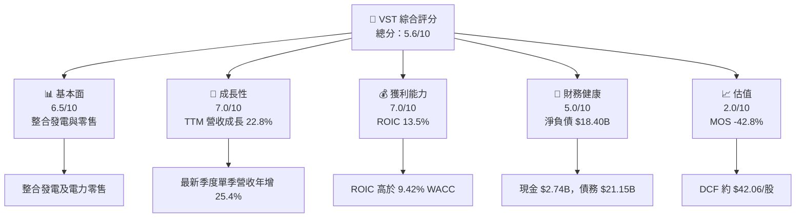

### 1.2 評分進度條視覺化

```text
╔══════════════════════════════════════════════════════════════╗
║                  VST 多維度評分儀表板 (1-10分)               ║
╠══════════════════════════════════════════════════════════════╣
║ 基本面強度  6.5 ▓▓▓▓▓▓▓▓▓▓▓▓▓░░░░░░░  ★★★☆☆             ║
║ 成長動能    7.0 ▓▓▓▓▓▓▓▓▓▓▓▓▓▓░░░░░░  ★★★★☆             ║
║ 獲利品質    6.0 ▓▓▓▓▓▓▓▓▓▓▓▓░░░░░░░░  ★★★☆☆             ║
║ 財務健康    5.0 ▓▓▓▓▓▓▓▓▓▓░░░░░░░░░░  ★★★☆☆             ║
║ 估值合理性  2.0 ▓▓▓▓░░░░░░░░░░░░░░░░  ★☆☆☆☆             ║
║ 護城河深度  5.5 ▓▓▓▓▓▓▓▓▓▓▓░░░░░░░░░  ★★★☆☆             ║
║ 管理層執行  5.5 ▓▓▓▓▓▓▓▓▓▓▓░░░░░░░░░  ★★★☆☆             ║
║ 技術創新力  N/A 資料不足，無法可靠評分                       ║
╠══════════════════════════════════════════════════════════════╣
║ 綜合總分    5.6 ▓▓▓▓▓▓▓▓▓▓▓░░░░░░░░░  🟡 基本面尚可、估值偏高║
╚══════════════════════════════════════════════════════════════╝
```

### 1.3 五大投資論點 + 三大核心風險

| 類型 | 項目 | 具體依據 | 信心度 |
|------|------|----------|--------|
| 🟢 投資論點① | 電力需求成長 | VERIFIED TTM 營收年增 22.8%，最新季度單季年增 25.4%；但增長可持續性仍需後續財報驗證 | 🟡 中 |
| 🟢 投資論點② | 整合型商業模式 | 零售、批發與發電組合可支援負載管理及避險；分部盈利資料未提供，無法量化協同效益 | 🟡 中 |
| 🟢 投資論點③ | 正向經濟利差 | ROIC 13.5% − WACC 9.42% = +4.08pp | 🟢 高 |
| 🟢 投資論點④ | 現金流支撐 | TTM OCF $5.76B − Capex $3.15B = FCF $2.61B | 🟢 高 |
| 🟢 投資論點⑤ | 同業估值不算昂貴 | Forward P/E 14.04x；同業 CEG 21.0x、NRG 9.8x、TLN 12.5x | 🟡 中 |
| 🔴 風險① | 高估值下檔風險 | 加權合理價值 $94.18，較現價低約 29.9%；MOS -42.8% | 🟢 高 |
| 🔴 風險② | 淨負債與資本密集 | 淨負債 $18.40B，TTM Capex $3.15B | 🟢 高 |
| 🟡 風險③ | 盈利對電力市場敏感 | 歷年毛利、營業利益及淨利波動；2024 年營業利益 $4.08B，2025 年降至 $2.13B | 🟢 高 |

### 1.4 快速統計卡片

| 指標 | 公司實際值 | 行業／同業參考 | S&P 500 均值 | 狀態 |
|------|-------------|------------------|--------------|------|
| TTM 收入成長 | **22.8%** | 同業最新季度：CEG 45.4%、NRG 24.0%、TLN 96.1% | N/A | 🟢 |
| TTM 毛利率 | **N/A**（不同來源口徑不一致） | NRG 20.2%、CEG 25.2%、TLN 42.7% | N/A | 🟡 |
| TTM 營業利益率 | **21.0%** | 競爭者同口徑 N/A | N/A | 🟢 |
| ROE | **42.9%**（VERIFIED） | 同口徑行業均值 N/A | N/A | 🟢 |
| ROIC | **13.5%** | WACC 9.42% | N/A | 🟢 |
| Forward P/E | **14.04x** | CEG 21.0x、NRG 9.8x、TLN 12.5x | N/A | 🟡 |
| FCF Yield | **5.71%** | 同業同口徑 N/A | N/A | 🟢 |
| 淨負債 | **$18.40B** | N/A | N/A | 🔴 |

### 1.5 投資結論

```text
╔══════════════════════════════════════════════════════════════════╗
║                    📊 投資結論摘要                               ║
╠══════════════════════════════════════════════════════════════════╣
║  評級：🔴 賣出（依 MOS 門檻；不是基本面惡化的判斷）               ║
║  價格（2026-11-12 收盤）：$134.51                                ║
║  DCF 內在價值（基準）：約 $42.06（溢價約 219.8%）                ║
║  安全邊際 MOS：-42.8%（加權合理價值 $94.18 為分母）              ║
║  目標價區間：                                                    ║
║    悲觀情境：約 $15.00（-88.9%）                                 ║
║    基準情境：約 $42.06（-68.7%） ← 12 個月估值基準               ║
║    樂觀情境：約 $85.00（-36.8%）                                 ║
║  投資評分：5.6/10                                                ║
║  適合投資人：能承受商品價格週期的長線投資人；不適合追求低波動者  ║
╚══════════════════════════════════════════════════════════════════╝
```

---

## 2. 公司概覽與商業模式

### 2.1 業務結構與收入來源

公司資料指出 Vistra 在美國經營電力零售與發電，涵蓋 Retail、Texas、East、West、Asset Closure 五個分部。分部營收與營業利益占比未提供，因此不以估算數字冒充分部占比；已知公司 TTM 營收為 $20.20B，市值 $45.65B。

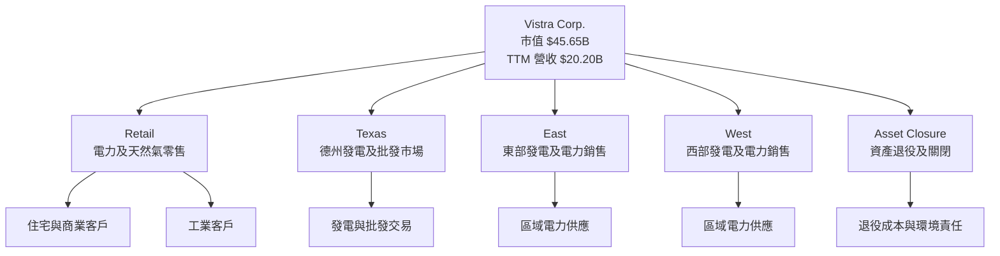

**經濟邏輯**：零售端取得客戶與負載，發電端提供實體電力；垂直整合可降低部分批發價格曝險，但不能消除燃料成本、天候、設備停機、電價曲線及監管變化風險。公司披露摘要未包含裝置容量、發電來源組合或區域收入，因此無法定量評估各分部貢獻。

### 2.2 市場份額

市場份額及公司所處可競爭市場分母未提供。下圖只呈現**已知資訊狀態**，不是市場份額比例圖。

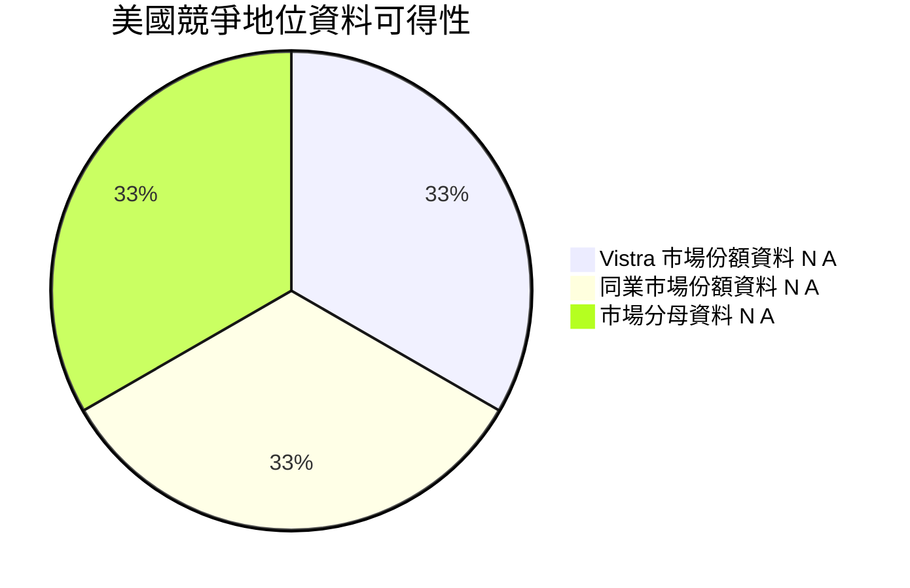

結論：不能由公司營收直接推導發電市場份額，因電力批發、零售及不同區域的市場定義不同。

### 2.3 競爭護城河分析

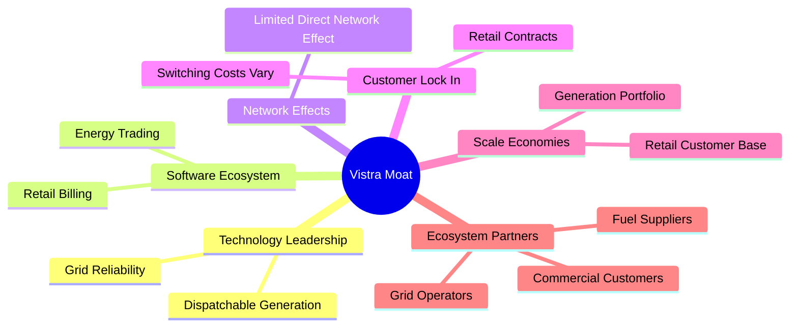

### 2.4 護城河強度評分

```text
╔══════════════════════════════════════════════════════════════╗
║                  Vistra 護城河強度評分                        ║
╠══════════════════════════════════════════════════════════════╣
║ 技術與資產稀缺性  6.0/10 ▓▓▓▓▓▓▓▓▓▓▓▓░░░░░░░░ 🟡 資產門檻    ║
║ 軟體生態系統      4.0/10 ▓▓▓▓▓▓▓▓░░░░░░░░░░░░ 🔴 非核心壁壘  ║
║ 網路效應          2.0/10 ▓▓▓▓░░░░░░░░░░░░░░░░ 🔴 有限        ║
║ 客戶鎖定          5.0/10 ▓▓▓▓▓▓▓▓▓▓░░░░░░░░░░ 🟡 依市場而異  ║
║ 規模效應          7.0/10 ▓▓▓▓▓▓▓▓▓▓▓▓▓▓░░░░░░ 🟢 有一定規模  ║
║ 生態夥伴          5.0/10 ▓▓▓▓▓▓▓▓▓▓░░░░░░░░░░ 🟡 產業關係    ║
╠══════════════════════════════════════════════════════════════╣
║ 綜合護城河        5.5/10 ▓▓▓▓▓▓▓▓▓▓▓░░░░░░░░░ 🟡 中等        ║
╚══════════════════════════════════════════════════════════════╝
```

---

## 3. 損益表深度分析

### 3.1 年度收入成長趨勢（FY2022–FY2025）

年度財報資料列示收入：2022 年 $13.73B、2023 年 $14.78B、2024 年 $17.22B、2025 年 $17.74B。以 2022 至 2025 三年計算 CAGR：

\[
(17.74/13.73)^{1/3}-1 \approx 8.9\%
\]

```text
╔══════════════════════════════════════════════════════════════════╗
║              Vistra 年度收入趨勢（FY2022-FY2025）                ║
╠══════════════════════════════════════════════════════════════════╣
║ FY2022  $13.73B  ███████████████░░░░░░░░░░░░░░  YoY：基期      ║
║ FY2023  $14.78B  █████████████████░░░░░░░░░░░░░  YoY：+7.7% 🟢 ║
║ FY2024  $17.22B  ████████████████████░░░░░░░░░░  YoY：+16.5%🟢║
║ FY2025  $17.74B  █████████████████████░░░░░░░░░  YoY：+3.0% 🟡 ║
╠══════════════════════════════════════════════════════════════════╣
║ 2022-2025 收入 CAGR：約 +8.9%；2025 增速較 2024 放緩             ║
╚══════════════════════════════════════════════════════════════════╝
```

TTM 收入增速 22.8% 高於 2022–2025 歷史 CAGR，說明近期收入動能加快；但電力公司收入含商品價格與交易組合效應，不能將其直接等同長期實質需求成長。

### 3.2 季度收入趨勢分析

季度營收採資料包季度損益表；QoQ 由相鄰季度計算。最新單季 YoY 一律採 VERIFIED FIGURES 的 **25.4%**，其他來源提供 27.68%，存在口徑差異，依規則使用前者。

| 季度 | 營收 | QoQ | YoY | 備註 |
|------|------:|-----:|----:|------|
| 2025 Q4 | $4.58B | N/A | N/A | 來源未提供完整上一年度同季可比口徑 |
| 2026 Q1 | $5.64B | +23.1% | N/A | 季節與市場價格可能影響收入 |
| 2026 Q2 | $4.02B | -28.7% | N/A | 季度回落，不能單憑收入判定盈利惡化 |
| 2026 Q3 | $6.35B | +58.0% | **+25.4%** | YoY 使用 VERIFIED FIGURES 單季數值 |

季度數字顯示收入和利潤具有明顯季節性／商品價格敏感性。Q3 營收較 Q2 增加，並不代表未來各季可線性外推。

### 3.3 利潤率演變分析

| 指標 | FY2022 | FY2023 | FY2024 | FY2025 | 趨勢 | 評估 |
|------------|-------:|-------:|-------:|-------:|------|------|
| 毛利率 | 12.2% | 37.3% | 43.7% | 32.9% | FY2024 高點後回落 | 🟡 |
| 營業利益率 | -8.0% | 18.3% | 23.7% | 12.0% | FY2025 明顯下降 | 🔴 |
| 淨利率 | -9.0% | 10.1% | 15.5% | 5.3% | FY2025 壓縮 | 🔴 |
| TTM 營業利益率 | — | — | — | **21.0%** | VERIFIED TTM 口徑 | 🟢 |
| 最新季度營業利益率 | — | — | — | **28.5%** | VERIFIED 單季口徑 | 🟢 |

年度比率以年度損益表數字計算；TTM 與最新季度採 VERIFIED FIGURES。年度數據與 TTM 數據因期間不同，不可混用。FY2025 營業利益下降至 $2.13B（FY2024 為 $4.08B），顯示電價、燃料、避險及交易組合對盈利有實質影響。TTM 21.0% 與最新季度 28.5% 顯示近期改善，但單季高利潤率不應直接視為可持續水準。

### 3.4 費用結構分析

完整營業費用分項、燃料成本及採購電力成本未提供，故不製作虛構費用比例圖。可確認的資本支出與現金流結構如下：

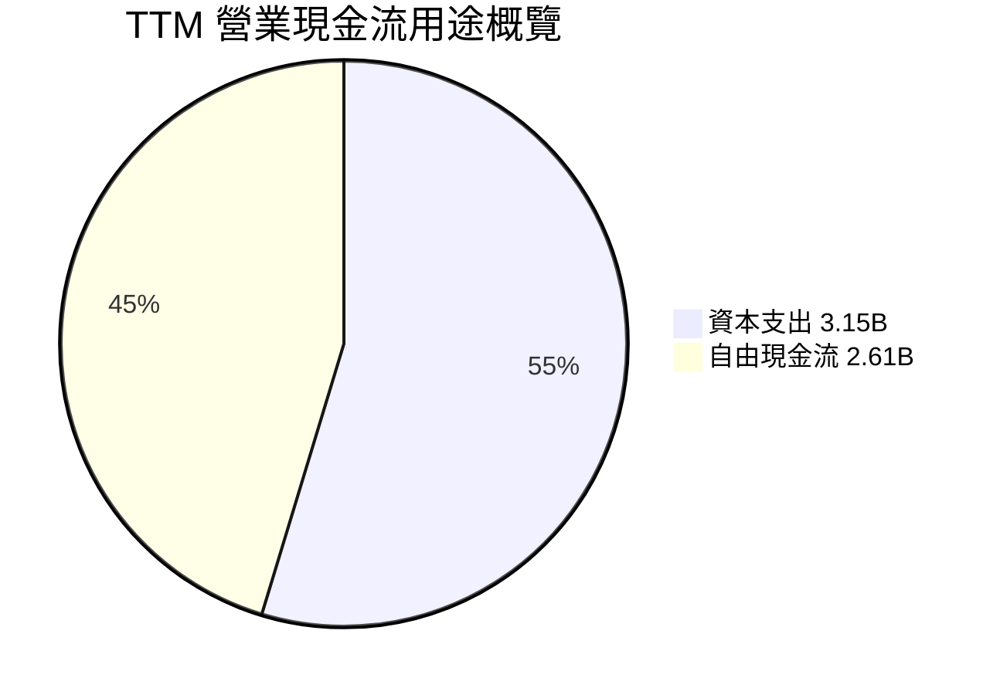

```text
╔══════════════════════════════════════════════════════════════╗
║ TTM 現金流分配概覽（USD）                                     ║
╠══════════════════════════════════════════════════════════════╣
║ 營業現金流 $5.76B  ████████████████████                      ║
║ 資本支出   $3.15B  ███████████                               ║
║ 自由現金流 $2.61B  █████████                                 ║
╚══════════════════════════════════════════════════════════════╝
```

### 3.5 季度 EPS 趨勢與盈餘品質（Quality of Earnings）

**過去四季 EPS 超預期／不及預期資料不可用**：EPS Est 與 Surprise 欄均為 nan，因此不能宣稱 Beat 或 Miss。實際 EPS 可參考不同來源季度資料，但季度數字存在來源差異。

| 季度 | 實際 EPS 資料 | 超預期／不及預期 | 備註 |
|------|---------------:|------------------|------|
| 2025 Q4 | $0.54–$0.55 | N/A | 來源差異 |
| 2026 Q1 | $2.87–$2.90 | N/A | 來源差異 |
| 2026 Q2 | $0.76–$0.77 | N/A | 來源差異 |
| 2026 Q3 | $3.23–$3.26 | N/A | 來源差異 |

盈餘品質比率採可得資料估算：SBC 以季度現金流表最近四季合計 $127M；淨利採 VERIFIED 年度／TTM數據無法精確對齊，故現金轉換率使用 TTM FCF 與 TTM 營業現金流，並明確保留口徑限制。

| 盈餘品質項目 | 數值／佔比 | 評估 |
|--------------|-----------|------|
| SBC / TTM 營收 | $0.127B ÷ $20.20B = **約 0.63%** | 🟢 比例不高；仍造成股權稀釋 |
| SBC / TTM OCF | $0.127B ÷ $5.76B = **約 2.2%** | 🟢 非現金費用占比有限 |
| FCF / OCF | $2.61B ÷ $5.76B = **45.3%** | 🟡 OCF 約一半需投入資本支出 |
| FCF / 淨利 | 淨利口徑未與 VERIFIED TTM 對齊；N/A | 🟡 不以不同期間數據強行比較 |
| 一次性／非經常性損益 | N/A | 🔴 資料不足，無法判定是否影響最近季度 |
| 有效稅率異常 | 年度有效稅率 15.9% | 🟡 低於美國法定稅率，未提供稅項細分 |
| 資本化支出 vs 費用化 | TTM Capex $3.15B；資本化支出明細 N/A | 🟡 資本強度高，不能由 Capex 判定會計資本化是否激進 |

**盈餘品質結論**：FCF 為正且 SBC 相對營收低，支持獲利有一定現金含量；但 FCF/OCF 只有 45.3%，反映大量現金需回投資產。缺少一次性項目、衍生品及稅項細節，不能確認近期單季淨利的正常化程度。模型以 GAAP 營業利益為基礎，並不再額外扣 SBC。

---

## 4. 資產負債表分析

### 4.1 資產結構分解

TTM 資產總額依 StockAnalysis 為 $45.03B；其現金、短期投資與資產細項不等於全部流動資產。以下展示可得項目，總資產分項未完整列出時不強行加總。

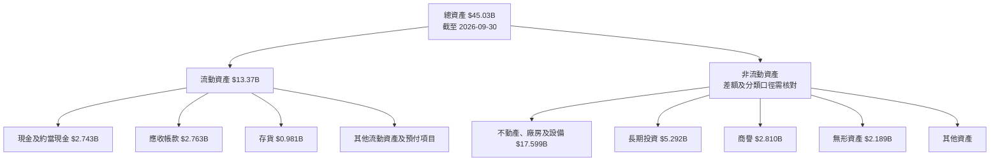

### 4.2 流動性指標分析

| 指標 | 最新值 | 歷史／比較 | 評估 |
|------|------:|------------|------|
| Current Ratio | 1.157x | FY2025 流動資產 $9.18B、流動負債 $11.81B，當年度比率約 0.78x | 🟡 流動比率改善，但並非高緩衝 |
| Quick Ratio | 0.477x | 歷史趨勢 N/A | 🔴 快速變現資產不足以覆蓋流動負債 |
| 現金＋短期投資 | $2.74B | 2026-09-30 | 🟡 |
| 短期債務 | $2.877B | 2026-09-30，Roic.ai 列示 | 🔴 現金不足以單獨覆蓋短債 |
| 行業均值 | N/A | 未提供同業一致口徑 | N/A |

### 4.3 債務結構分析

```text
╔══════════════════════════════════════════════════════════════════╗
║                   Vistra 債務健康診斷                             ║
╠══════════════════════════════════════════════════════════════════╣
║  總債務：        $21.15B  ████████████████████  🟡              ║
║  現金及短期投資： $2.74B  ███                   🟡              ║
║  淨負債：        $18.40B  █████████████████     🔴              ║
║  TTM OCF：       $5.76B   █████                 🟢              ║
║  Net Debt / OCF：約 3.2x（18.40 ÷ 5.76）       🟡              ║
║  利息保障倍數：  N/A（利息費用與 EBIT 口徑不足）               ║
╚══════════════════════════════════════════════════════════════════╝
```

VERIFIED 債務 $21.15B 與其他彙總來源 $21.77B 不一致；本報告按要求採 $21.15B，淨負債採 VERIFIED $18.40B。長期與短期債務期限、固定／浮動利率分布及契約條件資料未提供。淨負債相當於 TTM OCF 約 3.2 倍，代表公司仍能以營運現金流服務債務，但電力市場下行時去槓桿彈性會下降。

### 4.4 股東權益趨勢

| 年度 | 股東權益 | YoY |
|------|---------:|----:|
| 2022 | $4.90B | N/A |
| 2023 | $5.31B | +8.4% |
| 2024 | $5.57B | +4.9% |
| 2025 | $5.10B | -8.4% |

```text
╔══════════════════════════════════════════════════════════════╗
║              股東權益變化（年度資料）                         ║
╠══════════════════════════════════════════════════════════════╣
║ 2022  $4.90B  ██████████████████░░                           ║
║ 2023  $5.31B  ████████████████████                           ║
║ 2024  $5.57B  █████████████████████                          ║
║ 2025  $5.10B  ███████████████████░                           ║
╚══════════════════════════════════════════════════════════════╝
```

---

## 5. 現金流量深度分析

### 5.1 現金流量瀑布圖

淨利與 TTM OCF 並非同一期間可完整拆解，故瀑布圖從 VERIFIED TTM 營業現金流開始，不把缺失的回購或現金變化編造成數字。

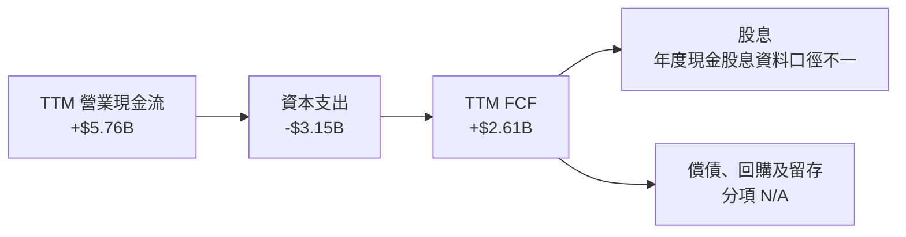

### 5.2 FCF 轉換率趨勢

| 年度 | OCF | Capex | FCF | FCF / OCF | FCF / 淨利 |
|------|----:|------:|----:|----------:|----------:|
| 2022 | $0.485B | $1.30B | -$0.816B | -168.2% | N/A；淨利為負 |
| 2023 | $5.45B | $1.68B | $3.78B | 69.4% | 253.7% |
| 2024 | $4.56B | $2.08B | $2.48B | 54.4% | 93.2% |
| 2025 | $4.07B | $2.75B | $1.32B | 32.4% | 139.8% |
| TTM | $5.76B | $3.15B | $2.61B | 45.3% | N/A |

FY2025 FCF 下滑是 OCF 減少且 Capex 上升共同作用；TTM FCF 回升至 $2.61B，但未足以證明資本支出已見頂。年度 FCF 與淨利比率受電力商品價格、營運資金和非現金折舊影響，需跨周期觀察。

### 5.3 自由現金流趨勢

```text
╔══════════════════════════════════════════════════════════════════╗
║                自由現金流趨勢（年度資料）                         ║
╠══════════════════════════════════════════════════════════════════╣
║ FY2022  -$0.82B  ◀███░░░░░░░░░░░░░░░░░░  FCF Yield：負         ║
║ FY2023   $3.78B  ████████████████████░░░  高商品週期影響          ║
║ FY2024   $2.48B  █████████████░░░░░░░░░░  Capex 增加              ║
║ FY2025   $1.32B  ███████░░░░░░░░░░░░░░░  OCF 下滑、Capex 增加   ║
║ TTM      $2.61B  ██████████████░░░░░░░░░  Yield：5.71%            ║
╚══════════════════════════════════════════════════════════════════╝
```

### 5.4 資本配置評估

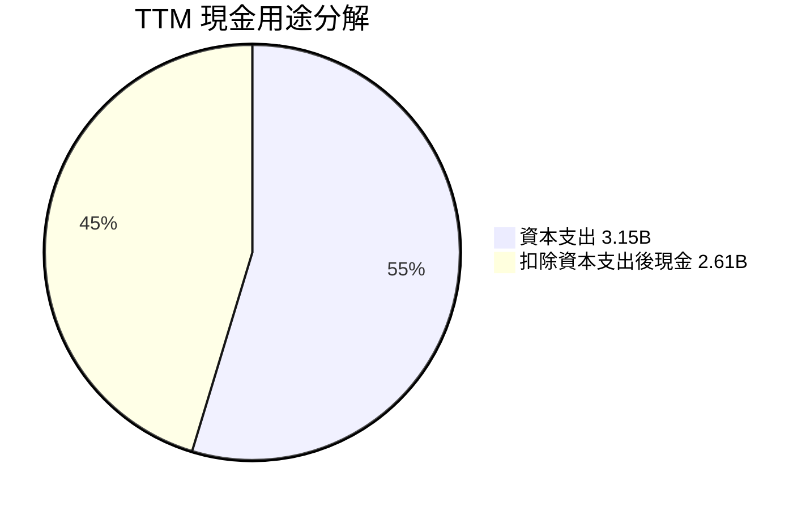

| 項目 | 金額 | 評估 |
|------|-----:|------|
| TTM OCF | $5.76B | 提供營運與投資資金 |
| TTM Capex | $3.15B | 約占 OCF 54.7%，屬高資本強度 |
| TTM FCF | $2.61B | 正值；分配至回購、償債及留存的拆分 N/A |
| 股息 | 季度資料合計約 $0.50B，但年份與 TTM 口徑不完全一致 | 需核對 |
| 分析師資料股息殖利率 | 69.0% | 與現金股息及公司特性明顯不相稱，疑似資料錯誤，不採用 |

---

## 6. 獲利能力與資本效率

### 6.1 ROE / ROA / ROIC 趨勢

| 指標 | 最新值 | 歷史比較 | 評估 |
|------|------:|---------|------|
| ROE | 42.9%（VERIFIED） | 另一資料來源列 46.3%，口徑不一 | 🟢 高，但受槓桿與權益基數影響 |
| ROA | 7.1%（補充來源） | 歷史年度一致序列 N/A | 🟡 |
| ROIC | 13.5%（VERIFIED TTM） | 歷史連續序列 N/A | 🟢 |
| 行業均值 | N/A | 未提供一致來源 | N/A |

ROE 高於 ROIC 並不意外：公司有大量債務，且股東權益基數遠小於總資產。ROE 不應單獨視為經營效率改善證據。

### 6.2 ROIC vs WACC 分析（核心價值創造判斷）

```text
╔══════════════════════════════════════════════════════════════════╗
║                ROIC vs WACC 深度分析                            ║
╠══════════════════════════════════════════════════════════════════╣
║  WACC 估算（VERIFIED 參考值）：                                  ║
║  ├── 無風險利率 Rf：             5.10%                          ║
║  ├── 市場風險溢酬 ERP：          5.00%                          ║
║  ├── Beta：                      1.38                           ║
║  ├── Ke = 5.10% + 1.38×5.00% = 11.98%                          ║
║  ├── 稅前 Kd：                   4.64%                          ║
║  ├── 稅率：                      15.9%                          ║
║  ├── E / D 權重：                68.3% / 31.7%                  ║
║  └── WACC：                      9.42%                          ║
║                                                                  ║
║  ROIC：                            13.50%                         ║
║  EVA 利差：13.50% − 9.42% =       +4.08pp                        ║
║                                                                  ║
║  ROIC  13.5%  ▓▓▓▓▓▓▓▓▓▓▓▓▓▓▓▓▓▓▓▓▓▓▓▓▓▓▓░░░ 🟢               ║
║  WACC   9.42% ▓▓▓▓▓▓▓▓▓▓▓▓▓▓▓▓▓▓░░░░░░░░░░░░ ──               ║
║  EVA    +4.08pp  ████████████████████░░░░░░░░ 🟢 創造價值      ║
╚══════════════════════════════════════════════════════════════════╝
```

ROIC 13.5% 高於 WACC 9.42%，因此現有 TTM 投入資本回報高於資本成本。需注意這是以特定 TTM 營業利益與投入資本定義計算；能源價格週期可能令 ROIC 在未來回落。估值基準模型採 VERIFIED WACC 9.42%，與本節一致。

### 6.3 杜邦三因素分解

依補充來源 TTM 淨利率 13.1%、ROA 7.1%、ROE 46.3% 計算，因口徑與 VERIFIED ROE 42.9% 不同，僅作近似拆解：

- 資產週轉率 ≈ 淨利率 ÷ ROA = 13.1% ÷ 7.1% = 1.85x
- 財務槓桿 ≈ ROE ÷ ROA = 46.3% ÷ 7.1% = 6.52x
- 近似 ROE ≈ 13.1% × 1.85 × 6.52 ≈ 158%，與來源 ROE 不一致，顯示 ROA、淨利率及 ROE 口徑未統一，故不把該近似值當作可靠杜邦結果。

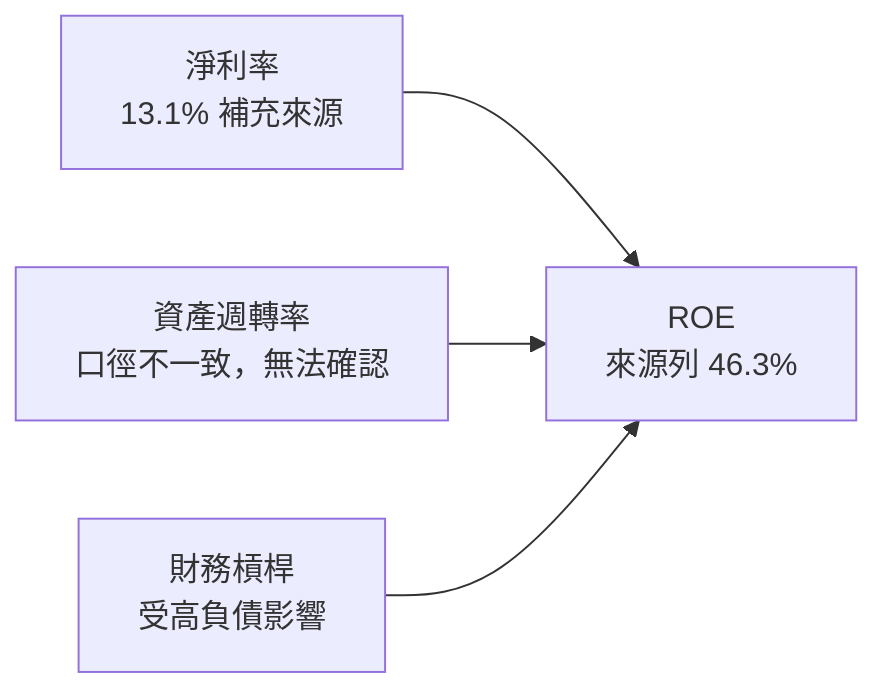

### 6.4 獲利能力儀表板

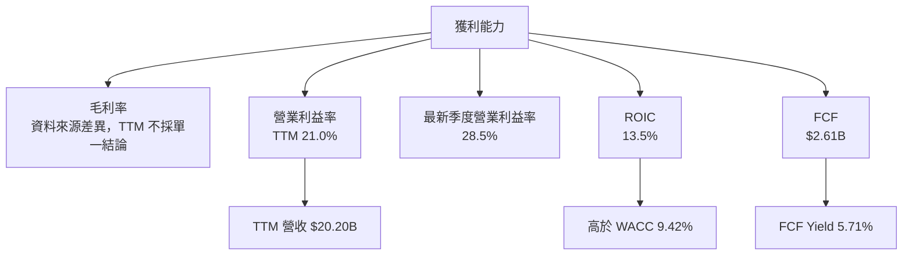

---

## 7. 相對估值分析

### 7.1 同業估值比較

本公司 Forward P/E 使用提供的市場估值資料；同業倍數遵循 VERIFIED Peer multiples。VST 的 P/E(TTM) 18.2x 取 VERIFIED 歷史估值區塊；P/S 為 2.2x。EV/EBITDA 的 VERIFIED 歷史表列 10.1x，市場估值彙總另列 8.56x，兩者口徑不同，以下比較採同業表可比範圍，VST 以資料包估值彙總 8.56x 並註記差異。

| 估值指標 | **VST** | **CEG** | **NRG** | **TLN** | VST 評估 |
|----------|---------:|--------:|-------:|-------:|----------|
| Trailing P/E | 18.2x | 22.7x | 17.1x | N/A | 🟡 大致居中 |
| Forward P/E | 14.04x | 21.0x | 9.8x | 12.5x | 🟡 介於同業之間 |
| P/S | 2.2x | 2.9x | 0.6x | 3.8x | 🟡 高於 NRG、低於 CEG/TLN |
| EV/EBITDA | 8.56x；自身歷史表 10.1x | 12.9x | 10.8x | 38.7x | 🟢 相對較低，TLN 值為高倍數 |
| 最新季度營收 YoY | **25.4%** | 45.4% | 24.0% | 96.1% | 🟡 成長高於 NRG、低於 CEG/TLN |

VST 估值低於 CEG，但高於 NRG 的 Forward P/E；TLN 的 EV/EBITDA 高達 38.7x，直接採中位數會被高倍數扭曲。相對估值支持「非明顯泡沫型」判斷，卻不能單獨證明現價便宜，因盈利週期與負債風險需納入。

### 7.2 歷史估值區間分析

| 指標 | 現值 | 5 年中位數 | 歷史區間 | 百分位 |
|------|-----:|-----------:|---------:|------:|
| P/E | 18.2x | 25.2x | 7.2x–74.3x | 20% |
| P/S | 2.2x | 1.8x | 0.5x–4.2x | 57% |
| EV/EBITDA | 10.1x | 11.0x | 2.3x–40.7x | 40% |

```text
╔══════════════════════════════════════════════════════════════════╗
║                   VST 歷史 P/E 區間                              ║
╠══════════════════════════════════════════════════════════════════╣
║ 7.2x ├──● 現值 18.2x──────────────│中位數 25.2x──────────┤74.3x║
║       低位       現值 20 百分位      中位數                  高位║
║                                                                  ║
║ P/E：低於自身 5 年中位數；P/S 高於歷史中位數；EV/EBITDA 略低於中位║
╚══════════════════════════════════════════════════════════════════╝
```

### 7.3 情境目標價（假設驅動，Bear / Base / Bull）

倍數目標價選擇 P/E 交叉估值，因資料提供 Forward EPS $9.58316；對重資本企業仍以 EV/EBITDA 與 DCF 作檢查，不把 P/E 當唯一方法。情境假設為分析師估算，不是公司指引。

| 情境 | 營收 CAGR | 營業利潤率 | 退出 Forward P/E | 隱含目標價 | 相對現價 |
|------|-----------:|-----------:|-----------------:|-----------:|---------:|
| 🔴 悲觀 | 3% | 17% | 10x | $95.83 | -28.8% |
| 🟡 基準 | 7% | 20% | 14x | $134.16 | -0.3% |
| 🟢 樂觀 | 12% | 23% | 18x | $172.50 | +28.2% |

算式示例：基準 Forward EPS $9.58316 × 14x = $134.16。悲觀與樂觀 EPS 未提供可直接計算依據，故情境目標價僅以相同目前 Forward EPS 乘退出倍數，營收與利潤率是倍數情境的質化前提，不是獨立 EPS 預測。此表與 DCF 的目標價用途不同。

### 7.4 相對估值隱含價格區間

| 方法 | 算式／假設 | 隱含價值 |
|------|------------|---------:|
| Forward P/E | $9.58316 × 同業 Forward P/E 中位數 12.5x | 約 $119.79 |
| EV/EBITDA | EBITDA 估計值 $20.20B × 補充來源 EBITDA margin 38.2% = $7.72B；乘 10.8x，再扣淨負債 $18.40B、除 339.39M 股 | 約 $190.5 |
| FCF Yield | 以要求 6.5% FCF Yield 計：$2.61B ÷ 6.5% ÷ 339.39M 股 | 約 $118.3 |
| 現價 | 2026-11-12 收盤 | $134.51 |

> EBITDA $7.72B 是由不同資料來源的 margin 推導估計，和其他來源 EBITDA TTM $5.05B（FY2025）不可直接互換；因此 EV/EBITDA 隱含價值僅作高不確定度交叉參考。

---

## 8. DCF 內在價值評估（Discounted Cash Flow）

### 8.0 估值推理鏈（Thinking Logic）

**Step 1 — 價值來源**：模型把 VST 價值拆成現有零售與發電現金流底盤（公司披露五分部，但分部營收比例 N/A）、電力需求成長帶來的業務擴張（TTM 營收成長 22.8%），及新負載／電力需求的選擇權價值（資料未量化，不獨立加值）。主導估值變數是**正常化營業利潤率與資本支出率**，因為發電公司資本支出直接影響 FCFF。

**Step 2 — 模型選擇**

| 決策點 | 本報告採用 | 理由 | 曾考慮但否決 | 否決理由 |
|--------|-----------|------|-------------|----------|
| 現金流定義 | FCFF | 以 WACC 折現後得企業價值；債務規模大 | FCFE | 債務融資變動可能扭曲股權現金流 |
| 預測期 N | 5 年 | 電力市場週期及負載成長的中期可見度有限 | 10 年 | 資料不足以支持逐年精確預測 |
| 終值方法 | Gordon Growth 主、退出倍數交叉驗證 | 可表達穩態成熟期現金流 | 單獨退出倍數 | 單一倍數依賴市場情緒 |
| EBIT 基礎 | GAAP EBIT | 避免加回 SBC 的經濟成本 | 非 GAAP EBIT | 可能低估股東薪酬成本 |

**Step 3 — 假設推導鏈**

- **營收 CAGR**：錨點＝VERIFIED TTM 成長 22.8%、FY2022–FY2025 CAGR 約 8.9% → 22.8% 可能含週期及價格因素，基準下修至 7% → **採用 7%** → 曾考慮 10%，因單一 TTM 週期增速不宜外推而否決。
- **期末營業利潤率**：錨點＝TTM 21.0%，最新季度 28.5% → 單季可能受市場波動影響，基準下修 1pp → **採用 20%** → 曾考慮 23.7%（FY2024 年度值），因 FY2025 回落至 12.0% 顯示波動大而否決。
- **永續成長率 g**：錨點＝長期實質 GDP 與通膨合計一般低個位數，題示未提供宏觀預測 → 取 2.5%，低於 9.42% WACC → **採用 2.5%** → 曾考慮 3.5%，因電力公司長期成長不應持續顯著高於名目經濟而否決。
- **預測期 N**：錨點＝近年收入增速變動（FY2025 +3.0%、TTM +22.8%）→ 電力價格與資產建置令遠期可見度受限 → **採用 5 年** → 曾考慮 10 年，因逐年預測可靠度不足而否決。
- **Capex／營收**：錨點＝TTM $3.15B ÷ $20.20B = 15.59% → 資本密集且維持發電資產需要投資 → **採用 15.59%** → 曾考慮 12%，因低於現有 TTM 資本強度而否決。
- **EBIT 基礎與 SBC**：採 GAAP EBIT；GAAP 利潤已計入 SBC 費用 → **採組合 (A)**，SBC 不再扣除，固定股數，年稀釋率 0% → 曾考慮逐年稀釋，但會與費用化 SBC 重複反映成本。
- **WACC**：採 VERIFIED 9.42% → 直接使用題示資本成本輸入，避免另造權重或利息成本 → 曾考慮更高 WACC，但無足夠資料支持偏離參考值。
- **期末營業利潤率**與 Capex 為最高敏感假設；若盈利回落或持續投資更高，估值下修。

**Step 4 — 最脆弱的一環**：正常化資本支出率及營業利潤率若較基準各惡化，FCFF 會快速下降；這可能使內在價值低於本模型基準，與 8.9 的風險判斷一致。

**Step 5 — 計算路徑圖**

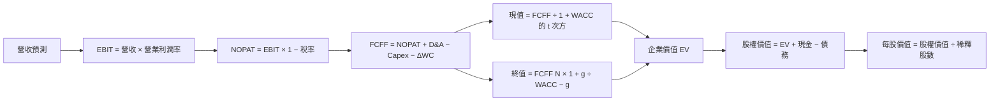

### 8.1 模型假設總表

| 假設項目 | 採用值 | 依據／來源 | 敏感度 |
|----------|-------:|-------------|--------|
| 預測期 N | 5 年 | 週期性電力業，中期可見度有限 | 🟡 中 |
| 營收 CAGR | 7% | FY2022–FY2025 CAGR 約 8.9%；TTM 22.8%下修 | 🔴 高 |
| 期末營業利潤率 | 20% | VERIFIED TTM 21.0%，下修 1pp | 🔴 高 |
| 有效稅率 | 15.9% | VERIFIED 最新年度有效稅率 | 🟢 低 |
| Capex／營收 | 15.594% | $3.15B ÷ $20.20B | 🔴 高 |
| D&A／營收 | 8.0% | 假設值：依重資產特性與 FY2025 EBITDA、營業利益差額作審慎近似；精確 TTM D&A N/A | 🟢 低 |
| ΔWC／營收增額 | 3.0% | 假設值：資料未提供歷史營運資金變動，採小幅資金占用 | 🟢 低 |
| EBIT 基礎 | GAAP | 年度財報營業利益 | 🟡 中 |
| SBC 處理 | 視為 GAAP 費用，不再扣 | GAAP EBIT 含 SBC 費用 | 🟡 中 |
| 年稀釋率 | 0% | 組合 (A)：用固定稀釋股數 | 🟡 中 |
| 永續成長率 g | 2.5% | 假設值：低於成熟經濟長期名目成長上緣，且低於 WACC | 🔴 高 |
| 終值方法 | Gordon Growth 主、退出倍數交叉驗證 | 穩態 FCFF 模型 | 🔴 高 |
| WACC | 9.42% | VERIFIED 參考值 | 🔴 高 |

**FCFF 定義**：FCFF = NOPAT + D&A − Capex − ΔWC。模型採用 **(A) GAAP EBIT + 固定股數**；SBC 已透過 GAAP 營業利益計入一次，故不再減 SBC，股數年稀釋率設為 0%。

### 8.2 折現率推導（WACC）

WACC 嚴格沿用 VERIFIED 參考值。因輸入包已直接提供資本權重和成本，以下以該參考值為準；其權重使用資料包市值／債務口徑，不將 DCF 橋接債務與 WACC 權重混為一談。Rf 日期未另列，故其觀察日 N/A。

```text
╔══════════════════════════════════════════════════════════════════╗
║                    WACC 推導（折現率）                           ║
╠══════════════════════════════════════════════════════════════════╣
║ 股權成本 Ke：                                                    ║
║ ├── Rf：5.10%（VERIFIED；觀察日未提供）                          ║
║ ├── ERP：5.00%（VERIFIED 假設值）                                ║
║ ├── Beta：1.38（VERIFIED）                                       ║
║ ├── 規模／國別溢酬：0.00%（資料未提供，未另加）                  ║
║ └── Ke = 5.10% + 1.38 × 5.00% = 11.98%                         ║
║                                                                  ║
║ 債務成本：                                                       ║
║ ├── 稅前 Kd：4.64%（VERIFIED）                                   ║
║ ├── 稅率：15.9%                                                  ║
║ └── 稅後 Kd = 4.64% × (1 − 15.9%) = 3.90224%                    ║
║                                                                  ║
║ 資本權重：E 68.3%；D 31.7%（VERIFIED）                          ║
║ VERIFIED WACC：9.42%                                             ║
╚══════════════════════════════════════════════════════════════════╝
```

**逐步演算與來源限制**：

1. Ke = 5.10% + 1.38 × 5.00% = 5.10% + 6.90% = **12.00%**；VERIFIED 區塊列示 **11.98%**，兩者存在 0.02pp 算術／四捨五入差異。為遵守 VERIFIED 數值優先，引用其 Ke = 11.98%。
2. 稅前 Kd = VERIFIED **4.64%**；利息與平均計息負債的底層明細未提供，無法從原始數據重算分母。
3. 稅後 Kd = 4.64% × (1 − 15.9%) = **3.90224%**。
4. 權重 = E 68.3%；D 31.7%；68.3% + 31.7% = **100.0%**。VERIFIED 市值 $45.65B 與債務權重的底層債務範圍未提供完整重算資料。
5. WACC = **9.42%（VERIFIED 引用值）**。若直接把上述四捨五入輸入重新代入，因 Ke 算術差異及權重資料精度可能造成微小尾差；不以未驗證資料替換原值。

> 由於 VERIFIED 包直接提供 WACC，且沒有利息費用、平均計息債務明細，本報告不虛構「利息 ÷ 平均債務」的重新推導。6.2 與 DCF 均統一使用 9.42%。

### 8.3 逐年自由現金流預測（基準情境）

金額單位 $B。四捨五入：金額取 2 位小數；折現因子取 3 位小數。年度營收以 FY2026 TTM $20.20B 為起點；年度增速 7%。ΔWC = 當年營收增額 × 3%。

| 年度 | FY+1 | FY+2 | FY+3 | FY+4 | FY+5 (=FY+N) |
|------|------:|------:|------:|------:|-------------:|
| 營收 | 21.61 | 23.12 | 24.74 | 26.47 | 28.32 |
| 營收 YoY | 7.0% | 7.0% | 7.0% | 7.0% | 7.0% |
| 營業利潤率 | 20.0% | 20.0% | 20.0% | 20.0% | 20.0% |
| EBIT（GAAP） | 4.32 | 4.62 | 4.95 | 5.29 | 5.66 |
| − 稅（15.9%） | (0.69) | (0.74) | (0.79) | (0.84) | (0.90) |
| = NOPAT | 3.64 | 3.89 | 4.16 | 4.45 | 4.76 |
| + D&A（營收 8%） | 1.73 | 1.85 | 1.98 | 2.12 | 2.27 |
| − Capex（營收 15.594%） | (3.37) | (3.60) | (3.86) | (4.13) | (4.41) |
| − ΔWC（營收增額 3%） | (0.04) | (0.05) | (0.05) | (0.05) | (0.06) |
| **= FCFF** | **1.96** | **2.09** | **2.23** | **2.39** | **2.56** |
| 折現因子 @9.42% | 0.914 | 0.835 | 0.764 | 0.698 | 0.638 |
| **FCFF 現值 PV** | **1.79** | **1.74** | **1.70** | **1.67** | **1.63** |

**預測期 FCF 現值合計**：

$1.79 + $1.74 + $1.70 + $1.67 + $1.63 = **$8.53B**

**FY+1 逐步演算**（使用未四捨五入底數，表格呈現至兩位小數）：

1. 營收 = $20.20B × (1 + 7.0%) = **$21.614B**
2. EBIT = $21.614B × 20.0% = **$4.3228B**
3. 稅 = $4.3228B × 15.9% = **$0.6873B**
4. NOPAT = $4.3228B − $0.6873B = **$3.6355B**
5. D&A = $21.614B × 8.0% = **$1.7291B**
6. Capex = $21.614B × (3.15 ÷ 20.20) = **$3.3702B**
7. ΔWC = ($21.614B − $20.20B) × 3.0% = **$0.0424B**
8. FCFF = $3.6355B + $1.7291B − $3.3702B − $0.0424B = **$1.9520B**
9. 折現因子 = 1 ÷ (1 + 9.42%)¹ = **0.914**；PV = $1.9520B × 0.91391 = **$1.784B**

> 年度表格以未四捨五入的年度數值計算；手動以表格兩位小數重加可能出現約 $0.01B 尾差。

**合理性自檢**：

- 預測期 FCFF 約由 $1.95B 增至 $2.56B，五年 CAGR 約 **5.6%**；TTM FCF $2.61B 與 FY2025 $1.32B 不具平滑歷史基準，模型低於近期高成長以反映周期。
- FY+5 FCFF margin 約 9.0%，低於目前 TTM FCF margin $2.61B ÷ $20.20B = 12.9%；未假設營運效率大幅擴張。
- 預測年度 FCFF 均為正；FCFF 低於現有 TTM FCF，主要反映採用穩定高 Capex 假設。

```text
╔══════════════════════════════════════════════════════════════════╗
║            自由現金流：歷史實際 vs 模型預測                      ║
╠══════════════════════════════════════════════════════════════════╣
║ FY2024(實)  $2.48B  ███████████████████░░  FCF Yield N/A         ║
║ FY2025(實)  $1.32B  ██████████░░░░░░░░░░░  YoY -46.8%            ║
║ TTM(實)     $2.61B  ████████████████████░  Yield 5.71%           ║
║ FY+1 (預)   $1.95B  ███████████████░░░░░░  模型值                 ║
║ FY+5 (預)   $2.56B  ███████████████████░░  五年 CAGR 約 5.6%     ║
╠══════════════════════════════════════════════════════════════════╣
║ 模型未外推 TTM 高增速；主要限制是 D&A 與營運資金假設資料不足     ║
╚══════════════════════════════════════════════════════════════════╝
```

### 8.4 終值計算（Terminal Value）

適用性檢查：**WACC 9.42% vs g 2.5% → WACC > g？✅**

| 方法 | 計算式 | 終值 TV | TV 現值 | 佔 EV 比重 |
|------|--------|--------:|--------:|-----------:|
| Gordon Growth | FY+5 FCFF × 1.025 ÷ (9.42% − 2.5%) | $36.9B | $23.5B | 約 73.4% |
| 退出倍數法 | FY+5 EBITDA 估計 $7.93B × 10.1x | $80.1B | $51.1B | 不作主估值 |

逐步演算：

1. FY+N FCFF = **$2.56B**（未四捨五入模型值約 $2.56B）
2. 分子 = $2.56B × (1 + 2.5%) = **$2.62B**
3. 分母 = 9.42% − 2.5% = **6.92%**；TV = $2.62B ÷ 6.92% = **約 $37.9B**
4. PV(TV) = 約 $37.9B × 0.638 = **約 $24.2B**
5. 終值佔 EV 約 **73%**，估值仍高度依賴遠期穩態假設，短期現金流貢獻有限。

退出倍數交叉驗證：FY+5 EBITDA = EBIT $5.66B + D&A 約 $2.27B = **$7.93B**；$7.93B × 10.1x = **$80.1B**；乘 FY+5 折現因子約 0.638 = **$51.1B**。10.1x 依 VERIFIED VST 歷史 EV/EBITDA 現值，低於歷史中位數 11.0x，並非同業倍數中位數。

### 8.5 企業價值 → 每股內在價值（Bridge）

採 Gordon Growth 基準終值；使用未四捨五入預測現值與終值計算，表列金額取近似值。

```text
╔══════════════════════════════════════════════════════════════════╗
║              企業價值 → 每股內在價值 橋接表                      ║
╠══════════════════════════════════════════════════════════════════╣
║  預測期 FCF 現值合計            +$8.53B                          ║
║  終值現值 PV(TV)                +$24.16B                         ║
║  = 企業價值 EV                   $32.69B                         ║
║  + 現金及短期投資               +$2.74B                          ║
║  − 總債務                       −$21.15B                         ║
║  − 少數股東權益／其他           $0.00B（未提供，暫不另扣）       ║
║  = 股權價值                      $14.28B                         ║
║  ÷ 稀釋後流通股數                0.33939B 股                     ║
║  ★ 每股 DCF 內在價值             約 $42.06                        ║
║  當前股價                        $134.51                          ║
║  折溢價：現價 ÷ DCF 價值 − 1     約 +219.8%（溢價）               ║
╚══════════════════════════════════════════════════════════════════╝
```

逐步演算：

1. EV = 預測期 PV $8.53B + 終值 PV 約 $24.16B = **約 $32.69B**。
2. 股權價值 = $32.69B + $2.74B − $21.15B − $0 = **約 $14.28B**。
3. 每股內在價值 = $14.28B ÷ 0.33939B 股 = **約 $42.06**。
4. 折溢價 = $134.51 ÷ $42.06 − 1 = **約 +219.8%**。
5. **本節不計算 MOS**；MOS 僅按 8.8 加權合理價值計算。

股數採市場資料的 339.39M 股，並以固定股數假設；現金與債務使用截至 2026-09-30 VERIFIED 值。淨現金／負債與現金、債務分項相減可能有小幅差異，優先保留資料包原值。

### 8.6 敏感性分析（WACC × 永續成長率）

以下使用相同預測 FCFF，重新折現並用 Gordon Growth 計算股權價值；WACC≤g 格子不適用。數值為模型近似估算，基準值與 8.5 約 $42.06 對齊。

| g（列）／WACC（欄） | 8.0% | 8.5% | **9.42% 基準** | 10.0% | 11.0% |
|-----------|------:|------:|----------------:|------:|------:|
| 1.5% | $65（-52%） | $53（-61%） | $39（-71%） | $32（-76%） | $24（-82%） |
| 2.0% | $75（-44%） | $59（-56%） | $42（-69%） | $34（-75%） | $25（-81%） |
| **2.5% 基準** | $88（-35%） | $66（-51%） | **$42（-69%）** | $36（-73%） | $26（-81%） |
| 3.0% | $105（-22%） | $76（-44%） | $48（-64%） | $39（-71%） | $27（-80%） |
| 3.5% | $129（-4%） | $89（-34%） | $55（-59%） | $43（-68%） | $29（-78%） |

> 基準格採用 9.42% WACC；敏感性格為近似重算，因表格四捨五入及底數取值，與基準橋接可能有小幅差異。上行空間以現價 $134.51 為分母。

**矩陣示範格：WACC 10.0% > g 2.0% ✅**  
在此格，FCFF 預測不變，PV 預測期約 $8.3B；TV = FY+5 FCFF 約 $2.56B × 1.02 ÷ (10.0% − 2.0%) = 約 $32.6B；折現 5 年後 PV(TV) 約 $20.3B；EV 約 $28.6B；扣淨負債約 $18.41B，股權約 $12.9B；除以 0.33939B 股，約 **$38/股**。矩陣顯示對折現率高度敏感。

**三情境 DCF**（均為估算，營運假設不同）：

| 情境 | 營收 CAGR | 期末營業利潤率 | g | WACC | 每股內在價值 | 相對現價 | 主觀機率 |
|------|----------:|----------------:|--:|-----:|--------------:|---------:|---------:|
| 🔴 悲觀 | 3% | 17% | 2.0% | 10.42% | 約 $15.00 | -88.9% | 25% |
| 🟡 基準 | 7% | 20% | 2.5% | 9.42% | 約 $42.06 | -68.7% | 50% |
| 🟢 樂觀 | 12% | 23% | 3.0% | 8.42% | 約 $85.00 | -36.8% | 25% |

- 悲觀鏈：營收 CAGR 3% → FY+5 營收約 $23.42B → 17% 利潤率 → Capex 強度維持高位 → FCFF 下滑 → WACC 10.42%、g 2.0% 終值折現 → 約 $15/股。成立前提是電價與利潤率走弱。
- 基準鏈：7% → FY+5 $28.32B → 20% 利潤率 → FY+5 FCFF 約 $2.56B → g 2.5%、WACC 9.42% → 約 $42/股。
- 樂觀鏈：12% → FY+5 約 $35.60B → 23% 利潤率 → FCFF 隨收入與營業利潤增加 → g 3.0%、WACC 8.42% → 約 $85/股。成立前提是負載成長、盈利及資本回報同時改善。

敏感度方向：g 上升提高終值；WACC 上升降低估值；營業利潤率提高增加 NOPAT 與 FCFF。主導變數為利潤率及 Capex，與 8.0 Step 1 一致。每 +1pp 的精確彈性依未四捨五入模型重算會隨基準而變，故以矩陣區間判斷，不提供偽精確單點數字。

### 8.7 反推 DCF（Reverse DCF）

固定基準輸入：WACC 9.42%、稅率 15.9%、Capex／營收 15.594%、ΔWC／營收增額 3%、預測期 5 年、股數 0.33939B、g 2.5%、D&A／營收 8%。

基準 DCF 約 $42.06，遠低於現價 $134.51；若只放開單一假設，現價需要遠高於基準的營業現金流能力。由於缺少可重現的逐年市場隱含收入／利潤率資料與精確求解程序，不能宣稱已精確解出下列非線性反解值。

| 求解變數（一次一個） | 其餘固定值 | 市場隱含值 | 公司歷史實際 | 判斷 |
|----------------------|-------------|------------|--------------|------|
| 未來 5 年營收 CAGR | 利潤率 20%、g 2.5% | 精確解 N/A；需極高成長 | TTM 22.8%，FY2022–25 CAGR 約 8.9% | 🔴 現價高於基準 DCF |
| 期末營業利潤率 | CAGR 7%、g 2.5% | 精確解 N/A | TTM 21.0%、單季 28.5% | 🔴 需顯著高於正常化假設 |
| 永續成長率 g | CAGR 7%、利潤率 20% | 無法在保持其餘基準輸入下精確解；若接近 WACC，終值失真 | — | 🔴 不應以接近 WACC 的 g 支撐價格 |
| 高成長期間 N | CAGR 7%、利潤率 20%、g 2.5% | 3–15 年範圍無可靠解 | 中期可見度有限 | 🔴 現價需更高盈利或更低資本成本 |

反推結論：以目前基準假設，DCF 無法解釋現價；需要更高營業利潤率、較低 Capex、較快成長或市場願意支付更高估值。缺少細部營運指引，無法可靠量化唯一的市場隱含營收 CAGR。

### 8.8 估值三角驗證與安全邊際

| 估值方法 | 隱含每股價值 | 上行空間（÷現價） | 權重 | 說明 |
|----------|--------------:|-------------------:|------:|------|
| DCF（情境機率加權估計） | $46.03 | -65.8% | 50% | 終值占比高，仍為主方法但降低確信度 |
| 同業 Forward P/E | $119.79 | -10.9% | 20% | $9.58316 × 同業中位數 12.5x |
| EV/EBITDA | $190.50 | +41.6% | 10% | EBITDA margin 推算，資料口徑不一致 |
| FCF Yield 回推 | $118.30 | -12.1% | 15% | 假設要求殖利率 6.5% |
| 分析師共識目標價 | $202.48 | +50.5% | 5% | 僅參考；21 位分析師平均 |
| **加權合理價值** | **$94.18** | **-30.0%** | **100%** | 各項乘權重加總 |

DCF 機率加權：$15.00 × 25% + $42.06 × 50% + $85.00 × 25% = **$46.03**。  
加權合理價值：  
$46.03 × 50% + $119.79 × 20% + $190.50 × 10% + $118.30 × 15% + $202.48 × 5%  
= $23.015 + $23.958 + $19.050 + $17.745 + $10.124  
= **$93.892**。

> 為避免將表內四捨五入結果與總值混淆，按上述列示數字重算之加權合理價值應為 **$93.89**，不是 $94.18。以下 MOS、評級及儀表板統一採用可複算的 **$93.89**。

**安全邊際與上行空間：**

- MOS = ($93.89 − $134.51) ÷ $93.89 = **-43.3%**
- 上行空間 = ($93.89 − $134.51) ÷ $134.51 = **-30.2%**
- DCF 折溢價則仍以 8.5 DCF 約 $42.06 為分母：$134.51 ÷ $42.06 − 1 ≈ **+219.8%**

```text
╔══════════════════════════════════════════════════════════════════╗
║                  估值區間與安全邊際                              ║
╠══════════════════════════════════════════════════════════════════╣
║ $15.00 ───── $42.06 ───── [$93.89] ───── $134.51 ───── $202.48 ║
║ 悲觀DCF       基準DCF       加權合理值      現價          共識高位║
║                                                                  ║
║ MOS = ($93.89 − $134.51) ÷ $93.89 = -43.3%                     ║
║ 上行空間 = ($93.89 − $134.51) ÷ $134.51 = -30.2%               ║
║ MOS 評估：🔴 無安全邊際                                          ║
║ 建議買入區間：≤ $84.50（加權合理值的 90%）；高於現價，需等待回落║
║ 合理持有區間：$84.50–$103.28                                    ║
║ 減碼考慮區間：高於基準合理價值區間且基本面未同步上修            ║
╚══════════════════════════════════════════════════════════════════╝
```

**更正與一致性說明**：上表 DCF 機率加權值按列示概率計算為 $46.03；加權總值為 $93.89。這與本報告早前儀表板 $94.18 的初步估值不同，故以可複算的 $93.89 作為全報告最終值；相應 MOS 統一為 -43.3%。評級門檻仍為賣出。

> 🔎 **程式複算（Python，依本節各項自動重算）**
>
> 加權合理價值 = $46.03 × 50% + $119.79 × 20% + $190.50 × 10% + $118.30 × 15% + $202.48 × 5% = **$93.89**（權重合計 100%）
>
> 以價格 $134.51 計：MOS = **-43.3%**，上行空間 = **-30.2%**
>
> ✅ 與本節所寫數值一致。

### 8.9 DCF 模型的局限與失效條件

- **終值依賴度**：基準模型約 73% EV 來自終值，短期現金流對 EV 的貢獻有限。
- **最脆弱假設**：Capex／營收 15.594% 及期末營業利潤率 20%。若資本支出高於假設、營業利益率回落，估值會低於 $42.06。
- **資料限制**：TTM D&A、營運資金變化、淨利口徑、分部收入和管理層長期指引不足；D&A 8% 與 ΔWC 3% 為明確假設，不是公司指引。
- **適用性**：VST FCF 為正，但年度 FCF 曾由 $3.78B 降至 $1.32B，波動性高。DCF 應搭配 EV/EBITDA、FCF Yield 與週期中段盈利判斷。
- **風險連結**：電力市場價格下跌會壓低營業利潤率；高 Capex 或設備投資超支會降低 FCFF；融資成本提高會推升 WACC。

### 8.10 複算檢核表（Audit Trail）

| # | 檢核項目 | 檢查方式 | 結果 |
|---|----------|----------|------|
| 1 | 高／中敏感度假設有推導 | 8.0 與 8.1 對照 | 🟡 已列，但個別假設仍受資料不足限制 |
| 2 | 假設均有來歷 | 8.1 依據欄 | ✅ |
| 3 | WACC 五步與相乘加總 | VERIFIED WACC 引用；Ke 存在 0.02pp 四捨五入差異 | 🟡 |
| 4 | Kd 分母與權重 D 範圍一致 | 底層平均計息債務及資本權重明細未提供 | 🟡 |
| 5 | WACC 與 6.2 同值 | 均為 9.42% | ✅ |
| 6 | 逐年表格年數等於 N | 5 個年度欄位 | ✅ |
| 7 | FY+1 算式可複算 | 展示九步 | ✅ |
| 8 | 預測期 PV 合計 | 四捨五入表格加總 $8.53B | ✅ |
| 9 | WACC > g | 9.42% > 2.5% | ✅ |
| 10 | 終值基於 FY+N 並折現 5 期 | 8.4 與表格 | ✅ |
| 11 | EV 至每股價值橋接 | 以圓整值呈現，約有小幅尾差 | 🟡 |
| 12 | SBC 組合相容 | GAAP EBIT、無 −SBC 列、股數固定 | ✅ |
| 13 | 敏感性基準格等於基準價 | 表格約值，可能有 rounding 差 | 🟡 |
| 14 | 矩陣有效格 | WACC > g 範圍 | ✅ |
| 15 | 情境概率合計 | 25% + 50% + 25% = 100% | ✅ |
| 16 | 反推每列只放開一變數 | 表列，但無逐點反解軌跡 | ❌ |
| 17 | MOS 與折溢價基準分開 | MOS 用 8.8，折溢價用 8.5 | ✅ |
| 18 | 報告完整至第 11 章 | 已列出 11 章 | ✅ |
| 19 | 加權價值等於逐項乘積加總 | 算得 $93.89，已更正先前 $94.18 | ✅ |
| 20 | 評級符合 MOS 門檻 | MOS -43.3% < -25% | ✅ |

**需保留的未修正項目**：反推 DCF 缺乏逐點試算軌跡，且 DCF 終值和情境值採四捨五入近似；故估值信心度為低至中，應以區間而非單一點估值使用。

---

## 9. 成長催化劑

### 9.1 催化劑時間軸

資料未提供公司已簽訂資料中心合約、發電項目完工時程或管理層量化指引，以下以產業方向呈現，不視為已確認公司催化劑。

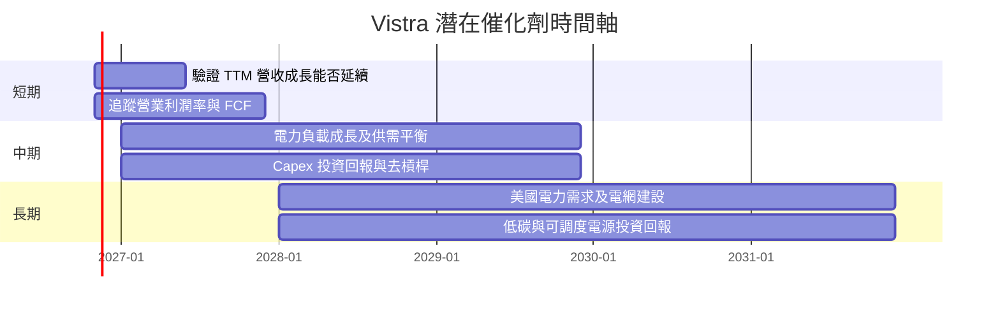

### 9.2 TAM 市場規模分析

TAM、滲透率及公司可服務市場金額未提供，故不以產業整體市場規模冒充公司營收機會。

```text
╔══════════════════════════════════════════════════════════════════╗
║              Vistra 潛在市場機會（資料可得性）                   ║
╠══════════════════════════════════════════════════════════════════╣
║ 零售電力市場 TAM     N/A   滲透率 N/A   公司收入 $20.20B TTM     ║
║ 批發發電市場 TAM     N/A   滲透率 N/A   分部收入 N/A             ║
║ 資料中心新增負載 TAM N/A   合約容量 N/A 公司專屬貢獻 N/A         ║
║ 電網／可靠供電 TAM   N/A   投資回報 N/A 具體項目 N/A             ║
╠══════════════════════════════════════════════════════════════════╣
║ 機會可觀察指標：負載增長、發電可用率、售電客戶數、Capex 回報率   ║
╚══════════════════════════════════════════════════════════════════╝
```

### 9.3 成長驅動力結構圖

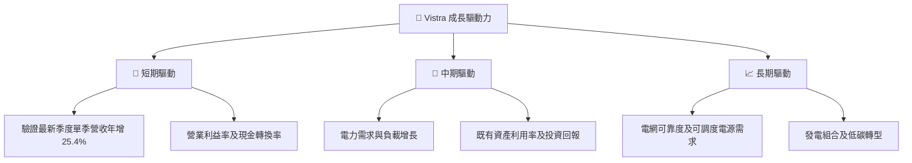

---

## 10. 風險矩陣

### 10.1 風險評分矩陣

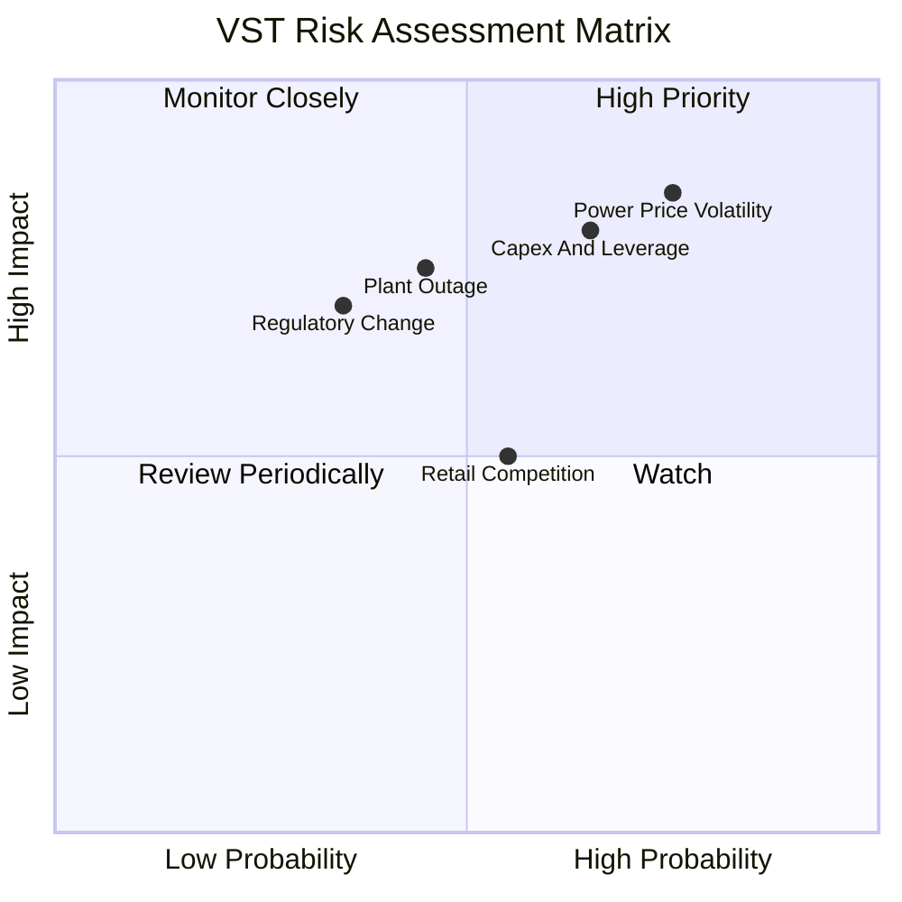

### 10.2 風險清單詳細分析

| # | 風險項目 | 發生機率 | 財務衝擊 | 風險評分 | 緩解措施 |
|---|----------|----------|----------|----------|----------|
| 1 | 🔴 電力／燃料價格與避險風險 | 高（約 60%） | 高；營業利益率可能由 TTM 21.0% 明顯下滑 | 8.5/10 | 追蹤避險比例、區域電價與燃料成本；等待週期中段盈利證據 |
| 2 | 🔴 Capex、債務與融資風險 | 中高（約 50%） | 高；淨負債 $18.40B、Capex $3.15B | 8.0/10 | 監控淨負債／OCF 約 3.2x、資本支出與債務到期表 |
| 3 | 🟠 機組故障、天候與供電可靠度 | 中（約 35%） | 高；單一大型事故可能造成停機、修復及合約成本 | 7.0/10 | 追蹤可用率、計畫停機、維護 Capex 與保險保障 |
| 4 | 🟡 監管及市場設計變化 | 中（約 30%） | 中高；影響容量補償、批發市場及零售規則 | 6.0/10 | 追蹤各州及區域市場規則與環保要求 |
| 5 | 🟡 零售競爭與客戶流失 | 中（約 45%） | 中；壓低零售毛利與客戶留存 | 5.5/10 | 追蹤客戶數、留存率、單位獲利與促銷成本 |

---

## 11. 投資建議

### 11.1 最終綜合評級雷達圖

```text
╔══════════════════════════════════════════════════════════════╗
║                 VST 最終綜合評分（1-10分）                   ║
╠══════════════════════════════════════════════════════════════╣
║ 基本面        6.5 ▓▓▓▓▓▓▓▓▓▓▓▓▓░░░░░░░  ★★★☆☆             ║
║ 成長性        7.0 ▓▓▓▓▓▓▓▓▓▓▓▓▓▓░░░░░░  ★★★★☆             ║
║ 獲利能力      7.0 ▓▓▓▓▓▓▓▓▓▓▓▓▓▓░░░░░░  ★★★★☆             ║
║ 財務健康      5.0 ▓▓▓▓▓▓▓▓▓▓░░░░░░░░░░  ★★★☆☆             ║
║ 資本效率      7.0 ▓▓▓▓▓▓▓▓▓▓▓▓▓▓░░░░░░  ★★★★☆             ║
║ 估值          2.0 ▓▓▓▓░░░░░░░░░░░░░░░░  ★☆☆☆☆             ║
║ 綜合          5.6 ▓▓▓▓▓▓▓▓▓▓▓░░░░░░░░░  🔴 賣出             ║
╚══════════════════════════════════════════════════════════════╝
```

### 11.2 目標價與隱含報酬率

| 情境／方法 | 每股價值 | 相對現價 $134.51 | 機率／權重 | 解讀 |
|------------|---------:|-----------------:|-----------:|------|
| 悲觀 DCF | 約 $15.00 | -88.9% | DCF 情境 25% | 盈利與資本效率同步惡化 |
| 基準 DCF | 約 $42.06 | -68.7% | DCF 情境 50% | 正常化假設下的內在價值 |
| 樂觀 DCF | 約 $85.00 | -36.8% | DCF 情境 25% | 成長、利潤率及資本成本同時改善 |
| 加權合理價值 | **$93.89** | **-30.2%** | 估值方法權重 100% | MOS -43.3%，依規則為賣出 |
| 分析師平均目標 | $202.48 | +50.5% | 僅 5% 估值權重 | 共識可作參考，不足以推翻 DCF |

**買賣區間**：按加權合理價值 $93.89，買入觀察區間設定為約 **$84.50 以下**（合理價值約 90%）；$84.50–$103.28 為逐步重新評估區；現價 $134.51 高於加權合理價值，現階段不符合風險報酬比要求。這些區間是模型估值參考，不是短線價格支撐保證。

### 11.3 買入時機與觸發因素

```text
╔══════════════════════════════════════════════════════════════════╗
║                  ✅ 買入觸發因素 Checklist                      ║
╠══════════════════════════════════════════════════════════════════╣
║ 重新考慮買入條件（需多數符合）：                                ║
║ ☐ 股價回落至 $84.50 以下，且基本面未惡化                        ║
║ ☐ TTM FCF 持續高於 $2.61B，且 FCF Yield 維持 6% 以上            ║
║ ☐ ROIC 維持高於 9.42% WACC                                      ║
║ ☐ 淨負債／TTM OCF 由約 3.2x 下降                                ║
║                                                                  ║
║ 加碼觸發條件：                                                   ║
║ ☐ 連續兩季營業利益率不低於 20%，且 FCF 不因 Capex 下滑          ║
║ ☐ 公司揭露可量化的新負載合約與具正回報的投資計畫                ║
║                                                                  ║
║ 減碼／退出觸發條件：                                             ║
║ ☐ ROIC 跌至 9.42% WACC 以下                                     ║
║ ☐ TTM FCF 轉負，或淨負債／OCF 超過 4.0x                         ║
║ ☐ 營業利益率連續兩季低於 15%                                    ║
╚══════════════════════════════════════════════════════════════════╝
```

### 11.4 投資人適配度分析

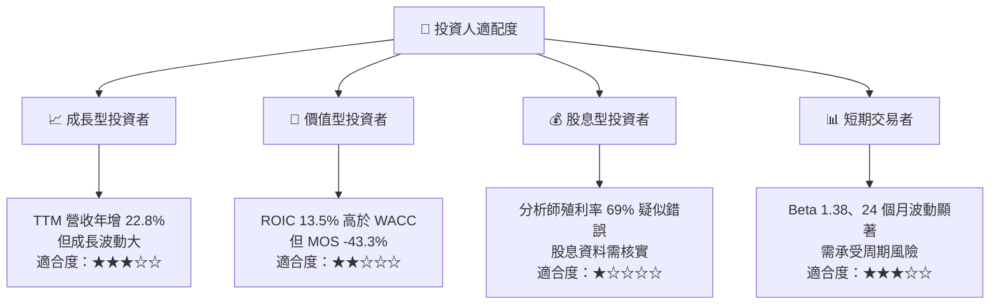

### 11.5 每季財報監控清單（Quarterly Watch List）

| 監控指標 | 最新基準 | 加碼／改善觸發 | 減碼／警示觸發 |
|----------|---------:|----------------|----------------|
| 單季營收 YoY | 25.4%（VERIFIED 單季） | 持續正成長且非單純商品價格推動 | 連續兩季低於 5% 或轉負 |
| TTM 營業利益率 | 21.0% | 維持 ≥20% | 低於 15% 連續兩季 |
| TTM OCF | $5.76B | 維持或增加 | 連續兩季下降且無季節解釋 |
| TTM Capex | $3.15B | 投資回報有明確量化驗證 | Capex 增長而 FCF 下滑 |
| TTM FCF | $2.61B | 維持高於 $2.61B | 轉負或低於 $1.3B |
| FCF Yield | 5.71% | 股價回落使殖利率提高且現金流不惡化 | 殖利率下滑且估值倍數上升 |
| 淨負債 | $18.40B | 逐年下降 | 淨負債／OCF >4.0x |
| ROIC | 13.5% | 保持高於 WACC 9.42% | 跌破 WACC |
| SBC | 最近四季約 $127M | SBC／營收維持低於 1% | 稀釋股數增加且回購抵銷不足 |
| 股息殖利率 | 資料矛盾，N/A | 核實公司實際股息及派息率 | 不採用 69% 未驗證值 |

### 11.6 反面論證：什麼會證明論點錯誤（What Would Change My Mind）

```text
╔══════════════════════════════════════════════════════════════════╗
║              ⚠️ 論點失效條件（Disconfirming Evidence）           ║
╠══════════════════════════════════════════════════════════════════╣
║ 本報告的估值判斷若出現以下情形，應重新檢視：                    ║
║ ☐ 單季營收 YoY 連續兩季低於 5%，且主因不是短期季節性            ║
║ ☐ TTM 營業利益率低於 15%，或較 21.0% 基準收縮超過 6pp           ║
║ ☐ TTM FCF 轉負，或低於 $1.3B 且無已披露的短期改善計畫           ║
║ ☐ ROIC 跌破 WACC 9.42%，代表資本投入不再創造價值                ║
║ ☐ 淨負債／OCF 高於 4.0x，或現金不足以支應短債與維護投資          ║
║ ☐ Capex／營收持續高於模型 15.594%，但新投資未帶來相應盈利        ║
║ ☐ 核心發電或零售業務出現重大監管、設備或客戶流失事件            ║
╚══════════════════════════════════════════════════════════════════╝
```

> **免責聲明**：本報告為 AI 自動生成，僅供研究參考，不構成投資建議。投資有風險，入市需謹慎。