# VST 基本面深度分析報告
> **報告日期**：2026-11-14 ｜ **語言**：繁體中文 ｜ **數據來源**：SEC 申報資料 (XBRL)、Yahoo Finance、Finviz、StockAnalysis、Roic.ai ｜ **分析師**：CFA 級機構研究

## 目錄

| # | 章節 | 核心結論 |
|---|------|----------|
| 1 | 執行摘要 | 強烈買入；加權合理價值 $206.63；MOS 35.6% |
| 2 | 公司概覽與商業模式 | 綜合發電與零售平台提供規模與客戶渠道，但商品化電力市場限制護城河 |
| 3 | 損益表深度分析 | TTM 營收 $20.20B、年增 22.8%；單季年增 25.4%，盈利波動仍大 |
| 4 | 資產負債表分析 | 淨負債 $18.40B；現金與短期投資 $2.74B，槓桿是主要財務限制 |
| 5 | 現金流量深度分析 | TTM FCF $2.61B、FCF Yield 5.77%，但年度 FCF 有明顯波動 |
| 6 | 獲利能力與資本效率 | ROIC 13.5% 高於 WACC 9.01%，目前創造價值；杜邦 ROE 受高槓桿放大 |
| 7 | 相對估值分析 | 公司估值低於自身歷史 P/E 中位數，但相對同業仍須考慮電力週期風險 |
| 8 | DCF 內在價值評估 | DCF 基準 $279.02；加權合理價值 $206.63，終值占 EV 64.9% |
| 9 | 成長催化劑 | 電力需求、零售客戶與發電資產帶來機會，TAM 數字未提供 |
| 10 | 風險矩陣 | 電力價格、資本密集與高負債為首要風險 |
| 11 | 投資建議 | 依 MOS 評級為強烈買入；以財報驗證現金流與槓桿改善 |

---

## 1. 執行摘要

VST 的 TTM 營收為 **$20.20B**，TTM 年增 **22.8%**、最新季度單季年增 **25.4%**；TTM 營業利益率為 **21.0%**，FCF 為 **$2.61B**，ROIC **13.5%** 高於 WACC **9.01%**。然而，公司仍有 **$18.40B 淨負債**，且估值高度依賴長期現金流與終值。按固定權重估值所得加權合理價值 **$206.63**，以 2026-11-13 收盤價 **$133.01** 計算，MOS **35.6%**；依 MOS 門檻評級為**強烈買入**，未作質化調整。

### 1.0 一頁式投資儀表板（Portfolio Manager 30 秒速讀）

| 項目 | 內容 |
|------|------|
| **投資論點（3 句）** | ① TTM 營收年增 **22.8%**，最新季度單季年增 **25.4%**，反映近年需求及業務組合支撐成長。② TTM FCF **$2.61B**、FCF Yield **5.77%**，提供實際現金支撐，但年度 FCF 波動明顯。③ ROIC **13.5%** 高於 WACC **9.01%**，目前創造價值；$18.40B 淨負債則限制財務彈性。 |
| **綜合評分** | **6.8/10**（引用 1.1 評分卡） |
| **財務健康** | 🟡 淨負債 **$18.40B**，但 TTM 營業現金流 **$5.76B**、流動比率 **1.157** |
| **ROIC vs WACC** | **13.5% vs 9.01%**；ROIC 高出 **4.49 個百分點**，目前創造股東價值 |
| **FCF 趨勢** | TTM FCF **$2.61B**；年度 FCF 從 FY2023 的 **$3.78B** 降至 FY2025 的 **$1.32B**，最新 FCF Yield **5.77%** |
| **估值** | Forward P/E **14.2x** ｜ EV/EBITDA **8.495x** ｜ FCF Yield **5.77%** |
| **DCF 內在價值（基準）** | **$279.02** ｜ 現價相對 DCF 折價 **52.3%**（折溢價基準為 DCF） |
| **安全邊際（MOS）** | **+35.6%**＝($206.63 − $133.01) ÷ $206.63；基準為 8.8 加權合理價值｜🟢 充足 |
| **預期報酬（基準情境 12M）** | **+109.8%**（DCF 基準情境相對現價；非時間保證） |
| **關鍵風險（前二）** | 電力價格與發電利潤回落；高負債與大型資本支出壓縮自由現金流 |
| **評級 + 信心度** | 🟢 **強烈買入** ｜ 信心：中（估值與現金流模型對長期假設敏感） |

### 1.1 綜合評分卡（全報告唯一）

| 維度 | 評分（1–10） | 主要依據（引用數字與其來源章節） |
|------|--------------|----------------------------------|
| 成長性 | 8.0 | TTM 營收成長 **22.8%**、最新季度單季年增 **25.4%**（第 3 章） |
| 獲利能力 | 8.0 | TTM 營業利益率 **21.0%**；ROIC **13.5%** 高於 WACC **9.01%**；F-Score **7/8**（第 3、6 章） |
| 財務健康 | 5.0 | 淨負債 **$18.40B**、總債務 **$21.15B**；流動比率 **1.157**、CCC **34 天**（第 4 章） |
| 估值 | 8.0 | MOS **35.6%**；P/E **18.0x**，低於自身五年中位數 **25.2x**（第 7、8 章） |
| 護城河 | 6.0 | 綜合零售與發電資產有規模及渠道優勢，但市場份額與客戶留存數據未提供（第 2 章） |
| 管理層與資本配置 | 6.0 | FY2025 股息支出 **$498M**，SBC **$113M**；近年 FCF 由 FY2023 **$3.78B** 降至 FY2025 **$1.32B**（第 5 章） |
| **綜合評分** | **6.8** | 六項算術平均：(**8.0 + 8.0 + 5.0 + 8.0 + 6.0 + 6.0**) ÷ 6 = **6.8** |

### 1.2 五大投資論點 + 三大核心風險

| 類型 | 項目 | 具體依據 | 信心度 |
|------|------|----------|--------|
| 🟢 **投資論點①** | 營收成長延續 | TTM 營收 **$20.20B**、年增 **22.8%**；最新季度單季年增 **25.4%** | 🟢 高 |
| 🟢 **投資論點②** | 現金流有實質支撐 | TTM 營業現金流 **$5.76B** 減資本支出 **$3.15B**，FCF **$2.61B** | 🟢 高 |
| 🟢 **投資論點③** | 資本回報高於資金成本 | ROIC **13.5%**、WACC **9.01%**，差距 **4.49 個百分點** | 🟢 中高 |
| 🟢 **投資論點④** | 估值相對自身歷史折讓 | P/E **18.0x** 對五年中位數 **25.2x**；EV/EBITDA **10.0x** 對中位數 **11.0x** | 🟢 中 |
| 🟢 **投資論點⑤** | 營運品質指標尚可 | Piotroski F-Score **7/8**；DSO **50 天**，較一年前 **52 天**減少 2 天 | 🟡 中 |
| 🟡 **風險①** | 電力價格與利潤週期反轉 | FY2025 營業利益 **$2.13B**，低於 FY2024 **$4.08B**；年度獲利具週期性 | 🟡 中 |
| 🔴 **風險②** | 淨負債與資本支出負擔 | 淨負債 **$18.40B**，TTM Capex **$3.15B**；若現金流下滑，去槓桿速度受限 | 🔴 高 |
| 🟡 **風險③** | DCF 終值及長期假設敏感 | DCF 終值現值占企業價值 **64.9%**；WACC 或永續成長率變動可大幅改變估值 | 🟡 中高 |

### 1.3 快速統計卡片

| 指標 | 公司實際值（期間） | 同業中位數 | 狀態 |
|------|--------------------|------------|------|
| 營收成長（TTM） | **22.8%** | — | 🟢 |
| 營收成長（最新一季年增） | **25.4%** | **45.4%** | 🟡 |
| 毛利率（TTM） | **N/A（SEC 一致口徑未提供）** | **25.2%** | 🟡 |
| 營業利益率（TTM） | **21.0%** | — | 🟢 |
| ROIC（TTM） | **13.5%** | — | 🟢 |
| Forward P/E | **14.2x** | **12.2x** | 🟡 |
| FCF Yield（TTM） | **5.77%** | — | 🟢 |
| Piotroski F-Score | **7 / 8** | — | 🟢 |

> 同業中位數按 CEG、NRG、TLN 所列數值取中位數；部分公司比較值不適用或為 N/A。公司毛利率資料來源間口徑不一致，因此不以非 SEC 同口徑數字取代。

### 1.4 投資結論

╔══════════════════════════════════════════════════════════════════╗  
║                    📊 投資結論摘要                               ║  
╠══════════════════════════════════════════════════════════════════╣  
║  評級：強烈買入（MOS 35.6%，ROIC 13.5% > WACC 9.01%）           ║  
║  價格（2026-11-13 收盤）：$133.01                               ║  
║  DCF 內在價值（基準）：$279.02（折價 52.3%）                    ║  
║  安全邊際 MOS：+35.6%（以加權合理價值為分母）                   ║  
║  加權合理價值（8.8）：$206.63                                    ║  
║  DCF 情境價值：                                                  ║  
║    悲觀情境：$93.52（-29.7%）                                   ║  
║    基準情境：$279.02（+109.8%）                                 ║  
║    樂觀情境：$651.57（+389.9%）                                 ║  
║  綜合評分：6.8/10（引用 1.1）                                    ║  
║  適合投資人：能承受電力週期、高槓桿與估值波動的中長期投資人      ║  
╚══════════════════════════════════════════════════════════════════╝

---

## 2. 公司概覽與商業模式

### 2.1 業務結構與收入來源

公司披露零售、Texas、East、West、Asset Closure 五個分部，但分部收入與占比沒有可用明細，故不臆測分部權重。

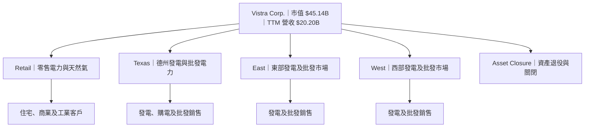

### 2.2 市場份額

市場份額數據未提供，故不繪製占比圖。VST 的 TTM 營收為 **$20.20B**，TTM 成長 **22.8%**；同業 CEG、NRG、TLN 最新季度營收年增分別為 **45.4%**、**24.0%**、**96.1%**，但公司業務組合與基期不同，不能僅憑成長率推定市場份額變化。

### 2.3 競爭護城河分析

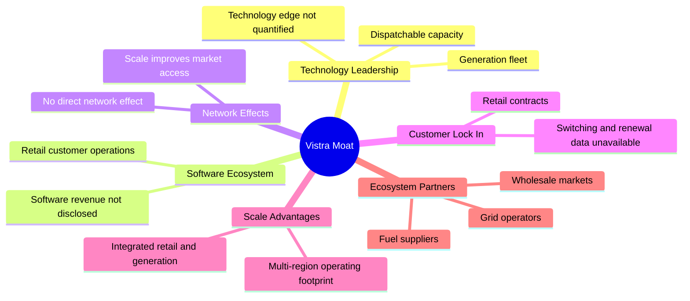

### 2.4 護城河強度

| 護城河項目 | 強度（強／中／弱） | 證據（引用數字或事實） | 會削弱它的情況 |
|------------|--------------------|------------------------|----------------|
| 發電資產與規模 | 中 | 經營 Texas、East、West 等發電業務；員工 **6,390 人** | 機組停機、燃料成本上升、競爭新增供給 |
| 零售渠道 | 中 | 向住宅、商業及工業客戶供應電力及天然氣 | 客戶流失、零售價格競爭、壞帳上升 |
| 技術領先 | 弱至中 | 可用資料未提供發電效率或成本領先量化證據 | 競爭者設備更新、資產老化 |
| 軟體生態系統 | 弱 | 未披露獨立軟體收入、訂閱數或平台黏著度 | 客戶服務成本上升或平台轉換更容易 |
| 網路效應 | 弱 | 發電及零售不是典型雙邊網路平台 | 電力供需與批發價格仍受市場影響 |
| 生態夥伴 | 中 | 依賴電網、燃料供應與批發市場 | 電網限制、供應中斷、監管變化 |

**1.1 護城河評分為 6.0/10**：公司有跨區域資產及零售渠道，但市場份額、客戶留存與成本曲線資料有限，且電力仍具有商品化特徵。

---

## 3. 損益表深度分析

### 3.1 年度收入成長趨勢（近 4 年）

╔══════════════════════════════════════════════════════════════════╗  
║              Vistra 年度收入趨勢（FY2022–FY2025）              ║  
╠══════════════════════════════════════════════════════════════════╣  
║ FY2022  $13.73B  ████████████████░░░░░░░░  YoY：N/A             ║  
║ FY2023  $14.78B  █████████████████░░░░░░░  YoY：+7.7% 🟢        ║  
║ FY2024  $17.22B  ████████████████████░░░░  YoY：+16.5% 🟢       ║  
║ FY2025  $17.74B  █████████████████████░░░  YoY：+3.0% 🟡        ║  
╠══════════════════════════════════════════════════════════════════╣  
║ FY2022–FY2025 收入 CAGR：(17.74 ÷ 13.73)^(1/3) − 1 = 約 8.9%    ║  
╚══════════════════════════════════════════════════════════════════╝

2025 年全年收入只增 **3.0%**，低於 2024 年的 **16.5%**，顯示年度成長不平滑；至最新 TTM，收入為 **$20.20B**、年增 **22.8%**，最新季度單季年增 **25.4%**，近期增長明顯回升，但要觀察是否能延續至不同季節與電力市場週期。

### 3.2 季度收入趨勢分析

| 季度 | 營收 | QoQ | YoY | 備註 |
|------|------:|----:|----:|------|
| 2025 Q4 | $4.584B | — | +13.55% | 年增率採 StockAnalysis 季度列示 |
| 2026 Q1 | $5.640B | +23.0% | +43.40% | 電力交易及季度組合造成季節性變動 |
| 2026 Q2 | $4.017B | -28.8% | -5.48% | 季減顯著；單季收入易受季節與市場價格影響 |
| 2026 Q3 | $6.347B | +58.0% | **+25.4%** | YoY 採 SEC 計算值；季度收入為財報列示值 |

QoQ 計算使用相鄰季度收入，例如 Q3 QoQ = ($6.347B ÷ $4.017B) − 1 = **58.0%**。不同來源的最新季度 YoY 值有差異；本報告依 SEC 計算數據採 **25.4%**，不把第三方 **27.68%** 混作同一口徑。

### 3.3 利潤率演變分析

| 利潤率指標 | FY2022 | FY2023 | FY2024 | FY2025 | 趨勢 | 評估 |
|------------|-------:|-------:|-------:|-------:|------|------|
| 毛利率 | 12.2% | 37.4% | 43.7% | 32.9% | 2024 高點後收縮 | 🟡 |
| 營業利益率 | -8.0% | 18.3% | 23.7% | 12.0% | 2025 大幅回落 | 🔴 |
| 淨利率 | -9.0% | 10.1% | 15.5% | 5.3% | 受營業利潤及其他項目影響 | 🟡 |

年度毛利率及營業利益率依年報收入與毛利、營業利益計算；最新 TTM 營業利益率採 SEC 計算的 **21.0%**，不可與單一年度 FY2025 **12.0%** 混用。FY2025 營業利益由 FY2024 **$4.08B** 降至 **$2.13B**，顯示電力價格、發電資產組合與交易環境可能讓利潤率快速變動；現有資料不足以將變動精確拆分為燃料、定價或資產運轉因素。

### 3.4 費用結構分析

FY2025 收入 **$17.74B**、毛利 **$5.83B**，推算銷貨成本約 **$11.91B**（收入減毛利）。這只是成本與毛利的粗略分拆，不能代替管理費用、利息、稅項的完整費用結構。

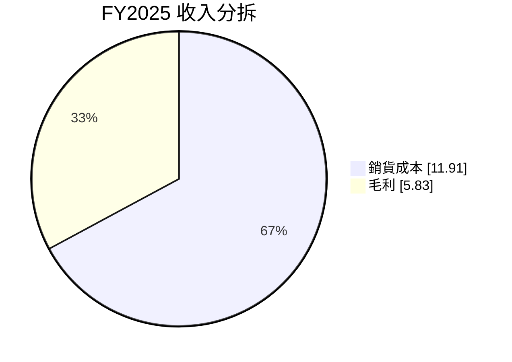

### 3.5 季度 EPS 趨勢與盈餘品質（Quality of Earnings）

| 季度 | EPS 實際值 | EPS 預期值 | 超預期／不及預期 |
|------|-----------:|-----------:|------------------|
| 2025 Q4 | $0.54 | N/A | N/A；分析師預期未提供 |
| 2026 Q1 | $2.87 | N/A | N/A；分析師預期未提供 |
| 2026 Q2 | $0.76 | N/A | N/A；分析師預期未提供 |
| 2026 Q3 | $3.23 | N/A | N/A；分析師預期未提供 |

EPS 實際值依 StockAnalysis 季度列示，來源間有細微差異。EPS 預期值為缺失，因此不能判定過去四季超預期或不及預期；「nan」不視為可用預期數字。

| 盈餘品質項目 | 數值/佔比 | 評估 |
|--------------|-----------|------|
| SBC / 營收 | **N/A**（完整 TTM SBC 未提供） | FY2025 SBC **$113M**，約占 FY2025 收入 **0.64%**；稀釋成本看來不大，但不是最新 TTM 比率 |
| SBC / 營業現金流 | **N/A**（最新 TTM SBC 未提供） | FY2025 SBC / FY2025 OCF = $113M ÷ $4.07B = **2.8%**，歷史年度參考 |
| FCF / 淨利 | **N/A**（不同期間淨利數據口徑不一致） | 不用不一致期間數字自行拼湊現金轉換率 |
| 一次性／非經常性損益 | N/A | 未有可確認的一次性損益拆分；獲利變動可能含市場因素 |
| 有效稅率異常 | **15.9%**（最新年有效稅率） | DCF 採用；單年稅務項目及稅務利益拆分 N/A |
| 資本化支出 vs 費用化 | TTM Capex **$3.15B** | 資本支出為現金流項目，折舊與資本化細項不足，無法判定是否有延後費用化 |

**盈餘品質結論**：營業現金流為正且 TTM FCF 達 **$2.61B**，支持盈餘具現金流基礎；但產業資本需求大、年度 FCF 波動，且最新 TTM SBC 與一致期間淨利未齊全。估值宜重視現金流及負債而非單看 EPS。

---

## 4. 資產負債表分析

### 4.1 資產結構分解

以下採 2026-09-30 StockAnalysis 資產明細；各項為美元十億，部分資產明細口徑未必完全等於合計。

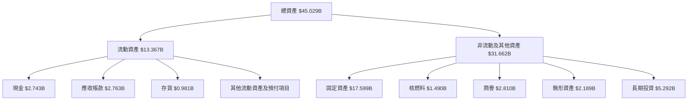

### 4.2 流動性與營運資金分析

| 指標 | 最新 TTM | 一年前 TTM | 變化 | 解讀 |
|------|----------|------------|------|------|
| DSO 應收帳款天數 | 50 天 | 52 天 | -2 天 | 收款天數改善；單獨不足以判斷信用政策或客戶組合變化 |
| DIO 存貨天數 | 30 天 | N/A | N/A | 一年前缺可比存貨餘額，不推算變化 |
| DPO 應付帳款天數 | 45 天 | N/A | N/A | 一年前缺可比應付餘額，不推算變化 |
| CCC 現金轉換週期 | 34 天 | N/A | N/A | 目前 CCC 為正 34 天；一年變化無法計算 |

流動比率 **1.157**，顯示流動資產略高於流動負債；速動比率 **0.477**，代表扣除存貨等項目後的短期流動性較弱。營運資金天數照品質指標列示，不以其他來源替代 N/A。

### 4.3 債務結構分析

╔══════════════════════════════════════════════════════════════════╗  
║                    Vistra 債務健康診斷                          ║  
╠══════════════════════════════════════════════════════════════════╣  
║  總債務：        $21.15B  ████████████████████  🟡               ║  
║  現金及短期投資：$2.74B   ███░░░░░░░░░░░░░░░░░  🟡               ║  
║  淨負債：        $18.40B  █████████████████░░░  🔴               ║  
║  Debt/EBITDA：   N/A（同口徑 TTM EBITDA 未提供）                 ║  
║  Interest coverage：N/A（利息費用及同口徑 EBIT 未提供）          ║  
║  風險提示：債務總額高於現金，現金流持續性是去槓桿關鍵            ║  
╚══════════════════════════════════════════════════════════════════╝

### 4.4 股東權益趨勢

╔══════════════════════════════════════════════════════════════════╗  
║               Vistra 歷年股東權益（年末）                        ║  
╠══════════════════════════════════════════════════════════════════╣  
║ FY2022  $4.90B  ███████████████████                             ║  
║ FY2023  $5.31B  █████████████████████                           ║  
║ FY2024  $5.57B  ██████████████████████                          ║  
║ FY2025  $5.10B  ████████████████████                            ║  
╚══════════════════════════════════════════════════════════════════╝

股東權益 FY2025 較 FY2024 減少 **$0.47B**；可用資料未提供權益變動完整調節表，不能將其全數歸因於回購、股息或其他單一項目。

---

## 5. 現金流量深度分析

### 5.1 現金流量瀑布圖

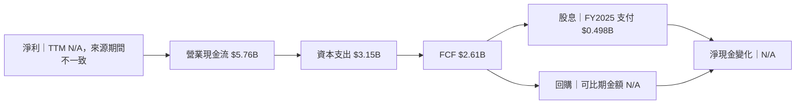

瀑布圖不代表當期完整現金流勾稽：股息金額為 FY2025 年度值，不與 TTM FCF 混成同一期間；回購及其他融資現金流數字未提供。

### 5.2 FCF 轉換率趨勢

| 財年 | FCF | 淨利 | FCF / 淨利 |
|------|----:|-----:|-----------:|
| FY2022 | -$0.816B | -$1.23B | 66.3%（負數對負數，比率解讀有限） |
| FY2023 | $3.78B | $1.49B | 253.7% |
| FY2024 | $2.48B | $2.66B | 93.2% |
| FY2025 | $1.32B | $0.944B | 139.8% |
| TTM | $2.61B | N/A | N/A |

年度數據顯示現金轉換率波動，部分來自資本支出與營運現金流週期差異；年度比率不宜外推為穩定常態。

### 5.3 自由現金流趨勢

╔══════════════════════════════════════════════════════════════════╗  
║                  自由現金流歷史趨勢                              ║  
╠══════════════════════════════════════════════════════════════════╣  
║ FY2022  -$0.816B  ◀ 負值                                         ║  
║ FY2023   $3.78B   ████████████████████                          ║  
║ FY2024   $2.48B   █████████████                                  ║  
║ FY2025   $1.32B   ███████                                        ║  
║ TTM      $2.61B   ██████████████  FCF Yield 5.77%                ║  
╚══════════════════════════════════════════════════════════════════╝

FY2023 至 FY2025 FCF 由 **$3.78B** 降至 **$1.32B**，但 TTM 回升至 **$2.61B**。TTM FCF 依指定定義為營業現金流 **$5.76B** 減 Capex **$3.15B**。

### 5.4 資本配置評估

| 項目 | 可用數字 | 評估 |
|------|----------|------|
| 資本支出 | TTM **$3.15B**；FY2025 **$2.75B** | 投資強度高，維持與擴建支出會影響現金回報 |
| 股息 | FY2025 支付 **$498M** | 對照 FY2025 FCF **$1.32B**，股息現金負擔可覆蓋 |
| 股票回購 | 可比期間金額 N/A | 不推測回購規模或資本配置優先順序 |
| SBC | FY2025 **$113M** | 需持續監控股數與薪酬成本 |
| 留存現金／還債 | N/A | 缺少完整同期資金用途明細 |

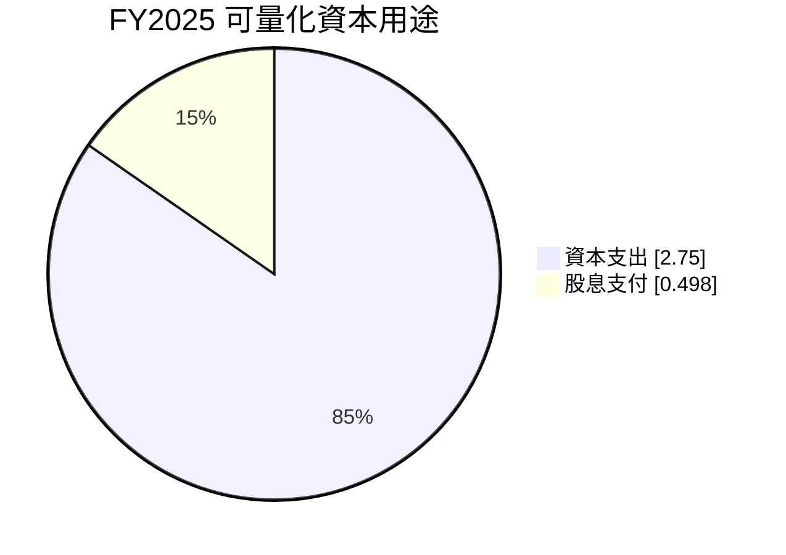

此圖只展示已知 Capex 與股息金額，不代表兩項構成公司所有資本配置。

---

## 6. 獲利能力與資本效率

### 6.1 ROE / ROA / ROIC 趨勢

| 指標 | FY2022 | FY2023 | FY2024 | FY2025／TTM | 評估 |
|------|-------:|-------:|-------:|------------:|------|
| ROE | N/A | N/A | N/A | **42.9% TTM** | 高回報但受槓桿放大 |
| ROA | N/A | N/A | N/A | N/A | 同口徑歷史趨勢不足 |
| ROIC | N/A | N/A | N/A | **13.5% TTM** | 高於 WACC **9.01%** |
| 行業均值 | — | — | — | N/A | 未提供可核驗同口徑數值 |

### 6.2 ROIC vs WACC 分析（核心價值創造判斷）

╔══════════════════════════════════════════════════════════════════╗  
║                 ROIC vs WACC 深度分析                            ║  
╠══════════════════════════════════════════════════════════════════╣  
║ WACC 輸入：                                                      ║  
║ ├── 無風險利率：5.15%                                            ║  
║ ├── ERP：5.00%                                                   ║  
║ ├── 原始 Beta：1.38；調整 Beta：1.25                             ║  
║ ├── Ke = 5.15% + 1.25 × 5.00% = 11.40%                          ║  
║ ├── 稅前 Kd：4.64%；稅率：15.9%                                  ║  
║ ├── 股權／債務權重：68.1%／31.9%                                 ║  
║ └── WACC：9.01%                                                  ║  
║                                                                  ║  
║ ROIC：13.5%（TTM，SEC 計算口徑）                                 ║  
║ EVA spread = 13.5% − 9.01% = +4.49 個百分點                     ║  
║ 判斷：ROIC 高於 WACC，現階段創造經濟價值                         ║  
╚══════════════════════════════════════════════════════════════════╝

ROIC / WACC = **13.5% ÷ 9.01% = 1.50 倍**。但這是 TTM 指標，若電力價格或利用率回落，ROIC 可能收斂；應以跨週期回報檢驗價值創造能否持續。

### 6.3 杜邦三因素分解

| 因素 | 數值（TTM） | 解讀 |
|------|-------------|------|
| 淨利率 | 13.4% | 獲利能力提供 ROE 基礎 |
| 資產週轉率 | 0.45 | 資產密集型發電與零售業務使資產週轉率偏低 |
| 權益乘數 | 7.14 | 槓桿大幅放大股東權益回報 |
| **ROE** | **42.9%** | 13.4% × 0.45 × 7.14 = **42.9%** |

ROE 的高值不能單獨視為資本效率優異：權益乘數 **7.14** 顯示財務槓桿是重要放大因素。

### 6.4 財務體質：Piotroski F-Score

**Piotroski F-Score：7 / 8**。可判定測試只有 8 項，毛利率測試因缺資料未納入分母。

| 測試 | 結果 | 解讀 |
|------|------|------|
| ROA > 0 | ✅ 通過 | 盈利資產回報為正 |
| 營業現金流 > 0 | ✅ 通過 | 營運產生正現金 |
| ROA 高於一年前 | ✅ 通過 | 資產回報改善 |
| 營業現金流 > 淨利 | ✅ 通過 | 應計品質測試通過 |
| 長期負債 ÷ 總資產低於一年前 | ❌ 未通過 | 槓桿相對資產沒有改善 |
| 流動比率高於一年前 | ✅ 通過 | 短期流動性有所改善 |
| 稀釋股數未增加 | ✅ 通過 | 稀釋股數測試通過 |
| 毛利率高於一年前 | — 無法判定 | 缺資料，未計入分母 |
| 資產週轉率高於一年前 | ✅ 通過 | 資產效率改善 |

---

## 7. 相對估值分析

### 7.1 同業估值比較表格

| 估值指標 | **VST** | **CEG** | **NRG** | **TLN** | 本公司評估 |
|----------|--------:|--------:|--------:|--------:|-----------|
| **Trailing P/E** | 18.0x | 22.5x | 17.0x | N/A | 🟢 低於 CEG，略高於 NRG |
| **Forward P/E** | 14.2x | 20.8x | 9.9x | 12.2x | 🟡 高於同業中位數 12.2x |
| **P/S Ratio** | 2.2x | 2.9x | 0.6x | 3.7x | 🟡 接近同業中位數 2.9x 以下 |
| **EV/EBITDA** | 8.495x* | 12.8x | 10.7x | 38.0x | 🟢 低於同業中位數 12.8x |
| 最新季度營收 YoY | 25.4% | 45.4% | 24.0% | 96.1% | 🟡 高於 NRG、低於 CEG/TLN |
| 毛利率（TTM） | N/A | 25.2% | 20.2% | 42.7% | — |

\* VST EV/EBITDA 使用市場資料區列值 **8.495x**；公司自身五年估值序列的 EV/EBITDA 為 **10.0x**，兩者來源與計算口徑可能不同，勿直接視為同一數值。Forward P/E 同業中位數為 **12.2x**；EV/EBITDA 中位數為 **12.8x**。

### 7.2 歷史估值區間分析

╔══════════════════════════════════════════════════════════════════╗  
║                 VST 五年估值位置（TTM）                          ║  
╠══════════════════════════════════════════════════════════════════╣  
║ P/E：範圍 7.2x ───────── 18.0x ───────── 74.3x                 ║  
║                         現值百分位：20%                          ║  
║       五年中位數：25.2x                                         ║  
║ P/S：現值 2.2x｜五年中位數 1.8x｜範圍 0.5x–4.2x｜百分位 57%   ║  
║ EV/EBITDA：現值 10.0x｜中位數 11.0x｜百分位 40%                 ║  
╚══════════════════════════════════════════════════════════════════╝

P/E 低於五年中位數，但 P/S 高於中位數；這代表估值訊號並不完全一致，且盈利週期可造成 P/E 大幅波動。

### 7.3 情境價值（Bear / Base / Bull）

| 情境 | 第 1 年營收成長 | 期末營業利潤率 | WACC | 每股價值 | 相對現價 | 機率 | 會發生的條件 |
|------|----------------:|---------------:|-----:|---------:|---------:|-----:|--------------|
| 🔴 悲觀 | 11.4% | 16.4% | 10.01% | $93.52 | -29.7% | 25% | 電力市場回落，收入與成熟期利潤率均低於基準 |
| 🟡 基準 | 22.8% | 19.3% | 9.01% | $279.02 | +109.8% | 50% | TTM 成長延續後逐步放緩，利潤率向歷史中位數收斂 |
| 🟢 樂觀 | 34.3% | 21.2% | 8.01% | $651.57 | +389.9% | 25% | 成長高於目前 TTM，成熟期利潤率維持高位且資金成本下降 |

情境價值與機率為模型輸出，不是獨立預測或價格承諾；樂觀情境對成長、利潤率和折現率均有利。

### 7.4 相對估值隱含價格區間

╔══════════════════════════════════════════════════════════════════╗  
║              相對估值方法及現價位置                             ║  
╠══════════════════════════════════════════════════════════════════╣  
║ $113.76 ── 現價 $133.01 ───────── $185.33 ── $202.48 ── $279.02║  
║ Forward P/E      ●          EV/EBITDA   共識       DCF          ║  
╚══════════════════════════════════════════════════════════════════╝

| 方法 | 每股價值 | 相對現價 | 依據 |
|------|---------:|---------:|------|
| 同業 Forward P/E | $113.76 | -14.5% | 同業中位數 **12.2x** × VST Forward EPS **$9.36** |
| 同業 EV/EBITDA | $185.33 | +39.3% | 同業中位數 **12.8x** × TTM EBITDA，加回淨現金／扣除淨負債 |
| DCF 基準 | $279.02 | +109.8% | 10 年 FCFF、WACC **9.01%**、永續成長 **3.0%** |
| 分析師共識目標價 | $202.48 | +52.2% | 21 位分析師平均目標價 |

---

## 8. DCF 內在價值評估（Discounted Cash Flow）

### 8.0 估值推理鏈（Thinking Logic）

**Step 1 — 價值來源及主導變數**  
模型以綜合零售與發電主業的 FCFF 為基礎；分部收入占比未提供，故不把任何業務另列為已量化的第二曲線。價值主要受營收路徑、營業利潤率和終值折現假設影響。敏感度矩陣中永續成長率與 WACC 對終值影響最大，與長期現金流持續性是估值主導因素的判斷一致。

**Step 2 — 模型選擇**

| 決策點 | 本報告採用 | 理由（含數字） | 曾考慮但否決 | 否決理由 |
|--------|-----------|----------------|--------------|----------|
| 現金流定義 | FCFF | 以 WACC **9.01%** 折現，先估 EV 再橋接股權價值 | FCFE | 債務與現金均須於 EV 橋接處理 |
| 預測期 N | 10 年 | 模型固定輸出 10 個年度，營收成長由 **22.8%** 漸降至 **3.0%** | 5 年 | 無法沿用本模型提供的終值起算年份 |
| 終值方法 | Gordon Growth | 使用 FCFF(FY+10) 與 g **3.0%** | 退出倍數主估值 | DCF 模型未提供退出倍數計算結果 |
| EBIT 基礎 | GAAP EBIT | TTM 營業利益率 **21.0%**；股權薪酬已列為費用 | 非 GAAP EBIT | 會需要額外 SBC 扣減或股數稀釋假設 |

**Step 3 — 關鍵假設推導鏈**

- **營收成長路徑**：錨點＝TTM 營收年增 **22.8%** → 模型將其作為第一年起點，並線性降至第十年 **3.0%** → 採用模型逐年成長率 **22.8%、20.6%、18.4%、16.2%、14.0%、11.8%、9.6%、7.4%、5.2%、3.0%** → 未採「十年維持 22.8%」的替代假設，因其未反映成熟期成長收斂。
- **營業利潤率**：錨點＝TTM **21.0%**，第十年收斂到近五年中位數 **19.3%** → 模型逐年略降 → 採用第十年 **19.3%** → 否決長期維持或提升到高於起點的假設，因缺少可核驗的持續擴大利潤率證據。
- **Capex／營收**：錨點＝TTM **15.6%** → 模型逐年降至第十年 **11.5%**，且終點依模型規則相當於 D&A 的約 **1.1 倍** → 採用第 1 年 **15.6%**、第 10 年 **11.5%** → 否決長期固定在 TTM 比率，因模型採取資本支出逐步正常化假設；若實際投資需求不降，DCF 會偏高。
- **永續成長率 g**：錨點＝成熟經濟長期名目成長的模型假設 **3.0%** → 採用 **3.0%**，低於 WACC **9.01%** → 不採更高長期成長率，以避免將終值建立在難以持續的高速增長上。
- **預測期 N**：模型固定 **10 年**，足以呈現成長率由 **22.8%** 至 **3.0%** 的收斂路徑 → 採用 10 年 → 否決縮短至 5 年，因與已計算模型輸出不相容。
- **WACC**：採用成本資本區塊提供的 **9.01%**，不另建折現率；替代值不自行更換，以維持與估值矩陣及模型一致。
- **GAAP／SBC／稀釋率**：採用 **GAAP EBIT、固定股數、年稀釋率 0%**；SBC 已在 GAAP 營業費用中扣除，模型不再扣一次，也不另計稀釋。此為組合 **(A)**。
- **稅率**：以最新年度有效稅率 **15.9%** 為錨點，模型全期採 **15.9%**。
- **D&A／營收**：模型採 TTM 比率 **10.4%** 並維持不變；這是模型輸入而非對未來折舊政策的獨立判斷。
- **營運資金**：模型不納入 ΔWC；FCFF 按模型公式計算，不自行補入缺乏模型輸出的營運資金假設。

**Step 4 — 最脆弱環節**  
最脆弱的是終值成長、長期利潤率及 Capex 正常化；終值 PV 占 EV **64.9%**，若長期假設偏差，估值會大幅改變，詳見 8.6。

**Step 5 — 計算路徑**

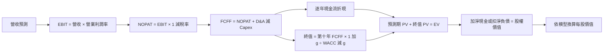

### 8.1 模型假設總表（Model Inputs）

| 假設項目 | 採用值 | 依據 / 來源 | 敏感度 |
|----------|--------|-------------|--------|
| 預測期長度 N | 10 年 | DCF 模型；成長率逐年收斂 | 🟡 中 |
| 營收成長 | FY+1 **22.8%**，FY+10 **3.0%** | TTM 成長 **22.8%** 起始，模型線性淡出 | 🔴 高 |
| 營業利潤率 | 21.0% 降至 19.3% | TTM **21.0%**，終點為近五年中位數 | 🔴 高 |
| 有效稅率 | 15.9% | 最新年度有效稅率 | 🟢 低 |
| Capex / 營收 | 15.6% 降至 11.5% | TTM **15.6%**；第十年回落至模型正常化比率 | 🔴 高 |
| D&A / 營收 | 10.4% | TTM 比率，模型固定 | 🟢 低 |
| ΔWC / 營收增額 | 未建模 | 模型 FCFF 明確未納入營運資金 | 🟢 低 |
| EBIT 基礎 | GAAP | TTM GAAP 營業利益率 **21.0%** | 🟡 中 |
| SBC 處理 | 已包含在 GAAP EBIT，不另扣 | SBC 已費用化；採組合 (A) | 🟡 中 |
| 年稀釋率 | 0% | 模型固定股數，不額外放大 | 🟡 中 |
| 永續成長率 g | 3.0% | 模型輸入；低於 WACC | 🔴 高 |
| 終值方法 | Gordon Growth | DCF 模型所列終值 | 🔴 高 |
| WACC | 9.01% | 成本資本輸入，詳 8.2 | 🔴 高 |

**FCFF 定義**：使用 FCFF = NOPAT + D&A − Capex；依模型設定不列 ΔWC。  
**SBC 防重複扣除**：本模型採用 **(A)**，GAAP EBIT 已含 SBC；故 FCFF 不另減 SBC，股數亦不額外稀釋，SBC 影響計入一次。

### 8.2 折現率推導（WACC）

╔══════════════════════════════════════════════════════════════════╗  
║                    WACC 推導（折現率）                           ║  
╠══════════════════════════════════════════════════════════════════╣  
║ 股權成本 Ke：                                                    ║  
║ ├── 無風險利率 Rf：5.15%（成本資本輸入；日期未提供）             ║  
║ ├── ERP：5.00%（成本資本輸入）                                   ║  
║ ├── 原始 Beta：1.38；調整 Beta：1.25                             ║  
║ ├── 調整：⅔ × 1.38 + ⅓ × 1 = 1.2533，採用 1.25                ║  
║ └── Ke = 5.15% + 1.25 × 5.00% = 11.40%                         ║  
║                                                                  ║  
║ 債務成本 Kd：                                                    ║  
║ ├── 稅前 Kd = 利息／債務比率：4.64%                              ║  
║ ├── 利息金額、平均計息負債金額：N/A                              ║  
║ └── 稅後 Kd = 4.64% × (1 − 15.9%) = 3.9024%                     ║  
║                                                                  ║  
║ 資本結構：                                                      ║  
║ ├── 股權權重：68.1%；債務權重：31.9%                            ║  
║ └── WACC = 68.1% × 11.40% + 31.9% × 3.9024% = 9.01%            ║  
╚══════════════════════════════════════════════════════════════════╝

**逐步演算（WACC）**

1. **Ke（CAPM）** = 5.15% + 1.25 × 5.00% = **11.40%**。
2. **稅前 Kd** = 利息費用 ÷ 計息負債；利息及平均計息負債金額未提供，採成本資本輸入直接列示 **4.64%**，不可由本報告資料獨立重建。
3. **稅後 Kd** = 4.64% × (1 − 15.9%) = **3.9024%**。
4. **權重** = 股權 **68.1%**；債務 **31.9%**；68.1% + 31.9% = **100.0%**。成本資本權重採資料所列市場資本結構權重，不另以來源不一致的股數與債務數重估。
5. **WACC** = 68.1% × 11.40% + 31.9% × 3.9024% = 7.7634% + 1.2450% = **9.0084% ≈ 9.01%**。

第 6.2 節與本節均採用 **9.01%**。原始 Beta **1.38** 經 ⅔ 原始 Beta 加 ⅓ 的調整後採 **1.25**；未加規模或國別溢酬。Rf 日期在資料中未提供，故不補造日期。

### 8.3 逐年自由現金流預測（基準情境）

金額單位為 **$B**；折現因子保留三位小數。表格沿用 DCF 模型輸出，未額外加入營運資金或 SBC 列。

| 年度 | FY+1 | FY+2 | FY+3 | FY+4 | FY+5 | FY+6 | FY+7 | FY+8 | FY+9 | FY+10 |
|------|-----:|-----:|-----:|-----:|-----:|-----:|-----:|-----:|-----:|------:|
| 營收 | 24.81 | 29.93 | 35.45 | 41.20 | 46.98 | 52.54 | 57.59 | 61.85 | 65.07 | 67.03 |
| 營收 YoY | 22.8% | 20.6% | 18.4% | 16.2% | 14.0% | 11.8% | 9.6% | 7.4% | 5.2% | 3.0% |
| 營業利潤率 | 21.0% | 20.8% | 20.6% | 20.4% | 20.2% | 20.0% | 19.8% | 19.6% | 19.4% | 19.3% |
| EBIT（GAAP） | 5.20 | 6.22 | 7.29 | 8.40 | 9.49 | 10.51 | 11.41 | 12.14 | 12.65 | 12.91 |
| − 稅 | (0.83) | (0.99) | (1.16) | (1.34) | (1.51) | (1.68) | (1.82) | (1.94) | (2.02) | (2.06) |
| = NOPAT | 4.37 | 5.22 | 6.13 | 7.06 | 7.98 | 8.84 | 9.60 | 10.21 | 10.64 | 10.85 |
| + D&A | 2.58 | 3.12 | 3.69 | 4.29 | 4.89 | 5.47 | 6.00 | 6.44 | 6.78 | 6.98 |
| − Capex | (3.88) | (4.54) | (5.21) | (5.86) | (6.47) | (6.99) | (7.40) | (7.66) | (7.75) | (7.68) |
| **= FCFF** | **3.08** | **3.80** | **4.61** | **5.49** | **6.40** | **7.32** | **8.20** | **8.99** | **9.66** | **10.15** |
| 折現因子 | 0.917 | 0.842 | 0.772 | 0.708 | 0.650 | 0.596 | 0.547 | 0.501 | 0.460 | 0.422 |
| **FCFF 現值 PV** | **2.82** | **3.20** | **3.56** | **3.89** | **4.16** | **4.36** | **4.48** | **4.51** | **4.44** | **4.28** |

**預測期 PV 合計**  
$2.82 + $3.20 + $3.56 + $3.89 + $4.16 + $4.36 + $4.48 + $4.51 + $4.44 + $4.28 = **$39.70B**。

**逐步演算（FY+1 代表年度）**

1. **營收** = $20.20B × (1 + 22.8%) = **$24.81B**。
2. **EBIT** = $24.81B × 21.0% ≈ **$5.20B**（模型使用未四捨五入內部輸入）。
3. **稅** = $5.20B × 15.9% ≈ **$0.83B**。
4. **NOPAT** = $5.20B − $0.83B = **$4.37B**。
5. **D&A** = 模型列示 **$2.58B**。
6. **Capex** = 模型列示 **$3.88B**。
7. **ΔWC** = **0（模型未建模）**。
8. **FCFF** = 模型列示 **$3.08B**。表內顯示值經四捨五入後，$4.37 + $2.58 − $3.88 = $3.07B，與模型值差 **$0.01B**；此差異來自模型未公開的未四捨五入輸入，低於 1%。
9. **折現因子** = 1 ÷ (1 + 9.01%)¹ = **0.917**；PV = $3.08B × 0.917 ≈ **$2.82B**。

**合理性自檢**

- FY+1 至 FY+10 FCFF CAGR = (10.15 ÷ 3.08)^(1/9) − 1 ≈ **14.2%**；歷史年度 FCF 受週期及資本支出影響，不能用單一 CAGR 直接外推。
- FY+10 FCFF 利潤率 = $10.15B ÷ $67.03B = **15.1%**；FY+1 約 **12.4%**；同業最佳值未提供，無法做同口徑排名。
- 模型所有年度 FCFF 為正；但 Capex 正常化若未實現，模型 FCF 及估值將偏高。

╔══════════════════════════════════════════════════════════════════╗  
║          自由現金流：歷史實際 vs 模型預測（$B）                  ║  
╠══════════════════════════════════════════════════════════════════╣  
║ FY2023（實） $3.78  ████████                                    ║  
║ FY2024（實） $2.48  █████                                       ║  
║ FY2025（實） $1.32  ███                                         ║  
║ TTM（實）    $2.61  █████                                       ║  
║ FY+1（預）   $3.08  ██████                                      ║  
║ FY+10（預） $10.15  ████████████████████                        ║  
╠══════════════════════════════════════════════════════════════════╣  
║ 預測依賴成長與 Capex 正常化；預測值不等於管理層指引。            ║  
╚══════════════════════════════════════════════════════════════════╝

### 8.4 終值計算（Terminal Value）

**適用性檢查**：WACC **9.01%** vs g **3.0%** → WACC > g？✅

| 方法 | 計算式 | 終值 TV | TV 現值 | 佔總 EV 比重 |
|------|--------|---------:|--------:|-------------:|
| Gordon Growth | $10.15 × (1 + 3.0%) ÷ (9.01% − 3.0%) | $173.94B | $73.40B | 64.9% |
| 退出倍數法 | N/A | N/A | N/A | N/A |

退出倍數法的倍數及模型計算結果未提供，因此不自行填入替代估值。

**逐步演算**

1. **FY+10 FCFF** = **$10.15B**。
2. **分子** = $10.15B × (1 + 3.0%) = **$10.4545B**。
3. **分母** = 9.01% − 3.0% = **6.01%**；TV = $10.4545B ÷ 6.01% = **$173.94B**。
4. **PV(TV)** = $173.94B × 0.422 = **$73.40B**（模型輸出）。
5. **終值占比** = $73.40B ÷ $113.10B = **64.9%**。

### 8.5 企業價值 → 每股內在價值（Bridge）

╔══════════════════════════════════════════════════════════════════╗  
║              企業價值 → 每股內在價值橋接                         ║  
╠══════════════════════════════════════════════════════════════════╣  
║ 預測期 FCF 現值合計             +$39.70B                         ║  
║ 終值現值 PV(TV)                 +$73.40B                         ║  
║ = 企業價值 EV                    $113.10B                        ║  
║ + 淨現金（負數代表淨負債）      −$18.40B                         ║  
║ = 股權價值                       $94.70B                         ║  
║ 每股 DCF 基準內在價值             $279.02                         ║  
║ 現價（2026-11-13 收盤）           $133.01                         ║  
║ 折溢價＝現價÷DCF價值−1             -52.3%（折價）                  ║  
╚══════════════════════════════════════════════════════════════════╝

**逐步演算**

1. **EV** = $39.70B + $73.40B = **$113.10B**。
2. **股權價值** = $113.10B − $18.40B = **$94.70B**。
3. **每股價值**依模型所列換算式：股權價值 × 價格 ÷ 市值 = $94.70B × $133.01 ÷ $45.14B = **$279.02**。
4. **折溢價** = $133.01 ÷ $279.02 − 1 = **-52.3%**。
5. 本節不計算 MOS；MOS 以第 8.8 節加權合理價值為分母。

股數處理採模型固定股數、不另加年稀釋率；模型將每股價值定義為股權價值 × 價格 ÷ 市值。SEC 最新季度稀釋股數與模型換算公式並未提供足以獨立重建的完整橋接，因此遵循模型原值，不另改用其他股數重新估算。

### 8.6 敏感性分析（WACC × 永續成長率）

| g（列）／WACC（欄） | 7.01% | 8.01% | **9.01%（基準）** | 10.01% | 11.01% |
|-----------|------:|------:|------------------:|-------:|-------:|
| 2.0% | $385.49 (+189.8%) | $304.13 (+128.7%) | $246.38 (+85.2%) | $203.38 (+52.9%) | $170.19 (+27.9%) |
| 2.5% | $421.44 (+216.8%) | $326.69 (+145.6%) | $261.45 (+96.6%) | $213.91 (+60.8%) | $177.81 (+33.7%) |
| 3.0% | $466.35 (+250.6%) | $353.75 (+165.9%) | **$279.02 (+109.8%)** | $225.94 (+69.9%) | $186.37 (+40.1%) |
| 3.5% | $524.05 (+293.2%) | $386.81 (+190.8%) | $299.79 (+125.4%) | $239.82 (+80.3%) | $196.08 (+47.4%) |
| 4.0% | $600.90 (+351.8%) | $428.11 (+221.9%) | $324.70 (+144.1%) | $256.01 (+92.5%) | $207.17 (+55.8%) |

括號上行空間以 **$133.01** 現價計算。  
**所選格 WACC 10.01% > g 2.5% ✅**。模型敏感度表給出的每股價值為 **$213.91**。該矩陣由程式模型以完整未四捨五入現金流計算；由於沒有各年度未四捨五入現金流與折現細項，不能用表中兩位小數逐項重建該格而不產生四捨五入差異，故直接引用模型原值。

**三情境 DCF**

| 情境 | 營收假設（第 1 年） | 期末營業利潤率 | WACC | 每股內在價值 | 相對現價 | 機率 |
|------|---------------------:|---------------:|-----:|--------------:|---------:|-----:|
| 🔴 悲觀 | 11.4% | 16.4% | 10.01% | $93.52 | -29.7% | 25% |
| 🟡 基準 | 22.8% | 19.3% | 9.01% | $279.02 | +109.8% | 50% |
| 🟢 樂觀 | 34.3% | 21.2% | 8.01% | $651.57 | +389.9% | 25% |
| **機率加權** | — | — | — | **$325.78** | **+144.9%** | 100% |

三情境每年度收入路徑、各情境 FCFF 與終值拆分未提供，故不製作無法驗算的逐年推導鏈。機率加權 = $93.52 × 25% + $279.02 × 50% + $651.57 × 25% = **$325.78**（四捨五入）。

**敏感度結論（依模型矩陣）**

- g 從 **2.5%** 升至 **3.5%**，WACC 固定 **9.01%**：$261.45 → $299.79，增加 **$38.34**，約 **14.7%**。
- WACC 從 **8.01%** 升至 **10.01%**，g 固定 **3.0%**：$353.75 → $225.94，減少 **$127.81**，約 **36.1%**。
- 期末營業利潤率每 +1 個百分點的獨立敏感度未提供，不能補造；情境中同時改變營收、利潤率與 WACC，不能把情境差額歸因於單一變數。
- 在提供的敏感度矩陣範圍內，**WACC 變動的估值影響最大**；這與 8.0 所述終值折現及長期現金流是估值主導因素一致。

### 8.7 反推 DCF（Reverse DCF）

固定模型基準輸入：WACC **9.01%**、稅率 **15.9%**、D&A／營收 **10.4%**、Capex 由 **15.6%** 降至 **11.5%**、預測期 **10 年**、g **3.0%**、固定股數且不額外稀釋。ΔWC 不建模。模型反推結果只提供兩個單變數解：

| 求解的變數（一次一個） | 其餘變數設定 | 市場隱含值（令 DCF = 現價） | 公司參考值 | 判斷 |
|------------------------|--------------|------------------------------|-----------|------|
| 第 1 年營收成長 | 利潤率及其他參數固定為基準 | **8.6%** | TTM 成長 **22.8%** | 🟢 現價隱含成長低於目前 TTM |
| 固定營業利潤率 | 營收及其他參數固定為基準 | **11.9%** | 目前 TTM **21.0%**，基準終點 **19.3%** | 🟢 市場價格隱含利潤率低於基準模型 |
| 永續成長率 g | 未計算 | 未提供 | — | N/A |
| 高成長持續年數 N | 未計算 | 未提供 | — | N/A |

DCF 模型未提供各級距試算軌跡，因此不虛構迭代點或收斂誤差。反推結果代表在其他假設固定時，市場價格可由低於目前 TTM 的營收成長或較低的固定利潤率解釋；但模型結果不代表市場確實只採用這些假設。

### 8.8 估值三角驗證與安全邊際

| 估值方法 | 隱含每股價值 | 上行空間（÷現價） | 權重 | 說明 |
|----------|--------------:|-------------------:|------:|------|
| DCF（基準） | $279.02 | +109.8% | 40% | 10 年 FCFF、WACC 9.01%、g 3.0% |
| 同業 Forward P/E | $113.76 | -14.5% | 25% | 同業中位數 12.2x × Forward EPS $9.36 |
| 同業 EV/EBITDA | $185.33 | +39.3% | 25% | 同業中位數 12.8x × TTM EBITDA，並反映淨負債橋接 |
| 分析師共識目標價 | $202.48 | +52.2% | 10% | 21 位分析師平均目標價 |
| **加權合理價值** | **$206.63** | **+55.3%** | **100%** | 公司類型：盈利公司；採固定方法權重 |

**逐步演算（權重外顯）**

$279.02 × 40% + $113.76 × 25% + $185.33 × 25% + $202.48 × 10%  
= $111.608 + $28.440 + $46.3325 + $20.248  
= $206.6285 ≈ **$206.63**。  
權重合計 = 40% + 25% + 25% + 10% = **100%**。無方法因無法計算而剔除；相對估值採同業中位數倍數。

安全邊際以加權合理價值為分母：  
**MOS = ($206.63 − $133.01) ÷ $206.63 = $73.62 ÷ $206.63 = 35.6%**。  
上行空間以現價為分母：  
**($206.63 − $133.01) ÷ $133.01 = $73.62 ÷ $133.01 = 55.3%**。

╔══════════════════════════════════════════════════════════════════╗  
║                  估值區間與安全邊際                              ║  
╠══════════════════════════════════════════════════════════════════╣  
║ $93.52 ─── $133.01 ───── [$206.63] ───── $279.02 ─── $651.57   ║  
║ 悲觀DCF       現價       加權合理值       基準DCF       樂觀DCF  ║  
║                                                                  ║  
║ MOS = (加權合理價值 − 現價) ÷ 加權合理價值 = 35.6%             ║  
║ 評估：🟢 MOS >25%                                                ║  
║ 上行空間 = (合理價值 − 現價) ÷ 現價 = 55.3%                    ║  
║ 建議買入區間：$133.01–$185.97（按 MOS ≥10% 的價格上限計算）    ║  
║ 合理持有參考：$185.97–$206.63                                   ║  
║ 減碼考慮：高於 $279.02 時，需重新檢視基準 DCF 假設              ║  
╚══════════════════════════════════════════════════════════════════╝

買入上限的算式：價格 = 加權合理價值 × 90% = $206.63 × 90% = **$185.97**；若現價低於或等於該值，依定義 MOS 至少 10%。評級為強烈買入，因此買入區間上限高於現價。

> 🔎 **程式複算（Python，依本節各項自動重算）**
>
> 加權合理價值 = $279.02 × 40% + $113.76 × 25% + $185.33 × 25% + $202.48 × 10% = **$206.63**（權重合計 100%）
>
> 以價格 $133.01 計：MOS = **+35.6%**，上行空間 = **+55.3%**
>
> ✅ 與本節所寫數值一致。

### 8.9 DCF 模型的局限與失效條件

- **終值依賴度**：終值現值占 EV **64.9%**，價值主要取決於第十年後現金流假設，而非近年現金流本身。
- **最脆弱假設**：若營收成長轉弱、期末利潤率低於悲觀情境 **16.4%**，或 WACC 上升至 **10.01%**，悲觀情境價值為 **$93.52**；若 Capex 長期無法由 TTM **15.6%** 向模型的 **11.5%** 收斂，基準 DCF 可能偏高。
- **模型限制**：模型沒有 ΔWC、分部預測與完整年稀釋假設；電力公司資產使用年限、退役成本及電力週期均使簡化 FCFF 的精確度受限。若現金流週期加大，應輔以相對估值及分部資產價值交叉檢查。
- **風險連結**：市場電價或發電利用率下滑會影響營收與營業利潤率；建設或維修支出高於預期會影響 Capex；資金成本上升則直接提高 WACC。

### 8.10 複算檢核表（Audit Trail）

| # | 檢核項目 | 檢查方式 | 結果 |
|---|----------|----------|------|
| 1 | 所有高／中敏感度輸入有推導鏈 | 對照 8.0、8.1；模型未公開的細項已標示未提供 | ✅ |
| 2 | 每個假設都有來歷 | 8.1 依據列出模型輸入與財務錨點 | ✅ |
| 3 | WACC 五步算式齊全且相加正確 | 權重合計 100%；算得 9.0084% ≈ 9.01% | ✅ |
| 4 | Kd 分母與權重債務口徑可核對 | 稅前 Kd 直接採成本資本輸入；利息及平均計息負債金額未提供 | ⚠️ 限制：無法獨立重建金額 |
| 5 | WACC 與第 6.2 節一致 | 兩處均為 9.01% | ✅ |
| 6 | 逐年表格數量與 N 一致 | FY+1 至 FY+10，共 10 年 | ✅ |
| 7 | FY+1 代表年度計算可複算 | 四捨五入數值有 $0.01B 差異，已註明使用模型未四捨五入數 | ⚠️ |
| 8 | 預測期 PV 加總 | 2.82 + 3.20 + 3.56 + 3.89 + 4.16 + 4.36 + 4.48 + 4.51 + 4.44 + 4.28 = 39.70 | ✅ |
| 9 | WACC > g | 9.01% > 3.0% | ✅ |
| 10 | 終值以 FY+10 FCFF 為基礎、折現 10 期 | 使用 $10.15B、折現因子 0.422 | ✅ |
| 11 | EV 橋接 | $39.70B + $73.40B = $113.10B；扣淨負債得 $94.70B | ✅ |
| 12 | SBC 組合相容 | GAAP EBIT、無 SBC 扣減、年稀釋率 0% | ✅ |
| 13 | 矩陣基準格與 DCF 基準值一致 | g 3.0%、WACC 9.01% = $279.02 | ✅ |
| 14 | 矩陣有效性 | 表內測試格皆為 WACC > g | ✅ |
| 15 | 三情境機率合計 | 25% + 50% + 25% = 100% | ✅ |
| 16 | 反推每列只放開一個變數 | 僅列模型提供的兩項單變數解；未提供試算軌跡 | ⚠️ |
| 17 | MOS、折溢價基準一致 | MOS 用 $206.63；折溢價用 DCF $279.02 | ✅ |
| 18 | 完整輸出至第 11 章 | 已涵蓋第 1 至第 11 章 | ✅ |
| 19 | 加權合理價值可重算 | 加權結果 $206.6285 ≈ $206.63，未微調 | ✅ |
| 20 | 評級符合 MOS 門檻 | MOS 35.6%、ROIC 13.5% > WACC 9.01%，強烈買入 | ✅ |

---

## 9. 成長催化劑

### 9.1 催化劑時間軸

具體商業化時點與管理層時程未提供；以下按觀察期間分類，不代表公司已承諾的投產日期。

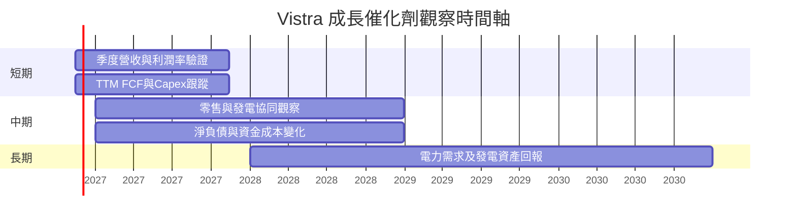

### 9.2 TAM 市場規模分析

**N/A（TAM 數據未提供）**。VST TTM 營收 **$20.20B**、年增 **22.8%**，顯示近期業務規模擴張；市場需求總額、公司滲透率與可服務市場的量化數據未提供，不能推算 TAM。

### 9.3 成長驅動力結構圖

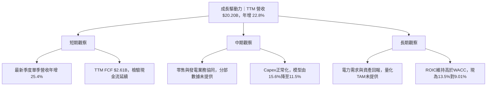

---

## 10. 風險矩陣

### 10.1 風險評分矩陣

以下機率與衝擊為分析判斷，不是公司披露的統計概率；量化財務影響資料不足時不虛構收入損失百分比。

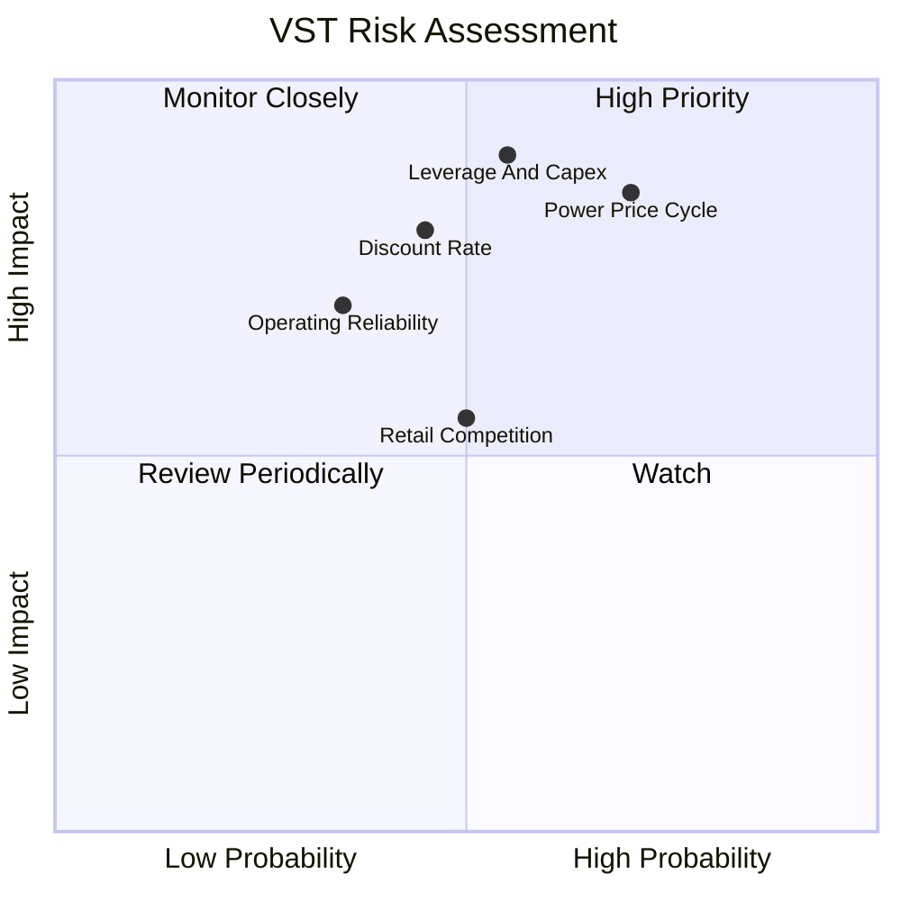

### 10.2 風險清單詳細分析

| # | 風險項目 | 發生機率 | 財務衝擊 | 風險評分 | 緩解措施 |
|---|----------|----------|----------|----------|----------|
| 1 | 🔴 **電力價格與發電利潤週期** | 中高 | 高；FY2025 營業利益 **$2.13B**，低於 FY2024 **$4.08B** | 🔴 高 | 追蹤分部利潤、實現電價、對沖與機組利用率；避免把單季利潤率外推 |
| 2 | 🔴 **高淨負債與資本支出** | 中 | 高；淨負債 **$18.40B**、TTM Capex **$3.15B** | 🔴 高 | 監控淨負債、利息覆蓋與 FCF；必要時降低可延後的非核心投資 |
| 3 | 🟡 **折現率及終值假設變化** | 中 | 高；終值 PV 占 EV **64.9%** | 🟡 高 | 用 WACC/g 矩陣更新估值，採加權估值而不只依賴 DCF |
| 4 | 🟡 **機組可靠性、燃料與退役成本** | 中 | 中至高；成本及停機損失未提供量化值 | 🟡 中高 | 追蹤非計畫停機、維修支出、資產退役準備及監管資訊 |
| 5 | 🟡 **零售競爭及客戶流失** | 中 | 中；零售客戶留存與獲客成本未提供 | 🟡 中 | 追蹤零售客戶數、續約率、單位毛利與應收帳款天數 |

---

## 11. 投資建議

### 11.1 最終評級與評分

依加權合理價值 **$206.63** 與 2026-11-13 收盤價 **$133.01** 計算，MOS 為 **35.6%**；ROIC **13.5%** 高於 WACC **9.01%**，因此依規則 20 評級為**強烈買入**，未調整一級。1.1 綜合評分為 **6.8/10**，其中成長性 **8.0**、獲利能力 **8.0**、財務健康 **5.0**、估值 **8.0**、護城河 **6.0**、管理層與資本配置 **6.0**。

### 11.2 合理價值與隱含報酬率

| 價值參考 | 每股價值 | 相對現價 | 機率／權重 |
|----------|---------:|---------:|----------:|
| 加權合理價值 | **$206.63** | **+55.3%** | 估值方法權重合計 100% |
| 🔴 悲觀 DCF | $93.52 | -29.7% | 25% |
| 🟡 基準 DCF | $279.02 | +109.8% | 50% |
| 🟢 樂觀 DCF | $651.57 | +389.9% | 25% |
| DCF 情境機率加權（參考） | $325.78 | +144.9% | 100% |

加權合理價值與 DCF 情境機率加權為不同用途：前者依固定估值方法權重，是 MOS 基準；後者只作情境參考，不替代 8.8 加權合理價值。

### 11.3 買入時機與觸發因素

╔══════════════════════════════════════════════════════════════════╗  
║                  ✅ 買入觸發因素 Checklist                       ║  
╠══════════════════════════════════════════════════════════════════╣  
║  持續持有／分批布局的確認條件：                                  ║  
║  ✅ TTM 營收成長維持正值，最新季度單季年增目前為 25.4%          ║  
║  ✅ TTM FCF 維持正值；目前 $2.61B、FCF Yield 5.77%               ║  
║  ✅ ROIC 高於 WACC；目前 13.5% 對 9.01%                          ║  
║                                                                  ║  
║  加碼觸發條件（可量化觀察）：                                    ║  
║  ☐ 股價不高於 $185.97，對 $206.63 加權合理價值仍有至少 10% MOS  ║  
║  ☐ TTM FCF 高於零且淨負債低於目前 $18.40B                       ║  
║  ☐ 營業利潤率維持於 TTM 21.0% 附近，並由財報證實               ║  
║                                                                  ║  
║  減碼／重新評估條件：                                            ║  
║  ☐ TTM FCF 轉負或 Capex 長期高於營業現金流                       ║  
║  ☐ ROIC 跌至 WACC 9.01% 以下                                     ║  
║  ☐ 股價高於基準 DCF $279.02，但營收及現金流未同步上修           ║  
╚══════════════════════════════════════════════════════════════════╝

### 11.4 投資人適配度分析

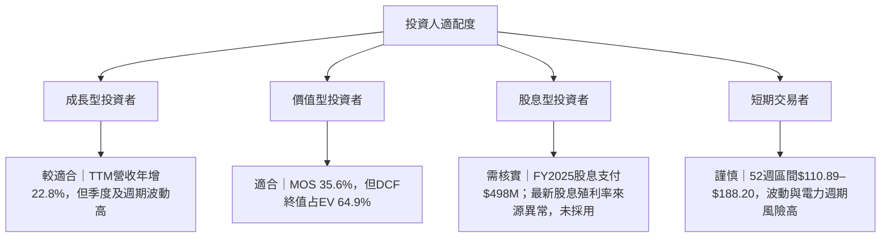

### 11.5 每季財報監控清單（Quarterly Watch List）

| 指標 | 目前基準 | 加碼／正向觸發 | 減碼／負向觸發 |
|------|----------|----------------|----------------|
| 營收年增 | TTM **22.8%**；最新季度單季 **25.4%** | 單季年增維持正值且 TTM 不顯著減速 | 連續兩季單季營收年增低於 0% |
| 營業利益率 | TTM **21.0%**；最新季度 **28.5%** | TTM 維持接近目前水平 | TTM 低於 **19.3%**（DCF 第十年成熟利潤率假設） |
| 營業現金流 | TTM **$5.76B** | 持續為正且與淨利趨勢一致 | 連續兩季營業現金流轉弱並導致 TTM 下滑 |
| Capex | TTM **$3.15B** | 投資增加但 FCF 仍為正 | Capex 增長令 TTM FCF 轉負 |
| FCF / FCF Yield | **$2.61B / 5.77%** | FCF 維持正值且淨負債下降 | FCF 轉負或 FCF Yield 顯著下降 |
| 淨負債 | **$18.40B** | 季度淨負債下降 | 淨負債連續上升且現金流轉弱 |
| DSO／CCC | DSO **50 天**；CCC **34 天** | DSO 不高於目前水平 | DSO 持續上升並伴隨應收增加 |
| 股數與 SBC | Piotroski 稀釋股數測試通過；最新 TTM SBC N/A | 股數穩定、SBC／營收比率可核驗且受控 | 稀釋股數增加或 SBC 顯著高於收入增長 |
| 管理層財測 | 最新管理層財測數字未提供 | 財測上修且現金流同步改善 | 下修財測、資本支出上修但回報不明 |

### 11.6 反面論證：什麼會證明論點錯誤（What Would Change My Mind）

╔══════════════════════════════════════════════════════════════════╗  
║              ⚠️ 論點失效條件（Disconfirming Evidence）           ║  
╠══════════════════════════════════════════════════════════════════╣  
║ 本投資論點在下列情況成立時應重新檢視：                          ║  
║ ☐ 最新季度單季營收年增連續兩季低於 0%                           ║  
║ ☐ TTM 營業利益率持續低於 19.3%                                  ║  
║ ☐ TTM FCF 轉負，或營業現金流不足以支持資本支出                  ║  
║ ☐ ROIC 跌破 WACC 9.01%，代表經濟價值創造消失                   ║  
║ ☐ 淨負債高於目前 $18.40B 且自由現金流同步下滑                  ║  
║ ☐ 以新資料重估後，加權合理價值低於現價或 MOS 跌至 0% 以下      ║  
║ ☐ Capex 長期無法向模型假設的收入比率回落，基準 DCF 失效         ║  
╚══════════════════════════════════════════════════════════════════╝

> **免責聲明**：本報告為 AI 自動生成，僅供研究參考，不構成投資建議。投資有風險，入市需謹慎。

---

## 資料與來源

| 項目 | 內容 |
|------|------|
| 價格 | 133.01 USD，2026-11-13 收盤（Yahoo Finance 日線） |
| 財務報表 | SEC 10-Q filed 2026-11-09，最新季度 2026-09-30（FY2026 Q3） |
| 有回應的資料來源 | SEC 申報資料 (XBRL)、Yahoo Finance、Finviz、StockAnalysis、Roic.ai |
| 由程式計算 | TTM 數字、WACC、DCF 模型、估值方法與權重、加權合理價值、MOS、評級門檻、F-Score、杜邦分解、營運資金天數、綜合評分 |
| 撰寫模型 | openai / gpt-6-luna |

> 本區塊由產生報告的程式依實際取得的資料填寫，非模型撰寫。「由程式計算」的數字不是模型的估計；其餘判斷（評分、情境、策略）是模型的分析。
