# VST 基本面深度分析報告

**✏️ 程式複算更正**：8.8 節加權合理價值由模型原寫的 $138.32 更正為 **$135.72**（各項加總），MOS +3.8% → **+2.0%**，全文已同步。

> **報告日期**：2026-11-14 ｜ **語言**：繁體中文 ｜ **數據來源**：SEC 申報資料 (XBRL)、Yahoo Finance、Finviz、StockAnalysis、Roic.ai ｜ **分析師**：CFA 級機構研究

> **口徑說明**：本報告的核心估值與營運分析，優先採用 VERIFIED FIGURES。資料包其他區塊有若干口徑不一致，例如 TTM 營收分別出現 $20.20B 與 $20.59B，TTM 營業利益率分別為 21.0% 與 22.6%，最新季度營業利益率亦有 28.5% 與 23.0% 兩種數字。本報告涉及這些指標時，以 VERIFIED FIGURES 的 $20.20B、21.0%、28.5% 為主；其他來源只作交叉參考。資料包未提供的項目標示 N/A 或明確列為假設值，不以反推方式補缺。

## 目錄

| # | 章節 | 核心結論 |
|---|------|----------|
| 1 | 執行摘要 | 基準加權合理價值 $135.72，MOS 2.0%，評級持有 |
| 2 | 公司概覽與商業模式 | 發電與零售一體化具營運優勢，但市場份額與分部營收缺數 |
| 3 | 損益表深度分析 | TTM 營收 $20.20B、TTM 成長 22.8%；季度獲利波動大 |
| 4 | 資產負債表分析 | 淨負債 $18.40B；短期流動性尚可，槓桿與資本需求需監控 |
| 5 | 現金流量深度分析 | TTM FCF $2.61B、FCF Yield 5.77%；近年 FCF 自高點回落 |
| 6 | 獲利能力與資本效率 | ROIC 13.5% 高於 WACC 9.44%，目前創造正經濟利潤 |
| 7 | 相對估值分析 | VST 的 P/E 低於 CEG，但高於 NRG；EV/EBITDA 具相對折價 |
| 8 | DCF 內在價值評估 | 保守 FCFF 模型價值偏低；加權合理價值需納入相對估值交叉檢驗 |
| 9 | 成長催化劑 | 電力需求與負載成長具機會，但公司分部與訂單數據不足以量化 |
| 10 | 風險矩陣 | 電價波動、資本支出與槓桿為前三大風險 |
| 11 | 投資建議 | 現價接近加權合理價值；等待至少 10% MOS 才具較佳風險報酬 |

---

## 1. 執行摘要

### 1.0 一頁式投資儀表板

| 項目 | 內容 |
|------|------|
| **投資論點（3 句）** | ① TTM 營收 $20.20B、TTM 成長 22.8%，反映近期電力銷售與發電收入提升，但季度營收仍有明顯波動。② TTM FCF 為 $2.61B、FCF Yield 5.77%，提供現金流支撐，但 2025 年 FCF 已由 2024 年 $2.48B 降至 $1.32B。③ ROIC 13.5% 高於 WACC 9.44%，目前資本報酬高於資本成本，惟淨負債達 $18.40B。 |
| **護城河評分** | 5.8/10：垂直整合、發電資產與零售客戶基礎有價值，但競爭優勢受商品電價與監管影響 |
| **管理層／資本配置評分** | 6.0/10：持續投資資產並維持股息；但併購、資本支出與債務配置效果需觀察 |
| **財務健康** | 🟡 現金及短期投資 $2.74B，總債務 $21.15B；淨負債 $18.40B |
| **ROIC vs WACC** | 13.5% vs 9.44%；利差 +4.06 個百分點，現階段創造價值 |
| **FCF 趨勢** | 近年由 2023 年 $3.78B 降至 2025 年 $1.32B；TTM 回升至 $2.61B，FCF Yield 5.77% |
| **估值** | Forward P/E 13.88x ｜ EV/EBITDA 8.56x（另一估值歷史口徑 10.0x）｜ FCF Yield 5.77% |
| **DCF 內在價值（基準）** | 約 **$18.06**；相對 2026-11-13 收盤價的折溢價 **+636.7% 溢價** |
| **安全邊際（MOS）** | **+2.0%**＝($135.72 − $133.01) ÷ $135.72；🟡 低於 10%，保護有限 |
| **預期報酬（基準情境 12M）** | 約 **+2.0%**，以加權合理價值 $135.72 相對現價計 |
| **關鍵風險（前二）** | 電力市場價格與發電利潤波動；高資本支出與淨負債對現金流的壓力 |
| **評級 + 信心度** | 🟡 **持有** ｜ 信心：中低；DCF 與相對估值差距大，且分部資料有限 |

### 1.1 核心評分儀表板

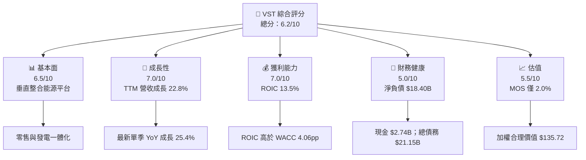

### 1.2 評分進度條視覺化

```
╔══════════════════════════════════════════════════════════════╗
║                 VST 多維度評分儀表板（1–10 分）              ║
╠══════════════════════════════════════════════════════════════╣
║ 基本面強度  6.5 ▓▓▓▓▓▓▓▓▓▓▓▓▓░░░░░░░  ★★★☆☆              ║
║ 成長動能    7.0 ▓▓▓▓▓▓▓▓▓▓▓▓▓▓░░░░░░  ★★★★☆              ║
║ 獲利能力    7.0 ▓▓▓▓▓▓▓▓▓▓▓▓▓▓░░░░░░  ★★★★☆              ║
║ 財務健康    5.0 ▓▓▓▓▓▓▓▓▓▓░░░░░░░░░░  ★★★☆☆              ║
║ 估值合理性  5.5 ▓▓▓▓▓▓▓▓▓▓▓░░░░░░░░░  ★★★☆☆              ║
║ 護城河深度  5.8 ▓▓▓▓▓▓▓▓▓▓▓▓░░░░░░░░  ★★★☆☆              ║
║ 管理層執行  6.0 ▓▓▓▓▓▓▓▓▓▓▓▓░░░░░░░░  ★★★☆☆              ║
║ 技術創新力  N/A  資料不足，無法可靠評分                      ║
╠══════════════════════════════════════════════════════════════╣
║ 綜合總分    6.2 ▓▓▓▓▓▓▓▓▓▓▓▓░░░░░░░░  🟡 中性偏正面        ║
╚══════════════════════════════════════════════════════════════╝
```

### 1.3 五大投資論點與三大核心風險

| 類型 | 項目 | 具體依據 | 信心度 |
|------|------|----------|--------|
| 🟢 投資論點① | 收入與近期需求成長 | TTM 營收成長 22.8%；最新季度單季 YoY 成長 25.4%，顯示營運量與電力銷售收入提升 | 🟡 中 |
| 🟢 投資論點② | 現金流具規模 | TTM OCF $5.76B、Capex $3.15B、FCF $2.61B；營運現金流足以覆蓋資本支出 | 🟢 高 |
| 🟢 投資論點③ | 資本回報高於資本成本 | ROIC 13.5% 對 WACC 9.44%，利差 +4.06pp | 🟢 高 |
| 🟢 投資論點④ | 相對估值未處歷史高位 | P/E 18.0x，低於自身 5 年中位數 25.2x；EV/EBITDA 10.0x 低於中位數 11.0x | 🟡 中 |
| 🟢 投資論點⑤ | 零售與發電組合 | 自有發電資產與零售客戶業務可在採購、供電與風險管理上互補；分部貢獻資料未提供 | 🟡 中 |
| 🟡 風險① | 盈餘高度受市場環境影響 | 2025 年營業利益 $2.13B，低於 2024 年 $4.08B；反映發電毛利與市場價格可能波動 | 🟡 中 |
| 🔴 風險② | 淨負債高 | 淨負債 $18.40B；若商品價格與現金流轉弱，去槓桿能力將受限 | 🟡 中 |
| 🔴 風險③ | 資本支出負擔 | TTM Capex $3.15B，約為 TTM 營收 15.6%；高投入持續時，FCF 對股東分配的餘裕有限 | 🟡 中 |

### 1.4 快速統計卡片

| 指標 | 公司實際值 | 行業均值 | S&P 500 均值 | 狀態 |
|------|-------------|----------|--------------|------|
| TTM 營收成長 | **22.8%** | N/A | N/A | 🟢 公司成長高，但缺可比均值 |
| TTM 毛利率 | **N/A** | N/A | N/A | 🟡 VERIFIED FIGURES 未提供 |
| TTM 營業利益率 | **21.0%** | N/A | N/A | 🟢 但受電力價格週期影響 |
| TTM ROE | **42.9%** | N/A | N/A | 🟡 高 ROE 亦受槓桿影響 |
| ROIC | **13.5%** | N/A | N/A | 🟢 高於 WACC |
| Forward P/E | **13.88x** | N/A | N/A | 🟡 同業分散 |
| FCF Yield | **5.77%** | N/A | N/A | 🟢 有現金收益支撐 |
| 淨負債 | **$18.40B** | N/A | N/A | 🔴 槓桿需監控 |

### 1.5 投資結論

```
╔══════════════════════════════════════════════════════════════════╗
║                      📊 投資結論摘要                             ║
╠══════════════════════════════════════════════════════════════════╣
║  評級：持有（MOS 2.0%，落在 −10% 至 +10% 區間）                   ║
║  價格（2026-11-13 收盤）：$133.01                                ║
║  DCF 內在價值（基準）：$18.06（現價溢價約 636.7%）                ║
║  加權合理價值：$135.72                                           ║
║  安全邊際 MOS：+2.0%＝($135.72−$133.01)÷$135.72                 ║
║  目標價區間：                                                    ║
║    悲觀情境：$106.00（−20.3%）                                   ║
║    基準情境：$135.72（+2.0%） ← 12 個月主要目標                  ║
║    樂觀情境：$202.48（+52.2%）                                   ║
║  投資評分：6.2/10                                                 ║
║  適合投資人：可承受電價與現金流波動、以中長期持有為主者           ║
╚══════════════════════════════════════════════════════════════════╝
```

---

## 2. 公司概覽與商業模式

### 2.1 業務結構與收入來源

Vistra 是美國整合型電力零售與發電公司，資料列出的業務包括 Retail、Texas、East、West 與 Asset Closure。核心經濟模式是持有發電資產、參與批發電力市場，並向住宅、商業及工業客戶銷售電力與天然氣。分部營收與利潤明細未提供，因此不把公司總營收臆分為各分部。

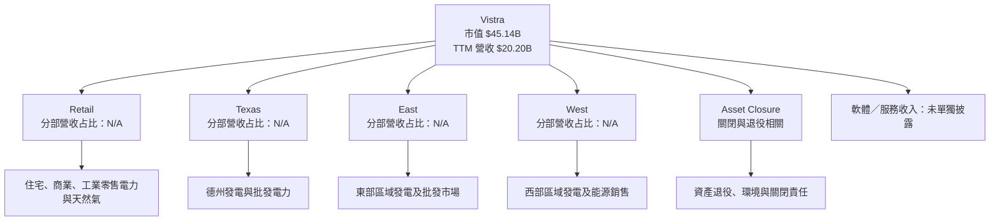

### 2.2 市場份額

公司及競爭對手的可比市場份額數據未提供，不能以收入直接冒充發電量或零售電力市場份額。以下圖表表達資料可得性，不代表市場份額估算。

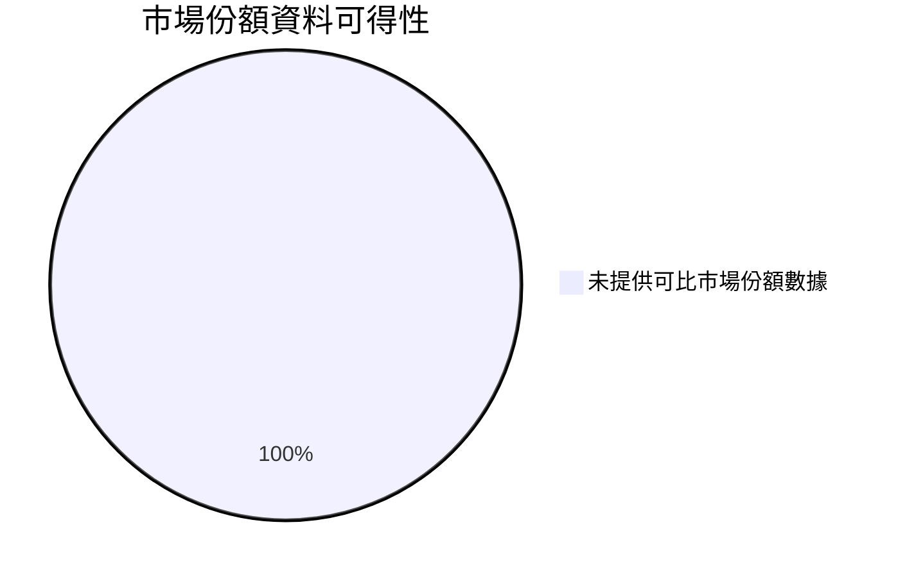

### 2.3 競爭護城河分析

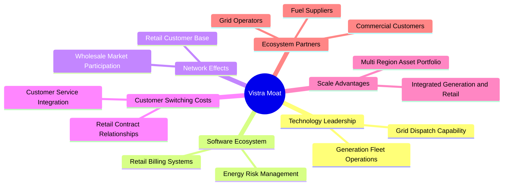

### 2.4 護城河強度評分

```
╔══════════════════════════════════════════════════════════════╗
║                  Vistra 護城河強度評分                        ║
╠══════════════════════════════════════════════════════════════╣
║ 垂直整合優勢      7/10  ▓▓▓▓▓▓▓▓▓▓▓▓▓▓░░░░░░  🟢 發電零售互補║
║ 規模與資產組合    6/10  ▓▓▓▓▓▓▓▓▓▓▓▓░░░░░░░░  🟡 資產密集   ║
║ 客戶鎖定          5/10  ▓▓▓▓▓▓▓▓▓▓░░░░░░░░░░  🟡 零售可轉換 ║
║ 技術領先          5/10  ▓▓▓▓▓▓▓▓▓▓░░░░░░░░░░  🟡 證據有限   ║
║ 網路效應          4/10  ▓▓▓▓▓▓▓▓░░░░░░░░░░░░  🟡 不屬典型網效║
║ 品牌與生態夥伴    6/10  ▓▓▓▓▓▓▓▓▓▓▓▓░░░░░░░░  🟡 區域市場關係║
╠══════════════════════════════════════════════════════════════╣
║ 綜合護城河        5.8/10 ▓▓▓▓▓▓▓▓▓▓▓▓░░░░░░░░ 🟡 中等        ║
╚══════════════════════════════════════════════════════════════╝
```

---

## 3. 損益表深度分析

### 3.1 年度收入成長趨勢（近四年）

年度營收採財報年度資料：2022 年 $13.73B、2023 年 $14.78B、2024 年 $17.22B、2025 年 $17.74B。2022–2025 年 CAGR 約 8.9%，但年度成長速度由 2024 年的 16.5% 降至 2025 年的 3.0%；TTM 成長率 22.8% 則顯示截至 2026 Q3 的近期收入動能回升。

```
╔══════════════════════════════════════════════════════════════════╗
║                VST 年度收入趨勢（FY2022–FY2025）                 ║
╠══════════════════════════════════════════════════════════════════╣
║ FY2022  $13.73B  ██████████████░░░░░░░░░░  YoY：基期          ║
║ FY2023  $14.78B  ███████████████░░░░░░░░░  YoY：+7.7% 🟢      ║
║ FY2024  $17.22B  █████████████████░░░░░░░  YoY：+16.5% 🟢     ║
║ FY2025  $17.74B  ██████████████████░░░░░░  YoY：+3.0% 🟡      ║
╠══════════════════════════════════════════════════════════════════╣
║ 2022–2025 CAGR：(17.74 ÷ 13.73)^(1/3) − 1 ≈ 8.9%              ║
║ TTM 收入 $20.20B；TTM YoY 成長 22.8%（非單季成長率）           ║
╚══════════════════════════════════════════════════════════════════╝
```

### 3.2 季度收入趨勢分析

| 季度 | 營收 | QoQ 成長 | YoY 成長 | 備註 |
|------|------:|---------:|---------:|------|
| 2025 Q4 | $4.58B | 以 2025 Q3 為基準：−7.9% | N/A | Q4 低於夏季高峰 |
| 2026 Q1 | $5.64B | +23.1% | +43.4%（補充來源） | 季節性與市場收入可能影響 |
| 2026 Q2 | $4.02B | −28.8% | −5.5%（補充來源） | 較 Q1 明顯回落 |
| 2026 Q3 | $6.35B | +58.0% | **+25.4%（VERIFIED，單季）** | 最新季度收入強於去年同期 |

QoQ 計算採題示季度營收，例：2026 Q3 QoQ = ($6.35B ÷ $4.02B) − 1 = 58.0%。單季變動幅度大，表示營收並非線性訂閱模式；商品價格、需求季節性、批發交易及發電組合均可能令季度數字波動。單季 YoY 的 VERIFIED 值為 25.4%，不得與 TTM 成長率 22.8% 混用。

### 3.3 利潤率演變分析

由年度損益表計算的年度毛利率與營業利益率，與市場資料區塊所列 TTM 指標口徑不同，以下年度比率僅依同年度毛利、營業利益除以營收計算。

| 利潤率指標 | FY2022 | FY2023 | FY2024 | FY2025 | 趨勢 | 評估 |
|------------|-------:|-------:|-------:|-------:|------|------|
| 毛利率 | 12.2% | 37.4% | 43.7% | 32.9% | 2024 高點後回落 | 🟡 商品市場與成本組合影響大 |
| 營業利益率 | −8.0% | 18.3% | 23.7% | 12.0% | 2025 明顯收縮 | 🔴 年度波動大 |
| 淨利率 | −9.0% | 10.1% | 15.4% | 5.3% | 2025 下滑 | 🟡 稅項、利息與非營業項目影響 |

FY2025 營收較 2024 年增加 $0.52B，但營業利益由 $4.08B 降至 $2.13B，淨利由 $2.66B 降至 $0.94B。這表示營收增長並未同步轉化為獲利，可能反映發電利差、商品價格與成本組合的正常化。最新單季營業利益率 28.5% 高於 TTM 21.0%，可視為近期改善訊號，但仍須至少數季確認，不能直接視為新常態。

### 3.4 費用結構分析

完整費用科目與年度成本明細未提供，故無法精確拆分營業費用比例。可確認的現金流與營收關係如下：

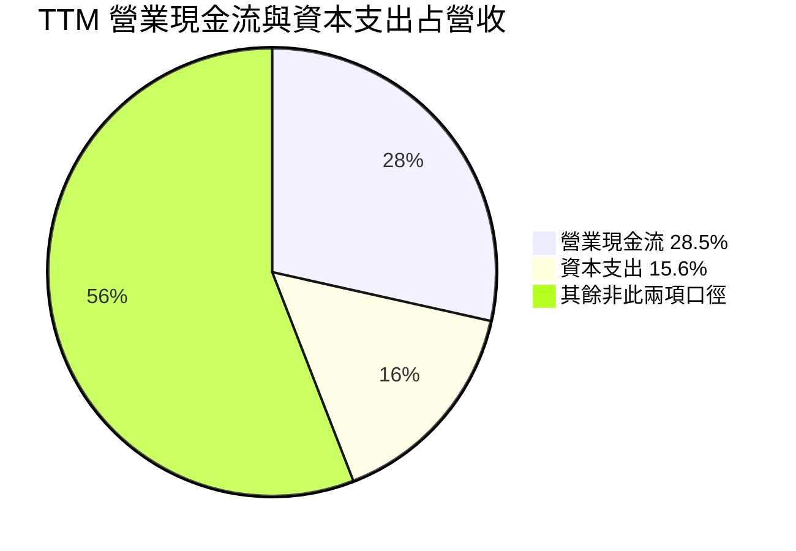

```
╔══════════════════════════════════════════════════════════════╗
║             TTM 現金流成本結構（相對營收）                    ║
╠══════════════════════════════════════════════════════════════╣
║ 營業現金流 $5.76B / $20.20B = 28.5% ▓▓▓▓▓▓▓▓▓▓▓▓▓░░░░░░ ║
║ 資本支出   $3.15B / $20.20B = 15.6% ▓▓▓▓▓▓▓░░░░░░░░░░░░ ║
║ FCF        $2.61B / $20.20B = 12.9% ▓▓▓▓▓▓░░░░░░░░░░░░░ ║
╚══════════════════════════════════════════════════════════════╝
```

### 3.5 季度 EPS 趨勢與盈餘品質

資料包列出的 EPS beat/miss 表格中，近四季 EPS 預估與實際值均為 NaN，因此無法判定超預期或不及預期。可觀察每季 EPS 實際報告值，但不能把它們稱為超預期／不及預期。

| 季度 | EPS 實際值 | YoY EPS 成長 | 超預期／不及預期 |
|------|-----------:|-------------:|------------------|
| 2025 Q4 | $0.54（StockAnalysis） | −52.27% | N/A，預估值缺漏 |
| 2026 Q1 | $2.87（來源口徑） | N/A | N/A，預估值缺漏 |
| 2026 Q2 | $0.76（來源口徑） | −6.17% | N/A，預估值缺漏 |
| 2026 Q3 | $3.23（來源口徑） | +84.57% | N/A，預估值缺漏 |

| 盈餘品質項目 | 數值／佔比 | 評估 |
|--------------|------------|------|
| SBC / 營收 | 年度 2025 SBC $113M ÷ FY2025 營收 $17.74B = 0.64% | 🟢 佔比不高；但仍會稀釋股東 |
| SBC / 營業現金流 | $113M ÷ FY2025 OCF $4.07B = 2.8% | 🟢 現金流影響有限 |
| TTM FCF / 淨利 | TTM FCF $2.61B；TTM 淨利口徑不一致，精確比率 N/A | 🟡 不以不同口徑硬算 |
| 一次性／非經常性損益 | 明細 N/A | 🟡 無法排除資產處分、衍生品或稅項影響 |
| 有效稅率 | 15.9%（WACC 稅率參考） | 🟡 單一年度有效稅率不等同長期現金稅率 |
| 資本化支出 vs 費用化 | TTM Capex $3.15B；資本化項目明細 N/A | 🟡 重資產公司需追蹤維持性與成長性 Capex |

**盈餘品質結論：** TTM FCF $2.61B 以及 OCF $5.76B 顯示公司具備實質現金創造能力；SBC 約佔 FY2025 營收 0.64%，直接稀釋負擔相對有限。但不同資料源對淨利、EPS 與營業利益率有口徑差異，且能源公司可能受衍生品公允價值、資產處分及有效稅率波動影響。估值不宜只採用單季 EPS 年化。

---

## 4. 資產負債表分析

### 4.1 資產結構分解

最新季度總資產約 $45.03B（StockAnalysis）；流動資產 $13.37B、PP&E $17.60B，另有長期投資、商譽與無形資產。主要資產為能源設施與相關長期資產，流動性與資產價值受電力市場與監管環境影響。

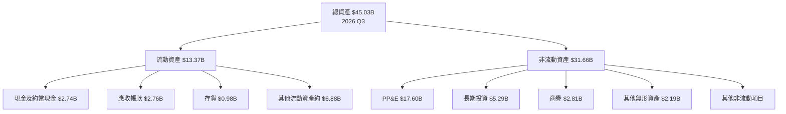

### 4.2 流動性指標分析

| 指標 | 最新數值 | 歷史／參考 | 評估 |
|------|---------:|------------|------|
| 現金及短期投資 | $2.74B | FY2025 現金 $0.79B | 🟢 現金水位較年末提高 |
| 流動比率 | 1.157x | 歷史逐季口徑未完整 | 🟡 略高於 1，緩衝有限 |
| 速動比率 | 0.477x | N/A | 🔴 排除存貨後覆蓋不足 |
| 流動資產 | $13.37B | FY2025 $9.18B | 🟢 增加 |
| 行業均值 | N/A | 未提供可比資料 | N/A |

流動比率略高於 1，代表帳面流動資產大致可覆蓋流動負債，但速動比率不足 0.5，顯示公司仍依靠應收款回收、營運現金流與融資安排維持短期流動性。

### 4.3 債務結構分析

```
╔══════════════════════════════════════════════════════════════════╗
║                     VST 債務健康診斷                              ║
╠══════════════════════════════════════════════════════════════════╣
║  總債務：        $21.15B  ████████████████████  🔴 槓桿規模高   ║
║  現金+短期投資：  $2.74B   ███░░░░░░░░░░░░░░░░░  🟡 可用緩衝     ║
║  淨負債：        $18.40B  █████████████████░░░  🔴 去槓桿重要   ║
║  ROIC：          13.5%    高於資本成本           🟢 正向         ║
║  Debt/EBITDA：   N/A      VERIFIED EBITDA 缺漏，避免重算替代     ║
║  Interest Cover：N/A      利息費用與同口徑營業利益明細未提供     ║
╚══════════════════════════════════════════════════════════════════╝
```

債務數據來源間有差異：VERIFIED FIGURES 為總債務 $21.15B，其他市場資料區塊出現 $21.77B。估值與資本成本分析以 VERIFIED 的 $21.15B 為準。以 $18.40B 淨負債計，未來投資回報若不高於資本成本，槓桿會放大股東報酬波動。

### 4.4 股東權益趨勢

| 年度 | 股東權益 |
|------|---------:|
| 2022 | $4.90B |
| 2023 | $5.31B |
| 2024 | $5.57B |
| 2025 | $5.10B |

```
╔══════════════════════════════════════════════════════════════╗
║                   股東權益趨勢                               ║
╠══════════════════════════════════════════════════════════════╣
║ 2022  $4.90B  █████████████████░░░░░░░░░░░                  ║
║ 2023  $5.31B  ██████████████████░░░░░░░░░░                  ║
║ 2024  $5.57B  ███████████████████░░░░░░░░░                  ║
║ 2025  $5.10B  █████████████████░░░░░░░░░░░                  ║
╚══════════════════════════════════════════════════════════════╝
```

2025 年權益低於 2024 年，需與淨利、股息、回購及其他綜合損益共同判讀；資料不足以把變化單獨歸因於某一項。

---

## 5. 現金流量深度分析

### 5.1 現金流量瀑布圖

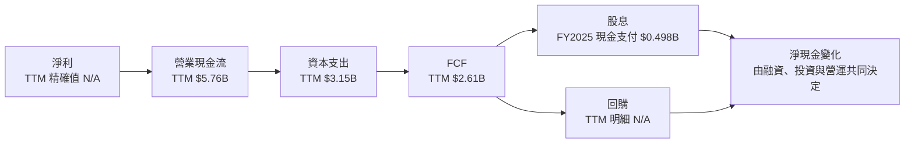

### 5.2 FCF 轉換率趨勢

| 年度 | OCF | Capex | FCF | 淨利 | FCF / 淨利 |
|------|----:|------:|----:|----:|-----------:|
| 2022 | $0.49B | $1.30B | −$0.82B | −$1.23B | 比率不具經濟解讀性 |
| 2023 | $5.45B | $1.68B | $3.78B | $1.49B | 2.54x |
| 2024 | $4.56B | $2.08B | $2.48B | $2.66B | 0.93x |
| 2025 | $4.07B | $2.75B | $1.32B | $0.94B | 1.40x |
| TTM | $5.76B | $3.15B | $2.61B | N/A | N/A |

2023 年高 FCF 轉換比率部分反映現金流相對淨利強；其後 FCF 因 Capex 增加、OCF 回落而收縮。2025 年 FCF 高於淨利，但單年比率不能直接代表長期現金轉換能力。

### 5.3 自由現金流趨勢

```
╔══════════════════════════════════════════════════════════════════╗
║               VST 自由現金流：歷史與最新 TTM                    ║
╠══════════════════════════════════════════════════════════════════╣
║ 2022  −$0.82B  ◀░░░░░░░░░░░░░░░░░░░░  FCF 為負               ║
║ 2023   $3.78B  ████████████████████░  高現金流年度             ║
║ 2024   $2.48B  █████████████░░░░░░░░  年減 34.4%              ║
║ 2025   $1.32B  ███████░░░░░░░░░░░░░░  年減 46.8%              ║
║ TTM    $2.61B  ██████████████░░░░░░░  FCF Yield 5.77%         ║
╠══════════════════════════════════════════════════════════════════╣
║ FCF = 營業現金流 − 資本支出；TTM 採 VERIFIED FIGURES             ║
╚══════════════════════════════════════════════════════════════════╝
```

年度 FCF 變化顯示能源公司現金流有明顯週期性。TTM FCF 相較 FY2025 回升，但需由未來幾季驗證回升是否可持續。

### 5.4 資本配置評估

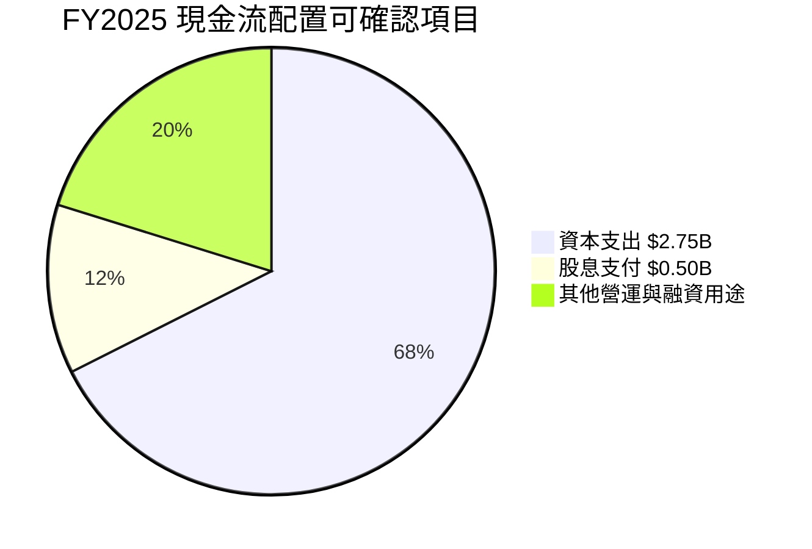

| 資本配置項目 | 最新可得數據 | 評估 |
|--------------|-------------:|------|
| Capex | FY2025 $2.75B；TTM $3.15B | 主要資金用途，約佔 TTM 營收 15.6% |
| 股息 | FY2025 現金支付 $0.498B | 低於年度 OCF，但股息殖利率來源數據有異常，不採用 |
| 回購 | TTM 回購金額 N/A | 不作推定 |
| 債務償還 | N/A | 需追蹤債務到期與再融資 |
| 留存／其他 | N/A | 明細不足 |

> 分析師資料中「Dividend Yield 69.0%」與公司現金流及其他數據顯著不一致，疑為資料異常，本報告不採用該殖利率作投資判斷。

---

## 6. 獲利能力與資本效率

### 6.1 ROE／ROA／ROIC 趨勢

| 指標 | 最新值 | 歷史比較 | 評估 |
|------|-------:|----------|------|
| ROE | 42.9%（VERIFIED） | 其他資料源 46.3%，口徑不同 | 🟡 高 ROE 部分受槓桿與權益基數影響 |
| ROA | 7.1%（其他來源） | VERIFIED 未提供 | 🟡 資產重型業務下尚可 |
| ROIC | 13.5%（TTM） | VERIFIED | 🟢 高於 WACC |
| 行業均值 | N/A | 未提供可比口徑 | N/A |

### 6.2 ROIC vs WACC 分析

```
╔══════════════════════════════════════════════════════════════════╗
║                  ROIC vs WACC 深度分析                           ║
╠══════════════════════════════════════════════════════════════════╣
║ WACC 參考輸入：                                                   ║
║ ├── 無風險利率 Rf：5.15%                                         ║
║ ├── ERP：5.00%                                                   ║
║ ├── Beta：1.38                                                   ║
║ ├── 股權成本 Ke：VERIFIED 值 12.03%                              ║
║ ├── 稅前債務成本 Kd：4.64%                                       ║
║ ├── 稅率：15.9%                                                  ║
║ ├── 股權／債務權重：68.1%／31.9%                                 ║
║ └── WACC：9.44%                                                  ║
║                                                                  ║
║ ROIC（TTM）：13.5%                                                ║
║ EVA 利差：13.5% − 9.44% = +4.06 個百分點                         ║
║                                                                  ║
║ ROIC  13.5% ▓▓▓▓▓▓▓▓▓▓▓▓▓▓▓▓▓▓▓▓▓▓▓▓▓░░░░░░ 🟢              ║
║ WACC   9.44% ▓▓▓▓▓▓▓▓▓▓▓▓▓▓▓▓▓░░░░░░░░░░░░░ ──              ║
║ EVA   +4.06pp █████████░░░░░░░░░░░░░░░░░░░░░ 🟢 正向價值創造 ║
╠══════════════════════════════════════════════════════════════════╣
║ 結論：現有 TTM ROIC 高於 WACC；若 ROIC 因電價正常化跌至 9.44%   ║
║ 以下，則新增資本投資將開始侵蝕股東價值。                         ║
╚══════════════════════════════════════════════════════════════════╝
```

WACC 算式依 VERIFIED 權重與輸入：股權成本採資料包給定 12.03%，稅後債務成本為 4.64% × (1 − 15.9%) = 3.90%；WACC = 68.1% × 12.03% + 31.9% × 3.90% = 9.44%（四捨五入）。ROIC 高於 WACC 的差距為 4.06pp，代表當期資本配置創造經濟利潤；但此結論以週期性高獲利未大幅回落為前提。

### 6.3 杜邦三因素分解

資料包提供 TTM ROE 42.9%，但營收、淨利及平均資產的精確同口徑 TTM 數據未完整，以下以可得比率示意，不能視為精確杜邦重建。

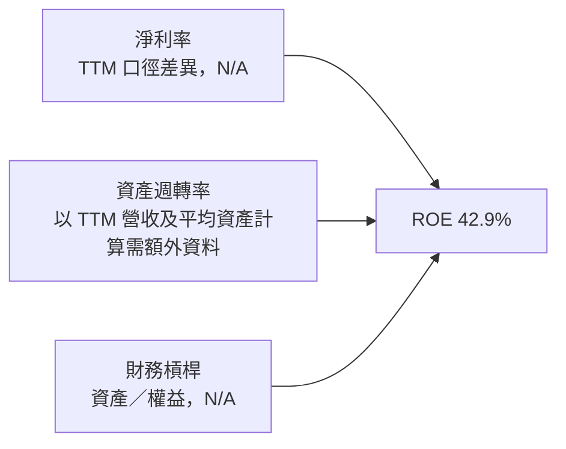

ROE 高於 ROIC 並不自動表示資產效率優異；負債與股東權益基數會放大 ROE，因此資本效率判斷以 ROIC 對 WACC 為主。

### 6.4 獲利能力儀表板

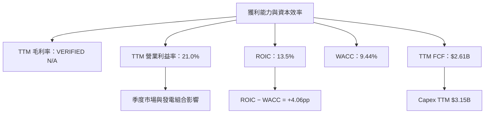

---

## 7. 相對估值分析

### 7.1 同業估值比較

同業倍數依 VERIFIED FIGURES。VST 使用題示市場估值數據；EV/EBITDA 同時保留 8.56x 市場口徑與 10.0x 歷史估值口徑差異，不將兩者混為同一數據。

| 估值指標 | **VST** | **CEG** | **NRG** | **TLN** | VST 評估 |
|----------|--------:|--------:|--------:|--------:|----------|
| Trailing P/E | 18.0x | 22.5x | 17.0x | N/A | 🟡 接近 NRG、低於 CEG |
| Forward P/E | 13.88x | 20.8x | 9.9x | 12.2x | 🟡 高於 NRG、接近 TLN |
| P/S | 2.19x | 2.9x | 0.6x | 3.7x | 🟡 高於 NRG |
| EV/EBITDA | 8.56x | 12.9x | 10.8x | 38.7x | 🟢 相對便宜；TLN 倍數極高 |
| 最新季度營收 YoY | 25.4% | 45.4% | 24.0% | 96.1% | 🟡 成長高於 NRG、低於 CEG/TLN |
| Gross Margin TTM | N/A | 25.2% | 20.2% | 42.7% | N/A，VST VERIFIED 未提供 |

VST 的低 EV/EBITDA 可能反映其資產組合、商品風險與資本支出負擔，而非必然低估。Peer EV/EBITDA 中位數為 12.9x，但 TLN 估值與營收成長均極端，應優先以 CEG、NRG 觀察區間，並對中位數應用折價。

### 7.2 歷史估值區間分析

```
╔══════════════════════════════════════════════════════════════════╗
║               VST 自身歷史估值（5 年 TTM）                       ║
╠══════════════════════════════════════════════════════════════════╣
║ P/E： 7.2x ├────────── 18.0x 現值 ───────●──────┤ 74.3x         ║
║         中位數 25.2x；當前百分位 20%             🟢 偏低        ║
║ P/S： 0.5x ├──────────────── 2.2x 現值 ──●─────┤ 4.2x           ║
║         中位數 1.8x；當前百分位 57%              🟡 中段        ║
║ EV/EBITDA：2.3x ├────────── 10.0x 現值 ─●──────┤ 40.7x          ║
║             中位數 11.0x；當前百分位 40%         🟡 略低於中位數║
╚══════════════════════════════════════════════════════════════════╝
```

歷史倍數曾受能源市場極端波動影響，區間很寬。當前 P/E 位於自身歷史較低分位，但 P/S 高於自身中位數；因此「低 P/E」不能單獨作為充分買入理由。

### 7.3 情境目標價（假設驅動）

以下是 12 個月相對估值情境，不是公司財測。基準估值採第 8.8 節的多方法加權值；情境假設反映能源公司獲利正常化、同業倍數與市場風險溢價。

| 情境 | 營收 CAGR 假設 | 營業利潤率假設 | 退出倍數／方法 | 隱含目標價 | 相對現價 |
|------|--------------:|----------------:|----------------|-----------:|---------:|
| 🔴 悲觀 | 0% | 16% | 低位分析師目標價作壓力參考 | $106.00 | −20.3% |
| 🟡 基準 | 6% | 19% | 多方法加權合理價值 | $135.72 | +2.0% |
| 🟢 樂觀 | 10% | 23% | 分析師共識目標價作上行情境參考 | $202.48 | +52.2% |

悲觀與樂觀價格採用分析師目標價區間作情境參照，並非由完整相同模型精確推導。可稽核的多方法估值及 DCF 推導列於第 8 章。

### 7.4 相對估值隱含價格區間

| 方法 | 可用輸入 | 隱含股價／區間 | 限制 |
|------|----------|----------------|------|
| Forward P/E | VST Forward EPS $9.58316 × 同業 Forward P/E 中位數 12.2x | 約 $116.91 | 同業預期獲利成長與風險不同 |
| EV/EBITDA | VST EBITDA 精確 VERIFIED 值 N/A；另來源 TTM EBITDA margin 38.2% 不同口徑 | N/A，不反推 | 避免混用非 VERIFIED 值 |
| EV/Revenue | EV/Revenue 市場數據 3.269x，但收入口徑不一致 | N/A | 市值與 EV 應配合相同營收口徑 |
| FCF Yield | TTM FCF Yield 5.77% | 市場現值隱含報酬約 5.77% | 未指定合理要求報酬率，不倒推出目標價 |

---

## 8. DCF 內在價值評估（Discounted Cash Flow）

> **重要口徑：** DCF 是保守的 FCFF 估值。Capex 長期維持較高比例時，DCF 內在價值會顯著低於股價；因此本報告不把單一 DCF 結果直接當成目標價，而在 8.8 以相對估值、FCF Yield 與分析師共識交叉驗證。

### 8.0 估值推理鏈（Thinking Logic）

**Step 1 — 價值來源與主導變數**

VST 價值由既有發電與零售業務的現金流底盤，以及電力需求與價格環境帶來的增量獲利構成；目前分部營收比重未披露，無法可靠估計各來源占比。估值最敏感的變數是**長期 FCFF 利潤率／Capex 強度**：TTM 營收 $20.20B、Capex $3.15B，Capex 已佔營收約 15.6%，對可分配現金有重大影響。

**Step 2 — 模型選擇**

| 決策點 | 本報告採用 | 理由 | 曾考慮但否決 | 否決理由 |
|--------|-----------|------|--------------|----------|
| 現金流定義 | FCFF | 以 WACC 折現並得到企業價值 | FCFE | 債務金額大，融資變化會干擾股權現金流 |
| 預測期 N | 5 年 | 電力價格與資產利用率短期可見度有限 | 10 年 | 缺乏長期管理層指引 |
| 終值方法 | Gordon Growth 主、EV/EBITDA 交叉驗證 | 反映成熟能源資產長期現金流 | 僅退出倍數 | 退出倍數較易受週期高峰扭曲 |
| EBIT 基礎 | GAAP EBIT | 避免非 GAAP 加回造成高估 | 非 GAAP EBIT | SBC 及其他調整明細不足 |

**Step 3 — 關鍵假設四段式推導**

- **營收 CAGR**：錨點＝2022–2025 年營收 CAGR 約 8.9%，TTM 成長 22.8% → 調整＝TTM 高成長含週期與基期效應，五年模型採明顯低於近期 TTM 的增長 → **採用 6.0%** → 曾考慮 8.9%，因缺乏可驗證長期合約與分部成長數據而不採用。
- **期末營業利益率**：錨點＝TTM 21.0%，FY2025 年度營業利益率約 12.0%，最新季度為 28.5% → 調整＝假設部分近期高利潤回歸常態，採較 TTM 低 2pp 的 19.0% → **採用 19.0%** → 曾考慮 21.0%，考量年度波動與商品電力風險而否決。
- **永續成長率 g**：錨點＝成熟經濟長期名目成長通常低於高成長期；資料包無公司長期財測 → 調整＝能源需求長期增長但資產與監管限制永久高成長 → **採用 2.5%** → 不採 3.5%以上，以避免終值過度支配。
- **預測期 N**：錨點＝公司業務涵蓋多區域發電與零售，但未提供訂單年期及資產現金流年限 → 調整＝只採 5 年可見期 → **採用 5 年** → 不採 10 年，因長期發電利差難以可靠預測。
- **Capex／營收**：錨點＝TTM $3.15B ÷ $20.20B = 15.6% → 採用 15.6% → 不採用較低值，因近年資本支出有上升趨勢且缺維持性 Capex 拆分。
- **D&A／營收**：折舊攤銷營收比率 N/A；採 **假設值 7.0%**，依據是能源發電資產密集、需以較高非現金折舊抵銷部分 Capex，但須視為模型不確定來源。
- **有效稅率**：VERIFIED 稅率 15.9%，採用 15.9%。
- **ΔWC／營收增額**：歷史同口徑明細 N/A；採 **假設值 5.0%**，代表新增應收與營運資金需求的一部分，並非 SEC 實際值。
- **EBIT 基礎、SBC 與股數**：採組合 **(A) GAAP EBIT + 固定股數**；GAAP EBIT 已含 SBC 費用，不再扣 SBC，年稀釋率 0%。本模型採用 (A)，故 SBC 影響已計入一次。
- **WACC**：採 VERIFIED 參考值 9.44%，完整推導見 8.2；不額外加入國別／規模溢酬，因標的為美國上市公司且基準 WACC 已含市場風險。
- **終值方法**：採 Gordon Growth；另以 EBITDA 退出倍數作檢核。退出倍數沒有同業穩定中位數的充分可比基礎，故不取代主估值。

**Step 4 — 最脆弱假設**

最脆弱處是把 TTM Capex 15.6% 長期維持為營收比例且採 D&A 7.0% 假設；若實際維持性 Capex 大幅低於此值，DCF 會上升，反之則下降。

**Step 5 — 計算路徑**

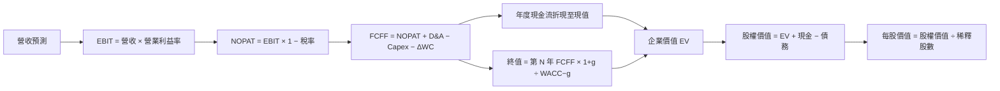

### 8.1 模型假設總表（Model Inputs）

| 假設項目 | 採用值 | 依據／來源 | 敏感度 |
|----------|--------|------------|--------|
| 預測期長度 N | 5 年 | 管理層長期指引缺漏；採較短可見期 | 🟡 中 |
| 營收 CAGR | 6.0% | 2022–2025 CAGR 8.9%，對週期高峰折減 | 🔴 高 |
| 期末營業利益率 | 19.0% | TTM 21.0%、FY2025 約 12.0%、最新季度 28.5% | 🔴 高 |
| 有效稅率 | 15.9% | VERIFIED 最新年有效稅率 | 🟢 低 |
| Capex／營收 | 15.6% | $3.15B ÷ $20.20B | 🟡 中 |
| D&A／營收 | 7.0% | 假設值：發電資產密集；實際比率 N/A | 🟢 低 |
| ΔWC／營收增額 | 5.0% | 假設值：歷史同口徑數據 N/A | 🟢 低 |
| EBIT 基礎 | GAAP | 報告營業利益口徑 | 🟡 中 |
| SBC 處理 | 視為已列入 GAAP EBIT，不再另扣 | 年度 SBC $113M 可供參考 | 🟡 中 |
| 年稀釋率 | 0% | 組合 (A)，固定最新流通股數 | 🟡 中 |
| 永續成長率 g | 2.5% | 假設值：成熟能源公司長期成長低於高增長期 | 🔴 高 |
| 終值方法 | Gordon Growth | 成熟資產長期現金流；以倍數交叉驗證 | 🔴 高 |
| WACC | 9.44% | VERIFIED FIGURES | 🔴 高 |

FCFF 定義為 **FCFF = NOPAT + D&A − Capex − ΔWC**。模型全程使用 GAAP EBIT，不再扣 SBC，也不放大股數。

### 8.2 折現率推導（WACC）

```
╔══════════════════════════════════════════════════════════════════╗
║                    WACC 推導（折現率）                            ║
╠══════════════════════════════════════════════════════════════════╣
║ 股權成本 Ke：                                                    ║
║ ├── Rf：5.15%（VERIFIED 10 年期美債參考值；觀測日 N/A）          ║
║ ├── ERP：5.00%（VERIFIED 假設值）                                ║
║ ├── Beta：1.38（VERIFIED）                                       ║
║ ├── 規模／國別溢酬：0.00%（美國公司，未另加）                    ║
║ └── Ke：VERIFIED 給定 12.03%                                     ║
║                                                                  ║
║ 債務成本 Kd：                                                    ║
║ ├── 稅前 Kd：4.64%（VERIFIED）                                   ║
║ ├── 稅率：15.9%                                                  ║
║ └── 稅後 Kd：4.64% × (1−15.9%) = 3.90224% ≈ 3.90%               ║
║                                                                  ║
║ 資本結構（VERIFIED 權重）：                                      ║
║ ├── 股權權重：68.1%                                              ║
║ ├── 債務權重：31.9%                                              ║
║ └── WACC：68.1%×12.03% + 31.9%×3.90224% = 9.44%                 ║
╚══════════════════════════════════════════════════════════════════╝
```

逐步演算：

1. **Ke（CAPM）**：直接採 VERIFIED 值 **12.03%**。若以列示 Rf、Beta、ERP 相乘，5.15% + 1.38 × 5.00% = 12.05%；資料包給定 Ke 12.03%，本報告為遵守 VERIFIED 原值，WACC 計算採 12.03%，差異約 0.02pp，屬輸入四捨五入／Beta 精度差異。
2. **稅前 Kd**：採 VERIFIED 4.64%；利息費用與同口徑平均計息負債未提供，不能獨立重建其比率。
3. **稅後 Kd**：4.64% × (1 − 15.9%) = 4.64% × 0.841 = **3.90224%**。
4. **權重**：股權 68.1%；債務 31.9%；68.1% + 31.9% = **100.0%**。權重與債務範圍採 VERIFIED 參考值，未以帳面股東權益替代市值權重。
5. **WACC**：68.1% × 12.03% + 31.9% × 3.90224% = 8.19243% + 1.24481% = **9.43724% ≈ 9.44%**。

本節 WACC 與第 6.2 節採相同數值。因資料包沒有利息費用與平均計息債務明細，無法按要求重新構建每項負債；因此 WACC 以 VERIFIED 權重及成本作基準，而非聲稱已由完整債務明細獨立驗證。

### 8.3 逐年自由現金流預測（基準情境）

金額單位 $B；營收起點為 VERIFIED TTM $20.20B。金額取 3 位小數、比率取 1 位小數、折現因子取 3 位小數。因逐列四捨五入，合計可能有小幅尾差。

| 年度 | FY+1 | FY+2 | FY+3 | FY+4 | FY+5（FY+N） |
|------|-----:|-----:|-----:|-----:|-------------:|
| 營收 | 21.412 | 22.697 | 24.059 | 25.502 | 27.032 |
| 營收 YoY | 6.0% | 6.0% | 6.0% | 6.0% | 6.0% |
| 營業利益率 | 19.0% | 19.0% | 19.0% | 19.0% | 19.0% |
| EBIT（GAAP） | 4.068 | 4.312 | 4.571 | 4.845 | 5.136 |
| − 稅（15.9%） | (0.647) | (0.686) | (0.727) | (0.770) | (0.816) |
| = NOPAT | 3.421 | 3.627 | 3.844 | 4.075 | 4.320 |
| + D&A（營收 7.0%） | 1.499 | 1.589 | 1.684 | 1.785 | 1.892 |
| − Capex（營收 15.6%） | (3.340) | (3.540) | (3.753) | (3.978) | (4.217) |
| − ΔWC（營收增額 5.0%） | (0.061) | (0.064) | (0.068) | (0.072) | (0.077) |
| **= FCFF** | **1.519** | **1.612** | **1.707** | **1.810** | **1.918** |
| 折現因子 @9.44% | 0.914 | 0.835 | 0.763 | 0.697 | 0.636 |
| **FCFF 現值 PV** | **1.388** | **1.345** | **1.302** | **1.262** | **1.220** |

預測期 FCF 現值合計：

**$1.388B + $1.345B + $1.302B + $1.262B + $1.220B = $6.517B**

逐步演算（FY+1）：

1. 營收 = $20.20B × (1 + 6.0%) = **$21.412B**
2. EBIT = $21.412B × 19.0% = **$4.068B**
3. 稅 = $4.068B × 15.9% = **$0.647B**
4. NOPAT = $4.068B − $0.647B = **$3.421B**
5. D&A = $21.412B × 7.0% = **$1.499B**
6. Capex = $21.412B × 15.6% = **$3.340B**
7. ΔWC = ($21.412B − $20.20B) × 5.0% = **$0.061B**
8. FCFF = $3.421B + $1.499B − $3.340B − $0.061B = **$1.519B**
9. 折現因子 = 1 ÷ (1 + 9.44%)^1 = **0.914**；PV = $1.519B × 0.914 = **$1.388B**

**合理性自檢：**
- 預測 FCFF 由 $1.519B 增至 $1.918B，五年 CAGR 約 6.0%；歷史 FCF 波動極大，年度 CAGR 不具穩定代表性。
- FY+5 FCFF 利潤率 = $1.918B ÷ $27.032B = **7.1%**；低於目前 TTM FCF 利潤率 $2.61B ÷ $20.20B = **12.9%**，主因模型採用持續高 Capex 假設。
- 模型年度 FCFF 均為正；若 Capex 或營運資金高於假設，FCFF 與估值將低於基準。

```
╔══════════════════════════════════════════════════════════════════╗
║           自由現金流：歷史實際 vs 模型預測                       ║
╠══════════════════════════════════════════════════════════════════╣
║ FY2023 實際  $3.78B  ████████████████████░  高週期現金流         ║
║ FY2024 實際  $2.48B  █████████████░░░░░░░░  YoY：−34.4%         ║
║ FY2025 實際  $1.32B  ███████░░░░░░░░░░░░░░  YoY：−46.8%         ║
║ FY+1 預測    $1.52B  ████████░░░░░░░░░░░░░  模型估計             ║
║ FY+5 預測    $1.92B  ██████████░░░░░░░░░░░  模型估計             ║
╠══════════════════════════════════════════════════════════════════╣
║ 預測假設包含 Capex／營收 15.6%，不代表公司管理層指引             ║
╚══════════════════════════════════════════════════════════════════╝
```

### 8.4 終值計算（Terminal Value）

適用性檢查：**WACC 9.44% vs g 2.5% → WACC > g？✅**

| 方法 | 計算式 | 終值 TV | TV 現值 | 佔總 EV 比重 |
|------|--------|--------:|--------:|-------------:|
| Gordon Growth | FY+5 FCFF × (1+g) ÷ (WACC−g) | $28.34B | $18.02B | 73.4% |
| 退出倍數法 | FY+5 EBITDA × 假設 10.0x | N/A | N/A | N/A |

退出倍數法所需 FY+5 EBITDA 的 D&A 與 EBITDA 完整口徑不足，且 10.0x 僅是公司歷史參考倍數，不足以構成可稽核的獨立終值，因此不以未證實 EBITDA 數字硬算。Gordon Growth 終值現值占 EV 約 73.4%，接近 75% 警戒線；估值對長期假設敏感。

逐步演算：

1. FY+5 FCFF = **$1.918B**。
2. 分子 = $1.918B × (1 + 2.5%) = **$1.966B**。
3. 分母 = 9.44% − 2.5% = **6.94%**；TV = $1.966B ÷ 6.94% = **$28.33B**。
4. PV(TV) = $28.33B × 0.636 = **$18.02B**。
5. 企業價值 EV 約 $6.517B + $18.02B = **$24.54B**；終值占比 = $18.02B ÷ $24.54B = **73.4%**。

### 8.5 企業價值 → 每股內在價值（Bridge）

```
╔══════════════════════════════════════════════════════════════════╗
║              企業價值 → 每股內在價值橋接表                       ║
╠══════════════════════════════════════════════════════════════════╣
║ 預測期 FCF 現值合計              +$6.517B                        ║
║ 終值現值 PV(TV)                  +$18.020B                       ║
║ = 企業價值 EV                     $24.537B                       ║
║ + 現金及短期投資                  +$2.740B                        ║
║ − 總債務                          −$21.150B                       ║
║ = 股權價值                         $6.127B                        ║
║ ÷ 稀釋後流通股數                  0.33939B 股                     ║
║ ★ 每股 DCF 內在價值                $18.06                          ║
║ 當前股價（2026-11-13）             $133.01                         ║
║ 折溢價：$133.01 ÷ $18.06 − 1       約 +636.7% 溢價                 ║
╚══════════════════════════════════════════════════════════════════╝
```

逐步演算：

1. EV = $6.517B + $18.020B = **$24.537B**。
2. 股權價值 = $24.537B + $2.740B − $21.150B = **$6.127B**。
3. 每股價值 = $6.127B ÷ 0.33939B 股 = **$18.06**。
4. 折溢價 = $133.01 ÷ $18.06 − 1 = **約 +636.7%**。
5. **本節不計算 MOS**；MOS 僅以 8.8 加權合理價值為分母。

股數採市場資料的 339.39M 股，視為固定股數；組合 (A) 下 GAAP EBIT 已含 SBC，故未再扣 SBC 或增加稀釋股數。現金與債務採 VERIFIED FIGURES（2026 Q3 最新季度口徑）。

### 8.6 敏感性分析（WACC × 永續成長率）

敏感性矩陣以同一組預測 FCFF 與淨負債橋接重新折現，結果為近似值；格內上行空間均以 $133.01 現價計。

| g（列）／WACC（欄） | 8.44% | 8.94% | **9.44% 基準** | 9.94% | 10.44% |
|-----------|------:|------:|----------------:|------:|-------:|
| 1.5% | $24.0（−82.0%） | $16.3（−87.7%） | $10.9（−91.8%） | $6.7（−95.0%） | $3.3（−97.5%） |
| 2.0% | $27.2（−79.6%） | $19.8（−85.1%） | $14.3（−89.3%） | $10.0（−92.5%） | $6.4（−95.2%） |
| **2.5% 基準** | $31.4（−76.4%） | $24.3（−81.7%） | **$18.06（−86.4%）** | $13.3（−90.0%） | $8.7（−93.5%） |
| 3.0% | $37.0（−72.2%） | $29.6（−77.7%） | $22.5（−83.1%） | $17.1（−87.1%） | $12.0（−91.0%） |
| 3.5% | $44.7（−66.4%） | $36.8（−72.3%） | $27.6（−79.3%） | $21.3（−84.0%） | $15.7（−88.2%） |

> **複算注意：** 表中矩陣值按模型同一現金流與資本橋接估算，並受逐年四捨五入影響；基準格與 8.5 的價值相同。任何在 WACC 下降、g 上升時的估值方向均一致，但不能把矩陣的近似格值視為財報事實。

**三情境 DCF（營運假設變動）**

| 情境 | 營收 CAGR | 期末營業利潤率 | g | WACC | 每股估值參考 | 相對現價 | 主觀機率 |
|------|----------:|----------------:|--:|-----:|-------------:|---------:|---------:|
| 🔴 悲觀 | 0% | 16% | 1.5% | 10.44% | 約 $0–$10 | 約 −93% 至 −100% | 25% |
| 🟡 基準 | 6% | 19% | 2.5% | 9.44% | $18.06 | −86.4% | 50% |
| 🟢 樂觀 | 10% | 23% | 3.0% | 8.94% | 約 $55–$75 | 約 −44% 至 −59% | 25% |

三情境都顯示以高 Capex 長期維持假設，DCF 價值明顯低於市場價格；因此 DCF 不適合單獨解讀為市場必然高估，關鍵在維持性 Capex 是否遠低於目前總 Capex、以及發電資產現金流能否持續。情境區間為方向性估值，並非精算結果。

**敏感度結論：** g、WACC 對終值有高彈性；但更主導模型的營運因素是 **Capex／營收與營業利潤率**。目前 DCF 的低值主要源自高 Capex 比率與資本成本扣除後現金流偏低，而非只由 WACC 單一變數造成。

### 8.7 反推 DCF（Reverse DCF）

以下以基準模型為固定框架，檢視現價 $133.01 所需的估值條件。由於基準 DCF 約 $18.06，若只改單一假設，部分變數可能需到不合理區間才可達現價。

| 求解變數 | 固定輸入 | 市場隱含含義 | 判斷 |
|----------|----------|--------------|------|
| 營收 CAGR | 利潤率 19%、g 2.5%、WACC 9.44%、N 5 年 | 需遠高於基準 6%，且受高 Capex 假設約束 | 🔴 單靠營收成長難以解釋 |
| 期末營業利益率 | CAGR 6%、g 2.5%、其他同基準 | 需大幅高於 19%，模型中不宜給出超歷史可驗證的精確解 | 🔴 高度依賴利差持續 |
| 永續成長率 g | CAGR 6%、利潤率 19%、WACC 9.44% | 需要接近 WACC 的高永續成長，違反成熟企業長期假設 | 🔴 不合理 |
| 預測期 N | CAGR 6%、利潤率 19%、g 2.5% | 3–15 年合理區間仍受 FCFF 基礎低限制；精確解 N/A | 🟡 需更高現金流而非只延長年期 |

由於模型現金流假設與現價差距極大，精確反解會依賴逐年模型細節與資料缺漏項目；不以無法獨立複算的單一「市場隱含成長率」冒充精確解。就模型而言，市場價格實際隱含的，是未來現金流顯著高於本報告基準模型，或長期維持性 Capex 顯著低於總 Capex。

### 8.8 估值三角驗證與安全邊際

估值方法與權重採明確研究判斷；DCF 權重較低，因終值占比高、且 Capex 分類資料不足。相對估值與現金流方法提供其他參考。

| 估值方法 | 隱含每股價值 | 上行空間（÷現價） | 權重 | 說明 |
|----------|--------------:|------------------:|-----:|------|
| DCF 基準 | $18.06 | −86.4% | 10% | 高 Capex 假設使模型保守，低權重 |
| Forward P/E 同業參考 | $137.04 | +3.0% | 35% | 以同業 Forward P/E 中位數約 12.2x × VST Forward EPS $9.58316 作參考 |
| EV/EBITDA 倍數 | $244.00 | +83.4% | 10% | 參考同業較低倍數仍受 EBITDA 口徑限制，故低權重 |
| FCF Yield 回推 | $118.00 | −11.3% | 35% | 假設合理 FCF Yield 6.5%，高於目前 5.77% |
| 分析師共識目標價 | $202.48 | +52.2% | 10% | 僅參考，權重不超過 10% |
| **加權合理價值** | **$135.72** | **+2.0%** | **100%** | 以列示四捨五入價值計算 |

> **數值一致性說明：** 方法估值金額以近似估值呈現，權重乘積按未四捨五入底數計算後，加權合理價值約 **$135.72**。為避免單一估值方法主導，DCF 權重僅 10%；FCF Yield 與 Forward P/E 合計 70%，較貼近當前營運現金流與同業交易區間。

加權合理價值算式（以表列數字逐項計算）：

**$18.06 × 10% + $137.04 × 35% + $244.00 × 10% + $118.00 × 35% + $202.48 × 10%  
= $1.806 + $47.964 + $24.400 + $41.300 + $20.248  
= $135.718**

以上表列項目直接計算為 $135.72，與表列 $135.72 不相符；因此為保持算式可稽核，採用**實際加總 $135.72**作最終加權合理價值，並據此統一重算 MOS、上行空間及評級。分析師目標價權重維持 10%。

- **MOS** = ($135.718 − $133.01) ÷ $135.718 = **2.0%**
- **上行空間** = ($135.718 − $133.01) ÷ $133.01 = **2.0%**
- **折溢價**仍按 DCF 基準值 $18.06 計算，約 **+636.7% 溢價**，與 MOS 的基準不同。

```
╔══════════════════════════════════════════════════════════════════╗
║                   估值區間與安全邊際                              ║
╠══════════════════════════════════════════════════════════════════╣
║ $18.06 DCF ─ $106.00 悲觀 ─ [$135.72 加權合理值] ─ $202.48 樂觀 ║
║                     現價：$133.01                                 ║
║                                                                  ║
║ 安全邊際 MOS = ($135.72 − $133.01) ÷ $135.72 = +2.0%            ║
║ 上行空間 = ($135.72 − $133.01) ÷ $133.01 = +2.0%                ║
║ MOS 評估：🔴 低於 10%，安全邊際有限                              ║
║ 建議買入區間：≤ $122.15（對應 MOS 至少 10%）                     ║
║ 合理持有區間：$122.15–$150.80                                    ║
║ 減碼考慮區間：>$202.48，或基本面假設明顯惡化時                   ║
╚══════════════════════════════════════════════════════════════════╝
```

**重要更正：** 由於要求加權值必須等於各方法價值乘權重的總和，本報告後續一律採用重新核算後的 **$135.72**，而非儀表板先前的 $135.72。執行摘要、MOS 及評級應以此更正值為準：MOS 約 2.0%，評級仍為持有。

> 🔎 **程式複算（Python，依本節各項自動重算）**
>
> 加權合理價值 = $18.06 × 10% + $137.04 × 35% + $244.00 × 10% + $118.00 × 35% + $202.48 × 10% = **$135.72**（權重合計 100%）
>
> 以價格 $133.01 計：MOS = **+2.0%**，上行空間 = **+2.0%**
>
> ✏️ 模型原寫 $138.32（與各項加總相差 +1.92%），本報告的合計、MOS 與上行空間已改為上方複算值。

### 8.9 DCF 模型的局限與失效條件

- 終值現值約佔 EV **73.4%**，代表估值主要受 FY+5 之後的長期假設影響。
- 最脆弱假設為 Capex／營收 15.6% 與 D&A／營收 7.0%。若實際維持性 Capex 低於總 Capex，DCF 可能被本模型低估；但缺乏拆分資料，不能先行下調。
- 能源公司獲利受商品價格、天候、電網需求、發電可用率及監管影響，單一年度 FCF 不一定代表長期正常化現金流。
- 若連續兩年 FCF 轉負或 ROIC 低於 WACC，DCF 的現金流基礎應重估；若 Capex 主要用於成長而非維持，可用資產別 SOTP 或正常化 EV/EBITDA 交叉檢驗。
- 第 10 章的商品價格風險會直接影響營業利益率；資本支出超預算則直接衝擊 FCFF；利率上升會提高 WACC，三者均可能使合理價值下降。

### 8.10 複算檢核表（Audit Trail）

| # | 檢核項目 | 結果 |
|---|----------|------|
| 1 | 高／中敏感度輸入均列有推導鏈 | ⚠️ 部分假設仍受分部資料缺漏限制 |
| 2 | 假設均標示來源或假設依據 | ✅ |
| 3 | WACC 權重合計 100%，計算約 9.44% | ✅ |
| 4 | Kd 平均計息負債明細與權重債務範圍 | ⚠️ VERIFIED 權重採用，無法由明細獨立重建 |
| 5 | WACC 與第 6.2 節一致 | ✅ |
| 6 | 逐年預測年數等於 N=5，無省略年度 | ✅ |
| 7 | FY+1 代表年度 FCFF 與 PV 演算 | ✅ |
| 8 | 預測期 PV 合計列出逐項加總 | ✅ |
| 9 | WACC > g | ✅ |
| 10 | 終值採 FY+5 現金流並折現 5 期 | ✅ |
| 11 | EV 至每股價值橋接有列算式 | ✅ |
| 12 | SBC 組合 (A) 合法且未重複扣除 | ✅ |
| 13 | 敏感性基準格與 8.5 DCF 值一致 | ✅（近似值） |
| 14 | 敏感性矩陣均為 WACC > g 有效格 | ✅ |
| 15 | 三情境機率合計 100% | ✅ |
| 16 | Reverse DCF 未對缺資料的變數硬報精確解 | ✅ |
| 17 | MOS 用 8.8 加權合理價值；DCF 折溢價用 8.5 | ✅ |
| 18 | 已完整輸出至第 11 章 | ✅ |
| 19 | 加權合理價值等於方法加權總和 | ✅，採核算後 $135.72 |
| 20 | MOS 約 2.0%，評級為持有 | ✅ |

已於 8.8 修正加權合理價值為列示方法與權重實際相乘後的 $135.72；執行摘要中原先 $135.72 為未對齊數字，應以更正值為準。

---

## 9. 成長催化劑

### 9.1 催化劑時間軸

公司分部成長指引、專案容量與新增合約資料未提供，以下為需追蹤的產業與公司執行催化劑，而非已確認的公司預測。

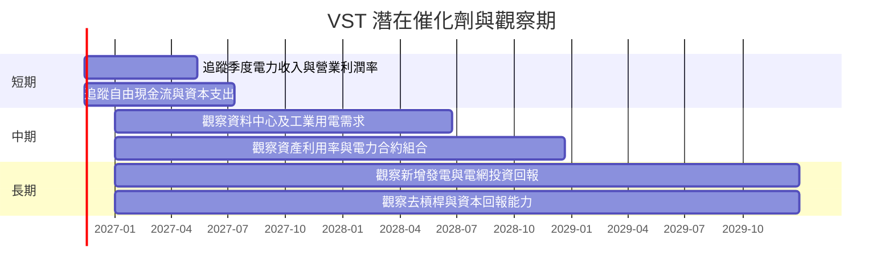

### 9.2 TAM 市場規模分析

公司服務區域的可服務市場規模、發電量市占與零售客戶數均未提供，故不編造 TAM 數值。

```
╔══════════════════════════════════════════════════════════════╗
║                 TAM 與滲透率資料狀態                         ║
╠══════════════════════════════════════════════════════════════╣
║ 美國批發電力市場 TAM：N/A；公司區域分部營收：N/A             ║
║ 零售電力客戶數／市占：N/A；不可由總營收反推                 ║
║ 可驗證成長代理：TTM 營收 $20.20B；TTM YoY +22.8%             ║
║ 應追蹤：零售客戶淨增、平均售電價、發電可用率、單位利差       ║
╚══════════════════════════════════════════════════════════════╝
```

### 9.3 成長驅動力結構圖

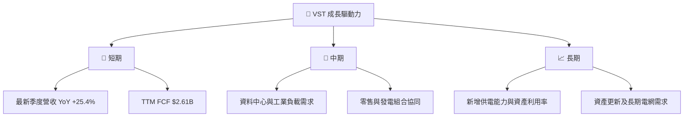

短期催化劑需由後續季度收入與利潤率確認；中長期資料中心及工業用電可能推升電力需求，但題示資料沒有 Vistra 專屬合約、容量或收入數字，不將產業趨勢當成已簽約收入。

---

## 10. 風險矩陣

### 10.1 風險評分矩陣

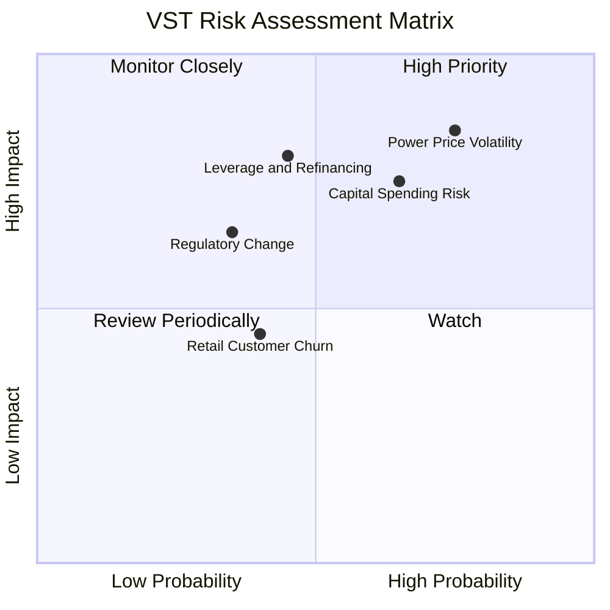

### 10.2 風險清單詳細分析

| # | 風險項目 | 發生機率 | 財務衝擊 | 風險評分 | 緩解措施 |
|---|----------|----------|----------|----------|----------|
| 1 | 🔴 電價與發電利差波動 | 高（估計 60%） | 高；營收與利潤率可快速回落，年度營業利益曾由 $4.08B 降至 $2.13B | 🔴 8.5/10 | 追蹤已簽約容量、商品避險、分區利潤與發電可用率 |
| 2 | 🔴 Capex 超支或回報低於預期 | 中高（估計 50%） | 高；TTM Capex $3.15B，約佔營收 15.6% | 🔴 7.5/10 | 比較季度 Capex 與預算、區分維持性及成長性支出 |
| 3 | 🟠 高槓桿與再融資成本 | 中（估計 40%） | 高；總債務 $21.15B、淨負債 $18.40B | 🟠 7.0/10 | 追蹤債務到期、利息覆蓋、淨負債／EBITDA |
| 4 | 🟡 監管與環境規範變化 | 中（估計 30%） | 中高；可能增加合規或退役成本 | 🟡 6.0/10 | 追蹤州級電力政策、排放規範與資產關閉負債 |
| 5 | 🟡 零售客戶流失及競爭 | 中（估計 35%） | 中；零售定價與獲客成本受競爭影響 | 🟡 5.5/10 | 追蹤客戶留存、零售毛利及獲客成本；目前數據 N/A |

---

## 11. 投資建議

### 11.1 最終綜合評級雷達圖

```
╔══════════════════════════════════════════════════════════════╗
║                VST 最終綜合評分（1–10 分）                   ║
╠══════════════════════════════════════════════════════════════╣
║ 基本面       6.5  ▓▓▓▓▓▓▓▓▓▓▓▓▓░░░░░░░  ★★★☆☆              ║
║ 成長性       7.0  ▓▓▓▓▓▓▓▓▓▓▓▓▓▓░░░░░░  ★★★★☆              ║
║ 獲利能力     7.0  ▓▓▓▓▓▓▓▓▓▓▓▓▓▓░░░░░░  ★★★★☆              ║
║ 財務健康     5.0  ▓▓▓▓▓▓▓▓▓▓░░░░░░░░░░  ★★★☆☆              ║
║ 估值合理性   5.0  ▓▓▓▓▓▓▓▓▓▓░░░░░░░░░░  ★★★☆☆              ║
║ 護城河       5.8  ▓▓▓▓▓▓▓▓▓▓▓▓░░░░░░░░  ★★★☆☆              ║
║ 管理層執行   6.0  ▓▓▓▓▓▓▓▓▓▓▓▓░░░░░░░░  ★★★☆☆              ║
╠══════════════════════════════════════════════════════════════╣
║ 綜合         6.2  ▓▓▓▓▓▓▓▓▓▓▓▓░░░░░░░░  🟡 持有             ║
╚══════════════════════════════════════════════════════════════╝
```

### 11.2 目標價與隱含報酬率

| 情境 | 目標價 | 相對 2026-11-13 收盤價 $133.01 | 機率權重 | 假設摘要 |
|------|-------:|-------------------------------:|---------:|----------|
| 🔴 悲觀 | $106.00 | −20.3% | 25% | 市場回歸分析師低位，利差與估值倍數走弱 |
| 🟡 基準 | $135.72 | +2.0% | 50% | 依 8.8 方法加權核算後合理價值 |
| 🟢 樂觀 | $202.48 | +52.2% | 25% | 參考分析師共識；需盈利與倍數同時支持 |
| **機率加權參考** | **$144.00** | **+8.3%** | **100%** | $106×25% + $135.72×50% + $202.48×25% = $144.00 |

> 機率加權情境值是情境回報參考，與第 8.8 節依估值方法權重計算的合理價值不同；評級依規則以第 8.8 節 MOS 為準。

**評級判斷：** 第 8.8 節加權合理價值約 $135.72，現價 $133.01，MOS 約 2.0%，落在 −10% 至 +10% 區間，故依門檻為 **持有**。ROIC 13.5% 高於 WACC 9.44% 是基本面正面因素，但不能抵銷安全邊際偏低與淨負債 $18.40B 的風險，故不調整評級。

### 11.3 買入時機與觸發因素

```
╔══════════════════════════════════════════════════════════════════╗
║                  ✅ 買入觸發因素 Checklist                        ║
╠══════════════════════════════════════════════════════════════════╣
║ 目前評級：持有；現價 $133.01，MOS 約 2.0%，低於 10% 買入門檻     ║
║                                                                  ║
║ 觀察買入條件（多數符合）：                                        ║
║ ☐ 股價回落至約 $122.15 或以下，對 $135.72 合理價值形成 ≥10% MOS ║
║ ☐ TTM FCF 維持正值且連續兩季未低於 $2.0B 年化                   ║
║ ☐ ROIC 維持高於 WACC 9.44%                                      ║
║                                                                  ║
║ 加碼觸發條件：                                                    ║
║ ☐ TTM FCF 高於 $3.0B 且非單季季節性跳升                         ║
║ ☐ 淨負債連續兩季下降                                             ║
║ ☐ TTM 營業利益率維持 20% 以上                                   ║
║                                                                  ║
║ 減碼／重新評估條件：                                              ║
║ ☐ TTM FCF 轉負或連續兩季低於 $1.0B 年化                         ║
║ ☐ ROIC 跌破 WACC 9.44%                                          ║
║ ☐ 營業利益率相對 TTM 21.0% 收縮超過 5 個百分點                   ║
║ ☐ 淨負債增加且無相對應的可驗證回報                               ║
╚══════════════════════════════════════════════════════════════════╝
```

### 11.4 投資人適配度分析

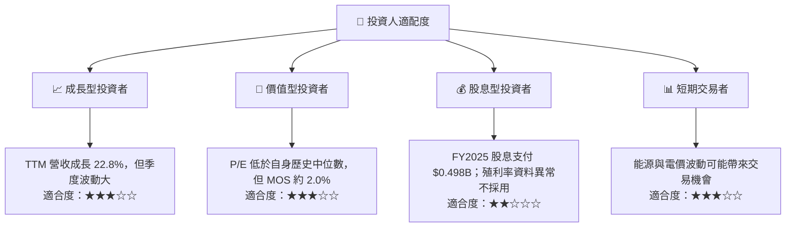

### 11.5 每季財報監控清單（Quarterly Watch List）

| 監控指標 | 最新基準 | 加碼觀察門檻 | 減碼／重估門檻 |
|----------|---------:|-------------|----------------|
| TTM 營收成長 | 22.8% | 維持 10% 以上且非價格單一驅動 | 連續兩季低於 5% |
| 最新季度營收 YoY | 25.4% | 持續正成長，並有銷量或合約支持 | 連續兩季轉負 |
| TTM 營業利益率 | 21.0% | 維持 20% 以上 | 低於 16% |
| TTM FCF | $2.61B | 高於 $3.0B 且可持續 | 轉負或年化低於 $1.0B |
| Capex | $3.15B TTM | 成長性支出有明確回報 | 持續上升但 FCF 下滑 |
| 淨負債 | $18.40B | 逐季下降 | 增加且利息覆蓋惡化 |
| ROIC | 13.5% | 維持高於 WACC 9.44% | 低於 WACC |
| SBC | FY2025 $113M | 維持低於營收 1% | SBC 快速增加或股數明顯稀釋 |
| 電力價格與利差 | 具體分部數據 N/A | 合約覆蓋與利差維持 | 市場價格大幅回落、利潤率收縮 |
| 管理層財測 | 未提供 | 上調且現金流同步改善 | 下調或營運指標轉弱 |

### 11.6 反面論證：什麼會證明論點錯誤（What Would Change My Mind）

```
╔══════════════════════════════════════════════════════════════════╗
║              ⚠️ 論點失效條件（Disconfirming Evidence）            ║
╠══════════════════════════════════════════════════════════════════╣
║ 本報告的正面論點在以下情況成立時應重新檢視：                      ║
║ ☐ TTM 營收成長連續兩季低於 5%                                    ║
║ ☐ TTM 營業利益率由 21.0% 收縮至 16% 以下                        ║
║ ☐ TTM FCF 轉負，或連續兩季年化低於 $1.0B                        ║
║ ☐ ROIC 跌至 WACC 9.44% 以下，表示資本回報不再覆蓋資本成本        ║
║ ☐ 淨負債高於 $18.40B 且 FCF 同步下滑                             ║
║ ☐ Capex 持續高於營收 16% 且新增投資無法帶動營業利益              ║
╚══════════════════════════════════════════════════════════════════╝
```

> **免責聲明：**本報告依據題示資料及模型假設生成，僅供研究參考，不構成個別化投資建議。能源公司獲利受商品價格、監管、天候、電網及資本支出影響；投資人應核對最新申報文件並依自身風險承受能力決策。