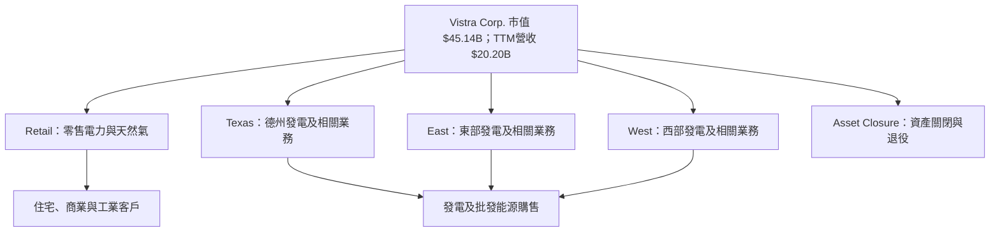
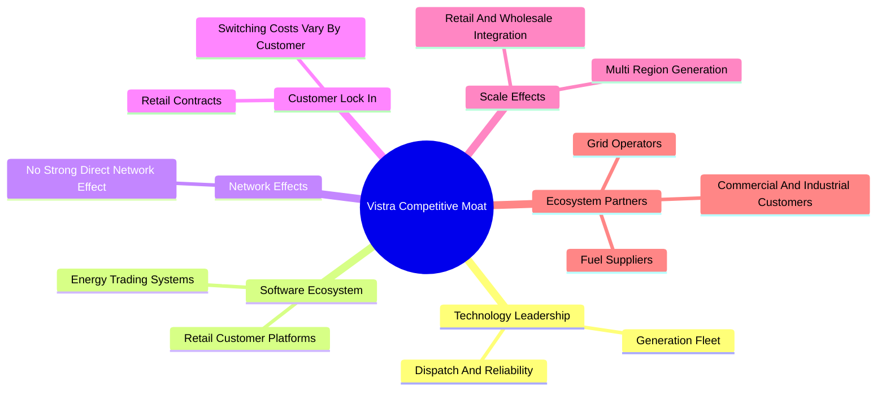
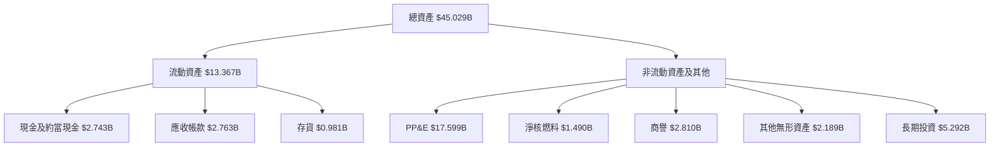
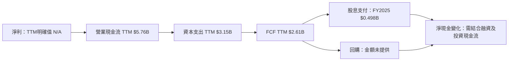
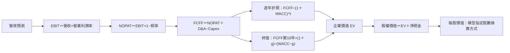
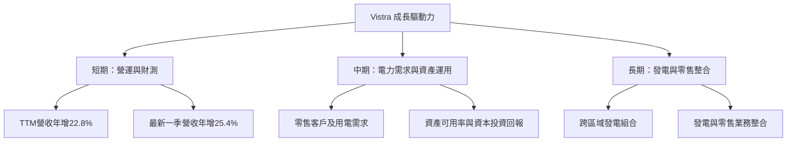
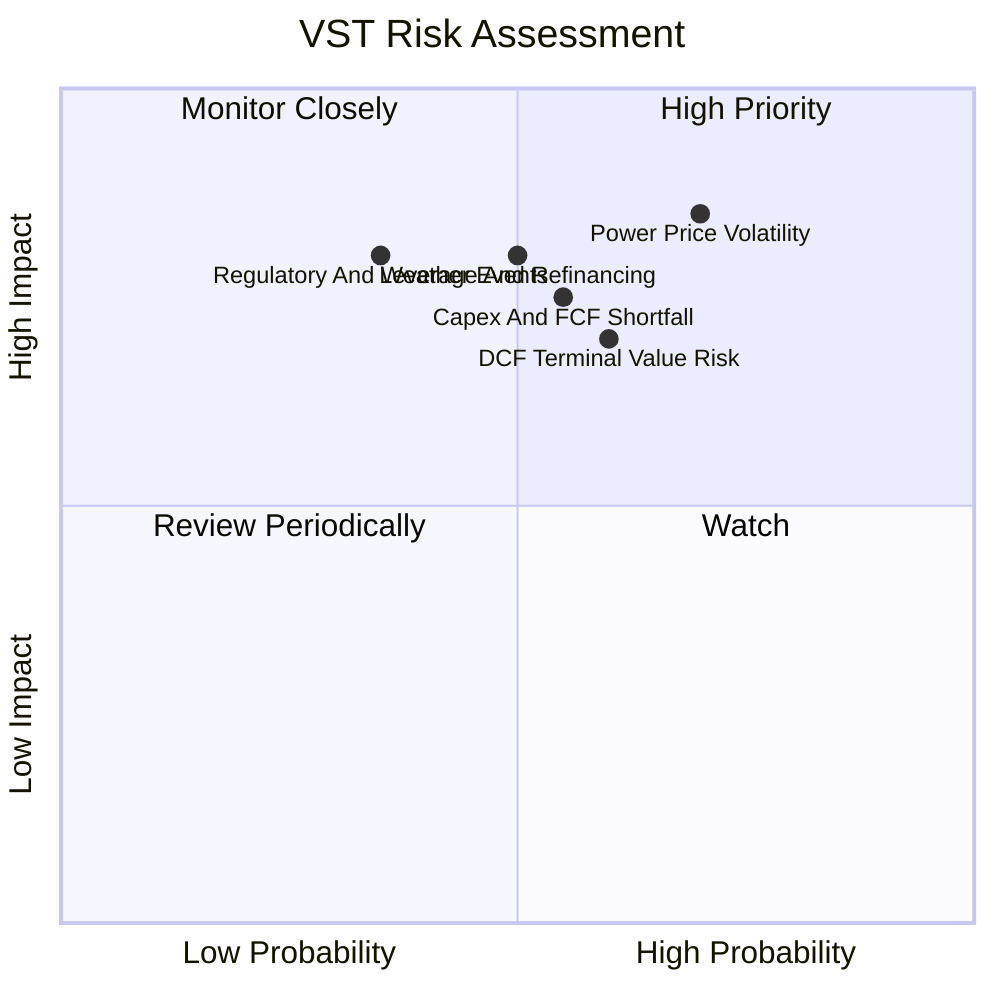
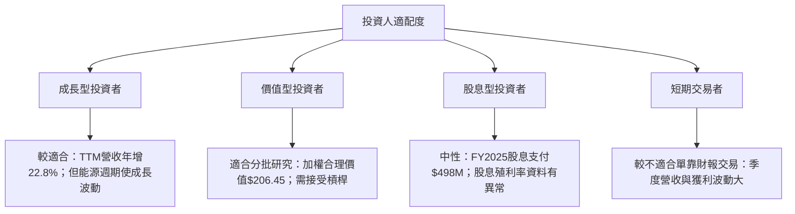

# VST 基本面深度分析報告
> **報告日期**：2026-11-15 ｜ **語言**：繁體中文 ｜ **數據來源**：SEC 申報資料 (XBRL)、Yahoo Finance、Finviz、StockAnalysis、Roic.ai ｜ **分析師**：CFA 級機構研究

## 目錄

| # | 章節 | 核心結論 |
|---|------|----------|
| 1 | 執行摘要 | 強烈買入；加權合理價值 $206.45；MOS +35.6% |
| 2 | 公司概覽與商業模式 | 發電與零售電力整合，具有資產規模與零售客戶基礎；市場份額數據未提供 |
| 3 | 損益表深度分析 | TTM 營收 $20.20B、TTM 年增 22.8%；季度獲利波動明顯 |
| 4 | 資產負債表分析 | 淨負債 $18.40B；流動性可用但槓桿是重要限制 |
| 5 | 現金流量深度分析 | TTM FCF $2.61B、FCF Yield 5.77%；資本支出與發電週期影響現金流 |
| 6 | 獲利能力與資本效率 | ROIC 13.5% 高於 WACC 9.01%，目前創造正經濟價值 |
| 7 | 相對估值分析 | P/E 低於自身五年中位數；同業估值分散，不能單看單一倍數 |
| 8 | DCF 內在價值評估 | DCF 基準值 $279.02；三角驗證後合理價值 $206.45 |
| 9 | 成長催化劑 | 電力需求、發電資產與零售業務可提供成長選項；TAM 數據未提供 |
| 10 | 風險矩陣 | 核心風險為電力價格／營運波動、槓桿與估值假設敏感度 |
| 11 | 投資建議 | 強烈買入；買入區間上限依 MOS 門檻約 $185.81 |

## 1. 執行摘要

### 1.0 一頁式投資儀表板（Portfolio Manager 30 秒速讀）

| 項目 | 內容 |
|------|------|
| **投資論點（3 句）** | ① TTM 營收 $20.20B、年增 22.8%，顯示需求與營運規模仍在擴張。② TTM FCF $2.61B、FCF Yield 5.77%，且 ROIC 13.5% 高於 WACC 9.01%。③ 以四種估值方法加權後合理價值 $206.45，較 2026-11-13 收盤價 $133.01 高 55.2%。 |
| **綜合評分** | **7.2/10**（引用 1.1 評分卡） |
| **財務健康** | 🟡 淨負債 $18.40B，流動比率 1.157；FCF 為正但槓桿限制抗逆能力。 |
| **ROIC vs WACC** | 13.5% vs 9.01%；目前創造價值，利差 **+4.49 個百分點**。 |
| **FCF 趨勢** | FY2025 FCF $1.32B，低於 FY2024 的 $2.48B；TTM FCF 回升至 $2.61B，TTM FCF Yield 5.77%。年度與 TTM 期間不同，不能視為單純連續趨勢。 |
| **估值** | Forward P/E 14.21x｜EV/EBITDA 8.495x｜FCF Yield 5.77% |
| **DCF 內在價值（基準）** | $279.02｜相對 DCF 的折溢價 **−52.3%**（折價；見第 8.5 節） |
| **安全邊際（MOS）** | **+35.6%**＝($206.45 − $133.01) ÷ $206.45；🟢 相對加權合理價值具保護。 |
| **預期報酬（基準情境 12M）** | +109.8%（DCF 基準情境值 $279.02；模型情境值不等同保證的一年報酬） |
| **關鍵風險（前二）** | 電力價格與資產營運波動；淨負債 $18.40B 與高再投資需求。 |
| **評級 + 信心度** | 🟢 **強烈買入**｜信心：中（估值結果對長期成長與終值假設敏感） |

### 1.1 綜合評分卡（全報告唯一）

| 維度 | 評分（1–10） | 主要依據（引用數字與其來源章節） |
|------|--------------|----------------------------------|
| 成長性 | 8.0 | TTM 營收年增 22.8%、最新一季年增 25.4%（第 3 章）；但季度成長波動。 |
| 獲利能力 | 8.0 | TTM 營業利益率 21.0%、ROIC 13.5% 高於 WACC 9.01%，F-Score 7/8（第 6 章）。 |
| 財務健康 | 5.5 | 淨負債 $18.40B、流動比率 1.157、速動比率 0.477；DSO 50 天、CCC 34 天（第 4 章）。 |
| 估值 | 8.5 | MOS +35.6%；P/E 18.0x 低於自身五年中位數 25.2x（第 7、8 章）。 |
| 護城河 | 7.0 | 整合發電與零售平台、跨區域資產與客戶基礎；缺乏市場份額及分部營收占比資料（第 2 章）。 |
| 管理層與資本配置 | 6.0 | FY2025 資本支出 $2.75B、股息支付 $498M；TTM 股數未增加的 F-Score 測試通過，但資本配置回報數據有限。 |
| **綜合評分** | **7.2** | 六項算術平均：(8.0+8.0+5.5+8.5+7.0+6.0)÷6＝7.17，四捨五入至一位小數。 |

### 1.2 五大投資論點 + 三大核心風險

| 類型 | 項目 | 具體依據 | 信心度 |
|------|------|----------|--------|
| 🟢 **投資論點①** | 營收仍在擴張 | TTM 營收 $20.20B，年增 22.8%；最新一季年增 25.4%。若增長由用電需求與客戶組合帶動，可能延續營運槓桿。 | 🟢 高 |
| 🟢 **投資論點②** | 資本回報高於資金成本 | ROIC 13.5% 對 WACC 9.01%，利差 +4.49 個百分點，表示目前新增資本仍有正價值創造空間。 | 🟢 高 |
| 🟢 **投資論點③** | 自由現金流為正 | TTM 營業現金流 $5.76B、資本支出 $3.15B、FCF $2.61B；現金流可支持降低負債與資本投資。 | 🟢 高 |
| 🟢 **投資論點④** | 估值低於自身部分歷史中位數 | P/E 18.0x vs 五年中位數 25.2x；EV/EBITDA 10.0x vs 中位數 11.0x。 | 🟡 中 |
| 🟢 **投資論點⑤** | 電力需求具有結構性選擇權 | 公司同時經營零售電力、天然氣零售與發電；數據中心等新增電力需求可能提供商業機會，但缺少公司特定合約與收入量化資料。 | 🟡 中 |
| 🟡 **風險①** | 獲利與電力市場週期波動 | 年度營業利益由 FY2024 $4.08B 降至 FY2025 $2.13B；單季營業利益也由 Q2 $553M 升至 Q3 $1.98B。 | 🟡 中 |
| 🔴 **風險②** | 淨負債及再投資負擔 | 淨負債 $18.40B；TTM 資本支出 $3.15B，占營業現金流 $5.76B 的約 54.7%。 | 🔴 高衝擊 |
| 🟡 **風險③** | DCF 對長期假設敏感 | 基準 DCF 終值現值占企業價值 64.9%；WACC 或永續成長率變動可顯著改變估值。 | 🟡 中 |

### 1.3 快速統計卡片

| 指標 | 公司實際值（期間） | 同業中位數 | 狀態 |
|------|--------------------|------------|------|
| 營收成長（TTM） | **22.8%** | — | 🟢 |
| 營收成長（最新一季年增） | **25.4%** | 45.4% | 🟡 |
| 毛利率（TTM） | **41.5%**（補充來源；與主要口徑有差異） | 25.2% | 🟢 |
| 營業利益率（TTM） | **21.0%** | — | 🟢 |
| ROIC（TTM） | **13.5%** | — | 🟢 |
| Forward P/E | **14.21x** | 12.2x | 🟡 |
| FCF Yield（TTM） | **5.77%** | — | 🟢 |
| Piotroski F-Score | **7 / 8**（九項中一項缺少可判定資料） | — | 🟢 |

> 注：不同財務資料來源對營收、毛利率、營業利益率與季度淨利有口徑差異。本報告優先採用 SEC 10-Q 與程式計算的 VERIFIED FIGURES；其他來源只作交叉參考，不混用為同一口徑。

### 1.4 投資結論

```text
╔══════════════════════════════════════════════════════════════════╗
║                    📊 投資結論摘要                               ║
╠══════════════════════════════════════════════════════════════════╣
║  評級：強烈買入（依 MOS 門檻；ROIC 亦高於 WACC）                 ║
║  價格（2026-11-13 收盤）：$133.01                                ║
║  DCF 內在價值（基準）：$279.02（相對 DCF 折價 52.3%）            ║
║  安全邊際 MOS：+35.6%（＝(加權合理價值−現價)÷加權合理價值）      ║
║  加權合理價值（8.8）：$206.45                                    ║
║  DCF 情境價值：                                                  ║
║    悲觀情境：$93.52（−29.7%）                                    ║
║    基準情境：$279.02（+109.8%）                                  ║
║    樂觀情境：$651.57（+389.9%）                                  ║
║  綜合評分：7.2/10（引用 1.1）                                    ║
║  適合投資人：可承受電力市場波動、以中長期資本增值為目標者        ║
╚══════════════════════════════════════════════════════════════════╝
```

## 2. 公司概覽與商業模式

### 2.1 業務結構與收入來源

公司資料顯示 Vistra 經營 Retail、Texas、East、West、Asset Closure 五個分部，業務涵蓋零售電力與天然氣、發電、批發能源購售及資產關閉相關活動。各分部收入與佔比未提供，因此不推估分部比例。



### 2.2 市場份額

市場份額數據未提供，因此不繪製市占圓餅圖或推估比例。公司 TTM 營收為 $20.20B，最新一季年增 25.4%；同業 CEG、NRG、TLN 的最新一季收入年增分別為 45.4%、24.0%、96.1%，VST 的成長高於 NRG、低於 CEG 與 TLN。

### 2.3 競爭護城河分析



### 2.4 護城河強度

| 護城河項目 | 強度（強／中／弱） | 證據（引用數字或事實） | 會削弱它的情況 |
|------------|--------------------|------------------------|----------------|
| 發電資產與規模 | 中 | 業務涵蓋 Texas、East、West，並有零售及批發業務；員工 6,390 人。 | 資產故障、燃料成本上漲、極端天候或市場價格下跌。 |
| 零售客戶關係 | 中 | 零售電力及天然氣涵蓋美國多州與哥倫比亞特區。 | 客戶流失、競爭者促銷、零售毛利下降。 |
| 整合營運 | 中 | 同時經營零售與發電，理論上可管理供需曝險；但分部獲利資料未提供。 | 發電與零售曝險未能有效對沖，或監管限制增加。 |
| 技術、軟體與網路效應 | 弱至中 | 未提供專利、軟體營收、客戶留存或網路效應量化資料。 | 同業以更低成本或更佳客戶體驗競爭。 |
| 生態夥伴 | 中 | 需依賴電網、燃料供應及能源市場交易；公司具多地區營運。 | 電網瓶頸、燃料供應中斷、政策與市場設計變化。 |

護城河評分引用 1.1 的 **7.0/10**：跨區域資產與發電—零售整合提供一定規模優勢，但缺少市占、客戶留存與分部獲利數據，故不評為更高。

## 3. 損益表深度分析

### 3.1 年度收入成長趨勢（近4年）

FY2022 至 FY2025 年度收入依次為 $13.73B、$14.78B、$17.22B、$17.74B；FY2022–FY2025 CAGR 約 8.9%。

```text
╔══════════════════════════════════════════════════════════════════╗
║              Vistra 年度收入趨勢（FY2022-FY2025）                ║
╠══════════════════════════════════════════════════════════════════╣
║  FY2022  $13.73B  ███████████████       YoY：基期             ║
║  FY2023  $14.78B  ████████████████      YoY：+7.7% 🟢         ║
║  FY2024  $17.22B  ███████████████████   YoY：+16.5% 🟢        ║
║  FY2025  $17.74B  ████████████████████  YoY：+3.0% 🟡         ║
║                                                                  ║
║  FY2022–FY2025 CAGR：(17.74÷13.73)^(1/3)−1 ≈ 8.9%              ║
╚══════════════════════════════════════════════════════════════════╝
```

FY2025 收入僅增 3.0%，低於 FY2024 的 16.5%，表示近年收入增長並非平滑擴張；TTM 收入年增 22.8% 則顯示最近 12 個月增長重新加速。能源價格、發電量及零售客戶組合均可能造成表現波動，但現有資料不足以拆分各因素貢獻。

### 3.2 季度收入趨勢分析

| 季度 | 營收 | QoQ 成長 | YoY 成長 | 備註 |
|------|------|---------:|---------:|------|
| 2025 Q4 | $4.584B | −7.8% | +13.6% | QoQ 以 2025 Q3 $4.971B 為基期；季節性及市場價格可能影響。 |
| 2026 Q1 | $5.640B | +23.0% | +43.4% | 對照 2025 Q1 $3.933B；年增率資料源一致。 |
| 2026 Q2 | $4.017B | −28.8% | −5.5% | 對照 2026 Q1 下滑，反映季度收入波動。 |
| 2026 Q3 | $6.347B | +58.0% | **+25.4%** | YoY 採主要財務指標；補充來源列示 27.68%，口徑有差異。 |

QoQ 算式分別為：$4.584B÷$4.971B−1＝−7.8%；$5.640B÷$4.584B−1＝+23.0%；$4.017B÷$5.640B−1＝−28.8%；$6.347B÷$4.017B−1＝+58.0%。季增幅度大，故單季成長不能直接外推全年。

### 3.3 利潤率演變分析

| 利潤率指標 | FY2022 | FY2023 | FY2024 | FY2025 | 趨勢 | 評估 |
|------------|-------:|-------:|-------:|-------:|------|------|
| **毛利率**（毛利÷營收） | 12.2% | 37.4% | 43.7% | 32.9% | FY2024 上升、FY2025 回落 | 🟡 |
| **營業利益率**（營業利益÷營收） | −8.0% | 18.3% | 23.7% | 12.0% | FY2024 升至高點後回落 | 🟡 |
| **淨利率**（淨利÷營收） | −9.0% | 9.1% | 15.5% | 5.3% | FY2025 明顯收縮 | 🟡 |

TTM 營業利益率為 21.0%，最新一季營業利益率 28.5%，高於 FY2025 年度值；但季度數據波動顯著。FY2025 毛利由 FY2024 $7.53B 降至 $5.83B，營業利益由 $4.08B 降至 $2.13B。可能反映能源價格、發電／零售組合、套期與成本變化，現有資料無法量化各項影響；因此不宜將最新季度高利潤率直接視為常態。

### 3.4 費用結構分析

目前資料可確認 FY2025 營收 $17.74B、毛利 $5.83B，故銷貨成本為 $17.74B−$5.83B＝$11.91B；但營業費用分項、利息與稅費的完整同口徑結構未提供，故不繪製費用結構圓餅圖，以免將未披露項目誤作完整費用比例。

### 3.5 季度 EPS 趨勢與盈餘品質（Quality of Earnings）

| 盈餘品質項目 | 數值／佔比 | 評估 |
|--------------|-----------|------|
| 股權薪酬 SBC / 營收 | 近四個可見季度 SBC 合計約 $127M；按 TTM 營收 $20.20B 計約 0.63% | 🟢 占比有限，但仍會稀釋股東；Piotroski 稀釋股數測試通過。 |
| SBC / 營業現金流 | $127M÷$5.76B≈2.2% | 🟢 對現金流相對不大；SBC 是非現金費用，不代表沒有股東成本。 |
| FCF / 淨利（現金轉換率） | 以 StockAnalysis TTM 淨利 $2.515B 交叉計算：$2.61B÷$2.515B≈103.8% | 🟢 高於 100%；分子取主要口徑 TTM FCF，淨利為補充來源，口徑需留意。 |
| 一次性／非經常性損益 | 新聞資料指出 Q3 有 $269M 長期資產減損 | 🟡 可能壓低 GAAP 獲利；是否非現金及具體會計分類應以 10-Q 附註核對。 |
| 有效稅率異常 | 15.9%（最近年度有效稅率） | 🟢 作 DCF 稅率輸入；單年稅率可能受稅務項目影響。 |
| 資本化支出 vs 費用化 | TTM Capex $3.15B；資本化政策明細未提供 | 🟡 高資本支出使現金流對建設投資敏感；無法判定資本化是否偏高。 |

最近四季 EPS 實際值（補充來源）為 2025 Q4 $0.54、2026 Q1 $2.87、2026 Q2 $0.76、2026 Q3 $3.23。EPS 預估值均為缺漏，故**無法判定過去四季是超預期或不及預期**；不以空缺估計值冒充盈餘驚喜。已知最新 Q3 EPS 年增 84.6%，Q2 EPS 年增 −6.17%。整體而言，FCF 對淨利轉換支持盈餘含金量，但季度獲利波動與減損項目要求投資人追蹤 GAAP 淨利及營運現金流的差異。

## 4. 資產負債表分析

### 4.1 資產結構分解

以下採 StockAnalysis 2026-09-30 資產負債表補充明細；總資產 $45.029B。資料列示之主要項目包括流動資產、PP&E、核燃料、商譽、無形資產及長期投資。



### 4.2 流動性與營運資金分析

| 指標 | 最新 TTM | 一年前 TTM | 變化 | 解讀 |
|------|----------|------------|------|------|
| 流動比率 | 1.157 | N/A | N/A | 略高於 1，但流動資產品質與能源結算項目需一併觀察。 |
| 速動比率 | 0.477 | N/A | N/A | 低於 1，短期流動性仰賴營運現金流及融資。 |
| DSO 應收帳款天數 | 50 天 | 52 天 | −2 天 | 收款週期略縮短；不能單憑兩天變化判斷客戶信用改善。 |
| DIO 存貨天數 | 30 天 | N/A | N/A | 一年前資料缺失，不能比較。 |
| DPO 應付帳款天數 | 45 天 | N/A | N/A | 一年前資料缺失，不能比較供應商付款趨勢。 |
| CCC 現金轉換週期 | 34 天 | N/A | N/A | 依 50+30−45＝35 天，而官方 QUALITY FIGURES 列為 34 天；照抄官方計算值，差異可能來自未四捨五入底層數據。 |

### 4.3 債務結構分析

```text
╔══════════════════════════════════════════════════════════════════╗
║                   Vistra 債務健康診斷                            ║
╠══════════════════════════════════════════════════════════════════╣
║  總債務：        $21.15B  ████████████████████  🟡              ║
║  現金及短期投資：$2.74B   ███                   🟡              ║
║  淨負債：        $18.40B  █████████████████     🔴              ║
║                                                                  ║
║  淨負債公式：$21.15B − $2.74B = $18.41B；官方列示淨負債 $18.40B ║
║  Debt/EBITDA：N/A（沒有可一致核對的 EBITDA／債務口徑）           ║
║  利息保障倍數：N/A（利息費用資料未提供）                         ║
║  流動比率：1.157；速動比率：0.477                               ║
╚══════════════════════════════════════════════════════════════════╝
```

補充市場資料列示總債務 $21.77B、淨負債 $19.02B，與主要 VERIFIED FIGURES 的 $21.15B、$18.40B 不一致；本報告採用主要口徑。負債總量較高，但 TTM 營業現金流 $5.76B 可提供償債支撐；仍應追蹤利息保障、到期結構及再融資成本，現有資料不足以計算前兩者。

### 4.4 股東權益趨勢

```text
╔══════════════════════════════════════════════════════════════════╗
║                 Vistra 歷年股東權益（年度）                      ║
╠══════════════════════════════════════════════════════════════════╣
║  FY2022  $4.90B  ██████████████████                            ║
║  FY2023  $5.31B  ████████████████████                          ║
║  FY2024  $5.57B  █████████████████████                         ║
║  FY2025  $5.10B  ███████████████████                           ║
║                                                                  ║
║  FY2024→FY2025：($5.10B÷$5.57B)−1 = −8.4%                      ║
╚══════════════════════════════════════════════════════════════════╝
```

FY2025 權益下降與淨利、股利、回購及其他綜合損益等因素可能相關，但現有資料未提供完整權益變動表，不能將變化歸因於單一項目。

## 5. 現金流量深度分析

### 5.1 現金流量瀑布圖



### 5.2 FCF 轉換率趨勢

| 財年 | 淨利 | FCF | FCF／淨利 | 解讀 |
|------|-----:|----:|----------:|------|
| FY2022 | −$1.23B | −$0.816B | 比率不具經濟解讀性 | 分子、分母皆為負，不能視為正常現金轉換率。 |
| FY2023 | $1.49B | $3.78B | 253.7% | 現金流高於淨利，可能受營運資金與非現金項目影響。 |
| FY2024 | $2.66B | $2.48B | 93.2% | 現金轉換接近淨利。 |
| FY2025 | $0.944B | $1.32B | 139.8% | 現金流高於淨利；仍需留意年度能源業務波動。 |

### 5.3 自由現金流趨勢

```text
╔══════════════════════════════════════════════════════════════════╗
║               Vistra 自由現金流：歷史實際                         ║
╠══════════════════════════════════════════════════════════════════╣
║  FY2022  −$0.816B  ◀負值                                         ║
║  FY2023   $3.780B  ████████████████████                          ║
║  FY2024   $2.480B  █████████████                                  ║
║  FY2025   $1.320B  ███████                                        ║
║  TTM      $2.610B  ██████████████   FCF Yield：5.77%              ║
║                                                                  ║
║  FCF = 營業現金流 − 資本支出；TTM：$5.76B − $3.15B = $2.61B     ║
╚══════════════════════════════════════════════════════════════════╝
```

### 5.4 資本配置評估

完整的回購、併購、償債與留存現金分配比例未提供，因此不以 pie chart 製造資本配置比例。

| 資本配置項目 | 可核對數據 | 評估 |
|--------------|------------|------|
| 資本支出 | FY2025 $2.75B；TTM $3.15B | 對發電資產維護與成長投資必要，但高 Capex 會壓低短期 FCF。 |
| 股息 | FY2025 $498M | 約為 FY2025 FCF $1.32B 的 37.7%；期間一致的近似比率。 |
| 股票回購 | 金額未提供 | 不能判定回購是否抵消 SBC 稀釋。 |
| 債務償還／併購 | 明細未提供 | N/A。 |
| 留存現金 | TTM 現金及短期投資 $2.74B | 對淨負債 $18.40B 的緩衝有限。 |

## 6. 獲利能力與資本效率

### 6.1 ROE / ROA / ROIC 趨勢

| 指標 | FY2022 | FY2023 | FY2024 | FY2025／TTM | 評估 |
|------|-------:|-------:|-------:|------------:|------|
| ROE | N/A | N/A | N/A | TTM 42.9% | 回報高，但權益乘數 7.14 顯示槓桿對 ROE 有重要貢獻。 |
| ROA | N/A | N/A | N/A | TTM 由 QUALITY FIGURES 測試確認 >0；具體百分比 N/A | 數據不足以列歷年趨勢。 |
| ROIC | N/A | N/A | N/A | TTM 13.5% | 高於 WACC 9.01%。 |

行業均值資料未提供，故不列行業均值對比。

### 6.2 ROIC vs WACC 分析（核心價值創造判斷）

```text
╔══════════════════════════════════════════════════════════════════╗
║                ROIC vs WACC 深度分析                            ║
╠══════════════════════════════════════════════════════════════════╣
║  WACC（採用程式計算固定值）：                                    ║
║  ├── 無風險利率（10Y美債）：  5.15%                              ║
║  ├── 市場風險溢酬（假設）：   5.00%                              ║
║  ├── 原始 Beta：1.38；調整後 Beta：1.25                          ║
║  ├── 股權成本：5.15% + 1.25×5.00% = 11.40%                      ║
║  ├── 稅前債務成本：4.64%；稅後：4.64%×(1−15.9%)=3.90%           ║
║  ├── 資本結構：股權 68.1%，債務 31.9%                            ║
║  └── ✅ WACC：9.01%                                              ║
║                                                                  ║
║  ROIC（TTM）：13.5%                                               ║
║  EVA利差：13.5% − 9.01% = +4.49 個百分點                         ║
║  ROIC/WACC：13.5% ÷ 9.01% ≈ 1.50 倍                              ║
║                                                                  ║
║  ROIC  13.5%  ▓▓▓▓▓▓▓▓▓▓▓▓▓▓▓▓▓▓▓▓▓▓▓▓▓▓  🟢                   ║
║  WACC   9.01% ▓▓▓▓▓▓▓▓▓▓▓▓▓▓▓▓▓▓▓▓░░░░░░  ──                   ║
║                                                                  ║
║  📊 結論：以目前 TTM 口徑，ROIC 高於資金成本，創造正經濟價值。  ║
╚══════════════════════════════════════════════════════════════════╝
```

WACC 使用 VERIFIED FIGURES 指定的 9.01%，此處不另建 WACC。利息費用與平均計息負債缺乏完整明細，因此稅前 Kd 直接引用 4.64%，不另反推利息費用。ROIC 減 WACC 的正利差表示當前投入資本回報高於資金成本；若能源市場或資產利用率反轉，ROIC 可能快速收斂。

### 6.3 杜邦三因素分解

| 因素 | 數值（TTM） | 解讀 |
|------|-------------|------|
| 淨利率 | 13.4% | 對 ROE 提供獲利基礎。 |
| 資產週轉率 | 0.45 | 資產密集型發電業務，週轉率相對受資產規模影響。 |
| 權益乘數 | 7.14 | 槓桿較高，是 ROE 放大的重要來源。 |
| **ROE** | **42.9%** | 13.4% × 0.45 × 7.14 ≈ 42.9%；高 ROE 不應單獨解讀為低風險高回報。 |

### 6.4 財務體質：Piotroski F-Score

Piotroski F-Score 為 **7/8**；九項測試中一項因資料缺失不納入分母。

| 測試 | 結果 | 解讀 |
|------|------|------|
| ROA > 0 | ✅ 通過 | TTM 資產回報為正。 |
| 營業現金流 > 0 | ✅ 通過 | TTM 營業現金流 $5.76B。 |
| ROA 高於一年前 | ✅ 通過 | 資產獲利改善。 |
| 營業現金流 > 淨利 | ✅ 通過 | 現金流支持盈餘品質。 |
| 長期負債÷總資產低於一年前 | ❌ 未通過 | 槓桿改善未能確認，需關注負債。 |
| 流動比率高於一年前 | ✅ 通過 | 短期流動性方向改善。 |
| 稀釋股數未增加 | ✅ 通過 | 該項期間比較未見稀釋股數增加。 |
| 毛利率高於一年前 | — 無法判定 | 缺少比較所需資料。 |
| 資產週轉率高於一年前 | ✅ 通過 | 該項測試通過。 |

## 7. 相對估值分析

### 7.1 同業估值比較表格

| 估值指標 | **VST** | **CEG** | **NRG** | **TLN** | VST 評估 |
|----------|--------:|--------:|--------:|--------:|----------|
| **Trailing P/E** | 18.0x | 22.5x | 17.0x | N/A | 🟡 位於 CEG 與 NRG 之間；TLN 無可用值。 |
| **Forward P/E** | 14.2x | 20.8x | 9.9x | 12.2x | 🟡 高於 NRG、TLN，低於 CEG；同業中位數 12.2x。 |
| **P/S Ratio** | 2.2x | 2.9x | 0.6x | 3.7x | 🟡 同業差異大，VST 低於 CEG、TLN，高於 NRG。 |
| **EV/EBITDA** | 10.0x | 12.8x | 10.7x | 38.0x | 🟢 低於三家同業中位數 12.8x；TLN 倍數極高，需審慎解讀。 |
| 最新一季營收 YoY | 25.4% | 45.4% | 24.0% | 96.1% | 🟡 高於 NRG，低於 CEG 與 TLN。 |
| 毛利率（TTM） | 41.5%* | 25.2% | 20.2% | 42.7% | 🟡 *VST 採補充來源，與主要口徑存在差異。 |

同業數據取自 Yahoo Finance Peer multiples。P/E、P/S 與 EV/EBITDA 不同公司間受商業模式、資產組合及獲利週期影響，不宜單憑倍數排序作結論。

### 7.2 歷史估值區間分析

```text
╔══════════════════════════════════════════════════════════════════╗
║               VST 五年估值區間（TTM multiples）                  ║
╠══════════════════════════════════════════════════════════════════╣
║  P/E        7.2x ───────────●18.0x─────────── 74.3x              ║
║               五年中位數 25.2x；目前百分位 20%                   ║
║  P/S        0.5x ──────────●2.2x──────────── 4.2x               ║
║               五年中位數 1.8x；目前百分位 57%                    ║
║  EV/EBITDA  2.3x ─────────●10.0x─────────── 40.7x              ║
║               五年中位數 11.0x；目前百分位 40%                   ║
╚══════════════════════════════════════════════════════════════════╝
```

目前 P/E 18.0x 低於五年中位數 25.2x，估值歷史百分位為 20%；EV/EBITDA 10.0x 亦低於中位數 11.0x。P/S 2.2x 則高於自身中位數 1.8x，顯示不同估值指標給出的訊號並不一致。

### 7.3 情境價值（Bear / Base / Bull，照抄 DCF MODEL 的 Scenarios）

| 情境 | 第 1 年營收成長 | 期末營業利潤率 | WACC | 每股價值 | 相對現價 | 機率 | 會發生的條件 |
|------|----------------:|----------------:|-----:|----------:|----------:|-----:|--------------|
| 🔴 悲觀 | 11.4% | 16.4% | 10.01% | $93.52 | −29.7% | 25% | 電力價格或發電量低於預期、利潤率降至 16.4%，資金成本上升。 |
| 🟡 基準 | 22.8% | 19.3% | 9.01% | $279.02 | +109.8% | 50% | 近期成長延續但逐步降至成熟期，利潤率收斂至 19.3%。 |
| 🟢 樂觀 | 34.3% | 21.2% | 8.01% | $651.57 | +389.9% | 25% | 電力需求持續強於基準、利潤率維持較高且資金成本下降。 |

### 7.4 相對估值隱含價格區間

```text
╔══════════════════════════════════════════════════════════════════╗
║                估值方法隱含每股價值                               ║
╠══════════════════════════════════════════════════════════════════╣
║  $113.76 ── 現價 $133.01 ── $185.33 ── $200.73 ── $279.02       ║
║  Forward P/E       市價       EV/EBITDA  分析師共識       DCF     ║
╚══════════════════════════════════════════════════════════════════╝
```

- 同業 Forward P/E：$113.76；採 CEG、NRG、TLN 同業中位數 **12.2x** 乘 VST Forward EPS **$9.36**。
- 同業 EV/EBITDA：$185.33；採同業中位數 **12.8x** 乘 TTM EBITDA，再加回淨現金。底層 EBITDA 數額未列，故不另重算。
- 分析師共識目標價：$200.73；22 位分析師平均值。
- DCF 基準：$279.02；10 年 FCFF、WACC 9.01%、終值成長率 3.0%。

## 8. DCF 內在價值評估（Discounted Cash Flow）

### 8.0 估值推理鏈（Thinking Logic）

**Step 1 — 價值來源與主導變數**

模型把 VST 價值拆成既有發電與零售營運的現金流、能源需求成長帶來的擴張，以及長期終值。公司五個分部的收入占比未提供，故不能聲稱任何單一業務占營收特定比例。基準 DCF 終值 PV 占 EV **64.9%**，因此最主導估值的變數是長期穩態現金流與折現率，而非單一年度營收。

**Step 2 — 模型選擇**

| 決策點 | 本報告採用 | 理由 | 曾考慮但否決 | 否決理由 |
|--------|-----------|------|--------------|----------|
| 現金流定義 | FCFF | 對應 WACC 折現並先估 EV，再扣淨負債。 | FCFE | 債務與融資現金流會增加股東現金流波動。 |
| 預測期 N | 10 年 | DCF MODEL 固定為 10 年，讓高成長逐步衰減至長期 3.0%。 | 5 年 | 不符合指定模型輸入；會改變模型結果。 |
| 終值方法 | Gordon Growth | 模型提供 WACC 9.01% 大於 g 3.0%。 | 退出倍數作主估值 | DCF MODEL 已固定 Gordon Growth；退出倍數可作交叉參考但模型未提供該終值。 |
| EBIT 基礎 | GAAP EBIT | TTM 營業利益率 21.0%；模型明確採 GAAP。 | 非 GAAP | 會造成與模型口徑不同。 |

**Step 3 — 關鍵假設推導鏈**

- **營收成長**：錨點＝TTM 年增 22.8%；FY2022–FY2025 年收入 CAGR 約 8.9% → 最近 TTM 成長高於多年年度趨勢，模型假設逐年線性降至 3.0% → **採用第 1 年 22.8%、第 10 年 3.0%** → 不採永久維持 22.8%，因長期外推與電力市場週期風險不匹配。
- **期末營業利潤率**：錨點＝TTM 21.0%；FY2025 年度營業利益率約 12.0%，FY2024 約 23.7% → 模型採用 21.0% 逐步淡化至近五年中位數 19.3% → **採用 FY+10 19.3%** → 不採 FY2024 約 23.7%，因年度獲利已顯示波動。
- **永續成長率 g**：錨點＝長期名目經濟成長的常見參考範圍約 3%–4%（假設值，非公司財務數據）→ 電力需求成長不代表公司可永久高於經濟成長 → **採用 3.0%** → 不採 4.0%，因提高終值且接近 WACC，估值敏感度更高。
- **預測期 N**：錨點＝模型指定 10 年 → 以高成長逐步淡化至成熟期假設 → **採用 10 年** → 不用較短期間，以保持既定模型；不將 10 年視為護城河已被證明。
- **Capex／營收**：錨點＝TTM Capex／Revenue 約 15.6% → 模型逐年降至 11.5%，即 1.1 倍 D&A 水準 → **採用 15.6% 至 11.5% 的線性淡化** → 不假設 Capex 很快降至低於折舊，因發電資產維護與更新需要持續投資。
- **WACC**：錨點＝指定 WACC 9.01% → 使用市場權重及調整後 Beta 的既定資本成本估計 → **採用 9.01%** → 不另用單一同業折現率，以免偏離同一估值框架。
- **EBIT 與 SBC**：錨點＝GAAP EBIT；SBC 已列為費用 → **採用組合 (A)：GAAP EBIT、固定股數、FCFF 不再減 SBC、股數不另稀釋** → 不用加回 SBC 的非 GAAP 口徑，避免漏算或重複計算股東成本。
- **年稀釋率**：模型以當期股數固定，不再稀釋 → **採用 0% 額外年稀釋**，與組合 (A) 一致 → 不再另放大股數，因 SBC 已在 GAAP EBIT 作費用處理。
- **有效稅率、D&A／營收**：模型錨點分別為最近年度有效稅率 15.9%、TTM D&A／營收 10.4%；**採用 15.9% 與 10.4%**，按模型固定。
- **終值方法**：採 Gordon Growth，使用 FY+10 FCFF；不另加入未提供的退出倍數終值，避免自行更改模型。
- **營運資金**：模型明確不建模 ΔWC；不是推估為零，而是該模型項目未納入。

**Step 4 — 最脆弱環節**

最脆弱環節為長期成長、利潤率及終值假設：終值占 EV 64.9%；若公司無法維持模型中的中長期營運現金流，估值會大幅向下，悲觀情境已降至 $93.52。

**Step 5 — 計算路徑圖**



### 8.1 模型假設總表（Model Inputs）

| 假設項目 | 採用值 | 依據／來源 | 敏感度 |
|----------|--------|-------------|--------|
| 預測期長度 N | 10 年 | DCF MODEL 固定輸入；營收成長由 22.8% 淡化至 3.0%。 | 🟡 中 |
| 營收成長 | FY+1 22.8%，FY+10 3.0% | TTM 成長 22.8%，逐年線性淡化；FY2022–FY2025 年收入 CAGR 約 8.9%。 | 🔴 高 |
| 營業利潤率 | FY+1 21.0% 至 FY+10 19.3% | TTM 21.0%，淡化至模型所用近五年中位數。 | 🔴 高 |
| 有效稅率 | 15.9% | 最近年度有效稅率。 | 🟢 低 |
| Capex／營收 | FY+1 15.6% 至 FY+10 11.5% | TTM 比例，逐步淡化至 1.1×D&A 的模型假設。 | 🟡 中 |
| D&A／營收 | 10.4% | TTM 比率，模型固定。 | 🟢 低 |
| 營運資金變動 | 未建模 | DCF MODEL 明確不計 ΔWC；不是以財務數據估得的零。 | 🟢 低 |
| EBIT 基礎 | GAAP | DCF MODEL 指定 GAAP EBIT。 | 🟡 中 |
| SBC 處理 | 組合 (A)：不在 FCFF 再扣 SBC | GAAP EBIT 已含 SBC；股數不再稀釋。 | 🟡 中 |
| 年稀釋率 | 0% 額外稀釋 | 與組合 (A) 相容；使用模型指定當期換算方式。 | 🟡 中 |
| 永續成長率 g | 3.0% | DCF MODEL 固定值，且低於 WACC 9.01%。 | 🔴 高 |
| 終值方法 | Gordon Growth | 以第 10 年 FCFF 計算；退出倍數未納入基準模型。 | 🔴 高 |
| WACC | 9.01% | 依成本資本資料直接採用。 | 🔴 高 |

**FCFF 定義**：FCFF = NOPAT + D&A − Capex；營運資金未建模。**本模型採用 (A)，故 SBC 影響已計入一次**：採 GAAP EBIT、不另扣 SBC，並不另外放大股數。

### 8.2 折現率推導（WACC）

```text
╔══════════════════════════════════════════════════════════════════╗
║                    WACC 推導（折現率）                           ║
╠══════════════════════════════════════════════════════════════════╣
║  股權成本 Ke（CAPM）：                                           ║
║  ├── 無風險利率 Rf（10Y美債）：      5.15%                      ║
║  ├── 市場風險溢酬 ERP（假設）：       5.00%                      ║
║  ├── 原始 Beta：1.38；調整後 Beta：   1.25                      ║
║  │   調整方式：⅔×1.38＋⅓×1＝1.2533，採用 1.25                  ║
║  ├── 規模／國別溢酬：                 0.00%（未另加）            ║
║  └── Ke = 5.15% + 1.25×5.00% = 11.40%                           ║
║                                                                  ║
║  債務成本 Kd：                                                   ║
║  ├── 稅前 Kd：4.64%（直接採用成本資本資料）                     ║
║  ├── 有效稅率：15.9%                                             ║
║  └── 稅後 Kd = 4.64%×(1−15.9%) = 3.90%                          ║
║                                                                  ║
║  資本權重：股權 68.1%；債務 31.9%                               ║
║  └── WACC = 68.1%×11.40% + 31.9%×3.90% = 9.01%                  ║
╚══════════════════════════════════════════════════════════════════╝
```

逐步演算：  
1. **Ke**＝5.15%＋1.25×5.00%＝11.40%。Beta 的原始值為 1.38，依指定調整公式 `(2/3)×1.38+(1/3)×1=1.2533`，取 1.25。  
2. **稅前 Kd**＝4.64%（利息費用及平均計息負債分項未提供，不能依要求另行反推）。  
3. **稅後 Kd**＝4.64%×(1−15.9%)＝3.90224%≈3.90%。  
4. **權重**＝E 68.1%、D 31.9%，合計 100%；資本成本資料給定以市值／債務權重計算。  
5. **WACC**＝68.1%×11.40%＋31.9%×3.90224%＝7.7634%＋1.2448%＝9.0082%≈**9.01%**。  

Rf 日期、利息費用及平均計息負債明細未提供；不自行補造日期或債務平均值。此 WACC 與第 6.2 節相同。

### 8.3 逐年自由現金流預測（基準情境）

金額單位：$B。表格數字照 DCF MODEL 原值；折現因子保留三位小數。由於模型 FCFF 依未四捨五入的底層數字計算，顯示到兩位小數後個別年度可能有 0.01 的四捨五入差異。

| 年度 | FY+1 | FY+2 | FY+3 | FY+4 | FY+5 | FY+6 | FY+7 | FY+8 | FY+9 | FY+10 |
|------|-----:|-----:|-----:|-----:|-----:|-----:|-----:|-----:|-----:|------:|
| 營收 | 24.81 | 29.93 | 35.45 | 41.20 | 46.98 | 52.54 | 57.59 | 61.85 | 65.07 | 67.03 |
| 營收 YoY | 22.8% | 20.6% | 18.4% | 16.2% | 14.0% | 11.8% | 9.6% | 7.4% | 5.2% | 3.0% |
| 營業利潤率 | 21.0% | 20.8% | 20.6% | 20.4% | 20.2% | 20.0% | 19.8% | 19.6% | 19.4% | 19.3% |
| EBIT（GAAP） | 5.20 | 6.22 | 7.29 | 8.40 | 9.49 | 10.51 | 11.41 | 12.14 | 12.65 | 12.91 |
| − 稅 | (0.83) | (0.99) | (1.16) | (1.34) | (1.51) | (1.68) | (1.82) | (1.94) | (2.02) | (2.06) |
| = NOPAT | 4.37 | 5.22 | 6.13 | 7.06 | 7.98 | 8.84 | 9.60 | 10.21 | 10.64 | 10.85 |
| + D&A | 2.58 | 3.12 | 3.69 | 4.29 | 4.89 | 5.47 | 6.00 | 6.44 | 6.78 | 6.98 |
| − Capex | (3.88) | (4.54) | (5.21) | (5.86) | (6.47) | (6.99) | (7.40) | (7.66) | (7.75) | (7.68) |
| − ΔWC | 未建模 | 未建模 | 未建模 | 未建模 | 未建模 | 未建模 | 未建模 | 未建模 | 未建模 | 未建模 |
| **= FCFF** | **3.08** | **3.80** | **4.61** | **5.49** | **6.40** | **7.32** | **8.20** | **8.99** | **9.66** | **10.15** |
| 折現因子 @9.01% | 0.917 | 0.842 | 0.772 | 0.708 | 0.650 | 0.596 | 0.547 | 0.501 | 0.460 | 0.422 |
| **FCFF 現值 PV** | **2.82** | **3.20** | **3.56** | **3.89** | **4.16** | **4.36** | **4.48** | **4.51** | **4.44** | **4.28** |

預測期現值加總：  
`$2.82+$3.20+$3.56+$3.89+$4.16+$4.36+$4.48+$4.51+$4.44+$4.28=$39.70B`

**逐步演算（FY+1）**

1. 營收＝$20.20B×(1+22.8%)＝$24.81B。  
2. EBIT＝$24.81B×21.0%＝$5.20B（以未四捨五入數計算）。  
3. 稅＝$5.20B×15.9%＝$0.83B。  
4. NOPAT＝$5.20B−$0.83B＝$4.37B。  
5. D&A＝$24.81B×10.4%＝$2.58B。  
6. Capex＝$24.81B×15.6%＝$3.88B。  
7. ΔWC＝未建模，不作為數值加入 FCFF。  
8. FCFF＝$4.37B＋$2.58B−$3.88B＝約 $3.08B（底層未四捨五入數據；顯示數直接相減為 $3.07B，差額來自逐項四捨五入）。  
9. 折現因子＝1÷(1+9.01%)¹＝0.917；PV＝$3.08B×0.917＝$2.82B（按模型底層未四捨五入數計算）。

**合理性自檢**

- 模型 FCFF CAGR：`(10.15÷3.08)^(1/9)−1≈14.2%`；FY2023 至 FY2025 實際 FCF 由 $3.78B 降至 $1.32B，兩年 CAGR 約 −40.9%，歷史波動大，基準預測明顯假設現金流修復。
- FY+10 FCF 利潤率＝$10.15B÷$67.03B≈15.1%；目前 TTM FCF 利潤率＝$2.61B÷$20.20B≈12.9%；同業最佳 FCF 利潤率未提供。
- 十年預測各年 FCFF 均為正；模型未納入營運資金變動，屬估值限制。

```text
╔══════════════════════════════════════════════════════════════════╗
║            自由現金流：歷史實際 vs 模型預測                      ║
╠══════════════════════════════════════════════════════════════════╣
║  FY2023(實)  $3.78B  ████████░░░░░░░░░░░░  YoY：N/A             ║
║  FY2024(實)  $2.48B  █████░░░░░░░░░░░░░░░  YoY：−34.4%          ║
║  FY2025(實)  $1.32B  ███░░░░░░░░░░░░░░░░░  YoY：−46.8%          ║
║  FY+1 (預)   $3.08B  ██████░░░░░░░░░░░░░░  模型值               ║
║  FY+10(預)  $10.15B  ████████████████████  FCF CAGR：約14.2%    ║
╠══════════════════════════════════════════════════════════════════╣
║  ⚠️ 預測與FY2023–FY2025歷史下降趨勢不同，需驗證現金流修復。      ║
╚══════════════════════════════════════════════════════════════════╝
```

### 8.4 終值計算（Terminal Value）

**適用性檢查**：`WACC 9.01% vs g 3.0% → WACC > g？✅`

DCF MODEL 未提供退出倍數終值的交叉驗證值，因此不自行建立或補入該方法。

| 方法 | 計算式 | 終值 TV | TV 現值 | 佔總 EV 比重 |
|------|--------|---------:|--------:|-------------:|
| Gordon Growth | $10.15×(1+3.0%)÷(9.01%−3.0%) | $173.94B | $73.40B | 64.9% |
| 退出倍數法 | N/A（DCF MODEL 未提供） | N/A | N/A | N/A |

逐步演算：

1. FY+10 FCFF＝$10.15B。  
2. 分子＝$10.15B×(1+3.0%)＝$10.4545B。  
3. 分母＝9.01%−3.0%＝6.01%；TV＝$10.4545B÷6.01%＝$173.94B。  
4. PV(TV)＝$173.94B×0.422＝$73.40B。  
5. 終值占比＝$73.40B÷$113.10B＝64.9%。  

因終值占 EV 未超過 75%，但仍高達 64.9%，本估值對長期假設有明顯依賴。

### 8.5 企業價值 → 每股內在價值（Bridge）

```text
╔══════════════════════════════════════════════════════════════════╗
║              企業價值 → 每股內在價值 橋接表                      ║
╠══════════════════════════════════════════════════════════════════╣
║  預測期 FCF 現值合計             +$39.70B                         ║
║  終值現值 PV(TV)                 +$73.40B                         ║
║  ─────────────────────────────────────────────                  ║
║  = 企業價值 EV                    $113.10B                        ║
║  + 淨現金（負值代表淨負債）       −$18.40B                         ║
║  = 股權價值                        $94.70B                         ║
║  每股價值：模型換算值               $279.02                         ║
║  當前股價（2026-11-13收盤）          $133.01                         ║
║  折溢價（現價÷DCF價值−1）           −52.3%（折價）                 ║
╚══════════════════════════════════════════════════════════════════╝
```

逐步演算：

1. **EV**＝$39.70B＋$73.40B＝$113.10B。  
2. **股權價值**＝$113.10B＋(−$18.40B)＝$94.70B。  
3. **每股內在價值**＝依 DCF MODEL 指定公式「股權價值×價格÷市值」＝$94.70B×$133.01÷$45.14B＝$279.02。  
4. **折溢價**＝$133.01÷$279.02−1＝−52.3%。  
5. **本節不計算 MOS**；MOS 僅採第 8.8 節加權合理價值為分母。

該每股換算使用 DCF MODEL 指定的價格／市值比例換算方式；不以報告外推的股數取代模型數值。現金與債務採主要口徑淨現金欄位，非另行重估。

### 8.6 敏感性分析（WACC × 永續成長率）

| g（列）／WACC（欄） | 7.01% | 8.01% | **9.01%（基準）** | 10.01% | 11.01% |
|-----------|------:|------:|------------------:|-------:|-------:|
| 2.0% | $385.49（+189.8%） | $304.13（+128.7%） | $246.38（+85.2%） | $203.38（+52.9%） | $170.19（+28.0%） |
| 2.5% | $421.44（+216.8%） | $326.69（+145.6%） | $261.45（+96.6%） | $213.91（+60.8%） | $177.81（+33.7%） |
| 3.0% | $466.35（+250.6%） | $353.75（+165.9%） | **$279.02（+109.8%）** | $225.94（+69.9%） | $186.37（+40.1%） |
| 3.5% | $524.05（+294.0%） | $386.81（+190.8%） | $299.79（+125.4%） | $239.82（+80.3%） | $196.08（+47.4%） |
| 4.0% | $600.90（+351.8%） | $428.11（+221.9%） | $324.70（+144.1%） | $256.01（+92.5%） | $207.17（+55.8%） |

逐步演算示例選格：`所選格 WACC 8.01% > g 3.0% ✅`。該格模型輸出每股價值 **$353.75**；以同一 DCF 模型重折現十年 FCFF，並以 `$10.15×(1+3.0%)÷(8.01%−3.0%)` 計算終值後橋接，得到矩陣值 $353.75。矩陣未提供該格預測期 PV 與 PV(TV) 的獨立中間值，故不虛構中間數字。

**三情境 DCF**

| 情境 | 營收成長假設 | 期末營業利潤率 | 永續成長 g | WACC | 每股內在價值 | 相對現價 | 主觀機率 |
|------|--------------|----------------|------------|------|--------------|----------|----------|
| 🔴 悲觀 | 第 1 年 11.4% | 16.4% | 情境模型值未另列 | 10.01% | $93.52 | −29.7% | 25% |
| 🟡 基準 | 第 1 年 22.8% | 19.3% | 3.0% | 9.01% | $279.02 | +109.8% | 50% |
| 🟢 樂觀 | 第 1 年 34.3% | 21.2% | 情境模型值未另列 | 8.01% | $651.57 | +389.9% | 25% |
| **機率加權** | — | — | — | — | **$325.78** | **+144.9%** | 100% |

模型沒有列出悲觀與樂觀情境的永續成長率，也未列各情境 FY+10 營收、FCFF 與終值明細；依規定不自行重建情境模型。基準機率加權算式：`$93.52×25%+$279.02×50%+$651.57×25%=$325.78`。

敏感度結論：

- **g +1 個百分點**（基準 WACC 9.01%）：$279.02 至 $324.70，增加 **$45.68／+16.4%**。
- **WACC +1 個百分點**（基準 g 3.0%）：$279.02 至 $225.94，減少 **$53.08／−19.0%**。
- **期末營業利潤率每 +1 個百分點**：敏感度矩陣未提供，故為 **N/A**，不自行計算。
- 以已提供矩陣檢視，WACC 變化造成的價值幅度大於 g +1 個百分點的上行情境；與 8.0 指出「終值與折現率主導」一致。

### 8.7 反推 DCF（Reverse DCF：市場在預期什麼）

固定其他基準輸入：WACC 9.01%、稅率 15.9%、Capex／營收按模型逐年淡化、營運資金未建模、預測期 10 年、股數換算按模型指定方式。

| 求解的變數（一次一個） | 其餘變數設定 | 市場隱含值（令 DCF = 現價） | 公司歷史實際 | 判斷 |
|------------------------|--------------|------------------------------:|--------------|------|
| 第 1 年營收成長 | 期末營業利潤率及其他假設固定 | **8.6%** | FY2022–FY2025 年收入 CAGR 約 8.9%；TTM 增長 22.8% | 🟢 相較近期 TTM 較保守 |
| 固定營業利潤率 | 營收成長等固定 | **11.9%** | TTM 21.0%；FY2025 約 12.0% | 🟡 接近 FY2025 年度水準，低於 TTM |
| 永續成長率 g | 營收、利潤率固定 | 未提供 | — | N/A |
| 高成長持續年數 N | 其他固定 | 未提供 | — | N/A |

模型指出的反推值為年 1 營收成長 8.6%、固定營業利潤率 11.9%；其他兩項沒有解值。完整迭代軌跡與逐輪 DCF 試算數據未提供，不能捏造收斂表。概括而言，現價並未要求延續 22.8% 的近期 TTM 成長；若固定利潤率只有約 11.9%，市場價格也可被模型解釋。

### 8.8 估值三角驗證與安全邊際

| 估值方法 | 隱含每股價值 | 上行空間（÷現價） | 權重 | 說明 |
|----------|--------------|-------------------|------|------|
| DCF（基準） | $279.02 | +109.8% | 40% | 10 年 FCFF，WACC 9.01%、永續成長率 3.0%。 |
| 同業 Forward P/E | $113.76 | −14.5% | 25% | 同業中位數 12.2x × 公司 Forward EPS $9.36。 |
| 同業 EV/EBITDA | $185.33 | +39.3% | 25% | 同業中位數 12.8x × TTM EBITDA，加回淨現金。 |
| 分析師共識目標價 | $200.73 | +50.9% | 10% | 22 位分析師平均目標價。 |
| **加權合理價值** | **$206.45** | **+55.2%** | **100%** | — |

逐步演算：  
`$279.02×40%+$113.76×25%+$185.33×25%+$200.73×10%`  
`=$111.608+$28.440+$46.3325+$20.073=$206.4535≈$206.45`。  
估值方法適用類型為「獲利公司」；上述四種方法均納入，沒有因缺漏剔除的方法。

```text
╔══════════════════════════════════════════════════════════════════╗
║                  估值區間與安全邊際                              ║
╠══════════════════════════════════════════════════════════════════╣
║  $93.52 ─── $133.01 ─── [$206.45] ─── $279.02 ─── $651.57       ║
║  悲觀DCF      現價       加權合理值       基準DCF       樂觀DCF    ║
║                                                                  ║
║  MOS=(206.45−133.01)÷206.45=+35.6%                              ║
║  MOS評估：🟢 >25% 充足                                           ║
║  上行空間=(206.45−133.01)÷133.01=+55.2%                         ║
║                                                                  ║
║  建議買入區間：現價至 $185.81（對應 MOS ≥10%）                   ║
║  合理持有區間：約 $185.81–$229.39（MOS 約 +10% 至 −10%）          ║
║  減碼考慮：高於 $651.57（樂觀情境值；並非單一機械觸發線）         ║
╚══════════════════════════════════════════════════════════════════╝
```

買入上限計算：`$206.45×(1−10%)=$185.805≈$185.81`。持有區間上界：`$206.45÷(1−10%)=$229.39`。MOS **+35.6%** 為全報告統一數值。

> 🔎 **程式複算（Python，依本節各項自動重算）**
>
> 加權合理價值 = $279.02 × 40% + $113.76 × 25% + $185.33 × 25% + $200.73 × 10% = **$206.45**（權重合計 100%）
>
> 以價格 $133.01 計：MOS = **+35.6%**，上行空間 = **+55.2%**
>
> ✅ 與本節所寫數值一致。

### 8.9 DCF 模型的局限與失效條件

- **終值依賴度**：終值 PV 占企業價值 **64.9%**，估值明顯依賴 FY+10 之後的現金流假設。
- **最脆弱假設**：營收成長逐年淡化但仍累積至 FY+10 $67.03B；若低於預期，價值下降。悲觀情境值為 $93.52。
- **營業利潤率**：基準期末假設 19.3%；若持續回到 FY2025 約 12.0% 水準，DCF 可能顯著低於基準值，精確差額未提供。
- **營運資金與資本支出**：營運資金未建模；Capex 比率由 15.6% 降至 11.5%，若實際長期維持高位，FCFF 將低於模型。
- **適用性**：公司目前 FCF 為正，但年度 FCF 從 FY2023 $3.78B 降至 FY2025 $1.32B，波動會降低單點 DCF 可靠度；應同時參考同業倍數及分析師共識。
- **與第 10 章連結**：電力價格、資產可用率衝擊營收與利潤率；高利率提高 WACC；資本支出超預期降低 FCFF。

### 8.10 複算檢核表（Audit Trail）

| # | 檢核項目 | 檢查方式 | 結果 |
|---|----------|----------|------|
| 1 | 高／中敏感度輸入有推導 | 逐項檢視 8.0 Step 3 | ✅ |
| 2 | 每個假設有依據或明確標註缺值 | 對照 8.1 | ✅ |
| 3 | WACC 算式齊全且相加正確 | 以權重 68.1%／31.9% 重算 | ✅ |
| 4 | Kd 分母與 D 權重負債範圍可核對 | 平均計息負債細項未提供；直接採用指定 Kd 與權重 | ⚠️ |
| 5 | WACC 與第 6.2 節同值 | 比對均為 9.01% | ✅ |
| 6 | 逐年年度數等於 N | 10 個年度欄位、無省略 | ✅ |
| 7 | FY+1 代表年演算可由顯示值完全複算 | 中間數字四捨五入導致 0.01 差異 | ⚠️ |
| 8 | 預測期 PV 加總 | 2.82+3.20+3.56+3.89+4.16+4.36+4.48+4.51+4.44+4.28=39.70 | ✅ |
| 9 | WACC > g | 9.01% > 3.0% | ✅ |
| 10 | 終值基於 FY+10 並折現 10 期 | 依 DCF MODEL；折現因子 0.422 | ✅ |
| 11 | EV 至每股橋接 | 39.70+73.40=113.10；加淨現金後 94.70 | ✅ |
| 12 | SBC 組合相容 | GAAP EBIT、不另扣 SBC、股數不額外稀釋 | ✅ |
| 13 | 敏感度基準格等於 8.5 | 基準格 $279.02 | ✅ |
| 14 | 敏感度矩陣格符合 WACC>g | 全部提供格均 WACC 高於 g | ✅ |
| 15 | 情境機率加總 | 25%+50%+25%=100%；加權值 $325.78 | ✅ |
| 16 | 反推每列僅放開一個變數 | 提供兩個解值，缺少迭代軌跡 | ⚠️ |
| 17 | MOS 及折溢價基準一致 | MOS 用 $206.45；折溢價用 $279.02 DCF | ✅ |
| 18 | 報告完整至第 11 章 | 已列 11 章 | ✅ |
| 19 | 加權合理價值等於加權總和 | 未四捨五入總和 $206.4535 | ✅ |
| 20 | 評級符合 MOS 門檻 | MOS +35.6%、ROIC 13.5%>WACC 9.01% | ✅ |

未能完全複算的項目是平均計息負債明細、逐年未四捨五入的 DCF 輸入與反推 DCF 迭代軌跡；因此相關部分採用模型原值並明確揭露，未自行填補缺漏。

## 9. 成長催化劑

### 9.1 催化劑時間軸

公司特定催化劑的商業化日期及金額未提供。近期新聞於 2026-10 至 2026-11 提及 Vistra 財測、Q3 財報及長期資產減損，但不足以形成可核對的未來工程里程碑時間表；故不以推估日期繪製甘特圖。

### 9.2 TAM 市場規模分析

**N/A（TAM 數據未提供）**。公司 TTM 營收 $20.20B、年增 22.8%，最新一季年增 25.4%，顯示營運規模與收入仍在擴張；但缺少可引用的電力市場 TAM、公司服務區域市場規模及滲透率資料，不能量化市場滲透空間。

### 9.3 成長驅動力結構圖



短期數字為財務實績；中長期項目屬業務驅動因素，是否帶來增量收入仍需公司提供合約、產能與分部獲利資料驗證。

## 10. 風險矩陣

### 10.1 風險評分矩陣

以下座標為質化風險排序，不代表公司披露的統計機率。



### 10.2 風險清單詳細分析

| # | 風險項目 | 發生機率 | 財務衝擊 | 風險評估 | 緩解措施 |
|---|----------|----------|----------|----------|----------|
| 1 | 🔴 **電力價格與發電波動** | 中高；沒有可量化頻率 | 高；FY2024 至 FY2025 營業利益由 $4.08B 降至 $2.13B | 🔴 高 | 追蹤分部毛利、避險部位、發電量與市場價格；確認零售與發電曝險是否有效對沖。 |
| 2 | 🔴 **負債與再融資風險** | 中；淨負債 $18.40B | 高；利率上升可能增加利息成本，利息保障倍數未提供 | 🔴 高 | 追蹤到期債務、利息保障倍數、淨負債／EBITDA 與償債政策。 |
| 3 | 🟡 **Capex 超支與 FCF 低於預期** | 中；TTM Capex $3.15B | 高；若支出增加，FCF $2.61B 可能下滑 | 🟡 高 | 逐季核對資本支出、專案進度與現金流；若 FCF 持續低於股利與投資需求，應重新估值。 |
| 4 | 🟡 **終值與折現率敏感度** | 高（估值特性） | 高；終值 PV 占 EV 64.9% | 🟡 高 | 對照 WACC／g 矩陣與悲觀情境，不以單一 DCF 值決策。 |
| 5 | 🟡 **監管、極端天候與電網限制** | 中；公司有跨區域資產 | 高；可能影響可用率、供電與維修成本，衝擊金額未提供 | 🟡 中高 | 追蹤資產可用率、重大事故、監管決策與天候相關揭露。 |

## 11. 投資建議

### 11.1 最終評級與評分

按加權合理價值 $206.45、收盤價 $133.01 計算，MOS 為 **+35.6%**；ROIC 13.5% 高於 WACC 9.01%，依 MOS 規則評為 **強烈買入**，不作質化降級。公司品質與估值的綜合評分引用 1.1：**7.2/10**。

### 11.2 合理價值與隱含報酬率

| 估值參考 | 每股價值 | 相對 2026-11-13 收盤價 | 機率 |
|----------|---------:|----------------------:|-----:|
| 加權合理價值 | $206.45 | +55.2% | — |
| 🔴 悲觀 DCF | $93.52 | −29.7% | 25% |
| 🟡 基準 DCF | $279.02 | +109.8% | 50% |
| 🟢 樂觀 DCF | $651.57 | +389.9% | 25% |
| DCF 機率加權（參考） | $325.78 | +144.9% | 100% |

DCF 情境價值是模型估值，不等同實際 12 個月報酬承諾；機率加權值僅作情境參考，不取代第 8.8 節依固定方法權重計算的 $206.45 加權合理價值。

### 11.3 買入時機與觸發因素

```text
╔══════════════════════════════════════════════════════════════════╗
║                  ✅ 買入觸發因素 Checklist                      ║
╠══════════════════════════════════════════════════════════════════╣
║  目前可支持分批建立部位的條件：                                  ║
║  ✅ 2026-11-13 收盤價 $133.01 低於加權合理價值 $206.45           ║
║  ✅ MOS +35.6%，高於強烈買入門檻 25%                             ║
║  ✅ TTM FCF $2.61B 為正，ROIC 13.5% 高於 WACC 9.01%              ║
║                                                                  ║
║  加碼觸發條件（需同時檢視營運）：                                ║
║  ☐ 股價低於約 $119.35，對加權合理價值的 MOS 達 42.2%             ║
║  ☐ TTM FCF 維持正值，且營業利益率維持在 19%以上                  ║
║  ☐ 淨負債下降，或公司披露可核對的債務償還計畫                    ║
║                                                                  ║
║  減碼／重新評估條件：                                            ║
║  ☐ 股價高於 $206.45 且估值上行主要靠終值假設                     ║
║  ☐ TTM FCF 轉負，或 ROIC 跌至 WACC 9.01% 以下                   ║
║  ☐ 淨負債上升且利息保障能力未改善                                ║
╚══════════════════════════════════════════════════════════════════╝
```

約 $119.35 係以 `$206.45×(1−42.2%)` 推導，屬分批加碼參考而非模型目標價；強烈買入建議買入區間上限不低於現價，且 MOS 至少 10% 的價格上限約 $185.81。

### 11.4 投資人適配度分析



### 11.5 每季財報監控清單（Quarterly Watch List）

| 監控指標 | 目前基準 | 加碼觀察條件 | 減碼／重估條件 |
|----------|----------|--------------|----------------|
| 最新一季營收年增 | 25.4% | 維持正增長且收入組成改善 | 連續兩季低於 10% |
| TTM 營業利益率 | 21.0% | 維持 19%以上 | 跌破 16% 且原因非暫時性 |
| TTM 營業現金流 | $5.76B | 維持正值並能覆蓋資本支出 | 下降至無法覆蓋 Capex 與股息 |
| TTM Capex | $3.15B | 資本支出與新增現金流回報相稱 | 超支且 FCF 轉負 |
| TTM FCF | $2.61B | 維持正值並逐步穩定 | 轉負或連續兩季顯著下滑 |
| 淨負債 | $18.40B | 持續下降或負債／EBITDA 改善 | 淨負債持續上升 |
| ROIC vs WACC | 13.5% vs 9.01% | ROIC 維持高於 WACC | ROIC 跌破 9.01% |
| 應收與營運資金 | DSO 50 天、CCC 34 天 | DSO 不持續上升 | DSO 持續增加且現金流轉差 |
| SBC／稀釋 | 近四季 SBC 約 $127M；F-Score 稀釋股數測試通過 | 股數維持穩定 | 股數持續增加、SBC 占比上升 |
| 資產減損及指引 | Q3 新聞提及 $269M 長期資產減損 | 指引與資產可用率穩定 | 反覆減損或管理層下修財測 |

### 11.6 反面論證：什麼會證明論點錯誤（What Would Change My Mind）

```text
╔══════════════════════════════════════════════════════════════════╗
║              ⚠️ 論點失效條件（Disconfirming Evidence）           ║
╠══════════════════════════════════════════════════════════════════╣
║  本投資論點在下列情況成立時應重新檢視或退出：                    ║
║  ☐ 最新一季營收年增連續兩季低於 10%                              ║
║  ☐ TTM 營業利益率跌破 16%，且不是單次非經常性事件                ║
║  ☐ TTM FCF 轉負，或營業現金流無法覆蓋資本支出與股息              ║
║  ☐ ROIC 跌破 WACC 9.01%，代表經濟價值創造消失                   ║
║  ☐ 淨負債持續上升，且利息保障倍數惡化                            ║
║  ☐ 發電資產營運或零售業務未能支持 19.3% 的模型期末利潤率假設     ║
║  ☐ SBC 增加並帶來稀釋股數連續上升，削弱每股價值                  ║
╚══════════════════════════════════════════════════════════════════╝
```

> **免責聲明**：本報告為 AI 自動生成，僅供研究參考，不構成投資建議。投資有風險，入市需謹慎。

---

## 資料與來源

| 項目 | 內容 |
|------|------|
| 價格 | 133.01 USD，2026-11-13 收盤（Yahoo Finance 日線） |
| 財務報表 | SEC 10-Q filed 2026-11-09，最新季度 2026-09-30（FY2026 Q3） |
| 有回應的資料來源 | SEC 申報資料 (XBRL)、Yahoo Finance、Finviz、StockAnalysis、Roic.ai |
| 由程式計算 | TTM 數字、WACC、DCF 模型、估值方法與權重、加權合理價值、MOS、評級門檻、F-Score、杜邦分解、營運資金天數、綜合評分 |
| 撰寫模型 | openai / gpt-6-luna |

> 本區塊由產生報告的程式依實際取得的資料填寫，非模型撰寫。「由程式計算」的數字不是模型的估計；其餘判斷（評分、情境、策略）是模型的分析。
