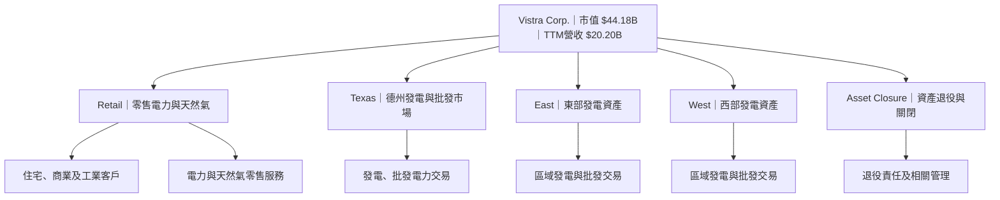
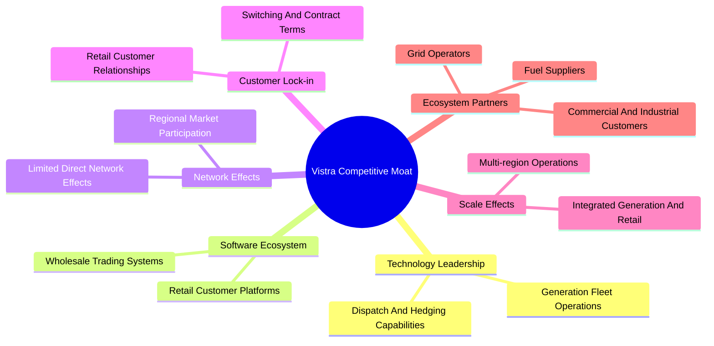
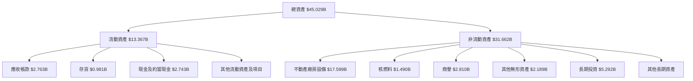
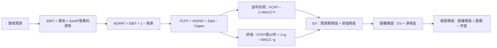
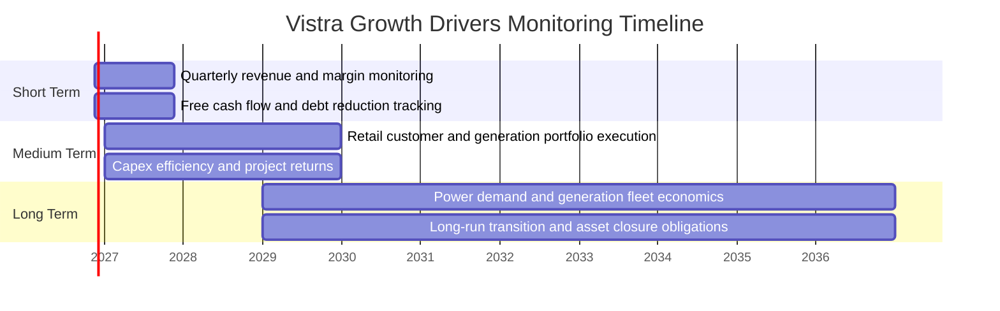
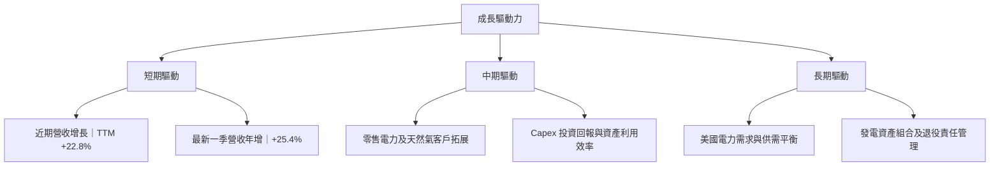
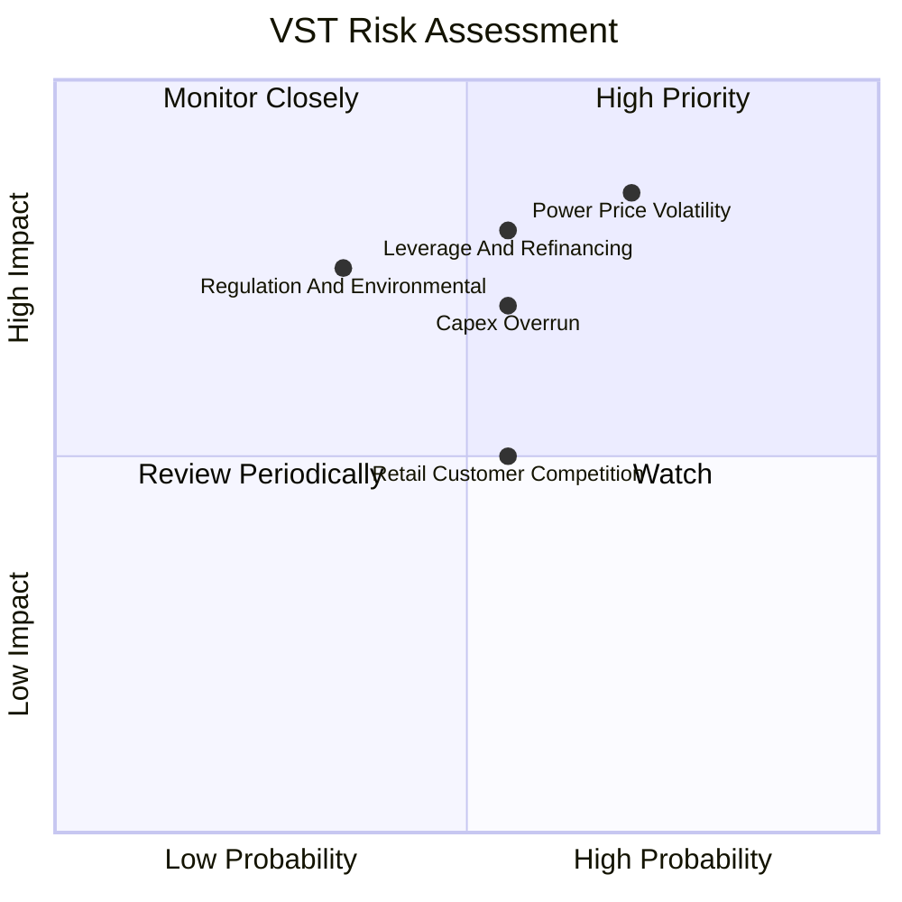
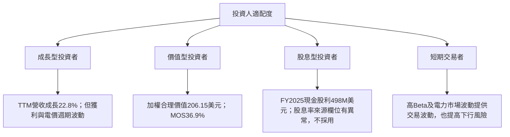

# VST 基本面深度分析報告
> **報告日期**：2026-11-17 ｜ **語言**：繁體中文 ｜ **數據來源**：SEC 申報資料 (XBRL)、Yahoo Finance、Finviz、StockAnalysis、Roic.ai ｜ **分析師**：CFA 級機構研究

## 目錄

| # | 章節 | 核心結論 |
|---|------|----------|
| 1 | 執行摘要 | 強烈買入；加權合理價值 $206.15；MOS +36.9% |
| 2 | 公司概覽與商業模式 | 綜合發電與零售電力模式具規模優勢，但市場份額與分部收入資料未提供 |
| 3 | 損益表深度分析 | TTM 營收 $20.20B、成長 22.8%；近期營業利益率高，但年度獲利波動明顯 |
| 4 | 資產負債表分析 | 淨負債 $18.40B；流動性尚可，槓桿與資本密集度是主要約束 |
| 5 | 現金流量深度分析 | TTM FCF $2.61B、FCF Yield 5.90%；年度 FCF 受投資與電力市場波動影響 |
| 6 | 獲利能力與資本效率 | ROIC 13.5% 高於 WACC 8.95%，目前創造正經濟利潤 |
| 7 | 相對估值分析 | 本益比低於歷史中位數；同業估值訊號分歧 |
| 8 | DCF 內在價值評估 | 基準 DCF $282.64；終值佔 EV 65.2%，估值對假設敏感 |
| 9 | 成長催化劑 | 電力需求、發電資產與零售業務可支持成長；TAM 數據未提供 |
| 10 | 風險矩陣 | 電力價格、監管／環境、資本支出與槓桿為主要風險 |
| 11 | 投資建議 | 依 MOS 評級為強烈買入；建議持續追蹤現金流、槓桿與營業利潤率 |

---

## 1. 執行摘要

截至 **2026-11-16 收盤價 $130.16**，VST 的加權合理價值為 **$206.15**，依統一定義安全邊際 MOS 為 **+36.9%**；ROIC 13.5% 高於 WACC 8.95%，表示現階段投入資本回報高於資金成本。TTM 營收 $20.20B、年增 22.8%，TTM FCF $2.61B、FCF Yield 5.90%，但公司仍有 $18.40B 淨負債，且 DCF 終值佔企業價值 65.2%。依 MOS 門檻及 ROIC/WACC 條件，評級為 **🟢 強烈買入**；此判斷成立的前提是成長與利潤率能大致沿基準情境延續，而非無條件外推。

### 1.0 一頁式投資儀表板（Portfolio Manager 30 秒速讀）

| 項目 | 內容 |
|------|------|
| **投資論點（3 句）** | ① TTM 營收 $20.20B、年增 22.8%，顯示電力與零售營運規模擴大。② TTM FCF $2.61B、FCF Yield 5.90%，現金流可支持去槓桿與資本投資。③ ROIC 13.5% 高於 WACC 8.95%，目前資本回報創造正價值。 |
| **綜合評分** | **7.1/10**（引用 1.1 評分卡） |
| **財務健康** | 🟡 淨負債 $18.40B；TTM OCF $5.76B 可提供現金流支撐，但資本密集與負債規模仍高。 |
| **ROIC vs WACC** | **13.5% vs 8.95%**，創造價值，利差 +4.55 個百分點。 |
| **FCF 趨勢** | TTM FCF $2.61B；年 FCF 曾由 FY2023 $3.78B 降至 FY2025 $1.32B，近期 TTM 回升；FCF Yield 5.90%。 |
| **估值** | Forward P/E 13.9x ｜ EV/EBITDA 8.37x（市場估值資料）｜ FCF Yield 5.90%。 |
| **DCF 內在價值（基準）** | **$282.64** ｜ 現價相對 DCF 折價 **−53.96%**（現價 ÷ DCF − 1）。 |
| **安全邊際（MOS）** | **+36.9%＝($206.15 − $130.16) ÷ $206.15**，🟢 充足。 |
| **預期報酬（基準情境 12M）** | DCF 基準情境相對現價 **+117.2%**；此為模型情境結果，不是保證報酬。 |
| **關鍵風險（前二）** | 電力價格／市場機制變動造成獲利回落；高淨負債與高資本支出使自由現金流與再融資能力受壓。 |
| **評級 + 信心度** | 🟢 **強烈買入** ｜ 信心：中（估值折價明顯，但 DCF 終值占比高，且來源數據有差異）。 |

### 1.1 綜合評分卡（全報告唯一）

| 維度 | 評分（1–10） | 主要依據（引用數字與其來源章節） |
|------|--------------|----------------------------------|
| 成長性 | 8.0 | TTM 營收年增 22.8%、最新一季年增 25.4%（均為第 3 章 VERIFIED 指標）。 |
| 獲利能力 | 8.0 | TTM 營業利益率 21.0%、ROIC 13.5% 高於 WACC 8.95%，Piotroski F-Score 7/8（第 3、6 章）。 |
| 財務健康 | 5.5 | 淨負債 $18.40B；流動比率 1.157、速動比率 0.477；CCC 34 天（第 4 章）。 |
| 估值 | 8.0 | MOS +36.9%；P/E 17.6x，低於自身五年中位數 25.2x（第 7、8 章）。 |
| 護城河 | 6.0 | 綜合發電、零售電力與客戶服務平台具規模與整合優勢；未提供市場份額、分部獲利及客戶留存數據（第 2 章）。 |
| 管理層與資本配置 | 7.0 | FY2025 SBC $113M、約佔營收 0.64%；稀釋股數測試通過，歷年 Capex 高且回購資料未提供（第 3、5 章）。 |
| **綜合評分** | **7.1** | 六項算術平均：(8.0 + 8.0 + 5.5 + 8.0 + 6.0 + 7.0) ÷ 6 = **7.1**。 |

### 1.2 五大投資論點 + 三大核心風險

| 類型 | 項目 | 具體依據 | 信心度 |
|------|------|----------|--------|
| 🟢 **投資論點①** | 收入增長延續 | TTM 營收 $20.20B，TTM 年增 22.8%；最新一季年增 25.4%。若增長由零售客戶增加、電力需求及發電量支撐，將擴大營業槓桿。 | 🟢 高 |
| 🟢 **投資論點②** | 營運現金流具支撐力 | TTM OCF $5.76B、Capex $3.15B，按定義 FCF $2.61B；提供投資與償債資源。 | 🟢 高 |
| 🟢 **投資論點③** | 資本回報高於成本 | ROIC 13.5% 對 WACC 8.95%，正利差 4.55 個百分點。 | 🟢 高 |
| 🟢 **投資論點④** | 相對自身歷史估值偏低 | P/E 17.6x，低於五年中位數 25.2x；當前歷史百分位 20%。 | 🟡 中 |
| 🟢 **投資論點⑤** | 盈餘現金轉換尚可 | TTM FCF $2.61B，StockAnalysis TTM 淨利 $2.515B，換算 FCF/淨利約 103.8%；來源口徑有差異，應追蹤後續季度。 | 🟡 中 |
| 🟡 **風險①** | 商品與電力價格波動 | FY2025 營業利益 $2.13B，低於 FY2024 $4.08B；電力供需與避險結果可使盈利快速變動。 | 🟡 中 |
| 🔴 **風險②** | 淨負債與資本密集度 | 淨負債 $18.40B，TTM Capex $3.15B；若 FCF 下滑，去槓桿和股東回報空間會受限。 | 🔴 高衝擊 |
| 🟡 **風險③** | DCF 對長期假設敏感 | 基準 DCF 終值現值佔 EV 65.2%；WACC、永續成長率或終期利潤率變動會顯著影響估值。 | 🟡 中 |

### 1.3 快速統計卡片

| 指標 | 公司實際值（期間） | 同業中位數 | 狀態 |
|------|--------------------|------------|------|
| 營收成長（TTM） | **22.8%** | — | 🟢 |
| 營收成長（最新一季年增） | **25.4%** | **45.4%** | 🟡 |
| 毛利率（TTM） | **41.5%**（市場資料彙整口徑；來源口徑與 SEC 區塊不一致） | **25.2%** | 🟢* |
| 營業利益率（TTM） | **21.0%** | — | 🟢 |
| ROIC（TTM） | **13.5%** | — | 🟢 |
| Forward P/E | **13.9x** | **11.6x** | 🟡 |
| FCF Yield（TTM） | **5.90%** | — | 🟢 |
| Piotroski F-Score | **7 / 8**（8 項可判定測試） | — | 🟢 |

\* 毛利率公司值採市場資料彙整欄，peer 中位數取 CEG、NRG、TLN 的 25.2%；不同資料商的公司營收、毛利率口徑存在差異，不宜視為完全同口徑比較。

### 1.4 投資結論

```text
╔══════════════════════════════════════════════════════════════════╗
║                    📊 投資結論摘要                               ║
╠══════════════════════════════════════════════════════════════════╣
║  評級：🟢 強烈買入（MOS +36.9%，ROIC 13.5% > WACC 8.95%）        ║
║  價格（2026-11-16 收盤）：$130.16                                ║
║  DCF 內在價值（基準）：$282.64（現價折價 53.96%）                ║
║  安全邊際 MOS：+36.9%＝($206.15−$130.16)÷$206.15                ║
║  加權合理價值（8.8）：$206.15                                    ║
║  DCF 情境價值：                                                   ║
║    悲觀情境：$94.86（−27.1%）                                    ║
║    基準情境：$282.64（+117.2%）                                  ║
║    樂觀情境：$660.87（+407.7%）                                  ║
║  綜合評分：7.1/10（引用 1.1）                                    ║
║  適合投資人：能承受商品價格、槓桿與估值波動的長線成長型投資人   ║
╚══════════════════════════════════════════════════════════════════╝
```

---

## 2. 公司概覽與商業模式

### 2.1 業務結構與收入來源

公司資料描述 Vistra 為美國綜合零售電力與發電企業，涵蓋 Retail、Texas、East、West、Asset Closure 五個分部；各分部營收與獲利占比未提供，因此不以推估數字填補。



### 2.2 市場份額

市場份額數據未提供，亦沒有可引用的市場容量或分部銷售資料，因此不製作份額圖表。以 TTM 營收 $20.20B 與 22.8% 年增率看，VST 在獨立發電商中具相當營運規模；然而 CEG、NRG、TLN 的業務組合和毛利率差異明顯，單以營收不能推定市占率或競爭力排序。

### 2.3 競爭護城河分析



### 2.4 護城河強度

| 護城河項目 | 強度（強／中／弱） | 證據（引用數字或事實） | 會削弱它的情況 |
|------------|--------------------|------------------------|----------------|
| 技術與資產營運 | 中 | 公司同時營運發電與零售電力業務；員工 6,390 人。資產可用率及單位發電成本資料未提供。 | 設備老化、停機、燃料成本或維護費用上升。 |
| 軟體與交易能力 | 中 | 批發電力採購、銷售及零售客戶管理為營運內容；交易績效與留存率資料未提供。 | 避險失誤、交易風險管理不足、系統或資安事件。 |
| 網路效應 | 弱至中 | 區域電網與市場參與具一定規模效益，但未見直接網路效應量化資料。 | 市場規則改變、競爭者增加或區域供需失衡。 |
| 客戶鎖定 | 中 | 零售電力及天然氣面向住宅、商業與工業客戶；客戶數、流失率與合約期限未提供。 | 價格競爭、客戶轉換成本低、零售毛利受壓。 |
| 規模效應 | 中 | TTM 營收 $20.20B，且涵蓋多個區域與零售業務。 | 大型資產帶來高維護與資本支出，規模未轉化為較低成本。 |
| 生態夥伴 | 中 | 依賴電網、燃料供應商、批發市場及終端客戶；合作效益未量化。 | 燃料供應中斷、電網瓶頸或不利監管變更。 |

1.1 的護城河評分 **6.0/10**，反映其整合營運與規模帶來一定優勢，但市場份額、客戶留存與單位成本等關鍵護城河證據尚缺。

---

## 3. 損益表深度分析

> **口徑說明：**本報告的 TTM 核心指標優先採 SEC 10-Q／程式計算的 VERIFIED FIGURES：TTM 營收 $20.20B、營收年增 22.8%、營業利益率 21.0%。資料彙整的其他欄位另顯示 TTM 營收 $20.588B、最新季年增 27.7% 等不同數值；不以後者取代 VERIFIED FIGURES，歷史年度表則依列示年度財務數據計算。

### 3.1 年度收入成長趨勢（近4年）

FY2022 至 FY2025 營收由 $13.73B 增至 $17.74B，三年 CAGR 約 8.9%；FY2025 年增僅 3.0%，低於 FY2024 的 16.5%，顯示年度收入並非線性增長。TTM 年增 22.8% 高於 FY2025 成長，意味近期收入動能回升，但應確認是否主要來自電價、發電量或併購等不同因素。

```text
╔══════════════════════════════════════════════════════════════════╗
║              Vistra 年度收入趨勢（FY2022-FY2025）               ║
╠══════════════════════════════════════════════════════════════════╣
║  FY2022  $13.73B  ██████████████░░░░░░░░░░░  YoY：基期         ║
║  FY2023  $14.78B  ███████████████░░░░░░░░░░  YoY：+7.7%  🟡    ║
║  FY2024  $17.22B  ██████████████████░░░░░░░  YoY：+16.5% 🟢    ║
║  FY2025  $17.74B  ███████████████████░░░░░░  YoY：+3.0%  🟡    ║
║                                                                  ║
║  FY2022-FY2025 營收 CAGR：約 +8.9%                               ║
╚══════════════════════════════════════════════════════════════════╝
```

年度營收成長算式：FY2023 = $14.78B ÷ $13.73B − 1 = **7.7%**；FY2024 = $17.22B ÷ $14.78B − 1 = **16.5%**；FY2025 = $17.74B ÷ $17.22B − 1 = **3.0%**。三年 CAGR = \((17.74 ÷ 13.73)^{1/3}−1\) ≈ **8.9%**。

### 3.2 季度收入趨勢分析

| 季度 | 營收 | QoQ 成長 | YoY 成長 | 備註 |
|------|------|----------|----------|------|
| 2025 Q4 | $4.58B | −7.8% | 13.5% | QoQ 對比 2025 Q3；季節性與市場價格可影響季度收入。 |
| 2026 Q1 | $5.64B | +23.1% | 43.4% | YoY 依季度歷史表列示。 |
| 2026 Q2 | $4.02B | −28.8% | −5.5% | 季度波動較大；不同來源對年增率有差異。 |
| 2026 Q3 | $6.35B | +58.0% | **+25.4%** | +25.4% 為 VERIFIED FIGURES 的單季 YoY；不是 TTM 成長率。 |

QoQ 算式例：2026 Q3 = $6.35B ÷ $4.02B − 1 ≈ **58.0%**。此 QoQ 增幅不應直接年化，因批發電力市場具有季節性與價格波動。

### 3.3 利潤率演變分析

| 利潤率指標 | FY2022 | FY2023 | FY2024 | FY2025 | 趨勢 | 評估 |
|------------|--------|--------|--------|--------|------|------|
| **毛利率** | 12.2% | 37.4% | 43.7% | 32.9% | FY2024 升、FY2025 回落 | 🟡 |
| **營業利益率** | −8.0% | 18.3% | 23.7% | 12.0% | FY2024 高點後收縮 | 🟡 |
| **淨利率** | −9.0% | 9.0% | 15.5% | 5.3% | FY2025 顯著下降 | 🟡 |

計算基礎為年度毛利、營業利益與淨利除以年度營收。例如 FY2025 營業利益率 = $2.13B ÷ $17.74B ≈ **12.0%**。年度利潤率起伏遠大於營收成長幅度，與發電組合、電力價格、燃料成本、避險及資產相關項目變動相符；但所提供資料不足以將年度利潤率差異分解為各因素貢獻。

與年度數據相比，程式計算的最新 TTM 營業利益率為 **21.0%**、最新單季為 **28.5%**。這可能代表近期營運改善，也可能受季度發電價格、季節性或一次性項目影響，不能直接當成可持續的長期利潤率。

### 3.4 費用結構分析

缺少完整 TTM 費用科目與各費用項目的拆分，無法建立可複核的費用結構圓餅圖。可確認的是 TTM D&A 約為 DCF 假設中的營收 10.4%，Capex 約為營收 15.6%；二者屬現金流與投資強度指標，不可誤作損益費用占比。

### 3.5 季度 EPS 趨勢與盈餘品質（Quality of Earnings）

**EPS 預估與實際比較資料：**最近四季的 EPS Estimate 與 Surprise 欄位均為缺值，因此無法判定四季是超預期或不及預期，亦不能以收入或淨利增長替代 EPS surprise。另一來源列示季度 EPS：2025 Q4 $0.55、2026 Q1 $2.90、2026 Q2 $0.77、2026 Q3 $3.26；不同財務資料源對部分季度淨利及 EPS 存在口徑差異，故只描述實際值，不判定 beat/miss。

| 盈餘品質項目 | 數值／佔比 | 評估 |
|--------------|-----------|------|
| 股權薪酬 SBC / 營收 | FY2025 SBC $113M ÷ 營收 $17.738B = **0.64%** | 🟢 比重不高，但仍屬股東經濟成本；稀釋股數測試未增加。 |
| SBC / 營業現金流 | FY2025 $113M ÷ OCF $4.07B = **2.78%** | 🟢 SBC 相較營運現金流有限；FY2025 為年度口徑。 |
| FCF / 淨利（現金轉換率） | TTM FCF $2.61B ÷ StockAnalysis TTM 淨利 $2.515B ≈ **103.8%** | 🟢 略高於 100%；使用不同資料源的淨利，視為近似比較。 |
| 一次性／非經常性損益 | N/A（未提供明確調節表） | 無法判斷非經常項目對 GAAP 盈餘的影響。 |
| 有效稅率異常 | **15.9%**（最新年度有效稅率） | 未見足夠歷史稅率資料判定是否異常；DCF 使用同一稅率。 |
| 資本化支出 vs 費用化 | TTM Capex $3.15B；費用化／資本化明細 N/A | Capex 規模大，會拖累 FCF；缺少明細，不能判斷是否有成本遞延或不當資本化。 |

**盈餘品質結論：**FCF 約為 TTM 淨利的 103.8%，表面上現金轉換合理；SBC 相對營收不高，且 F-Score 的稀釋股數測試通過。但電力業資本支出與商品市場會令年度現金流變化，且一次性損益與資本化政策明細缺漏，因此對 GAAP 盈餘的持續性採中性判斷，不將單季高利潤率直接外推。

---

## 4. 資產負債表分析

### 4.1 資產結構分解

以下採 StockAnalysis 2026-09-30 資產負債表列示的總資產 $45.029B 與細項；與其他資料表的資產總額可能因資料源及科目分類不同而有差異。



### 4.2 流動性與營運資金分析

| 指標 | 最新值 | 歷史趨勢 | 評估 |
|------|--------|----------|------|
| 流動比率 | 1.157 | 年度流動資產與流動負債數據來源存在差異 | 🟡 高於 1，但並非大量流動性緩衝。 |
| 速動比率 | 0.477 | 同上 | 🟡 低於 1，需依賴營運現金流及資產周轉。 |
| 現金及短期投資 | $2.74B | 2025 年底現金 $0.785B；期間現金有變動 | 🟢 近期現金水位上升，但遠低於總債務。 |

**營運資金天數（照錄品質指標）：**

| 指標 | 最新 TTM | 一年前 TTM | 變化 | 解讀 |
|------|----------|------------|------|------|
| DSO 應收帳款天數 | 50 天 | 52 天 | −2 天 | 收款天數略降，方向上有利營運資金；未提供應收帳款帳齡與壞帳資料。 |
| DIO 存貨天數 | 30 天 | N/A | N/A | 前期資料未提供／公司未報列可用餘額，不作推算。 |
| DPO 應付帳款天數 | 45 天 | N/A | N/A | 前期資料缺漏，無法判斷供應商付款期限變化。 |
| CCC 現金轉換週期 | 34 天 | N/A | N/A | 最新值為 50 + 30 − 45 = 35 天；品質指標原值為 34 天，可能受未四捨五入底層數字影響，照錄原值。 |

### 4.3 債務結構分析

```text
╔══════════════════════════════════════════════════════════════════╗
║                   Vistra 債務健康診斷                            ║
╠══════════════════════════════════════════════════════════════════╣
║  總債務：             $21.15B  ████████████████████  🔴 高       ║
║  現金及短期投資：      $2.74B  ███░░░░░░░░░░░░░░░░░  🟡         ║
║  淨負債：             $18.40B  █████████████████░░░  🔴         ║
║                                                                  ║
║  Debt/EBITDA：N/A（未提供同口徑 EBITDA 與負債計算輸入）          ║
║  利息保障倍數：N/A（利息費用金額未提供）                         ║
║  流動比率：1.157                                             🟡 ║
║  速動比率：0.477                                             🟡 ║
║                                                                  ║
║  判斷：現金流可提供債務服務來源，但槓桿限制財務彈性。             ║
╚══════════════════════════════════════════════════════════════════╝
```

淨負債採 VERIFIED FIGURES：$21.15B 總債務減 $2.74B 現金及短期投資，程式計算值為 **$18.40B**（四捨五入差異）。其他市場資料另列總債務 $21.77B、淨負債 $19.02B；本報告核心分析依 VERIFIED FIGURES 原值，提醒讀者核對最新申報口徑。

### 4.4 股東權益趨勢

| 年度 | 股東權益 | YoY 變化 |
|------|----------|----------|
| 2022 | $4.90B | — |
| 2023 | $5.31B | +8.4% |
| 2024 | $5.57B | +4.9% |
| 2025 | $5.10B | −8.4% |

```text
╔══════════════════════════════════════════════════════════════════╗
║                Vistra 股東權益趨勢（年度）                       ║
╠══════════════════════════════════════════════════════════════════╣
║  FY2022  $4.90B  █████████████████░░░░░░░░░░░                  ║
║  FY2023  $5.31B  ██████████████████░░░░░░░░░░                  ║
║  FY2024  $5.57B  ███████████████████░░░░░░░░                  ║
║  FY2025  $5.10B  █████████████████░░░░░░░░░░                  ║
║  FY2025 較 FY2024 減少約 8.4%，須配合股利、淨利與其他綜合損益追蹤。║
╚══════════════════════════════════════════════════════════════════╝
```

---

## 5. 現金流量深度分析

### 5.1 現金流量瀑布圖

因最新 TTM 淨利的 SEC 同口徑數字未在核心資料中提供，圖中保留「未提供」，不以其他來源替代；股利以 FY2025 年度資料表示。


### 5.2 FCF 轉換率趨勢

| 年度 | FCF | 淨利 | FCF／淨利 | 解讀 |
|------|-----|------|-----------|------|
| 2022 | −$0.816B | −$1.23B | 66.3% | 兩者均為負數，比例不宜作一般現金轉換解讀。 |
| 2023 | $3.78B | $1.49B | 253.7% | 現金流高於淨利，但可能受營運資金與市場收付款波動影響。 |
| 2024 | $2.48B | $2.66B | 93.2% | 現金轉換接近淨利。 |
| 2025 | $1.32B | $0.944B | 139.8% | FCF 高於淨利，但兩者絕對值均較 FY2024 低。 |
| TTM | $2.61B | $2.515B（StockAnalysis） | 約 103.8% | 跨資料源近似值；需以 SEC TTM 淨利核對。 |

### 5.3 自由現金流趨勢

```text
╔══════════════════════════════════════════════════════════════════╗
║                 自由現金流趨勢（OCF − Capex）                    ║
╠══════════════════════════════════════════════════════════════════╣
║  FY2022  −$0.816B  ◀░░░░░░░░░░░░░░░░░░░░  FCF 為負             ║
║  FY2023   $3.780B  ████████████████████░░  FCF 強勁反彈         ║
║  FY2024   $2.480B  █████████████░░░░░░░░░  YoY：−34.4%         ║
║  FY2025   $1.320B  ███████░░░░░░░░░░░░░░░  YoY：−46.8%         ║
║  TTM      $2.610B  ██████████████░░░░░░░░  FCF Yield：5.90%    ║
╚══════════════════════════════════════════════════════════════════╝
```

TTM FCF 為 **$5.76B − $3.15B = $2.61B**，且 FCF Yield 為 5.90%。FY2025 FCF 相較 FY2024 減少 46.8%，表示現金流波動不可忽略；最新 TTM 回升，能否延續仍取決於電力價格、營運資金及持續性資本支出。

### 5.4 資本配置評估

未提供完整回購金額、投資收購支出與留存現金變化資料，因此不製作含推估比例的圓餅圖。

| 資本配置項目 | 可用數據 | 評估 |
|--------------|----------|------|
| 資本支出 | TTM $3.15B；FY2025 $2.75B | 資本密集，支出高於股利；須確認投資回報與維持性／成長性 Capex 區分。 |
| 現金股利 | FY2025 $498M | 約占 FY2025 FCF $1.32B 的 37.7%；依年度值計算。 |
| 股票回購 | N/A | 未提供可引用金額。 |
| 留存與償債 | N/A | 缺少現金用途完整調節表，無法拆分。 |
| SBC | FY2025 $113M | 相對營收約 0.64%，稀釋股數測試通過。 |

---

## 6. 獲利能力與資本效率

### 6.1 ROE / ROA / ROIC 趨勢

| 指標 | 歷史數據 | 最新值 | 評估 |
|------|----------|--------|------|
| ROE | VERIFIED TTM **42.9%**；市場彙整另列 46.3% | 42.9% | 🟢 高，但 DuPont 權益乘數達 7.14，槓桿貢獻顯著。 |
| ROA | F-Score 顯示 TTM 為正且高於一年前；精確數值 N/A | N/A | 🟡 缺少可直接統一口徑的歷史序列。 |
| ROIC | TTM **13.5%** | 13.5% | 🟢 高於 WACC 8.95%，但須留意電力週期及資本投資需求。 |

未提供足以建立同口徑多年 ROIC/ROA 序列的資料，本節不填補行業均值。

### 6.2 ROIC vs WACC 分析（核心價值創造判斷）

```text
╔══════════════════════════════════════════════════════════════════╗
║                ROIC vs WACC 深度分析                            ║
╠══════════════════════════════════════════════════════════════════╣
║  WACC（依資本成本資料）：                                        ║
║  ├── 無風險利率（10Y美債）：             5.12%                   ║
║  ├── 市場風險溢酬 ERP：                 5.00%                   ║
║  ├── 原始 Beta：                        1.38                    ║
║  ├── 調整 Beta：                        1.25                    ║
║  ├── 股權成本：5.12% + 1.25×5.00% =     11.37%                  ║
║  ├── 稅前債務成本：                     4.64%                   ║
║  ├── 稅後債務成本：4.64%×(1−15.9%) =     3.90%                   ║
║  ├── 資本權重：股權 67.6%，債務 32.4%                           ║
║  └── WACC：                             8.95%                   ║
║                                                                  ║
║  ROIC：                                    13.5%                 ║
║  EVA 利差：13.5% − 8.95% =                  +4.55pp              ║
║                                                                  ║
║  ROIC  13.5%  ▓▓▓▓▓▓▓▓▓▓▓▓▓▓▓░░░░░░░  高於資本成本             ║
║  WACC   8.95% ▓▓▓▓▓▓▓▓▓▓░░░░░░░░░░░░░  折現率                   ║
║                                                                  ║
║  結論：目前 ROIC 高於 WACC，代表投入資本正創造股東經濟價值。     ║
║  注意：高槓桿可能放大 ROE，ROIC 較適合判斷營運資本回報。         ║
╚══════════════════════════════════════════════════════════════════╝
```

WACC 完整代入：股權成本 11.37%、債務稅後成本 \(4.64\%×(1−15.9\%)=3.90\%\)。因此 \(67.6\%×11.37\%+32.4\%×3.90\%=8.95\%\)（採資料提供的 WACC 原值）。無風險利率日期未另外提供，故以報告使用的 5.12% 為準。ROIC 13.5% 高於 WACC 8.95%，價值利差 **4.55 個百分點**；此結論是依 TTM ROIC，並非未來永久保證。

### 6.3 杜邦三因素分解

| 因素 | 數值（TTM） | 解讀 |
|------|-------------|------|
| 淨利率 | 13.4% | 淨利率是 ROE 的營運獲利來源之一。 |
| 資產週轉率 | 0.45 | 每單位資產產生的營收有限，符合資產密集型發電營運特徵。 |
| 權益乘數 | 7.14 | 財務槓桿高，放大股東報酬也會放大下行風險。 |
| **ROE** | **42.9%** | 13.4% × 0.45 × 7.14 = 42.9%（照錄品質指標）。 |

ROE 不應單獨視為高品質獲利訊號；權益乘數 7.14 顯示槓桿是重要放大因素。

### 6.4 財務體質：Piotroski F-Score

**Piotroski F-Score：7 / 8**（缺一項毛利率測試資料；不是 7/9）。

| 測試 | 結果 | 解讀 |
|------|------|------|
| ROA > 0 | ✅ 通過 | TTM 資產報酬為正。 |
| 營業現金流 > 0 | ✅ 通過 | TTM OCF $5.76B。 |
| ROA 高於一年前 | ✅ 通過 | 獲利回報較前期改善。 |
| 營業現金流 > 淨利（應計品質） | ✅ 通過 | 品質指標判定營運現金流高於淨利。 |
| 長期負債 ÷ 總資產低於一年前 | ❌ 未通過 | 槓桿相對資產未改善，需重視負債走勢。 |
| 流動比率高於一年前 | ✅ 通過 | 短期流動性指標較前期改善。 |
| 稀釋股數未增加 | ✅ 通過 | 未見稀釋股數增加的測試訊號。 |
| 毛利率高於一年前 | — 無法判定 | 缺少該測試所需資料。 |
| 資產週轉率高於一年前 | ✅ 通過 | 資產使用效率相較前期改善。 |

---

## 7. 相對估值分析

### 7.1 同業估值比較表格

公司倍數採市場估值資料欄；同業倍數依 Yahoo Finance Peer multiples。相對估值方法使用同業中位數，不以 VST 自身倍數反推目標價。

| 估值指標 | **VST** | **CEG** | **NRG** | **TLN** | VST 評估 |
|----------|---------|---------|---------|---------|-----------|
| **Trailing P/E** | 17.6x | 22.3x | 16.4x | N/A | 🟡 低於 CEG、高於 NRG；TLN 無數值。 |
| **Forward P/E** | 13.9x | 20.7x | 9.8x | 11.6x | 🟡 高於 peer 中位數 11.6x。 |
| **P/S Ratio** | 2.15x | 2.9x | 0.6x | 3.5x | 🟡 差異反映業務組合與毛利率不同。 |
| **EV/EBITDA** | 8.37x | 12.7x | 10.6x | 36.9x | 🟢 低於三家同業的中位數 12.7x。 |
| **最新一季營收年增** | 25.4% | 45.4% | 24.0% | 96.1% | 🟡 VST 高於 NRG、低於 CEG 與 TLN。 |
| **毛利率（TTM）** | 41.5%* | 25.2% | 20.2% | 42.7% | 🟡 VST 高於 CEG、NRG，略低於 TLN。 |

\* VST 毛利率來自市場資料彙整；公司內其他來源有不同口徑。  
Peer 中位數：Forward P/E = **11.6x**；EV/EBITDA = **12.7x**。

### 7.2 歷史估值區間分析

```text
╔══════════════════════════════════════════════════════════════════╗
║                 VST 五年估值區間（TTM multiples）                ║
╠══════════════════════════════════════════════════════════════════╣
║  P/E：      7.2x ├────────● 17.6x──────────┤ 74.3x             ║
║                         中位數 25.2x｜當前百分位 20%             ║
║  P/S：      0.5x ├──────────● 2.2x─────────┤ 4.2x              ║
║                         中位數 1.8x｜當前百分位 57%              ║
║  EV/EBITDA：2.3x ├────────● 9.8x───────────┤ 40.7x             ║
║                         中位數 11.0x｜當前百分位 40%             ║
╚══════════════════════════════════════════════════════════════════╝
```

P/E 17.6x 位於五年歷史第 20 百分位、低於中位數 25.2x，歷史定位偏低；P/S 2.2x 高於中位數 1.8x，位於第 57 百分位。估值訊號並非全面便宜，應配合獲利週期與資本支出判斷。

### 7.3 情境價值（Bear / Base / Bull，照抄 DCF MODEL 的 Scenarios）

| 情境 | 第 1 年營收成長 | 期末營業利潤率 | WACC | 每股價值 | 相對現價 | 機率 | 會發生的條件 |
|------|----------------|----------------|------|----------|----------|------|--------------|
| 🔴 悲觀 | 11.4% | 16.4% | 9.95% | $94.86 | −27.1% | 25% | 電力價格與發電利潤回落、增長放慢，且終期利潤率下降。 |
| 🟡 基準 | 22.8% | 19.3% | 8.95% | $282.64 | +117.2% | 50% | 營收增長由 TTM 22.8% 起步並逐步減速，營業利潤率回落至歷史中位數。 |
| 🟢 樂觀 | 34.3% | 21.2% | 7.95% | $660.87 | +407.7% | 25% | 電力需求與零售增長超出基準，且利潤率維持在較高水準、資金成本下降。 |

### 7.4 相對估值隱含價格區間

```text
╔══════════════════════════════════════════════════════════════════╗
║                相對估值法與 VST 價格位置                         ║
╠══════════════════════════════════════════════════════════════════╣
║  $108.84 ────────── $130.16 ─────────────── $183.69              ║
║  同業 Forward P/E       現價                 同業 EV/EBITDA        ║
║                                                                  ║
║  Forward P/E：$108.84，peer 中位數 11.6x × Forward EPS $9.36     ║
║  EV/EBITDA：  $183.69，peer 中位數 12.7x × TTM EBITDA，再加淨現金║
║  分析師共識： $199.66，23 位分析師平均目標價                    ║
╚══════════════════════════════════════════════════════════════════╝
```

按程式提供的估值方法，Forward P/E 法低於現價 16.4%，EV/EBITDA 法高於現價 41.1%；不同方法對盈利增長、資本結構與同業差異的敏感性不同，因此採權重加總，而非取單一倍數結論。

---

## 8. DCF 內在價值評估（Discounted Cash Flow）

### 8.0 估值推理鏈（Thinking Logic）

**Step 1 — 價值由哪些變數決定？**  
VST 的 DCF 價值主要由現有發電與零售業務的營收增長、GAAP 營業利潤率，以及 Capex 相對營收的下降路徑決定。公司沒有提供分部營收占比，故不能把特定業務增長拆成百分比；在模型中，主導估值的變數是 **WACC 與終值成長率 g 的差距**，其次是高增長能否延續與長期營業利潤率。敏感度表顯示 WACC 由 8.95% 升至 9.95%、g 固定 3.0% 時，每股價值由 $282.64 降至 $228.58。

**Step 2 — 模型選擇**

| 決策點 | 本報告採用 | 理由（含數字） | 曾考慮但否決 | 否決理由 |
|--------|-----------|----------------|--------------|----------|
| 現金流定義 | FCFF | 使用 NOPAT + D&A − Capex；與 WACC 折現並得出 EV 一致。 | FCFE | 淨負債 $18.40B，FCFF 避免把債務融資現金流混入營運現金流。 |
| 預測期 N | 10 年 | DCF 模型固定為 10 年；營收增長從 22.8% 線性降至 3.0%。 | 短期預測期 | 發電資產與長週期投資不宜只用短期現金流，但 10 年仍帶來較高預測不確定性。 |
| 終值方法 | Gordon Growth | 模型使用永續成長率 3.0%，低於 WACC 8.95%。 | 僅用退出倍數 | DCF 模型未提供退出倍數終值輸入，不能另建模型。 |
| EBIT 基礎 | GAAP | DCF 模型明列 GAAP EBIT。 | 非 GAAP EBIT | 避免將 SBC 加回後再漏計其股東成本。 |

**Step 3 — 關鍵假設推導鏈**

- **營收成長路徑**：錨點＝TTM 營收年增 22.8%；調整＝模型設定第 1 年沿用 TTM 成長，之後線性衰減至第 10 年 3.0%，反映基期墊高與成熟期收斂；**採用第 1 年 22.8%、第 10 年 3.0%**；未採用十年維持 22.8%，因其會把短期高增長無限外推。
- **期末營業利潤率**：錨點＝TTM 營業利益率 21.0%；調整＝模型以近五個財年的中位數作長期錨，並由 21.0% 線性降至 19.3%；**採用 19.3%**；未維持 21.0%，因年度歷史營業利益率在 FY2024 與 FY2025 之間已有明顯波動。
- **永續成長率 g**：錨點＝長期成熟企業現金流需低於折現率；模型採 **3.0%**，且 WACC 為 8.95%；未採用高於 WACC 或更高的永續增長，因會令 Gordon Growth 不具經濟可行性。
- **預測期 N**：錨點＝公司 TTM 成長 22.8%，但年度收入成長 FY2025 只有 3.0%；調整＝以 10 年呈現成長收斂，而非假設短期成長立即消失；**採用 10 年**；不採更長期預測，因遠期資產價格及資本支出可見度有限。
- **Capex／營收**：錨點＝TTM Capex $3.15B／營收 $20.20B，約 15.6%；調整＝模型逐年下降至第 10 年 11.5%，即 1.1 倍 D&A（D&A／營收 10.4%）；**採用 15.6% 線性降至 11.5%**；未固定 15.6%，因模型假設增長成熟後資本支出強度下降。
- **EBIT 與 SBC**：錨點＝GAAP EBIT；調整＝模型不再從 FCFF 扣 SBC，且股數不額外稀釋；**採用組合 (A)**；未採非 GAAP 加回 SBC，避免同一 SBC 成本被漏計或重複計算。
- **年稀釋率**：錨點＝品質指標顯示稀釋股數未增加；調整＝與組合 (A) 一致；**採用固定股數／年稀釋率 0%**；未額外假設稀釋，因 SBC 已經反映在 GAAP EBIT 費用中。
- **WACC**：錨點＝程式資本成本輸入 WACC 8.95%；**採用 8.95%**；不另改 WACC，遵守統一資本成本輸入。
- **營運資金**：模型明確未建模 ΔWC；不補入臆測比例，避免把缺失資料偽裝成實際輸入。

**Step 4 — 最脆弱一環**  
最脆弱的是 10 年增長與 Capex 強度同時收斂的假設；若增長未能實現或 Capex 長期維持高位，FCFF 會低於基準，估值將向敏感度矩陣中的較低值移動。

**Step 5 — 計算路徑**



### 8.1 模型假設總表（Model Inputs）

| 假設項目 | 採用值 | 依據／來源 | 敏感度 |
|----------|--------|-------------|--------|
| 預測期長度 **N** | 10 年 | DCF MODEL 固定輸入；涵蓋營收由高成長向成熟收斂。 | 🟡 中 |
| 營收成長 | FY+1 22.8%，FY+10 3.0%，逐年線性下降 | TTM vs prior TTM 成長 22.8%；終期 3.0% 為模型假設值。 | 🔴 高 |
| 營業利潤率 | FY+1 21.0% → FY+10 19.3% | TTM 21.0%；19.3% 為含 TTM 的近五年中位數。 | 🔴 高 |
| 有效稅率 | 15.9% | 最新年度 effective tax rate。 | 🟢 低 |
| Capex／營收 | FY+1 15.6% → FY+10 11.5% | TTM Capex／營收起點；終點依 1.1×D&A。 | 🟡 中 |
| D&A／營收 | 10.4% | DCF MODEL 使用 TTM 比例。 | 🟢 低 |
| 營運資金變動 | 未建模 | DCF MODEL 明確未建模 working capital；不自行補假設值。 | 🟢 低 |
| EBIT 基礎 | GAAP | DCF MODEL 明列 GAAP EBIT。 | 🟡 中 |
| SBC 處理 | GAAP EBIT 已含 SBC，不再扣 SBC | 組合 (A)。**本模型採用 (A)，故 SBC 影響已計入一次。** | 🟡 中 |
| 年稀釋率 | 0%／固定股數 | 與 GAAP EBIT + SBC 已費用化之組合一致。 | 🟡 中 |
| 永續成長率 g | 3.0% | DCF MODEL 固定輸入；低於 WACC 8.95%。 | 🔴 高 |
| 終值方法 | Gordon Growth | DCF MODEL 提供該方法；未提供退出倍數終值的模型輸入。 | 🔴 高 |
| WACC | 8.95% | Cost of capital 程式計算輸入；詳見 8.2。 | 🔴 高 |

FCFF 定義：**FCFF = NOPAT + D&A − Capex**；營運資金變動不建模。SBC 在 GAAP EBIT 中已費用化，沒有額外扣 SBC，股數不再稀釋。

### 8.2 折現率推導（WACC）

```text
╔══════════════════════════════════════════════════════════════════╗
║                    WACC 推導（折現率）                           ║
╠══════════════════════════════════════════════════════════════════╣
║  股權成本 Ke（CAPM）：                                           ║
║  ├── 無風險利率 Rf（10Y 美債）：        5.12%                   ║
║  ├── 市場風險溢酬 ERP：                 5.00%（假設值）         ║
║  ├── 原始 Beta（Yahoo）：               1.38                    ║
║  ├── 調整 Beta：                        1.25                    ║
║  ├── 調整方式：2/3×1.38 + 1/3×1 =       1.253 ≈ 1.25           ║
║  ├── 規模／國別溢酬：                   0.00%（未另加）         ║
║  └── Ke = 5.12% + 1.25×5.00% =         11.37%                  ║
║                                                                  ║
║  債務成本 Kd：                                                   ║
║  ├── 稅前 Kd：                          4.64%                   ║
║  ├── 有效稅率：                         15.9%                   ║
║  └── 稅後 Kd = 4.64%×(1−15.9%) =        3.90%                   ║
║                                                                  ║
║  資本結構：股權 67.6%，債務 32.4%                               ║
║  ✅ WACC = 67.6%×11.37% + 32.4%×3.90% = 8.95%                   ║
╚══════════════════════════════════════════════════════════════════╝
```

**五步演算與資料限制**

1. **Ke（CAPM）** = \(Rf + β×ERP\) = \(5.12\% + 1.25×5.00\%\) = **11.37%**。Beta 調整前為 Yahoo 原始 1.38，調整後按 \(2/3×1.38+1/3×1\) 得 1.253，採用原區塊 1.25。ERP 5.00% 為假設值；規模／國別溢酬未另計。
2. **稅前 Kd** = **4.64%**（程式資本成本輸入，定義為利息 ÷ 債務）。原始利息費用與平均計息負債分項未完整提供，無法獨立重建分子與平均負債；故照錄輸入，不以總負債自行回推。
3. **稅後 Kd** = \(4.64\%×(1−15.9\%)\) = **3.90%**。
4. **權重** = 股權 **67.6%**、債務 **32.4%**，合計 **100.0%**。資本成本輸入已提供市值基礎權重；本報告不以股東權益帳面值取代。
5. **WACC** = \(67.6\%×11.37\% + 32.4\%×3.90\%\) = \(7.686\%+1.264\%\) = **8.95%**（按原輸入值取兩位小數）。

本 WACC 與第 6.2 節採同一數值。由於成本資本輸入提供權重，但沒有完整列出市值及計息債務的同日拆分，故第 2、4 步屬引用已計算輸入，而非重新估算。

### 8.3 逐年自由現金流預測（基準情境）

單位：金額 $B；折現因子保留三位小數。表內數值依 DCF MODEL 原值照錄。模型沒有營運資金列，也沒有 SBC 扣除列，符合組合 (A)。

| 年度 | FY+1 | FY+2 | FY+3 | FY+4 | FY+5 | FY+6 | FY+7 | FY+8 | FY+9 | FY+10 |
|------|------:|------:|------:|------:|------:|------:|------:|------:|------:|-------:|
| 營收 | 24.81 | 29.93 | 35.45 | 41.20 | 46.98 | 52.54 | 57.59 | 61.85 | 65.07 | 67.03 |
| 營收 YoY | 22.8% | 20.6% | 18.4% | 16.2% | 14.0% | 11.8% | 9.6% | 7.4% | 5.2% | 3.0% |
| 營業利潤率 | 21.0% | 20.8% | 20.6% | 20.4% | 20.2% | 20.0% | 19.8% | 19.6% | 19.4% | 19.3% |
| EBIT（GAAP） | 5.20 | 6.22 | 7.29 | 8.40 | 9.49 | 10.51 | 11.41 | 12.14 | 12.65 | 12.91 |
| − 稅 | (0.83) | (0.99) | (1.16) | (1.34) | (1.51) | (1.68) | (1.82) | (1.94) | (2.02) | (2.06) |
| NOPAT | 4.37 | 5.22 | 6.13 | 7.06 | 7.98 | 8.84 | 9.60 | 10.21 | 10.64 | 10.85 |
| + D&A | 2.58 | 3.12 | 3.69 | 4.29 | 4.89 | 5.47 | 6.00 | 6.44 | 6.78 | 6.98 |
| − Capex | (3.88) | (4.54) | (5.21) | (5.86) | (6.47) | (6.99) | (7.40) | (7.66) | (7.75) | (7.68) |
| **FCFF** | **3.08** | **3.80** | **4.61** | **5.49** | **6.40** | **7.32** | **8.20** | **8.99** | **9.66** | **10.15** |
| 折現因子 @8.95% | 0.918 | 0.842 | 0.773 | 0.710 | 0.651 | 0.598 | 0.549 | 0.504 | 0.462 | 0.424 |
| **FCFF 現值 PV** | **2.82** | **3.20** | **3.57** | **3.89** | **4.17** | **4.37** | **4.50** | **4.53** | **4.46** | **4.31** |

**預測期現值總和（按模型列示）**  
\(2.82+3.20+3.57+3.89+4.17+4.37+4.50+4.53+4.46+4.31=\)**39.82B**。  
DCF MODEL 列示預測期 PV 合計為 **$39.83B**；相差 $0.01B，屬逐年列值四捨五入尾差，照錄模型合計 $39.83B。

**FY+1 逐步演算（模型呈現精度）**

1. **營收** = $20.20B × (1 + 22.8%) = $20.20B × 1.228 = **$24.81B**。
2. **EBIT** = $24.81B × 21.0% = **$5.20B**（模型原值）。
3. **稅** = $5.20B × 15.9% = **$0.83B**。
4. **NOPAT** = $5.20B − $0.83B = **$4.37B**。
5. **D&A** = $24.81B × 10.4% = **$2.58B**。
6. **Capex** = $24.81B × 15.6% = **$3.88B**。
7. **ΔWC** = 模型未建模，未扣除。
8. **FCFF** = NOPAT + D&A − Capex；按模型顯示值為 \(4.37+2.58−3.88=3.07B\)，模型表列 **$3.08B**。差異來自各輸入保留兩位小數前的未四捨五入值；採用 DCF MODEL 原列值，不替換。
9. **折現因子** = \(1÷(1+8.95\%)^1=0.918\)；**PV** = $3.08B × 0.918 = **$2.82B**（模型原值）。

**合理性自檢**

- 預測 FCFF：FY+1 $3.08B 至 FY+10 $10.15B，九年間年化約 **14.2%**；FY2022–FY2025 歷史 FCF 由 −$0.816B 至 $1.32B，負值起點使 CAGR 不具可比性；FY2023–FY2025 FCF 由 $3.78B 降至 $1.32B，顯示模型採用的未來增長高於近期年度趨勢，依據是營收與利潤率假設改善。
- FY+10 FCFF 利潤率 = $10.15B ÷ $67.03B ≈ **15.1%**；目前 TTM FCF 利潤率 = $2.61B ÷ $20.20B ≈ **12.9%**。未提供同業最佳 FCF 利潤率，故不作同業最佳比較。
- 表列各年 FCFF 均為正值；FCFF 從 $3.08B 升至 $10.15B，對估值貢獻遞增。

```text
╔══════════════════════════════════════════════════════════════════╗
║            自由現金流：歷史實際 vs 模型預測                      ║
╠══════════════════════════════════════════════════════════════════╣
║  FY2023(實)   $3.78B  ████████░░░░░░░░░░░░░░  歷史高點          ║
║  FY2024(實)   $2.48B  █████░░░░░░░░░░░░░░░░░  YoY：−34.4%      ║
║  FY2025(實)   $1.32B  ███░░░░░░░░░░░░░░░░░░░  YoY：−46.8%      ║
║  FY+1 (預)    $3.08B  ██████░░░░░░░░░░░░░░░░  模型值            ║
║  FY+10(預)   $10.15B  ████████████████████░░  模型值            ║
╠══════════════════════════════════════════════════════════════════╣
║  ⚠️ 預測 FCF 增長與近期歷史下降趨勢不同，取決於收入擴張與Capex率 ║
║     逐步下降能否實現。                                            ║
╚══════════════════════════════════════════════════════════════════╝
```

### 8.4 終值計算（Terminal Value）

**適用性檢查：**WACC **8.95%** vs g **3.0%** → WACC > g？✅

| 方法 | 計算式 | 終值 TV | TV 現值 | 佔總 EV 比重 |
|------|--------|---------|---------|--------------|
| Gordon Growth | FCFF FY+10 × (1+g) ÷ (WACC − g) | $175.63B | $74.50B | 65.2% |
| 退出倍數法 | N/A（DCF MODEL 未提供此方法輸入） | N/A | N/A | N/A |

**逐步演算（依 DCF MODEL 原值）**

1. **FY+10 FCFF** = **$10.15B**。
2. **分子** = $10.15B × (1 + 3.0%) = **$10.4545B**（模型終值以未四捨五入 FCFF 計算）。
3. **分母** = 8.95% − 3.0% = **5.95%**；TV = **$175.63B**（模型原值）。
4. **PV(TV)** = $175.63B × 0.424 = **$74.50B**（模型原值）。
5. **終值佔比** = $74.50B ÷ $114.33B = **65.2%**。

退出倍數法未在 DCF MODEL 提供，故不自行假設倍數或另建終值。

### 8.5 企業價值 → 每股內在價值（Bridge）

```text
╔══════════════════════════════════════════════════════════════════╗
║              企業價值 → 每股內在價值 橋接表                      ║
╠══════════════════════════════════════════════════════════════════╣
║  預測期 FCF 現值合計             +$39.83B                        ║
║  終值現值 PV(TV)                 +$74.50B                        ║
║  ─────────────────────────────────────────────                  ║
║  = 企業價值 EV                    $114.33B                       ║
║  + 淨現金（負數代表淨負債）       −$18.40B                        ║
║  = 股權價值                       $95.93B                         ║
║  每股內在價值（DCF MODEL 原值）   $282.64                         ║
║  當前股價（2026-11-16 收盤）       $130.16                         ║
║  折溢價：現價÷DCF價值−1            −53.96%（折價）                ║
╚══════════════════════════════════════════════════════════════════╝
```

**逐步演算**

1. **EV** = $39.83B + $74.50B = **$114.33B**。
2. **股權價值** = EV $114.33B + 淨現金（−$18.40B） = **$95.93B**。
3. **每股內在價值** = DCF MODEL 以「股權價值 × 價格 ÷ 市值」換算，原值 **$282.64**。市值與股數的隱含換算及未四捨五入輸入由程式模型處理；不另以其他股數口徑改寫模型結果。
4. **折溢價** = $130.16 ÷ $282.64 − 1 = **−53.96%**。
5. **本節不計算 MOS**；MOS 一律以第 8.8 節加權合理價值作分母。

現金及債務以 VERIFIED FIGURES 的現金加短期投資 $2.74B、總債務 $21.15B 所得淨現金 −$18.40B 為準。DCF 每股換算使用程式提供的原值；市場資料另列流通股數 339.39M，但模型明確指定以 equity value × price ÷ market cap 換算，不以另一種股數算法替代。

### 8.6 敏感性分析（WACC × 永續成長率）

下表照錄 DCF MODEL 每股價值；括號為依當前價 $130.16 計算的上行空間。基準格為 WACC 8.95%、g 3.0%。

| g（列）／WACC（欄） | 6.95% | 7.95% | **8.95%（基準）** | 9.95% | 10.95% |
|-----------|------:|------:|------------------:|------:|-------:|
| 2.0% | $391.22（+200.6%） | $308.07（+136.7%） | $249.25（+91.5%） | $205.56（+57.9%） | $171.90（+32.1%） |
| 2.5% | $428.23（+229.0%） | $331.20（+154.5%） | $264.65（+103.4%） | $216.30（+66.2%） | $179.65（+38.0%） |
| 3.0% | $474.61（+264.7%） | $359.00（+175.8%） | **$282.64（+117.2%）** | $228.58（+75.6%） | $188.38（+44.7%） |
| 3.5% | $534.42（+310.6%） | $393.04（+201.9%） | $303.93（+133.5%） | $242.77（+86.5%） | $198.28（+52.3%） |
| 4.0% | $614.48（+372.1%） | $435.70（+234.7%） | $329.52（+153.2%） | $259.34（+99.2%） | $209.60（+61.0%） |

例如基準格上行空間 = \(($282.64−$130.16)÷$130.16\) = **117.2%**。矩陣由 DCF MODEL 程式計算；因未提供各敏感度格的逐年折現現值中間表，不重建矩陣格的內部中間值，以免變更模型口徑。

**三情境 DCF（程式提供的 Scenarios）**

| 情境 | 第 1 年營收成長 | 期末營業利潤率 | 永續成長 g | WACC | 每股內在價值 | 相對現價 | 主觀機率 |
|------|-----------:|-----------:|-----------:|-----:|-------------:|---------:|---------:|
| 🔴 悲觀 | 11.4% | 16.4% | DCF 模型情境未另列 | 9.95% | $94.86 | −27.1% | 25% |
| 🟡 基準 | 22.8% | 19.3% | 3.0% | 8.95% | $282.64 | +117.2% | 50% |
| 🟢 樂觀 | 34.3% | 21.2% | DCF 模型情境未另列 | 7.95% | $660.87 | +407.7% | 25% |
| **機率加權** | — | — | — | — | **$330.26** | **+153.7%** | **100%** |

情境價值與機率完全照錄模型。各情境完整的 FY+10 營收、FCFF 與終值分拆未在 DCF MODEL 列出，因此不能補寫未提供的逐項情境算式；模型提供的情境價值不可視為本報告另行建立之獨立情境估值。

**敏感度結論**

- g 由 2.0% 升至 3.0%、WACC 固定 8.95%：$249.25 → $282.64，增加 **$33.39／13.4%**。
- WACC 由 8.95% 升至 9.95%、g 固定 3.0%：$282.64 → $228.58，下降 **$54.06／19.1%**。
- 期末營業利潤率每 +1pp 的獨立價值敏感度：**N/A（DCF MODEL 未提供單變數利潤率敏感度格）**。
- 上述已提供敏感度中，WACC +1pp 造成的價值影響較大；因此與 8.0 Step 1 所指的資本成本／終值折現率主導估值一致。

### 8.7 反推 DCF（Reverse DCF）

模型以 2026-11-16 收盤價 **$130.16** 為目標價格，固定基準輸入求解。程式實際提供的解只有兩項；其他項目不自行疊代。

| 求解的變數（一次一個） | 其餘變數設定 | 市場隱含值（令 DCF = 現價） | 公司歷史實際 | 判斷 |
|------------------------|--------------|------------------------------|--------------|------|
| 第 1 年營收成長 | 其他輸入維持基準 | **8.0%**（DCF MODEL） | TTM 成長 22.8%；FY2025 年增 3.0% | 🟢 低於近期 TTM 成長，但高於 FY2025 單年成長。 |
| 固定營業利潤率 | 其他輸入維持基準 | **11.7%**（DCF MODEL） | TTM 21.0%；模型由 21.0% 降至 19.3% | 🟢 顯著低於目前 TTM 營業利益率。 |
| 永續成長率 g | 未計算 | N/A | — | DCF MODEL 未提供反推解。 |
| 預測期長度 N | 未計算 | N/A | — | DCF MODEL 未提供反推解。 |

**反推結論：**依單變數反推，若其他基準假設成立，現價只要求第 1 年營收增長 8.0%，或固定營業利潤率 11.7%，低於基準模型營運假設。這表示市場價格對成長與利潤率的要求相對低，但不能由此推定兩種條件能同時成立，因每次只解一個變數。

### 8.8 估值三角驗證與安全邊際

| 估值方法 | 隱含每股價值 | 上行空間（÷現價） | 權重 | 說明 |
|----------|--------------:|-------------------:|-----:|------|
| DCF（基準） | $282.64 | +117.1% | 40% | 10 年 FCFF、WACC 8.95%、終值成長 3.0%。 |
| 同業 Forward P/E | $108.84 | −16.4% | 25% | 同業中位數 11.6x × VST Forward EPS $9.36。 |
| 同業 EV/EBITDA | $183.69 | +41.1% | 25% | 同業中位數 12.7x × TTM EBITDA，再加淨現金。 |
| 分析師共識目標價 | $199.66 | +53.4% | 10% | 23 位分析師平均目標價，參考用途。 |
| **加權合理價值** | **$206.15** | **+58.4%** | **100%** | — |

**逐步演算（加權合理價值）**

\[
\$282.64×40\%+\$108.84×25\%+\$183.69×25\%+\$199.66×10\%
=\$113.056+\$27.210+\$45.9225+\$19.966
=\$206.1545\approx\mathbf{\$206.15}
\]

權重合計 40% + 25% + 25% + 10% = **100%**。公司類型為獲利公司；權重依固定分類使用。沒有方法被剔除。

安全邊際與上行空間分母不同，依定義分別計算：

- **MOS** = \(($206.15−$130.16)÷$206.15\) = **36.9%**。
- **上行空間** = \(($206.15−$130.16)÷$130.16\) = **58.4%**。
- **DCF 折溢價** = \($130.16÷$282.64−1\) = **−53.96%**。

```text
╔══════════════════════════════════════════════════════════════════╗
║                  估值區間與安全邊際                              ║
╠══════════════════════════════════════════════════════════════════╣
║  $94.86 ─────── $130.16 ─────── [$206.15] ─────── $282.64        ║
║  悲觀DCF         現價            加權合理值          基準DCF       ║
║                                                                  ║
║  安全邊際 MOS = ($206.15−$130.16)÷$206.15 = +36.9%              ║
║  MOS 評估：🟢 >25% 充足                                           ║
║  上行空間 = ($206.15−$130.16)÷$130.16 = +58.4%                  ║
║                                                                  ║
║  建議買入區間：$110.89 – $185.54                                 ║
║  合理持有區間：$185.54 – $282.64                                 ║
║  減碼考慮區間：高於 $660.87（超過模型樂觀情境價值）              ║
╚══════════════════════════════════════════════════════════════════╝
```

建議買入區間上端 $185.54 是加權合理價值的 90%，即 MOS 仍有 10% 的價格上限；下端採 52 週低點 $110.89 作為資料所提供的觀察區間，不代表估值底部。合理持有與減碼區間為操作框架，不是保證價格目標。

> 🔎 **程式複算（Python，依本節各項自動重算）**
>
> 加權合理價值 = $282.64 × 40% + $108.84 × 25% + $183.69 × 25% + $199.66 × 10% = **$206.15**（權重合計 100%）
>
> 以價格 $130.16 計：MOS = **+36.9%**，上行空間 = **+58.4%**
>
> ✅ 與本節所寫數值一致。

### 8.9 DCF 模型的局限與失效條件

- **終值依賴度：**終值現值佔 EV **65.2%**，代表超過半數企業價值依賴 FY+10 之後的假設。
- **最脆弱假設：**WACC 與永續成長率差距、Capex／營收由 15.6% 降至 11.5%。敏感度表中，WACC 由 8.95% 升至 9.95%、g 固定 3.0%，每股價值由 $282.64 降至 $228.58。
- **模型限制：**營運資金未建模，GAAP EBIT 假設 19.3% 終期利潤率，且終值佔比高。若電力價格、燃料成本或發電資產利用率大幅變動，DCF 可靠度下降；可用 EV/EBITDA、同業 Forward P/E 交叉檢查。
- **與第 10 章風險的連結：**電力價格與市場機制衝擊營收增長與營業利潤率；資本支出超預期會破壞 Capex 收斂假設；利率上升直接推高 WACC，降低終值現值。
- **模型數字的精度：**逐年數字多以 $0.01B 顯示，故部分算式出現 $0.01B 尾差；本報告保留程式模型原值，不以四捨五入數字反改模型結果。

### 8.10 複算檢核表（Audit Trail）

| # | 檢核項目 | 檢查方式 | 結果 |
|---|----------|----------|------|
| 1 | 所有高／中敏感度輸入均有推導 | 對照 8.0 Step 3 與 8.1 | ✅ 已逐項說明；情境中未提供的中間數字未臆造。 |
| 2 | 每個假設都有來歷 | 對照 8.1 依據欄 | ✅ 已標示來源或模型假設。 |
| 3 | WACC 五步與權重 | 代入資本成本輸入；權重 67.6%+32.4% | ✅ 照錄程式 WACC 8.95%；原始利息及平均負債未能獨立重建，已揭露。 |
| 4 | Kd 與債務權重範圍一致 | 對照程式成本資本輸入 | 🟡 依程式提供的 Kd 與權重；缺少足夠分項以獨立核驗負債範圍。 |
| 5 | WACC 與第 6.2 節同值 | 比對兩節 | ✅ 均為 8.95%。 |
| 6 | 年度數與 N 相符 | 核對 FY+1 至 FY+10 | ✅ 共 10 年，無省略。 |
| 7 | FY+1 算式可複核 | 對照模型未四捨五入輸入 | 🟡 表列取兩位小數會使 FCFF 出現 $0.01B 尾差，已註明並保留原值。 |
| 8 | 預測期 PV 合計 | 逐項相加 | ✅ 表列值為 $39.82B，模型合計 $39.83B，尾差 $0.01B。 |
| 9 | WACC > g | 8.95% vs 3.0% | ✅ 成立。 |
| 10 | 終值基期與折現期 | FY+10 FCFF、折現因子 0.424 | ✅ 依 DCF MODEL。 |
| 11 | EV 至每股價值橋接 | 檢查 EV 與股權價值 | ✅ EV $114.33B − 淨負債 $18.40B = $95.93B；每股值照錄模型換算。 |
| 12 | SBC 三要素一致 | GAAP EBIT／無 SBC 扣除／固定股數 | ✅ 組合 (A)。 |
| 13 | 敏感性矩陣基準格 | 對照 8.5 | ✅ 均為 $282.64。 |
| 14 | 矩陣有效格 | WACC 最低 6.95% 高於最高 g 4.0% | ✅ 全部格子 WACC > g。 |
| 15 | 情境機率合計 | 25% + 50% + 25% | ✅ 100%；機率加權值照錄 $330.26。 |
| 16 | 反推每列只解一變數 | 核對 Reverse DCF 原值 | ✅ 僅報告模型提供的兩個解，其他列 N/A。 |
| 17 | MOS 與折溢價基準 | MOS 用 $206.15；DCF 折溢價用 $282.64 | ✅ 與 1.0、8.5、8.8 定義一致。 |
| 18 | 報告完整至第 11 章 | 核對章節 | ✅ 已完整列出。 |
| 19 | 加權價值逐項加總 | 依價值乘權重重算 | ✅ $206.1545，四捨五入 $206.15。 |
| 20 | 評級與 MOS 門檻一致 | MOS +36.9%，ROIC 13.5% > WACC 8.95% | ✅ 強烈買入，未調整評級。 |

---

## 9. 成長催化劑

### 9.1 催化劑時間軸

公司資料未提供明確的新建機組投產日期、併購時程或管理層分期財測；下列按觀察期限列出可監控的營運驅動，不代表已公告事件。



### 9.2 TAM 市場規模分析

**N/A（TAM 數據未提供）**。可以確認的公司規模數字為 TTM 營收 $20.20B、TTM 成長 22.8%，但缺少全美可服務市場規模與各區域市場分母，不能計算滲透率。成長空間需以各分部營收、客戶數、發電量與新增容量逐季追蹤。

### 9.3 成長驅動力結構圖



數值成長驅動以 TTM 營收年增 22.8% 及最新單季年增 25.4% 為錨；公司未提供新增容量、零售客戶成長或分部營收數據，其他驅動以質化監控為主。

---

## 10. 風險矩陣

### 10.1 風險評分矩陣

下圖為定性風險排序；座標為研究判斷，不是財務資料測量值。



### 10.2 風險清單詳細分析

| # | 風險項目 | 發生機率 | 財務衝擊 | 風險評分 | 緩解措施 |
|---|----------|----------|----------|----------|----------|
| 1 | 🔴 電力價格與批發市場波動 | 中高（未有可靠機率數據） | 高；FY2025 營業利益 $2.13B，低於 FY2024 $4.08B | 🔴 高 | 追蹤避險政策、發電量、區域現貨價格與分部利潤；避免把單季利潤率外推。 |
| 2 | 🔴 淨負債與融資條件惡化 | 中 | 高；淨負債 $18.40B，WACC 8.95% | 🔴 高 | 追蹤淨負債、到期債務、利息費用、利息保障倍數；以 FCF 去槓桿。 |
| 3 | 🟠 資本支出高於預期 | 中 | 中高；TTM Capex $3.15B，若投入回報不足將壓低 FCF | 🟠 中高 | 核對 Capex 預算、專案投產時間、維持性與成長性 Capex。 |
| 4 | 🟠 監管、環境與資產退役成本 | 中 | 高；分部包含 Asset Closure，但退役負債與現金支出拆分未提供 | 🟠 中高 | 追蹤監管規則、碳排要求、退役準備金及現金支出。 |
| 5 | 🟡 零售市場競爭與客戶流失 | 中 | 中；客戶數、流失率及零售分部利潤未提供 | 🟡 中 | 追蹤客戶留存率、零售毛利、電力與天然氣供應成本。 |
| 6 | 🟡 DCF 假設不成立 | 中 | 高；終值佔 EV 65.2% | 🟡 中高 | 以季度實際營收、利潤率、Capex 與 WACC 重估；若偏離模型路徑，降低對 DCF 的依賴。 |

上述機率未有統計數據支撐，不以虛構百分比量化；風險衝擊的財務錨點列於表中。

---

## 11. 投資建議

### 11.1 最終評級與評分

依加權合理價值 $206.15 與現價 $130.16 計算，MOS 為 +36.9%；ROIC 13.5% 高於 WACC 8.95%，規則 20 對應 **🟢 強烈買入**，未作質化調整。公司品質綜合評分為 **7.1/10**，六項分數為成長性 8.0、獲利能力 8.0、財務健康 5.5、估值 8.0、護城河 6.0、管理層與資本配置 7.0（均引用 1.1）。

### 11.2 合理價值與隱含報酬率

| 方法／情境 | 每股價值 | 相對現價 | 機率 | 說明 |
|------------|---------:|---------:|-----:|------|
| 加權合理價值 | $206.15 | +58.4% | — | 四種估值方法按既定權重加權。 |
| 🔴 悲觀 DCF | $94.86 | −27.1% | 25% | 第 1 年成長 11.4%、期末營業利潤率 16.4%、WACC 9.95%。 |
| 🟡 基準 DCF | $282.64 | +117.2% | 50% | 第 1 年成長 22.8%、期末營業利潤率 19.3%、WACC 8.95%。 |
| 🟢 樂觀 DCF | $660.87 | +407.7% | 25% | 第 1 年成長 34.3%、期末營業利潤率 21.2%、WACC 7.95%。 |
| 機率加權 DCF（參考） | $330.26 | +153.7% | 100% | DCF MODEL 的機率加權結果；第 8.8 加權合理價值仍按基準 DCF 權重計算。 |

### 11.3 買入時機與觸發因素

```text
╔══════════════════════════════════════════════════════════════════╗
║                  ✅ 買入觸發因素 Checklist                       ║
╠══════════════════════════════════════════════════════════════════╣
║  目前支持分批布局的條件：                                        ║
║  ✅ 現價 $130.16 低於加權合理價值 $206.15                         ║
║  ✅ MOS +36.9%，高於強烈買入門檻 25%                             ║
║  ✅ TTM ROIC 13.5% 高於 WACC 8.95%                               ║
║  ✅ TTM FCF $2.61B 為正，FCF Yield 5.90%                         ║
║                                                                  ║
║  加碼觸發條件：                                                  ║
║  ☐ TTM 營收年增維持在 20% 左右或以上，且單季營業利潤率不惡化    ║
║  ☐ TTM FCF 維持正值，且淨負債逐季下降                            ║
║  ☐ Capex 執行未超預算，新增資產轉化為營運現金流                  ║
║                                                                  ║
║  減碼／重新評估條件：                                             ║
║  ☐ 營業利益率連續兩季低於 15%                                    ║
║  ☐ TTM FCF 轉負，或淨負債持續增加而非下降                        ║
║  ☐ ROIC 跌破 WACC 8.95%                                          ║
║  ☐ 估值高於樂觀情境 $660.87，且營運數據未同步上修                ║
╚══════════════════════════════════════════════════════════════════╝
```

### 11.4 投資人適配度分析



### 11.5 每季財報監控清單（Quarterly Watch List）

| 指標 | 當前基準 | 加碼觀察門檻 | 減碼／重估門檻 |
|------|----------|--------------|----------------|
| 營收成長 | TTM 22.8%；最新單季 YoY 25.4% | TTM 維持雙位數，單季年增接近或高於 20% | 連續兩季單季年增低於 10% |
| 營業利益率 | TTM 21.0%；最新單季 28.5% | TTM 維持 18% 以上 | 連續兩季低於 15% |
| 營運現金流 | TTM $5.76B | 維持正成長並高於 Capex | TTM OCF 下降且 FCF 轉負 |
| Capex | TTM $3.15B | 投資預算可控，且資產回報可驗證 | 超出計畫且無對應營運現金流 |
| FCF | TTM $2.61B；Yield 5.90% | TTM FCF 為正、FCF Yield 維持在 5% 左右或以上 | FCF 轉負或 FCF Yield 明顯下滑 |
| 淨負債 | $18.40B | 逐季下降 | 持續上升或融資成本上升 |
| ROIC vs WACC | 13.5% vs 8.95% | ROIC 維持高於 WACC | ROIC 跌破 WACC |
| EPS 預期差 | 最近四季預估／實際數據為缺值 | 建立可靠的 EPS estimate 與實際追蹤後再評估 | 若可比口徑下連續 miss，重估盈利假設 |
| 股利及回購 | FY2025 股利 $498M；回購資料未提供 | 股利由持續 FCF 支付，並兼顧去槓桿 | 股利支付侵蝕必要投資或借款支應分配 |

### 11.6 反面論證：什麼會證明論點錯誤（What Would Change My Mind）

```text
╔══════════════════════════════════════════════════════════════════╗
║              ⚠️ 論點失效條件（Disconfirming Evidence）           ║
╠══════════════════════════════════════════════════════════════════╣
║  本投資論點在下列情況成立時應重新檢視或退出：                    ║
║  ☐ TTM 營收年增連續兩季低於 10%，且無法由新增業務補足            ║
║  ☐ TTM 營業利益率連續兩季低於 15%                                ║
║  ☐ TTM FCF 轉負，或 OCF 低於 Capex 且延續兩季                    ║
║  ☐ ROIC 跌破 WACC 8.95%，代表經濟價值創造停止                   ║
║  ☐ 淨負債高於 $18.40B 且連續增加，沒有可驗證的投資回報            ║
║  ☐ Capex/營收未向模型假設的 11.5% 終點收斂，且現金流未改善       ║
║  ☐ 實際利潤率或現金流偏離基準 DCF，令加權合理價值降至接近現價    ║
╚══════════════════════════════════════════════════════════════════╝
```

> **免責聲明**：本報告為 AI 自動生成，僅供研究參考，不構成投資建議。投資有風險，入市需謹慎。

---

## 資料與來源

| 項目 | 內容 |
|------|------|
| 價格 | 130.16 USD，2026-11-16 收盤（Yahoo Finance 日線） |
| 財務報表 | SEC 10-Q filed 2026-11-09，最新季度 2026-09-30（FY2026 Q3） |
| 有回應的資料來源 | SEC 申報資料 (XBRL)、Yahoo Finance、Finviz、StockAnalysis、Roic.ai |
| 由程式計算 | TTM 數字、WACC、DCF 模型、估值方法與權重、加權合理價值、MOS、評級門檻、F-Score、杜邦分解、營運資金天數、綜合評分 |
| 撰寫模型 | openai / gpt-6-luna |

> 本區塊由產生報告的程式依實際取得的資料填寫，非模型撰寫。「由程式計算」的數字不是模型的估計；其餘判斷（評分、情境、策略）是模型的分析。
