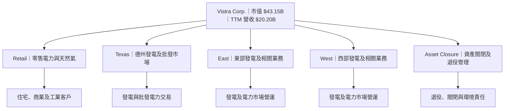
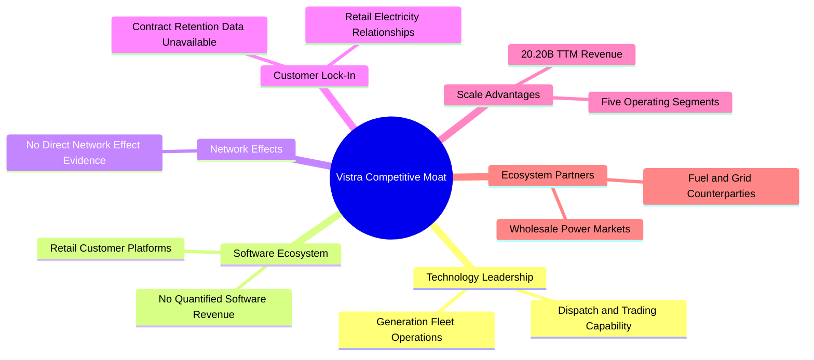
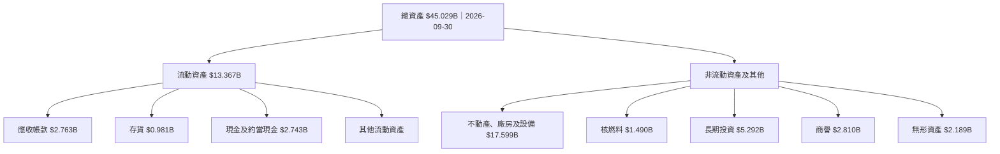
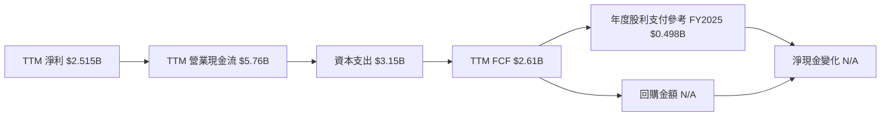
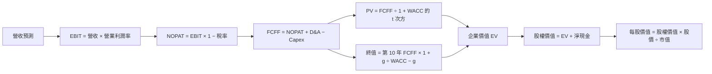
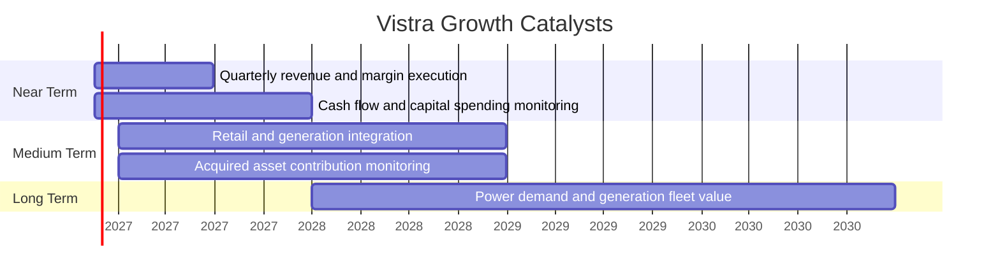
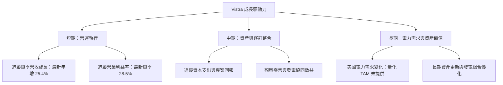
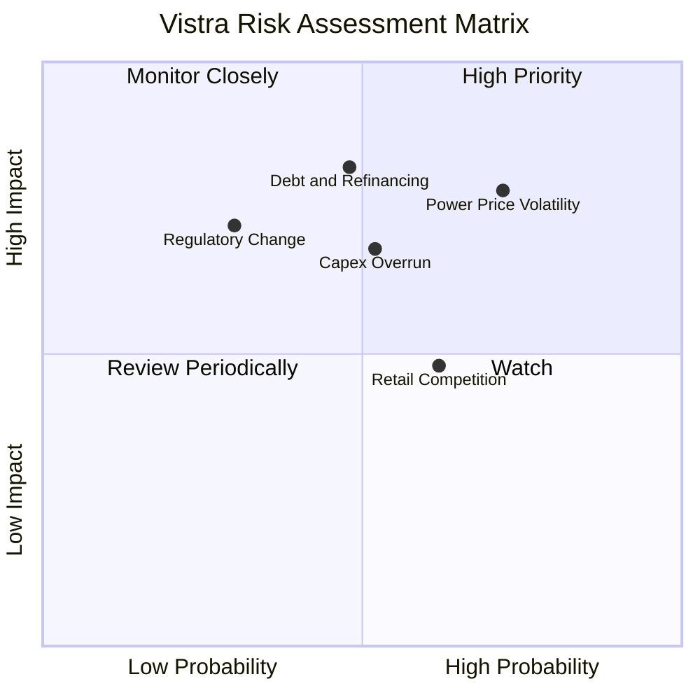
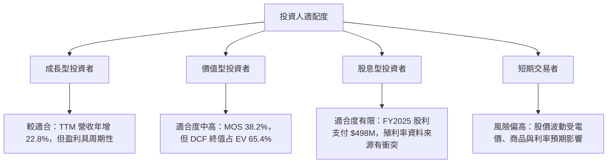

# VST 基本面深度分析報告
> **報告日期**：2026-11-18 ｜ **語言**：繁體中文 ｜ **數據來源**：SEC 申報資料 (XBRL)、Yahoo Finance、Finviz、StockAnalysis、Roic.ai ｜ **分析師**：CFA 級機構研究

## 目錄

| # | 章節 | 核心結論 |
|---|------|----------|
| 1 | 執行摘要 | 強烈買入；加權合理價值 $205.66；MOS 38.2% |
| 2 | 公司概覽與商業模式 | 發電與零售整合提供規模及客戶基礎，但市場份額與板塊營收拆分未提供 |
| 3 | 損益表深度分析 | TTM 營收 $20.20B、年增 22.8%；最新季營業利益率 28.5% |
| 4 | 資產負債表分析 | 淨負債 $18.40B；流動性改善但槓桿仍高 |
| 5 | 現金流量深度分析 | TTM FCF $2.61B、FCF Yield 6.04%；資本支出仍高 |
| 6 | 獲利能力與資本效率 | ROIC 13.5% 高於 WACC 8.90%，創造正經濟價值 |
| 7 | 相對估值分析 | Forward P/E 低於同業中位數；自身 P/E 位於五年區間偏低位置 |
| 8 | DCF 內在價值評估 | DCF 基準值 $285.87；加權合理價值 $205.66，模型高度依賴終值 |
| 9 | 成長催化劑 | 電力需求、發電資產與零售客群是潛在催化來源；TAM 數據未提供 |
| 10 | 風險矩陣 | 電價／商品價格、資本支出與高負債為主要風險 |
| 11 | 投資建議 | 強烈買入；現價低於加權合理價值，建議監控現金流與資本回報 |

---

## 1. 執行摘要

### 1.0 一頁式投資儀表板（Portfolio Manager 30 秒速讀）

| 項目 | 內容 |
|------|------|
| **投資論點（3 句）** | ① TTM 營收 $20.20B、年增 22.8%，反映營運規模與電力需求增加；若成長延續，可支持營業槓桿。② TTM ROIC 13.5% 高於 WACC 8.90%，利差 4.6 個百分點，表示目前資本回報高於資金成本。③ TTM FCF $2.61B、FCF Yield 6.04%，提供負債償還與資本投資資金，但總債務仍達 $21.15B。 |
| **綜合評分** | **7.3/10**（引用 1.1 評分卡） |
| **財務健康** | 🟡 淨負債 $18.40B、Piotroski F-Score 7/8；營運現金流為正，但債務負擔限制財務彈性。 |
| **ROIC vs WACC** | 13.5% vs 8.90%：目前創造股東價值，利差 +4.6pp。 |
| **FCF 趨勢** | TTM FCF $2.61B；高於 FY2025 的 $1.32B，但低於 FY2024 的 $2.48B 以外的歷史高點 FY2023 $3.78B；TTM FCF Yield 6.04%。 |
| **估值** | Forward P/E 13.38x ｜ EV/EBITDA 8.243x（市場資料）｜ FCF Yield 6.04%。 |
| **DCF 內在價值（基準）** | $285.87 ｜ 現價相對 DCF 折價 **55.5%**（折溢價 = $127.15 ÷ $285.87 − 1）。 |
| **安全邊際（MOS）** | **+38.2%**＝($205.66 − $127.15) ÷ $205.66；以 8.8 加權合理價值為基準。🟢 >25% |
| **預期報酬（基準情境 12M）** | +124.8%（DCF MODEL 基準情境價值 $285.87 相對現價；非分析師共識目標價） |
| **關鍵風險（前二）** | 電價與燃料／批發市場波動可能使利潤率正常化；淨負債 $18.40B 降低景氣下行時的財務彈性。 |
| **評級 + 信心度** | 🟢 **強烈買入** ｜ 信心：中（估值折價明顯，但 DCF 終值佔 EV 65.4%，且同業估值結果低於現價） |

### 1.1 綜合評分卡（全報告唯一）

| 維度 | 評分（1–10） | 主要依據（引用數字與其來源章節） |
|------|--------------|----------------------------------|
| 成長性 | 8.0 | TTM 營收年增 22.8%、最新一季年增 25.4%（第 3 章）；同業 CEG、NRG、TLN 最新季年增分別 45.4%、24.0%、96.1%。 |
| 獲利能力 | 8.0 | TTM 營業利益率 21.0%、ROIC 13.5% 高於 WACC 8.90%、Piotroski 7/8（第 3、6 章）。 |
| 財務健康 | 6.0 | 淨負債 $18.40B、現金及短期投資 $2.74B；DSO 50 天、CCC 34 天，流動性不算寬裕（第 4 章）。 |
| 估值 | 8.0 | MOS 38.2%；P/E 17.2x 低於自身五年中位數 25.2x，但同業 Forward P/E 估值顯示相對折價不等於絕對低估（第 7、8 章）。 |
| 護城河 | 7.0 | 發電資產與零售業務整合、TTM 營收 $20.20B；市場份額及客戶留存率未提供（第 2 章）。 |
| 管理層與資本配置 | 7.0 | FY2025 股權薪酬 $113M、股利支付 $498M；稀釋股數未增加的 F-Score 測試通過，但回購金額與資本回報門檻未提供（第 3、5 章）。 |
| **綜合評分** | **7.3** | 六項算術平均：(8.0 + 8.0 + 6.0 + 8.0 + 7.0 + 7.0) ÷ 6 = 7.3。 |

### 1.2 五大投資論點 + 三大核心風險

| 類型 | 項目 | 具體依據 | 信心度 |
|------|------|----------|--------|
| 🟢 **投資論點①** | 需求與營收成長 | TTM 營收 $20.20B，TTM 年增 22.8%；最新一季年增 25.4%。若增長來自持續性需求而非單一商品價格，將支持未來現金流。 | 🟢 高 |
| 🟢 **投資論點②** | 資本回報高於資金成本 | ROIC 13.5% vs WACC 8.90%，利差 +4.6pp，顯示目前投入資本創造正經濟利潤。 | 🟢 高 |
| 🟢 **投資論點③** | 現金流能力 | TTM OCF $5.76B、Capex $3.15B、FCF $2.61B；FCF Yield 6.04%，有能力同時投資資產與服務債務。 | 🟢 中高 |
| 🟢 **投資論點④** | 估值低於自身 P/E 歷史中位數 | 當前 P/E 17.2x，低於五年中位數 25.2x；目前位於自身五年 P/E 分布第 20 百分位。 | 🟢 中 |
| 🟢 **投資論點⑤** | 營運品質指標良好 | Piotroski F-Score 7/8；營業現金流高於淨利、流動比率改善、稀釋股數未增加等測試通過。 | 🟢 中 |
| 🟡 **風險①** | 電價、燃料及批發市場波動 | 發電業盈利受區域供需、燃料價格、天候與對沖策略影響；若價格正常化，近期較高的單季營業利益率 28.5% 可能回落。 | 🟡 中 |
| 🔴 **風險②** | 淨負債與再融資壓力 | 淨負債 $18.40B、總債務 $21.15B；若利潤與 FCF 下滑，債務償還與資本投資將競爭現金流。 | 🔴 高衝擊 |
| 🟡 **風險③** | DCF 對終值及長期假設敏感 | 基準 DCF 中終值現值佔企業價值 65.4%；若 WACC 上升或終端利潤率回落，內在價值會顯著下降。 | 🟡 中高 |

### 1.3 快速統計卡片

| 指標 | 公司實際值（期間） | 同業中位數 | 狀態 |
|------|--------------------|------------|------|
| 營收成長（TTM） | **22.8%** | — | 🟢 |
| 營收成長（最新一季年增） | **25.4%** | 45.4% | 🟡 |
| 毛利率（TTM） | **N/A** | 25.2% | — |
| 營業利益率（TTM） | **21.0%** | — | 🟢 |
| ROIC（TTM） | **13.5%** | — | 🟢 |
| Forward P/E | **13.383x** | 11.5x | 🟡 |
| FCF Yield（TTM） | **6.04%** | — | 🟢 |
| Piotroski F-Score | **7 / 8** | — | 🟢 |

> 同業最新季營收年增中位數為 45.4%、24.0%、96.1% 的中位數 45.4%；本公司最新季年增率依 Verified Figures 為 25.4%。VST 毛利率資料有來源差異，故此處依規則採 N/A，不使用其他彙整欄位覆蓋。

### 1.4 投資結論

╔══════════════════════════════════════════════════════════════════╗  
║                    📊 投資結論摘要                               ║  
╠══════════════════════════════════════════════════════════════════╣  
║ 評級：強烈買入（依 MOS 38.2%，且 ROIC 13.5% > WACC 8.90%）       ║  
║ 價格（2026-11-17 收盤）：$127.15                                 ║  
║ DCF 內在價值（基準）：$285.87（折價 55.5%）                     ║  
║ 安全邊際 MOS：+38.2%（＝($205.66−$127.15)÷$205.66）              ║  
║ 加權合理價值（8.8）：$205.66                                     ║  
║ DCF 情境價值：                                                   ║  
║   悲觀情境：$96.06（−24.5%）                                     ║  
║   基準情境：$285.87（+124.8%）                                   ║  
║   樂觀情境：$669.19（+426.3%）                                   ║  
║ 綜合評分：7.3/10（引用 1.1）                                     ║  
║ 適合投資人：能承受電力市場波動、以中長期資本增值為目標者          ║  
╚══════════════════════════════════════════════════════════════════╝

---

## 2. 公司概覽與商業模式

### 2.1 業務結構與收入來源

Vistra 是美國綜合電力零售與發電公司，業務包含 Retail、Texas、East、West、Asset Closure 五個分部。公司亦從事電力與天然氣零售、發電、批發電力採購與銷售。分部營收與營收占比未提供，因此不以不完整數據繪製占比圖。

> 各分部的營收金額、占比及公司軟體／服務收入未提供，圖中不呈現比例或推估金額。

### 2.2 市場份額

市場份額數據未提供。可確認的規模指標為 TTM 營收 $20.20B、TTM 年增 22.8%；同業 CEG、NRG、TLN 的最新季營收年增分別為 45.4%、24.0%、96.1%。因此，VST 具大型綜合電力營運規模，但僅憑所提供數據不能判定其區域或全美市場份額。

### 2.3 競爭護城河分析

### 2.4 護城河強度

| 護城河項目 | 強度（強／中／弱） | 證據（引用數字或事實） | 會削弱它的情況 |
|------------|--------------------|------------------------|----------------|
| 規模與資產組合 | 中 | 五個營運分部，TTM 營收 $20.20B；可以跨零售及發電市場營運。 | 資產老化、維護資本支出上升或市場價格不利。 |
| 垂直整合 | 中 | 同時涉及電力零售、發電與批發採購銷售；有助於管理供需與客戶端風險。 | 零售定價無法轉嫁成本，或發電與零售曝險未能有效匹配。 |
| 客戶鎖定 | 弱至中 | 零售業務涵蓋住宅、商業與工業客戶；客戶數、留存率及轉換率未提供。 | 客戶轉換成本低、同業折扣競爭加劇。 |
| 技術與交易能力 | 中 | 發電組合與批發市場交易需要調度、風險管理與營運能力；具體效益數據未提供。 | 對沖失誤、極端天候或商品價格快速變動。 |
| 網路效應 | 弱 | 沒有可證明直接網路效應的客戶或交易數據。 | 零售業務競爭加劇會進一步降低其差異化。 |
| 軟體生態系統／夥伴 | 弱至中 | 沒有軟體收入、平台用戶或合作夥伴收入的量化資料。 | 平台與服務未能提升客戶留存或單位經濟。 |

1.1「護城河」評分為 **7.0/10**，依據是公司具規模與垂直整合結構，但市場份額、客戶留存與軟體收入等直接護城河證據仍缺。

---

## 3. 損益表深度分析

### 3.1 年度收入成長趨勢（近 4 年）

╔══════════════════════════════════════════════════════════════════╗  
║              Vistra 年度收入趨勢（FY2022–FY2025）                ║  
╠══════════════════════════════════════════════════════════════════╣  
║ FY2022  $13.73B  ████████████████░░░░░░░░  YoY：基期          ║  
║ FY2023  $14.78B  █████████████████░░░░░░░  YoY：+7.7% 🟢      ║  
║ FY2024  $17.22B  ████████████████████░░░░  YoY：+16.5% 🟢     ║  
║ FY2025  $17.74B  █████████████████████░░░  YoY：+3.0% 🟡      ║  
║                                                                  ║  
║ FY2022–FY2025 三年 CAGR：(17.74 ÷ 13.73)^(1/3) − 1 = 約 8.9%    ║  
╚══════════════════════════════════════════════════════════════════╝

FY2025 年度營收成長放緩至 3.0%，而 TTM 營收成長達 22.8%。這表示最近 TTM 的增長速度明顯高於 FY2025，但電力業營收容易受電價、發電量與商品市場影響；要判斷成長品質，仍需觀察發電量、零售客戶數及價格／數量拆分，相關資料未提供。

### 3.2 季度收入趨勢分析

下表季度金額依 StockAnalysis 季度列示；QoQ 以相鄰季度計算，YoY 以同季度去年比較。季度金額可能受季節性影響，且最新一季年增率以 Verified Figures 的 25.4% 為準。

| 季度 | 營收 | QoQ 成長 | YoY 成長 | 備註 |
|------|------:|---------:|---------:|------|
| 2025 Q4 | $4.584B | +16.5% | +13.6% | 相對 2025 Q3 回升；季節性與電力價格均可能影響。 |
| 2026 Q1 | $5.640B | +23.0% | +43.4% | 高於 2025 Q1，反映當季營收增加。 |
| 2026 Q2 | $4.017B | −28.8% | −5.5% | QoQ 回落，顯示季節性／市場營收波動。 |
| 2026 Q3 | $6.347B | +58.0% | +25.4%* | Verified Figures 指最新一季單季 YoY 為 25.4%；其他彙整資料顯示值有差異，採 Verified Figures。 |

\* 不將單季年增率誤標為 TTM 成長率。以季度收入列示數字自行相除所得值與 Verified Figures 存在來源差異；本報告對官方指定最新一季年增率採用 25.4%。

### 3.3 利潤率演變分析

年度毛利率與營業利益率由年度損益表金額計算，四捨五入至一位小數；TTM 營業利益率採 Verified Figures 21.0%。

| 利潤率指標 | FY2022 | FY2023 | FY2024 | FY2025 | 趨勢 | 評估 |
|------------|--------|--------|--------|--------|------|------|
| **毛利率** | 12.2% | 37.3% | 43.7% | 32.9% | FY2024 高點後回落 | 🟡 |
| **營業利益率** | −8.0% | 18.3% | 23.7% | 12.0% | FY2024 高點後收縮 | 🟡 |
| **淨利率** | −9.0% | 9.1% | 15.4% | 5.3% | FY2025 顯著下降 | 🟡 |

年度數值計算例：FY2025 毛利率 = $5.83B ÷ $17.74B = 32.9%；營業利益率 = $2.13B ÷ $17.74B = 12.0%。近四季資料顯示 2026 Q3 營業利益 $1.98B，該季營業利益率 28.5%（Verified Figures）。單季利潤率高於年度歷史值，可能反映當季營運條件或商品價格較有利；現有資料沒有提供價格、發電量、燃料成本與對沖貢獻拆分，不能把單季利潤率直接外推為長期常態。

### 3.4 費用結構分析

損益表未提供完整營業費用分項，無法可靠計算燃料、維護、銷售管理與其他費用占比；因此不繪製費用結構圓餅圖。現有數據顯示 FY2025 營收 $17.74B、毛利 $5.83B、營業利益 $2.13B，差額受營業費用及其他項目影響，但缺乏細項不能進一步拆分。

### 3.5 季度 EPS 趨勢與盈餘品質（Quality of Earnings）

EPS beat/miss 歷史表的預估與實際欄位均為缺值，故無法判斷過去四季是否超預期或不及預期。StockAnalysis 顯示季度 EPS：2025 Q4 $0.54、2026 Q1 $2.87、2026 Q2 $0.76、2026 Q3 $3.23；但此處沒有一致的分析師預估數字，不能用實際 EPS 代替超預期判斷。

| 盈餘品質項目 | 數值／佔比 | 評估 |
|--------------|-----------|------|
| 股權薪酬 SBC / 營收 | 約 $127M ÷ $20.20B = **0.63%**；SBC 以近四季季度數 $31M+$32M+$35M+$29M 計算 | 🟢 佔營收比例低；但 SBC 仍是股東經濟成本。 |
| SBC / 營業現金流 | 約 $127M ÷ $5.76B = **2.2%** | 🟢 相對 OCF 不高。 |
| FCF / 淨利（現金轉換率） | $2.61B ÷ TTM 淨利 $2.515B = **103.8%** | 🟢 FCF 高於淨利，現金轉換尚可。 |
| 一次性／非經常性損益 | N/A（無足夠明細） | 🟡 無法排除資產處分、商品對沖或稅務等項目影響。 |
| 有效稅率異常 | 15.9%（最新年度有效稅率） | 🟢 模型依此稅率；缺少多年稅務調節表，無法判定是否具持續性。 |
| 資本化支出 vs 費用化 | TTM Capex $3.15B；資本化與維護／成長性支出拆分 N/A | 🟡 資本支出高，資本化比例及折舊年限細節未提供。 |

**盈餘品質結論**：FCF 高於 TTM 淨利，且 SBC 約佔營收 0.63%，現金轉換表現支持獲利含金量；但電力業收入及利潤受市場價格影響，年度營業利益率從 FY2024 的 23.7% 降至 FY2025 的 12.0%，顯示單年 GAAP 盈餘不宜直接視為穩態盈利。對估值而言，現金流與正常化資本支出比單季 EPS 更重要。

---

## 4. 資產負債表分析

### 4.1 資產結構分解

以 2026-09-30 StockAnalysis 資產負債表為資產結構參考，總資產 $45.029B。部分項目及公司簡化財務數據來源口徑不同，避免將子項目強行加總成與總資產一致的結構圖。

### 4.2 流動性與營運資金分析

| 指標 | 最新 TTM | 一年前 TTM | 變化 | 解讀 |
|------|----------|------------|------|------|
| DSO 應收帳款天數 | 50 天 | 52 天 | −2 天 | 收款週期略縮短，代表應收帳款天數改善；仍需配合客戶組合及季末餘額觀察。 |
| DIO 存貨天數 | 30 天 | N/A | N/A | 公司一年前未提供可比數據，不能判斷存貨變化方向。 |
| DPO 應付帳款天數 | 45 天 | N/A | N/A | 一年前數據 N/A，無法判定供應商付款週期是否延長。 |
| CCC 現金轉換週期 | 34 天 | N/A | N/A | 最新值為 DSO + DIO − DPO = 50 + 30 − 45；因缺少去年 DIO、DPO，不能計算同比變化。 |

流動性補充：流動比率 1.157、速動比率 0.477（市場彙整資料）。Piotroski 測試顯示流動比率較一年前改善，但速動比率低於 1，表示短期償債較依賴營運現金流與流動資產變現，而非現金等價物本身。

### 4.3 債務結構分析

╔══════════════════════════════════════════════════════════════════╗  
║                   Vistra 債務健康診斷                            ║  
╠══════════════════════════════════════════════════════════════════╣  
║ 總債務：        $21.15B  ████████████████████  槓桿偏高          ║  
║ 現金及短期投資：$2.74B   ██░░░░░░░░░░░░░░░░░░  緩衝有限          ║  
║ 淨負債：        $18.40B  █████████████████░░░  需持續管理        ║  
║ Debt/EBITDA：   N/A（缺少與同一口徑一致的 EBITDA）               ║  
║ 利息保障倍數：  N/A（缺少利息費用與一致期間 EBIT 明細）           ║  
║ ROIC：          13.5%    高於 WACC 8.90%，目前具正資本報酬       ║  
╚══════════════════════════════════════════════════════════════════╝

淨負債為 Verified Figures 原值 −$18.40B（以「Net cash（− = net debt）」表示）。市場資料中另有總債務與淨負債數字不同，本報告以 SEC 申報資料程式計算區塊為準。

### 4.4 股東權益趨勢

年度股東權益由 FY2022 的 $4.90B 增至 FY2023 的 $5.31B，FY2024 $5.57B，FY2025 $5.10B。FY2025 較 FY2024 減少 $0.47B，不能僅憑此數據判斷原因；分配、累積其他綜合損益及資本交易明細需查閱完整股東權益變動表。

╔══════════════════════════════════════════════════════════════════╗  
║               Vistra 股東權益趨勢（年度）                         ║  
╠══════════════════════════════════════════════════════════════════╣  
║ FY2022  $4.90B  █████████████████░░░░░░░                         ║  
║ FY2023  $5.31B  ███████████████████░░░░░                         ║  
║ FY2024  $5.57B  ████████████████████░░░░                         ║  
║ FY2025  $5.10B  ██████████████████░░░░░░                         ║  
╚══════════════════════════════════════════════════════════════════╝

---

## 5. 現金流量深度分析

### 5.1 現金流量瀑布圖

╔══════════════════════════════════════════════════════════════════╗  
║ TTM 現金流瀑布：淨利 → OCF → Capex → FCF → 股東分配              ║  
╚══════════════════════════════════════════════════════════════════╝

TTM FCF 嚴格採用 OCF − Capex：$5.76B − $3.15B = $2.61B。圖中股利採 FY2025 年度值，並非 TTM 分配額；回購及淨現金變化未提供，故不將它們量化。

### 5.2 FCF 轉換率趨勢

| 期間 | FCF | 淨利 | FCF / 淨利 | 解讀 |
|------|----:|-----:|-----------:|------|
| FY2022 | −$0.816B | −$1.23B | 66.3%* | 虧損年度以比率觀察意義有限，FCF 為負。 |
| FY2023 | $3.78B | $1.49B | 253.7% | 現金流高於會計獲利，可能包含營運資金與非現金項目差異。 |
| FY2024 | $2.48B | $2.66B | 93.2% | 現金轉換接近淨利。 |
| FY2025 | $1.32B | $0.944B | 139.8% | FCF 高於淨利，但 Capex 仍高。 |
| TTM 至 2026-09-30 | $2.61B | $2.515B | 103.8% | TTM 現金流略高於淨利。 |

\* FY2022 FCF 與淨利同為負數，商數不能解讀為正向現金轉換表現。

### 5.3 自由現金流趨勢

╔══════════════════════════════════════════════════════════════════╗  
║           自由現金流：歷史實際與 TTM（FCF = OCF − Capex）         ║  
╠══════════════════════════════════════════════════════════════════╣  
║ FY2022  −$0.816B  ◀負值                                          ║  
║ FY2023   $3.78B   ████████████████████                           ║  
║ FY2024   $2.48B   █████████████                                  ║  
║ FY2025   $1.32B   ███████                                        ║  
║ TTM      $2.61B   ██████████████  FCF Yield：6.04%               ║  
╚══════════════════════════════════════════════════════════════════╝

FY2025 FCF 較 FY2024 下滑 $1.16B，原因在於 OCF 從 $4.56B 降至 $4.07B，同時 Capex 從 $2.08B 增至 $2.75B。TTM FCF 回升至 $2.61B，顯示最近四季現金流改善；但資本支出與商品市場週期仍是主要變數。

### 5.4 資本配置評估

資本配置占比所需的 TTM 回購、投資支出與現金留存完整資料未提供，因此不繪製圓餅圖。

| 資本配置項目 | 已知數據 | 評估 |
|--------------|----------|------|
| 資本支出 | TTM $3.15B；FY2025 $2.75B | 投資規模大，需確認增長性投資能否轉化為更高 FCF。維護與成長支出拆分 N/A。 |
| 股利 | FY2025 現金股利 $498M | 低於 FY2025 FCF $1.32B，支付能力目前有現金流支持。 |
| 股票回購 | N/A | 回購金額未提供，不能量化其對股東回報及股數的影響。 |
| 債務償還／新增借款 | N/A | TTM 淨負債 $18.40B；當期償還及新增借款分項未提供。 |
| 股權薪酬 | FY2025 $113M | 規模相對營收不高，但長期仍需追蹤稀釋。 |

---

## 6. 獲利能力與資本效率

### 6.1 ROE / ROA / ROIC 趨勢

| 指標 | 最新 TTM | 歷史對照 | 評估 |
|------|---------:|----------|------|
| ROE | 42.9% | 其他年度一致口徑 N/A | 表面回報高，但權益乘數 7.14，槓桿貢獻顯著。 |
| ROA | N/A | F-Score 測試顯示 ROA 為正且高於一年前；具體年度數值 N/A | 方向正面，缺少可比較數值。 |
| ROIC | 13.5% | 一致口徑歷史年度數據 N/A | 高於 WACC 8.90%，目前創造經濟價值。 |

### 6.2 ROIC vs WACC 分析（核心價值創造判斷）

╔══════════════════════════════════════════════════════════════════╗  
║                ROIC vs WACC 深度分析                            ║  
╠══════════════════════════════════════════════════════════════════╣  
║ WACC 估算：                                                       ║  
║ ├── 無風險利率（10Y 美債）：5.10%                                ║  
║ ├── 市場風險溢酬 ERP：5.00%                                      ║  
║ ├── 原始 Beta：1.38；採用調整後 Beta：1.25                      ║  
║ ├── 股權成本 Ke = 5.10% + 1.25 × 5.00% = 11.35%                 ║  
║ ├── 稅前債務成本：4.64%；稅後約 3.90%                            ║  
║ ├── 資本結構：股權 67.1%，債務 32.9%                             ║  
║ └── WACC = 8.90%                                                  ║  
║                                                                  ║  
║ ROIC（TTM）：13.5%                                               ║  
║ EVA 利差 = ROIC − WACC = 13.5% − 8.90% = +4.6pp                 ║  
║                                                                  ║  
║ ROIC  13.5%  ▓▓▓▓▓▓▓▓▓▓▓▓▓▓░░░░░░  高於資金成本                 ║  
║ WACC   8.90% ▓▓▓▓▓▓▓▓▓░░░░░░░░░░  折現率基準                    ║  
║                                                                  ║  
║ 結論：ROIC / WACC = 13.5% ÷ 8.90% = 1.52 倍；目前創造價值。     ║  
╚══════════════════════════════════════════════════════════════════╝

ROIC 使用 Verified Figures 的 13.5%，WACC 使用 Cost of capital 的 8.90%。正利差表示以目前 TTM 資本回報衡量，公司資本運用高於估計資金成本；若電力價格下行或新增投資回報下降，ROIC 可能收斂，因此應以多年度 ROIC 追蹤而非單一 TTM 判斷。

### 6.3 杜邦三因素分解

| 因素 | 數值（TTM） | 解讀 |
|------|-------------|------|
| 淨利率 | 13.4% | 每一美元營收約形成 13.4 美分淨利。 |
| 資產週轉率 | 0.45 | 每一美元資產產生約 $0.45 營收，反映資產密集型電力產業特徵。 |
| 權益乘數 | 7.14 | 槓桿放大 ROE，亦使股東回報對資產與債務變動更敏感。 |
| **ROE** | **42.9%** | 13.4% × 0.45 × 7.14 = 42.9%（輸入值經四捨五入）。 |

ROE 的高值不是單靠淨利率或資產週轉率，而是受到 7.14 倍權益乘數顯著放大；因此 ROE 不應單獨作為資本效率判斷。

### 6.4 財務體質：Piotroski F-Score

**Piotroski F-Score：7 / 8**。毛利率測試因缺少輸入而未納入分母；分母低於完整九項測試。

| 測試 | 結果 | 解讀 |
|------|------|------|
| ROA > 0 | ✅ 通過 | TTM 資產報酬為正。 |
| 營業現金流 > 0 | ✅ 通過 | TTM OCF 為 $5.76B。 |
| ROA 高於一年前 | ✅ 通過 | 資產獲利能力方向改善。 |
| 營業現金流 > 淨利 | ✅ 通過 | OCF 高於淨利，有利於盈餘現金含量。 |
| 長期負債 ÷ 總資產低於一年前 | ❌ 未通過 | 槓桿相對資產未改善，負債管理仍是風險。 |
| 流動比率高於一年前 | ✅ 通過 | 短期流動性指標改善。 |
| 稀釋股數未增加 | ✅ 通過 | 股數稀釋測試通過。 |
| 毛利率高於一年前 | — 無法判定 | 缺資料；未計入分母。 |
| 資產週轉率高於一年前 | ✅ 通過 | 資產使用效率改善。 |

---

## 7. 相對估值分析

### 7.1 同業估值比較表格

同業估值均採 Yahoo Finance Peer multiples。VST P/E 等倍數引用估值區塊；Peer 中位數不納入 TLN 缺失的 TTM P/E。

| 估值指標 | **VST** | **CEG** | **NRG** | **TLN** | 本公司評估 |
|----------|--------:|--------:|--------:|--------:|-----------|
| **Trailing P/E** | 17.2x | 21.5x | 16.0x | N/A | 🟡 VST 介於 CEG 與 NRG 之間；可比公司數量有限。 |
| **Forward P/E** | 13.383x | 20.0x | 9.6x | 11.5x | 🟡 同業中位數 11.5x；VST 溢價約 16.4%，須由成長與資產品質支持。 |
| **P/S Ratio** | 2.1x | 2.8x | 0.6x | 3.4x | 🟡 同業中位數 2.8x；VST 低於 CEG、TLN，但高於 NRG。 |
| **EV/EBITDA** | 9.7x* | 12.4x | 10.4x | 36.6x | 🟢 VST 低於同業中位數 12.4x；但不同資產組合與盈利波動可能造成倍數差異。 |
| **最新季營收年增** | 25.4% | 45.4% | 24.0% | 96.1% | 🟡 VST 高於 NRG、低於 CEG 與 TLN。 |
| **毛利率（TTM）** | N/A | 25.2% | 20.2% | 42.7% | — VST 缺少同一 Verified Figures 口徑數值，不作直接比較。 |

\* Verified Figures 的自身歷史估值為 EV/EBITDA 9.7x；市場彙整區塊另列 8.243x，存在來源差異，本表遵守規則採 9.7x。  
同業 Forward P/E 中位數：排序 9.6x、11.5x、20.0x，中位數 11.5x。EV/EBITDA 中位數：10.4x、12.4x、36.6x，中位數 12.4x。

### 7.2 歷史估值區間分析

╔══════════════════════════════════════════════════════════════════╗  
║               VST 五年 P/E 歷史位置（TTM）                       ║  
╠══════════════════════════════════════════════════════════════════╣  
║ 五年低點 7.2x ├──────── 現值 17.2x ────────┤ 五年高點 74.3x       ║  
║ 五年中位數：25.2x；當前百分位：20%                               ║  
║                                                                  ║  
║ P/S：現值 2.1x｜中位數 1.8x｜區間 0.5x–4.2x｜百分位 57%         ║  
║ EV/EBITDA：現值 9.7x｜中位數 11.0x｜區間 2.3x–40.7x｜百分位 35% ║  
╚══════════════════════════════════════════════════════════════════╝

P/E 位於自身五年分布第 20 百分位，低於中位數；P/S 高於中位數，EV/EBITDA 低於中位數。多種倍數並未一致指向低估，合理解讀是市場對近期獲利持續性仍有折價，而非所有估值指標均具安全邊際。

### 7.3 情境價值（Bear / Base / Bull，照抄 DCF MODEL 的 Scenarios）

| 情境 | 第 1 年營收成長 | 期末營業利潤率 | WACC | 每股價值 | 相對現價 | 機率 | 會發生的條件 |
|------|----------------|----------------|------|----------|----------|------|--------------|
| 🔴 悲觀 | 11.4% | 16.4% | 9.90% | $96.06 | −24.5% | 25% | 成長較基準慢、成熟期利潤率收斂，且資金成本上升。 |
| 🟡 基準 | 22.8% | 19.3% | 8.90% | $285.87 | +124.8% | 50% | TTM 成長可延續至模型起始年，長期利潤率逐步回歸近五年中位數。 |
| 🟢 樂觀 | 34.3% | 21.2% | 7.90% | $669.19 | +426.3% | 25% | 電力需求與盈利擴張超出基準、資金成本降低，且利潤率維持較高水準。 |

### 7.4 相對估值隱含價格區間

╔══════════════════════════════════════════════════════════════════╗  
║                 估值方法隱含每股價值                             ║  
╠══════════════════════════════════════════════════════════════════╣  
║ 同業 Forward P/E      $108.92  ──── 現價 $127.15 ─────────────  ║  
║ 同業 EV/EBITDA        $176.93  ───────── 現價 $127.15 ────────  ║  
║ 分析師共識目標價       $198.49  ───────────── 現價 $127.15 ────  ║  
║ DCF 基準               $285.87  ──────────────────────────────  ║  
╚══════════════════════════════════════════════════════════════════╝

| 方法 | 每股價值 | 相對現價 | 依據 |
|------|---------:|---------:|------|
| 同業 Forward P/E | $108.92 | −14.3% | CEG、NRG、TLN 同業中位數 11.5x × VST Forward EPS $9.50。 |
| 同業 EV/EBITDA | $176.93 | +39.2% | 同業 EV/EBITDA 中位數 12.4x × VST TTM EBITDA，再加回淨現金／扣除淨負債。 |
| 分析師共識目標價 | $198.49 | +56.1% | 23 位分析師平均目標價。 |

---

## 8. DCF 內在價值評估（Discounted Cash Flow）

> DCF 全章採程式計算的基準模型，金額單位為美元十億，逐年預測及估值方法不另建模型。現有資料未提供獨立的管理層長期財測、逐年營運資金需求及退出倍數計算輸入，相關缺項明確標示。

### 8.0 估值推理鏈（Thinking Logic）

**Step 1 — 公司價值由哪些變數決定？**

Vistra 的企業價值主要取決於現有發電與零售業務的現金流、營收成長能否在高基期延續，以及成熟期營業利潤率能否維持。模型以 TTM 營收 $20.20B 為起點，但五個分部的收入占比未提供，不能將各業務拆分為具體營收占比。敏感度矩陣顯示 WACC 與永續成長率會顯著影響價值；情境分析亦同時改變營收成長、期末利潤率與 WACC。

**Step 2 — 模型選擇**

| 決策點 | 本報告採用 | 理由（含數字） | 曾考慮但否決 | 否決理由 |
|--------|-----------|----------------|--------------|----------|
| 現金流定義 | FCFF | 以 WACC 8.90% 折現，先得企業價值，再扣除淨負債。 | FCFE | 不直接折現股東現金流，因模型已指定以 WACC 計算 EV。 |
| 預測期 N | 10 年 | DCF 模型固定 10 年；收入成長由 22.8% 線性降至 3.0%。 | 5 年 | 會縮短模型已設定的成長淡出期間，違反固定模型輸入。 |
| 終值方法 | Gordon Growth | 模型採 g = 3.0%，WACC = 8.90%，符合 WACC > g。 | 只用退出倍數 | 模型未提供退出倍數法終值數值，且指定 DCF 模型為唯一模型。 |
| EBIT 基礎 | GAAP EBIT | 模型採 GAAP 營業利益率；TTM 營業利益率 21.0%。 | 非 GAAP EBIT | 未提供調整後 EBIT，且可能重複加回 SBC。 |

**Step 3 — 關鍵假設推導鏈**

- **預測期 N**：錨點＝模型以 TTM 營收 $20.20B 起算、收入成長由 22.8% 逐年淡出至第 10 年 3.0% → 調整＝將短期高成長逐步收斂，以涵蓋完整淡出期 → **採用 10 年** → 曾考慮 5 年，但會在成長仍高時過早進入終值，且與既定模型不符。
- **營收成長**：錨點＝TTM 年增 22.8% → 調整＝假定近期成長可延續至 FY+1，之後逐年線性回落 → **FY+1 採 22.8%，FY+10 採 3.0%** → 曾考慮直接採用較低的年度歷史 CAGR，但模型已指定以 TTM 成長起始；其風險是近期增長不一定代表長期需求。
- **營業利潤率**：錨點＝TTM GAAP 營業利益率 21.0% → 調整＝由 21.0% 逐步淡出至近五個財年中位數 19.3% → **FY+1 21.0%，FY+10 19.3%** → 曾考慮永久維持 21.0%，但不符合周期性電力業應採正常化利潤率的保守原則。
- **終端成長率 g**：錨點＝模型採 3.0%，處於長期名目經濟成長常用假設範圍的低端；此範圍屬模型假設而非公司財務數據 → 調整＝使用 3.0%，並確認低於 WACC 8.90% → **採用 3.0%** → 曾考慮更高 g，但終值對 g 敏感且長期成長率不宜無限高。
- **Capex／營收**：錨點＝TTM Capex $3.15B ÷ TTM 營收 $20.20B = 15.6%（模型採用值）→ 調整＝預期資本支出率逐步收斂至 11.5%，模型依據是達 D&A 的 1.1 倍附近 → **FY+1 15.6% 至 FY+10 11.5%** → 曾考慮固定在 TTM 比率，但可能忽略成熟期支出率下降；若維護支出高於模型假設，估值偏高。
- **GAAP EBIT 與 SBC**：錨點＝模型使用 GAAP EBIT；FY2025 SBC $113M，近四季約 $127M → 調整＝GAAP EBIT 已扣除 SBC，股數不再額外稀釋 → **採組合 (A)：GAAP EBIT、無額外 −SBC、年稀釋率 0%** → 否決非 GAAP EBIT 加回 SBC，因缺少一致調整數據並可能漏計或重計股東成本。
- **D&A／營收**：錨點＝TTM D&A／營收 10.4%（模型值）→ **採 10.4% 固定**；D&A 變化可能影響 FCFF，但目前沒有可驗證的逐年折舊計畫。
- **ΔWC**：模型說明未建模營運資金，因此不設逐年 ΔWC 數字；這不代表營運資金變動為零，而是模型中未納入。
- **WACC**：錨點＝資本成本區塊 WACC 8.90% → 調整＝採用程式計算值，不另建一個 WACC → **採 8.90%** → 否決自行調整折現率，避免改變既定模型與評級底稿。
- **終值方法**：錨點＝模型採 Gordon Growth，FCFF 第 10 年 $10.15B、g 3.0%、WACC 8.90% → **採用 Gordon Growth** → 退出倍數法缺少模型明列的終值及相關輸入，不能另造數字。

**Step 4 — 最脆弱的一環**

最脆弱假設是成長率由 FY+1 的 22.8% 起步，因為若成長迅速回落，預測期營收與終值現金流都會降低；反向 DCF 顯示以現價計算的隱含 FY+1 成長率為 7.4%，說明基準假設相對市場價格隱含值偏積極。

**Step 5 — 計算路徑圖**

### 8.1 模型假設總表（Model Inputs）

| 假設項目 | 採用值 | 依據／來源 | 敏感度 |
|----------|--------|-------------|--------|
| 預測期長度 **N** | 10 年 | DCF MODEL 指定 10 年；收入成長逐年淡出至第 10 年 3.0%。 | 🟡 中 |
| 營收成長 | FY+1 22.8% → FY+10 3.0% | 起始值採 TTM vs prior TTM 22.8%；末年採模型指定 3.0%，中間年度線性淡出。 | 🔴 高 |
| 營業利潤率 | FY+1 21.0% → FY+10 19.3% | TTM GAAP 營業利益率 21.0%；末年淡至近五年財年中位數 19.3%。 | 🔴 高 |
| 有效稅率 | 15.9% | 最新年度有效稅率；模型指定。 | 🟢 低 |
| Capex／營收 | FY+1 15.6% → FY+10 11.5% | TTM 基礎率，逐步淡至模型所設 D&A 的 1.1 倍附近。 | 🟡 中 |
| D&A／營收 | 10.4% | TTM 模型輸入，模型中維持不變。 | 🟢 低 |
| 營運資金變動 | 未建模 | DCF MODEL 明示 Working capital is not modelled；並非假設其變化為零。 | 🟢 低 |
| EBIT 基礎 | GAAP EBIT | 模型列明 GAAP operating margin。 | 🟡 中 |
| SBC 處理 | 組合 (A)：已含於 GAAP EBIT，不再扣 SBC | 模型明示 SBC 已為費用，股數不再稀釋。 | 🟡 中 |
| 年稀釋率 | 0% | 模型假設固定股數，與組合 (A) 一致。 | 🟡 中 |
| 永續成長率 g | 3.0% | DCF MODEL 固定輸入，低於 WACC 8.90%。 | 🔴 高 |
| 終值方法 | Gordon Growth | 模型明列 Gordon Growth 計算。 | 🔴 高 |
| WACC | 8.90% | Cost of capital 區塊指定值；推導見 8.2。 | 🔴 高 |

**FCFF 定義**：FCFF = NOPAT + D&A − Capex；模型未納入 ΔWC。**本模型採用 (A)，故 SBC 影響已計入一次**：GAAP EBIT 已含 SBC 費用，沒有額外 SBC 扣除列，且年稀釋率為 0%。

### 8.2 折現率推導（WACC）

╔══════════════════════════════════════════════════════════════════╗  
║                    WACC 推導（折現率）                           ║  
╠══════════════════════════════════════════════════════════════════╣  
║ 股權成本 Ke（CAPM）：                                             ║  
║ ├── 無風險利率 Rf（10Y 美債）：5.10%                             ║  
║ ├── 市場風險溢酬 ERP：5.00%                                      ║  
║ ├── 原始 Beta：1.38；調整 Beta：1.25                             ║  
║ ├── 規模／國別溢酬：0.00%（成本資本輸入未提供額外溢酬）          ║  
║ └── Ke = 5.10% + 1.25 × 5.00% = 11.35%                           ║  
║                                                                  ║  
║ 債務成本 Kd：                                                     ║  
║ ├── 稅前 Kd：4.64%（成本資本區塊計算值）                         ║  
║ ├── 有效稅率：15.9%                                              ║  
║ └── 稅後 Kd = 4.64% × (1 − 15.9%) = 3.90224% ≈ 3.90%             ║  
║                                                                  ║  
║ 資本結構（成本資本區塊）：股權 67.1%，債務 32.9%                 ║  
║ WACC = 67.1% × 11.35% + 32.9% × 3.90224% = 8.90%                ║  
╚══════════════════════════════════════════════════════════════════╝

**逐步演算（WACC）**

1. **Ke（CAPM）** = Rf + β × ERP = 5.10% + 1.25 × 5.00% = **11.35%**。原始 Yahoo Beta 1.38，採調整後 Beta：⅔ × 1.38 + ⅓ × 1 = 1.2533，區塊採用值 1.25。10Y 美債利率日期未提供，故不另標日期。
2. **稅前 Kd** = 成本資本區塊提供的利息費用 ÷ 債務計算結果 = **4.64%**。利息費用金額與平均計息負債原始金額未提供，無法展開美元分子、分母。
3. **稅後 Kd** = 4.64% × (1 − 15.9%) = 4.64% × 0.841 = **3.90224% ≈ 3.90%**。
4. **權重**：依成本資本區塊提供 E/D 權重，股權 67.1%、債務 32.9%；67.1% + 32.9% = **100.0%**。市值為 $43.15B，總債務 Verified Figures 為 $21.15B，但權重採區塊原值，不用不同來源自行覆算。
5. **WACC** = 67.1% × 11.35% + 32.9% × 3.90224% = 7.61585% + 1.28384% = **8.89969% ≈ 8.90%**。

### 8.3 逐年自由現金流預測（基準情境）

金額單位 $B；折現因子保留三位小數。模型所列 NOPAT、FCFF 與 PV 皆照錄，未自行改動。

| 年度 | FY+1 | FY+2 | FY+3 | FY+4 | FY+5 | FY+6 | FY+7 | FY+8 | FY+9 | FY+10 |
|------|------:|------:|------:|------:|------:|------:|------:|------:|------:|-------:|
| 營收 | 24.81 | 29.93 | 35.45 | 41.20 | 46.98 | 52.54 | 57.59 | 61.85 | 65.07 | 67.03 |
| 營收 YoY | 22.8% | 20.6% | 18.4% | 16.2% | 14.0% | 11.8% | 9.6% | 7.4% | 5.2% | 3.0% |
| 營業利潤率 | 21.0% | 20.8% | 20.6% | 20.4% | 20.2% | 20.0% | 19.8% | 19.6% | 19.4% | 19.3% |
| 營業利益 EBIT（GAAP） | 5.20 | 6.22 | 7.29 | 8.40 | 9.49 | 10.51 | 11.41 | 12.14 | 12.65 | 12.91 |
| − 稅（15.9%） | (0.83) | (0.99) | (1.16) | (1.34) | (1.51) | (1.68) | (1.82) | (1.94) | (2.02) | (2.06) |
| = NOPAT | 4.37 | 5.22 | 6.13 | 7.06 | 7.98 | 8.84 | 9.60 | 10.21 | 10.64 | 10.85 |
| + D&A | 2.58 | 3.12 | 3.69 | 4.29 | 4.89 | 5.47 | 6.00 | 6.44 | 6.78 | 6.98 |
| − Capex | (3.88) | (4.54) | (5.21) | (5.86) | (6.47) | (6.99) | (7.40) | (7.66) | (7.75) | (7.68) |
| = FCFF | 3.08 | 3.80 | 4.61 | 5.49 | 6.40 | 7.32 | 8.20 | 8.99 | 9.66 | 10.15 |
| 折現因子 @8.90% | 0.918 | 0.843 | 0.774 | 0.711 | 0.653 | 0.599 | 0.550 | 0.505 | 0.464 | 0.426 |
| FCFF 現值 PV | 2.83 | 3.21 | 3.57 | 3.90 | 4.18 | 4.39 | 4.51 | 4.54 | 4.48 | 4.33 |

**預測期 FCF 現值合計**：  
$2.83 + $3.21 + $3.57 + $3.90 + $4.18 + $4.39 + $4.51 + $4.54 + $4.48 + $4.33 = **$39.94B**

**逐步演算（FY+1，依模型列值示範）**

1. **營收** = TTM 營收 $20.20B × (1 + 22.8%) = $20.20B × 1.228 = **$24.81B**（四捨五入）。
2. **EBIT** = $24.81B × 21.0% = **$5.20B**（模型列值）。
3. **稅** = $5.20B × 15.9% = **$0.83B**。
4. **NOPAT** = $5.20B − $0.83B = **$4.37B**。
5. **D&A** = $24.81B × 10.4% = **$2.58B**。
6. **Capex** = $24.81B × 15.6% = **$3.88B**。
7. **ΔWC**：模型未建模，表中不設數值列；不是把實際營運資金變動假設為零。
8. **FCFF** = $4.37B + $2.58B − $3.88B = **$3.07B**；模型表列 $3.08B，差異 $0.01B，屬輸入四捨五入／底層精度差異，依規則照錄模型值 $3.08B。
9. **折現因子** = 1 ÷ (1 + 8.90%)¹ = 0.918；模型 PV = $3.08B × 0.918 = **$2.83B**（按未四捨五入底層值計算）。

**合理性自檢**

- 預測 FCF：FY+1 $3.08B 至 FY+10 $10.15B，九年 CAGR = ($10.15 ÷ $3.08)^(1/9) − 1 ≈ **14.2%**；歷史 FY2022 FCF 為負、FY2023 $3.78B、FY2024 $2.48B、FY2025 $1.32B，跨越周期且基期不同，不能用單一歷史 CAGR 作穩定比較。
- FY+10 FCF 利潤率 = $10.15B ÷ $67.03B = **15.1%**；目前 TTM FCF 利潤率 = $2.61B ÷ $20.20B = **12.9%**。同業最佳 FCF 利潤率未提供，不能判斷是否超越同業最佳。
- 模型每年 FCFF 均為正；但模型未納入營運資金變動，因此營運資金若占用現金，實際 FCFF 會低於模型值。

╔══════════════════════════════════════════════════════════════════╗  
║            自由現金流：歷史實際 vs 模型預測                      ║  
╠══════════════════════════════════════════════════════════════════╣  
║ FY2023（實） $3.78B  ████████████████████                       ║  
║ FY2024（實） $2.48B  █████████████                              ║  
║ FY2025（實） $1.32B  ███████                                    ║  
║ FY+1（預）   $3.08B  ████████████████                           ║  
║ FY+10（預）  $10.15B ████████████████████████████████████████  ║  
╠══════════════════════════════════════════════════════════════════╣  
║ 預測期 FCF CAGR 約 14.2%；歷史現金流波動大，模型存在外推風險。  ║  
╚══════════════════════════════════════════════════════════════════╝

### 8.4 終值計算（Terminal Value）

**適用性檢查**：WACC 8.90% vs g 3.0% → WACC > g？✅

| 方法 | 計算式 | 終值 TV | TV 現值 | 佔總 EV 比重 |
|------|--------|---------:|--------:|-------------:|
| Gordon Growth | $10.15B × (1 + 3.0%) ÷ (8.90% − 3.0%) | $177.13B | $75.49B | 65.4% |
| 退出倍數法 | N/A（DCF MODEL 未提供退出倍數終值） | N/A | N/A | N/A |

**逐步演算（Gordon Growth）**

1. **FY+N 的 FCFF** = 第 10 年 FCFF **$10.15B**。
2. **分子** = $10.15B × (1 + 3.0%) = $10.15B × 1.03 = **$10.4545B**。
3. **分母** = 8.90% − 3.0% = **5.90%**；TV = $10.4545B ÷ 5.90% = **$177.13B**。
4. **PV(TV)** = $177.13B × 折現因子 0.426 = **$75.49B**（模型底層精度計算）。
5. **終值佔比** = $75.49B ÷ $115.43B = **65.4%**。

終值佔 EV 65.4%，未超過 75% 警示線，但仍代表價值逾六成取決於第 10 年之後的成長、利潤率與折現率假設。模型未提供退出倍數法結果，故不自行補算。

### 8.5 企業價值 → 每股內在價值（Bridge）

╔══════════════════════════════════════════════════════════════════╗  
║              企業價值 → 每股內在價值 橋接表                      ║  
╠══════════════════════════════════════════════════════════════════╣  
║ 預測期 FCF 現值合計          +$39.94B                             ║  
║ 終值現值 PV(TV)              +$75.49B                             ║  
║ = 企業價值 EV                 $115.43B                            ║  
║ + Net cash（負值為淨負債）   −$18.40B                             ║  
║ = 股權價值                    $97.02B                             ║  
║ 每股價值：依模型價格／市值換算 $285.87                            ║  
║ 2026-11-17 收盤價              $127.15                            ║  
║ 折溢價：$127.15 ÷ $285.87 − 1 = −55.5%（折價）                    ║  
╚══════════════════════════════════════════════════════════════════╝

**逐步演算（橋接）**

1. **EV** = 預測期 PV 合計 $39.94B + PV(TV) $75.49B = **$115.43B**。
2. **股權價值** = EV $115.43B + Net cash (−$18.40B) = **$97.03B**；DCF MODEL 列示 $97.02B，$0.01B 差異為底層精度／列值四捨五入，依規則保留模型列值 $97.02B。
3. **每股內在價值** = 模型所列股權價值乘以價格除以市值：$97.02B × $127.15 ÷ $43.15B = **$285.87**（模型值，使用未四捨五入底層數據）。
4. **折溢價** = 現價 $127.15 ÷ DCF 基準內在價值 $285.87 − 1 = **−55.5%**，即現價相對 DCF 折價。
5. **本節不計算 MOS**：MOS 僅在 8.8 以加權合理價值為分母計算。

**股數及資產負債表來歷**：模型採固定股數、股數成本透過 GAAP EBIT 中的 SBC 費用反映；市場數據列示 339.39M 股，但模型每股換算明確採「股權價值 × 價格 ÷ 市值」並給出 $285.87，依規則照錄。現金與債務以 Verified Figures 的 Net cash（− = net debt）−$18.40B 淨額橋接，不另拆成不同來源的現金與負債。

### 8.6 敏感性分析（WACC × 永續成長率）

下表每格的內在價值照錄 DCF MODEL，括號為依 $127.15 現價計算的上行空間，四捨五入至一位小數。

| g（列）／WACC（欄） | 6.90% | 7.90% | **8.90%（基準）** | 9.90% | 10.90% |
|-----------|------:|------:|------------------:|------:|-------:|
| **2.0%** | $396.33（+211.7%） | $311.58（+145.0%） | $251.80（+98.0%） | $207.49（+63.2%） | $173.41（+36.4%） |
| **2.5%** | $434.32（+241.6%） | $335.23（+163.7%） | $267.51（+110.4%） | $218.42（+71.8%） | $181.29（+42.6%） |
| **3.0%（基準）** | $482.04（+279.1%） | $363.70（+186.0%） | **$285.87（+124.8%）** | $230.93（+81.6%） | $190.16（+49.6%） |
| **3.5%** | $543.78（+327.7%） | $398.63（+213.6%） | $307.63（+141.9%） | $245.39（+93.0%） | $200.23（+57.5%） |
| **4.0%** | $626.79（+393.0%） | $442.51（+248.2%） | $333.83（+162.6%） | $262.30（+106.3%） | $211.76（+66.6%） |

**逐步演算（有效非基準格：WACC = 9.90%、g = 3.0%）**  
所選格 WACC 9.90% > g 3.0% ✅。模型矩陣列示此格每股價值 **$230.93**。由於 DCF MODEL 未提供該折現率下逐年 FCFF 現值合計，無法用區塊內數字完整重建替代 WACC 的 EV；不得假造 PV 合計或橋接數字。此格以程式矩陣原值為準，以下僅能驗算相對現價上行：($230.93 − $127.15) ÷ $127.15 = **81.6%**。

**三情境 DCF（照抄模型輸出）**

| 情境 | 營收成長假設 | 期末營業利潤率 | WACC | 每股內在價值 | 相對現價 | 機率 |
|------|-------------|----------------|------|--------------|----------|------|
| 🔴 悲觀 | FY+1 11.4% | 16.4% | 9.90% | $96.06 | −24.5% | 25% |
| 🟡 基準 | FY+1 22.8% | 19.3% | 8.90% | $285.87 | +124.8% | 50% |
| 🟢 樂觀 | FY+1 34.3% | 21.2% | 7.90% | $669.19 | +426.3% | 25% |

模型未列三情境各自的 FY+10 營收、FCFF 及終值明細，故不自行補造完整情境算式。機率加權值照錄：$96.06 × 25% + $285.87 × 50% + $669.19 × 25% = **$334.25**（僅供參考；8.8 使用基準 DCF 值）。

**敏感度結論（依模型矩陣）**

- **g 每 +1pp**：以 WACC 8.90% 欄、g 2.5% 至 3.5% 比較，$267.51 → $307.63，增加 **$40.12／+15.0%**。
- **WACC 每 +1pp**：以 g 3.0% 列、WACC 8.90% 至 9.90% 比較，$285.87 → $230.93，減少 **$54.94／−19.2%**。
- **期末營業利潤率每 +1pp**：敏感度矩陣未單獨提供利潤率彈性數值，**N/A（模型未提供單變量敏感度）**。
- 矩陣顯示 WACC 變動 1pp 的估值影響大於 g 變動 1pp。這是終值占比達 65.4%、且折現率同時影響預測期現金流與終值的結果；與 8.0 所述估值對長期現金流及折現率敏感一致。

### 8.7 反推 DCF（Reverse DCF：市場在預期什麼）

DCF MODEL 提供兩個反推結果，均為一次放開一個變數；沒有提供其他變數的反推解或疊代軌跡。

| 求解的變數（一次一個） | 其餘變數設定 | 市場隱含值（令 DCF = 現價） | 公司歷史／基準實際 | 判斷 |
|------------------------|--------------|------------------------------|---------------------|------|
| FY+1 營收成長 | 其他基準輸入固定 | 7.4% | TTM 營收成長 22.8% | 🟢 現價隱含成長低於目前 TTM；若成長能維持，價格可能偏保守。 |
| 固定營業利潤率 | 其他基準輸入固定 | 11.4% | 基準模型由 21.0% 淡至 19.3% | 🟢 現價隱含利潤率明顯低於基準模型。 |
| 永續成長率 g | 模型未提供解 | N/A | — | N/A（模型未列反推結果）。 |
| 預測期 N | 模型未提供解 | N/A | — | N/A（模型未列反推結果）。 |

**固定基準輸入**：WACC 8.90%、稅率 15.9%、Capex 比率 FY+1 15.6% 至 FY+10 11.5%、ΔWC 未建模、N = 10 年、固定股數。求解軌跡（試算點及誤差）未提供，不能自行宣稱試算收斂誤差。反推結論是：在基準模型其他條件成立時，現價可由較低的起始成長率 7.4% 或較低固定營業利潤率 11.4% 解釋；這是市場定價含意，不代表這些數值就是公司實際預期。

### 8.8 估值三角驗證與安全邊際

| 估值方法 | 隱含每股價值 | 上行空間（÷現價） | 權重 | 說明 |
|----------|--------------:|-------------------:|------|------|
| DCF（基準） | $285.87 | +124.8% | 40% | 10 年 FCFF、WACC 8.90%、終端成長 3.0%。 |
| 同業 Forward P/E | $108.92 | −14.3% | 25% | 同業中位數 11.5x × VST Forward EPS $9.50。 |
| 同業 EV/EBITDA | $176.93 | +39.2% | 25% | 同業中位數 12.4x × TTM EBITDA，再扣除淨負債影響。 |
| 分析師共識目標價 | $198.49 | +56.1% | 10% | 23 位分析師平均目標價。 |
| **加權合理價值** | **$205.66** | **+61.7%** | **100%** | 四種估值方法加權平均。 |

**逐步演算（權重外顯）**：  
$285.87 × 40% + $108.92 × 25% + $176.93 × 25% + $198.49 × 10%  
= $114.348 + $27.230 + $44.2325 + $19.849  
= **$205.6595 ≈ $205.66**。  
公司類型為 profitable；權重依程式固定。本次四種方法皆可計算，沒有方法被剔除。

╔══════════════════════════════════════════════════════════════════╗  
║                  估值區間與安全邊際                              ║  
╠══════════════════════════════════════════════════════════════════╣  
║ $96.06 ─── $127.15 ─── [$205.66] ─── $285.87 ─── $669.19       ║  
║ 悲觀DCF      現價       加權合理值     基準DCF       樂觀DCF       ║  
║                                                                  ║  
║ 安全邊際 MOS = ($205.66 − $127.15) ÷ $205.66 = 38.2%            ║  
║ 上行空間 = ($205.66 − $127.15) ÷ $127.15 = 61.7%                 ║  
║                                                                  ║  
║ 建議買入區間：$127.15 – $185.09                                  ║  
║ 合理持有區間：$185.09 – $285.87                                  ║  
║ 減碼考慮區間：高於 $285.87，並檢視盈利與估值是否同步改善          ║  
╚══════════════════════════════════════════════════════════════════╝

買入區間上限依 MOS 至少 10% 計算：$205.66 × (1 − 10%) = **$185.09**；現價低於上限，與強烈買入評級一致。安全邊際 MOS 全報告只採此處的 38.2%。

> 🔎 **程式複算（Python，依本節各項自動重算）**
>
> 加權合理價值 = $285.87 × 40% + $108.92 × 25% + $176.93 × 25% + $198.49 × 10% = **$205.66**（權重合計 100%）
>
> 以價格 $127.15 計：MOS = **+38.2%**，上行空間 = **+61.7%**
>
> ✅ 與本節所寫數值一致。

### 8.9 DCF 模型的局限與失效條件

- **終值依賴度**：終值現值佔 EV 65.4%，估值很大部分取決於 FY+10 之後的現金流、3.0% 永續成長率及 8.90% WACC。
- **最脆弱假設**：FY+1 營收成長 22.8% 高於反推 DCF 隱含的 7.4%；若增長回落，估值將下修。另一脆弱項為 Capex／營收從 15.6% 降至 11.5%；若維護性支出不能下降，FCFF 會低於模型。
- **模型資料缺口**：營運資金未建模；退出倍數估值、各情境逐年現金流、稀釋股數原始模型換算底稿及利潤率單變量敏感度未提供。此等缺口會降低模型的可稽核程度。
- **適用性**：VST TTM FCF 為正 $2.61B，DCF 可作估值參考；但年度 FCF 從 FY2023 $3.78B 到 FY2025 $1.32B 波動明顯，估值需與同業倍數及分析師共識交叉驗證。
- **與第 10 章連結**：電價與燃料波動會影響營收成長和 EBIT margin；資本支出上升會抬高 Capex／營收；利率或信用利差上升會提高 WACC，三者均直接壓低 DCF 價值。

### 8.10 複算檢核表（Audit Trail）

| # | 檢核項目 | 檢查方式 | 結果 |
|---|----------|----------|------|
| 1 | 所有 🔴高／🟡中敏感度輸入有推導 | 對照 8.0 Step 3 與 8.1 | ✅ |
| 2 | 每個假設有來歷 | 逐項對照 8.1 依據欄 | ✅ |
| 3 | WACC 五步算式齊全且權重相加 100% | 67.1% + 32.9% = 100.0%；WACC ≈ 8.90% | ✅ |
| 4 | Kd 分母與權重 D 同範圍 | Kd 原始平均計息負債明細及權重債務範圍未提供；採成本資本區塊給定輸入 | ⚠️ 受原始明細缺漏限制 |
| 5 | WACC 與第 6.2 節同值 | 8.90% 對 8.90% | ✅ |
| 6 | 逐年表格年度數等於 N 且無省略 | FY+1 至 FY+10 共 10 年 | ✅ |
| 7 | FY+1 算式複算 | FCFF 列值 3.08 與顯示圓整項目相減 3.07 差 $0.01B | ⚠️ 模型底層精度／四捨五入差異，保留原模型值 |
| 8 | 預測期 PV 相加 | 2.83+3.21+3.57+3.90+4.18+4.39+4.51+4.54+4.48+4.33 = 39.94 | ✅ |
| 9 | WACC > g | 8.90% > 3.0% | ✅ |
| 10 | 終值以 FY+N 現金流並折現 10 期 | FY+10 FCFF $10.15B；因子 0.426 | ✅ |
| 11 | EV 至每股價值橋接 | 模型 EV、股權價值與每股值照錄；顯示金額相加有 $0.01B 圓整差 | ⚠️ 保留模型原值 |
| 12 | SBC 組合相容 | GAAP EBIT、無 SBC 扣除列、年稀釋率 0% | ✅ |
| 13 | 矩陣基準格 = DCF 基準值 | 8.90%、g 3.0% = $285.87 | ✅ |
| 14 | 矩陣格有效性與完整重算 | 基準 WACC 高於所有 g；非基準格底層逐年 PV 未提供，不能完整重算示範 | ⚠️ 明示缺少底稿，不編造 |
| 15 | 三情境機率相加及加權 | 25%+50%+25%=100%；加權 $334.25 | ✅ |
| 16 | 反推每列僅放開一變數且有試算軌跡 | 模型列出兩個單變數解，但未提供疊代軌跡 | ⚠️ 解值照錄，收斂過程不可複核 |
| 17 | MOS 與折溢價基準一致 | MOS 用 8.8 $205.66；折溢價用 8.5 $285.87 | ✅ |
| 18 | 報告完整至第 11 章 | 已完整列至第 11 章 | ✅ |
| 19 | 加權價值等於各方法加權總和 | 算得 $205.6595，四捨五入 $205.66 | ✅ |
| 20 | 評級符合 MOS 門檻 | MOS 38.2% ≥25%，且 ROIC 13.5% > WACC 8.90% | ✅ |

以上 ⚠️ 項目源自模型所列數值圓整或底層計算明細未提供；已在相應段落標示，不以自行推估數字補齊，估值細節信心因此評為中等。

---

## 9. 成長催化劑

### 9.1 催化劑時間軸

時間軸按催化劑可能觀察的期間呈現，不代表公司已公布具體財務指引或確定完成日期。

### 9.2 TAM 市場規模分析

N/A（TAM 數據未提供）。公司 TTM 營收 $20.20B、TTM 年增 22.8%，最新一季年增 25.4%，顯示營運規模與近期營收增加，但缺乏全美電力市場規模、區域市場份額及公司滲透率，不能量化 TAM 或滲透率。

### 9.3 成長驅動力結構圖

成長催化能否轉化為股東價值，關鍵不是營收單獨增長，而是增量業務能否在 Capex 需求及負債成本之上創造正增量 ROIC。

---

## 10. 風險矩陣

### 10.1 風險評分矩陣

下圖座標為研究分析的定性風險排序，並非公司公布的發生機率統計；數據不足以精確估計事件機率。

### 10.2 風險清單詳細分析

| # | 風險項目 | 發生機率 | 財務衝擊 | 風險評估 | 緩解措施 |
|---|----------|----------|----------|----------|----------|
| 1 | 🔴 電價、燃料及批發市場波動 | 中高；無精確機率資料 | 可能壓低 21.0% TTM 營業利益率及 $2.61B FCF；量化收入衝擊 N/A | 高 | 追蹤季度營業利益率、發電量、對沖與燃料成本；避免把單季 28.5% 利潤率視為常態。 |
| 2 | 🔴 淨負債與再融資風險 | 中；無到期債務表 | 淨負債 $18.40B；若利率上升或獲利下滑，利息與資本支出競爭現金流 | 高 | 追蹤淨負債／EBITDA、到期結構、利息保障倍數；相關比率目前缺少可一致計算的資料。 |
| 3 | 🟠 資本支出高於模型假設 | 中 | TTM Capex $3.15B；模型假設 Capex／營收由 15.6% 降至 11.5%，若不下降會壓低 FCFF | 中高 | 比較季度實際 Capex、投資專案進度與投入資本回報。 |
| 4 | 🟡 監管及市場規則變動 | 中低；無精確機率 | 可能影響區域容量市場、電力交易及資產回報；量化衝擊 N/A | 中 | 追蹤各營運區域監管變化與新規成本。 |
| 5 | 🟡 零售競爭與客戶流失 | 中；客戶留存資料未提供 | 可能降低零售毛利與增加獲客成本；量化影響 N/A | 中 | 追蹤客戶數、續約率、零售單位毛利及服務成本。 |

---

## 11. 投資建議

### 11.1 最終評級與評分

依 8.8 加權合理價值 $205.66、現價 $127.15 計算，MOS 為 38.2%；ROIC 13.5% 高於 WACC 8.90%，因此按規則 20 評級為 **強烈買入**，未作質化調整。1.1 綜合評分為 **7.3/10**，六項分數依序為成長性 8.0、獲利能力 8.0、財務健康 6.0、估值 8.0、護城河 7.0、管理層與資本配置 7.0。

### 11.2 合理價值與隱含報酬率

| 估值 | 每股價值 | 相對 2026-11-17 收盤價 $127.15 | 機率／權重 |
|------|---------:|------------------------------:|-----------:|
| 加權合理價值（8.8） | $205.66 | +61.7% | 估值權重合計 100% |
| 悲觀 DCF 情境 | $96.06 | −24.5% | 25% |
| 基準 DCF 情境 | $285.87 | +124.8% | 50% |
| 樂觀 DCF 情境 | $669.19 | +426.3% | 25% |
| DCF 機率加權值（背景參考） | $334.25 | +162.9% | 100% |

加權合理價值採估值方法固定權重；DCF 機率加權值僅作情境參考，不取代 8.8 加權合理價值，也不作 MOS 分母。

### 11.3 買入時機與觸發因素

╔══════════════════════════════════════════════════════════════════╗  
║                  ✅ 買入觸發因素 Checklist                      ║  
╠══════════════════════════════════════════════════════════════════╣  
║ 目前價格與估值條件：                                             ║  
║ ✅ 2026-11-17 收盤 $127.15，低於加權合理價值 $205.66            ║  
║ ✅ MOS 38.2%，高於規則 20 強烈買入門檻 25%                      ║  
║ ✅ ROIC 13.5% 高於 WACC 8.90%                                    ║  
║                                                                  ║  
║ 加碼觸發條件：                                                   ║  
║ ☐ TTM FCF 維持正值，且 FCF Yield 不低於目前 6.04%               ║  
║ ☐ ROIC 持續高於 8.90% WACC                                       ║  
║ ☐ Capex／營收下降但維護投資仍足以維持資產可靠度                  ║  
║ ☐ 季度營收成長仍為正，營業利益率未顯著低於 TTM 21.0%             ║  
║                                                                  ║  
║ 減碼／重新評估條件：                                             ║  
║ ☐ 股價高於 DCF 基準值 $285.87，但盈利與現金流沒有同步提升        ║  
║ ☐ 淨負債上升且 FCF 下滑，或 ROIC 跌破 WACC 8.90%                 ║  
║ ☐ 資本支出率無法按模型假設逐步下降，且增量投資回報不足            ║  
╚══════════════════════════════════════════════════════════════════╝

買入區間上限約 $185.09，計算方式為加權合理價值 $205.66 × 90%；若股價超過此價，MOS 低於 10%，評級與加碼節奏應重新檢視。

### 11.4 投資人適配度分析

提供的市場資料列示 Dividend Yield 71.0%，此數值與一般股利殖利率呈現顯著異常且缺少股價／股利口徑說明，因此不以此數字作股息投資論據；股息型投資人應先核對 SEC 申報與公司公告中的每股股利及殖利率。

### 11.5 每季財報監控清單（Quarterly Watch List）

| 監控指標 | 當前基準 | 觸發加碼條件 | 觸發減碼／重新評估條件 |
|----------|----------|--------------|--------------------------|
| 最新一季營收年增 | 25.4% | 維持正成長，且成長可由發電量、客戶或持續性價格支持 | 連續兩季年增低於 0% |
| TTM 營收成長 | 22.8% | 保持雙位數且盈利同步轉化 | 連續兩季降至低於 7.4%（反推市場隱含起始成長） |
| 營業利益率 | TTM 21.0%；最新一季 28.5% | TTM 維持 21.0% 附近或以上 | TTM 低於 16.4%（悲觀情境期末假設，作壓力警戒而非指引） |
| 營業現金流 | TTM $5.76B | OCF 維持正值並足以支持投資與債務管理 | TTM OCF 轉負 |
| Capex | TTM $3.15B；模型 FY+1 Capex／營收 15.6% | Capex 轉化為新資產回報，且比率逐步下降 | Capex／營收持續高於 15.6% 且 ROIC 下滑 |
| FCF | TTM $2.61B；FCF Yield 6.04% | FCF 維持正值且不低於目前水準 | FCF 轉負或 FCF／淨利低於 80% |
| 淨負債 | $18.40B | 淨負債下降或淨負債／EBITDA改善 | 淨負債連續增加且 FCF 同時下降 |
| ROIC vs WACC | 13.5% vs 8.90% | ROIC 持續高於 8.90% | ROIC 跌破 8.90% |
| 稀釋股數／SBC | F-Score 稀釋股數測試通過；FY2025 SBC $113M | 股數穩定、SBC／營收低於目前約 0.63% | SBC／營收持續高於 1.0% 或股數顯著增加 |
| 分析師共識與財測 | 23 位分析師；均值目標 $198.49 | 財測上修且由營運數據支持 | 共識下修並伴隨現金流或利潤率惡化 |

### 11.6 反面論證：什麼會證明論點錯誤（What Would Change My Mind）

╔══════════════════════════════════════════════════════════════════╗  
║              ⚠️ 論點失效條件（Disconfirming Evidence）           ║  
╠══════════════════════════════════════════════════════════════════╣  
║ 本投資論點在下列情況成立時應重新檢視或退出：                    ║  
║ ☐ 最新一季營收年增率連續兩季低於 7.4%，即低於反推隱含成長        ║  
║ ☐ TTM 營業利益率低於 16.4%，並非短期季節性波動                  ║  
║ ☐ TTM FCF 轉負，或 FCF／淨利低於 80% 且持續兩季                 ║  
║ ☐ ROIC 跌破 WACC 8.90%，代表資本回報不再覆蓋資金成本             ║  
║ ☐ 淨負債在 FCF 下降時仍連續上升，且債務償付能力惡化              ║  
║ ☐ Capex／營收長期無法由 15.6% 向模型末年 11.5% 收斂              ║  
║ ☐ SBC／營收高於 1.0% 且稀釋股數增加，削弱每股價值                 ║  
╚══════════════════════════════════════════════════════════════════╝

> **免責聲明**：本報告為 AI 自動生成，僅供研究參考，不構成投資建議。投資有風險，入市需謹慎。

---

## 資料與來源

| 項目 | 內容 |
|------|------|
| 價格 | 127.15 USD，2026-11-17 收盤（Yahoo Finance 即時報價（該交易日已收盤）） |
| 財務報表 | SEC 10-Q filed 2026-11-09，最新季度 2026-09-30（FY2026 Q3） |
| 有回應的資料來源 | SEC 申報資料 (XBRL)、Yahoo Finance、Finviz、StockAnalysis、Roic.ai |
| 由程式計算 | TTM 數字、WACC、DCF 模型、估值方法與權重、加權合理價值、MOS、評級門檻、F-Score、杜邦分解、營運資金天數、綜合評分 |
| 撰寫模型 | openai / gpt-6-luna |

> 本區塊由產生報告的程式依實際取得的資料填寫，非模型撰寫。「由程式計算」的數字不是模型的估計；其餘判斷（評分、情境、策略）是模型的分析。
