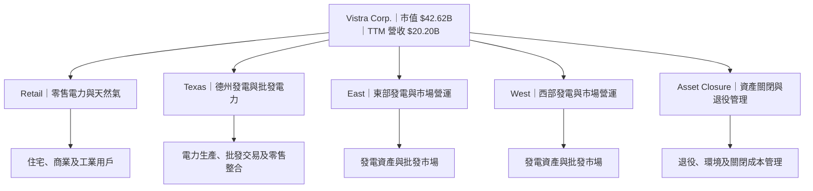
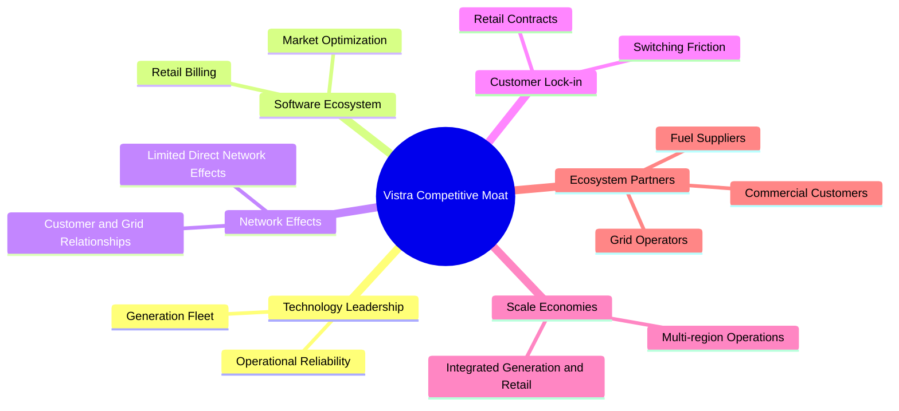
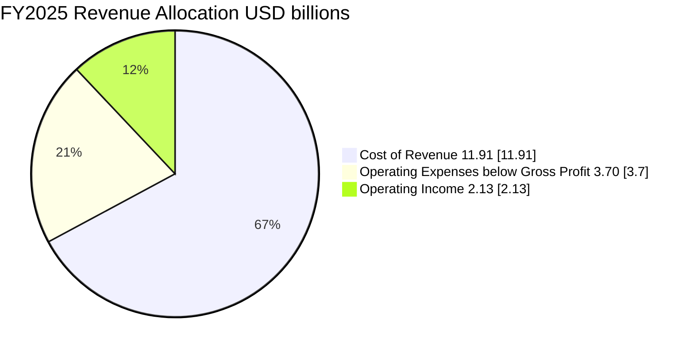
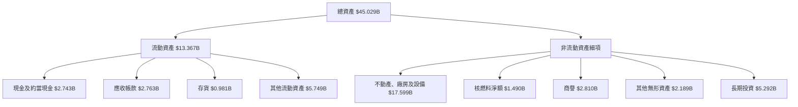
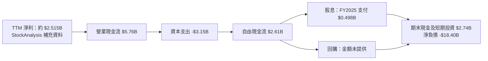
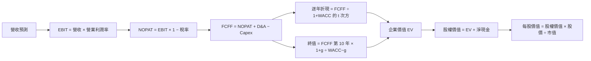
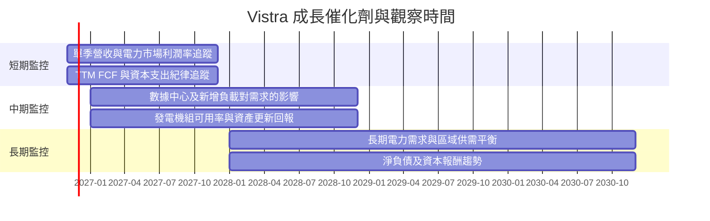
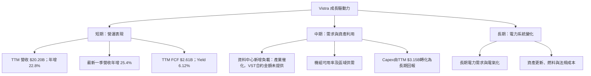
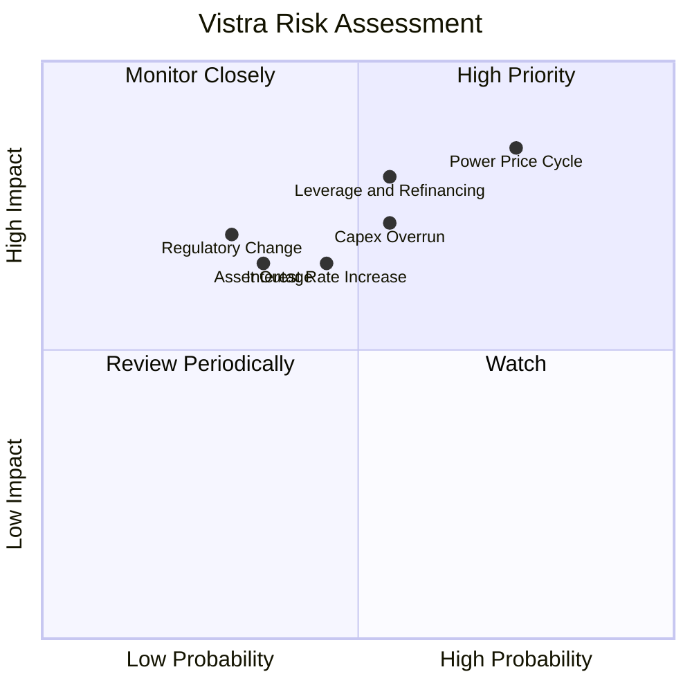
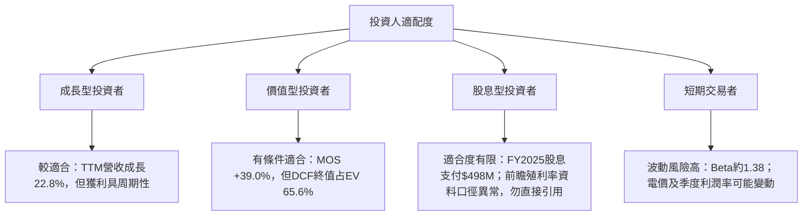

# VST 基本面深度分析報告
> **報告日期**：2026-11-19 ｜ **語言**：繁體中文 ｜ **數據來源**：SEC 申報資料 (XBRL)、Yahoo Finance、Finviz、StockAnalysis、Roic.ai ｜ **分析師**：CFA 級機構研究

## 目錄

| # | 章節 | 核心結論 |
|---|------|----------|
| 1 | 執行摘要 | 強烈買入；加權合理價值 $205.98；MOS +39.0% |
| 2 | 公司概覽與商業模式 | 發電與零售整合模式具規模及資產基礎；各板塊營收占比未提供 |
| 3 | 損益表深度分析 | TTM 營收 $20.20B、年增 22.8%；獲利受電價、發電組合與季度波動影響 |
| 4 | 資產負債表分析 | 淨負債 $18.40B；流動比率 1.157，需持續管理槓桿與流動性 |
| 5 | 現金流量深度分析 | TTM FCF $2.61B、FCF Yield 6.12%；資本支出仍高 |
| 6 | 獲利能力與資本效率 | ROIC 13.5% 高於 WACC 8.86%，目前創造價值 |
| 7 | 相對估值分析 | 現價低於加權合理價值，但同業 Forward P/E 顯示估值並非全面便宜 |
| 8 | DCF 內在價值評估 | DCF 基準價值 $288.81；估值高度依賴長期現金流與終值假設 |
| 9 | 成長催化劑 | 電力需求、數據中心與發電資產價值是潛在驅動；量化 TAM 未提供 |
| 10 | 風險矩陣 | 電價／商品週期、槓桿及再投資需求是主要風險 |
| 11 | 投資建議 | 依 MOS 評級為強烈買入；以財報追蹤利潤率、FCF、負債與資本支出 |

---

## 1. 執行摘要

### 1.0 一頁式投資儀表板（Portfolio Manager 30 秒速讀）

| 項目 | 內容 |
|------|------|
| **投資論點（3 句）** | ① TTM 營收 $20.20B、年增 22.8%，最新一季單季營收年增 25.4%，反映營運規模擴大。② TTM ROIC 13.5% 高於 8.86% WACC，利差為 +4.64 個百分點，現階段高於資本成本。③ TTM FCF $2.61B、FCF Yield 6.12%，但淨負債 $18.40B，現金流仍須兼顧投資與償債。 |
| **綜合評分** | **6.9/10**（引用 1.1 評分卡） |
| **財務健康** | 🟡 淨負債 $18.40B、流動比率 1.157；營運現金流為正，但槓桿仍高 |
| **ROIC vs WACC** | **13.5% vs 8.86%**；高於資本成本，創造股東價值 |
| **FCF 趨勢** | 2025 年 FCF $1.32B，TTM 回升至 $2.61B；FCF Yield **6.12%** |
| **估值** | Forward P/E **12.87x** ｜ EV/EBITDA（財務數據主估值欄）**8.175x** ｜ FCF Yield **6.12%** |
| **DCF 內在價值（基準）** | **$288.81** ｜ 現價相對 DCF 折價 **56.5%**（折溢價 = 現價 ÷ DCF 基準價值 − 1） |
| **安全邊際（MOS）** | **+39.0%**＝($205.98 − $125.58) ÷ $205.98；以第 8.8 節加權合理價值為基準 🟢 |
| **預期報酬（基準情境 12M）** | **+64.0%**，由加權合理價值 $205.98 相對現價計算；非保證報酬 |
| **關鍵風險（前二）** | 電力及燃料價格波動導致利潤率反轉；淨負債 $18.40B 與高資本支出限制財務彈性 |
| **評級 + 信心度** | 🟢 **強烈買入** ｜ 信心：中（估值上行幅度大，但 DCF 終值占 EV 65.6%，且業務獲利具週期性） |

> **評級推導**：加權合理價值 $205.98 高於 2026-11-18 收盤價 $125.58，MOS 為 +39.0%；ROIC 13.5% 亦高於 WACC 8.86%。依 MOS 與資本報酬門檻，規則 20 評級為**強烈買入**，未作質化調整。

### 1.1 綜合評分卡（全報告唯一）

| 維度 | 評分（1–10） | 主要依據（引用數字與其來源章節） |
|------|--------------|----------------------------------|
| 成長性 | 8.0 | TTM 營收成長 22.8%，最新一季單季年增 25.4%（第 3 章）；成長仍受發電市場與季度組合影響 |
| 獲利能力 | 8.0 | TTM 營業利益率 21.0%、ROIC 13.5% 高於 WACC 8.86%、Piotroski 7/8（第 3、6 章） |
| 財務健康 | 5.5 | 淨負債 $18.40B、總債務 $21.15B，現金及短期投資 $2.74B；流動比率 1.157（第 4 章） |
| 估值 | 7.5 | 加權合理價值 $205.98、MOS +39.0%；現價 P/E 17.0x，低於自身五年中位數 25.2x（第 7、8 章） |
| 護城河 | 6.5 | 擁有多州零售客戶與發電資產、整合營運平台；市場份額及板塊營收分布未提供（第 2 章） |
| 管理層與資本配置 | 6.0 | 稀釋股數測試通過；2025 年 SBC $113M、股息支付 $498M，資本配置仍需在投資、債務與股東回報間取捨（第 3、5 章） |
| **綜合評分** | **6.9** | 六項算術平均：(8.0 + 8.0 + 5.5 + 7.5 + 6.5 + 6.0) ÷ 6 = 6.9167，四捨五入至一位小數 |

### 1.2 五大投資論點 + 三大核心風險

| 類型 | 項目 | 具體依據 | 信心度 |
|------|------|----------|--------|
| 🟢 **投資論點①** | 營收具擴張動能 | TTM 營收 $20.20B，TTM 年增 22.8%；最新一季單季年增 25.4%（第 3 章） | 🟢 高 |
| 🟢 **投資論點②** | 資本報酬高於資本成本 | ROIC 13.5% 對 WACC 8.86%，正利差 4.64 個百分點（第 6 章） | 🟢 高 |
| 🟢 **投資論點③** | 現金流提供估值支撐 | TTM OCF $5.76B、Capex $3.15B、FCF $2.61B，FCF Yield 6.12%（第 5 章） | 🟢 中高 |
| 🟢 **投資論點④** | 歷史估值低於自身中位數 | P/E 17.0x，低於五年中位數 25.2x；EV/EBITDA 9.6x，低於五年中位數 11.0x（第 7 章） | 🟢 中 |
| 🟢 **投資論點⑤** | 同業中位數估值與 DCF 指向上行 | 加權合理價值 $205.98，相對現價上行空間 64.0%；但 DCF 基準值 $288.81 對長期假設敏感（第 8 章） | 🟡 中 |
| 🟡 **風險①** | 獲利週期與電價波動 | 2024 年營業利益 $4.08B，2025 年降至 $2.13B；電力市場價格、燃料與發電組合可能使利潤快速反轉 | 🟡 中高 |
| 🔴 **風險②** | 淨負債與高再投資需求 | 淨負債 $18.40B；TTM Capex $3.15B，占 TTM OCF $5.76B 的大部分 | 🔴 高衝擊 |
| 🟡 **風險③** | 終值與利率敏感度 | DCF 終值現值占 EV 65.6%；WACC 或永續成長率變動會明顯改變估值（第 8 章） | 🟡 中高 |

### 1.3 快速統計卡片

| 指標 | 公司實際值（期間） | 同業中位數 | 狀態 |
|------|--------------------|------------|------|
| 營收成長（TTM） | **22.8%** | — | 🟢 |
| 營收成長（最新一季年增） | **25.4%** | **45.4%** | 🟡 |
| 毛利率（TTM） | **41.5%**（Yahoo Finance／StockAnalysis 彙整資料；非 VERIFIED FIGURES 核心欄位） | **25.2%** | 🟢 |
| 營業利益率（TTM） | **21.0%** | — | 🟢 |
| ROIC（TTM） | **13.5%** | — | 🟢 |
| Forward P/E | **12.87x** | **11.2x** | 🟡 |
| FCF Yield（TTM） | **6.12%** | — | 🟢 |
| Piotroski F-Score | **7 / 8**（可判定測試） | — | 🟢 |

> 公司毛利率在合併資料的不同欄位出現口徑差異，本表所列 41.5% 為補充財務資料值；本文估值與核心營運結論以 SEC 計算區塊的數字為優先。

### 1.4 投資結論

```
╔══════════════════════════════════════════════════════════════════╗
║                    📊 投資結論摘要                               ║
╠══════════════════════════════════════════════════════════════════╣
║  評級：強烈買入（MOS +39.0%，ROIC 13.5% > WACC 8.86%）            ║
║  價格（2026-11-18 收盤）：$125.58                                ║
║  DCF 內在價值（基準）：$288.81（現價折價 56.5%）                 ║
║  安全邊際 MOS：+39.0%（＝($205.98−$125.58)÷$205.98）             ║
║  加權合理價值（8.8）：$205.98                                    ║
║  DCF 情境價值：                                                   ║
║    悲觀情境：$97.14（-22.6%）                                    ║
║    基準情境：$288.81（+130.0%）                                  ║
║    樂觀情境：$676.78（+438.9%）                                  ║
║  綜合評分：6.9/10（引用 1.1）                                    ║
║  適合投資人：可承受電力市場週期與高波動的成長型、長線投資者      ║
╚══════════════════════════════════════════════════════════════════╝
```

---

## 2. 公司概覽與商業模式

### 2.1 業務結構與收入來源

Vistra Corp. 是美國垂直整合的零售電力與發電公司，透過發電資產、批發電力市場與零售供電服務參與產業價值鏈。公司資料列出 Retail、Texas、East、West 與 Asset Closure 五個營運板塊，但各板塊營收及獲利占比未提供，因此不以推估值繪製比例圖。



**收入來源與經濟特性**：零售業務可形成客戶關係與供電服務收入；發電資產則使公司暴露於區域電價、燃料、天候及機組可用率。整合模式有助於管理批發採購與零售負載間的風險，但不代表天然消除商品價格風險。公司員工數為 6,390 人；各業務的營收占比、客戶數及零售留存率未提供。

### 2.2 市場份額

市場份額數據未提供，亦沒有可引用的市場總量或年份，因此不繪製份額圖。從營收規模觀察，Vistra TTM 營收為 $20.20B，TTM 年增 22.8%；其規模與成長均具參考價值，但同業營收增速差異大，不能單以增速推論市占變化。

### 2.3 競爭護城河分析



此圖為護城河類型的質化分類，不代表公司已披露每項技術或客戶指標。其護城河主要來自發電資產規模、零售服務渠道、批發市場經驗與資產管理能力，而非典型軟體網路效應。

### 2.4 護城河強度

| 護城河項目 | 強度（強／中／弱） | 證據（引用數字或事實） | 會削弱它的情況 |
|------------|--------------------|------------------------|----------------|
| 發電資產與營運規模 | 中 | TTM 營收 $20.20B、員工 6,390 人；公司營運跨區域發電板塊 | 機組老化、維修停機增加，或新供給壓低批發電價 |
| 零售客戶與品牌 | 中 | 公司在多州提供住宅、商業及工業電力與天然氣服務；客戶數與留存率未提供 | 顧客流失、競爭者價格削弱零售毛利 |
| 垂直整合 | 中 | 發電、批發交易與零售業務並存，可協調供需與市場風險 | 發電與零售曝險方向不匹配、對沖失效 |
| 網路效應 | 弱 | 未有客戶網路擴張帶來單位價值上升的量化證據 | 市場平台化及零售轉換成本下降 |
| 軟體生態系統 | 弱 | 財務資料未揭露可獨立變現的軟體收入 | 技術外包、營運系統落後或資安事件 |
| 生態夥伴 | 中 | 業務依賴電網、燃料供應商、批發交易及商業客戶 | 電網壅塞、供應中斷、法規或合約條件惡化 |

**1.1 護城河評分 6.5/10**：公司具跨區域資產與整合營運的現實壁壘，但可量化的市占、客戶留存與軟體平台證據有限，故評分不代表具有無週期性的定價權。

---

## 3. 損益表深度分析

### 3.1 年度收入成長趨勢（近 4 年）

年報營收為 2022 年 $13.73B、2023 年 $14.78B、2024 年 $17.22B、2025 年 $17.74B。2022–2025 年營收 CAGR 約 8.9%；公式為 \((17.74 ÷ 13.73)^{1/3}-1\)。

```
╔══════════════════════════════════════════════════════════════════╗
║              Vistra 年度收入趨勢（FY2022–FY2025）                ║
╠══════════════════════════════════════════════════════════════════╣
║  FY2022  $13.73B  ███████████████                YoY：基期       ║
║  FY2023  $14.78B  ████████████████               YoY：+7.7%  🟢 ║
║  FY2024  $17.22B  ███████████████████            YoY：+16.5% 🟢 ║
║  FY2025  $17.74B  ████████████████████           YoY：+3.0%  🟡 ║
║                                                                  ║
║  2022–2025 營收 CAGR：約 +8.9%                                   ║
╚══════════════════════════════════════════════════════════════════╝
```

年度增速在 2024 年加快，2025 年回到較低的 3.0%。這種變化與獨立發電業收入對電價、區域供需和發電組合的敏感性相符；不能把單一年度成長率直接外推為長期固定增速。SEC 計算的 TTM 營收為 $20.20B，TTM 年增 22.8%，高於年度歷史趨勢，反映最新 TTM 動能較強。

### 3.2 季度收入趨勢分析

| 季度 | 營收（$B） | QoQ 成長 | YoY 成長（單季） | 備註 |
|------|-----------:|---------:|----------------:|------|
| 2025 Q4 | 4.584 | -7.8% | +13.5% | QoQ 比較 2025 Q3；YoY 比較 2024 Q4 |
| 2026 Q1 | 5.640 | +23.0% | +43.4% | 季節及供電組合可能影響季度基期 |
| 2026 Q2 | 4.017 | -28.8% | -5.5% | QoQ 回落且單季低於去年同期 |
| 2026 Q3 | 6.347 | +58.0% | +27.7% | 當季營收升至四季高點；SEC 計算區塊採用單季年增 25.4% |

註：季度營收與 QoQ/YoY 是依季度財報列值計算；最新一季單季 YoY 核心指標依 SEC 計算區塊原值引用為 **25.4%**。其他彙整來源列出 27.7%，與 SEC 口徑不一致，故不取代核心指標。季度跳動明顯，顯示不宜用單季年化推算全年。

### 3.3 利潤率演變分析

| 利潤率指標 | FY2022 | FY2023 | FY2024 | FY2025 | 趨勢 | 評估 |
|------------|-------:|-------:|-------:|-------:|------|------|
| **毛利率** | 12.2% | 37.3% | 43.7% | 32.9% | 2024 高點後回落 | 🟡 |
| **營業利益率** | -8.0% | 18.3% | 23.7% | 12.0% | 2024 高點後收縮 | 🟡 |
| **淨利率** | -9.0% | 9.1% | 15.5% | 5.3% | 2025 明顯回落 | 🟡 |

年度利潤率以年報收入與毛利、營業利益、淨利計算，與 TTM 指標期間不同。最新 TTM 營業利益率為 21.0%，最新一季營業利益率為 28.5%；單季利潤率高於 TTM，表示近期盈利能力較高，但仍需觀察是否可持續。

**利潤率演變深度解析**：2022 年營業虧損反映獨立發電業對市場價格與燃料成本的週期敏感度；2023–2024 年營業利益改善，可能受市場價格、機組組合及零售／批發對沖結果影響。2025 年營收仍微增 3.0%，營業利益卻由 $4.08B 降至 $2.13B，顯示利潤率收縮而非單純收入規模不足。資料未提供板塊級毛利、實現電價及燃料成本分解，因此不能將改善或惡化歸因於特定板塊。

### 3.4 費用結構分析

以下為 FY2025 由收入、毛利及營業利益推導的收入用途分解：營收 $17.74B = 營業成本 $11.91B + 毛利以下營業費用 $3.70B + 營業利益 $2.13B。營業費用屬差額計算，僅代表毛利至營業利益間的淨費用，不等同單一費用科目。



```
╔══════════════════════════════════════════════════════════════════╗
║                  FY2025 收入用途概覽（$B）                       ║
╠══════════════════════════════════════════════════════════════════╣
║  營收                  $17.74B  ████████████████████            ║
║  營業成本              $11.91B  █████████████                    ║
║  毛利以下營業費用       $3.70B  ████                             ║
║  營業利益               $2.13B  ██                               ║
╚══════════════════════════════════════════════════════════════════╝
```

### 3.5 季度 EPS 趨勢與盈餘品質（Quality of Earnings）

SEC 申報與 Yahoo 彙整中的近四季 EPS 預估及實際值缺漏（預估 EPS 欄為 nan），因此無法判定超預期或不及預期。補充來源的實際 EPS 也存在口徑差異：StockAnalysis 的 2026 Q3 EPS 為 $3.23，Roic.ai 列 $3.26；以下不以其判定盈餘驚喜。

| 季度 | 補充來源列示 EPS | EPS 預估／surprise | 季度淨利（財務資料） | 解讀 |
|------|-----------------:|--------------------|----------------------:|------|
| 2025 Q4 | $0.54–$0.55 | N/A | $0.233B | 兩個彙整來源略有差異；無預估值 |
| 2026 Q1 | $2.87–$2.90 | N/A | $1.03B（補充來源列 $0.980B） | 淨利資料存在來源差異 |
| 2026 Q2 | $0.76–$0.77 | N/A | $0.305B（補充來源列 $0.258B） | 仍無法評估 beat/miss |
| 2026 Q3 | $3.23–$3.26 | N/A | $1.14B（補充來源列 $1.092B） | 單季盈利上升，但 EPS 預估缺漏 |

| 盈餘品質項目 | 數值／佔比 | 評估 |
|--------------|-----------|------|
| 股權薪酬 SBC / 營收 | TTM SBC 約 $127M；$127M ÷ $20.20B = **0.63%** | 🟢 占比低，但仍是股東經濟成本 |
| SBC / 營業現金流 | $127M ÷ $5.76B = **2.2%** | 🟢 對 OCF 的影響有限 |
| FCF / 淨利（現金轉換率） | TTM FCF $2.61B ÷ StockAnalysis TTM 淨利 $2.515B = **103.8%** | 🟢 現金轉換高於 100%；淨利來源口徑與 SEC TTM 不完全一致 |
| 一次性／非經常性損益 | N/A（未提供足以辨識一次性項目的完整明細） | 🟡 不宜假設盈餘全為經常性 |
| 有效稅率異常 | **15.9%**（最新年度有效稅率） | 🟢 DCF 按原值採用；缺乏多年稅率細節，不能認定為長期穩定稅率 |
| 資本化支出 vs 費用化 | TTM Capex $3.15B；SBC 已列為費用，但資本化內部成本明細未提供 | 🟡 無法判斷成本資本化是否異常 |

**盈餘品質結論**：TTM FCF $2.61B 約為補充來源淨利 $2.515B 的 1.04 倍，SBC 相對營收僅 0.63%，支持盈餘具一定現金含量；但市場電價週期、一次性項目與資本化支出明細不足，且季度 EPS 預估缺漏。估值應以現金流與中期利潤率為主，避免只用單季 EPS 年化。

---

## 4. 資產負債表分析

### 4.1 資產結構分解

最新 TTM 截止 2026-09-30 的資產負債表資料列示總資產 $45.029B、流動資產 $13.367B；以下只呈現披露金額，不以差額重建未披露的分類總數。



### 4.2 流動性與營運資金分析

| 指標 | 最新值 | 歷史／比較 | 評估 |
|------|------:|------------|------|
| 流動比率 | **1.157** | 補充資料；年度流動資產／流動負債波動 | 🟡 短期資產略高於流動負債，但流動資產品質與能源結算週期重要 |
| Quick ratio | **0.477** | 補充資料 | 🟡 扣除存貨等後流動性較低 |
| 現金及短期投資 | **$2.74B** | 2026-09-30 | 🟡 相對總債務低 |
| 淨負債 | **$18.40B** | 2026-09-30 | 🔴 顯著負債規模，需要持續管理 |

**營運資金天數**（照抄 QUALITY FIGURES）：

| 指標 | 最新 TTM | 一年前 TTM | 變化 | 解讀 |
|------|----------|------------|------|------|
| DSO 應收帳款天數 | **50 天** | **52 天** | **-2 天** | 收款天數略縮短，方向有利；能源交易結算可能帶來季度波動 |
| DIO 存貨天數 | **30 天** | **N/A** | N/A | 一年前公司未報告可用存貨餘額指標，不作推算 |
| DPO 應付帳款天數 | **45 天** | **N/A** | N/A | 一年前數據不可用，不推測供應商付款變化 |
| CCC 現金轉換週期 | **34 天** | **N/A** | N/A | 最新數字依原列示；一年前缺少 DIO、DPO，不計算變化 |

CCC 最新值依 QUALITY FIGURES 原值引用；若按已四捨五入的 DSO 50、DIO 30、DPO 45 相加，會得到 35 天，與原始 CCC 34 天差 1 天，合理地反映原始天數未四捨五入前的差異。

### 4.3 債務結構分析

```
╔══════════════════════════════════════════════════════════════════╗
║                   Vistra 債務健康診斷                            ║
╠══════════════════════════════════════════════════════════════════╣
║  總債務：         $21.15B  ████████████████████  🟡             ║
║  現金及短期投資：  $2.74B  ██                    🟡             ║
║  淨負債：         $18.40B  █████████████████     🔴             ║
║                                                                  ║
║  總債務／EBITDA： N/A（核心財務數據未提供可一致引用的 EBITDA）    ║
║  利息保障倍數：   N/A（利息費用及一致期間 EBIT 未提供）           ║
║  流動比率：       1.157                 🟡                       ║
║  淨負債方向：     仍為淨負債，需靠持續 OCF 支應資本需求與償債    ║
╚══════════════════════════════════════════════════════════════════╝
```

債務資料在不同彙整來源略有差異：SEC 計算區塊總債務 $21.15B、淨負債 $18.40B；其他合併市場資料列總債務 $21.77B、淨負債 $19.02B。本文涉及槓桿與 DCF 橋接時，依優先規則採用 **$21.15B** 與 **$18.40B**。

### 4.4 股東權益趨勢

```
╔══════════════════════════════════════════════════════════════════╗
║                Vistra 歷年股東權益（$B）                         ║
╠══════════════════════════════════════════════════════════════════╣
║  FY2022  $4.90B  ██████████████████                             ║
║  FY2023  $5.31B  ████████████████████                           ║
║  FY2024  $5.57B  █████████████████████                          ║
║  FY2025  $5.10B  ███████████████████                            ║
╚══════════════════════════════════════════════════════════════════╝
```

FY2024 股東權益升至 $5.57B，FY2025 回落至 $5.10B，下降約 8.4%。股東權益變化受淨利、股利、回購、其他綜合損益與併購等影響；資料未提供完整權益變動表拆解，不能將降幅單獨歸因於回購或分配。

---

## 5. 現金流量深度分析

### 5.1 現金流量瀑布圖



該圖呈現量級關係而非逐項現金流對帳。年度股息付款為 FY2025 數字，不應與 TTM FCF 混為同一會計期間；回購金額未提供。

### 5.2 FCF 轉換率趨勢

| 年度 | OCF（$B） | Capex（$B） | FCF（$B） | 淨利（$B） | FCF／淨利 |
|------|----------:|------------:|----------:|-----------:|----------:|
| 2022 | 0.485 | 1.30 | -0.816 | -1.23 | 不具可比性 |
| 2023 | 5.45 | 1.68 | 3.78 | 1.49 | 約 253.7% |
| 2024 | 4.56 | 2.08 | 2.48 | 2.66 | 約 93.2% |
| 2025 | 4.07 | 2.75 | 1.32 | 0.944 | 約 139.8% |
| TTM 至 2026-09-30 | 5.76 | 3.15 | 2.61 | 2.515（補充來源） | 約 103.8% |

FCF 對淨利的轉換率高低受資本支出時點、營運資金與發電資產投資周期影響。2025 年淨利下降而 FCF 仍為正，TTM FCF 又回升，支持現金流具有韌性；但不能因單年高於 100% 就推論長期轉換率維持該水準。

### 5.3 自由現金流趨勢

```
╔══════════════════════════════════════════════════════════════════╗
║              Vistra 自由現金流：歷史與 TTM                       ║
╠══════════════════════════════════════════════════════════════════╣
║  FY2022  -$0.816B  ◀ 負值，投資支出高於 OCF                     ║
║  FY2023   $3.780B  ████████████████████                         ║
║  FY2024   $2.480B  █████████████                                ║
║  FY2025   $1.320B  ███████                                      ║
║  TTM      $2.610B  ██████████████          FCF Yield 6.12%     ║
╚══════════════════════════════════════════════════════════════════╝
```

2023 年 FCF 高點後連續兩年下降，2025 年降至 $1.32B；最新 TTM 回升至 $2.61B。年度 FCF Yield 未提供一致市值日期下的歷史數據，故只列 TTM FCF Yield 6.12%。

### 5.4 資本配置評估

| 資本用途 | 可用數字 | 評估 |
|----------|----------|------|
| 資本支出 | FY2025 $2.75B；TTM $3.15B | 維持發電資產、擴建及資產生命週期管理可能需要較高投資；支出回報需追蹤 |
| 股息 | FY2025 支付 $498M | 約為 FY2025 FCF $1.32B 的 37.7%；年度配對僅供參考 |
| 股票回購 | N/A（金額未提供） | 不對回購成效作量化判斷 |
| 債務償還／現金留存 | N/A（未提供同期間完整資本配置分項） | 公司仍有淨負債 $18.40B，應衡量增量資本的償債優先級 |

未繪製資本配置圓餅圖：目前沒有同期間、完整且可相加的回購、投資、股息、償債與留存現金分項，避免以不完整數字假裝總額分配。

---

## 6. 獲利能力與資本效率

### 6.1 ROE / ROA / ROIC 趨勢

| 指標 | FY2022 | FY2023 | FY2024 | FY2025／TTM 最新 | 評估 |
|------|-------:|-------:|-------:|----------------:|------|
| ROE | N/A | N/A | N/A | **42.9% TTM** | 高回報，但受到 7.14 倍權益乘數放大 |
| ROA | N/A | N/A | N/A | **N/A（QUALITY FIGURES 未提供 ROA 數值）** | 補充來源列 7.1%，但不同口徑下不與核心數值混列 |
| ROIC | N/A | N/A | N/A | **13.5% TTM** | 高於 WACC，為正向價值創造 |
| 行業均值對比 | — | — | — | **未提供同口徑行業均值** | 不以非同口徑數字補入 |

資料不足以構建可靠的逐年 ROIC、ROE、ROA 時序；不以不同來源的平均資產、期末資產或不同期間計算拼接趨勢。

### 6.2 ROIC vs WACC 分析（核心價值創造判斷）

```
╔══════════════════════════════════════════════════════════════════╗
║                ROIC vs WACC 深度分析                            ║
╠══════════════════════════════════════════════════════════════════╣
║  WACC（依成本資本資料原值）：                                    ║
║  ├── 無風險利率（10Y美債）：  5.07%                              ║
║  ├── 市場風險溢酬 ERP：       5.00%                              ║
║  ├── 原始 Beta：              1.38                               ║
║  ├── 採用調整後 Beta：        1.25                               ║
║  ├── 股權成本 Ke：            11.32%                             ║
║  ├── 稅前債務成本：           4.64%                              ║
║  ├── 稅後債務成本：           3.90%                              ║
║  ├── 資本結構：股權 66.8%，債務 33.2%                           ║
║  └── ✅ WACC：                8.86%                              ║
║                                                                  ║
║  ROIC（TTM）：                13.5%                              ║
║  EVA 利差 = ROIC − WACC：     +4.64 個百分點                    ║
║                                                                  ║
║  ROIC 13.5%  ▓▓▓▓▓▓▓▓▓▓▓▓▓▓▓░░░░░  高於 WACC                  ║
║  WACC  8.86%  ▓▓▓▓▓▓▓▓▓░░░░░░░░░░░                               ║
║                                                                  ║
║  結論：ROIC 約為 WACC 的 1.52 倍，現階段創造經濟價值             ║
╚══════════════════════════════════════════════════════════════════╝
```

**計算與解讀**：

- 股權成本 CAPM：\(5.07\% + 1.25 \times 5.00\% = 11.32\%\)。
- 稅後債務成本：\(4.64\% \times (1-15.9\%) = 3.902\%\)，四捨五入為 3.90%。
- WACC：\(66.8\% \times 11.32\% + 33.2\% \times 3.902\% = 8.86\%\)。
- ROIC／WACC：\(13.5\% ÷ 8.86\% = 1.52\) 倍；利差 \(13.5\%-8.86\%=4.64\) 個百分點。

成本資本區塊未提供 10 年期公債殖利率的精確觀測日期、股權風險溢酬來源細節及利息費用絕對值。故本節直接採用程式計算 WACC 及其組成，不另建另一套 WACC。這是點估值，利率和發電市場風險變化會改變資本成本。

### 6.3 杜邦三因素分解

| 因素 | 數值（TTM） | 解讀 |
|------|-------------|------|
| 淨利率 | **13.4%** | 每一美元營收轉化為淨利的比率 |
| 資產週轉率 | **0.45** | 資產營收產出約為每美元資產 0.45 美元營收 |
| 權益乘數 | **7.14** | 槓桿放大 ROE，需與資產回報及利息負擔一起評估 |
| **ROE** | **42.9%** | 原值：13.4% × 0.45 × 7.14 = 43.1%，與未四捨五入原始因子相乘後的 42.9% 有小幅四捨五入差 |

ROE 偏高部分來自權益乘數 7.14，不能將 42.9% 全部解讀為低槓桿下的營運報酬。淨負債 $18.40B 使資本結構是投資論點的重要風險約束。

### 6.4 財務體質：Piotroski F-Score

**Piotroski F-Score：7 / 8**；一項因缺資料無法判定，分母低於標準九項測試。

| 測試 | 結果 | 解讀 |
|------|------|------|
| ROA > 0 | ✅ 通過 | 依程式比較期間，資產回報為正 |
| 營業現金流 > 0 | ✅ 通過 | TTM OCF 為 $5.76B |
| ROA 高於一年前 | ✅ 通過 | 獲利效率較一年前改善 |
| 營業現金流 > 淨利（應計品質） | ✅ 通過 | 現金流高於淨利，應計品質測試通過 |
| 長期負債 ÷ 總資產低於一年前 | ❌ 未通過 | 負債比未改善，與淨負債 $18.40B 的風險一致 |
| 流動比率高於一年前 | ✅ 通過 | 流動比率變化測試通過；最新流動比率 1.157 |
| 稀釋股數未增加 | ✅ 通過 | 測試期稀釋股數未增加 |
| 毛利率高於一年前 | — 無法判定 | 缺少該測試的可比輸入，依規則不補值 |
| 資產週轉率高於一年前 | ✅ 通過 | 資產利用率測試通過 |

7/8 顯示多項營運及資產品質測試通過，但長期負債相對資產未改善，且毛利率測試缺資料；分數不能替代對能源市場週期與槓桿的判斷。

---

## 7. 相對估值分析

### 7.1 同業估值比較表格

比較對象為 Constellation Energy（CEG）、NRG Energy（NRG）及 Talen Energy（TLN）。VST 倍數依提供的同一資料集；同業倍數依 Yahoo Finance Peer multiples。表內 VST EV/EBITDA 使用 SEC 計算區塊的自身歷史比較口徑 9.6x；市場估值彙整資料另列 8.175x，兩口徑不混用。

| 估值指標 | **VST** | **CEG** | **NRG** | **TLN** | VST 評估 |
|----------|--------:|--------:|--------:|-------:|-----------|
| **Trailing P/E** | **17.0x** | 21.1x | 16.4x | N/A | 🟡 介於兩家可比公司之間；TLN 不列入中位數 |
| **Forward P/E** | **12.87x** | 19.6x | 9.8x | 11.2x | 🟡 高於同業中位數 11.2x，低於 CEG |
| **P/S Ratio** | **2.1x** | 2.7x | 0.6x | 3.5x | 🟡 接近中位數 2.7x；NRG 顯著較低 |
| **EV/EBITDA（TTM）** | **9.6x** | 12.2x | 10.5x | 37.0x | 🟢 低於三家同業中位數 12.2x；TLN 倍數高且分布偏斜 |
| **最新一季營收 YoY** | **25.4%** | 45.4% | 24.0% | 96.1% | 🟡 VST 高於 NRG、低於 CEG 與 TLN |
| **毛利率（TTM）** | **41.5%** | 25.2% | 20.2% | 42.7% | 🟢 接近 TLN、顯著高於 CEG 與 NRG；VST 為補充來源口徑 |

同業倍數屬不同資產組合及獲利週期，尤其 TLN EV/EBITDA 37.0x 與營收增長 96.1% 可能受到基期及市場預期影響；中位數相對優於平均數，但仍需檢查週期化 EBITDA。

### 7.2 歷史估值區間分析

```
╔══════════════════════════════════════════════════════════════════╗
║              VST 五年估值區間與目前位置                          ║
╠══════════════════════════════════════════════════════════════════╣
║  P/E：        7.2x ├────────────● 17.0x ───────────┤ 74.3x      ║
║                            五年中位數 25.2x                       ║
║               目前百分位：20%（低於自身中位數）                   ║
║                                                                  ║
║  P/S：        0.5x ├──────────────● 2.1x ──────────┤ 4.2x       ║
║                            五年中位數 1.8x                        ║
║               目前百分位：52%                                     ║
║                                                                  ║
║  EV/EBITDA：  2.3x ├────────────● 9.6x ───────────┤ 40.7x      ║
║                            五年中位數 11.0x                       ║
║               目前百分位：35%                                     ║
╚══════════════════════════════════════════════════════════════════╝
```

P/E 與 EV/EBITDA 目前分別處於自身五年 20% 與 35% 百分位，估值相對自身歷史偏低；P/S 百分位 52%，並未顯示同等程度的折價。由於能源公司盈餘週期性強，歷史中位數包含景氣高低點，不能單憑低 P/E 判定便宜。

### 7.3 情境價值（Bear / Base / Bull，照抄 DCF MODEL）

| 情境 | 第 1 年營收成長 | 期末營業利潤率 | WACC | 每股價值 | 相對現價 | 機率 | 會發生的條件 |
|------|----------------:|---------------:|-----:|----------:|---------:|-----:|--------------|
| 🔴 悲觀 | 11.4% | 16.4% | 9.86% | **$97.14** | **-22.6%** | 25% | 電力需求增長放緩、競爭供給增加、發電與零售利差收窄，資本成本提高 |
| 🟡 基準 | 22.8% | 19.3% | 8.86% | **$288.81** | **+130.0%** | 50% | TTM 增長能延續一段時間並逐步減速，營業利潤率向五年中位數收斂 |
| 🟢 樂觀 | 34.3% | 21.2% | 7.86% | **$676.78** | **+438.9%** | 25% | 電力需求及新負載提升資產利用與盈利，且資本成本下降 |

各情境數字按程式計算模型原值列示；不能將概率加權價值誤當基準目標價。悲觀情境低於現價，是估值不確定性的直接提醒。

### 7.4 相對估值隱含價格區間

```
╔══════════════════════════════════════════════════════════════════╗
║             相對估值方法隱含價格（每股美元）                     ║
╠══════════════════════════════════════════════════════════════════╣
║  $109.19 ───── $125.58 ───── $173.25 ───── $198.49 ───── $288.81║
║  Forward P/E      現價         EV/EBITDA      共識目標     DCF基準║
╚══════════════════════════════════════════════════════════════════╝
```

| 方法 | 每股價值 | 相對現價 | 依據 |
|------|---------:|---------:|------|
| 同業 Forward P/E | **$109.19** | **-13.1%** | 同業中位數 Forward P/E 11.2x × VST Forward EPS $9.76 |
| 同業 EV/EBITDA | **$173.25** | **+38.0%** | 同業中位數 EV/EBITDA 12.2x × VST TTM EBITDA，再加淨現金／扣除淨負債 |
| 分析師共識目標價 | **$198.49** | **+58.1%** | 23 位分析師平均目標價，作參考而非基本面獨立估值 |

同業 Forward P/E 推導的 $109.19 低於現價，而 EV/EBITDA 推導的 $173.25 高於現價，顯示不同盈利衡量方式會得出相反結論；估值不宜只靠單一倍數。

---

## 8. DCF 內在價值評估（Discounted Cash Flow）

### 8.0 估值推理鏈（Thinking Logic：在算之前先想清楚）

**Step 1 — 價值來源與主導變數**

VST 的企業價值主要來自現有發電與零售整合業務的現金流，而非已披露的獨立軟體或新業務收入：TTM 營收 $20.20B，板塊占比未提供，因此不拆分或杜撰「第二成長曲線」的營收比重。模型中最主導估值的是未來營收成長、營業利潤率與折現率；終值現值占 EV 65.6%，故長期利潤率和永續成長率對估值特別重要。

**Step 2 — 模型選擇**

| 決策點 | 本報告採用 | 理由（含數字） | 曾考慮但否決 | 否決理由 |
|--------|-----------|----------------|--------------|----------|
| 現金流定義 | FCFF | 使用 WACC 8.86% 折現並得出企業價值；公司總債務 $21.15B | FCFE | 債務與現金須在 EV 至股權價值橋接處處理，避免與 WACC 不匹配 |
| 預測期 N | **10 年** | DCF 模型固定 10 年，逐年將 TTM 成長 22.8% 線性減速至第 10 年 3.0% | 縮短預測期 | 未提供管理層多年財測，不能自建另一預測期模型 |
| 終值方法 | Gordon Growth | 模型提供永續成長率 3.0%，且 WACC 8.86% > g | 只用退出倍數 | DCF 模型沒有給退出倍數的終值數字，不另建或補值 |
| EBIT 基礎 | GAAP EBIT | TTM GAAP 營業利益率 21.0%；模型明確採 GAAP EBIT | 非 GAAP EBIT | 沒有提供可核對的非 GAAP EBIT，也避免加回 SBC |

**Step 3 — 關鍵假設推導鏈**

- **預測期營收增長**：錨點＝TTM 營收成長 22.8% → 調整＝按模型設定由 22.8% 線性降至第 10 年 3.0%，反映高增長逐步正常化 → **採用第 1 年 22.8%、第 10 年 3.0%** → 曾考慮以 FY2022–FY2025 約 8.9% CAGR 起步，但模型基準依程式固定採用最新 TTM 增長；另以悲觀情境 11.4% 作下行檢驗，不替換基準值。
- **營業利潤率**：錨點＝TTM 21.0% → 調整＝模型將其逐步降至近五個財年的中位數 19.3%，不假設長期維持近期高位 → **第 1 年 21.0% 至第 10 年 19.3%** → 曾考慮固定 21.0%，因忽略歷史年度波動而不採用。
- **永續成長率 g**：錨點＝模型採 3.0%，且長期名目成長率應低於 WACC → 調整＝採模型指定值，未用更高永續增長放大終值 → **3.0%** → 曾考慮更高值，因能源發電屬成熟且週期性產業、又會令終值對利差更敏感而否決。
- **預測期 N**：錨點＝模型固定 10 年 → 調整＝以十年逐年減速捕捉目前增長與成熟期收斂 → **10 年** → 曾考慮 5 年，但會縮短模型提供的可見現金流期間，且不得自行更換模型。
- **Capex／營收**：錨點＝TTM Capex／營收 15.6% → 調整＝模型逐步降至 11.5%，即 1.1 倍 D&A 比率附近，假設高強度投資期後資本支出正常化 → **第 1 年 15.6% 至第 10 年 11.5%** → 曾考慮固定 15.6%，因忽視模型預設的資本支出均值回歸。
- **EBIT 基礎與 SBC**：錨點＝模型採 GAAP EBIT，SBC 在 GAAP 費用中；沒有另行提供非 GAAP 加回金額 → **組合 (A)：GAAP EBIT、FCFF 不再減 SBC、股數不再稀釋** → 曾考慮另外扣 SBC 或增加稀釋，因會與 GAAP 已認列費用重複計成本而否決。**本模型採用 (A)，故 SBC 影響已計入一次。**
- **年稀釋率**：錨點＝DCF 模型固定不再稀釋 → **0%** → 曾考慮股數逐年增加，但與組合 (A) 不相容，故否決。
- **WACC**：錨點＝成本資本資料 WACC **8.86%** → 調整＝不調整程式提供值 → **8.86%** → 曾考慮採較低折現率，因 10 年期現金流與終值比重大，不應在缺乏新證據時降低風險折現率。

**Step 4 — 最脆弱的一環**

最脆弱假設是營收高增長能否持續，同時保持接近 19.3% 的長期營業利潤率；若實現更接近悲觀情境（第 1 年增長 11.4%、期末利潤率 16.4%、WACC 9.86%），每股價值由基準 $288.81 降至 $97.14。

**Step 5 — 計算路徑圖**



### 8.1 模型假設總表（Model Inputs）

| 假設項目 | 採用值 | 依據／來源 | 敏感度 |
|----------|--------|-------------|--------|
| 預測期長度 **N** | **10 年** | DCF 模型固定十年；收入增長與利潤率逐年收斂 | 🟡 中 |
| 營收增長 | 第 1 年 **22.8%**，第 10 年 **3.0%** | 第 1 年錨定 TTM vs prior TTM 增長 22.8%；線性降至 3.0% | 🔴 高 |
| 營業利潤率 | 第 1 年 **21.0%** → 第 10 年 **19.3%** | TTM 營業利益率 21.0%；期末收斂至模型指定近五年中位數 19.3% | 🔴 高 |
| 有效稅率 | **15.9%** | 最新年度有效稅率 | 🟢 低 |
| Capex／營收 | **15.6%** → **11.5%** | 起點為 TTM 值，逐步降至模型設定的 1.1×D&A 附近 | 🟡 中 |
| D&A／營收 | **10.4%** | TTM D&A／營收比例，模型固定 | 🟢 低 |
| 營運資金變動 | **未建模** | DCF MODEL 明確未模擬營運資金；依模型原值，不另加列 | 🟢 低 |
| EBIT 基礎 | **GAAP EBIT** | DCF MODEL 明確採用 GAAP EBIT | 🟡 中 |
| SBC 處理 | **組合 (A)**：不重複扣 SBC | GAAP EBIT 已含 SBC 費用；DCF 不另扣，股數不再稀釋 | 🟡 中 |
| 年稀釋率 | **0%** | 與組合 (A) 相容，依 DCF MODEL 固定股數處理 | 🟡 中 |
| 永續成長率 g | **3.0%** | DCF MODEL 固定；小於 WACC 8.86% | 🔴 高 |
| 終值方法 | **Gordon Growth** | DCF MODEL 提供終值及折現值；未提供退出倍數計算 | 🔴 高 |
| WACC | **8.86%** | Cost of capital 計算區塊原值；詳見 8.2 | 🔴 高 |

FCFF 採用模型定義 **NOPAT + D&A − Capex**。模型未列 ΔWC，因此預測表不加入 ΔWC 項；不得把這解讀為公司營運資金永遠不變。金額以 $B 表示，逐年折現因子保留三位小數；模型所列逐年數字原樣引用，因展示四捨五入，個別列中間值相加可能出現 $0.01B 差異。

### 8.2 折現率推導（WACC）

```
╔══════════════════════════════════════════════════════════════════╗
║                    WACC 推導（折現率）                           ║
╠══════════════════════════════════════════════════════════════════╣
║  股權成本 Ke（CAPM）：                                           ║
║  ├── 無風險利率 Rf（10Y美債）：     5.07%                        ║
║  ├── 市場風險溢酬 ERP：              5.00%                        ║
║  ├── 原始 Beta（Yahoo）：             1.38                         ║
║  ├── 調整後 Beta：                   1.25                         ║
║  ├── Beta 調整：                     ⅔×1.38 + ⅓×1 = 1.253 ≈1.25  ║
║  ├── 規模／國別溢酬：                0.00%（未另加）              ║
║  └── Ke = 5.07% + 1.25×5.00% = 11.32%                           ║
║                                                                  ║
║  債務成本 Kd：                                                   ║
║  ├── 稅前 Kd（資料庫原值）：         4.64%                        ║
║  ├── 有效稅率：                      15.9%                        ║
║  └── 稅後 Kd = 4.64%×(1−15.9%) = 3.90%                         ║
║                                                                  ║
║  資本結構權重：                                                  ║
║  ├── 股權權重 E：                    66.8%                        ║
║  ├── 債務權重 D：                    33.2%                        ║
║  └── ✅ WACC = 66.8%×11.32% + 33.2%×3.90% = 8.86%               ║
╚══════════════════════════════════════════════════════════════════╝
```

**逐步演算（採用資本成本區塊提供的成本與權重）**：

1. **Ke（CAPM）** = Rf + β × ERP = 5.07% + 1.25 × 5.00% = **11.32%**。
2. **稅前 Kd** = 成本資本資料所列稅前債務成本 **4.64%**。利息費用絕對值及平均計息負債明細未提供，故不能另以「利息費用 ÷ 平均計息負債」獨立重建；本報告依要求直接採用區塊原值。
3. **稅後 Kd** = 4.64% × (1 − 15.9%) = 4.64% × 0.841 = **3.90224% ≈ 3.90%**。
4. **權重** = 資本成本區塊提供股權 66.8%、債務 33.2%；\(66.8\%+33.2\%=100.0\%\)。市場市值 $42.62B、總債務 $21.15B 為補充核對數字，與區塊权重可能因取值日期、口徑及未四捨五入值略異；本報告不以之替換原權重。
5. **WACC** = 66.8% × 11.32% + 33.2% × 3.90224% = 7.56176% + 1.29554% = **8.85730% ≈ 8.86%**。

原始 Beta 1.38，按成本資本區塊指定的調整方式 \(⅔×1.38 + ⅓×1\) 得 1.253，採用 Beta 1.25。ERP 5.00% 為模型假設值；風險自由利率的精確觀測日期未提供。6.2 節與本節統一使用 WACC **8.86%**。

### 8.3 逐年自由現金流預測（基準情境）

**單位：$B，除成長率、利潤率與折現因子外。**

| 年度 | FY+1 | FY+2 | FY+3 | FY+4 | FY+5 | FY+6 | FY+7 | FY+8 | FY+9 | FY+10 |
|------|------:|------:|------:|------:|------:|------:|------:|------:|------:|-------:|
| 營收 | 24.81 | 29.93 | 35.45 | 41.20 | 46.98 | 52.54 | 57.59 | 61.85 | 65.07 | 67.03 |
| 營收 YoY | 22.8% | 20.6% | 18.4% | 16.2% | 14.0% | 11.8% | 9.6% | 7.4% | 5.2% | 3.0% |
| 營業利潤率 | 21.0% | 20.8% | 20.6% | 20.4% | 20.2% | 20.0% | 19.8% | 19.6% | 19.4% | 19.3% |
| 營業利益 EBIT（GAAP） | 5.20 | 6.22 | 7.29 | 8.40 | 9.49 | 10.51 | 11.41 | 12.14 | 12.65 | 12.91 |
| − 稅 | (0.83) | (0.99) | (1.16) | (1.34) | (1.51) | (1.68) | (1.82) | (1.94) | (2.02) | (2.06) |
| = NOPAT | 4.37 | 5.22 | 6.13 | 7.06 | 7.98 | 8.84 | 9.60 | 10.21 | 10.64 | 10.85 |
| + D&A | 2.58 | 3.12 | 3.69 | 4.29 | 4.89 | 5.47 | 6.00 | 6.44 | 6.78 | 6.98 |
| − Capex | (3.88) | (4.54) | (5.21) | (5.86) | (6.47) | (6.99) | (7.40) | (7.66) | (7.75) | (7.68) |
| **= FCFF** | **3.08** | **3.80** | **4.61** | **5.49** | **6.40** | **7.32** | **8.20** | **8.99** | **9.66** | **10.15** |
| 折現因子 @8.86% | 0.919 | 0.844 | 0.775 | 0.712 | 0.654 | 0.601 | 0.552 | 0.507 | 0.466 | 0.428 |
| **FCFF 現值 PV** | **2.83** | **3.21** | **3.58** | **3.91** | **4.19** | **4.40** | **4.52** | **4.56** | **4.50** | **4.34** |

**預測期 FCF 現值合計**：

\[
2.83+3.21+3.58+3.91+4.19+4.40+4.52+4.56+4.50+4.34=40.04
\]

DCF MODEL 原值為 **$40.03B**；以表內逐年現值顯示值加總為 $40.04B，差額 $0.01B（約 0.02%），源於逐年值先四捨五入。EV 橋接採模型原值 $40.03B，避免更動模型數字。

**逐步演算（FY+1，模型以未四捨五入底層數字計算，表格列值按兩位小數展示）**：

1. **營收** = $20.20B × (1 + 22.8%) = $20.20B × 1.228 = **$24.81B**。
2. **EBIT** = FY+1 營收 × 21.0% = 模型原值 **$5.20B**；表列營收及 EBIT 各自四捨五入，直接用展示值相乘有約 $0.01B 差異。
3. **稅** = EBIT × 15.9% = 模型原值 **$0.83B**。
4. **NOPAT** = EBIT − 稅 = **$4.37B**。
5. **+ D&A** = 模型原值 **$2.58B**。
6. **− Capex** = 模型原值 **$3.88B**。
7. **− ΔWC** = **未建模**，DCF MODEL 明確不包含營運資金變動。
8. **FCFF** = NOPAT + D&A − Capex = 依模型未四捨五入底層數字得 **$3.08B**；表列中間數字相減 \(4.37+2.58-3.88=3.07\)，與模型值差 $0.01B，屬各列獨立四捨五入。
9. **折現因子** = \(1 ÷ (1+8.86\%)^1=0.919\)；**PV** = 模型原值 $3.08B × 0.919 ≈ **$2.83B**。

**合理性自檢**：

- 預測 FCF CAGR：由 FY+1 $3.08B 至 FY+10 $10.15B，\((10.15÷3.08)^{1/9}-1≈14.2\%\)。歷史實際 FCF 有 2022 年負值及大幅波動，無法用穩定歷史 CAGR 做有效比較；基準預測需要持續提高現金流。
- FY+10 FCF 利潤率 = $10.15B ÷ $67.03B = **15.1%**；目前 TTM FCF 利潤率 = $2.61B ÷ $20.20B = **12.9%**。未提供同業最佳 FCF 利潤率，故不做同業最佳比較。預測隱含擴張約 2.2 個百分點。
- 模型所列各年度 FCFF 皆為正；FY+10 FCFF $10.15B，對估值的主要影響來自持續性，而非現金流轉負風險。

```
╔══════════════════════════════════════════════════════════════════╗
║            自由現金流：歷史實際 vs 模型預測                      ║
╠══════════════════════════════════════════════════════════════════╣
║  FY2023(實)   $3.78B  ██████████                                 ║
║  FY2024(實)   $2.48B  ███████                                    ║
║  FY2025(實)   $1.32B  ████                                       ║
║  TTM(實)      $2.61B  ███████                                    ║
║  FY+1 (預)    $3.08B  ████████                                   ║
║  FY+10(預)   $10.15B  ██████████████████████                     ║
╠══════════════════════════════════════════════════════════════════╣
║  預測 FCF CAGR（FY+1 至 FY+10）約 14.2%；歷史波動大、CAGR 不穩定 ║
╚══════════════════════════════════════════════════════════════════╝
```

### 8.4 終值計算（Terminal Value）

**適用性檢查**：WACC **8.86%** vs g **3.0%** → WACC > g？✅（差 5.86 個百分點）

DCF MODEL 未提供退出倍數終值及其現值；依資料優先規則，不另建退出倍數模型。Gordon Growth 為本節可用的模型終值。

| 方法 | 計算式 | 終值 TV | TV 現值 | 佔總 EV 比重 |
|------|--------|---------|---------|--------------|
| Gordon Growth | $10.15B × (1 + 3.0%) ÷ (8.86% − 3.0%) | **$178.50B** | **$76.39B** | **65.6%** |
| 退出倍數法 | N/A（DCF MODEL 未提供退出倍數與計算結果） | N/A | N/A | N/A |

**逐步演算**：

1. FY+N FCFF = FY+10 FCFF **$10.15B**。
2. 分子 = $10.15B × (1 + 3.0%) = **$10.4545B**。
3. 分母 = 8.86% − 3.0% = **5.86%**；以未四捨五入模型數字計算，TV = $10.4545B ÷ 5.86%，DCF MODEL 列示 **$178.50B**。
4. PV(TV) = $178.50B × FY+10 折現因子 0.428 = **$76.39B**（折現因子與 TV 使用模型未四捨五入數字）。
5. 終值佔比 = $76.39B ÷ $116.42B = **65.6%**。

終值占 EV 未超過 75%警戒線，但達 65.6%，仍表示估值相當依賴十年後現金流與永續假設。第 8.6 節以模型敏感度矩陣呈現其方向與幅度。

### 8.5 企業價值 → 每股內在價值（Bridge）

```
╔══════════════════════════════════════════════════════════════════╗
║              企業價值 → 每股內在價值 橋接表                      ║
╠══════════════════════════════════════════════════════════════════╣
║  預測期 FCF 現值合計             +$40.03B                         ║
║  終值現值 PV(TV)                 +$76.39B                         ║
║  ─────────────────────────────────────────────                  ║
║  = 企業價值 EV                    $116.42B                        ║
║  + 淨現金（實為淨負債）           -$18.40B                         ║
║  = 股權價值                       $98.02B                         ║
║  每股公式：股權價值 × 股價 ÷ 市值                                  ║
║  ★ 每股內在價值                  $288.81                          ║
║    當前股價（2026-11-18）         $125.58                          ║
║    折溢價（現價÷DCF價值−1）       -56.5%（折價）                   ║
╚══════════════════════════════════════════════════════════════════╝
```

**逐步演算（依 DCF MODEL 原式）**：

1. **EV** = 預測期 PV $40.03B + PV(TV) $76.39B = **$116.42B**。
2. **股權價值** = EV $116.42B + 淨現金（負債）-$18.40B = **$98.02B**。
3. **每股內在價值** = 股權價值 × 價格 ÷ 市值 = \(98.02×125.58÷42.62\) = **$288.81**。此式隱含流通股數約等於市值除以股價，與資料所列約 339.39M 股相符；DCF MODEL 要求原式照抄，不另改用替代股數。
4. **折溢價** = 現價 $125.58 ÷ DCF 基準價值 $288.81 − 1 = **-56.5%**，即相對 DCF 基準價值折價。
5. **本節不計算 MOS**：安全邊際一律以 8.8 加權合理價值為分母；此處只計 DCF 折溢價。

股數採當期市場市值與股價隱含的股數口徑；DCF 組合 (A) 使用 GAAP EBIT、FCFF 不另扣 SBC、股數不再稀釋。現金與總債務橋接採 2026-09-30 淨負債原值 $18.40B。

### 8.6 敏感性分析（WACC × 永續成長率）

下表每格為 DCF MODEL 原始每股價值；括號為依 $125.58 現價計算的上行空間，四捨五入至一位小數。基準格為 g 3.0%、WACC 8.86%。

| g（列）／WACC（欄） | 6.86% | 7.86% | **8.86%（基準）** | 9.86% | 10.86% |
|-----------|------:|------:|------------------:|------:|-------:|
| **2.0%** | $401.00（+219.3%） | $314.78（+150.7%） | $254.12（+102.4%） | $209.24（+66.6%） | $174.78（+39.2%） |
| **2.5%** | $439.88（+250.3%） | $338.90（+169.9%） | $270.10（+115.1%） | $220.34（+75.5%） | $182.77（+45.5%） |
| **3.0%（基準）** | $488.85（+289.3%） | $367.98（+193.0%） | **$288.81（+130.0%）** | $233.06（+85.6%） | $191.77（+52.7%） |
| **3.5%** | $552.40（+339.9%） | $403.74（+221.5%） | $311.00（+147.6%） | $247.77（+97.3%） | $202.00（+60.9%） |
| **4.0%** | $638.18（+408.2%） | $448.77（+257.4%） | $337.77（+169.0%） | $265.00（+111.0%） | $213.72（+70.2%） |

**逐步演算（非基準格：WACC 9.86%、g 3.0%）**：

所選格 **WACC 9.86% > g 3.0% ✅**。矩陣對應每股價值 **$233.06**；逐年 FCFF 不變，重新折現後的預測期 PV、終值現值與股權價值逐項底層計算未在原模型區塊列示，因此不以自建模型補出中間橋接數字。可複核的矩陣輸出為：新 WACC 9.86%、g 3.0% → 模型每股價值 **$233.06** → 與現價上行空間 \((233.06÷125.58)-1=85.6\%\)。

**三情境 DCF（依 DCF MODEL 原值）**

| 情境 | 營收增長假設 | 期末營業利潤率 | g | WACC | 每股內在價值 | 相對現價 | 主觀機率 |
|------|--------------|---------------:|--:|-----:|--------------:|---------:|---------:|
| 🔴 悲觀 | 第 1 年 11.4% | 16.4% | 模型未另列 | 9.86% | **$97.14** | **-22.6%** | 25% |
| 🟡 基準 | 第 1 年 22.8% | 19.3% | 模型基準 3.0% | 8.86% | **$288.81** | **+130.0%** | 50% |
| 🟢 樂觀 | 第 1 年 34.3% | 21.2% | 模型未另列 | 7.86% | **$676.78** | **+438.9%** | 25% |
| **機率加權** | — | — | — | — | **$337.88** | **+169.1%** | 100% |

情境推導鏈中的逐年收入、終年 FCFF 及終值分項未在 DCF MODEL 的情境表提供；依規則不重建第二套模型。原始模型給出情境輸入與每股輸出，情境機率加權為：

\[
97.14×25\%+288.81×50\%+676.78×25\%=24.285+144.405+169.195=337.885\approx \$337.88
\]

原始模型列示概率加權 $337.88；三項顯示值以兩位小數直接計算為 $337.885，差異來自四捨五入。

**敏感度量化（依矩陣原值）**：

- **g 每 +1pp**：基準 WACC 8.86% 下，g 2.0% 的 $254.12 至 g 3.0% 的 $288.81，增加 **$34.69／13.7%**；若比較 g 3.0% 至 4.0%，增加 $48.96／17.0%，敏感度具有非線性。
- **WACC 每 +1pp**：g 3.0% 下，WACC 8.86% 的 $288.81 至 9.86% 的 $233.06，下降 **$55.75／19.3%**。
- **期末營業利潤率每 +1pp**：基準 DCF MODEL 未提供只改變營業利潤率的獨立敏感度數字，故 **N/A（模型未提供單變數敏感度）**，不自行重跑模型。
- 結論：矩陣直接顯示 WACC 每上升 1 個百分點對價值影響重大；終值占 EV 65.6% 亦令 g 敏感。這與 8.0 指出的長期現金流、利潤率與折現率共同主導估值一致。

### 8.7 反推 DCF（Reverse DCF：市場在預期什麼）

反推 DCF 只採模型已解出的變數。反推情境固定其餘基準輸入，但詳列 Capex、股數及其他固定值的完整求解軌跡未由 DCF MODEL 列出；因此不補造迭代表或其他變數的解。

| 求解的變數（一次一個） | 其餘變數設定 | 市場隱含值（令 DCF = 現價） | 公司歷史實際／基準 | 判斷 |
|------------------------|--------------|------------------------------:|--------------------|------|
| 第 1 年營收成長率 | 其餘維持模型基準 | **7.0%** | DCF 基準 22.8%；2022–2025 營收 CAGR 約 8.9% | 🟢 現價所隱含的首年成長低於近期 TTM 基準 |
| 固定營業利潤率 | 其餘維持模型基準 | **11.2%** | TTM 營業利益率 21.0%；基準模型期末 19.3% | 🟢 市場價格可由顯著低於現況的利潤率解釋 |
| 永續成長率 g | 未計算 | **未計算** | — | N/A（模型沒有解出的數字） |
| 高成長持續年數 N | 未計算 | **未計算** | 基準 N=10 年 | N/A（模型沒有解出的數字） |

**反推結論**：按 DCF MODEL 的單變數反推結果，現價可以在第 1 年營收成長僅 7.0% 或固定營業利潤率 11.2% 的條件下成立；相較基準假設，市場價格並未要求公司達成基準模型的高增長與高利潤率。但該結果不等於市場預期極度悲觀，因估值仍受債務、資本支出與終值假設共同影響。

未提供反推求解的逐次迭代軌跡、每次試算收入與 FCFF，因此不展示假造的收斂表。可引用且可核對的求解輸出僅為上述 7.0% 與 11.2%。

### 8.8 估值三角驗證與安全邊際

| 估值方法 | 隱含每股價值 | 上行空間（÷現價） | 權重 | 說明 |
|----------|--------------:|-------------------:|------:|------|
| DCF（基準） | **$288.81** | **+130.0%** | 40% | 10 年 FCFF，WACC 8.86%、永續成長 3.0% |
| 同業 Forward P/E | **$109.19** | **-13.1%** | 25% | 同業中位數 11.2x × 公司 Forward EPS $9.76 |
| 同業 EV/EBITDA | **$173.25** | **+38.0%** | 25% | 同業中位數 12.2x × TTM EBITDA，再扣除淨負債 |
| 分析師共識目標價 | **$198.49** | **+58.1%** | 10% | 23 位分析師平均目標價，作交叉參考 |
| **加權合理價值** | **$205.98** | **+64.0%** | **100%** | 成熟且獲利公司固定估值權重；各方法均保留 |

**逐步演算（權重外顯）**：

\[
288.81×40\%+109.19×25\%+173.25×25\%+198.49×10\%
\]
\[
=115.524+27.2975+43.3125+19.849=205.983\approx \mathbf{\$205.98}
\]

權重合計 \(40\%+25\%+25\%+10\%=100\%\)。公司類型為 profitable；使用 DCF、同業 Forward P/E、同業 EV/EBITDA 與分析師共識四種已提供方法，沒有剔除方法。

```
╔══════════════════════════════════════════════════════════════════╗
║                  估值區間與安全邊際                              ║
╠══════════════════════════════════════════════════════════════════╣
║  $97.14 ───── $125.58 ───── [$205.98] ───── $288.81 ─── $676.78║
║  悲觀 DCF       現價          加權合理值       基準 DCF    樂觀 DCF║
║                                                                  ║
║  MOS = ($205.98 − $125.58) ÷ $205.98 = +39.0%                  ║
║  MOS 評估：🟢 充足（MOS ≥25%）                                   ║
║  上行空間 = ($205.98 − $125.58) ÷ $125.58 = +64.0%              ║
║  買入觀察區間：$97.14–$185.38；現價 $125.58 在區間內            ║
║  合理持有區間：約 $185.38–$226.58                                ║
║  減碼考慮區間：高於悲觀／基準交叉區後再檢視；$676.78 為樂觀 DCF ║
╚══════════════════════════════════════════════════════════════════╝
```

買入區間上限 $185.38 由加權合理價值的 90% 得出：$205.98 × 90% = $185.382；亦高於現價，與買入評級一致。MOS 全文均採加權合理價值 $205.98 為分母；DCF 折溢價則固定以 DCF 基準 $288.81 為分母。

> 🔎 **程式複算（Python，依本節各項自動重算）**
>
> 加權合理價值 = $288.81 × 40% + $109.19 × 25% + $173.25 × 25% + $198.49 × 10% = **$205.98**（權重合計 100%）
>
> 以價格 $125.58 計：MOS = **+39.0%**，上行空間 = **+64.0%**
>
> ✅ 與本節所寫數值一致。

### 8.9 DCF 模型的局限與失效條件

- **終值依賴度**：終值現值占 EV **65.6%**，即超過一半的估值來自 FY+10 之後的現金流假設。
- **最脆弱假設**：營收增長和利潤率能否共同延續。基準 $288.81，在悲觀情境（第 1 年成長 11.4%、期末利潤率 16.4%、WACC 9.86%）下為 $97.14。
- **資本支出假設**：Capex／營收由 15.6% 降至 11.5%；若發電資產更新及新增容量需要高於假設的持續支出，FCFF 與估值下修。
- **營運資金限制**：模型不包含 ΔWC。對能源交易公司而言，應收、應付與結算時間可影響現金流，這是模型缺口。
- **SBC 與股數**：以 GAAP EBIT、固定股數處理 SBC，避免重複扣除，但不能反映未來股數可能變動。
- **不適用情境**：若商品價格導致長期虧損、FCF 持續負值或盈利波動加劇，單一十年 DCF 可靠度下降，應以週期化 EBITDA、同業 EV/EBITDA、資產價值與必要時分部估值交叉檢驗。
- **風險矩陣連結**：電價及供給衝擊會影響營收增長與營業利潤率；利率上升會抬高 WACC；資產故障與更新需求會推高 Capex；以上均直接壓低 DCF。

### 8.10 複算檢核表（Audit Trail：輸出前自我驗算）

| # | 檢核項目 | 檢查方式 | 結果 |
|---|----------|----------|------|
| 1 | 所有 🔴高／🟡中敏感度輸入都有推導 | 對照 8.0 Step 3 與 8.1；列出高敏感與中敏感假設 | ✅ |
| 2 | 每個假設都有來歷 | 8.1 表格列出數據來源或模型指定依據 | ✅ |
| 3 | WACC 五步算式與權重相加 | Ke、稅後 Kd、權重、WACC 算式；權重合計 100% | ✅（利息絕對值缺漏，直接採用原 Kd） |
| 4 | Kd 分母與債務權重 D 範圍一致 | 原始 WACC 權重 33.2%；負債細項平均與期末口徑未完整提供 | ⚠️ 不另行重建；保留資料庫 WACC |
| 5 | WACC 與 6.2 同值 | 比對 8.86% | ✅ |
| 6 | 逐年表格年度數等於 N | FY+1 至 FY+10，共 10 年 | ✅ |
| 7 | FY+1 FCFF 與 PV 可複算 | 展示值有 $0.01B 四捨五入差，模型底層值原樣引用 | ⚠️ 已註明 |
| 8 | 預測期 PV 加總 | 表列加總 $40.04B；模型原值 $40.03B，差 $0.01B（約 0.02%） | ✅（差額在 1% 內） |
| 9 | WACC > g | 8.86% > 3.0% | ✅ |
| 10 | 終值基於 FY+N 並折現 N 期 | FY+10 FCFF $10.15B，折現因子 0.428 | ✅ |
| 11 | EV 到每股價值橋接 | $40.03B + $76.39B = $116.42B；淨負債後 $98.02B；每股公式照抄 | ✅ |
| 12 | SBC 組合相容 | GAAP EBIT、無 −SBC 列、固定股數 | ✅ 組合 (A) |
| 13 | 敏感度基準格等於 DCF 基準值 | 矩陣基準格 $288.81，與 8.5 相同 | ✅ |
| 14 | 矩陣示範格有效 | 示範格 WACC 9.86% > g 3.0% | ✅ |
| 15 | 情境機率與加權值 | 25% + 50% + 25% = 100%；加權結果因展示值四捨五入為 $337.885，模型列 $337.88 | ⚠️ 微小尾差，保留模型原值 |
| 16 | 反推 DCF 一次一個變數 | 僅引用已求解營收成長 7.0% 與固定利潤率 11.2%；不補迭代軌跡 | ⚠️ 模型未提供試算步驟 |
| 17 | MOS 與折溢價分母 | MOS 使用 $205.98；DCF 折溢價使用 $288.81 | ✅ |
| 18 | 報告完整至第 11 章 | 章節及子章節連續列出 | ✅ |
| 19 | 加權合理價值無事後微調 | 逐項權重相加得 $205.983，四捨五入 $205.98 | ✅ |
| 20 | 評級符合 MOS 門檻 | MOS +39.0%、ROIC 13.5% > WACC 8.86% | ✅ 強烈買入 |

⚠️ 項目均已在相應章節披露資料缺口或四捨五入差異；沒有以推估值替代 DCF MODEL 原始輸入。

---

## 9. 成長催化劑

### 9.1 催化劑時間軸

以下為研究監控時間範圍，不是公司已發布的正式財測或確定投產日期。



**短期（至 2027 年）**：最新一季營收年增率 25.4%、營業利益率 28.5%，須觀察是否延續；TTM FCF $2.61B 是否維持亦是估值關鍵。  
**中期（2027–2028 年）**：近期新聞提及德州資料中心審批與大型科技公司核能採購等產業需求訊號，但沒有提供 Vistra 已簽訂合約金額或直接收入，因此只視為行業催化觀察點。  
**長期（2028 年後）**：若資料中心、電氣化及電力可靠度需求增加，既有發電資產可能受益；是否轉為股東現金流仍取決於容量供給、燃料、電網、法規與 Capex。

### 9.2 TAM 市場規模分析

**N/A（TAM 數據未提供）**。公司 TTM 營收 $20.20B、TTM 成長 22.8%，代表目前收入規模與近期增長，但沒有可引用的市場總量、年份、分部營收或滲透率，故不推估 TAM 金額。

### 9.3 成長驅動力結構圖



---

## 10. 風險矩陣

### 10.1 風險評分矩陣

以下機率及衝擊定位為研究者的質化風險分類，不是公司披露的事件機率；財務敏感度以已披露的淨負債、資本支出及 DCF 風險為參考。



### 10.2 風險清單詳細分析

| # | 風險項目 | 發生機率 | 財務衝擊 | 風險評分 | 緩解措施 |
|---|----------|----------|----------|----------|----------|
| 1 | 🔴 **電價、燃料與發電週期反轉** | 中高（質化估計） | 高：營業利益率可能下行；2025 年營業利益由 $4.08B 降至 $2.13B | 🔴 8/10 | 逐季檢查分部營業利益、對沖和機組可用率；不以單季 28.5% 營業利益率年化 |
| 2 | 🔴 **淨負債與融資成本** | 中（質化估計） | 高：淨負債 $18.40B；利率升高亦可能推升 WACC 並降低終值 | 🔴 8/10 | 追蹤淨負債、利息保障倍數、債務到期與資本配置；現有資料未提供到期表 |
| 3 | 🟠 **Capex 高於模型正常化假設** | 中（質化估計） | 高：TTM Capex $3.15B，DCF 假設 Capex／營收由 15.6% 降至 11.5% | 🟠 7/10 | 比較實際 Capex／營收與 DCF 路徑；若連續超標，重估自由現金流 |
| 4 | 🟠 **利率上升與估值壓縮** | 中（質化估計） | 中高：WACC 由 8.86% 升至 9.86% 時，g=3.0% 矩陣價值由 $288.81 降至 $233.06 | 🟠 7/10 | 以敏感度矩陣檢查風險承受度，避免只用基準 DCF 決策 |
| 5 | 🟡 **資料中心需求兌現不及預期** | 中（質化估計） | 中：目前沒有可引用的 VST 專屬合約收入；若需求預期未轉成訂單，成長假設需下修 | 🟡 6/10 | 只在公司披露合約、負載、投資與回報後才納入具體收入模型 |
| 6 | 🟡 **監管與資產退役成本** | 低至中（質化估計） | 中：公司有 Asset Closure 板塊，但未提供具體退役負債金額 | 🟡 6/10 | 追蹤環境、退役與監管承諾在 10-Q／10-K 的變化 |

---

## 11. 投資建議

### 11.1 最終評級與評分

依 8.8 節加權合理價值 $205.98 與現價 $125.58，MOS 為 +39.0%；ROIC 13.5% 高於 WACC 8.86%，故依規則 20 評級為**強烈買入**，未作一級調整。公司品質的綜合評分為 **6.9/10**，引用 1.1：成長性 8.0、獲利能力 8.0、財務健康 5.5、估值 7.5、護城河 6.5、管理層與資本配置 6.0。

### 11.2 合理價值與隱含報酬率

| 價值參考 | 每股價值 | 相對 2026-11-18 收盤價 $125.58 | 機率 | 說明 |
|----------|---------:|--------------------------------:|-----:|------|
| 加權合理價值 | **$205.98** | **+64.0%** | — | 四種估值方法加權 |
| 悲觀 DCF 情境 | **$97.14** | **-22.6%** | 25% | 成長下降、利潤率收縮、WACC 上升 |
| 基準 DCF 情境 | **$288.81** | **+130.0%** | 50% | DCF 模型基準 |
| 樂觀 DCF 情境 | **$676.78** | **+438.9%** | 25% | 高增長、高期末利潤率、低 WACC |
| 機率加權 DCF（背景參考） | **$337.88** | **+169.1%** | 100% | 不取代 8.8 MOS 的加權合理價值 |

分析師共識目標價為 $198.49，與加權合理價值接近，但分析師目標價不是獨立現金流證據。模型估值差距大，實際部位應配合風險承受度與季度數據逐步調整。

### 11.3 買入時機與觸發因素

```
╔══════════════════════════════════════════════════════════════════╗
║                  ✅ 買入觸發因素 Checklist                      ║
╠══════════════════════════════════════════════════════════════════╣
║  目前價格與價值條件：                                            ║
║  ✅ 2026-11-18 收盤 $125.58，低於加權合理價值 $205.98            ║
║  ✅ MOS +39.0%，高於強烈買入所需 25% 門檻                         ║
║  ✅ TTM ROIC 13.5% 高於 WACC 8.86%                               ║
║                                                                  ║
║  加碼觸發條件（出現以下任一，且基本論點未破壞）：                 ║
║  ☐ 股價回落至 $125.58 以下，且 TTM FCF 維持正值                  ║
║  ☐ 單季營業利益率低於 21.0% 但 FCF 未轉負，且有可驗證的短期原因  ║
║  ☐ 淨負債下降且 Capex／營收低於 DCF 基準路徑                     ║
║                                                                  ║
║  減碼／停損觸發條件（出現以下任一）：                             ║
║  ☐ TTM FCF 轉負或連續兩季營業現金流為負                          ║
║  ☐ ROIC 跌至 8.86% 以下，且非短期一次性因素                     ║
║  ☐ 淨負債上升、Capex 持續高於收入 15.6%，且回報未改善            ║
║  ☐ 股價超過加權合理價值區間且盈利假設未同步上修                  ║
╚══════════════════════════════════════════════════════════════════╝
```

### 11.4 投資人適配度分析



市場資料所列股息殖利率 73.0% 與公司 FY2025 股息支付金額及其他股息資料顯然存在口徑或資料品質疑慮，本報告不以 73.0% 作投資依據。股息型投資者應以正式股息金額、宣告頻率與實際股價重新核對。

### 11.5 每季財報監控清單（Quarterly Watch List）

| 指標 | 最新參考值 | 加碼觸發條件 | 減碼／重新估值條件 |
|------|-----------:|--------------|-------------------|
| 單季營收 YoY | 25.4%（SEC 核心值） | 維持正增長，且 TTM 營收高於 $20.20B 基準 | 連續兩季單季年增低於 0% |
| TTM 營業利益率 | 21.0% | 維持 21.0% 左右或改善，並有現金流佐證 | 低於 19.3% 且持續兩季，重新檢視基準利潤率 |
| 最新一季營業利益率 | 28.5% | 高於 21.0% 且可證明不是單季組合因素 | 回落至低於 19.3% 且營收或電價同步惡化 |
| TTM OCF | $5.76B | 維持正值並能覆蓋資本需求 | 連續兩季營業現金流為負 |
| TTM Capex | $3.15B | Capex 下降或投入後 ROIC 仍高於 8.86% | Capex／營收持續高於 15.6% 且 ROIC 下滑 |
| TTM FCF | $2.61B | FCF 維持正值，FCF Yield 不因大幅稀釋而下降 | FCF 轉負，或連續兩季低於 2025 年水平且原因未改善 |
| 淨負債 | $18.40B | 淨負債逐年下降，利息負擔受控 | 淨負債持續上升或再融資成本顯著增加 |
| DSO／CCC | DSO 50 天；CCC 34 天 | DSO 穩定或下降，應收帳款未快於營收擴張 | DSO 明顯上升或 CCC 持續延長，影響現金回收 |
| 稀釋股數 | Piotroski 稀釋股數測試通過 | 股數穩定且 SBC／營收維持低於約 1% | 股數持續增加或 SBC／營收明顯高於目前 0.63% |
| 管理層財測與投資回報 | N/A（未提供量化財測） | 新投資披露可量化投資額、預期回報及資金來源 | 投資額增加但缺乏回報、資金來源或交付進度披露 |

### 11.6 反面論證：什麼會證明論點錯誤（What Would Change My Mind）

```
╔══════════════════════════════════════════════════════════════════╗
║              ⚠️ 論點失效條件（Disconfirming Evidence）           ║
╠══════════════════════════════════════════════════════════════════╣
║  本投資論點在下列情況成立時應重新檢視或退出：                    ║
║  ☐ 單季營收 YoY 連續兩季低於 0%，且 TTM 營收停止增長            ║
║  ☐ TTM 營業利益率持續低於 DCF 期末假設 19.3%                    ║
║  ☐ TTM FCF 轉負，或連續兩季營業現金流為負                       ║
║  ☐ ROIC 跌破 WACC 8.86%，並持續兩季或兩個季度報告期             ║
║  ☐ Capex／營收持續高於基準起點 15.6%，且新增投資回報未改善       ║
║  ☐ 淨負債高於目前 $18.40B 且增幅持續，沒有相應盈利或資產回報     ║
║  ☐ 營收成長依賴未簽約需求預期，且未轉化為實際收入或現金流       ║
╚══════════════════════════════════════════════════════════════════╝
```

> **免責聲明**：本報告為 AI 自動生成，僅供研究參考，不構成投資建議。投資有風險，入市需謹慎。

---

## 資料與來源

| 項目 | 內容 |
|------|------|
| 價格 | 125.58 USD，2026-11-18 收盤（Yahoo Finance 即時報價（該交易日已收盤）） |
| 財務報表 | SEC 10-Q filed 2026-11-09，最新季度 2026-09-30（FY2026 Q3） |
| 有回應的資料來源 | SEC 申報資料 (XBRL)、Yahoo Finance、Finviz、StockAnalysis、Roic.ai |
| 由程式計算 | TTM 數字、WACC、DCF 模型、估值方法與權重、加權合理價值、MOS、評級門檻、F-Score、杜邦分解、營運資金天數、綜合評分 |
| 撰寫模型 | openai / gpt-6-luna |

> 本區塊由產生報告的程式依實際取得的資料填寫，非模型撰寫。「由程式計算」的數字不是模型的估計；其餘判斷（評分、情境、策略）是模型的分析。
