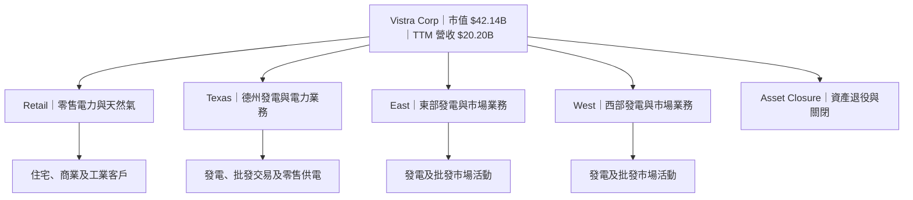
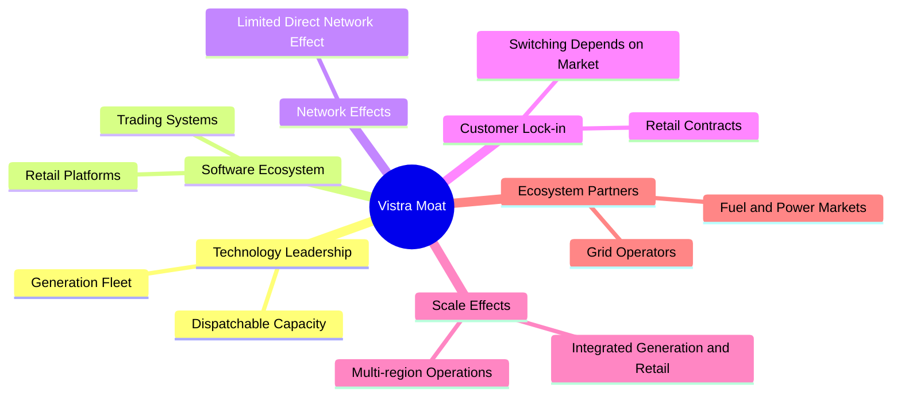
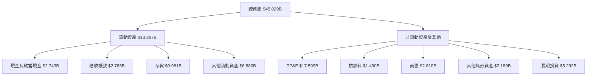
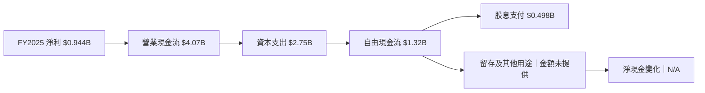
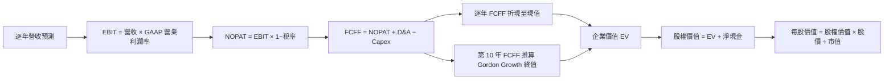
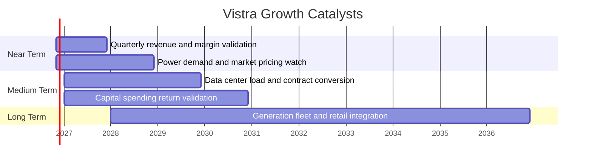
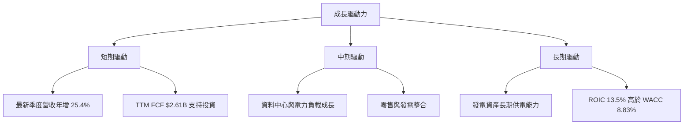
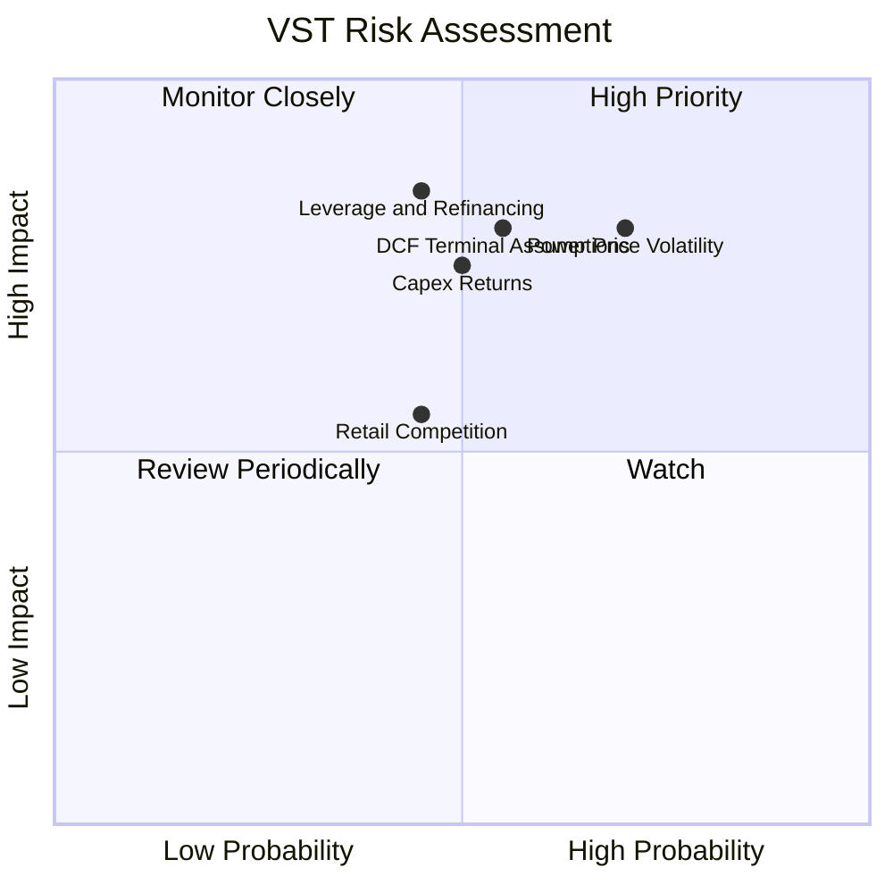
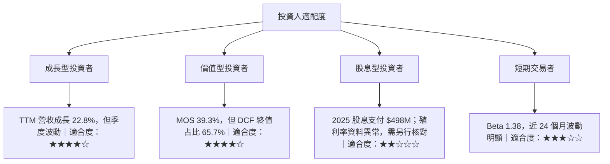

# VST 基本面深度分析報告
> **報告日期**：2026-11-20 ｜ **語言**：繁體中文 ｜ **數據來源**：SEC 申報資料 (XBRL)、Yahoo Finance、Finviz、StockAnalysis、Roic.ai ｜ **分析師**：CFA 級機構研究

## 目錄

| # | 章節 | 核心結論 |
|---|------|----------|
| 1 | 執行摘要 | 強烈買入；加權合理價值 $204.54；MOS 39.3% |
| 2 | 公司概覽與商業模式 | 發電與零售整合具規模優勢，業務市占及分部收入占比未提供 |
| 3 | 損益表深度分析 | TTM 營收 $20.20B、成長 22.8%；TTM 營業利益率 21.0% |
| 4 | 資產負債表分析 | 淨負債 $18.40B；流動比率 1.157，槓桿與流動性需監控 |
| 5 | 現金流量深度分析 | TTM FCF $2.61B、FCF Yield 6.19%；資本支出高且具週期性 |
| 6 | 獲利能力與資本效率 | ROIC 13.5% 高於 WACC 8.83%，目前創造價值 |
| 7 | 相對估值分析 | P/E 低於自身歷史中位數；同業估值指標分歧 |
| 8 | DCF 內在價值評估 | DCF 基準值 $290.66；終值占 EV 65.7%，對假設敏感 |
| 9 | 成長催化劑 | 電力需求、數據中心及電力供應緊張可能支持成長，TAM 數據未提供 |
| 10 | 風險矩陣 | 電力價格／利潤波動、槓桿與高估值假設為主要風險 |
| 11 | 投資建議 | 依 MOS 評級為強烈買入；建議以價格與營運里程碑分批執行 |

---

## 1. 執行摘要

### 1.0 一頁式投資儀表板（Portfolio Manager 30 秒速讀）

| 項目 | 內容 |
|------|------|
| **投資論點（3 句）** | ① TTM 營收 $20.20B、年增 22.8%，顯示近期業務規模擴張；但電力市場價格波動可能令成長不均。② TTM FCF 為 $2.61B、FCF Yield 6.19%，為高資本支出模式提供現金緩衝。③ ROIC 13.5% 高於 WACC 8.83%，價值創造利差為 4.67 個百分點。 |
| **綜合評分** | **7.0/10**（引用 1.1 六項算術平均） |
| **財務健康** | 🟡 淨負債 $18.40B、總債務 $21.15B；流動比率 1.157，現金及短期投資 $2.74B |
| **ROIC vs WACC** | 13.5% vs 8.83%；目前創造價值 |
| **FCF 趨勢** | 2025 財年 FCF 為 $1.32B，TTM 為 $2.61B；TTM FCF Yield 6.19% |
| **估值** | Forward P/E 12.73x（Yahoo Finance）；EV/EBITDA 8.11x；FCF Yield 6.19% |
| **DCF 內在價值（基準）** | $290.66；相對 2026-11-19 收盤價 $124.15 折價 57.3%（折溢價以 DCF 值為基準） |
| **安全邊際（MOS）** | **+39.3%＝($204.54 − $124.15) ÷ $204.54**（加權合理價值；🟢 >25%） |
| **預期報酬（基準情境 12M）** | +134.1%（DCF MODEL 基準情境價值 $290.66 相對現價） |
| **關鍵風險（前二）** | 電力市場價格及發電利潤波動；高負債與高資本支出使再融資及投資回報重要 |
| **評級 + 信心度** | 🟢 **強烈買入** ｜ 信心：中（評級有估值支持，但 DCF 終值占比高且資料存在來源差異） |

評級依據是：加權合理價值 $204.54，相對現價 $124.15 的 MOS 為 39.3%，達 25% 門檻；ROIC 13.5% 亦高於 WACC 8.83%。因此依 MOS 與價值創造條件，規則評級為**強烈買入**，未作質化調整。DCF 基準值 $290.66 的上行空間為 134.1%，但其終值占 EV 65.7%，不應把單一 DCF 點估值視為確定結果。

### 1.1 綜合評分卡（全報告唯一）

| 維度 | 評分（1–10） | 主要依據（引用數字與其來源章節） |
|------|--------------|----------------------------------|
| 成長性 | 8.0 | TTM 營收成長 22.8%、最新一季年增 25.4%（第 3 章）；但季度表現波動 |
| 獲利能力 | 7.5 | TTM 營業利益率 21.0%、ROIC 13.5% 對 WACC 8.83%、F-Score 7/8（第 3、6 章） |
| 財務健康 | 6.0 | 淨負債 $18.40B、總債務 $21.15B，流動比率 1.157（第 4 章） |
| 估值 | 8.0 | MOS 39.3%；P/E 16.8x 低於五年中位數 25.2x（第 7、8 章） |
| 護城河 | 6.0 | 發電資產與零售客戶組合提供整合營運基礎；但市占、分部獲利與客戶留存數據未提供（第 2 章） |
| 管理層與資本配置 | 6.5 | 2025 年資本支出 $2.75B、股息支付 $498M、SBC $113M；長期負債／資產改善測試未通過（第 5、6 章） |
| **綜合評分** | **7.0** | 六項算術平均：(8.0 + 7.5 + 6.0 + 8.0 + 6.0 + 6.5) ÷ 6 = **7.0** |

### 1.2 五大投資論點 + 三大核心風險

| 類型 | 項目 | 具體依據 | 信心度 |
|------|------|----------|--------|
| 🟢 **投資論點①** | 營收擴張 | TTM 營收 $20.20B，年增 22.8%；最新一季年增 25.4%，需求與定價改善有機會轉為經營槓桿 | 🟢 高 |
| 🟢 **投資論點②** | 現金流有支撐 | TTM OCF $5.76B、Capex $3.15B、FCF $2.61B；現金轉換能力可支持債務與股東回報 | 🟢 高 |
| 🟢 **投資論點③** | ROIC 高於資本成本 | ROIC 13.5% 對 WACC 8.83%，利差 4.67pp；若維持，可支持內在價值累積 | 🟢 中高 |
| 🟢 **投資論點④** | 部分估值倍數低於自身歷史 | P/E 16.8x，低於五年中位數 25.2x；EV/EBITDA 9.5x，低於五年中位數 11.0x | 🟢 中 |
| 🟢 **投資論點⑤** | 發電與零售整合 | 公司同時經營發電、批發交易及零售售電；可在供電與客戶端間協調，但分部財務資料不足以量化協同效益 | 🟡 中 |
| 🟡 **風險①** | 電力市場價格與利潤波動 | 近年年度營業利益由 2024 年 $4.08B 降至 2025 年 $2.13B；發電商盈利可能受電價、燃料與避險策略影響 | 🟡 中高 |
| 🔴 **風險②** | 淨負債及再投資負擔 | 淨負債 $18.40B、總債務 $21.15B，TTM Capex $3.15B；若現金流下滑，財務彈性會降低 | 🔴 高衝擊 |
| 🟡 **風險③** | DCF 對遠期假設敏感 | DCF 終值現值占 EV 65.7%；WACC 上升 1pp，敏感度表估值由 $290.66 降至 $234.40 | 🟡 中高 |

### 1.3 快速統計卡片

| 指標 | 公司實際值（期間） | 同業中位數 | 狀態 |
|------|--------------------|------------|------|
| 營收成長（TTM） | **22.8%** | — | 🟢 |
| 營收成長（最新一季年增） | **25.4%** | 45.4%（CEG）、24.0%（NRG）、96.1%（TLN）之中位數 45.4% | 🟡 |
| 毛利率（TTM） | **N/A（VERIFIED FIGURES 未提供）** | 25.2%（CEG）、20.2%（NRG）、42.7%（TLN）之中位數 25.2% | 🟡 |
| 營業利益率（TTM） | **21.0%** | — | 🟢 |
| ROIC（TTM） | **13.5%** | — | 🟢 |
| Forward P/E | **12.73x** | 11.1x（同業 Forward P/E 中位數） | 🟡 |
| FCF Yield（TTM） | **6.19%** | — | 🟢 |
| Piotroski F-Score | **7 / 8** | — | 🟢 |

> 同業 Forward P/E 中位數採 CEG 18.8x、NRG 9.8x、TLN 11.1x 的中位數。TLN 的 P/E(TTM) 為 N/A，不納入該項中位數。

### 1.4 投資結論

```text
╔══════════════════════════════════════════════════════════════════╗
║                    📊 投資結論摘要                               ║
╠══════════════════════════════════════════════════════════════════╣
║  評級：強烈買入（MOS 39.3%，且 ROIC 13.5% > WACC 8.83%）         ║
║  價格（2026-11-19 收盤）：$124.15                               ║
║  DCF 內在價值（基準）：$290.66（相對 DCF 折價 57.3%）           ║
║  安全邊際 MOS：+39.3%（＝(加權合理價值−現價)÷加權合理價值）    ║
║  加權合理價值（8.8）：$204.54                                   ║
║  DCF 情境價值：                                                 ║
║    悲觀情境：$97.83（-21.2%）                                   ║
║    基準情境：$290.66（+134.1%）                                 ║
║    樂觀情境：$681.58（+449.0%）                                 ║
║  綜合評分：7.0/10（引用 1.1）                                   ║
║  適合投資人：可承受電力市場波動、以中長期資本增值為目標者      ║
╚══════════════════════════════════════════════════════════════════╝
```

---

## 2. 公司概覽與商業模式

### 2.1 業務結構與收入來源

Vistra Corp. 是美國綜合型零售電力與發電公司，經營 Retail、Texas、East、West、Asset Closure 五個業務分部。公司總市值為 $42.14B，TTM 營收以 SEC 申報資料及程式計算口徑為 $20.20B。分部營收占比、分部 EBITDA、軟體或服務收入數據未提供，因此不虛構比例或金額。



零售業務可提供客戶關係與售電端收入，發電資產則提供批發供電能力。兩者整合有助於管理採購與銷售曝險，但其淨效果取決於合約、避險和市場價格；現有資料不足以量化分部協同效益。

### 2.2 市場份額

市場份額數據未提供，無法可靠地繪製市占圖或計算滲透率。以公司規模觀察，TTM 營收為 $20.20B、年增 22.8%；同業最新一季營收成長差異很大，CEG 45.4%、NRG 24.0%、TLN 96.1%，因此僅憑營收成長不能推定 VST 的市占變化。

### 2.3 競爭護城河分析



### 2.4 護城河強度

| 護城河項目 | 強度（強／中／弱） | 證據（引用數字或事實） | 會削弱它的情況 |
|------------|--------------------|------------------------|----------------|
| 技術與發電資產 | 中 | 公司經營 Texas、East、West 發電業務；TTM 營收 $20.20B，但發電容量及資產可用率未提供 | 設備停機、燃料成本上升或新供給壓低電價 |
| 零售客戶關係 | 中 | Retail 分部服務美國住宅、商業及工業客戶；客戶數、留存率及每戶貢獻未提供 | 價格競爭、客戶轉換或零售毛利受壓 |
| 網路效應 | 弱 | 電力供應與交易具市場連結，但資料未顯示平台型網路效應 | 客戶可替代供應商或市場規則改變 |
| 規模效應 | 中 | 五個業務分部，並有跨區域發電、批發和零售活動 | 規模無法轉化成較低單位成本或更穩定利潤 |
| 生態夥伴 | 中 | 必須依賴電網、燃料與批發市場等外部系統 | 電網限制、燃料供應或市場制度變動 |
| 軟體生態系統 | 弱 | 未提供軟體收入、平台使用量或客戶黏著數據 | 技術投資無法帶來可量化成本或收入優勢 |

1.1 的護城河評分為 **6.0/10**，理由是公司具整合營運與跨區域資產基礎，但缺少市占、客戶留存、分部獲利及單位成本等量化證據。

---

## 3. 損益表深度分析

### 3.1 年度收入成長趨勢（近 4 年）

年度收入按財務數據列示：2022 年 $13.73B、2023 年 $14.78B、2024 年 $17.22B、2025 年 $17.74B。四年來源資料與 TTM 的 SEC／程式計算口徑有差異；以下歷史年度按所列年度損益表，TTM 成長率則固定採 VERIFIED FIGURES 的 22.8%。

```text
╔══════════════════════════════════════════════════════════════════╗
║              Vistra 年度收入趨勢（FY2022–FY2025）               ║
╠══════════════════════════════════════════════════════════════════╣
║  FY2022  $13.73B  █████████████████░░░░░░░░░░  基期            ║
║  FY2023  $14.78B  ██████████████████░░░░░░░░░  YoY: +7.6% 🟢  ║
║  FY2024  $17.22B  █████████████████████░░░░░  YoY: +16.5% 🟢 ║
║  FY2025  $17.74B  ██████████████████████░░░░  YoY: +3.0% 🟡  ║
║                                                                  ║
║  2022–2025 CAGR = (17.74 ÷ 13.73)^(1/3) − 1 = +8.9%            ║
╚══════════════════════════════════════════════════════════════════╝
```

2025 年收入成長放慢至 3.0%，而 TTM 營收年增 22.8%，顯示最近期營收加速；但年度數字與 TTM 增速不可混為同一趨勢，應觀察後續能否持續及其對應利潤率。

### 3.2 季度收入趨勢分析

| 季度 | 營收 | QoQ 成長 | YoY 成長 | 備註 |
|------|------:|---------:|---------:|------|
| 2025 Q4 | $4.58B | — | 13.55% | 同年度季度資料顯示較 2024 Q4 $4.04B 增長 |
| 2026 Q1 | $5.64B | +23.1% | +43.40% | QoQ 以 2025 Q4 為比較基礎 |
| 2026 Q2 | $4.02B | -28.7% | -5.48% | 季度營收回落，顯示季節性／市場條件影響 |
| 2026 Q3 | $6.35B | +58.0% | **+25.4%** | 年增率採程式計算的最新季度 YoY；其他來源按報表金額計算為 27.7%，存在來源口徑差異 |

QoQ 公式為「本季營收 ÷ 前季營收 − 1」。例如 Q3 QoQ = $6.35B ÷ $4.02B − 1 = 58.0%。季度波動明顯，最新季度高增長不應直接外推為全年增速。

### 3.3 利潤率演變分析

| 利潤率指標 | FY2022 | FY2023 | FY2024 | FY2025 | 趨勢 | 評估 |
|------------|--------|--------|--------|--------|------|------|
| **毛利率** | 12.2% | 37.3% | 43.7% | 32.9% | 2024 高點後回落 | 🟡 |
| **營業利益率** | -8.0% | 18.3% | 23.7% | 12.0% | 2024 後明顯收縮 | 🟡 |
| **淨利率** | -9.0% | 10.1% | 15.4% | 5.3% | 2025 下降 | 🟡 |

計算按年度損益表：例如 2025 毛利率 = $5.83B ÷ $17.74B = 32.9%；營業利益率 = $2.13B ÷ $17.74B = 12.0%。年度 GAAP 利潤率與 TTM 指標並非同一期間；VERIFIED FIGURES 的 TTM 營業利益率為 21.0%、最新一季為 28.5%，不可與年度表格直接互換。

**利潤率演變深度解析：**2024 至 2025 年毛利由 $7.53B 降至 $5.83B、營業利益由 $4.08B 降至 $2.13B，淨利由 $2.66B 降至 $0.94B。這顯示營收小幅增加並未抵銷毛利和營業利益下滑，可能反映批發電力價格、燃料與避險結果、發電組合及其他營運成本變化；現有資料未提供分項橋接，不能把特定因素當作已證實原因。若 TTM 營業利益率 21.0% 能維持，則近期盈利能力可能已較 FY2025 年度平均改善，但仍須以後續季報驗證。

### 3.4 費用結構分析

資料未提供可一致拆分的燃料、購電、維修、人事及其他營業費用明細，也未提供完整費用結構數字，因此不繪製費用圓餅圖或推算比例。可確認的資本性支出與營運現金流見第 5 章；兩者不等同於損益表費用結構。

### 3.5 季度 EPS 趨勢與盈餘品質（Quality of Earnings）

SEC／市場資料中的最近四季 EPS 預估值與驚喜率為 NaN，無法判斷是否超預期或不及預期。StockAnalysis 列示的實際 EPS 為 2026 Q3 $3.26、Q2 $0.77、Q1 $2.90、2025 Q4 $0.54；實際 EPS 有季度波動，但沒有可用一致的分析師預估值，不能標註 beat/miss。季度淨利數據亦顯示 2026 Q3 $1.14B、Q2 $0.305B、Q1 $1.03B、2025 Q4 $0.233B。

| 盈餘品質項目 | 數值／佔比 | 評估 |
|--------------|-----------|------|
| 股權薪酬 SBC / 營收 | 約 0.63%：TTM SBC 以最近四季 $29M+$35M+$32M+$31M=$127M 計，除以 TTM 營收 $20.20B | 🟢 佔比低；仍是稀釋成本，需追蹤股數變化 |
| SBC / 營業現金流 | 約 2.2%：$127M ÷ $5.76B | 🟢 相對 OCF 不高 |
| FCF / 淨利（現金轉換率） | 約 103.8%：$2.61B ÷ StockAnalysis TTM 淨利 $2.515B | 🟢 但淨利來源口徑需與 SEC 核對 |
| 一次性／非經常性損益 | N/A（缺少可用的逐項調整與非經常性損益明細） | 🟡 不能排除年度獲利受非經常項目影響 |
| 有效稅率異常 | 15.9%（最新年度有效稅率） | 🟢／🟡 未顯示極端異常，但稅務明細未提供 |
| 資本化支出 vs 費用化 | TTM Capex $3.15B；資本化政策與維修／成長資本支出拆分 N/A | 🟡 電力資產屬資本密集型，折舊與投資回報需一併觀察 |

**盈餘品質結論：**TTM FCF 高於 StockAnalysis 列示的 TTM 淨利，現金轉換率約 103.8%；SBC 約為營收 0.63%，不是目前主要的稀釋來源。不過公司年度淨利由 2024 年 $2.66B 降至 2025 年 $0.94B，且資料缺少一次性損益、折舊政策及維持性 Capex 拆分，故 GAAP 盈利的持續性仍須透過後續現金流和分部資料確認。

---

## 4. 資產負債表分析

### 4.1 資產結構分解

TTM 資產資料列示總資產 $45.029B。下圖採 StockAnalysis 2026-09-30 資產負債表所列數值；細項分類可能與 SEC／其他資料口徑有差異，並非將所有細項重新加總的資產負債表。



### 4.2 流動性與營運資金分析

流動比率 1.157；Quick Ratio 0.477。前者略高於 1，表示流動資產總額超過流動負債，但速動比率偏低，顯示流動性對存貨、其他流動資產及現金管理較敏感。

| 指標 | 最新 TTM | 一年前 TTM | 變化 | 解讀 |
|------|----------|------------|------|------|
| DSO 應收帳款天數 | 50 天 | 52 天 | -2 天 | 收款天數縮短，方向上有利於回款；不代表已證實信用政策改善 |
| DIO 存貨天數 | 30 天 | N/A | N/A | 一年前沒有可用存貨天數資料，不能比較 |
| DPO 應付帳款天數 | 45 天 | N/A | N/A | 一年前沒有可用應付帳款天數資料，不能比較 |
| CCC 現金轉換週期 | 34 天 | N/A | N/A | 依當期 50+30−45=35 天與官方品質指標 34 天略有差異，照抄品質指標；一年前 N/A |

CCC 的 34 天為程式計算品質指標原值；由各天數經四捨五入後再相加會有 1 天差異。營運資金天數依期末餘額與 TTM 流量計算，能源交易與結算時點可能使單季餘額波動。

### 4.3 債務結構分析

```text
╔══════════════════════════════════════════════════════════════════╗
║                   Vistra 債務健康診斷                           ║
╠══════════════════════════════════════════════════════════════════╣
║  總債務：             $21.15B  ████████████████████  🟡         ║
║  現金及短期投資：      $2.74B  ███░░░░░░░░░░░░░░░░░  🟡         ║
║  淨負債：             $18.40B  █████████████████░░░  🔴         ║
║  Debt / EBITDA：       N/A（VERIFIED FIGURES 未提供 EBITDA）     ║
║  利息保障倍數：        N/A（缺少可一致核對的利息費用與 EBIT）     ║
║  流動比率：            1.157x  🟡                                ║
║  Quick Ratio：         0.477x  🟡                                ║
╚══════════════════════════════════════════════════════════════════╝
```

Debt/EBITDA 不以其他來源 EBITDA 與 VERIFIED FIGURES 債務混算。2025 年底總債務另有來源列示 $20.07B，2026-09-30 VERIFIED FIGURES 為 $21.15B；差異反映期間不同，本文債務判斷以最新 VERIFIED FIGURES 數字為準。

### 4.4 股東權益趨勢

```text
╔══════════════════════════════════════════════════════════════════╗
║                 Vistra 歷年股東權益變化                          ║
╠══════════════════════════════════════════════════════════════════╣
║  FY2022  $4.90B  ███████████████████░                           ║
║  FY2023  $5.31B  █████████████████████                           ║
║  FY2024  $5.57B  ██████████████████████                          ║
║  FY2025  $5.10B  ████████████████████                            ║
╚══════════════════════════════════════════════════════════════════╝
```

FY2024 至 FY2025 股東權益由 $5.57B 降至 $5.10B，雖然資產規模上升，權益並未同步增加。權益變化受到淨利、分紅、回購及其他權益項目共同影響；缺少完整權益變動表，不能把下降單獨歸因於某一資本配置項目。

---

## 5. 現金流量深度分析

### 5.1 現金流量瀑布圖

FY2025 淨利、OCF、Capex、股息可由年度現金流資料確認；回購金額及淨現金變化未提供，故不畫出虛構金額。



### 5.2 FCF 轉換率趨勢

| 財年 | FCF | 淨利 | FCF / 淨利 | 解讀 |
|------|----:|----:|-----------:|------|
| 2022 | -$0.816B | -$1.23B | 66.3%（兩者皆負，經濟意義有限） | 虧損及負 FCF |
| 2023 | $3.78B | $1.49B | 253.7% | 現金流顯著高於淨利，可能受營運資金與非現金項目影響 |
| 2024 | $2.48B | $2.66B | 93.2% | FCF 接近淨利 |
| 2025 | $1.32B | $0.944B | 139.8% | FCF 高於淨利，但絕對金額較 2024 下降 |

年度比率依所列年度資料計算，不能與 TTM 的 FCF／淨利比率混用。2025 年 FCF 較 2024 年下滑，主要算術來源是 OCF 從 $4.56B 降至 $4.07B、Capex 從 $2.08B 增至 $2.75B；支出增長可能反映擴張或維護投資，現有資料沒有拆分。

### 5.3 自由現金流趨勢

```text
╔══════════════════════════════════════════════════════════════════╗
║                    Vistra 自由現金流趨勢                         ║
╠══════════════════════════════════════════════════════════════════╣
║  FY2022  -$0.816B  ◀ 負值                                       ║
║  FY2023   $3.78B   ████████████████████                         ║
║  FY2024   $2.48B   █████████████                                ║
║  FY2025   $1.32B   ███████                                      ║
║  TTM      $2.61B   ██████████████  FCF Yield：6.19%             ║
╚══════════════════════════════════════════════════════════════════╝
```

TTM FCF 依固定定義為 OCF 減 Capex：$5.76B − $3.15B = $2.61B。TTM FCF Yield 為 6.19%，代表現價市值相對自由現金流有現金收益支撐；但年度 FCF 由 2023 年高點回落，波動性仍高。

### 5.4 資本配置評估

資料提供部分實際資本配置項目，但缺少回購金額、收購支出及現金償債拆分，因此不繪製比例圓餅圖。

| 項目 | 金額 | 觀察 |
|------|------:|------|
| 2025 Capex | $2.75B | 高於 2024 年 $2.08B；需判斷新增投資是否帶來長期回報 |
| 2025 股息支付 | $498M | 約占 2025 FCF $1.32B 的 37.7% |
| 2025 SBC | $113M | 約占 2025 營收 $17.74B 的 0.64% |
| 股票回購 | N/A | 資料未提供 |
| 2025 FCF 留存（扣股息後） | 約 $0.822B | 算式：$1.32B − $0.498B；不代表實際現金餘額變動 |

股息支付 2025 年為 $498M，2024 年為 $478M，支出增幅約 4.2%。現有資料並未提供債務償還與併購等用途明細，故不將 FCF 扣除股息後餘額視為全部留存現金。

---

## 6. 獲利能力與資本效率

### 6.1 ROE / ROA / ROIC 趨勢

| 指標 | 可得期間 | 數值 | 評估 |
|------|----------|------:|------|
| ROE | TTM | 42.9% | 高，但須與 7.14x 權益乘數一併看，槓桿貢獻顯著 |
| ROA | TTM | 依品質指標測試為正；精確值 N/A | 能力改善測試通過，但不補造百分比 |
| ROIC | TTM | 13.5% | 高於 WACC 8.83%，目前創造價值 |
| 5 年 ROIC 趨勢 | N/A | 資料未提供一致歷史序列 | 不以不同來源口徑推算 |

沒有可靠且同口徑的行業均值，故不列行業均值對比。

### 6.2 ROIC vs WACC 分析（核心價值創造判斷）

```text
╔══════════════════════════════════════════════════════════════════╗
║                ROIC vs WACC 深度分析                            ║
╠══════════════════════════════════════════════════════════════════╣
║  WACC（採用成本資本數據原值）：                                  ║
║  ├── 無風險利率（10Y 美債）：               5.05%               ║
║  ├── 市場風險溢酬（假設）：                 5.00%               ║
║  ├── 原始 Beta：                            1.38                ║
║  ├── 調整後 Beta：                          1.25                ║
║  ├── 股權成本：5.05% + 1.25 × 5.00% =      11.30%              ║
║  ├── 稅前債務成本：                         4.64%               ║
║  ├── 稅後債務成本：4.64% × (1−15.9%) =      3.90%               ║
║  ├── 資本結構：股權 66.6%，債務 33.4%                           ║
║  └── ✅ WACC：66.6%×11.30% + 33.4%×3.90% =   8.83%              ║
║                                                                  ║
║  ROIC（TTM）：                         13.5%                   ║
║  經濟價值利差：13.5% − 8.83% =          +4.67pp                 ║
║                                                                  ║
║  ROIC 13.50%  ▓▓▓▓▓▓▓▓▓▓▓▓▓▓▓▓▓▓▓▓▓▓▓                           ║
║  WACC  8.83%  ▓▓▓▓▓▓▓▓▓▓▓▓▓▓▓                                   ║
║  EVA   +4.67pp 目前為正，創造股東價值                            ║
╚══════════════════════════════════════════════════════════════════╝
```

權重代入：0.666 × 11.30% + 0.334 × [4.64% × (1−15.9%)] = 7.5258% + 1.3036% = 8.8294%，四捨五入為 8.83%。WACC 直接採程式計算值，不另行改算。Beta 調整方式為 ⅔ × 原始 Beta 1.38 + ⅓ × 1 = 1.25。ROIC 13.5% 高於 WACC，表示目前投入資本的報酬超過資本成本；若發電利潤下行或新投資回報下降，這個利差可能收窄。

### 6.3 杜邦三因素分解

| 因素 | 數值（TTM） | 解讀 |
|------|-------------|------|
| 淨利率 | 13.4% | 每一元營收轉化為 0.134 元淨利 |
| 資產週轉率 | 0.45 | 資產密集型業務，資產周轉相對有限 |
| 權益乘數 | 7.14 | 槓桿因素顯著放大 ROE |
| **ROE** | **42.9%** | 13.4% × 0.45 × 7.14 = 42.9%（依品質指標原值） |

ROE 並非只由高淨利率驅動；7.14x 權益乘數是重要放大因素。故評估股東回報時應以 ROIC、現金流和淨負債共同判斷，不應單看 42.9% ROE。

### 6.4 財務體質：Piotroski F-Score

Piotroski F-Score 為 **7 / 8**；毛利率比較因缺少輸入而排除，故可判定測試數不是九項完整總數。

| 測試 | 結果 | 解讀 |
|------|------|------|
| ROA > 0 | ✅ 通過 | TTM 資產報酬為正 |
| 營業現金流 > 0 | ✅ 通過 | TTM OCF 為 $5.76B |
| ROA 高於一年前 | ✅ 通過 | 獲利資產效率方向改善 |
| 營業現金流 > 淨利 | ✅ 通過 | 現金流覆蓋會計盈餘 |
| 長期負債 ÷ 總資產低於一年前 | ❌ 未通過 | 槓桿相對資產的改善不足 |
| 流動比率高於一年前 | ✅ 通過 | 短期流動性相對改善 |
| 稀釋股數未增加 | ✅ 通過 | 該測試期間稀釋股數未增加 |
| 毛利率高於一年前 | — 無法判定 | 缺少一致比較資料 |
| 資產週轉率高於一年前 | ✅ 通過 | 資產周轉改善 |

---

## 7. 相對估值分析

### 7.1 同業估值比較表格

公司倍數採市場資料；同業倍數按 Yahoo Finance 的 Peer multiples。注意：公司 EV/EBITDA 使用市場資料列示 8.113x；歷史估值區塊另列 9.5x，來源和計算口徑可能不同，本文不混用。

| 估值指標 | **VST** | **CEG** | **NRG** | **TLN** | VST 評估 |
|----------|--------:|--------:|--------:|--------:|----------|
| **Trailing P/E** | 16.8x | 20.3x | 16.4x | N/A | 🟡 接近 NRG，低於 CEG |
| **Forward P/E** | 12.73x | 18.8x | 9.8x | 11.1x | 🟡 位於同業區間內 |
| **P/S Ratio** | 2.05x | 2.6x | 0.6x | 3.5x | 🟡 介於 NRG 與 CEG／TLN |
| **EV/EBITDA** | 8.113x | 11.8x | 10.6x | 36.7x | 🟢 低於所列三家同業 |
| **最新一季營收 YoY** | 25.4% | 45.4% | 24.0% | 96.1% | 🟡 成長高於 NRG，低於 CEG、TLN |
| **毛利率（TTM）** | N/A | 25.2% | 20.2% | 42.7% | — VST 同口徑數據未提供 |

同業規模、發電組合、對沖策略及盈利波動並不相同，因此倍數差異不應單獨視為錯價。特別是 TLN EV/EBITDA 36.7x 與 P/E(TTM) N/A，盈利基礎可能與其他公司不同。

### 7.2 歷史估值區間分析

```text
╔══════════════════════════════════════════════════════════════════╗
║                 VST 五年估值位置（TTM 倍數）                     ║
╠══════════════════════════════════════════════════════════════════╣
║  P/E：       7.2x ───── 中位數 25.2x ─── 現值 16.8x ── 74.3x   ║
║                                  百分位：20%                     ║
║  P/S：       0.5x ───── 現值 2.1x ─ 中位數 1.8x ───── 4.2x     ║
║                                  百分位：52%                     ║
║  EV/EBITDA： 2.3x ─ 現值 9.5x ─ 中位數 11.0x ─────── 40.7x    ║
║                                  百分位：35%                     ║
╚══════════════════════════════════════════════════════════════════╝
```

P/E 現值位於五年歷史第 20 百分位，低於中位數；P/S 為第 52 百分位，高於中位數；EV/EBITDA 為第 35 百分位，低於中位數。這表示「低估」結論並非所有倍數一致支持，盈利正常化和當前週期位置是關鍵。

### 7.3 情境價值（Bear / Base / Bull，照抄 DCF MODEL 的 Scenarios）

| 情境 | 第 1 年營收成長 | 期末營業利潤率 | WACC | 每股價值 | 相對現價 | 機率 | 會發生的條件 |
|------|----------------|----------------|------|----------:|----------:|------:|--------------|
| 🔴 悲觀 | 11.4% | 16.4% | 9.83% | $97.83 | -21.2% | 25% | 電力需求或定價轉弱、利潤率回落，且風險溢酬上升 |
| 🟡 基準 | 22.8% | 19.3% | 8.83% | $290.66 | +134.1% | 50% | 近期成長延續但逐年減速，利潤率回歸五年中位數 |
| 🟢 樂觀 | 34.3% | 21.2% | 7.83% | $681.58 | +449.0% | 25% | 電力需求與定價顯著超預期、利潤率維持較高，資本成本下降 |

以上情境機率是模型列示值，不等同於市場隱含機率；情境價值只採 DCF MODEL 結果。

### 7.4 相對估值隱含價格區間

```text
╔══════════════════════════════════════════════════════════════════╗
║                  相對估值每股價值與現價                          ║
╠══════════════════════════════════════════════════════════════════╣
║  $107.89 ── 現價 $124.15 ───── $165.83 ── 共識 $198.49          ║
║  Forward P/E       ▲             EV/EBITDA    分析師共識         ║
║                                                                  ║
║  DCF 基準：$290.66                                                ║
╚══════════════════════════════════════════════════════════════════╝
```

| 方法 | 每股價值 | 依據 |
|------|---------:|------|
| 同業 Forward P/E | $107.89 | CEG、NRG、TLN 同業中位數 11.1x × VST Forward EPS $9.76 |
| 同業 EV/EBITDA | $165.83 | 同業中位數 11.8x × TTM EBITDA，再加回淨現金／扣除淨負債的橋接 |
| 分析師共識目標價 | $198.49 | 23 位分析師平均目標價 |
| DCF 基準 | $290.66 | 10 年 FCFF、WACC 8.83%、永續成長 3.0% |

Forward P/E 法回推值低於現價，EV/EBITDA 與分析師共識值則高於現價；這種分歧反映估值對盈利預測及正常化倍數高度敏感。

---

## 8. DCF 內在價值評估（Discounted Cash Flow）

> 下列 DCF 數字採程式計算的單一模型原值。金額除每股數字外均為美元十億；金額取兩位小數、比率取一位小數，折現因子取三位小數。表格顯示值經四捨五入，可能有不超過約 1% 的尾差。

### 8.0 估值推理鏈（Thinking Logic）

**Step 1 — 價值由哪些變數決定？**  
Vistra 的估值主要由零售售電與發電主業現金流、近期電力需求與交易環境、以及長期電力供需及終值假設決定。公司未提供分部營收占比，因此無法把這些來源拆成可驗證的百分比；已知整體 TTM 營收 $20.20B、TTM FCF $2.61B。模型中對估值最具主導性的變數是 WACC 與終值成長率，因為終值現值占 EV 65.7%。

**Step 2 — 模型選擇**

| 決策點 | 本報告採用 | 理由（含數字） | 曾考慮但否決 | 否決理由 |
|--------|-----------|----------------|--------------|----------|
| 現金流定義 | FCFF | 使用 WACC 折現，先得 EV 再扣淨負債 | FCFE | 債務與資本結構是估值重要因素，模型已指定 FCFF |
| 預測期 N | 10 年 | DCF MODEL 固定十年，足以呈現成長逐步收斂 | 5 年 | 無法涵蓋模型給定的成長淡出路徑 |
| 終值方法 | Gordon Growth 為主 | 永續成長率 3.0%，低於 WACC 8.83% | 單獨採退出倍數 | 終值 EBITDA 與退出倍數未提供，不可自建 |
| EBIT 基礎 | GAAP EBIT | 模型明確採 GAAP 營業利益率 | 非 GAAP EBIT | 會改變既定 DCF 假設及 SBC 處理方式 |

**Step 3 — 關鍵假設推導鏈**

- **預測期 N**：錨點＝模型採 10 年 → 調整＝採用模型固定期間，以呈現營收增速由 22.8% 逐步淡化至 3.0% → **採用 10 年** → 曾考慮 5 年，但會與既定逐年成長路徑不一致。
- **營收成長**：錨點＝TTM vs prior TTM 成長 22.8% → 調整＝模型由第 1 年 22.8% 線性淡化至第 10 年 3.0% → **採用模型逐年成長率** → 曾考慮長期維持 22.8%，但否決，因十年維持高增長對成熟電力業務過度樂觀。
- **期末營業利潤率**：錨點＝TTM 21.0%，模型稱第 10 年淡化至近五個財年中位數 19.3% → 調整＝逐年下降 1.7pp → **採用 19.3%** → 曾考慮沿用 21.0%，但否決，因模型設定要求利潤率回歸歷史中位數。
- **Capex／營收**：錨點＝TTM 15.6% → 調整＝模型逐年淡化至 11.5%，即約 1.1 倍 D&A 比例 → **採用第 1 年 15.6% 至第 10 年 11.5%** → 曾考慮維持 15.6%，但會忽略模型假設中的資本支出收斂。
- **永續成長率 g**：錨點＝模型採 3.0% → 調整＝低於 8.83% WACC，且與成熟公司長期名目成長假設相符 → **採用 3.0%** → 否決接近或高於 WACC 的數值，因 Gordon Growth 分母將縮小或失效。
- **WACC**：錨點＝程式計算 8.83% → 調整＝不另調整，直接採用成本資本區塊原值 → **採用 8.83%** → 否決另行自建 WACC，避免與 6.2 節資本成本不一致。
- **EBIT／SBC／股數**：錨點＝GAAP EBIT 已將 SBC 作為費用處理 → **採用組合 (A)：GAAP EBIT、FCFF 不再扣 SBC、股數不再稀釋** → 否決再次扣 SBC 或另加年稀釋率，避免重複計入。
- **營運資金變動**：模型未建模，故為 N/A；不以任意比例補入。

**Step 4 — 最脆弱的一環**  
最脆弱的是長期終值假設：終值 PV 占 EV 65.7%；若 WACC 上升 1pp，模型敏感度值從 $290.66 降至 $234.40，下降 $56.26。

**Step 5 — 計算路徑圖**



### 8.1 模型假設總表（Model Inputs）

| 假設項目 | 採用值 | 依據／來源 | 敏感度 |
|----------|--------|-------------|--------|
| 預測期長度 N | 10 年 | DCF MODEL 固定預測期 | 🟡 中 |
| 營收成長路徑 | 第 1 年 22.8%，第 10 年 3.0%，線性淡化 | 起點引用 TTM 成長 22.8%；終點採模型輸入 | 🔴 高 |
| 營業利潤率 | 第 1 年 21.0% → 第 10 年 19.3% | 起點為 TTM 營業利益率；終點為模型所採近五年中位數 | 🔴 高 |
| 有效稅率 | 15.9% | 最新年度有效稅率 | 🟢 低 |
| Capex／營收 | 15.6% → 11.5% | 起點 TTM Capex／營收；終點為模型淡化假設 | 🟡 中 |
| D&A／營收 | 10.4% | 模型 TTM 比率並維持固定 | 🟢 低 |
| 營運資金變動 | 未建模，N/A | DCF MODEL 明確未納入 Working Capital | 🟢 低 |
| EBIT 基礎 | GAAP EBIT | DCF MODEL 指定 GAAP | 🟡 中 |
| SBC 處理 | 組合 (A)：不再扣 SBC | GAAP EBIT 已含 SBC；固定股數 | 🟡 中 |
| 年稀釋率 | 0% | 組合 (A)；SBC 已在 GAAP 費用反映，模型不再稀釋股數 | 🟡 中 |
| 永續成長率 g | 3.0% | DCF MODEL 假設，低於 WACC 8.83% | 🔴 高 |
| 終值方法 | Gordon Growth | DCF MODEL 提供 Gordon Growth 終值；退出倍數缺必要輸入 | 🔴 高 |
| WACC | 8.83% | 程式計算成本資本原值 | 🔴 高 |

本模型採用 **(A) GAAP EBIT + 固定股數**，因此 SBC 影響已計入一次；FCFF 不再扣 SBC，也不對股數另行稀釋。FCFF 定義為 `NOPAT + D&A − Capex`；營運資金不在程式模型中建模。

### 8.2 折現率推導（WACC）

```text
╔══════════════════════════════════════════════════════════════════╗
║                    WACC 推導（折現率）                           ║
╠══════════════════════════════════════════════════════════════════╣
║  股權成本 Ke（CAPM）：                                           ║
║  ├── 無風險利率 Rf：                         5.05%              ║
║  ├── 市場風險溢酬 ERP（假設）：               5.00%              ║
║  ├── 原始 Beta：                              1.38               ║
║  ├── 調整後 Beta：                            1.25               ║
║  ├── 規模／國別溢酬：                          0.00%              ║
║  └── Ke = 5.05% + 1.25×5.00% =               11.30%             ║
║                                                                  ║
║  債務成本：                                                      ║
║  ├── 稅前 Kd：                                4.64%              ║
║  ├── 有效稅率：                               15.9%              ║
║  └── 稅後 Kd = 4.64%×(1−15.9%) =               3.90%              ║
║                                                                  ║
║  資本權重：股權 66.6%，債務 33.4%                               ║
║  └── WACC = 66.6%×11.30% + 33.4%×3.90% =        8.83%           ║
╚══════════════════════════════════════════════════════════════════╝
```

逐步演算如下：

1. **Ke** = 5.05% + 1.25 × 5.00% = **11.30%**。調整後 Beta 由 ⅔ × 1.38 + ⅓ × 1.00 = 1.253，四捨五入至 1.25。
2. **稅前 Kd** = 程式計算原值 **4.64%**。利息費用及平均計息負債的獨立金額未提供，故不自行反推。
3. **稅後 Kd** = 4.64% × (1 − 15.9%) = 4.64% × 84.1% = **3.90%**。
4. **權重** = 股權 66.6%；債務 33.4%；合計 = 66.6% + 33.4% = **100.0%**。成本資本資料直接給定市場市值／債務權重；個別日期的平均計息負債明細未提供。
5. **WACC** = 66.6% × 11.30% + 33.4% × 3.90% = 7.5258% + 1.3026% = **8.83%**（以底層未四捨五入輸入計算後四捨五入；使用顯示的 3.90% 會有約 0.001pp 尾差）。

無風險利率的具體觀測日期未提供；ERP 是成本資本資料中的假設值 5.00%。未另加規模或國別溢酬。6.2 節及 DCF 均使用 WACC 8.83%。

### 8.3 逐年自由現金流預測（基準情境）

金額單位：$B。表內數值按 DCF MODEL 原值抄錄；ΔWC 未建模，SBC 不重複扣除。

| 年度 | FY+1 | FY+2 | FY+3 | FY+4 | FY+5 | FY+6 | FY+7 | FY+8 | FY+9 | FY+10 |
|------|-----:|-----:|-----:|-----:|-----:|-----:|-----:|-----:|-----:|------:|
| 營收 | 24.81 | 29.93 | 35.45 | 41.20 | 46.98 | 52.54 | 57.59 | 61.85 | 65.07 | 67.03 |
| 營收 YoY | 22.8% | 20.6% | 18.4% | 16.2% | 14.0% | 11.8% | 9.6% | 7.4% | 5.2% | 3.0% |
| 營業利潤率 | 21.0% | 20.8% | 20.6% | 20.4% | 20.2% | 20.0% | 19.8% | 19.6% | 19.4% | 19.3% |
| EBIT（GAAP） | 5.20 | 6.22 | 7.29 | 8.40 | 9.49 | 10.51 | 11.41 | 12.14 | 12.65 | 12.91 |
| − 稅 | (0.83) | (0.99) | (1.16) | (1.34) | (1.51) | (1.68) | (1.82) | (1.94) | (2.02) | (2.06) |
| = NOPAT | 4.37 | 5.22 | 6.13 | 7.06 | 7.98 | 8.84 | 9.60 | 10.21 | 10.64 | 10.85 |
| + D&A | 2.58 | 3.12 | 3.69 | 4.29 | 4.89 | 5.47 | 6.00 | 6.44 | 6.78 | 6.98 |
| − Capex | (3.88) | (4.54) | (5.21) | (5.86) | (6.47) | (6.99) | (7.40) | (7.66) | (7.75) | (7.68) |
| − ΔWC | 未建模 | 未建模 | 未建模 | 未建模 | 未建模 | 未建模 | 未建模 | 未建模 | 未建模 | 未建模 |
| = FCFF | 3.08 | 3.80 | 4.61 | 5.49 | 6.40 | 7.32 | 8.20 | 8.99 | 9.66 | 10.15 |
| 折現因子 @8.83% | 0.919 | 0.844 | 0.776 | 0.713 | 0.655 | 0.602 | 0.553 | 0.508 | 0.467 | 0.429 |
| FCFF 現值 PV | 2.83 | 3.21 | 3.58 | 3.91 | 4.19 | 4.40 | 4.53 | 4.57 | 4.51 | 4.36 |

預測期 FCF 現值合計：  
`$2.83 + $3.21 + $3.58 + $3.91 + $4.19 + $4.40 + $4.53 + $4.57 + $4.51 + $4.36 = $40.09B`

**逐步演算（FY+1）：**

1. 營收 = $20.20B × (1 + 22.8%) = $24.8056B，四捨五入 **$24.81B**。
2. EBIT = 模型列示 **$5.20B**；按顯示後營收與 21.0% 直接相乘為 $24.81B × 21.0% = $5.21B，與模型列示差 $0.01B，屬底層精度／逐項四捨五入差異；DCF MODEL 原值保留。
3. 稅 = $5.20B − $4.37B = **$0.83B**（亦約等於 EBIT × 15.9%）。
4. NOPAT = $5.20B − $0.83B = **$4.37B**。
5. D&A = **$2.58B**（模型假設為營收的 10.4%，底層精度下四捨五入）。
6. Capex = **$3.88B**（模型假設第 1 年 Capex／營收 15.6%，按未四捨五入底層數據計算）。
7. ΔWC = **未建模**。
8. FCFF = $4.37B + $2.58B − $3.88B = $3.07B；模型列示為 $3.08B，差額 $0.01B，來自各項顯示精度；本報告保留模型輸出。
9. 折現因子 = 1 ÷ (1 + 8.83%)¹ = 0.919；PV = $3.08B × 0.919 = **$2.83B**。

**合理性自檢：**

- FY+1 至 FY+10 FCFF CAGR = ($10.15 ÷ $3.08)^(1/9) − 1 = 約 14.2%；2022 至 2025 年 FCF 從 -$0.816B 轉為 $1.32B，因起點為負值，歷史 CAGR 不具經濟可比性。模型成長主要來自收入擴張及 Capex／營收比率下降。
- FY+10 FCFF 利潤率 = $10.15B ÷ $67.03B = 15.1%；現有 TTM FCF 利潤率 = $2.61B ÷ $20.20B = 12.9%。同業最佳 FCF 利潤率未提供，不能比較。
- 各年 FCFF 均為正；模型未納入 ΔWC，故若營運資金需求增加，實際 FCFF 會低於模型。

```text
╔══════════════════════════════════════════════════════════════════╗
║            自由現金流：歷史實際 vs 模型預測                      ║
╠══════════════════════════════════════════════════════════════════╣
║  FY2023(實)  $3.78B  ████████████████████                       ║
║  FY2024(實)  $2.48B  █████████████                              ║
║  FY2025(實)  $1.32B  ███████                                    ║
║  FY+1 (預)   $3.08B  ████████████████                           ║
║  FY+10(預)  $10.15B  ████████████████████████████████████████   ║
╠══════════════════════════════════════════════════════════════════╣
║  預測端點增長來自營收上升與 Capex 比率逐步淡化；歷史波動較大。   ║
╚══════════════════════════════════════════════════════════════════╝
```

### 8.4 終值計算（Terminal Value）

適用性檢查：`WACC 8.83% vs g 3.0% → WACC > g？✅`

| 方法 | 計算式 | 終值 TV | TV 現值 | 佔總 EV 比重 |
|------|--------|---------:|--------:|-------------:|
| Gordon Growth | $10.15 × (1 + 3.0%) ÷ (8.83% − 3.0%) | $179.36B | $76.96B | 65.7% |
| 退出倍數法 | N/A（終值 EBITDA 與退出倍數未提供；不得另建模型） | N/A | N/A | N/A |

逐步演算：

1. FY+N FCFF = **$10.15B**（FY+10）。
2. 分子 = $10.15B × (1 + 3.0%) = **$10.4545B**。
3. 分母 = 8.83% − 3.0% = **5.83%**；TV = $10.4545B ÷ 5.83% = **$179.36B**（按模型底層精度）。
4. PV(TV) = $179.36B × 0.429 = **$76.96B**（底層折現因子未四捨五入）。
5. 終值占比 = $76.96B ÷ $117.05B = **65.7%**。

終值占 EV 尚未超過 75%，但已占 65.7%，因此估值仍高度依賴第 10 年後的現金流假設。

### 8.5 企業價值 → 每股內在價值（Bridge）

```text
╔══════════════════════════════════════════════════════════════════╗
║              企業價值 → 每股內在價值 橋接表                      ║
╠══════════════════════════════════════════════════════════════════╣
║  預測期 FCF 現值合計              +$40.09B                       ║
║  終值現值 PV(TV)                  +$76.96B                       ║
║  = 企業價值 EV                    $117.05B                       ║
║  + 淨現金（實為淨負債）           -$18.40B                       ║
║  = 股權價值                       $98.65B                        ║
║  每股價值換算：98.65×124.15÷42.14 = $290.66                      ║
║  當前股價（2026-11-19 收盤）       $124.15                        ║
║  折溢價（現價÷DCF價值−1）          -57.3%（折價）                 ║
╚══════════════════════════════════════════════════════════════════╝
```

逐步演算：

1. EV = $40.09B + $76.96B = **$117.05B**。
2. 股權價值 = $117.05B +（淨現金 -$18.40B）= **$98.65B**。
3. 每股價值 = 股權價值 × 價格 ÷ 市值 = $98.65B × $124.15 ÷ $42.14B = **$290.66**。此為程式提供的每股換算公式，等價於採用約 339.39M 股的市場股數資料。
4. 折溢價 = $124.15 ÷ $290.66 − 1 = **-57.3%**，即現價相對 DCF 基準值折價。
5. **本節不計算 MOS**；MOS 固定以第 8.8 節加權合理價值為分母。

現金與總債務取 2026-09-30 最新季度資料：現金及短期投資 $2.74B、總債務 $21.15B，淨負債 $18.40B。DCF 使用模型給定的淨負債橋接值 -$18.40B。

### 8.6 敏感性分析（WACC × 永續成長率）

下表直接採 DCF MODEL 敏感度矩陣；括號內為相對現價 $124.15 的上行空間。基準格為 WACC 8.83%、g 3.0%。

| g（列）／WACC（欄） | 6.83% | 7.83% | **8.83%（基準）** | 9.83% | 10.83% |
|-----------|------:|------:|------------------:|------:|-------:|
| 2.0% | $403.95 (+225.4%) | $316.79 (+155.2%) | $255.58 (+105.9%) | $210.35 (+69.4%) | $175.64 (+41.5%) |
| 2.5% | $443.42 (+257.2%) | $341.22 (+174.9%) | $271.73 (+118.9%) | $221.55 (+78.5%) | $183.70 (+48.0%) |
| **3.0%（基準）** | $493.18 (+297.1%) | $370.70 (+198.6%) | **$290.66 (+134.1%)** | $234.40 (+88.8%) | $192.79 (+55.3%) |
| 3.5% | $557.89 (+349.4%) | $406.98 (+227.8%) | $313.13 (+152.2%) | $249.28 (+100.8%) | $203.12 (+63.6%) |
| 4.0% | $645.47 (+419.8%) | $452.75 (+264.6%) | $340.26 (+174.1%) | $266.71 (+114.9%) | $214.96 (+73.1%) |

**敏感度示範格：**所選格 WACC 9.83% > g 3.0% ✅。該格每股價值依程式敏感度矩陣為 **$234.40**；模型未提供該格預測期 PV、終值 PV 等中間欄位，且規則要求不得另建模型，因此不臆造中間計算。該格可由 DCF MODEL 矩陣原值直接核對。

**三情境 DCF（DCF MODEL 原值）**

| 情境 | 年 1 營收成長 | 期末營業利潤率 | g | WACC | 每股內在價值 | 相對現價 | 主觀機率 |
|------|--------------:|---------------:|---:|-----:|-------------:|---------:|---------:|
| 🔴 悲觀 | 11.4% | 16.4% | 3.0%（未另列，採模型基準） | 9.83% | $97.83 | -21.2% | 25% |
| 🟡 基準 | 22.8% | 19.3% | 3.0% | 8.83% | $290.66 | +134.1% | 50% |
| 🟢 樂觀 | 34.3% | 21.2% | 3.0%（未另列，採模型基準） | 7.83% | $681.58 | +449.0% | 25% |
| **機率加權** | — | — | — | — | **$340.18** | **+174.0%** | **100%** |

三情境逐年營收及 FCFF 未在模型輸出中列出，因此不補建情境推導鏈；情境價值及假設以模型輸出為準。基準情境的完整逐年路徑見 8.3。

**敏感度結論：**

- g 上升 1pp（3.0% 至 4.0%，WACC 8.83%）：$340.26 − $290.66 = **+$49.60／+17.1%**。
- WACC 上升 1pp（8.83% 至 9.83%，g 3.0%）：$234.40 − $290.66 = **−$56.26／−19.4%**。
- 期末營業利潤率每 +1pp：**N/A（敏感度矩陣未提供利潤率單變數測試，且不得另建模型）**。
- 可量化的兩項中 WACC 變化對估值影響較大；這與 8.0 指出「終值假設主導」一致，終值對折現率特別敏感。

### 8.7 反推 DCF（Reverse DCF）

固定基準輸入包括 WACC 8.83%、稅率 15.9%、Capex／營收基準路徑、ΔWC 未建模、預測期 10 年及每股換算所用市場股數。只列程式有解出的變數；其他項目不自行求解。

| 求解的變數（一次一個） | 其餘變數設定 | 市場隱含值（令 DCF = 現價） | 公司歷史實際 | 判斷 |
|------------------------|--------------|------------------------------:|--------------|------|
| 第 1 年營收成長 | 其餘假設維持基準 | 6.7% | TTM 成長 22.8% | 🟢 市場隱含成長低於目前 TTM |
| 固定營業利潤率 | 其餘假設維持基準 | 11.1% | TTM 營業利益率 21.0% | 🟢 市場隱含利潤率偏低 |
| 永續成長率 g | 未計算 | 未計算 | — | N/A |
| 高成長持續年數 N | 未計算 | 未計算 | — | N/A |

反推 DCF 原始輸出未提供迭代軌跡，故不虛構試算點。其可引用結果表示，在其他假設不變時，現價隱含的年 1 營收成長 6.7%，明顯低於 TTM 22.8%；或固定營業利益率只有 11.1%，低於 TTM 21.0%。這不代表市場一定錯，也可能表示市場對週期性獲利、負債和終值採取更高折價。

### 8.8 估值三角驗證與安全邊際

| 估值方法 | 隱含每股價值 | 上行空間（÷現價） | 權重 | 說明 |
|----------|--------------:|-------------------:|------:|------|
| DCF（基準） | $290.66 | +134.1% | 40% | 10 年 FCFF、WACC 8.83%、g 3.0% |
| 同業 Forward P/E | $107.89 | -13.1% | 25% | 同業中位數 11.1x × VST Forward EPS 9.76 |
| 同業 EV/EBITDA | $165.83 | +33.6% | 25% | 同業中位數 11.8x × TTM EBITDA，經淨負債橋接 |
| 分析師共識目標價 | $198.49 | +59.9% | 10% | 23 位分析師平均目標價 |
| **加權合理價值** | **$204.54** | **+64.8%** | **100%** | — |

加權算式：  
`$290.66 × 40% + $107.89 × 25% + $165.83 × 25% + $198.49 × 10%`  
`= $116.264 + $26.9725 + $41.4575 + $19.849 = $204.543 ≈ $204.54`

權重依公司類型「profitable」固定，四項估值方法皆有提供，無方法剔除。按加權合理價值計算：

- **MOS** = ($204.54 − $124.15) ÷ $204.54 = $80.39 ÷ $204.54 = **39.3%**。
- **上行空間** = ($204.54 − $124.15) ÷ $124.15 = $80.39 ÷ $124.15 = **64.8%**。
- **DCF 折溢價** = $124.15 ÷ $290.66 − 1 = **-57.3%**。

```text
╔══════════════════════════════════════════════════════════════════╗
║                  估值區間與安全邊際                              ║
╠══════════════════════════════════════════════════════════════════╣
║  $97.83 ─── $124.15 ─── [$204.54] ─── $290.66 ─── $681.58       ║
║  悲觀DCF       現價       加權合理值       基準DCF      樂觀DCF    ║
║                                                                  ║
║  MOS = (204.54−124.15)÷204.54 = 39.3%                            ║
║  MOS 評估：🟢 >25% 充足                                          ║
║  上行空間 = (204.54−124.15)÷124.15 = 64.8%                      ║
║  DCF 折溢價：124.15÷290.66−1 = -57.3%                            ║
║  建議買入區間：$110.89–$184.09（下界參考 52W 低點；上界為 MOS 10%）║
║  合理持有區間：$184.09–$290.66                                   ║
║  減碼考慮區間：高於 $681.58（超過樂觀 DCF 情境值）               ║
╚══════════════════════════════════════════════════════════════════╝
```

加權合理價值 $204.54 的 10% MOS 價格上限 = $204.54 × 90% = $184.09。買入區間下界引用 52 週低點 $110.89，僅作價格參照，不是另一個內在價值估算。

> 🔎 **程式複算（Python，依本節各項自動重算）**
>
> 加權合理價值 = $290.66 × 40% + $107.89 × 25% + $165.83 × 25% + $198.49 × 10% = **$204.54**（權重合計 100%）
>
> 以價格 $124.15 計：MOS = **+39.3%**，上行空間 = **+64.8%**
>
> ✅ 與本節所寫數值一致。

### 8.9 DCF 模型的局限與失效條件

- **終值依賴度**：終值占 EV 65.7%，代表超過六成企業價值來自第 10 年之後的現金流。
- **最脆弱假設**：WACC 及 g。WACC 由 8.83% 升至 9.83%、g 維持 3.0% 時，敏感度值降至 $234.40；若成長／利潤率同時落入悲觀情境，模型價值為 $97.83。
- **營運資金限制**：模型沒有 ΔWC，若應收款或庫存增加、應付帳款條件收緊，實際 FCFF 將低於預測。
- **資本密集與週期性**：TTM Capex $3.15B、2025 年度 Capex $2.75B；若實際維持性資本支出高於模型下降路徑，DCF 將偏高。
- **適用性**：公司 TTM FCF 為正 $2.61B，DCF 可用，但年度 FCF 從 2023 年 $3.78B 降至 2025 年 $1.32B，獲利波動降低單點 DCF 可靠度。應同時參考 EV/EBITDA、同業 Forward P/E 及情境估值。
- **與第 10 章連結**：電力價格下跌會壓低營收成長與營業利潤率；利率上升提高 WACC；資本支出超預期會壓低 FCFF；上述均直接影響 DCF。

### 8.10 複算檢核表（Audit Trail）

| # | 檢核項目 | 檢查方式 | 結果 |
|---|----------|----------|------|
| 1 | 高／中敏感度假設均有推導邏輯 | 對照 8.0 與 8.1 | ✅ |
| 2 | 假設均有資料錨點或清楚標示模型原值 | 檢查 8.1 依據欄 | ✅ |
| 3 | WACC 組成與權重合計正確 | 66.6% + 33.4% = 100%；使用給定 WACC 8.83% | ✅ |
| 4 | Kd 分母與債務權重範圍一致 | 平均計息負債明細未提供；採成本資本區塊原值，不另推導 | ⚠️ |
| 5 | WACC 與第 6.2 節相同 | 兩處均 8.83% | ✅ |
| 6 | 預測年度數等於 N，無省略 | FY+1 至 FY+10 共十年 | ✅ |
| 7 | FY+1 代表年度可複算 | 顯示精度下有 $0.01B 尾差，保留模型原值 | ⚠️ |
| 8 | 預測期 PV 加總 | 十年 PV 相加 = $40.09B | ✅ |
| 9 | WACC > g | 8.83% > 3.0% | ✅ |
| 10 | 終值以 FY+10 FCFF 為基礎並折現十期 | 模型終值 $179.36B，PV $76.96B | ✅ |
| 11 | EV 至每股價值橋接 | $40.09B + $76.96B = $117.05B；扣淨負債後 $98.65B | ✅ |
| 12 | SBC 組合合法 | GAAP EBIT、無 SBC 再扣、股數不稀釋，組合 A | ✅ |
| 13 | 矩陣基準格等於 DCF 基準 | g 3.0%、WACC 8.83% 為 $290.66 | ✅ |
| 14 | 矩陣有效格 | 全部列示格均 WACC > g | ✅ |
| 15 | 三情境機率合計 | 25% + 50% + 25% = 100% | ✅ |
| 16 | 反推每列只放開一個變數 | 僅呈現模型提供的兩個單變數解；未提供迭代軌跡 | ⚠️ |
| 17 | MOS 與折溢價分母固定 | MOS 用 $204.54；DCF 折溢價用 $290.66 | ✅ |
| 18 | 報告完整至第 11 章 | 章節均列出 | ✅ |
| 19 | 加權合理價值加總正確 | 加權總和 $204.543，四捨五入 $204.54 | ✅ |
| 20 | 評級符合 MOS 門檻 | MOS 39.3%、ROIC 13.5% > WACC 8.83%，強烈買入 | ✅ |

三項注意事項：WACC 分項負債明細未提供，故採用程式成本資本原值；FY+1 表格因逐項四捨五入與底層精度出現 $0.01B 尾差；敏感度格及反推 DCF 缺少中間試算輸出，未另行自建模型。

---

## 9. 成長催化劑

### 9.1 催化劑時間軸

具體公司專案、投產日期與已簽約新增電量未提供。以下時間軸依公司業務特性與近期新聞所示電力需求背景列出觀察窗口，不把未確認項目當成已落地收入。



### 9.2 TAM 市場規模分析

**N/A（TAM 數據未提供）**。公司 TTM 營收為 $20.20B、成長 22.8%，但沒有可引用的美國電力市場 TAM、資料中心新增電力需求量或公司可服務市場規模，因此不填入 TAM 金額或滲透率。電力需求與數據中心相關新聞可視為需求線索，尚不能替代公司已簽約收入或可量化市場規模。

### 9.3 成長驅動力結構圖



短期重點是確認最新一季營收成長能否轉成可持續利潤率；中期重點是新增負載是否能透過合約、供電能力與資本支出回報實際變現；長期則要維持 ROIC 高於 WACC。公司未提供各催化劑對營收的量化貢獻。

---

## 10. 風險矩陣

### 10.1 風險評分矩陣

機率及衝擊座標為研究分析的相對判斷，不是公司發布的統計機率；財務影響以現有指標可量化處盡量引用，不對未披露的損失金額作假設。



### 10.2 風險清單詳細分析

| # | 風險項目 | 發生機率 | 財務衝擊 | 風險評分 | 緩解措施 |
|---|----------|----------|----------|----------|----------|
| 1 | 🔴 **批發電價及發電利潤波動** | 中高（研究判斷） | 高；年度營業利益由 2024 年 $4.08B 降至 2025 年 $2.13B | 🔴 8/10 | 追蹤分部營業利益、避險覆蓋、燃料與電價差；避免以單季高利潤外推 |
| 2 | 🔴 **淨負債與融資成本** | 中 | 高；淨負債 $18.40B、總債務 $21.15B；利率上升會抬高再融資成本 | 🔴 8/10 | 監控債務到期表、利息保障倍數、現金及短期投資，並以 FCF 優先管理槓桿 |
| 3 | 🟠 **資本支出回報低於預期** | 中 | 高；TTM Capex $3.15B，約為 TTM OCF 的 54.7% | 🟠 7/10 | 檢查新增資產投產、維修與成長 Capex 拆分、專案回報及 ROIC |
| 4 | 🟠 **DCF 終值與利率假設偏樂觀** | 中 | 高；終值占 EV 65.7%，WACC +1pp 時估值減少 $56.26 | 🟠 7/10 | 用敏感度矩陣和同業估值交叉驗證，不單看 DCF 點估值 |
| 5 | 🟡 **零售端競爭及客戶流失** | 中 | 中；零售業務收入占比、客戶數及留存率未提供，無法量化 | 🟡 5/10 | 追蹤零售分部毛利、客戶留存與每客戶獲利披露 |

---

## 11. 投資建議

### 11.1 最終評級與評分

依加權合理價值 $204.54、現價 $124.15 計算的 MOS 為 39.3%；ROIC 13.5% 高於 WACC 8.83%，因此依規則 20 評為**強烈買入**，未作一級調整。綜合評分為 **7.0/10**，六項分數依序為成長性 8.0、獲利能力 7.5、財務健康 6.0、估值 8.0、護城河 6.0、管理層與資本配置 6.5。

### 11.2 合理價值與隱含報酬率

| 估值參考 | 每股價值 | 相對現價 $124.15 | 機率／權重 |
|----------|---------:|-----------------:|-----------:|
| 加權合理價值 | $204.54 | +64.8% | 權重 100% |
| 悲觀 DCF 情境 | $97.83 | -21.2% | 25% |
| 基準 DCF 情境 | $290.66 | +134.1% | 50% |
| 樂觀 DCF 情境 | $681.58 | +449.0% | 25% |
| 機率加權 DCF 情境值 | $340.18 | +174.0% | 100% |

機率加權 DCF 值是情境分析參考，評級及 MOS 仍依 8.8 的加權合理價值 $204.54 計算。

### 11.3 買入時機與觸發因素

```text
╔══════════════════════════════════════════════════════════════════╗
║                  ✅ 買入觸發因素 Checklist                      ║
╠══════════════════════════════════════════════════════════════════╣
║  分批買入觸發條件：                                              ║
║  ✅ 股價不高於 $184.09，對加權合理價值保有至少 10% MOS           ║
║  ✅ 後續季度營收年增維持正值，且營業利益率沒有持續下滑           ║
║  ✅ TTM FCF 維持正值，Capex 未持續超過 OCF                       ║
║                                                                  ║
║  加碼觸發條件：                                                  ║
║  ☐ 最新季度成長回升，且分部營業利益率同步改善                    ║
║  ☐ 淨負債下降、FCF 穩定高於股息支付                              ║
║  ☐ ROIC 維持高於 WACC 8.83%                                      ║
║                                                                  ║
║  減碼／停損觸發條件：                                            ║
║  ☐ 股價高於 $290.66 且營運指標未支持基準 DCF 假設                ║
║  ☐ TTM FCF 轉負或 Capex 增長長期高於 OCF 成長                    ║
║  ☐ ROIC 跌至 WACC 8.83% 以下                                     ║
╚══════════════════════════════════════════════════════════════════╝
```

### 11.4 投資人適配度分析



資料中的 Dividend Yield 74.0% 與 Payout Ratio 12.4% 顯著不一致，可能是資料欄位錯置或口徑問題；不採用 74.0% 作為實際股息殖利率。股息型投資者應以公司正式公告及價格資料重新核實。

### 11.5 每季財報監控清單（Quarterly Watch List）

| 監控項目 | 最新基準 | 加碼訊號 | 減碼／重新評估訊號 |
|----------|----------|----------|--------------------|
| 營收成長 | TTM +22.8%；最新季度 YoY +25.4% | 最新季度年增保持正值，且營業利益同步改善 | 連續兩季營收年增低於 0% |
| 營業利益率 | TTM 21.0%；最新一季 28.5% | TTM 維持約 20% 以上 | TTM 低於 15% 或連續兩季收縮 |
| OCF 與 FCF | TTM OCF $5.76B、FCF $2.61B | FCF 維持正值並覆蓋股息及合理投資 | FCF 轉負或連續兩季明顯惡化 |
| Capex | TTM $3.15B | 資本支出伴隨 ROIC 穩定高於 WACC | Capex 上升但營收、利潤及 ROIC 未改善 |
| 淨負債 | $18.40B | 淨負債下降，流動性提升 | 淨負債上升且 FCF 下滑 |
| ROIC vs WACC | 13.5% vs 8.83% | ROIC 維持高於 8.83% | ROIC 跌破 8.83% |
| 應收與現金週期 | DSO 50 天、CCC 34 天 | DSO 穩定或下降 | DSO 持續上升，或 CCC 顯著拉長 |
| 股數／SBC | F-Score 稀釋股數測試通過；2025 SBC $113M | 股數不增加、SBC／營收維持低位 | 股數連續增加且 SBC／營收上升 |
| 財測與分部資料 | 分部營收占比未提供 | 公司披露的電力需求、合約及分部利潤改善 | 財測下修、項目延期或分部利潤轉弱 |

### 11.6 反面論證：什麼會證明論點錯誤（What Would Change My Mind）

```text
╔══════════════════════════════════════════════════════════════════╗
║              ⚠️ 論點失效條件（Disconfirming Evidence）           ║
╠══════════════════════════════════════════════════════════════════╣
║  本投資論點在下列情況成立時應重新檢視或退出：                    ║
║  ☐ 最新季度營收年增連續兩季低於 0%                               ║
║  ☐ TTM 營業利益率低於 15%，或較目前 21.0% 收縮逾 6pp            ║
║  ☐ TTM FCF 轉負，或 OCF 低於 Capex                               ║
║  ☐ ROIC 跌破 WACC 8.83%，代表資本回報不再覆蓋資本成本            ║
║  ☐ 淨負債持續增加，且流動比率低於 1.0                           ║
║  ☐ 資本支出增加但營收及營業利益未改善，導致 ROIC 下滑             ║
║  ☐ SBC／營收明顯高於目前約 0.63%，且稀釋股數重新增加             ║
║  ☐ 電力需求或合約無法轉為現金流，基準情境假設失效                ║
╚══════════════════════════════════════════════════════════════════╝
```

> **免責聲明**：本報告為 AI 自動生成，僅供研究參考，不構成投資建議。投資有風險，入市需謹慎。

---

## 資料與來源

| 項目 | 內容 |
|------|------|
| 價格 | 124.15 USD，2026-11-19 收盤（Yahoo Finance 即時報價（該交易日已收盤）） |
| 財務報表 | SEC 10-Q filed 2026-11-09，最新季度 2026-09-30（FY2026 Q3） |
| 有回應的資料來源 | SEC 申報資料 (XBRL)、Yahoo Finance、Finviz、StockAnalysis、Roic.ai |
| 由程式計算 | TTM 數字、WACC、DCF 模型、估值方法與權重、加權合理價值、MOS、評級門檻、F-Score、杜邦分解、營運資金天數、綜合評分 |
| 撰寫模型 | openai / gpt-6-luna |

> 本區塊由產生報告的程式依實際取得的資料填寫，非模型撰寫。「由程式計算」的數字不是模型的估計；其餘判斷（評分、情境、策略）是模型的分析。
