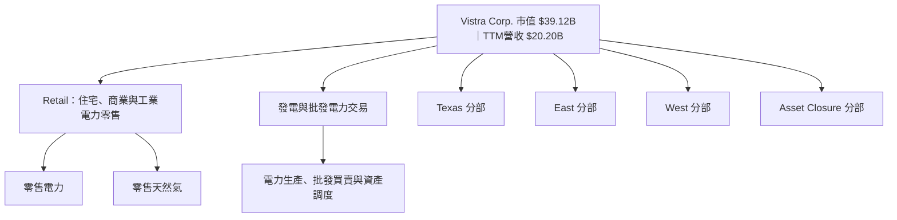
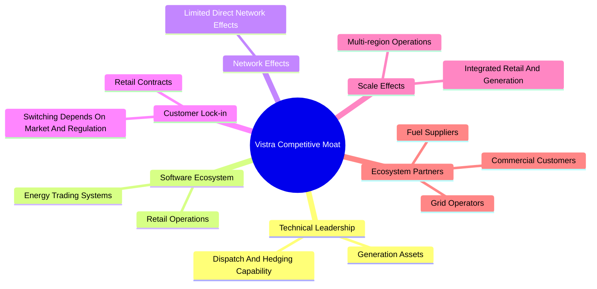
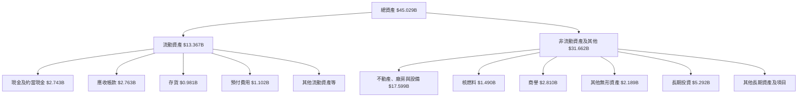
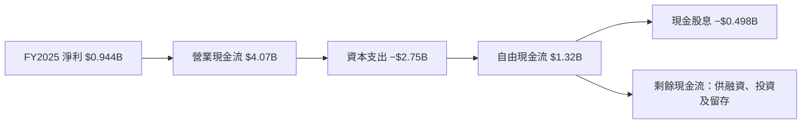
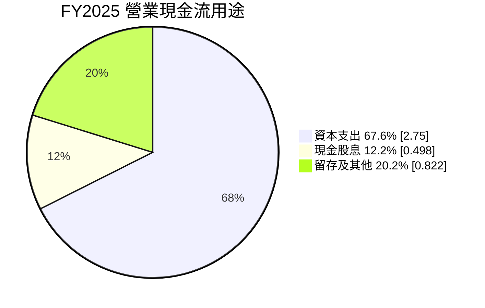
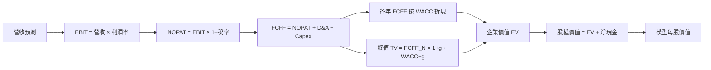
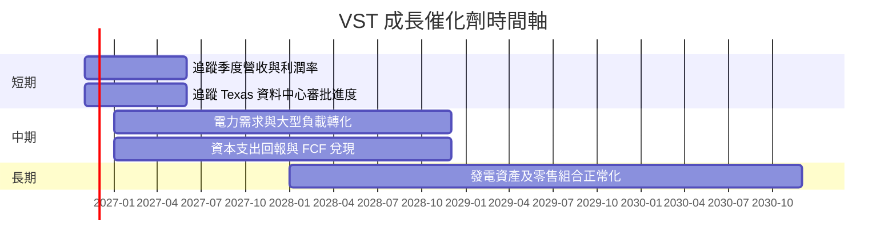
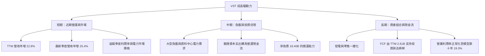
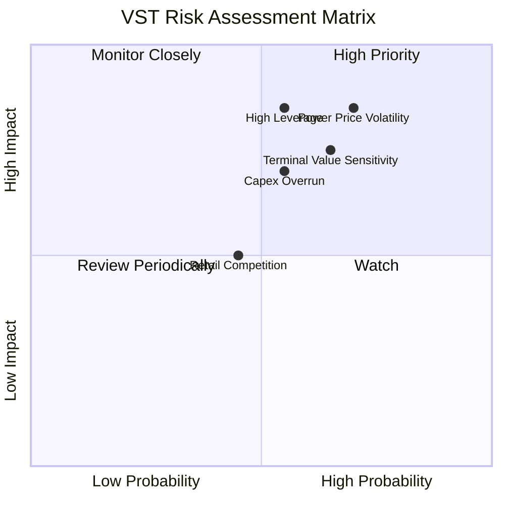
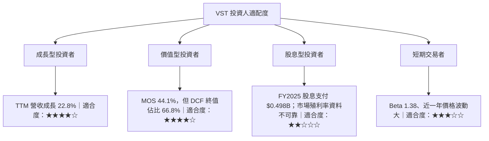

# VST 基本面深度分析報告
> **報告日期**：2026-11-21 ｜ **語言**：繁體中文 ｜ **數據來源**：SEC 申報資料 (XBRL)、Yahoo Finance、Finviz、StockAnalysis、Roic.ai ｜ **分析師**：CFA 級機構研究

> **口徑說明**：估值、現價、TTM 成長率、最新季度營業利益率、FCF、ROIC、WACC、同業倍數及估值方法，採用程式計算並以 SEC 申報資料及價格資料庫核對的核心數據。其他來源的營收、利潤率等欄位存在差異，本文在需遵守核心口徑的項目上不混用不同數字；差異會在相關章節註明。金額四捨五入至小數點後兩位，百分比多取一位；DCF 逐年表格照列模型數字，因顯示值已四捨五入，合計可能出現小幅尾差。

---

## 目錄

| # | 章節 | 核心結論 |
|---|------|----------|
| 1 | 執行摘要 | 強烈買入；加權合理價值 $206.08；MOS 44.1% |
| 2 | 公司概覽與商業模式 | 發電與零售一體化，但細分收入及市場份額未提供 |
| 3 | 損益表深度分析 | TTM 營收 $20.20B，年增 22.8%；盈利受電力市場與季度組合影響 |
| 4 | 資產負債表分析 | 淨負債 $18.40B；流動性可用但槓桿高 |
| 5 | 現金流量深度分析 | TTM FCF $2.61B，FCF Yield 6.66% |
| 6 | 獲利能力與資本效率 | ROIC 13.5% 高於 WACC 8.62%，目前創造價值 |
| 7 | 相對估值分析 | P/E 低於自身五年中位數；同業估值呈現分歧 |
| 8 | DCF 內在價值評估 | 基準 DCF $305.41；加權合理價值 $206.08 |
| 9 | 成長催化劑 | 電力需求與大型負載可能提供成長選擇權；TAM 數字未提供 |
| 10 | 風險矩陣 | 電力價格、資本支出、負債及 DCF 終值假設為主要風險 |
| 11 | 投資建議 | 強烈買入；以約 $103.23–$185.47 作為分批買入參考區 |

---

## 1. 執行摘要

### 1.0 一頁式投資儀表板（Portfolio Manager 30 秒速讀）

| 項目 | 內容 |
|------|------|
| **投資論點（3 句）** | ① TTM 營收 **$20.20B**、TTM 成長 **22.8%**，近期電力營收與需求擴張提供增長基礎。② TTM FCF **$2.61B**、FCF Yield **6.66%**，現金流有助於支撐投資與去槓桿。③ ROIC **13.5%** 高於 WACC **8.62%**，目前資本回報高於資本成本。 |
| **綜合評分** | **7.3/10**（引用 1.1 評分卡） |
| **財務健康** | 🟡 現金與短期投資 **$2.74B**，總債務 **$21.15B**，淨負債 **$18.40B**；有正 FCF，但負債限制財務彈性。 |
| **ROIC vs WACC** | **13.5% vs 8.62%**；差額 **4.88 個百分點**，目前創造股東價值。 |
| **FCF 趨勢** | TTM FCF **$2.61B**，較 FY2025 的 **$1.32B** 高；TTM FCF Yield **6.66%**。 |
| **估值** | Forward P/E **11.8x** ｜ EV/EBITDA（核心資料口徑）**9.1x** ｜ FCF Yield **6.66%** |
| **DCF 內在價值（基準）** | **$305.41** ｜相對現價折溢價 **−62.3%**，即現價相對 DCF 基準價折價約 62.3%（第 8.5 節）。 |
| **安全邊際（MOS）** | **+44.1%＝($206.08 − $115.25) ÷ $206.08**｜🟢 >25% 充足；基準為 8.8 節加權合理價值。 |
| **預期報酬（基準情境 12M）** | 相對基準情境價值 **$305.41** 的上行空間 **+165.0%**；這是模型情境價值而非保證的 12 個月報酬。 |
| **關鍵風險（前二）** | 電力價格及發電利潤波動；高資本支出與 **$18.40B** 淨負債。 |
| **評級 + 信心度** | 🟢 **強烈買入** ｜ 信心：中。估值折價與 ROIC/WACC 有利，但 DCF 終值佔 EV **66.8%**，且資料來源存在部分口徑差異。 |

### 1.1 綜合評分卡（全報告唯一）

| 維度 | 評分（1–10） | 主要依據（引用數字與其來源章節） |
|------|--------------|----------------------------------|
| 成長性 | 8.0 | TTM 營收年增 **22.8%**、最新季度年增 **25.4%**（1.3、3.2）；季度波動仍大。 |
| 獲利能力 | 8.0 | TTM 營業利益率 **21.0%**、ROIC **13.5%** 高於 WACC **8.62%**、Piotroski **7/8**（3.3、6.2、6.4）。 |
| 財務健康 | 5.5 | 淨負債 **$18.40B**，流動比率資料源顯示 **1.157**；CCC **34 天**（4.2、4.3）。 |
| 估值 | 8.5 | MOS **44.1%**；P/E **15.6x**，低於自身五年中位數 **25.2x**（7.1、7.2、8.8）。 |
| 護城河 | 6.5 | 發電資產、零售客戶及跨區域營運有一定規模，但市場份額、分部收入與客戶留存數據未提供（2.2–2.4）。 |
| 管理層與資本配置 | 7.0 | FY2025 資本支出 **$2.75B**、股息支付 **$0.498B**；稀釋股數測試通過，但歷史負債增加（5.4、6.4）。 |
| **綜合評分** | **7.3** | 六項算術平均：**(8.0 + 8.0 + 5.5 + 8.5 + 6.5 + 7.0) ÷ 6 = 7.25 ≈ 7.3**。 |

### 1.2 五大投資論點 + 三大核心風險

| 類型 | 項目 | 具體依據 | 信心度 |
|------|------|----------|--------|
| 🟢 **投資論點①** | 高成長營收基礎 | TTM 營收 **$20.20B**，TTM 年增 **22.8%**；最新季度年增 **25.4%**，增長為 DCF 前段現金流擴張提供支撐。 | 🟢 高 |
| 🟢 **投資論點②** | 現金流轉化 | TTM 營業現金流 **$5.76B**，資本支出 **$3.15B**，FCF **$2.61B**；FCF Yield **6.66%**。 | 🟢 高 |
| 🟢 **投資論點③** | 資本回報超過資本成本 | ROIC **13.5%** 對 WACC **8.62%**，利差 **4.88 個百分點**，有利於長期價值創造。 | 🟢 中高 |
| 🟢 **投資論點④** | 估值低於自身歷史 | P/E **15.6x** 對五年中位數 **25.2x**；當前百分位 **20%**，反映估值已較歷史低位區間靠近。 | 🟢 中 |
| 🟢 **投資論點⑤** | 財務評分及營運資金 | Piotroski **7/8**；DSO **50 天**、CCC **34 天**。現金轉換效率尚可，但負債項未通過測試。 | 🟡 中 |
| 🟡 **風險①** | 電力價格及利潤波動 | FY2024 營業利益 **$4.08B**，FY2025 降至 **$2.13B**；年度盈利高度受電價、套期保值及發電組合影響。 | 🟡 中 |
| 🔴 **風險②** | 淨負債與利率風險 | 總債務 **$21.15B**、現金與短期投資 **$2.74B**、淨負債 **$18.40B**；若利潤回落，去槓桿速度會下降。 | 🔴 高衝擊 |
| 🟡 **風險③** | DCF 對長期假設敏感 | 終值現值佔 EV **66.8%**；若 WACC 上升 1 個百分點，模型價值由 **$305.41** 降至 **$245.02**。 | 🟡 中高 |

### 1.3 快速統計卡片

| 指標 | 公司實際值（期間） | 同業中位數 | 狀態 |
|------|--------------------|------------|------|
| 營收成長（TTM） | **22.8%** | — | 🟢 |
| 營收成長（最新一季年增） | **25.4%** | **45.4%** | 🟡 |
| 毛利率（TTM） | **N/A（核心數據未提供同口徑值）** | **25.2%** | — |
| 營業利益率（TTM） | **21.0%** | — | 🟢 |
| ROIC（TTM） | **13.5%** | — | 🟢 |
| Forward P/E | **11.8x** | **10.3x** | 🟡 |
| FCF Yield（TTM） | **6.66%** | — | 🟢 |
| Piotroski F-Score | **7 / 8** | — | 🟢 |

> 同業中位數以可用 Peer multiples 計算。TLN 的 Trailing P/E 為 N/A，因此不納入該指標中位數；其他指標採 CEG、NRG、TLN 三家數據的中位數。

### 1.4 投資結論

> 估值規則下，MOS **44.1%** 且 ROIC **13.5% > WACC 8.62%**，對應 **強烈買入**；未作質化調整。評級的依據是 8.8 節加權合理價值 **$206.08** 相對 2026-11-20 收盤價 **$115.25** 的折價，而非單一 DCF 結果。需留意淨負債 **$18.40B** 與 DCF 終值佔比 **66.8%** 對估值的敏感度。

```text
╔══════════════════════════════════════════════════════════════════╗
║                    📊 投資結論摘要                               ║
╠══════════════════════════════════════════════════════════════════╣
║  評級：強烈買入（MOS 44.1%，ROIC 13.5% > WACC 8.62%）            ║
║  價格（2026-11-20 收盤）：$115.25                                ║
║  DCF 內在價值（基準）：$305.41（現價折價 62.3%）                 ║
║  安全邊際 MOS：44.1%（＝($206.08−$115.25)÷$206.08）            ║
║  加權合理價值（8.8）：$206.08                                    ║
║  DCF 情境價值：                                                  ║
║    悲觀情境：$103.23（−10.4%）                                   ║
║    基準情境：$305.41（+165.0%）                                  ║
║    樂觀情境：$720.18（+524.9%）                                  ║
║  綜合評分：7.3/10（引用 1.1）                                    ║
║  適合投資人：能承受電力價格波動、以估值與現金流為導向的長線投資人║
╚══════════════════════════════════════════════════════════════════╝
```

---

## 2. 公司概覽與商業模式

### 2.1 業務結構與收入來源

Vistra Corp. 是美國綜合電力零售與發電公司，營運包含 Retail、Texas、East、West、Asset Closure 五個分部。公司同時參與電力發電、批發電力買賣，以及向住宅、商業和工業客戶零售電力與天然氣。各分部營收與利潤貢獻比例未提供，故不以推估比例製作收入組成圖。



分部營收占比、客戶數、零售續約率及軟體／服務收入未提供；因此無法量化各板塊對合併營收的貢獻。商業模式的核心經濟性在於發電資產和零售業務的整合，可在一定程度上管理電力採購與銷售風險，但不代表能完全消除電價及發電可用率風險。

### 2.2 市場份額

市場份額數據未提供，且相關新聞未包含可引用的 Vistra 市占率數字，因此不製作份額圖或份額表。公司 TTM 營收 **$20.20B**、TTM 成長 **22.8%**，可說明其規模與增長，但不足以直接推導美國發電或零售電力市場份額。

### 2.3 競爭護城河分析



### 2.4 護城河強度

| 護城河項目 | 強度（強／中／弱） | 證據（引用數字或事實） | 會削弱它的情況 |
|------------|--------------------|------------------------|----------------|
| 發電及零售整合 | 中 | 公司同時經營 Retail、Texas、East、West、Asset Closure 五個分部；TTM 營收 **$20.20B**。分部獲利數據未提供。 | 發電故障、燃料成本上升、零售價格競爭加劇。 |
| 規模效應 | 中 | 員工 **6,390 人**，經營多地區電力零售和發電。 | 更高效的新發電資產、電力市場規則變更，或競爭者資本投入增加。 |
| 客戶鎖定 | 弱至中 | 住宅、商業及工業客群提供多樣化需求；續約率、合約期限及流失率未提供。 | 客戶轉換成本低、價格敏感度提高。 |
| 技術與交易能力 | 中 | 公司參與電力批發買賣及資產調度；具體交易收益、對沖成效及系統效率未提供。 | 對沖失誤、極端電價、營運或交易系統故障。 |
| 網路效應 | 弱 | 電力零售與發電不呈典型雙邊平台網路效應，沒有客戶數或平台互動資料可驗證。 | 若競爭者取得更大規模的客戶及資產組合。 |
| 生態夥伴 | 弱至中 | 與電網、燃料供應商及工商客戶存在業務依賴，但合作合約細節未提供。 | 燃料供應受阻、電網限制或關鍵客戶需求下滑。 |

第 1.1 節的「護城河」評分 **6.5/10**，反映公司有整合型資產與區域規模優勢，但缺少市占率、分部利潤及客戶留存資料來證明護城河能持續轉化為超額回報。

---

## 3. 損益表深度分析

### 3.1 年度收入成長趨勢（近 4 年）

年度營收：FY2022 **$13.73B**、FY2023 **$14.78B**、FY2024 **$17.22B**、FY2025 **$17.74B**。四年表中實際涵蓋三個年度間隔，CAGR 為 **約 8.9%**。

```text
╔══════════════════════════════════════════════════════════════════╗
║              Vistra 年度收入趨勢（FY2022-FY2025）                ║
╠══════════════════════════════════════════════════════════════════╣
║  FY2022  $13.73B  ████████████████████░░░░░░░░░  YoY：基期       ║
║  FY2023  $14.78B  █████████████████████░░░░░░░░  YoY：+7.7% 🟢  ║
║  FY2024  $17.22B  █████████████████████████░░░░  YoY：+16.5% 🟢 ║
║  FY2025  $17.74B  ██████████████████████████░░░  YoY：+3.0% 🟡  ║
╠══════════════════════════════════════════════════════════════════╣
║  FY2022 至 FY2025 營收 CAGR：約 +8.9%                            ║
╚══════════════════════════════════════════════════════════════════╝
```

FY2025 營收增長放慢至 **3.0%**，低於 FY2024 的 **16.5%**；但截至 2026-09-30 的 TTM 成長回升至 **22.8%**。這顯示需求、價格或發電量組合可能出現明顯週期變化，不能將單一年度增長率直接外推為穩定趨勢。

### 3.2 季度收入趨勢分析

| 季度 | 營收 | QoQ | YoY | 備註 |
|------|------:|----:|----:|------|
| 2025 Q4 | $4.58B | — | +13.6% | YoY 以 2024 Q4 $4.037B 計算。 |
| 2026 Q1 | $5.64B | +23.1% | +43.4% | 相較 2025 Q1 $3.933B；季度營收明顯增加。 |
| 2026 Q2 | $4.02B | −28.8% | −5.5% | 相較 2026 Q1 回落，也低於 2025 Q2 $4.250B。 |
| 2026 Q3 | $6.35B | +58.0% | **+25.4%** | 最新季度年增採核心口徑；其他來源列示 27.68%，存在資料差異。 |

QoQ 季節變化顯著：Q2 回落後，Q3 反彈。電力公司單季營收易受季節、電價、負載和電力交易影響，解讀上應更重視 TTM 與跨季盈利能力，而不是將單季增長率直接年化。

### 3.3 利潤率演變分析

下表由年度損益表計算毛利率、營業利益率與淨利率；TTM 營業利益率則採核心數據 **21.0%**。不同來源的 TTM 營收、營業利益率分別有 **$20.20B／21.0%** 與 **$20.588B／22.6%** 的差異，本文不將兩套數字混算。

| 利潤率指標 | FY2022 | FY2023 | FY2024 | FY2025 | 趨勢 | 評估 |
|------------|-------:|-------:|-------:|-------:|------|------|
| 毛利率 | 12.2% | 37.3% | 43.7% | 32.9% | FY2024 上升後 FY2025 收縮 | 🟡 |
| 營業利益率 | −8.0% | 18.3% | 23.7% | 12.0% | FY2025 明顯下降 | 🟡 |
| 淨利率 | −9.0% | 10.1% | 15.5% | 5.3% | 隨營業利潤及非營業項目大幅波動 | 🟡 |
| TTM 營業利益率 | — | — | — | **21.0%** | 核心數據口徑；最新季度 **28.5%** | 🟢 |

FY2025 營業利益由 FY2024 的 **$4.08B** 降至 **$2.13B**，淨利由 **$2.66B** 降至 **$0.944B**。收入同期間仍由 **$17.22B** 增至 **$17.74B**，代表利潤率下滑不是營收收縮，而更可能反映電力價格、發電及零售組合、對沖實現結果與成本等因素。可用數據不足以拆分各因素貢獻，因此不把特定原因當成已驗證事實。

### 3.4 費用結構分析

完整費用項目及分類資料未提供，無法在不以殘差反推的前提下繪製準確費用結構圓餅圖。FY2025 營收 **$17.74B**、毛利 **$5.83B**、營業利益 **$2.13B**、淨利 **$0.944B**，顯示毛利以下的營運與非營運成本對最終獲利影響重大；不應將其餘差額冒充為單一費用項目。

### 3.5 季度 EPS 趨勢與盈餘品質（Quality of Earnings）

過去四季 EPS 預期值及實際值的 EPS history 欄位為缺值，因此無法確認四季盈餘是否超預期或不及預期。另參考 StockAnalysis 的季度 EPS 實際值，2026 Q3 為 **$3.26**、Q2 **$0.77**、Q1 **$2.90**、2025 Q4 **$0.55**；這些是實際表現，不能代替預期值與 surprise 數據。

| 盈餘品質項目 | 數值／佔比 | 評估 |
|--------------|-----------|------|
| 股權薪酬 SBC / 營收 | 約 **0.63%**；以最近四季 SBC $29M+$35M+$32M+$31M=$127M，除以 TTM 營收 $20.20B | 🟢 SBC 相對營收比率低；但仍是股東成本，且不能據此推論未來稀釋為零。 |
| SBC / 營業現金流 | 約 **2.2%**；$127M ÷ $5.76B | 🟢 對 TTM 營業現金流影響有限。 |
| FCF / 淨利（現金轉換率） | 約 **103.8%**；TTM FCF $2.61B ÷ StockAnalysis TTM 淨利 $2.515B | 🟢 略高於 100%；兩個來源的 TTM 淨利口徑可能不同，結果視為近似比較。 |
| 一次性／非經常性損益 | N/A（無法由列示數據量化） | 🟡 FY2024–FY2025 利潤變化大，但未有足夠附註資料判定一次性損益。 |
| 有效稅率異常 | **15.9%**（最近年度有效稅率） | 🟢 作為模型稅率；未有資料顯示本期利潤由異常稅務利益主導。 |
| 資本化支出 vs 費用化 | TTM Capex **$3.15B**；資本化支出明顯且有實際現金流列示 | 🟡 資本密集型業務需長期投入；沒有項目明細，無法量化資本化與費用化差異。 |

**盈餘品質結論**：TTM FCF 約等於 TTM 淨利（比較口徑下轉換率約 **103.8%**），代表獲利有一定現金支持；SBC 相對營收及營業現金流比率偏低。但歷史年度淨利與營業利益波動大，且資本支出高，投資人應以跨年度 FCF 和發電／零售利潤正常化能力衡量，而非單季 EPS。

---

## 4. 資產負債表分析

### 4.1 資產結構分解

最新 TTM 資產負債表總資產 **$45.029B**。下列細項取自 StockAnalysis 的 2026-09-30 資產負債表；分類項目照列，不以未提供數字推算其他項目。



流動資產細項的「其他流動資產等」及非流動資產的「其他」未在圖中拆解，避免將其作為估計分類。核心數據口徑的現金與短期投資為 **$2.74B**。

### 4.2 流動性與營運資金分析

| 流動性指標 | 數值 | 評估 |
|------------|------|------|
| 流動比率 | **1.157**（Yahoo Finance 合併市場資料） | 🟡 略高於 1；短期流動資產覆蓋流動負債的緩衝不厚。 |
| 速動比率 | **0.477**（Yahoo Finance 合併市場資料） | 🟡 不含存貨後，速動資產低於流動負債，依賴現金流和融資管理。 |
| 現金及短期投資 | **$2.74B** | 🟡 相對總債務規模有限。 |

**營運資金天數**（QUALITY FIGURES 原值）：

| 指標 | 最新 TTM | 一年前 TTM | 變化 | 解讀 |
|------|----------|------------|------|------|
| DSO 應收帳款天數 | **50 天** | **52 天** | **−2 天** | 🟢 應收天數略降，收款週期較前一年改善。 |
| DIO 存貨天數 | **30 天** | **N/A** | N/A | N/A 代表一年前沒有可用資料，不自行補值。 |
| DPO 應付帳款天數 | **45 天** | **N/A** | N/A | 無法與一年前比較，不能推斷供應商付款議價能力變化。 |
| CCC 現金轉換週期 | **34 天** | **N/A** | N/A | 最新週期為 34 天；缺少一年前的完整組成，不能計算年度變化。 |

### 4.3 債務結構分析

```text
╔══════════════════════════════════════════════════════════════════╗
║                    Vistra 債務健康診斷                          ║
╠══════════════════════════════════════════════════════════════════╣
║  總債務：             $21.15B   ████████████████████  🔴 高      ║
║  現金及短期投資：      $2.74B   ███░░░░░░░░░░░░░░░░░  🟡        ║
║  淨負債：             $18.40B   █████████████████░░░  🔴        ║
║                                                                  ║
║  流動比率：             1.157x  🟡 略高於 1                       ║
║  速動比率：             0.477x  🟡 流動性緩衝有限                 ║
║  Debt/EBITDA：          N/A（核心口徑未提供可直接引用的 EBITDA）  ║
║  利息保障倍數：         N/A（利息支出及同期 EBIT 未提供）         ║
╚══════════════════════════════════════════════════════════════════╝
```

核心數據另列 Net cash **−$18.40B**，即淨負債 **$18.40B**。其他市場資料中的總債務為 **$21.77B**、淨負債 **$19.02B**，與核心財務數據口徑不同；本報告涉及淨負債估值及 DCF 橋接時採用核心值，避免混用。

### 4.4 股東權益趨勢

```text
╔══════════════════════════════════════════════════════════════════╗
║                Vistra 年度股東權益變化                          ║
╠══════════════════════════════════════════════════════════════════╣
║  FY2022  $4.90B  ██████████████████░░░░░░░░░░░░                ║
║  FY2023  $5.31B  ████████████████████░░░░░░░░░░                ║
║  FY2024  $5.57B  █████████████████████░░░░░░░░░               ║
║  FY2025  $5.10B  ███████████████████░░░░░░░░░░                ║
╠══════════════════════════════════════════════════════════════════╣
║  FY2024 至 FY2025 權益減少約 $0.47B；股東權益仍遠低於總債務。  ║
╚══════════════════════════════════════════════════════════════════╝
```

FY2025 權益由 FY2024 的 **$5.57B** 降至 **$5.10B**，同期總債務由 **$17.05B** 增至 **$20.07B**。負債增幅快於權益變化，是資本結構需要持續監控的原因。

---

## 5. 現金流量深度分析

### 5.1 現金流量瀑布圖

下圖列示 FY2025 現金流項目。資本支出以現金流出為負；淨現金變化未提供，故不作虛構連接。



淨利與營業現金流之間包含折舊、營運資金及其他非現金項目，圖中僅表示現金流鏈路，不代表淨利直接等於營業現金流。

### 5.2 FCF 轉換率趨勢

| 年度 | FCF | 淨利 | FCF／淨利 | 解讀 |
|------|----:|----:|----------:|------|
| FY2022 | −$0.816B | −$1.23B | 約 **66.3%** | 雙雙為負，比例解讀意義有限。 |
| FY2023 | $3.78B | $1.49B | 約 **253.7%** | 營運現金流顯著高於會計淨利。 |
| FY2024 | $2.48B | $2.66B | 約 **93.2%** | 現金轉換略低於淨利。 |
| FY2025 | $1.32B | $0.944B | 約 **139.8%** | FCF 高於淨利，但絕對 FCF 年減。 |
| TTM | $2.61B | 約 $2.515B | 約 **103.8%** | 以不同來源的 TTM 淨利估算，供參考。 |

比率由 FY2023 高點回落，主要反映 FCF 從 **$3.78B** 降至 FY2025 **$1.32B**，同時淨利亦有大幅變動。對電力資產公司而言，資本支出時點會影響 FCF，故應同時關注多年現金流與必要維護性投資。

### 5.3 自由現金流趨勢

| 年度／期間 | FCF | FCF Yield |
|------------|----:|----------|
| FY2022 | −$0.816B | N/A |
| FY2023 | $3.78B | N/A |
| FY2024 | $2.48B | N/A |
| FY2025 | $1.32B | N/A |
| TTM | **$2.61B** | **6.66%** |

```text
╔══════════════════════════════════════════════════════════════════╗
║               自由現金流：歷史實際與 TTM                        ║
╠══════════════════════════════════════════════════════════════════╣
║  FY2022  −$0.82B  ◀░░░░░░░░░░░░░░░░░░░░  FCF 為負             ║
║  FY2023   $3.78B  ████████████████████░░  高點                  ║
║  FY2024   $2.48B  █████████████░░░░░░░░░  仍為正                ║
║  FY2025   $1.32B  ███████░░░░░░░░░░░░░░  下降                  ║
║  TTM      $2.61B  ██████████████░░░░░░░░  Yield：6.66% 🟢      ║
╚══════════════════════════════════════════════════════════════════╝
```

TTM FCF 由營業現金流 **$5.76B** 減資本支出 **$3.15B** 得 **$2.61B**。TTM 高於 FY2025，表示近四季現金流較 FY2025 全年改善；但這不等於已確認結構性加速，仍須追蹤資本支出與電力價格週期。

### 5.4 資本配置評估

FY2025 營業現金流 **$4.07B**，資本支出 **$2.75B**，現金股息支付 **$0.498B**。下圖將已列示項目依 FY2025 OCF 做比例呈現；「留存／其他」是營業現金流扣除兩項現金用途後的數學餘額，不代表可直接投資的自由現金。



| 資本配置項目 | FY2025 金額 | 評估 |
|--------------|-----------:|------|
| 資本支出 | $2.75B | 主要現金用途；支持發電資產維護及投資，但回報率和成長性需持續核驗。 |
| 現金股息 | $0.498B | 低於年度營業現金流；市場資料另有 **74.0%** 股息殖利率，但與現金股息及常見市場口徑不相稱，本文不採用該殖利率作投資依據。 |
| 股票回購 | N/A | 未提供明確回購金額。 |
| 留存／其他 | 約 $0.822B | 由 $4.07B − $2.75B − $0.498B 計算，可能包括其他資金用途，不等同全部自由留存現金。 |

---

## 6. 獲利能力與資本效率

### 6.1 ROE / ROA / ROIC 趨勢

| 指標 | FY2025／TTM | 歷史資料 | 評估 |
|------|------------:|----------|------|
| ROE | TTM **42.9%**（核心口徑） | 另一來源列示 TTM **46.3%**；品質數據杜邦分解採 **42.9%** | 🟡 高 ROE 部分受高權益乘數影響。 |
| ROA | TTM **7.1%**（補充來源） | 品質數據顯示 ROA 高於一年前，但未提供確切前值 | 🟢 正值；未有足夠多年同口徑歷史值。 |
| ROIC | TTM **13.5%** | 歷史年度 ROIC 欄位不完整 | 🟢 高於 WACC **8.62%**。 |

未提供可靠且同口徑的行業 ROE、ROA、ROIC 均值，因此不作行業均值對比。

### 6.2 ROIC vs WACC 分析（核心價值創造判斷）

> ROIC 與 WACC 均採用同一口徑：ROIC **13.5%**，WACC **8.62%**。WACC 直接採用資本成本資料，不另建一套折現率。

```text
╔══════════════════════════════════════════════════════════════════╗
║                ROIC vs WACC 深度分析                            ║
╠══════════════════════════════════════════════════════════════════╣
║  WACC（資本成本資料）：                                          ║
║  ├── 無風險利率（10Y 美債）：       4.91%                       ║
║  ├── 市場風險溢酬 ERP：              5.00%                       ║
║  ├── Beta 原始值：                   1.38                        ║
║  ├── Beta 採用值（調整後）：         1.25                        ║
║  ├── 股權成本：4.91% + 1.25×5.00% = 11.16%                     ║
║  ├── 稅前債務成本：                  4.64%                       ║
║  ├── 資本權重：股權 64.9%，債務 35.1%                           ║
║  └── WACC：                          8.62%                       ║
║                                                                  ║
║  價值創造判斷：                                                  ║
║  ├── ROIC：                          13.50%                      ║
║  ├── WACC：                           8.62%                      ║
║  └── ROIC − WACC = 13.50% − 8.62% = 4.88 個百分點             ║
║                                                                  ║
║  結論：ROIC 高於 WACC；目前投入資本回報高於資本成本。            ║
║  注意：ROIC 下滑至 8.62% 以下，將意味價值創造優勢消失。          ║
╚══════════════════════════════════════════════════════════════════╝
```

資本成本的推導、Beta 調整及 WACC 算式詳見 8.2 節。ROIC 高於 WACC 表示現階段營運回報創造價值，但不能保證未來回報維持；電力市場週期、持續投資資本及槓桿都可能影響 ROIC。

### 6.3 杜邦三因素分解

| 因素 | 數值（TTM） | 解讀 |
|------|-------------|------|
| 淨利率 | **13.4%** | 盈利能力對淨利率有貢獻，但年際變動明顯。 |
| 資產週轉率 | **0.45** | 每單位資產產生約 0.45 單位營收，符合資產密集型業務特徵。 |
| 權益乘數 | **7.14** | 槓桿對 ROE 有明顯放大作用，ROE 不宜單獨視為純營運回報。 |
| **ROE** | **42.9%** | **13.4% × 0.45 × 7.14 = 43.0%**；與原始列示 ROE **42.9%** 的 0.1 個百分點差異來自四捨五入。 |

杜邦分解顯示，ROE 不只由淨利率驅動，權益乘數 **7.14** 亦是重要來源。負債與權益比例高時，高 ROE 需要搭配 ROIC、現金流與償債能力評估。

### 6.4 財務體質：Piotroski F-Score

Piotroski F-Score 為 **7/8**。九項測試中毛利率測試缺少輸入，故分母為 8，而非 9。

| 測試 | 結果 | 解讀 |
|------|------|------|
| ROA > 0 | ✅ 通過 | TTM 資產回報為正。 |
| 營業現金流 > 0 | ✅ 通過 | TTM 營業現金流 **$5.76B**。 |
| ROA 高於一年前 | ✅ 通過 | 獲利資產效率改善。 |
| 營業現金流 > 淨利（應計品質） | ✅ 通過 | 現金流高於淨利，盈餘具現金支持。 |
| 長期負債 ÷ 總資產低於一年前 | ❌ 未通過 | 長期負債相對資產未改善，與高負債需密切監控一致。 |
| 流動比率高於一年前 | ✅ 通過 | 流動性方向改善，但不代表目前緩衝充足。 |
| 稀釋股數未增加 | ✅ 通過 | 測試期間未見稀釋股數增加。 |
| 毛利率高於一年前 | — 無法判定 | 缺少測試所需輸入；不計入 8 項分母。 |
| 資產週轉率高於一年前 | ✅ 通過 | 資產使用效率改善。 |

---

## 7. 相對估值分析

### 7.1 同業估值比較表格

| 估值指標 | **VST** | **CEG** | **NRG** | **TLN** | VST 評估 |
|----------|--------:|--------:|--------:|--------:|-----------|
| **Trailing P/E** | **15.6x** | 19.1x | 15.3x | N/A | 🟢 接近 NRG、低於 CEG；可用同業中位數 **17.2x**。 |
| **Forward P/E** | **11.8x** | 17.7x | 9.2x | 10.3x | 🟡 高於同業中位數 **10.3x**，但接近 NRG、TLN。 |
| **P/S Ratio** | **1.9x** | 2.4x | 0.5x | 3.2x | 🟢 低於 CEG、TLN，高於 NRG；同業中位數 **2.4x**。 |
| **EV/EBITDA** | **9.1x** | 11.3x | 10.2x | 35.2x | 🟢 低於三家中位數 **11.3x**；TLN 倍數明顯偏高。 |
| **最新季度營收年增** | **25.4%** | 45.4% | 24.0% | 96.1% | 🟡 低於同業中位數 **45.4%**，但高於 NRG。 |
| **毛利率（TTM）** | N/A | 25.2% | 20.2% | 42.7% | — VST 核心同口徑數值未提供，不直接比較。 |

Peer multiples 來自 Yahoo Finance。VST EV/EBITDA 採核心估值歷史資料中的 **9.1x**；其他市場資料另列 **7.729x**，口徑不一致，故相對估值採 Peer multiples 比較所用的核心數字。

### 7.2 歷史估值區間分析

```text
╔══════════════════════════════════════════════════════════════════╗
║               VST 五年歷史估值區間（TTM）                       ║
╠══════════════════════════════════════════════════════════════════╣
║  P/E：      7.2x ───────── 15.6x ───────── 25.2x ───── 74.3x   ║
║                         ▲ 現值              中位數               ║
║  當前百分位：20%                                            🟢  ║
║                                                                  ║
║  P/S：      0.5x ───────── 1.9x ────────── 1.8x ───── 4.2x    ║
║                         ▲ 現值    中位數                         ║
║  當前百分位：52%                                            🟡  ║
║                                                                  ║
║  EV/EBITDA：2.3x ──────── 9.1x ─────────── 11.0x ──── 40.7x   ║
║                         ▲ 現值              中位數               ║
║  當前百分位：35%                                            🟢  ║
╚══════════════════════════════════════════════════════════════════╝
```

P/E **15.6x** 低於五年中位數 **25.2x**、位於歷史 **20 百分位**；EV/EBITDA **9.1x** 低於中位數 **11.0x**、位於 **35 百分位**。P/S **1.9x** 略高於中位數 **1.8x**、百分位 **52%**，估值訊號並非所有倍數一致偏低。

### 7.3 情境價值（Bear / Base / Bull，照抄 DCF MODEL 的 Scenarios）

| 情境 | 第 1 年營收成長 | 期末營業利潤率 | WACC | 每股價值 | 相對現價 | 機率 | 會發生的條件 |
|------|----------------:|----------------:|-----:|---------:|---------:|-----:|--------------|
| 🔴 悲觀 | 11.4% | 16.4% | 9.62% | **$103.23** | **−10.4%** | 25% | 電力增長低於基準、成本或市場價格使長期利潤率降至 16.4%，資本成本升至 9.62%。 |
| 🟡 基準 | 22.8% | 19.3% | 8.62% | **$305.41** | **+165.0%** | 50% | TTM 成長能延續於模型初期，且長期利潤率逐步回落至 19.3%。 |
| 🟢 樂觀 | 34.3% | 21.2% | 7.62% | **$720.18** | **+524.9%** | 25% | 高電力需求與較佳獲利組合使增長超越基準，同時資本成本下降。 |

模型給出的機率加權 DCF 為 **$358.56（+211.1%）**，僅作情境參照；估值三角驗證與 MOS 按規則使用基準 DCF 值，而非機率加權值。

### 7.4 相對估值隱含價格區間

```text
╔══════════════════════════════════════════════════════════════════╗
║                 估值方法回推每股價值                             ║
╠══════════════════════════════════════════════════════════════════╣
║  $100.92 ───── $115.25 ───── $155.86 ───── $197.18 ───── $305.41║
║  Forward P/E     現價          EV/EBITDA     分析師共識     DCF   ║
╚══════════════════════════════════════════════════════════════════╝
```

| 方法 | 每股價值 | 相對現價 | 依據 |
|------|---------:|---------:|------|
| 同業 Forward P/E | **$100.92** | **−12.4%** | 同業中位數 **10.3x** × VST Forward EPS **$9.76**。 |
| 同業 EV/EBITDA | **$155.86** | **+35.2%** | 同業中位數 **11.3x** × TTM EBITDA，再加回淨現金／扣除淨負債。 |
| 分析師共識目標價 | **$197.18** | **+71.1%** | 23 位分析師平均目標價。 |

Forward P/E 方法低於現價，與 DCF、EV/EBITDA 和分析師共識方向不同；因此不能只憑單一估值方法下結論。

---

## 8. DCF 內在價值評估（Discounted Cash Flow）

> 金額單位為美元十億（$B），每股價值為美元。DCF 數字採用固定模型輸出；本節的工作是披露假設、計算路徑與限制，不自行替換模型數字。金額取一位或兩位小數，百分比取一位小數，折現因子取三位小數。因原始模型與表格數字已四捨五入，尾差容許不超過 1%。

### 8.0 估值推理鏈（Thinking Logic）

**Step 1 — VST 的價值來源與主導變數**

模型價值可拆成：① 現有發電與零售業務產生的現金流底盤；② 電力需求與零售／批發業務帶來的成長；③ 新增負載與發電資產利用率帶來的成長選擇權。分部營收比例與新業務收入沒有披露，故不能把「成長選擇權」量化為獨立營收占比。

模型最關鍵的可驗證變數是未來營收增長與折現率：基準假設首年營收增長 **22.8%**，十年線性遞減至 **3.0%**；敏感度表顯示 WACC 由 **8.62%** 增至 **9.62%**，每股價值由 **$305.41** 降至 **$245.02**。此折現率變化的價值影響大於永續成長率由 3.0% 增至 4.0% 的變化，因此資本成本與現金流能否達標是估值的主導條件。

**Step 2 — 模型選擇**

| 決策點 | 本報告採用 | 理由（含數字） | 曾考慮但否決 | 否決理由 |
|--------|-----------|----------------|--------------|----------|
| 現金流定義 | FCFF | 使用 WACC **8.62%** 折現，先得企業價值再橋接到股權價值。 | FCFE | 利息與融資變動不直接進入預測現金流，避免把融資結構重複納入。 |
| 預測期 N | **10 年** | 模型將營收增長由 **22.8%** 逐年遞減至 **3.0%**，再接永續期。 | 5 年 | 五年不足以表達模型設定的增長正常化路徑。 |
| 終值方法 | Gordon Growth | 模型以終年 FCFF **$10.15B**、g **3.0%**、WACC **8.62%** 計終值。 | 退出倍數 | 核心 DCF MODEL 未提供退出倍數終值，不能自行新增。 |
| EBIT 基礎 | GAAP EBIT | 模型明確採 GAAP 營業利益，已含 SBC 費用。 | 非 GAAP EBIT | 會與模型所列盈利基礎不一致。 |

**Step 3 — 高／中敏感度假設推導**

- **營收成長路徑**：錨點＝TTM 營收年增 **22.8%**；調整＝模型將其視為首年增長，之後每年線性遞減至第十年 **3.0%**；**採用首年 22.8%、第十年 3.0%**；曾考慮以近 FY2022–FY2025 年營收 CAGR 約 **8.9%** 作為全期固定成長，但否決，因這會忽略已披露的 TTM 加速與逐年正常化設計。模型首年成長仍具進取性，不能視為管理層承諾。
- **期末營業利潤率**：錨點＝TTM GAAP 營業利益率 **21.0%**；調整＝向最近五個財年中位數收斂，反映週期性及利潤正常化；**採用第十年 19.3%**；曾考慮全期維持 **21.0%**，因利潤率可能受電價及發電組合波動，否決為過度樂觀。
- **永續成長率 g**：錨點＝長期名目經濟成長的一般框架約 **3%–4%**，此為估值假設而非公司實際數據；**採用 3.0%**，且低於 WACC **8.62%**；曾考慮 **4.0%**，但其對終值有重大提升，基準不採用以降低終值依賴。
- **預測期 N**：錨點＝模型明訂 **10 年**，且營收成長在十年內由 **22.8%** 遞減至 **3.0%**；**採用 10 年**；曾考慮較短預測期，因無法反映模型完整的增長退坡路徑而否決。
- **Capex／營收**：錨點＝TTM Capex **$3.15B**／TTM 營收 **$20.20B**，約 **15.6%**；調整＝模型假設資本支出率逐步下降至第十年 **11.5%**；**採用首年 15.6% 至第十年 11.5%**；曾考慮永續維持 TTM 比率，因模型假設高成長期後投資強度正常化而未採用。此退坡是 DCF 的重要上行來源，需以實際資本支出驗證。
- **EBIT 基礎及 SBC**：錨點＝模型採 GAAP EBIT；**採用組合 (A)：GAAP EBIT + 固定股數 + 不另扣 SBC**；曾考慮非 GAAP EBIT，不採用，避免與 GAAP 營業利益口徑混淆。
- **年稀釋率**：錨點＝Piotroski 測試「稀釋股數未增加」通過；**採用 0%**，依組合 (A)；曾考慮正稀釋率，但模型已把 SBC 作為 GAAP 費用反映，避免重複計入同一成本。
- **終值方法**：錨點＝模型明確使用 Gordon Growth；**採用 Gordon Growth**；退出倍數法未由模型提供，故不另造倍數。
- **WACC**：錨點＝資本成本計算值 **8.62%**；**採用 8.62%**；曾考慮使用其他估值折現率，但不採用，因要求以既定資本成本為準。

**Step 4 — 最脆弱環節**

最脆弱的一環是 TTM **22.8%** 成長能否短期延續，以及 Capex／營收能否從 **15.6%** 降至 **11.5%**；若不成立，FCFF 與終值都會下修。模型悲觀情境為 **$103.23**，低於現價約 **10.4%**，顯示營運假設與 WACC 同時惡化時，估值可回落至現價以下。

**Step 5 — 計算路徑圖**



### 8.1 模型假設總表（Model Inputs）

| 假設項目 | 採用值 | 依據／來源 | 敏感度 |
|----------|--------|-------------|--------|
| 預測期長度 N | **10 年** | DCF MODEL 固定輸入；營收增長由 22.8% 退坡至 3.0%。 | 🟡 中 |
| 營收成長 | FY+1 **22.8%**，FY+10 **3.0%**，逐年線性遞減 | FY+1 錨定 TTM 成長；FY+10 為模型終點假設。 | 🔴 高 |
| 營業利潤率 | FY+1 **21.0%**，FY+10 **19.3%** | FY+1 錨定 TTM；FY+10 為近五財年中位數。 | 🔴 高 |
| 有效稅率 | **15.9%** | 最近年度有效稅率。 | 🟢 低 |
| Capex／營收 | FY+1 **15.6%**，FY+10 **11.5%** | FY+1 TTM Capex／營收；逐步降至模型設定值。 | 🟡 中 |
| D&A／營收 | **10.4%** | TTM D&A／營收。 | 🟢 低 |
| 營運資金變動 | **未建模** | 模型明確未納入 working capital。 | 🟢 低 |
| EBIT 基礎 | **GAAP EBIT** | 模型採 GAAP 營業利益。 | 🟡 中 |
| SBC 處理 | GAAP EBIT 已含 SBC，不另扣 | 模型明訂採用組合 (A)。 | 🟡 中 |
| 年稀釋率 | **0%** | 組合 (A)，股數固定；稀釋股數未增加測試通過。 | 🟡 中 |
| 永續成長率 g | **3.0%** | 模型輸入；低於 WACC 8.62%。 | 🔴 高 |
| 終值方法 | Gordon Growth | DCF MODEL 提供 Gordon Growth 結果；退出倍數終值未提供。 | 🔴 高 |
| WACC | **8.62%** | 資本成本資料；推導見 8.2。 | 🔴 高 |

**現金流定義及 SBC 防呆**：採 FCFF，公式為 **NOPAT + D&A − Capex**；模型未納入 ΔWC。**本模型採用 (A)，故 SBC 影響已計入一次**：GAAP EBIT 已含 SBC，不在 FCFF 另扣 SBC，股數固定，不另設稀釋率。

### 8.2 折現率推導（WACC）

```text
╔══════════════════════════════════════════════════════════════════╗
║                    WACC 推導（折現率）                           ║
╠══════════════════════════════════════════════════════════════════╣
║  股權成本 Ke（CAPM）：                                           ║
║  ├── 無風險利率 Rf：                 4.91%                       ║
║  ├── 市場風險溢酬 ERP：              5.00%                       ║
║  ├── Yahoo 原始 Beta：                1.38                        ║
║  ├── 調整後 Beta：                    1.25                        ║
║  ├── 調整方式：⅔×1.38 + ⅓×1.00 = 1.253 ≈ 1.25                  ║
║  └── Ke = 4.91% + 1.25×5.00% = 11.16%                           ║
║                                                                  ║
║  債務成本 Kd：                                                   ║
║  ├── 稅前 Kd（利息 ÷ 債務）：         4.64%                       ║
║  ├── 有效稅率：                      15.9%                       ║
║  └── 稅後 Kd = 4.64%×(1−15.9%) = 3.90%                          ║
║                                                                  ║
║  資本權重：                                                      ║
║  ├── 股權權重：                      64.9%                       ║
║  ├── 債務權重：                      35.1%                       ║
║  └── WACC = 64.9%×11.16% + 35.1%×3.90% = 8.62%                 ║
╚══════════════════════════════════════════════════════════════════╝
```

逐步演算：

1. **Ke（CAPM）**  
   公式：Ke = Rf + β × ERP  
   代入：**4.91% + 1.25 × 5.00% = 11.16%**。  
   Rf 為資本成本資料列示的 10 年期美債利率；該資料未另列觀察日期，故不補造日期。ERP **5.00%** 為資本成本資料採用值；沒有額外規模／國別溢酬，因此溢酬項為 0。

2. **稅前 Kd**  
   核心資本成本資料直接提供 **4.64%**，定義為利息除以債務。利息費用金額、平均計息負債及租賃負債拆分未提供，故不能寫成虛構的「金額 ÷ 平均負債」算式；此處原值引用 **4.64%**。

3. **稅後 Kd**  
   公式：稅後 Kd = 稅前 Kd × (1 − 稅率)  
   代入：**4.64% × (1 − 15.9%) = 4.64% × 84.1% = 3.90224% ≈ 3.90%**。

4. **權重**  
   直接採用資本成本資料提供的市值基礎權重：股權 **64.9%**、債務 **35.1%**。兩者合計：**64.9% + 35.1% = 100.0%**。E 與 D 的精確絕對市值分子、債務計息範圍細項未由該資料提供，不能以股東權益帳面值替代重算。

5. **WACC**  
   公式：WACC = E 權重 × Ke + D 權重 × 稅後 Kd  
   代入：**64.9% × 11.16% + 35.1% × 3.90224%**  
   = **7.24284% + 1.36969% = 8.61253% ≈ 8.62%**。

6. **一致性檢查**  
   第 6.2 節 ROIC 比較與 DCF 均採 **WACC 8.62%**。核心資料未提供利息費用及計息負債的逐項分拆，因此 WACC 權重與 Kd 只引用其指定輸入，不另以其他總負債口徑重建。

### 8.3 逐年自由現金流預測（基準情境）

以下逐年數字照錄 DCF MODEL。**ΔWC 未建模，因此不列為數值列；不得視為營運資金影響為零的實證結論。**

| 年度 | FY+1 | FY+2 | FY+3 | FY+4 | FY+5 | FY+6 | FY+7 | FY+8 | FY+9 | FY+10 |
|------|-----:|-----:|-----:|-----:|-----:|-----:|-----:|-----:|-----:|------:|
| 營收 | 24.81 | 29.93 | 35.45 | 41.20 | 46.98 | 52.54 | 57.59 | 61.85 | 65.07 | 67.03 |
| 營收 YoY | 22.8% | 20.6% | 18.4% | 16.2% | 14.0% | 11.8% | 9.6% | 7.4% | 5.2% | 3.0% |
| 營業利潤率 | 21.0% | 20.8% | 20.6% | 20.4% | 20.2% | 20.0% | 19.8% | 19.6% | 19.4% | 19.3% |
| EBIT（GAAP） | 5.20 | 6.22 | 7.29 | 8.40 | 9.49 | 10.51 | 11.41 | 12.14 | 12.65 | 12.91 |
| − 稅（15.9%） | (0.83) | (0.99) | (1.16) | (1.34) | (1.51) | (1.68) | (1.82) | (1.94) | (2.02) | (2.06) |
| NOPAT | 4.37 | 5.22 | 6.13 | 7.06 | 7.98 | 8.84 | 9.60 | 10.21 | 10.64 | 10.85 |
| + D&A | 2.58 | 3.12 | 3.69 | 4.29 | 4.89 | 5.47 | 6.00 | 6.44 | 6.78 | 6.98 |
| − Capex | (3.88) | (4.54) | (5.21) | (5.86) | (6.47) | (6.99) | (7.40) | (7.66) | (7.75) | (7.68) |
| **FCFF** | **3.08** | **3.80** | **4.61** | **5.49** | **6.40** | **7.32** | **8.20** | **8.99** | **9.66** | **10.15** |
| 折現因子 @8.62% | 0.921 | 0.848 | 0.780 | 0.719 | 0.662 | 0.609 | 0.561 | 0.516 | 0.475 | 0.438 |
| **FCFF 現值 PV** | **2.83** | **3.22** | **3.60** | **3.94** | **4.23** | **4.46** | **4.60** | **4.64** | **4.59** | **4.44** |

**預測期 FCF 現值逐項加總**：  
**$2.83 + $3.22 + $3.60 + $3.94 + $4.23 + $4.46 + $4.60 + $4.64 + $4.59 + $4.44 = $40.55B**（以表內已四捨五入數字加總）。模型未四捨五入的預測期 PV 合計為 **$40.56B**；兩者差額 **$0.01B**，約為 0.03%，屬顯示值尾差。

**FY+1 逐步演算**（模型表格顯示值已四捨五入）：

1. **營收** = 上年營收 **$20.20B × (1 + 22.8%) = $24.81B**。
2. **EBIT** = 營收 **$24.81B × 21.0% = $5.21B**；模型原值列示 **$5.20B**，反映未四捨五入輸入與顯示精度差異。
3. **稅** = EBIT **$5.20B × 15.9% = $0.8268B ≈ $0.83B**。
4. **NOPAT** = **$5.20B − $0.83B = $4.37B**。
5. **D&A** = 營收 **$24.81B × 10.4% = $2.5802B ≈ $2.58B**。
6. **Capex** = 營收 **$24.81B × 15.6% = $3.8704B**；模型列示 **$3.88B**，小幅差異來自未四捨五入模型輸入。
7. **ΔWC** = 未建模；沒有單獨扣除項。
8. **FCFF** = 模型公式 **NOPAT + D&A − Capex**，表列模型值 **$3.08B**。依表列已四捨五入數字計算為 **$4.37 + $2.58 − $3.88 = $3.07B**，差 **$0.01B**；不以四捨五入輸入覆寫模型原值。
9. **折現因子與 PV** = **1 ÷ (1 + 8.62%)¹ = 0.921**；**$3.08B × 0.921 = $2.84B**，模型列示 **$2.83B**。差額由折現因子及 FCFF 未四捨五入前的模型精度造成。

**合理性自檢**

- 預測 FCF 由 FY+1 **$3.08B** 增至 FY+10 **$10.15B**，九個年度間隔 CAGR 約 **14.2%**。FY2022–FY2025 歷史 FCF 從 **−$0.816B** 轉為 **$1.32B**，因起點為負值，傳統 CAGR 無法有意義比較；歷史數列高度波動，模型增長需要更高信心。
- FY+10 FCF 利潤率＝**$10.15B ÷ $67.03B = 15.1%**；當前 TTM FCF 利潤率＝**$2.61B ÷ $20.20B = 12.9%**。同業最佳 FCF 利潤率未提供，故不判定是否超越產業最佳。
- 表內所有預測年度 FCFF 均為正；但營運資金未建模，若公司增長帶來額外營運資金需求，預測 FCFF 可能偏高。

```text
╔══════════════════════════════════════════════════════════════════╗
║            自由現金流：歷史實際 vs 模型預測                      ║
╠══════════════════════════════════════════════════════════════════╣
║  FY2023(實)  $3.78B  ████████████████░░░░  歷史高點             ║
║  FY2024(實)  $2.48B  ██████████░░░░░░░░░░  回落                 ║
║  FY2025(實)  $1.32B  █████░░░░░░░░░░░░░░░  再下降               ║
║  FY+1 (預)   $3.08B  █████████████░░░░░░░  模型預測             ║
║  FY+10(預)  $10.15B  ████████████████████  終年模型值           ║
╠══════════════════════════════════════════════════════════════════╣
║  模型隱含 FCF 長期擴張，歷史現金流波動大，預測須以季度數據驗證。║
╚══════════════════════════════════════════════════════════════════╝
```

### 8.4 終值計算（Terminal Value）

**適用性檢查**：**WACC 8.62% vs g 3.0% → WACC > g？✅**

| 方法 | 計算式 | 終值 TV | TV 現值 | 佔總 EV 比重 |
|------|--------|---------|---------|--------------|
| Gordon Growth | $10.15 × (1+3.0%) ÷ (8.62%−3.0%) | **$186.22B** | **$81.49B** | **66.8%** |
| 退出倍數法 | N/A（DCF MODEL 未提供退出倍數法終值） | N/A | N/A | N/A |

逐步演算：

1. FY+N 的 FCFF＝**$10.15B**。
2. 分子＝**$10.15B × (1 + 3.0%) = $10.4545B**。
3. 分母＝**8.62% − 3.0% = 5.62%**；**$10.4545B ÷ 5.62% = $186.20B**，模型未四捨五入值列示 **$186.22B**。
4. PV(TV)＝模型終值 **$186.22B × 0.438 = $81.56B**；模型以未四捨五入折現因子列示 **$81.49B**。
5. 終值佔 EV＝**$81.49B ÷ $122.06B = 66.8%**。

終值佔 EV **66.8%**，未超過 75% 警戒門檻，但仍占企業價值約三分之二；估值對第十年後現金流、永續成長率和 WACC 明顯敏感。

### 8.5 企業價值 → 每股內在價值（Bridge）

```text
╔══════════════════════════════════════════════════════════════════╗
║              企業價值 → 每股內在價值 橋接表                      ║
╠══════════════════════════════════════════════════════════════════╣
║  預測期 FCF 現值合計             +$40.56B                         ║
║  終值現值 PV(TV)                 +$81.49B                         ║
║  ─────────────────────────────────────────────                  ║
║  = 企業價值 EV                    $122.06B                       ║
║  + 淨現金（負數＝淨負債）         −$18.40B                         ║
║  = 股權價值（模型列示）           $103.65B                       ║
║  ─────────────────────────────────────────────                  ║
║  每股價值計算：股權價值 × 價格 ÷ 市值                            ║
║  ★ DCF 每股內在價值              $305.41                         ║
║    2026-11-20 收盤價              $115.25                         ║
║    折溢價（現價÷DCF內在價值−1）   −62.3%（折價）                  ║
╚══════════════════════════════════════════════════════════════════╝
```

逐步演算：

1. **EV**＝預測期 PV **$40.56B + PV(TV) $81.49B = $122.05B**；模型列示 EV **$122.06B**，顯示值尾差 **$0.01B**。
2. **股權價值**＝EV **$122.06B + 淨現金 −$18.40B = $103.66B**；模型列示 **$103.65B**，差 **$0.01B**，源自未四捨五入底數。
3. **每股內在價值**＝模型公式 **股權價值 × 價格 ÷ 市值**；照模型列示每股值 **$305.41**。市場資料市值列示 **$39.12B** 為兩位小數，與程式內部未四捨五入市值不同，因此用已四捨五入市值直接重算會有小幅差異。
4. **折溢價**＝**$115.25 ÷ $305.41 − 1 = −62.3%**。
5. **本節不計算 MOS**：安全邊際依規則只以 8.8 加權合理價值為分母。

股數資料顯示流通股約 **339.39M 股**；但 DCF MODEL 明定使用 **股權價值 × 價格 ÷ 市值** 的每股換算方式，且指定每股結果 **$305.41**。由於市值、股數及橋接金額均以不同精度呈現，本報告不以顯示值另造一個每股價值。

### 8.6 敏感性分析（WACC × 永續成長率）

下表每格為 DCF MODEL 原始每股價值及相對現價 **$115.25** 的上行空間。括號百分比依各格價值除以現價計算，四捨五入至一位小數。

| g（列）／WACC（欄） | 6.62% | 7.62% | **8.62%（基準）** | 9.62% | 10.62% |
|-----------|------:|------:|------------------:|------:|-------:|
| 2.0% | $427.69（+271.2%） | $332.85（+188.8%） | $267.13（+131.8%） | $219.03（+90.0%） | $182.39（+58.3%） |
| 2.5% | $471.94（+309.5%） | $359.75（+212.2%） | $284.71（+147.1%） | $231.11（+100.5%） | $191.02（+65.8%） |
| **3.0%（基準）** | $528.43（+358.5%） | $392.48（+240.6%） | **$305.41（+165.0%）** | $245.02（+112.6%） | $200.78（+74.3%） |
| 3.5% | $603.05（+423.2%） | $433.16（+275.9%） | $330.16（+186.5%） | $261.20（+126.7%） | $211.91（+83.9%） |
| 4.0% | $706.21（+512.8%） | $485.10（+320.9%） | $360.28（+212.6%） | $280.27（+143.2%） | $224.73（+95.0%） |

**有效格逐步演算限制**：敏感度矩陣數字一律照錄模型輸出；模型未提供各敏感度格的預測期 PV 分項與終值分項，故不另造分項重算。所選有效格為 **WACC 9.62% > g 3.0% ✅**；該格每股價值按模型列示 **$245.02**。若使用未四捨五入模型輸入，才能完整重現各格內部中間值。

**三情境 DCF**

| 情境 | 營收 CAGR／首年成長 | 期末營業利潤率 | 永續成長 g | WACC | 每股內在價值 | 相對現價 | 主觀機率 |
|------|-------------------:|----------------:|------------:|-----:|--------------:|---------:|---------:|
| 🔴 悲觀 | 首年 **11.4%** | **16.4%** | DCF MODEL 未另列 | **9.62%** | **$103.23** | **−10.4%** | **25%** |
| 🟡 基準 | 首年 **22.8%** | **19.3%** | **3.0%** | **8.62%** | **$305.41** | **+165.0%** | **50%** |
| 🟢 樂觀 | 首年 **34.3%** | **21.2%** | DCF MODEL 未另列 | **7.62%** | **$720.18** | **+524.9%** | **25%** |
| **機率加權** | — | — | — | — | **$358.56** | **+211.1%** | **100%** |

DCF MODEL 未提供悲觀／樂觀情境的終年營收、FCFF、終值及各情境 g 的中間計算，故不以自行建立的情境模型補數。可核對的完整機率加權算式為：  
**$103.23 × 25% + $305.41 × 50% + $720.18 × 25% = $358.5575 ≈ $358.56**。

**敏感度結論**

- **g 每 +1 個百分點**：基準 WACC 下 **$305.41 → $360.28**；變動 **$360.28 − $305.41 = +$54.87**，相對基準 **+$54.87 ÷ $305.41 = +18.0%**。
- **WACC 每 +1 個百分點**：基準 g 下 **$305.41 → $245.02**；變動 **$245.02 − $305.41 = −$60.39**，相對基準 **−$60.39 ÷ $305.41 = −19.8%**。
- **期末營業利潤率每 +1 個百分點**：DCF MODEL 未提供利潤率單變數敏感度，故為 **N/A（未計算，不自行重建模型）**。
- 在已提供的單變數矩陣範圍內，WACC 每變動 1 個百分點的影響略大於 g 每變動 1 個百分點；與 8.0 所指的「現金流能否兌現及折現率」主導估值方向一致。

### 8.7 反推 DCF（Reverse DCF：市場在預期什麼）

| 求解的變數（一次一個） | 其餘變數設定 | 市場隱含值（令 DCF＝現價） | 歷史／基準比較 | 判斷 |
|------------------------|--------------|------------------------------:|----------------|------|
| Year-1 營收成長 | 利潤率、g 與其他輸入固定為基準值 | **4.5%** | 基準 Year-1 為 **22.8%**；FY2022–FY2025 歷史營收 CAGR 約 **8.9%** | 🟢 相對基準偏保守 |
| 固定營業利潤率 | 營收增長及其他輸入固定為基準值 | **10.3%** | 基準路徑為 **21.0% → 19.3%** | 🟢 顯著低於基準 |
| 永續成長率 g | 其他輸入固定為基準值 | 未列示 | — | N/A（模型未提供反解值） |
| 預測期長度 N | 其他輸入固定為基準值 | 未列示 | — | N/A（模型未提供反解值） |

被固定輸入包括 WACC **8.62%**、稅率 **15.9%**、Capex 路徑、D&A／營收 **10.4%**、預測期 **10 年**及模型股數換算口徑。原模型提供 Year-1 成長與固定營業利潤率兩項反推結果，但未提供疊代路徑、終值與每股值的逐次試算表；因此不虛構「逐級試算」來宣稱獨立複現。

**反推結論**：在模型其他假設固定時，現價隱含的 Year-1 成長 **4.5%** 低於 FY2022–FY2025 約 **8.9%** 的歷史營收 CAGR，也遠低於 TTM 成長 **22.8%**；另固定營業利潤率隱含值 **10.3%**，低於 TTM **21.0%**。這表示市場定價較基準 DCF 保守，但反推值依賴單變數求解，不能解讀為公司必然能維持所有其他假設。

### 8.8 估值三角驗證與安全邊際

| 估值方法 | 隱含每股價值 | 上行空間（÷現價） | 權重 | 說明 |
|----------|--------------:|-------------------:|------:|------|
| DCF（基準） | **$305.41** | **+165.0%** | **40%** | 10 年 FCFF，WACC 8.62%，g 3.0%。 |
| 同業 Forward P/E | **$100.92** | **−12.4%** | **25%** | 同業中位數 10.3x × VST Forward EPS 9.76。 |
| 同業 EV/EBITDA | **$155.86** | **+35.2%** | **25%** | 同業中位數 11.3x × TTM EBITDA，並橋接淨負債。 |
| 分析師共識目標價 | **$197.18** | **+71.1%** | **10%** | 23 位分析師平均目標價；參考權重。 |
| **加權合理價值** | **$206.08** | **+78.8%** | **100%** | 盈利型公司估值權重；方法與權重固定。 |

**逐步演算（權重及 MOS）**

加權合理價值：  
**$305.41 × 40% + $100.92 × 25% + $155.86 × 25% + $197.18 × 10%**  
= **$122.164 + $25.230 + $38.965 + $19.718 = $206.077 ≈ $206.08**。

權重檢查：**40% + 25% + 25% + 10% = 100%**。四種估值方法均可計算，沒有方法被剔除。公司類型為盈利型。

- **MOS**＝(加權合理價值 − 現價) ÷ 加權合理價值  
  ＝**($206.08 − $115.25) ÷ $206.08 = $90.83 ÷ $206.08 = 44.1%**。
- **上行空間**＝(加權合理價值 − 現價) ÷ 現價  
  ＝**$90.83 ÷ $115.25 = 78.8%**。
- DCF 折溢價以第 8.5 節 DCF 基準值為分母：**$115.25 ÷ $305.41 − 1 = −62.3%**。

```text
╔══════════════════════════════════════════════════════════════════╗
║                  估值區間與安全邊際                              ║
╠══════════════════════════════════════════════════════════════════╣
║  $103.23 ─── $115.25 ───── [$206.08] ───── $305.41 ─── $720.18  ║
║  悲觀DCF       現價          加權合理值       基準DCF       樂觀DCF║
║                                                                  ║
║  MOS = ($206.08−$115.25) ÷ $206.08 = 44.1%                      ║
║  MOS 評估：🟢 >25% 充足 ｜ 🟡 10–25% 有限 ｜ 🔴 <10% 無         ║
║  上行空間 = ($206.08−$115.25) ÷ $115.25 = 78.8%                 ║
║                                                                  ║
║  建議買入區間：$103.23 – $185.47（含悲觀情境下緣與 MOS 10% 上限）║
║  MOS 10% 對應價格上限：$206.08 × (1−10%) = $185.47              ║
║  合理持有區間：$185.47 – $305.41                                 ║
║  減碼考慮區間：高於 $305.41；須先核驗樂觀情境及基本面兌現程度   ║
╚══════════════════════════════════════════════════════════════════╝
```

> 🔎 **程式複算（Python，依本節各項自動重算）**
>
> 加權合理價值 = $305.41 × 40% + $100.92 × 25% + $155.86 × 25% + $197.18 × 10% = **$206.08**（權重合計 100%）
>
> 以價格 $115.25 計：MOS = **+44.1%**，上行空間 = **+78.8%**
>
> ✅ 與本節所寫數值一致。

### 8.9 DCF 模型的局限與失效條件

- **終值依賴度**：終值現值佔 EV **66.8%**，價值主要依賴 FY+10 以後現金流；不是短期季度 EPS 的直接估值。
- **最脆弱假設一：成長持續性**。首年營收成長 **22.8%** 之後逐步遞減至 **3.0%**。若電力需求或價格支撐不及預期，營收和 FCFF 會低於基準；模型悲觀情境價值為 **$103.23**。
- **最脆弱假設二：Capex 正常化**。模型假設 Capex／營收由 **15.6%** 降至 **11.5%**。若維持高投資強度，FCFF 低於預測；模型沒有給出 Capex 單變數敏感度，不宜自行推算影響金額。
- **模型局限**：VST TTM FCF 為正 **$2.61B**，因此可以使用 DCF；但年度 FCF 曾由 FY2023 **$3.78B** 降至 FY2025 **$1.32B**，說明現金流仍有週期性。公司同時資產密集且負債高，可用相對估值和資產／分部估值作交叉檢驗。
- **風險矩陣連結**：電力價格下滑會壓低營業利潤率；必要投資高於假設會提高 Capex／營收；利率上行會推升 WACC；任何一項均可能使估值低於基準。

### 8.10 複算檢核表（Audit Trail）

| # | 檢核項目 | 檢查方式 | 結果 |
|---|----------|----------|------|
| 1 | 所有高／中敏感度輸入都有推導 | 對照 8.0 Step 3 與 8.1 | ✅ 有逐項說明；部分原始模型缺少情境中間值，已標示。 |
| 2 | 每個假設都有來歷 | 對照 8.1 依據欄 | ✅ 已列來源或明示為模型假設。 |
| 3 | WACC 五步及加權核對 | CAPM、稅後 Kd、權重及 WACC 算式 | ✅ 由未四捨五入輸入計算約 8.61%，採用值 8.62%；利息金額未提供，Kd 原值引用。 |
| 4 | Kd 與債務權重範圍一致 | 檢查計息負債範圍 | ⚠️ 資料未提供平均計息負債及分項拆分；未以無息負債重建，直接引用指定成本及權重。 |
| 5 | WACC 與第 6.2 節同值 | 比對數字 | ✅ 均為 **8.62%**。 |
| 6 | 逐年數量等於 N 且無省略 | 核對年度欄 | ✅ **10 年**，FY+1 至 FY+10 完整列出。 |
| 7 | FY+1 九步演算 | 以列示值重算 FCFF、折現 | ⚠️ 已示範；因模型輸入顯示精度有限，部分逐項計算有約 $0.01B 尾差。 |
| 8 | 預測期 PV 加總 | 加總列示 PV | ✅ 列示值合計 **$40.55B**；模型未四捨五入值 **$40.56B**，差約 0.03%。 |
| 9 | WACC > g | 8.62% 對 3.0% | ✅ |
| 10 | 終值基期及折現期 | FY+10 FCFF、折現因子 | ✅ 使用 FY+10 FCFF **$10.15B**、折現因子 **0.438**。 |
| 11 | EV 至每股價值橋接 | 核對模型橋接 | ⚠️ 顯示值 EV、淨負債、股權價值有約 $0.01B 尾差；每股值採原模型 **$305.41**。 |
| 12 | SBC 組合相容 | EBIT、SBC 列、稀釋 | ✅ 組合 (A)：GAAP EBIT、不另扣 SBC、稀釋率 0%。 |
| 13 | 敏感度基準格 | 比對 8.5 | ✅ **$305.41**。 |
| 14 | 敏感度格有效性 | 檢查 WACC > g | ✅ 核心矩陣所有格均 WACC 高於 g。 |
| 15 | 三情境機率 | 25%+50%+25% | ✅ 合計 **100%**；加權值 **$358.56**。 |
| 16 | 反推 DCF | 每列放開一個變數 | ⚠️ 原模型只提供兩個反推結果，無逐次試算軌跡；未自行補造。 |
| 17 | MOS 與折溢價基準 | 8.8、1.0、8.5 對照 | ✅ MOS 以 **$206.08** 為分母；DCF 折溢價以 **$305.41** 為分母。 |
| 18 | 完整輸出至第 11 章 | 檢查章節 | ✅ |
| 19 | 加權合理價值算式 | 逐項乘權重後相加 | ✅ 總和 **$206.077 ≈ $206.08**，未另行調整。 |
| 20 | 評級符合 MOS 門檻 | 對照規則 20 | ✅ MOS **44.1%** 且 ROIC **> WACC**，採 **強烈買入**。 |

**尾差處理**：原始 DCF 各表格數字以顯示精度列示，部分中間值相加與模型總數相差約 **$0.01B**。此處保留模型指定的 EV、股權價值及每股價值，不以已四捨五入數字改寫模型結果；此精度限制降低 DCF 複算的末位精確度，但不改變其結論方向。

---

## 9. 成長催化劑

### 9.1 催化劑時間軸



時間軸表示監控區間，不代表公司公布的確切商業化日期。近期新聞提及德州恢復部分資料中心審批，但沒有可引用的 VST 合約收入或投產數字。

### 9.2 TAM 市場規模分析

**N/A（TAM 數據未提供）**。公司 TTM 營收 **$20.20B**、TTM 成長 **22.8%**，代表業務規模與增長有實際支撐；但沒有市場規模、VST 市占率及可服務市場收入資料，無法計算滲透率或 TAM。

### 9.3 成長驅動力結構圖



---

## 10. 風險矩陣

### 10.1 風險評分矩陣

下圖為定性風險排序，不代表精確統計機率。軸值是風險評估位置，不是公司財務數字。



### 10.2 風險清單詳細分析

| # | 風險項目 | 發生機率 | 財務衝擊 | 風險評分 | 緩解措施 |
|---|----------|----------|----------|----------|----------|
| 1 | 🔴 **電價與發電利潤波動** | 中高（定性） | 高；FY2024 營業利益 **$4.08B**，FY2025 降至 **$2.13B** | 🔴 高 | 追蹤分部利潤、對沖效果、發電可用率與季度營業利潤率。 |
| 2 | 🔴 **高槓桿與利率風險** | 中（定性） | 淨負債 **$18.40B**；利息保障倍數未提供 | 🔴 高 | 追蹤淨負債、再融資到期分布、現金利息與淨負債／EBITDA。 |
| 3 | 🟠 **資本支出高於模型假設** | 中（定性） | TTM Capex **$3.15B**；基準模型假設 Capex／營收由 **15.6%** 降至 **11.5%** | 🟠 中高 | 比較實際 Capex／營收、專案回報、維護性與成長性支出。 |
| 4 | 🟠 **DCF 終值與折現率敏感** | 中高（模型敏感） | 終值 PV 佔 EV **66.8%**；WACC +1pp 時價值 **$305.41 → $245.02** | 🟠 中高 | 不以單一 DCF 定價；每季更新 WACC、長期成長與資本支出假設。 |
| 5 | 🟡 **大型負載需求兌現延遲** | 中（定性） | TAM、VST 專屬簽約量及新負載收入未提供 | 🟡 中 | 以已簽約負載、投產時間、客戶信用及增量資本需求驗證。 |

---

## 11. 投資建議

### 11.1 最終評級與評分

依加權合理價值 **$206.08** 與現價 **$115.25** 計算，MOS 為 **44.1%**；ROIC **13.5%** 高於 WACC **8.62%**，因此規則 20 對應 **強烈買入**，未作一級調整。公司綜合評分為 **7.3/10**，六項分數依序為成長性 **8.0**、獲利能力 **8.0**、財務健康 **5.5**、估值 **8.5**、護城河 **6.5**、管理層與資本配置 **7.0**（引用 1.1）。

### 11.2 合理價值與隱含報酬率

| 估值基準 | 每股價值 | 相對 2026-11-20 收盤價 | 機率 |
|----------|---------:|-----------------------:|-----:|
| **加權合理價值（8.8）** | **$206.08** | **+78.8%** | — |
| 悲觀 DCF 情境 | **$103.23** | **−10.4%** | **25%** |
| 基準 DCF 情境 | **$305.41** | **+165.0%** | **50%** |
| 樂觀 DCF 情境 | **$720.18** | **+524.9%** | **25%** |
| DCF 機率加權參考值 | **$358.56** | **+211.1%** | **100%** |

三個 DCF 情境為模型價值，和加權合理價值用途不同；機率加權 DCF **$358.56** 不取代 8.8 的加權合理價值，也不作 MOS 的分母。

### 11.3 買入時機與觸發因素

```text
╔══════════════════════════════════════════════════════════════════╗
║                  ✅ 買入觸發因素 Checklist                      ║
╠══════════════════════════════════════════════════════════════════╣
║  分批買入考量（多數符合）：                                      ║
║  ✅ 現價 $115.25 低於加權合理價值 $206.08                        ║
║  ✅ MOS 44.1%，超過強烈買入門檻 25%                              ║
║  ✅ ROIC 13.5% 高於 WACC 8.62%                                   ║
║  ✅ TTM FCF $2.61B 為正，FCF Yield 6.66%                         ║
║                                                                  ║
║  加碼觸發條件（擇一或多項）：                                    ║
║  ☐ 季度營業利益率維持在 21.0% 以上，且 FCF 持續為正             ║
║  ☐ 淨負債連續下降，且 Capex 未超出營業現金流承受能力             ║
║  ☐ 大型負載轉為可核實的合約、投產與營收                          ║
║                                                                  ║
║  減碼／重新估值條件：                                            ║
║  ☐ ROIC 跌至 WACC 8.62% 以下                                    ║
║  ☐ TTM FCF 轉負，或必要 Capex 使去槓桿能力明顯下降               ║
║  ☐ 營業利益率持續低於模型終年假設 19.3% 且增長同步放緩           ║
╚══════════════════════════════════════════════════════════════════╝
```

買入區間參考 **$103.23–$185.47**：下緣採悲觀 DCF 情境價值；上緣為加權合理價值 **$206.08** 下方保留 **10% MOS** 的價格，即 **$206.08 × (1−10%) = $185.47**。上限高於現價 **$115.25**，符合強烈買入區間與評級的一致性要求。此區間是估值規則的計算結果，不是保證價格支撐。

### 11.4 投資人適配度分析



### 11.5 每季財報監控清單（Quarterly Watch List）

| 監控指標 | 目前基準 | 觸發加碼條件 | 觸發減碼／重估條件 |
|----------|----------|--------------|--------------------|
| 營收成長 | TTM **22.8%**；最新季度 YoY **25.4%** | TTM 成長維持雙位數，且不是只由單季價格因素推動 | 連續兩季 TTM 成長低於 **10%** |
| 營業利益率 | TTM **21.0%**；最新季度 **28.5%** | TTM 維持 **21.0%** 左右或以上 | TTM 低於 **19.3%** 並伴隨營收放緩 |
| 營業現金流 | TTM **$5.76B** | 維持正值，且現金流與淨利方向一致 | TTM 顯著低於最近基準，且非短期營運資金波動 |
| Capex | TTM **$3.15B** | 資本支出帶來可核實的產能、合約或利潤改善 | Capex／營收長期高於基準 **15.6%** 且回報不明 |
| FCF | TTM **$2.61B**；FCF Yield **6.66%** | FCF 持續為正、淨負債下降 | 連續兩季 FCF 為負，或 TTM FCF 轉負 |
| 淨負債 | **$18.40B** | 逐季下降且融資成本受控 | 淨負債增加而 EBIT／FCF 同時走弱 |
| DSO／CCC | DSO **50 天**；CCC **34 天** | DSO 維持在 50 天附近，CCC 不持續拉長 | DSO 明顯高於 **52 天**且持續惡化，或 CCC 大幅延長 |
| 稀釋與 SBC | SBC 約 **$127M**（最近四季），稀釋股數測試通過 | 稀釋股數穩定，SBC／營收維持低位 | 稀釋股數增加且 SBC／營收明顯升高 |
| ROIC | TTM **13.5%** | 維持高於 WACC **8.62%** | ROIC 跌至 WACC **8.62%** 以下 |
| 電力需求／大型負載 | 專屬合約收入未提供 | 公布可核實簽約量、投產時間與財務貢獻 | 項目取消、延期，或新增需求未轉化為現金流 |

### 11.6 反面論證：什麼會證明論點錯誤（What Would Change My Mind）

```text
╔══════════════════════════════════════════════════════════════════╗
║              ⚠️ 論點失效條件（Disconfirming Evidence）           ║
╠══════════════════════════════════════════════════════════════════╣
║  ☐ TTM 營收成長連續兩季低於 10%，且並非季節性因素                ║
║  ☐ TTM 營業利益率低於 19.3%，並持續下滑                          ║
║  ☐ TTM FCF 轉負，或 FCF／淨利長期低於 80%                       ║
║  ☐ ROIC 跌破 WACC 8.62%，代表資本回報不足以覆蓋資本成本          ║
║  ☐ Capex／營收持續高於 15.6%，但新增資本投入未提升收益            ║
║  ☐ 淨負債高於 $18.40B 且營業現金流下降，去槓桿能力惡化            ║
║  ☐ 大型負載需求未形成可核實合約，或項目延期導致增長假設失效       ║
║  ☐ DCF 基準 $305.41 所依賴的長期現金流無法兌現，合理價值跌破現價  ║
╚══════════════════════════════════════════════════════════════════╝
```

> **免責聲明**：本報告為 AI 自動生成，僅供研究參考，不構成個別投資建議。估值對市場價格、利率及營運假設高度敏感；投資有風險，入市需謹慎。

---

## 資料與來源

| 項目 | 內容 |
|------|------|
| 價格 | 115.25 USD，2026-11-20 收盤（Yahoo Finance 即時報價（該交易日已收盤）） |
| 財務報表 | SEC 10-Q filed 2026-11-09，最新季度 2026-09-30（FY2026 Q3） |
| 有回應的資料來源 | SEC 申報資料 (XBRL)、Yahoo Finance、Finviz、StockAnalysis、Roic.ai |
| 由程式計算 | TTM 數字、WACC、DCF 模型、估值方法與權重、加權合理價值、MOS、評級門檻、F-Score、杜邦分解、營運資金天數、綜合評分 |
| 撰寫模型 | openai / gpt-6-luna |

> 本區塊由產生報告的程式依實際取得的資料填寫，非模型撰寫。「由程式計算」的數字不是模型的估計；其餘判斷（評分、情境、策略）是模型的分析。
