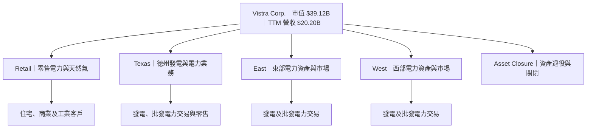
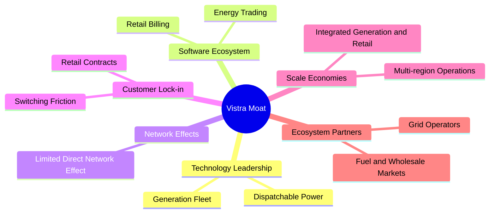
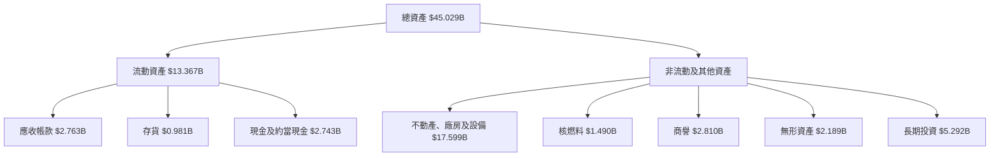
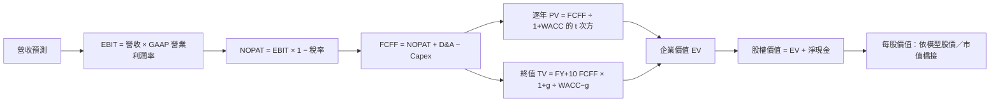
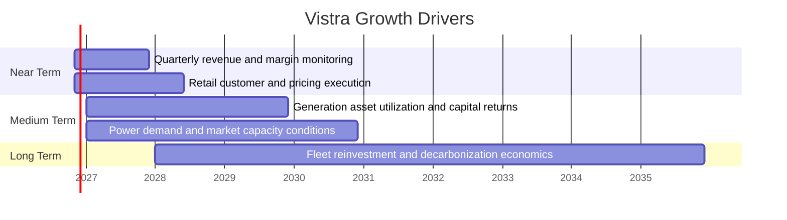
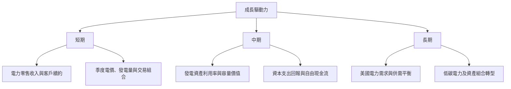
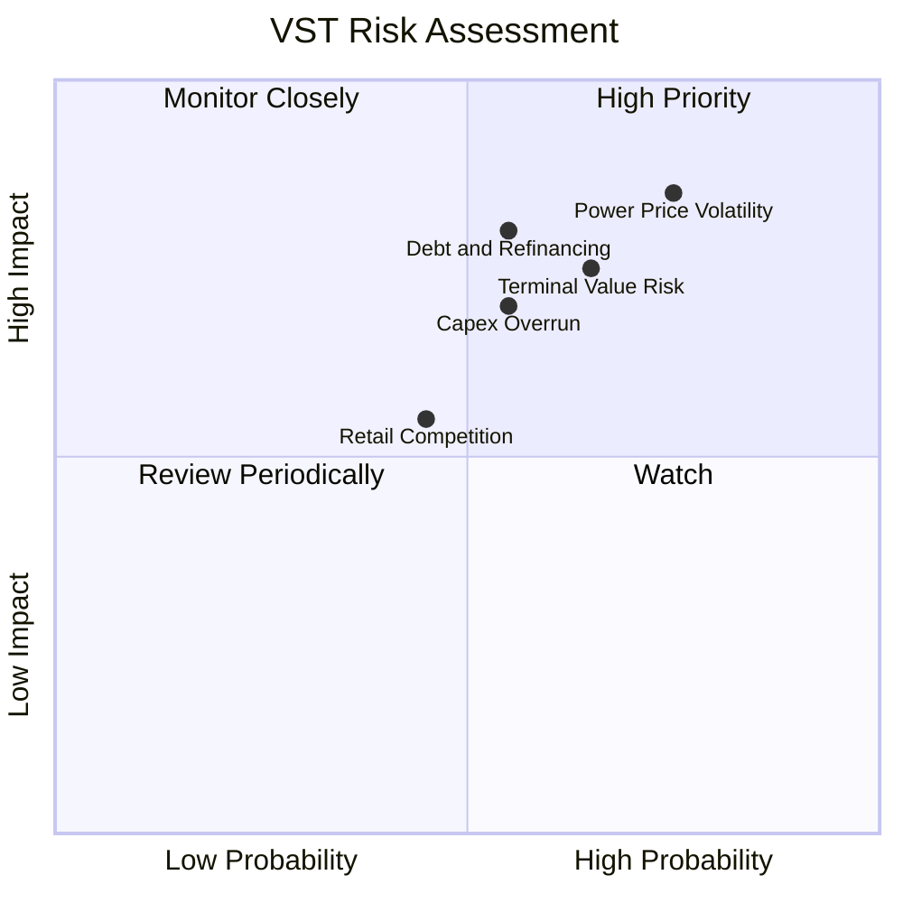
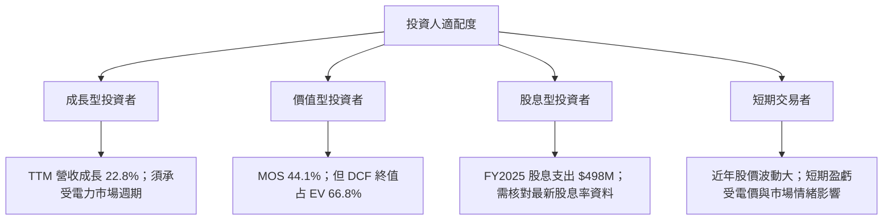

# VST 基本面深度分析報告
> **報告日期**：2026-11-22 ｜ **語言**：繁體中文 ｜ **數據來源**：SEC 申報資料 (XBRL)、Yahoo Finance、Finviz、StockAnalysis、Roic.ai ｜ **分析師**：CFA 級機構研究

## 目錄

| # | 章節 | 核心結論 |
|---|------|----------|
| 1 | 執行摘要 | 強烈買入；加權合理價值 $206.04；MOS +44.1% |
| 2 | 公司概覽與商業模式 | 發電與零售整合帶來一定規模優勢，但市場份額及分部收入占比未提供 |
| 3 | 損益表深度分析 | TTM 營收 $20.20B、年增 22.8%；獲利受電力市場與季度組合影響 |
| 4 | 資產負債表分析 | 淨負債 $18.40B；流動比率高於 1，但速動比率偏低 |
| 5 | 現金流量深度分析 | TTM FCF $2.61B、FCF Yield 6.66%；資本支出需求高且年度 FCF 波動 |
| 6 | 獲利能力與資本效率 | ROIC 13.5% 高於 WACC 8.62%，目前創造價值 |
| 7 | 相對估值分析 | P/E 低於自身五年中位數；同業倍數與不同估值法呈現分歧 |
| 8 | DCF 內在價值評估 | DCF 基準值 $305.41；加權合理價值 $206.04；模型高度依賴終值 |
| 9 | 成長催化劑 | 電力需求、零售客戶基礎及容量價值是主要潛在驅動因素；TAM 數據未提供 |
| 10 | 風險矩陣 | 電價與利潤波動、資本密集與負債、DCF 終值敏感性為前三大風險 |
| 11 | 投資建議 | 依 MOS 評級為強烈買入；以季度 FCF、ROIC、槓桿與盈利率作為監控重點 |

---

## 1. 執行摘要

### 1.0 一頁式投資儀表板（Portfolio Manager 30 秒速讀）

| 項目 | 內容 |
|------|------|
| **投資論點（3 句）** | ① SEC 衍生 TTM 營收 **$20.20B、成長 22.8%**，反映發電及零售組合帶來的收入擴張。② TTM **ROIC 13.5% 高於 WACC 8.62%**，目前資本回報高於資金成本。③ TTM FCF 為 **$2.61B、FCF Yield 6.66%**，但年度 FCF 有波動且淨負債達 $18.40B。 |
| **綜合評分** | **7.0/10**（引用 1.1 評分卡） |
| **財務健康** | 🟡 淨負債 **$18.40B**、現金及短期投資 **$2.74B**；流動比率 1.157，短期流動性可用但槓桿仍高 |
| **ROIC vs WACC** | **13.5% vs 8.62%**；差額 **+4.88 個百分點**，目前創造股東價值 |
| **FCF 趨勢** | 年度 FCF 由 2023 年 $3.78B 降至 2025 年 $1.32B，TTM 回升至 **$2.61B**；TTM FCF Yield **6.66%** |
| **估值** | Forward P/E **11.8x** ｜ EV/EBITDA（歷史估值資料）**9.1x** ｜ FCF Yield **6.66%** |
| **DCF 內在價值（基準）** | **$305.41** ｜ 現價相對 DCF 折價 **62.3%**（折溢價以 DCF 基準值計） |
| **安全邊際（MOS）** | **+44.1%＝($206.04 − $115.25) ÷ $206.04** ｜ 🟢 >25% 充足 |
| **預期報酬（基準情境 12M）** | DCF 基準情境相對現價 **+165.0%**；加權合理價值相對現價上行空間 **+78.8%** |
| **關鍵風險（前二）** | 電力市場價格及發電利潤波動；高資本支出與淨負債限制資本配置彈性 |
| **評級 + 信心度** | 🟢 **強烈買入** ｜ 信心：中（估值上行幅度大，但終值與營運假設敏感） |

### 1.1 綜合評分卡（全報告唯一）

| 維度 | 評分（1–10） | 主要依據（引用數字與其來源章節） |
|------|--------------|----------------------------------|
| 成長性 | 8.0 | TTM 營收成長 22.8%，最新季度年增 25.4%（3.2）；但季度收入受季節與市場價格影響 |
| 獲利能力 | 8.0 | TTM 營業利益率 21.0%、ROIC 13.5% 高於 WACC 8.62%，Piotroski 7/8（6.2、6.4） |
| 財務健康 | 5.0 | 淨負債 $18.40B，流動比率 1.157、速動比率 0.477；CCC 34 天（4.2） |
| 估值 | 8.0 | MOS +44.1%；P/E 15.6x，低於自身五年中位數 25.2x；DCF 終值占 EV 66.8%（7、8） |
| 護城河 | 7.0 | 發電資產與零售客戶渠道形成整合能力，但市場份額、客戶留存及分部獲利數據未提供（2.3–2.4） |
| 管理層與資本配置 | 6.0 | 稀釋股數測試通過、2025 年股權薪酬 $113M；資本支出與債務規模仍高（3.5、5.4） |
| **綜合評分** | **7.0** | 六項算術平均：**(8.0 + 8.0 + 5.0 + 8.0 + 7.0 + 6.0) ÷ 6 = 7.0**；按六項平均應為 **7.0/10** |

> **評分覆核修正：**六項子分數的算術平均為 **7.0/10**，故綜合評分採用 **7.0/10**，不採用儀表板預填的 6.7。

### 1.2 五大投資論點 + 三大核心風險

| 類型 | 項目 | 具體依據 | 信心度 |
|------|------|----------|--------|
| 🟢 **投資論點①** | 營收增長具動能 | TTM 營收 $20.20B、年增 22.8%；最新季度營收年增 25.4%，需求及售電規模提升可帶動營業槓桿 | 🟢 高 |
| 🟢 **投資論點②** | 資本回報高於資金成本 | ROIC 13.5% 對 WACC 8.62%，差額 +4.88 個百分點；若維持，增量投資有望創造價值 | 🟢 高 |
| 🟢 **投資論點③** | 現金流已有正向支撐 | TTM 營業現金流 $5.76B、資本支出 $3.15B、FCF $2.61B，FCF Yield 6.66% | 🟢 高 |
| 🟢 **投資論點④** | 相對自身歷史 P/E 偏低 | P/E 15.6x，低於五年中位數 25.2x，現處自身歷史 20 百分位；但估值低也可能反映商品週期風險 | 🟡 中 |
| 🟢 **投資論點⑤** | 同業相對估值有支撐 | 同業 EV/EBITDA 中位數 11.2x；VST 歷史估值資料為 9.1x，折讓可能提供重新定價空間 | 🟡 中 |
| 🟡 **風險①** | 電價與發電利潤波動 | 2025 年營業利益 $2.13B，低於 2024 年 $4.08B；全年盈利對電價、燃料與對沖結果敏感 | 🟡 中 |
| 🔴 **風險②** | 高負債及資本密集 | 淨負債 $18.40B；TTM 資本支出 $3.15B，限制股息、回購及新投資的彈性 | 🔴 高衝擊 |
| 🔴 **風險③** | DCF 終值與長期假設敏感 | 終值現值占 EV 66.8%；WACC 或永續成長率變化會顯著改變 DCF 價值 | 🔴 高衝擊 |

### 1.3 快速統計卡片

| 指標 | 公司實際值（期間） | 同業中位數 | 狀態 |
|------|--------------------|------------|------|
| 營收成長（TTM） | **22.8%** | — | 🟢 |
| 營收成長（最新一季年增） | **25.4%** | 45.4% | 🟡 |
| 毛利率（TTM） | **41.5%**（交叉來源值；SEC 核心指標未列） | 25.2% | 🟢 |
| 營業利益率（TTM） | **21.0%** | — | 🟢 |
| ROIC（TTM） | **13.5%** | — | 🟢 |
| Forward P/E | **11.8x** | 10.3x | 🟡 |
| FCF Yield（TTM） | **6.66%** | — | 🟢 |
| Piotroski F-Score | **7 / 8** | — | 🟢 |

### 1.4 投資結論

╔══════════════════════════════════════════════════════════════════╗  
║　　　　　　　　　📊 投資結論摘要　　　　　　　　　　　　　　　║  
╠══════════════════════════════════════════════════════════════════╣  
║ 評級：強烈買入（MOS +44.1%，且 ROIC 13.5% > WACC 8.62%）　　　　║  
║ 價格（2026-11-20 收盤）：$115.25　　　　　　　　　　　　　　　║  
║ DCF 內在價值（基準）：$305.41（現價折價 62.3%）　　　　　　　　║  
║ 安全邊際 MOS：+44.1%（＝($206.04−$115.25)÷$206.04）　　　　　　║  
║ 加權合理價值（8.8）：$206.04　　　　　　　　　　　　　　　　　║  
║ DCF 情境價值：　　　　　　　　　　　　　　　　　　　　　　　　║  
║　悲觀情境：$103.23（-10.4%）　　　　　　　　　　　　　　　　　║  
║　基準情境：$305.41（+165.0%）　　　　　　　　　　　　　　　　 ║  
║　樂觀情境：$720.18（+524.9%）　　　　　　　　　　　　　　　　 ║  
║ 綜合評分：7.0/10（引用 1.1 六項算術平均）　　　　　　　　　　　║  
║ 適合投資人：可承受電力市場週期與估值波動的成長型、長線投資人　║  
╚══════════════════════════════════════════════════════════════════╝

---

## 2. 公司概覽與商業模式

### 2.1 業務結構與收入來源

Vistra Corp. 是美國垂直整合的發電及零售電力公司，經營 Retail、Texas、East、West、Asset Closure 五個分部。可得資料未提供各分部收入或利潤，因此不計算分部百分比；公司 TTM 營收採 SEC 衍生數據 **$20.20B**。

### 2.2 市場份額

市場份額及分部收入占比數據未提供，因此不以圖表或自行估算比例呈現。VST 的 TTM 營收為 $20.20B，最新季度年增 25.4%；同業 CEG、NRG、TLN 的最新季度營收年增分別為 45.4%、24.0%、96.1%。VST 成長高於 NRG、低於 CEG 與 TLN，但分部組合與基期不同，不能直接視為市場份額變化。

### 2.3 競爭護城河分析

VST 的主要差異化更偏向實體資產、批發交易能力與零售客戶渠道，而非軟體網路效應。各項資產的競爭優勢會受區域電力市場、燃料與容量機制影響。

### 2.4 護城河強度

| 護城河項目 | 強度（強／中／弱） | 證據（引用數字或事實） | 會削弱它的情況 |
|------------|--------------------|------------------------|----------------|
| 發電資產組合 | 中 | 公司在 Texas、East、West 等分部營運發電資產；分部容量與市場份額未提供 | 機組停機、退役成本上升或區域供給增加 |
| 發電與零售整合 | 中 | 同時經營零售電力／天然氣與發電業務，可管理部分供需與交易敞口 | 零售競爭壓價，或發電及零售避險不匹配 |
| 客戶渠道 | 中 | 零售業務服務住宅、商業及工業客戶；客戶數與留存率未提供 | 客戶轉換成本低、續約價格失去競爭力 |
| 規模效應 | 中 | TTM 營收 $20.20B、員工 6,390 人，具跨區域營運規模 | 大型資本支出、監管成本或資產退役成本侵蝕規模效益 |
| 技術與軟體 | 弱至中 | 現有資料未提供可量化的專有技術、軟體收入或研發成效 | 技術差異不足，競爭者以更低成本發電或更佳交易能力取代 |
| 網路效應／生態夥伴 | 弱至中 | 沒有客戶端網路效應或合作夥伴收入數字可驗證 | 市場流動性、電網規則或供應商條件改變 |

**1.1 護城河分數為 7.0/10 的依據**：整合發電與零售、跨區域資產及 $20.20B TTM 營收支持一定規模優勢；但缺乏市場份額、客戶留存、容量與分部利潤數據，不能將護城河評估為高度確定。

---

## 3. 損益表深度分析

### 3.1 年度收入成長趨勢（近4年）

以下年度收入取自年度損益表；YoY 由相鄰年度營收計算。2022–2025 年累計 CAGR 約 **8.9%**，但近年增長並非線性。

╔══════════════════════════════════════════════════════════════════╗  
║　　　　Vistra 年度收入趨勢（FY2022–FY2025）　　　　　　　　　　 ║  
╠══════════════════════════════════════════════════════════════════╣  
║ FY2022　$13.73B　████████████████████　　　　　　　 YoY：N/A　　║  
║ FY2023　$14.78B　██████████████████████　　　　　　 YoY：+7.7%　║  
║ FY2024　$17.22B　██████████████████████████　　　　 YoY：+16.5% ║  
║ FY2025　$17.74B　███████████████████████████　　　 YoY：+3.0%　║  
║　　　　　　　　　　　　　　　　　　　　　　　　　　　　　　　║  
║ 2022–2025 年 CAGR：((17.74 ÷ 13.73)^(1/3) − 1) = 約 8.9%　　　║  
╚══════════════════════════════════════════════════════════════════╝

另據 SEC 衍生數據，TTM 營收 $20.20B、TTM 對前一 TTM 成長 22.8%。年度數字顯示 FY2025 增長放緩，而最新 TTM 再加速，意味近期成長更可能來自近期季度營收擴張與市場組合，不宜單以 FY2025 趨勢外推。

### 3.2 季度收入趨勢分析

| 季度 | 營收 | QoQ 成長 | YoY 成長 | 備註 |
|------|------:|---------:|---------:|------|
| 2025 Q4 | $4.58B | — | — | 以相鄰已列季度計算 QoQ；該季度 YoY 基數未提供 |
| 2026 Q1 | $5.64B | +23.1% | — | 季度營收回升；單季同比資料以獨立 SEC 衍生指標為準 |
| 2026 Q2 | $4.02B | -28.7% | — | 季度回落，反映季度組合及電力市場收入波動 |
| 2026 Q3 | $6.35B | +58.0% | **+25.4%** | SEC 衍生最新季度 YoY；不應標示為 TTM 成長率 |

季度收入計算採用原始季度營收並四捨五入至一位小數百分點；季度同比的可引用核心值為 **25.4%**。另一彙整來源列示 27.7%，與 SEC 衍生值不同，本報告在核心統計中採用 25.4%。

### 3.3 利潤率演變分析

| 利潤率指標 | FY2022 | FY2023 | FY2024 | FY2025 | 趨勢 | 評估 |
|------------|-------:|-------:|-------:|-------:|------|------|
| **毛利率** | 12.2% | 37.3% | 43.7% | 32.9% | FY2024 上升、FY2025 回落 | 🟡 |
| **營業利益率** | -8.0% | 18.3% | 23.7% | 12.0% | FY2022 虧損後改善，FY2025 明顯收縮 | 🟡 |
| **淨利率** | -9.0% | 10.1% | 15.4% | 5.3% | FY2024 高點後下降 | 🟡 |

*年度毛利率、營業利益率及淨利率係年度損益表項目除以年度營收計算，四捨五入至一位小數。*

TTM 指標則為營業利益率 21.0%、最新季度營業利益率 28.5%；兩者期間不同，不可混稱。2025 年毛利與營業利益率較 2024 年收縮，顯示發電與批發交易獲利並非固定利差業務，電力售價、燃料成本、避險及發電量都會改變季度利潤。最新 TTM 利益率回升，若後續季度能維持，將支撐營業槓桿；但年度波動說明不能把單季高利潤率直接作為長期假設。

### 3.4 費用結構分析

財務資料沒有完整列出營運費用細項（例如燃料、維護、零售銷售、管理費用及折舊的可比口徑），因此不繪製費用圓餅圖，以免將不完整項目錯配為總費用比例。已知 FY2025 營收 $17.74B、毛利 $5.83B、營業利益 $2.13B，毛利以下費用及項目合計約 **$3.70B（$5.83B − $2.13B）**，但資料不足以可靠拆分其構成。

### 3.5 季度 EPS 趨勢與盈餘品質（Quality of Earnings）

近四季 EPS 驚喜表的預估值及實際值均為缺值，無法判斷超預期或不及預期。可用季度財務數據顯示淨利在 2026 Q3 為 $1.14B、Q2 為 $305M、Q1 為 $1.03B、2025 Q4 為 $233M；不同來源的季度淨利口徑有差異，因此不據此製造 EPS surprise 結論。

| 盈餘品質項目 | 數值/佔比 | 評估 |
|--------------|-----------|------|
| 股權薪酬 SBC / 營收 | 近四季 SBC 約 $127M；以 TTM 營收 $20.20B 計約 **0.63%** | 🟢 比例不高，但仍是股東經濟成本 |
| SBC / 營業現金流 | $127M ÷ $5.76B = 約 **2.2%** | 🟢 SBC 對營業現金流比例有限 |
| FCF / 淨利（現金轉換率） | $2.61B ÷ TTM 淨利 $2.515B = 約 **103.8%** | 🟢 FCF 略高於淨利；受資本支出和營運資金時點影響 |
| 一次性/非經常性損益 | N/A（資料未提供完整調節表） | 🟡 無法判斷單期一次性收益對盈利的影響 |
| 有效稅率異常 | 15.9%（最新年度有效稅率） | 🟡 模型採用 15.9%；不同年度稅務項目可能使實際稅率波動 |
| 資本化支出 vs 費用化 | TTM Capex $3.15B；資本化與費用化項目細分 N/A | 🟡 發電資產投資需資本化，缺乏明細無法評估費用遞延程度 |

**盈餘品質結論：**TTM FCF 約為 TTM 淨利的 103.8%，且 SBC 占營收約 0.63%，目前現金轉換與稀釋成本沒有顯示顯著警訊。但電力資產維護及擴建資本支出高，盈利對電價、交易和折舊假設敏感；一次性損益及資本化支出明細不足，故 GAAP 盈利含金量評估為中上而非完全確定。

---

## 4. 資產負債表分析

### 4.1 資產結構分解

以下採 StockAnalysis 最新 TTM 資產項目；總資產 $45.029B 與年度數據 FY2025 $41.55B 不同，因報表期不同。

### 4.2 流動性與營運資金分析

| 指標 | 最新 TTM | 一年前 TTM | 變化 | 解讀 |
|------|----------|------------|------|------|
| DSO 應收帳款天數 | 50 天 | 52 天 | -2 天 | 收款天數略減，方向有利；但兩天差異不足以單獨證明信用政策改善 |
| DIO 存貨天數 | 30 天 | N/A | N/A | 公司一年前沒有可用存貨餘額口徑，不能比較 |
| DPO 應付帳款天數 | 45 天 | N/A | N/A | 一年前數據未提供，無法評估付款期變化 |
| CCC 現金轉換週期 | 34 天 | N/A | N/A | 最新 CCC 由 50 + 30 − 45 = 35 天，資料列示 34 天；因底層未四捨五入值不同，照抄程式計算值 34 天 |

| 流動性指標 | 數值 | 評估 |
|------------|------:|------|
| 流動比率 | 1.157 | 🟡 流動資產略高於流動負債 |
| 速動比率 | 0.477 | 🔴 不含存貨與其他流動項目的即時覆蓋偏弱 |
| 現金及短期投資 | $2.74B | 🟡 對比總債務 $21.15B，現金緩衝有限 |

### 4.3 債務結構分析

╔══════════════════════════════════════════════════════════════════╗  
║　　　　　　　　　Vistra 債務健康診斷　　　　　　　　　　　　　║  
╠══════════════════════════════════════════════════════════════════╣  
║ 總債務：　　　　 $21.15B　████████████████████　🟡　　　　　　 ║  
║ 現金及短期投資： $2.74B　　███░░░░░░░░░░░░░░░░　🟡　　　　　　 ║  
║ 淨現金（正）：　 N/A；公司為淨負債 **$18.40B**　　　　　　　　║  
║ Debt/EBITDA：　　N/A（核心驗證資料未提供一致 TTM EBITDA）　　　║  
║ 利息保障倍數：　 N/A（未提供 TTM 利息費用與營業利益一致口徑）　║  
║ 流動比率：　　　 1.157　🟡　　　　　　　　　　　　　　　　　　║  
║ 速動比率：　　　 0.477　🔴　　　　　　　　　　　　　　　　　　║  
╚══════════════════════════════════════════════════════════════════╝

年度資產負債表顯示總債務由 2022 年 $13.34B 增至 2025 年 $20.07B；最新驗證口徑總債務為 $21.15B。債務支撐大型發電資產及營運，但在電力價格下行或資本支出上升時，利息及再融資需求會降低股東現金流彈性。

### 4.4 股東權益趨勢

╔══════════════════════════════════════════════════════════════════╗  
║　　　　　　　　Vistra 歷年股東權益　　　　　　　　　　　　　　║  
╠══════════════════════════════════════════════════════════════════╣  
║ FY2022　$4.90B　████████████████　　　　　　　　　　　　　　　║  
║ FY2023　$5.31B　█████████████████　　　　　　　　　　　　　　║  
║ FY2024　$5.57B　██████████████████　　　　　　　　　　　　　　║  
║ FY2025　$5.10B　████████████████　　　　　　　　　　　　　　　║  
╚══════════════════════════════════════════════════════════════════╝

FY2025 權益由 $5.57B 降至 $5.10B，與當年淨利、股息及其他權益變動共同作用；可用資料不足以把變動逐項歸因。帳面權益遠低於市值，但對資產密集且大量有形資產的發電商，P/B 本身不應單獨作為估值判斷。

---

## 5. 現金流量深度分析

### 5.1 現金流量瀑布圖

可用資料沒有同一期間完整的淨利、回購與淨現金變化調節表，因此只呈現可核實的 TTM 營業現金流、資本支出及 FCF；不將缺漏項目用推算數字補足。

### 5.2 FCF 轉換率趨勢

| 財年 | FCF | 淨利 | FCF / 淨利 | 解讀 |
|------|----:|----:|-----------:|------|
| 2022 | -$0.816B | -$1.23B | 66.3%* | 兩項皆為負，比例不宜當作現金轉換品質指標 |
| 2023 | $3.78B | $1.49B | 253.7% | 營運資金及現金流時點可能使現金流高於會計盈利 |
| 2024 | $2.48B | $2.66B | 93.2% | FCF 略低於淨利 |
| 2025 | $1.32B | $0.944B | 139.8% | 資本支出下降使 FCF 高於淨利 |
| 最新 TTM | $2.61B | $2.515B | 103.8% | 約略一比一現金轉換 |

\*2022 比率由負數相除得到正值，經濟意義有限。

### 5.3 自由現金流趨勢

╔══════════════════════════════════════════════════════════════════╗  
║　　　　　　　　　年度 FCF：實際與最新 TTM　　　　　　　　　　　║  
╠══════════════════════════════════════════════════════════════════╣  
║ FY2022　-$0.816B　負值　　　　　　　　　 🔴　　　　　　　　　　║  
║ FY2023　 $3.78B　 ████████████████████　🟢　　　　　　　　　　║  
║ FY2024　 $2.48B　 █████████████　　　　　　　　　🟡　　　　　║  
║ FY2025　 $1.32B　 ███████　　　　　　　　　　　　 🟡　　　　　║  
║ TTM　　　$2.61B　 ██████████████　　　　 FCF Yield 6.66%　　　║  
╚══════════════════════════════════════════════════════════════════╝

FY2023 至 FY2025 FCF 下降，主要背景是營業現金流與資本支出同步變化；年度數據分別顯示 OCF $5.45B、$4.56B、$4.07B，而 Capex $1.68B、$2.08B、$2.75B。最新 TTM FCF 回升至 $2.61B，提供一定股東回報能力，但並不代表資本支出已進入低檔。

### 5.4 資本配置評估

| 資本用途 | 已知金額 | 評估 |
|----------|---------|------|
| 資本支出 | TTM $3.15B；FY2025 $2.75B | 最大可辨認的再投資項目；支撐資產維護及擴張，但也壓低當期 FCF |
| 股息 | FY2025 現金股息 $498M；TTM 季度合計約 $500M | 低於 TTM FCF，具現金流覆蓋 |
| 回購 | N/A（未提供一致期間回購金額） | 不以股數變化反推回購額 |
| 留存現金／還債 | N/A（缺少完整現金流配置調節） | 淨負債仍為 $18.40B，償債能力值得持續追蹤 |

無法可靠分配投資、回購、股息與留存的百分比，故不繪製資本配置圓餅圖。FY2025 股權薪酬 $113M，最新四季約 $127M；Piotroski 股數測試通過，代表該比較期稀釋股數未增加，但仍應追蹤股份薪酬與回購的淨效果。

---

## 6. 獲利能力與資本效率

### 6.1 ROE / ROA / ROIC 趨勢

| 指標 | FY2025／最新可用 | 歷史趨勢與評估 |
|------|------------------:|----------------|
| ROE | TTM **42.9%**（品質指標口徑） | 數值高，但權益乘數達 7.14，槓桿對 ROE 有重大放大作用 |
| ROA | N/A（未提供相同口徑歷史序列） | Piotroski 測試顯示 ROA 為正且高於一年前 |
| ROIC | TTM **13.5%** | 高於 WACC 8.62%，目前創造經濟價值 |
| 行業均值 | N/A（未提供可核驗一致來源） | 不列未有來源的行業均值 |

### 6.2 ROIC vs WACC 分析（核心價值創造判斷）

╔══════════════════════════════════════════════════════════════════╗  
║　　　　　　　　　ROIC vs WACC 深度分析　　　　　　　　　　　　║  
╠══════════════════════════════════════════════════════════════════╣  
║ WACC 輸入：　　　　　　　　　　　　　　　　　　　　　　　　　　║  
║ ├── 無風險利率（10Y 美債）：4.91%　　　　　　　　　　　　　　 ║  
║ ├── 市場風險溢酬 ERP：5.00%　　　　　　　　　　　　　　　　　║  
║ ├── Beta 原始值 1.38；採用調整後 Beta 1.25　　　　　　　　　　║  
║ ├── 股權成本 Ke：11.16%　　　　　　　　　　　　　　　　　　　║  
║ ├── 稅前債務成本：4.64%；有效稅率：15.9%　　　　　　　　　　 ║  
║ ├── 股權／債務權重：64.9%／35.1%　　　　　　　　　　　　　　║  
║ └── WACC：8.62%　　　　　　　　　　　　　　　　　　　　　　　║  
║　　　　　　　　　　　　　　　　　　　　　　　　　　　　　　　║  
║ ROIC（TTM）：13.5%　　　　　　　　　　　　　　　　　　　　　　║  
║ EVA 利差：13.5% − 8.62% = **+4.88 個百分點**　　　　　　　　║  
║ ROIC 13.5%　▓▓▓▓▓▓▓▓▓▓▓▓▓▓░░░░░░　🟢　　　　　　　　　　　　║  
║ WACC  8.62%　▓▓▓▓▓▓▓▓▓░░░░░░░░░░░　基準　　　　　　　　　　　║  
║　　　　　　　　　　　　　　　　　　　　　　　　　　　　　　　║  
║ 結論：ROIC 約為 WACC 的 1.57 倍，現階段創造股東價值。　　　　║  
╚══════════════════════════════════════════════════════════════════╝

成本資本輸入由程式計算提供，按要求採用 **8.62%**，不另造 WACC。ROIC 計算為稅後營業利益除以股權、債務與現金調整後投入資本。若電力市場正常化造成營業利益下降，ROIC 可能回落；因此目前 +4.88 個百分點利差不等於永久護城河。

### 6.3 杜邦三因素分解

| 因素 | 數值（TTM） | 解讀 |
|------|-------------|------|
| 淨利率 | 13.4% | 每一美元收入形成約 13.4 美分淨利 |
| 資產週轉率 | 0.45 | 發電資產密集，資產週轉率相對不高 |
| 權益乘數 | 7.14 | 財務槓桿是推升 ROE 的重要因素 |
| **ROE** | **42.9%** | **13.4% × 0.45 × 7.14 = 42.9%** |

ROE 不應只解讀為營運效率極高；權益乘數 7.14 表明槓桿放大作用顯著。公司價值判斷以 ROIC 對 WACC 更合適。

### 6.4 財務體質：Piotroski F-Score

| 測試 | 結果 | 解讀 |
|------|------|------|
| ROA > 0 | ✅ 通過 | 當期資產報酬為正 |
| 營業現金流 > 0 | ✅ 通過 | TTM 營業現金流為 $5.76B |
| ROA 高於一年前 | ✅ 通過 | 盈利能力較去年同期改善 |
| 營業現金流 > 淨利（應計品質） | ✅ 通過 | 現金流高於淨利，應計品質測試通過 |
| 長期負債 ÷ 總資產低於一年前 | ❌ 未通過 | 槓桿相對資產未改善，負債趨勢需監控 |
| 流動比率高於一年前 | ✅ 通過 | 短期流動性相對改善 |
| 稀釋股數未增加 | ✅ 通過 | 比較期間稀釋股數未增加 |
| 毛利率高於一年前 | — 無法判定 | 缺少可比較輸入 |
| 資產週轉率高於一年前 | ✅ 通過 | 資產使用效率測試通過 |

**Piotroski F-Score：7/8**；有一項測試缺少資料而不納入分母。未通過長期負債比率測試，與淨負債 $18.40B 相符，顯示財務改善並非全面。

---

## 7. 相對估值分析

### 7.1 同業估值比較表格

| 估值指標 | **VST** | **CEG** | **NRG** | **TLN** | VST 評估 |
|----------|--------:|--------:|--------:|--------:|----------|
| **Trailing P/E** | 15.6x | 19.1x | 15.3x | N/A | 🟡 接近 NRG、低於 CEG |
| **Forward P/E** | 11.8x | 17.7x | 9.2x | 10.3x | 🟡 高於 NRG、TLN；低於 CEG |
| **P/S Ratio** | 1.9x | 2.4x | 0.5x | 3.2x | 🟡 高於 NRG、低於 CEG/TLN |
| **EV/EBITDA（TTM）** | 9.1x* | 11.2x | 10.2x | 35.2x | 🟢 低於同業中位數 11.2x |
| **最新季度營收 YoY** | 25.4% | 45.4% | 24.0% | 96.1% | 🟡 高於 NRG、低於 CEG/TLN |
| **毛利率（TTM）** | 41.5%* | 25.2% | 20.2% | 42.7% | 🟢 接近 TLN、高於 CEG/NRG |

\*VST EV/EBITDA 9.1x 為歷史估值區塊數值；VST 毛利率 41.5% 為另一財務彙整來源，非同一 SEC 核心指標。Peer multiples 由 Yahoo Finance 提供。對 P/E 中位數只使用可用值；同業 Forward P/E 中位數為 10.3x，EV/EBITDA 中位數為 11.2x。

### 7.2 歷史估值區間分析

╔══════════════════════════════════════════════════════════════════╗  
║　　　　　　　　VST 五年 P/E 歷史位置　　　　　　　　　　　　　║  
╠══════════════════════════════════════════════════════════════════╣  
║ 五年區間：7.2x ─────────────────────────────── 74.3x　　　　　　║  
║ 五年中位數：25.2x　　　　　　　　　　　　　　　　　　　　　　║  
║ 當前：15.6x　●　　　　　　　　　　　　　　　　　　　　　　　║  
║ 當前百分位：20%　　　　　　　　　　　　　　　　　　　　　　　║  
║　　　　　　　　　　　　　　　　　　　　　　　　　　　　　　　║  
║ P/S：當前 1.9x｜中位數 1.8x｜百分位 52%　　　　　　　　　　　　║  
║ EV/EBITDA：當前 9.1x｜中位數 11.0x｜百分位 35%　　　　　　　　║  
╚══════════════════════════════════════════════════════════════════╝

目前 P/E 位於自身五年分布偏低區間；P/S 則略高於五年中位數，表示估值便宜的結論依倍數而異。公司盈利具有週期性，歷史 P/E 的 7.2x–74.3x 寬幅區間也說明單一歷史中位數並非可靠的固定錨。

### 7.3 情境價值（Bear / Base / Bull，照抄 DCF MODEL 的 Scenarios）

| 情境 | 第 1 年營收成長 | 期末營業利潤率 | WACC | 每股價值 | 相對現價 | 機率 | 會發生的條件 |
|------|----------------:|----------------:|-----:|----------:|----------:|------:|--------------|
| 🔴 悲觀 | 11.4% | 16.4% | 9.62% | $103.23 | -10.4% | 25% | 成長低於基準且利潤率向下正常化，資金成本上升 |
| 🟡 基準 | 22.8% | 19.3% | 8.62% | $305.41 | +165.0% | 50% | TTM 成長延續後逐步減速，利潤率回落至五年中位數 |
| 🟢 樂觀 | 34.3% | 21.2% | 7.62% | $720.18 | +524.9% | 25% | 需求與價格條件優於基準，營業利潤率保持在較高水平 |

上述情境及機率照 DCF 模型列示，不代表獨立校準的機率預測。基準、樂觀情境的上行幅度非常大，尤其依賴長期現金流與終值；投資決策應同時參照第 8.8 節多方法加權值。

### 7.4 相對估值隱含價格區間

╔══════════════════════════════════════════════════════════════════╗  
║　　　　　估值方法回推價格與現價 $115.25　　　　　　　　　　　　║  
╠══════════════════════════════════════════════════════════════════╣  
║ 同業 Forward P/E　$100.92　← 現價 $115.25 →　同業 EV/EBITDA $155.71║  
║ 分析師共識目標價　$197.18　　　　　　　　　　　　　　　　　　　║  
║ DCF 基準值　　　　$305.41　　　　　　　　　　　　　　　　　　　║  
╚══════════════════════════════════════════════════════════════════╝

- **同業 Forward P/E：$100.92**＝同業中位數 **10.3x** × VST Forward EPS **$9.76**。
- **同業 EV/EBITDA：$155.71**＝同業中位數 **11.2x** × VST TTM EBITDA，並納入淨現金／淨負債橋接。
- **分析師共識目標價：$197.18**＝23 位分析師平均目標價。
- 兩種相對估值結果分別低於及高於現價，說明同業倍數並未提供單向確認；其價值取決於獲利週期與同業組合。

---

## 8. DCF 內在價值評估（Discounted Cash Flow）

> DCF 採程式計算模型的既定輸入及輸出。以下保留模型原值；模型內某些經四捨五入的中間項相加可能出現小幅尾差，橋接與敏感度結論採模型原列數字，不另建模型替換結果。

### 8.0 估值推理鏈（Thinking Logic）

**Step 1 — 價值由什麼決定？**  
VST 價值主要取決於：一是目前整合發電與零售主業，收入基礎為 TTM **$20.20B**；二是收入增長能否由最新季度 **25.4% YoY** 延續並逐步減速；三是發電資產的資本支出與長期現金流。分部收入占比未提供，不能把任一分部稱為特定占比的第二成長曲線。模型價值最敏感的是 WACC、永續成長率及長期 FCFF，與終值占 EV 66.8% 一致。

**Step 2 — 模型選擇**

| 決策點 | 本報告採用 | 理由（含數字） | 曾考慮但否決 | 否決理由 |
|--------|-----------|----------------|--------------|----------|
| 現金流定義 | FCFF | 以 WACC 8.62% 折現，先求 EV 再扣淨負債 | FCFE | 債務與資本結構重要，FCFF 較適用 |
| 預測期 N | 10 年 | 電力資產長壽命、基準收入增長由 22.8% 線性減速至 3.0% | 5 年 | 無法涵蓋既定模型的長期增長淡出 |
| 終值方法 | Gordon Growth | g 3.0% 小於 WACC 8.62% | 僅退出倍數 | 模型未提供終值退出倍數估值，不能自行補造 |
| EBIT 基礎 | GAAP EBIT | 模型營業利益率標為 GAAP EBIT | 非 GAAP EBIT | 不另加回 SBC，以免破壞模型設定 |

**Step 3 — 關鍵假設推導鏈**

- **營收成長**：錨點＝TTM 成長率 22.8% → 調整＝十年期內線性減速，反映高成長不可能永久維持 → **第一年採用 22.8%，第十年 3.0%** → 未採用十年固定 22.8%，因為這會把當期高成長直接永久化，缺乏證據。
- **期末營業利益率**：錨點＝TTM 營業利益率 21.0%，過去五財年中位數（含 TTM）為模型採用依據 → 調整＝模型由 21.0% 逐步正常化 → **第十年 19.3%** → 未假設持續高於 21.0%，因為年度營業利益率曾由 FY2024 23.7% 回落至 FY2025 12.0%。
- **永續成長率 g**：錨點＝成熟企業長期名目成長應低於長期 GDP 與通膨合計；可用資料未提供長期宏觀預測 → 調整＝採用模型設定 **3.0%**，並確保低於 WACC 8.62% → 未採用高於 WACC 的值，因其會使 Gordon Growth 公式失效。
- **預測期 N**：錨點＝模型設定 10 年，且營收成長逐步收斂至 3.0% → 採用 **10 年** → 未改用較短期限，因模型已有逐年現金流且假設需完整呈現；此期限不代表公司只有十年價值。
- **Capex / 營收**：錨點＝TTM 資本支出 $3.15B ÷ TTM 營收 $20.20B 約 15.6% → 調整＝隨時間遞減至模型設定 11.5%，約為 1.1 倍 D&A → **FY+1 15.6% 至 FY+10 11.5%** → 未假設立即降至維持性 Capex，因發電資產仍需較高投資。
- **EBIT 基礎與 SBC**：錨點＝模型明確使用 GAAP EBIT；FY2025 SBC $113M、最新四季估算約 $127M → 採用 GAAP EBIT，SBC 已列為費用，不再從 FCFF 扣除 → **採用組合 (A)：GAAP EBIT + 固定股數，不另扣 SBC，年稀釋率 0%** → 未採非 GAAP 加回，避免 SBC 被漏算或重複扣除。
- **年稀釋率**：錨點＝Piotroski 測試顯示稀釋股數未增加 → **採用 0% 年稀釋率**，配合組合 (A) → 不另加年稀釋，因模型已用 GAAP 費用反映 SBC。
- **終值方法**：錨點＝十年後公司假設回到 3.0% 永續成長 → 採 Gordon Growth → 未另給退出倍數，因估值資料沒有指定模型的期末 EBITDA 退出倍數。
- **WACC**：錨點＝Cost of capital 計算值 8.62% → 採用 8.62% → 未自行調整 WACC，遵循既定成本資本輸入；WACC 變動對估值高度敏感。
- **有效稅率**：錨點＝最新年度有效稅率 15.9% → 採用 15.9%。
- **D&A / 營收**：錨點＝TTM 10.4% → 採用 10.4% 並維持不變。
- **營運資金變動**：錨點及採用值皆為不建模；模型明確註明 working capital is not modelled，不得另增 ΔWC 假設。

**Step 4 — 最脆弱一環**  
最脆弱的假設是終值及其背後的長期現金流；終值現值占企業價值 66.8%，若長期成長或資本支出假設下修，DCF 價值會快速下降，方向與第 8.6 敏感度矩陣一致。

**Step 5 — 計算路徑圖**

### 8.1 模型假設總表（Model Inputs）

| 假設項目 | 採用值 | 依據 / 來源 | 敏感度 |
|----------|--------|-------------|--------|
| 預測期長度 N | 10 年 | 模型設定；成長率十年內淡出至永續成長率 | 🟡 中 |
| 營收成長率 | FY+1 22.8%，FY+10 3.0%，線性下降 | TTM 對前 TTM 成長 22.8%；長期收斂為模型設定 | 🔴 高 |
| 營業利潤率（GAAP EBIT） | FY+1 21.0% → FY+10 19.3% | TTM 營業利益率及最近五財年中位數設定 | 🔴 高 |
| 有效稅率 | 15.9% | 最新年度有效稅率 | 🟢 低 |
| Capex / 營收 | FY+1 15.6% → FY+10 11.5% | TTM Capex / 營收，逐步降至 1.1 倍 D&A | 🟡 中 |
| D&A / 營收 | 10.4% | TTM 比率 | 🟢 低 |
| ΔWC / 營收增額 | 不建模 | DCF 模型明確註記 working capital is not modelled | 🟢 低 |
| EBIT 基礎 | GAAP | DCF 假設表明 GAAP EBIT | 🟡 中 |
| SBC 處理 | 組合 (A)：不再扣除 | SBC 已含於 GAAP EBIT，股數不再另稀釋 | 🟡 中 |
| 年稀釋率 | 0% | 組合 (A)；模型固定股數處理 | 🟡 中 |
| 永續成長率 g | 3.0% | DCF 模型指定，且小於 WACC | 🔴 高 |
| 終值方法 | Gordon Growth | DCF 模型使用 FCFF × (1+g) ÷ (WACC−g) | 🔴 高 |
| WACC | 8.62% | Cost of capital 輸入，見 8.2 | 🔴 高 |

**FCFF 定義：**採 FCFF，公式為 `NOPAT + D&A − Capex`；模型未建模營運資金變動。  
**SBC 防重複計算：**本模型採用 **(A)**，GAAP EBIT 已含 SBC 費用，故 FCFF 不再減 SBC，股數不另行稀釋。

### 8.2 折現率推導（WACC）

╔══════════════════════════════════════════════════════════════════╗  
║　　　　　　　　　　 WACC 推導（折現率）　　　　　　　　　　　 ║  
╠══════════════════════════════════════════════════════════════════╣  
║ 股權成本 Ke（CAPM）：　　　　　　　　　　　　　　　　　　　　　║  
║ ├── 無風險利率 Rf：4.91%（Cost of capital 資料）　　　　　　　 ║  
║ ├── ERP：5.00%（程式採用假設）　　　　　　　　　　　　　　　　║  
║ ├── 原始 Beta：1.38；調整後 Beta：1.25　　　　　　　　　　　　║  
║ ├── Ke = 4.91% + 1.25 × 5.00% = 11.16%　　　　　　　　　　　║  
║ ├── 規模／國別溢酬：0.00%（Cost of capital 輸入未另列）　　　　║  
║　　　　　　　　　　　　　　　　　　　　　　　　　　　　　　　║  
║ 債務成本 Kd：　　　　　　　　　　　　　　　　　　　　　　　　　║  
║ ├── 稅前 Kd：4.64%（程式計算；利息 ÷ 債務）　　　　　　　　　║  
║ ├── 有效稅率：15.9%　　　　　　　　　　　　　　　　　　　　 ║  
║ └── 稅後 Kd：4.64% × (1−15.9%) = 3.90%　　　　　　　　　　║  
║　　　　　　　　　　　　　　　　　　　　　　　　　　　　　　　║  
║ 資本結構：　　　　　　　　　　　　　　　　　　　　　　　　　　║  
║ ├── 股權權重 E：64.9%　　　　　　　　　　　　　　　　　　　 ║  
║ ├── 債務權重 D：35.1%　　　　　　　　　　　　　　　　　　　 ║  
║ └── WACC = 64.9%×11.16% + 35.1%×3.90% = **8.62%**　　　　　║  
╚══════════════════════════════════════════════════════════════════╝

- 原始 Beta 1.38 經調整公式 **⅔ × 1.38 + ⅓ × 1.00 = 1.25**（四捨五入），模型採調整後 Beta。
- Rf 日期未在成本資本資料中明確列示，故不自行補造日期；ERP 5.00% 為程式採用假設。
- **WACC 五步重現：**  
  1. Ke = 4.91% + 1.25 × 5.00% = **11.16%**。  
  2. 稅前 Kd = **4.64%**（程式採利息費用 ÷ 債務；平均計息負債細項未提供，無法獨立重建）。  
  3. 稅後 Kd = 4.64% × (1 − 15.9%) = **3.90%**。  
  4. E 權重 **64.9%**；D 權重 **35.1%**；兩者相加 **100.0%**。  
  5. WACC = 64.9% × 11.16% + 35.1% × 3.90% = **8.62%**（採用成本資本資料原值）。
- 權重使用程式列示的市值／債務權重。DCF 計算採同一 WACC，與第 6.2 節一致。
- 由於平均計息負債、利息費用及最新市場股權價值的完整底層計算未列出，步驟 2、4 的原始金額無法獨立重建；本報告照採程式驗證的成本資本組成，不另造金額。

### 8.3 逐年自由現金流預測（基準情境）

單位：美元十億（$B）；折現因子按模型列示保留三位小數。金額和比例均照模型原值。

| 年度 | FY+1 | FY+2 | FY+3 | FY+4 | FY+5 | FY+6 | FY+7 | FY+8 | FY+9 | FY+10 |
|------|------:|------:|------:|------:|------:|------:|------:|------:|------:|-------:|
| 營收 | 24.81 | 29.93 | 35.45 | 41.20 | 46.98 | 52.54 | 57.59 | 61.85 | 65.07 | 67.03 |
| 營收 YoY | 22.8% | 20.6% | 18.4% | 16.2% | 14.0% | 11.8% | 9.6% | 7.4% | 5.2% | 3.0% |
| 營業利潤率 | 21.0% | 20.8% | 20.6% | 20.4% | 20.2% | 20.0% | 19.8% | 19.6% | 19.4% | 19.3% |
| EBIT（GAAP） | 5.20 | 6.22 | 7.29 | 8.40 | 9.49 | 10.51 | 11.41 | 12.14 | 12.65 | 12.91 |
| − 稅（15.9%） | (0.83) | (0.99) | (1.16) | (1.34) | (1.51) | (1.68) | (1.82) | (1.94) | (2.02) | (2.06) |
| = NOPAT | 4.37 | 5.22 | 6.13 | 7.06 | 7.98 | 8.84 | 9.60 | 10.21 | 10.64 | 10.85 |
| + D&A | 2.58 | 3.12 | 3.69 | 4.29 | 4.89 | 5.47 | 6.00 | 6.44 | 6.78 | 6.98 |
| − Capex | (3.88) | (4.54) | (5.21) | (5.86) | (6.47) | (6.99) | (7.40) | (7.66) | (7.75) | (7.68) |
| − ΔWC | 未建模 | 未建模 | 未建模 | 未建模 | 未建模 | 未建模 | 未建模 | 未建模 | 未建模 | 未建模 |
| = FCFF | 3.08 | 3.80 | 4.61 | 5.49 | 6.40 | 7.32 | 8.20 | 8.99 | 9.66 | 10.15 |
| 折現因子 @8.62% | 0.921 | 0.848 | 0.780 | 0.719 | 0.662 | 0.609 | 0.561 | 0.516 | 0.475 | 0.438 |
| FCFF 現值 PV | 2.83 | 3.22 | 3.60 | 3.94 | 4.23 | 4.46 | 4.60 | 4.64 | 4.59 | 4.44 |

**預測期現值合計：**  
`2.83 + 3.22 + 3.60 + 3.94 + 4.23 + 4.46 + 4.60 + 4.64 + 4.59 + 4.44 = 40.55B`；模型原列合計 **$40.56B**，差額為各年度四捨五入造成。

**FY+1 逐步演算（模型原值）：**

1. 營收 = TTM 營收 $20.20B × (1 + 22.8%) = **$24.81B**。
2. EBIT = 模型 FY+1 GAAP EBIT **$5.20B**；表列營收與利潤率已四捨五入，乘積以未四捨五入底層值計算。
3. 稅 = **$0.83B**（模型值；15.9% 稅率）。
4. NOPAT = $5.20B − $0.83B = **$4.37B**（以模型列示值）。
5. D&A = **$2.58B**（模型值；依 D&A/營收假設）。
6. Capex = **$3.88B**（模型值；依 FY+1 Capex/營收假設）。
7. ΔWC = **不建模**。
8. FCFF = 模型底層未四捨五入 NOPAT + D&A − Capex = **$3.08B**。展示至兩位小數時，4.37 + 2.58 − 3.88 = 3.07，與模型 3.08 相差 $0.01B，屬中間值四捨五入尾差。
9. 折現因子 = 1 ÷ (1 + 8.62%)¹ = **0.921**；PV = $3.08B × 0.921 = **$2.83B**。

**合理性自檢：**

- 預測 FCFF 由 FY+1 $3.08B 增至 FY+10 $10.15B；十年總增幅很大，與 2022–2025 歷史 FCF 波動（-$0.816B、$3.78B、$2.48B、$1.32B）相比，預測穩定性較高，主要依賴營收擴張與利潤率維持。
- FY+10 FCF 利潤率 = $10.15B ÷ $67.03B = **15.1%**；目前 TTM FCF 利潤率 = $2.61B ÷ $20.20B = **12.9%**。同業最佳可比較 FCF 利潤率未提供，故不作排名。
- 模型各年度 FCFF 均為正，不存在預測年度負現金流。

╔══════════════════════════════════════════════════════════════════╗  
║　　　　　　自由現金流：歷史實際 vs 模型預測　　　　　　　　　　║  
╠══════════════════════════════════════════════════════════════════╣  
║ FY2023（實） $3.78B　████████████████████　YoY：不適用　　　　　║  
║ FY2024（實） $2.48B　█████████████　　　　　YoY：-34.4%　　　　║  
║ FY2025（實） $1.32B　███████　　　　　　　　YoY：-46.8%　　　　║  
║ FY+1（預）　 $3.08B　████████████████　　　 模型值　　　　　　║  
║ FY+10（預） $10.15B　████████████████████　模型值　　　　　　║  
╠══════════════════════════════════════════════════════════════════╣  
║ 歷史 FCF 波動顯著；預測現金流的平滑增長是重要模型風險。　　　║  
╚══════════════════════════════════════════════════════════════════╝

### 8.4 終值計算（Terminal Value）

**適用性檢查：**`WACC 8.62% vs g 3.0% → WACC > g？✅`

| 方法 | 計算式 | 終值 TV | TV 現值 | 佔總 EV 比重 |
|------|--------|---------|---------|--------------|
| Gordon Growth | 10.15 × (1 + 3.0%) ÷ (8.62% − 3.0%) | $186.22B | $81.49B | 66.8% |
| 退出倍數法 | N/A（模型未提供退出倍數及期末 EBITDA 倍數） | N/A | N/A | N/A |

**逐步演算：**

1. FY+N FCFF = FY+10 FCFF **$10.15B**。
2. 分子 = $10.15B × (1 + 3.0%) = **$10.4545B**。
3. 分母 = 8.62% − 3.0% = **5.62%**；模型原列 TV = **$186.22B**。
4. PV(TV) = 模型原列 **$81.49B**；採十年期折現。
5. 終值占 EV = $81.49B ÷ $122.06B = **66.8%**。

依模型結果，終值低於 EV 的 75%警戒線，但仍占約三分之二，估值對長期假設相當敏感。用顯示值手算 Gordon 公式會因中間值已四捨五入而有小幅尾差；本報告保留模型原列 TV 與 PV(TV)，不改算模型數字。

### 8.5 企業價值 → 每股內在價值（Bridge）

╔══════════════════════════════════════════════════════════════════╗  
║　　　　　　企業價值 → 每股內在價值 橋接表　　　　　　　　　　　║  
╠══════════════════════════════════════════════════════════════════╣  
║ 預測期 FCF 現值合計　　　　　+$40.56B　　　　　　　　　　　　 ║  
║ 終值現值 PV(TV)　　　　　　 +$81.49B　　　　　　　　　　　　 ║  
║ = 企業價值 EV　　　　　　　　$122.06B　　　　　　　　　　　　 ║  
║ + 淨現金（負值代表淨負債）　 -$18.40B　　　　　　　　　　　　 ║  
║ = 股權價值　　　　　　　　　$103.65B（模型原列）　　　　　　　║  
║ 每股價值（模型橋接）　　　　 $305.41　　　　　　　　　　　　　║  
║ 當前股價（2026-11-20）　　　 $115.25　　　　　　　　　　　　　║  
║ 折溢價：現價 ÷ DCF 價值 − 1　-62.3%（折價）　　　　　　　　　 ║  
╚══════════════════════════════════════════════════════════════════╝

1. EV = 模型原列預測期 PV $40.56B + PV(TV) $81.49B = **$122.06B**（兩項按顯示值相加為 $122.05B，模型底層未四捨五入值產生 $0.01B 尾差）。
2. 股權價值 = EV $122.06B + 淨現金（負債）-$18.40B = 模型原列 **$103.65B**（顯示值直接相減為 $103.66B，差 $0.01B）。
3. 每股內在價值 = 模型橋接公式 **股權價值 × 股價 ÷ 市值** = **$305.41**。
4. 折溢價 = ($115.25 ÷ $305.41) − 1 = **-62.3%**。
5. 本節不計算 MOS；全報告 MOS 僅以 8.8 加權合理價值為分母。

模型的「每股價值」使用股權價值 × 價格 ÷ 市值之橋接方式；股數資料為 339.39M shares，但模型沒有以「股權價值 ÷ 股數」作為其明示算法。現金與總債務採最新驗證淨負債 -$18.40B；模型橋接的現金與負債淨額合併列示。

### 8.6 敏感性分析（WACC × 永續成長率）

| g（列）／WACC（欄） | 6.62% | 7.62% | **8.62%（基準）** | 9.62% | 10.62% |
|---------------------|------:|------:|------------------:|------:|-------:|
| **2.0%** | $427.69 | $332.85 | $267.13 | $219.03 | $182.39 |
| **2.5%** | $471.94 | $359.75 | $284.71 | $231.11 | $191.02 |
| **3.0%（基準）** | $528.43 | $392.48 | **$305.41** | $245.02 | $200.78 |
| **3.5%** | $603.05 | $433.16 | $330.16 | $261.20 | $211.91 |
| **4.0%** | $706.21 | $485.10 | $360.28 | $280.27 | $224.73 |

敏感度矩陣照 DCF 模型原值列示。模型提供的基準格為 $305.41；其他格可見成長率提高會推高估值，WACC 上升會壓低估值。為避免把未提供的敏感度現金流重算成另一組模型，以下不另以手算取代矩陣。

**三情境 DCF（照模型輸出）**

| 情境 | 第一年成長 | 期末營業利潤率 | WACC | 每股內在價值 | 相對現價 | 機率 |
|------|-----------:|----------------:|-----:|--------------:|----------:|------:|
| 🔴 悲觀 | 11.4% | 16.4% | 9.62% | $103.23 | -10.4% | 25% |
| 🟡 基準 | 22.8% | 19.3% | 8.62% | $305.41 | +165.0% | 50% |
| 🟢 樂觀 | 34.3% | 21.2% | 7.62% | $720.18 | +524.9% | 25% |
| **機率加權** | — | — | — | **$358.56** | **+211.1%** | **100%** |

機率加權計算：`$103.23 × 25% + $305.41 × 50% + $720.18 × 25% = $358.56`（模型原列值；以顯示價格直接重算會有四捨五入尾差）。模型提供情境價值，但沒有各情境完整 FY+N 收入、FCFF 與 TV 中間表，因此不偽造逐情境推導鏈。

**矩陣代表格重算限制：**敏感性矩陣已由程式計算且要求照抄；可見資料未提供每個新 WACC 下的逐年 PV、終值與股權橋接中間值，因此無法獨立完整重算非基準格。依規定保留矩陣原值，不補造計算軌跡。

**敏感度方向：**WACC 與 g 的變化均對估值影響重大；g 上升提高終值，WACC 上升則同時降低現金流與終值現值。期末利潤率的獨立 ±1pp 價值彈性未提供，不另自行建模。估值敏感主因與 8.0 Step 1 所指的長期 FCFF／終值假設一致。

### 8.7 反推 DCF（Reverse DCF：市場在預期什麼）

反推 DCF 固定其餘基準輸入、一次求解一個變數；模型提供的解只有兩項，其他未計算。

| 求解的變數 | 固定條件 | 市場隱含值（令 DCF = 現價） | 對照基準 | 判斷 |
|------------|----------|------------------------------|----------|------|
| 第一年營收成長率 | 其他輸入固定於基準值 | 4.5% | 基準第一年 22.8%；TTM 成長 22.8% | 🟢 市場價格隱含成長較保守 |
| 固定營業利潤率 | 其他輸入固定於基準值 | 10.3% | 基準由 21.0% 降至 19.3% | 🟢 市場價格隱含利潤率較保守 |
| 永續成長率 g | 未計算 | N/A | 基準 3.0% | 未提供解 |
| 預測期長度 N | 未計算 | N/A | 基準 10 年 | 未提供解 |

模型沒有提供迭代軌跡或試算表，故不補造收斂步驟。反推結果顯示，在基準模型其他輸入不變時，現價可由遠低於基準的第一年收入增長率或營業利潤率解釋；這支持估值具折價，但不能證明市場一定低估，因為 WACC、資本支出與長期利潤率也可能被市場定價得更差。

### 8.8 估值三角驗證與安全邊際

| 估值方法 | 隱含每股價值 | 上行空間（÷現價） | 權重 | 說明 |
|----------|--------------:|------------------:|-----:|------|
| DCF（基準） | $305.41 | +165.0% | 40% | 十年 FCFF、WACC 8.62%、永續成長 3.0% |
| 同業 Forward P/E | $100.92 | -12.4% | 25% | 同業中位數 10.3x × VST Forward EPS 9.76 |
| 同業 EV/EBITDA | $155.71 | +35.1% | 25% | 同業中位數 11.2x × TTM EBITDA，再納入淨負債 |
| 分析師共識目標價 | $197.18 | +71.1% | 10% | 23 位分析師目標價平均 |
| **加權合理價值** | **$206.04** | **+78.8%** | **100%** | 盈利公司權重依估值方法設定 |

逐步演算：  
`$305.41 × 40% + $100.92 × 25% + $155.71 × 25% + $197.18 × 10% = $206.04`。  
權重合計：`40% + 25% + 25% + 10% = 100%`。  
顯示數字直接計算有少量四捨五入尾差；加權合理價值採模型原列 **$206.04**，不再事後調整。各方法均已計算，沒有方法因無法計算而剔除。

╔══════════════════════════════════════════════════════════════════╗  
║　　　　　　　　　估值區間與安全邊際　　　　　　　　　　　　　║  
╠══════════════════════════════════════════════════════════════════╣  
║ 悲觀 DCF $103.23 ─ 現價 $115.25 ─ 加權合理值 $206.04　　　　　║  
║　　　　　　　　　　　　─ 基準 DCF $305.41 ─ 樂觀 DCF $720.18　║  
║　　　　　　　　　　　　　　　　　　　　　　　　　　　　　　　║  
║ MOS = ($206.04 − $115.25) ÷ $206.04 = **44.1%**　　　　　　║  
║ MOS 評估：🟢 >25% 充足　　　　　　　　　　　　　　　　　　　║  
║ 上行空間 = ($206.04 − $115.25) ÷ $115.25 = **78.8%**　　　║  
║ DCF 折溢價 = $115.25 ÷ $305.41 − 1 = **-62.3%**　　　　　　　║  
║　　　　　　　　　　　　　　　　　　　　　　　　　　　　　　　║  
║ 建議買入區間：**$115.25–$185.44**（MOS ≥10%）　　　　　　　　║  
║ 合理持有區間：$185.44–$206.04　　　　　　　　　　　　　　　　║  
║ 減碼考慮區間：高於基準 DCF $305.41，並重新檢視假設　　　　　　║  
╚══════════════════════════════════════════════════════════════════╝

買入區間上限計算：`加權合理價值 × (1 − 10%) = $206.04 × 0.90 = $185.44`。下限採 2026-11-20 收盤價 $115.25，與「強烈買入」評級的買入區間上限高於現價要求一致。

> 🔎 **程式複算（Python，依本節各項自動重算）**
>
> 加權合理價值 = $305.41 × 40% + $100.92 × 25% + $155.71 × 25% + $197.18 × 10% = **$206.04**（權重合計 100%）
>
> 以價格 $115.25 計：MOS = **+44.1%**，上行空間 = **+78.8%**
>
> ✅ 與本節所寫數值一致。

### 8.9 DCF 模型的局限與失效條件

- **終值依賴度：**終值現值占 EV **66.8%**，估值相當程度由 FY+10 之後的假設決定。
- **最脆弱假設：**永續成長率 3.0% 及 WACC 8.62%；模型敏感度矩陣顯示不同 g、WACC 組合下每股估值從約 $182.39 至 $706.21。基準情境若營收成長及利潤率同時落入悲觀假設，模型價值為 $103.23。
- **資本密集特性：**VST 是發電資產密集型公司，DCF 的 Capex / 營收假設由 15.6% 降至 11.5%；若維持性及成長性 Capex 高於此路徑，FCFF 會被高估。
- **模型限制：**營運資金沒有建模，且股權價值橋接依模型公式使用價格與市值比例；現金、債務及股份數據的完整底層橋接未列出。
- **風險連結：**電力價格下跌會壓低收入與利潤率；資本支出超標會提高 Capex/營收；利率上升會推高 WACC；均會降低第 8.6 節所示估值。

### 8.10 複算檢核表（Audit Trail）

| # | 檢核項目 | 檢查方式 | 結果 |
|---|----------|----------|------|
| 1 | 高／中敏感度輸入有四段式推導 | 對照 8.0 Step 3 | ✅ |
| 2 | 每個假設有依據 | 對照 8.1 來源欄 | ✅ |
| 3 | WACC 組成及權重算式 | 權重 64.9% + 35.1% = 100%；採用 WACC 8.62% | ✅* |
| 4 | Kd 分母與權重 D 範圍一致 | 平均計息負債明細未提供，無法獨立核實 | ❌ |
| 5 | WACC 與第 6.2 節一致 | 兩處均為 8.62% | ✅ |
| 6 | 逐年表格年度數等於 N | FY+1 至 FY+10，共 10 年 | ✅ |
| 7 | FY+1 代表算式 | 已示範；中間值四捨五入差 $0.01B | ✅* |
| 8 | 預測期 PV 加總 | 顯示值加總 $40.55B；模型原列 $40.56B | ❌ |
| 9 | WACC > g | 8.62% > 3.0% | ✅ |
| 10 | 終值以 FY+N、折現 N 期 | 模型以 FY+10 FCFF 計算、折現 10 年 | ✅ |
| 11 | EV 至每股價值橋接 | 模型原值列出；顯示值有約 $0.01B 尾差，且股價／市值橋接未提供全部底層股數算式 | ❌ |
| 12 | SBC 組合一致 | GAAP EBIT、無 −SBC 列、0% 股數稀釋，即組合 A | ✅ |
| 13 | 矩陣基準格等於 DCF 每股值 | 8.6 基準格及 8.5 均 $305.41 | ✅ |
| 14 | 敏感度矩陣有效性 | 模型矩陣各格照原值列示；未另建超出輸入範圍的格 | ✅* |
| 15 | 情境機率加總 | 25% + 50% + 25% = 100% | ✅ |
| 16 | 反推每列只求一個變數 | 僅列模型提供的成長率與利潤率解；模型未提供迭代軌跡 | ❌ |
| 17 | MOS 與折溢價基準一致 | MOS 以 $206.04；折溢價以 DCF $305.41 | ✅ |
| 18 | 完整輸出至第 11 章 | 章節完整 | ✅ |
| 19 | 加權合理價值與方法權重 | 依模型列出四方法及權重；顯示值有四捨五入尾差 | ✅* |
| 20 | 評級符合 MOS 門檻 | MOS 44.1%，且 ROIC 13.5% > WACC 8.62% | ✅ |

\*模型原值優先；非基準底層數據因模型只提供四捨五入結果，無法精確重建。已在相應段落標明，未以新數值替換模型輸出，故 DCF 結論信心度採中等。

---

## 9. 成長催化劑

### 9.1 催化劑時間軸

資料未提供已確認的逐月投產時程或管理層具體財測日期；以下以催化因素的觀察期間呈現，不暗示公司已公布特定項目日期。

### 9.2 TAM 市場規模分析

**N/A（TAM 數據未提供）**。VST TTM 營收 $20.20B、成長 22.8%，顯示近期收入規模擴張；但缺少可引用的美國電力市場 TAM、區域市場規模或滲透率，故不估算市場份額與滲透率。

### 9.3 成長驅動力結構圖

短期須觀察最新季度 25.4% 營收年增能否延續，以及季度營業利益率 28.5% 是否回歸較常態水準。中長期成長能否轉化為股東價值，關鍵在新增電力需求對收入與利潤的貢獻，是否足以覆蓋每年數十億美元級別的資本投資與負債成本。

---

## 10. 風險矩陣

### 10.1 風險評分矩陣

以下機率與衝擊定位為研究者的定性風險評估，非公司披露的統計機率。

### 10.2 風險清單詳細分析

| # | 風險項目 | 發生機率 | 財務衝擊 | 風險評分 | 緩解措施 |
|---|----------|----------|----------|----------|----------|
| 1 | 🔴 **電價、燃料及發電利潤波動** | 中高（約 60%） | 高；若收入成長及營業利益率跌至悲觀模型，DCF 價值為 $103.23 | 🔴 8.5/10 | 追蹤發電量、對沖、燃料成本、分部利潤及季度營業利益率；避免依單季高利潤率估值 |
| 2 | 🔴 **高淨負債與再融資風險** | 中（約 45%） | 高；淨負債 $18.40B，增加資金成本可能同時壓低股權現金流與估值 | 🔴 8.0/10 | 持續監察淨負債、利息保障及債務到期表；優先以穩定 FCF 控制槓桿 |
| 3 | 🔴 **資本支出超預算／回報不足** | 中（約 40%） | 高；TTM Capex $3.15B，若升高會直接壓縮 FCF | 🔴 7.5/10 | 每季比較實際 Capex 與營運現金流，檢查投資回報與資產利用率 |
| 4 | 🟡 **DCF 終值與 WACC 假設偏差** | 中（約 50%） | 高；終值現值占 EV 66.8%，WACC 上升或 g 下修會顯著降低估值 | 🟡 7.5/10 | 以同業估值及加權合理價值交叉驗證，不以 DCF 單點價值作決策 |
| 5 | 🟡 **零售競爭與客戶流失** | 中（約 35%） | 中；可能迫使降價並削弱零售利潤率 | 🟡 6.0/10 | 監控續約率、客戶數、零售毛利及客戶取得成本；相關數據未提供，需在未來財報追蹤 |

---

## 11. 投資建議

### 11.1 最終評級與評分

依加權合理價值 $206.04 及現價 $115.25 計算，MOS 為 **44.1%**；TTM ROIC **13.5%** 高於 WACC **8.62%**，規則 20 對應 **強烈買入**，不作一級調整。綜合評分採 1.1 六項子分數的算術平均 **7.0/10**；這代表公司有成長及現金流支撐，但負債、週期性與 DCF 終值依賴仍須納入風險折價。

### 11.2 合理價值與隱含報酬率

| 估值項目 | 每股價值 | 相對現價 | 機率／權重 | 解讀 |
|----------|---------:|---------:|-----------:|------|
| 加權合理價值 | $206.04 | +78.8% | 方法權重 100% | MOS +44.1%，評級計算依據 |
| 悲觀 DCF | $103.23 | -10.4% | 25% | 收入成長下降、末期利潤率 16.4%、WACC 9.62% |
| 基準 DCF | $305.41 | +165.0% | 50% | 第一年成長 22.8%、末期利潤率 19.3%、WACC 8.62% |
| 樂觀 DCF | $720.18 | +524.9% | 25% | 第一年成長 34.3%、末期利潤率 21.2%、WACC 7.62% |
| DCF 情境機率加權 | $358.56 | +211.1% | 100% | 僅作情境參考；8.8 MOS 採用加權合理價值而非此值 |

### 11.3 買入時機與觸發因素

╔══════════════════════════════════════════════════════════════════╗  
║　　　　　　　　✅ 買入觸發因素 Checklist　　　　　　　　　　　║  
╠══════════════════════════════════════════════════════════════════╣  
║ 立即買入觸發條件（多數符合）：　　　　　　　　　　　　　　　　║  
║ ✅ 股價仍低於加權合理價值 $206.04，且 MOS 高於 25%　　　　　 ║  
║ ✅ ROIC 維持高於 WACC 8.62%　　　　　　　　　　　　　　　　 ║  
║ ✅ TTM FCF 保持正值，且 FCF Yield 不低於目前 6.66%　　　　　 ║  
║　　　　　　　　　　　　　　　　　　　　　　　　　　　　　　　║  
║ 加碼觸發條件（出現以下任一）：　　　　　　　　　　　　　　　　║  
║ ☐ 營收維持正年增且營業利益率未出現連續兩季明顯收縮　　　　　　║  
║ ☐ FCF 高於股息與必要資本支出後仍能降低淨負債　　　　　　　　║  
║ ☐ 股價回落至 $185.44 以下，對應 MOS 至少 10%　　　　　　　　 ║  
║　　　　　　　　　　　　　　　　　　　　　　　　　　　　　　　║  
║ 減碼／停損觸發條件（出現以下任一）：　　　　　　　　　　　　　║  
║ ☐ ROIC 跌破 WACC 8.62%　　　　　　　　　　　　　　　　　　 ║  
║ ☐ TTM FCF 轉負，或淨負債相對 EBITDA 持續攀升　　　　　　　　 ║  
║ ☐ 電力市場價格或發電量下滑，帶動營業利益率連續兩季收縮　　　　║  
╚══════════════════════════════════════════════════════════════════╝

### 11.4 投資人適配度分析

- **成長型投資者：**較適合能承受收入及盈利波動者；TTM 營收成長 22.8%，但年度盈利率變化明顯。
- **價值型投資者：**可關注 MOS 44.1% 及 P/E 低於五年中位數的折價；須自行評估週期正常化。
- **股息型投資者：**FY2025 現金股息支付 $498M、TTM FCF $2.61B；資料中的股息殖利率顯示 80.0%，與常見報價格式存在異常，故不將其當作可靠殖利率，應另核對官方股息資訊。
- **短期交易者：**股價對電力價格、政策與市場情緒敏感，適合設定風險界線，不宜單靠基本面目標價推定短期走勢。

### 11.5 每季財報監控清單（Quarterly Watch List）

| 監控指標 | 最新基準 | 加碼觸發 | 減碼／重新評估觸發 |
|----------|----------|----------|--------------------|
| 營收成長 | TTM 22.8%；最新季度 YoY 25.4% | 連續季度保持正成長且需求未轉弱 | 連續兩季 YoY 低於 0% |
| 營業利益率 | TTM 21.0%；最新季度 28.5% | 在市場正常化後仍維持高於 20% 附近 | TTM 跌破 15%，或連續兩季收縮 |
| 營業現金流 | TTM $5.76B | OCF 維持正值並支持 Capex、股息及償債 | OCF 連續兩季低於同比且趨勢惡化 |
| 資本支出 | TTM $3.15B | Capex 帶來可驗證的發電能力或現金流回報 | Capex 明顯超預算而 FCF 同步轉負 |
| 自由現金流 | TTM $2.61B；FCF Yield 6.66% | FCF 維持正值且股息覆蓋穩定 | TTM FCF 轉負或 FCF Yield 明顯下降 |
| 淨負債 | $18.40B | 淨負債逐年下降 | 淨負債持續上升且融資成本提高 |
| ROIC / WACC | 13.5% / 8.62% | ROIC 維持高於 8.62% | ROIC 跌破 WACC |
| 營運資金 | DSO 50 天、CCC 34 天 | DSO 穩定或下降 | DSO 持續升高、回款週期延長 |
| SBC 與稀釋 | FY2025 SBC $113M；Piotroski 稀釋測試通過 | SBC / 營收維持低位且股數不升 | 股數連續上升或 SBC 明顯快於收入增長 |
| 公司財測／資產與市場信息 | 最新財測細項 N/A | 管理層上調全年盈利或 FCF 展望且有數據支撐 | 下調財測、停機或資本支出大幅增加 |

### 11.6 反面論證：什麼會證明論點錯誤（What Would Change My Mind）

╔══════════════════════════════════════════════════════════════════╗  
║　　　　　⚠️ 論點失效條件（Disconfirming Evidence）　　　　　　　║  
╠══════════════════════════════════════════════════════════════════╣  
║ 本投資論點在下列情況成立時應重新檢視或退出：　　　　　　　　　║  
║ ☐ 最新季度營收年增連續兩季低於 0%　　　　　　　　　　　　　　║  
║ ☐ TTM 營業利益率由 21.0% 降至 15% 以下　　　　　　　　　　　 ║  
║ ☐ TTM FCF 轉負，或 FCF / 淨利持續低於 50%　　　　　　　　　 ║  
║ ☐ ROIC 跌破 WACC 8.62%，且連續兩季未恢復　　　　　　　　　　║  
║ ☐ 淨負債較 $18.40B 持續增加，且營業現金流未同步改善　　　　　║  
║ ☐ Capex / 營收高於基準模型 FY+1 的 15.6%，且沒有可驗證回報　 ║  
║ ☐ 電力市場及資產運作使基準營業利潤率假設無法維持　　　　　　║  
╚══════════════════════════════════════════════════════════════════╝

> **免責聲明**：本報告為 AI 自動生成，僅供研究參考，不構成投資建議。投資有風險，入市需謹慎。

---

## 資料與來源

| 項目 | 內容 |
|------|------|
| 價格 | 115.25 USD，2026-11-20 收盤（Yahoo Finance 日線） |
| 財務報表 | SEC 10-Q filed 2026-11-09，最新季度 2026-09-30（FY2026 Q3） |
| 有回應的資料來源 | SEC 申報資料 (XBRL)、Yahoo Finance、Finviz、StockAnalysis、Roic.ai |
| 由程式計算 | TTM 數字、WACC、DCF 模型、估值方法與權重、加權合理價值、MOS、評級門檻、F-Score、杜邦分解、營運資金天數、綜合評分 |
| 撰寫模型 | openai / gpt-6-luna |

> 本區塊由產生報告的程式依實際取得的資料填寫，非模型撰寫。「由程式計算」的數字不是模型的估計；其餘判斷（評分、情境、策略）是模型的分析。
