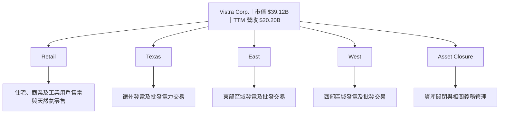
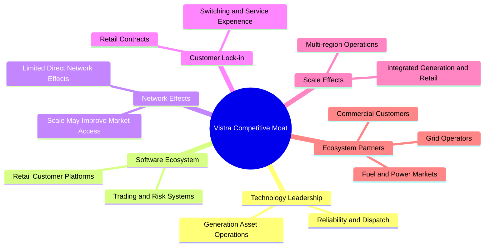
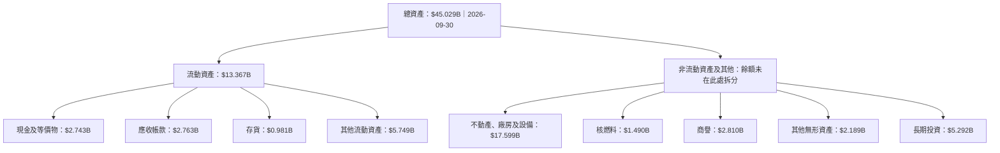
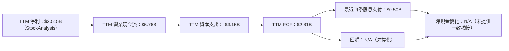
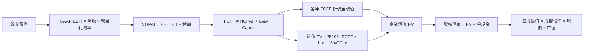
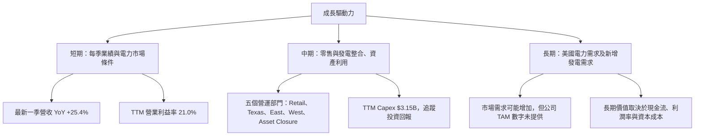
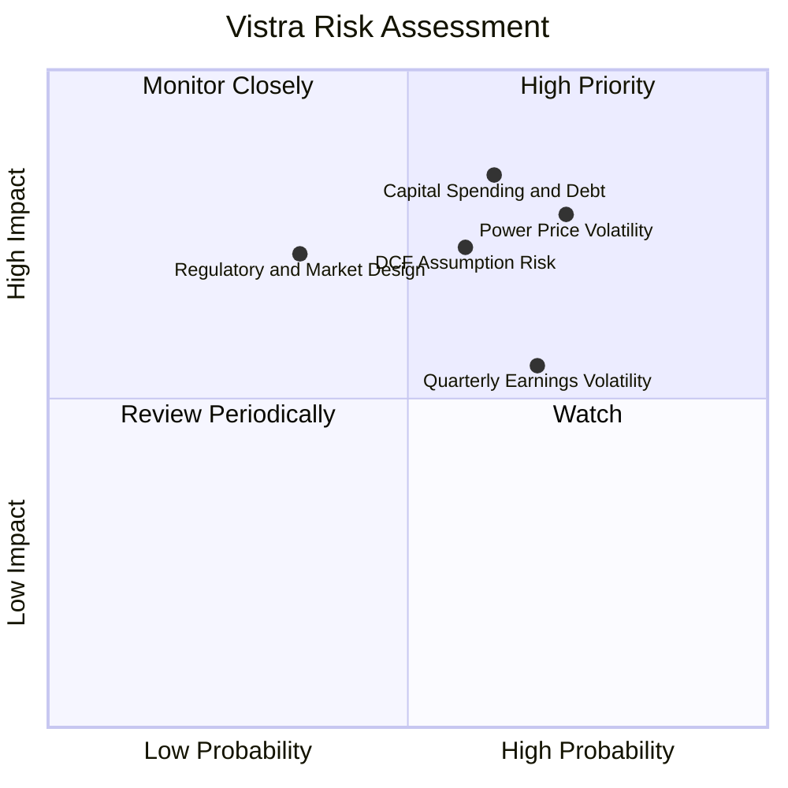
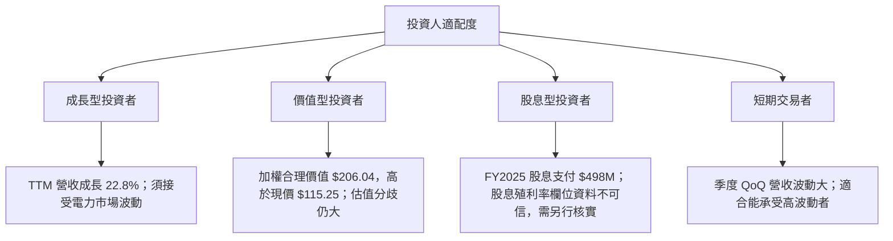

# VST 基本面深度分析報告
> **報告日期**：2026-11-23 ｜ **語言**：繁體中文 ｜ **數據來源**：SEC 申報資料 (XBRL)、Yahoo Finance、Finviz、StockAnalysis、Roic.ai ｜ **分析師**：CFA 級機構研究

## 目錄

| # | 章節 | 核心結論 |
|---|------|----------|
| 1 | 執行摘要 | 強烈買入；加權合理價值 $206.04；MOS 44.1% |
| 2 | 公司概覽與商業模式 | 發電與零售整合提供規模與客戶觸及，但分部收入資料不足以量化護城河 |
| 3 | 損益表深度分析 | TTM 營收 $20.20B、TTM 成長 22.8%；獲利隨電力市場與季度組合波動 |
| 4 | 資產負債表分析 | 淨負債 $18.40B；流動比率 1.157，短期流動性尚可但槓桿需監控 |
| 5 | 現金流量深度分析 | TTM FCF $2.61B、FCF Yield 6.66%；資本支出高且年度 FCF 波動 |
| 6 | 獲利能力與資本效率 | ROIC 13.5% 高於 WACC 8.62%，目前創造股東價值 |
| 7 | 相對估值分析 | Forward P/E 低於同業估值方法所用中位數，但各估值法結果分歧 |
| 8 | DCF 內在價值評估 | DCF 基準價值 $305.41；加權合理價值 $206.04，須留意終值依賴與資料精度 |
| 9 | 成長催化劑 | 電力需求與用電價格可能帶來機會，但公司可量化 TAM 與催化劑時程未提供 |
| 10 | 風險矩陣 | 電力價格／營運波動、資本支出與負債、估值假設為主要風險 |
| 11 | 投資建議 | 依 MOS 評級為強烈買入；買入區間以加權合理價值與 MOS 門檻推導 |

## 1. 執行摘要

### 1.0 一頁式投資儀表板（Portfolio Manager 30 秒速讀）

| 項目 | 內容 |
|------|------|
| **投資論點（3 句）** | ① TTM 營收 $20.20B、年增 22.8%，顯示零售與發電組合受益於需求與市場環境。② TTM FCF 為 $2.61B、FCF Yield 6.66%，提供內部投資與資本回饋來源。③ ROIC 13.5% 高於 WACC 8.62%，現階段投資回報超過資本成本。 |
| **綜合評分** | **7.2/10**（引用 1.1 評分卡） |
| **財務健康** | 🟡 淨負債 $18.40B；F-Score 7/8，但槓桿與資本需求仍限制財務彈性。 |
| **ROIC vs WACC** | **13.5% vs 8.62%**；差距 +4.88 個百分點，現階段創造價值。 |
| **FCF 趨勢** | 年度 FCF 曾由 2023 年 $3.78B 降至 2025 年 $1.32B，TTM 回升至 $2.61B；TTM FCF Yield **6.66%**。 |
| **估值** | Forward P/E **11.814284x** ｜ EV/EBITDA（歷史估值資料）**9.1x** ｜ FCF Yield **6.66%**。 |
| **DCF 內在價值（基準）** | **$305.41** ｜ 相對 DCF 折價 **62.3%**（折溢價定義：現價 ÷ DCF 內在價值 − 1）。 |
| **安全邊際（MOS）** | **+44.1%**＝（加權合理價值 $206.04 − 現價 $115.25）÷ 加權合理價值 $206.04；🟢 >25% 充足。 |
| **預期報酬（基準情境 12M）** | **+78.8%**，以加權合理價值 $206.04 相對現價計算；非保證報酬。 |
| **關鍵風險（前二）** | 電力價格與發電／零售利潤波動；高資本支出與 $18.40B 淨負債。 |
| **評級 + 信心度** | 🟢 **強烈買入** ｜ 信心：中（估值敏感、資料來源存在差異）。 |

### 1.1 綜合評分卡（全報告唯一）

| 維度 | 評分（1–10） | 主要依據（引用數字與其來源章節） |
|------|--------------|----------------------------------|
| 成長性 | 8.0 | TTM 營收成長 22.8%，最新一季單季 YoY 25.4%（第 3 章）；惟分部成長貢獻未提供。 |
| 獲利能力 | 8.0 | TTM 營業利益率 21.0%、ROIC 13.5% 高於 WACC 8.62%、F-Score 7/8（第 3、6 章）。 |
| 財務健康 | 6.0 | 淨負債 $18.40B、流動比率 1.157、CCC 34 天；負債水準及速動比率 0.477 限制彈性（第 4 章）。 |
| 估值 | 7.0 | 加權合理價值 $206.04、MOS 44.1%；DCF 基準 $305.41，但方法間估值差距大（第 7、8 章）。 |
| 護城河 | 7.0 | 發電資產與零售通路整合、跨區域營運；未提供市場份額及分部營收（第 2 章）。 |
| 管理層與資本配置 | 7.0 | 2025 年股權薪酬 $113M、股數測試通過；年度 FCF 由 2023 年 $3.78B 降至 2025 年 $1.32B，資本回報紀錄須持續觀察（第 3、5 章）。 |
| **綜合評分** | **7.2** | 六項算術平均：（8.0+8.0+6.0+7.0+7.0+7.0）÷6＝7.1667，四捨五入至一位小數。 |

### 1.2 五大投資論點 + 三大核心風險

| 類型 | 項目 | 具體依據 | 信心度 |
|------|------|----------|--------|
| 🟢 **投資論點①** | 營收增長具延續性 | TTM 營收 $20.20B，TTM YoY +22.8%；最新一季單季 YoY +25.4%。 | 🟢 高 |
| 🟢 **投資論點②** | 投入資本回報高於資本成本 | ROIC 13.5% 對 WACC 8.62%，正利差 +4.88 個百分點。 | 🟢 高 |
| 🟢 **投資論點③** | 現金流提供估值支撐 | TTM FCF $2.61B、FCF Yield 6.66%；營業現金流 $5.76B。 | 🟢 高 |
| 🟢 **投資論點④** | 零售與發電整合 | 公司營運零售、Texas、East、West 與 Asset Closure 五個部門，涵蓋售電與發電。 | 🟡 中 |
| 🟢 **投資論點⑤** | 加權估值低於基準合理價值 | 加權合理價值 $206.04，較 2026-11-20 收盤 $115.25 高 78.8%。 | 🟡 中 |
| 🟡 **風險①** | 盈利受電價與市場條件影響 | 2025 年營業利益 $2.13B，低於 2024 年 $4.08B；年度利潤波動明顯。 | 🟡 中 |
| 🔴 **風險②** | 淨負債與資本需求 | 淨負債 $18.40B，TTM 資本支出 $3.15B；高再投資可能壓低可分配現金。 | 🔴 高衝擊 |
| 🟡 **風險③** | DCF 終值與長期假設敏感 | 基準 DCF 企業價值中終值現值佔 66.8%；g 或 WACC 變動可顯著改變每股價值。 | 🟡 中 |

### 1.3 快速統計卡片

| 指標 | 公司實際值（期間） | 同業中位數 | 狀態 |
|------|--------------------|------------|------|
| 營收成長（TTM） | **22.8%** | — | 🟢 |
| 營收成長（最新一季年增） | **25.4%** | **45.4%**（CEG、NRG、TLN 最新季 YoY 的中位數） | 🟡 |
| 毛利率（TTM） | **N/A**（經核實指標未提供） | **25.2%**（同業毛利率中位數） | 🟡 |
| 營業利益率（TTM） | **21.0%** | — | 🟢 |
| ROIC（TTM） | **13.5%** | — | 🟢 |
| Forward P/E | **11.814284x** | **10.3x**（估值方法採用同業中位數） | 🟡 |
| FCF Yield（TTM） | **6.66%** | — | 🟢 |
| Piotroski F-Score | **7 / 8**（有一項無法判定） | — | 🟢 |

> 資料來源間存在差異：例如 Yahoo Finance／Finviz 合併資料列出營收 TTM $20.59B、最新季營收成長 27.7%；經核實 SEC 計算數據為 $20.20B、最新季 YoY 25.4%。本報告在適用欄位優先採用經核實數據，其他來源只作交叉參考，不混用口徑。

### 1.4 投資結論

```text
╔══════════════════════════════════════════════════════════════════╗
║                    📊 投資結論摘要                               ║
╠══════════════════════════════════════════════════════════════════╣
║  評級：強烈買入（MOS 44.1%，且 ROIC 13.5% > WACC 8.62%）         ║
║  價格（2026-11-20 收盤）：$115.25                                ║
║  DCF 內在價值（基準）：$305.41（相對 DCF 折價 62.3%）           ║
║  安全邊際 MOS：+44.1%（＝(加權合理價值−現價)÷加權合理價值）     ║
║  加權合理價值（8.8）：$206.04                                    ║
║  DCF 情境價值：                                                   ║
║    悲觀情境：$103.23（-10.4%）                                   ║
║    基準情境：$305.41（+165.0%）                                  ║
║    樂觀情境：$720.18（+524.9%）                                  ║
║  綜合評分：7.2/10（引用 1.1）                                    ║
║  適合投資人：能承受商品價格與股價波動、重視現金流與長期成長者     ║
╚══════════════════════════════════════════════════════════════════╝
```

## 2. 公司概覽與商業模式

### 2.1 業務結構與收入來源

公司資料顯示 Vistra 在美國營運整合式零售售電與發電業務，分為 Retail、Texas、East、West、Asset Closure 五個部門。各部門收入與占比未提供，因此不以估算比例製作收入拆分圖。



### 2.2 市場份額

市場份額數據未提供，沒有可引用的份額百分比或年份。可觀察到公司 TTM 營收 $20.20B、TTM 成長 22.8%；同業 CEG、NRG、TLN 最新季營收成長分別為 45.4%、24.0%、96.1%，但成長率差異不等同市場份額差距。分部收入與地區市場規模缺少，不能進一步量化相對份額。

### 2.3 競爭護城河分析



### 2.4 護城河強度

| 護城河項目 | 強度（強／中／弱） | 證據（引用數字或事實） | 會削弱它的情況 |
|------------|--------------------|------------------------|----------------|
| 發電與零售整合 | 中 | 公司同時經營零售與發電，並以五個業務部門營運。 | 發電供需錯配、零售價格競爭或批發價格快速反轉。 |
| 規模與區域覆蓋 | 中 | 公司營收 TTM $20.20B、員工 6,390 人，業務覆蓋多個美國區域。 | 資產利用率下降、監管限制或競爭者擴張。 |
| 客戶鎖定 | 弱至中 | 零售供電可能有合約與轉換成本，但客戶留存率、合約期限未提供。 | 客戶轉換容易、價格成為主要選擇因素。 |
| 技術、軟體及網路效應 | 弱至中 | 未提供可量化的技術領先、平台規模或網路效應證據。 | 技術優勢不足以轉化為成本差異或留存率。 |

1.1「護城河」評分 **7.0/10**，依據是整合營運與規模具實質作用，但分部收入、留存率、發電成本優勢及市場份額缺少可核實數據。

## 3. 損益表深度分析

### 3.1 年度收入成長趨勢（近 4 年）

以下年度數據取自年度損益表；成長率按年度營收計算，四捨五入至一位小數。

```text
╔══════════════════════════════════════════════════════════════════╗
║              Vistra 年度收入趨勢（FY2022–FY2025）                ║
╠══════════════════════════════════════════════════════════════════╣
║  FY2022  $13.73B  ███████████████░░░░░░░░░░  YoY：基期          ║
║  FY2023  $14.78B  ████████████████░░░░░░░░░  YoY：+7.6%   🟢   ║
║  FY2024  $17.22B  ███████████████████░░░░░░  YoY：+16.5%  🟢   ║
║  FY2025  $17.74B  ████████████████████░░░░░  YoY：+3.0%   🟡   ║
║                                                                  ║
║  FY2022–FY2025 CAGR：(17.74 ÷ 13.73)^(1/3)−1 ≈ 8.9%             ║
╚══════════════════════════════════════════════════════════════════╝
```

FY2025 年營收增幅降至 3.0%，低於 FY2024 的 16.5%；顯示收入成長並非線性。近三年 CAGR 約 8.9%，低於 TTM 成長 22.8%，基準 DCF 將第一年增長由 22.8% 逐步淡化至第十年 3.0%，但前期成長持續性仍是重要估值風險。

### 3.2 季度收入趨勢分析

| 季度 | 營收 | QoQ 成長 | YoY 成長 | 備註 |
|------|------:|---------:|---------:|------|
| 2025 Q4 | $4.58B | -7.8% | N/A | QoQ 以 2025 Q3 $4.97B 計算；單季 YoY 未在核實指標中列出。 |
| 2026 Q1 | $5.64B | +23.1% | N/A | QoQ 以 2025 Q4 $4.58B 計算。 |
| 2026 Q2 | $4.02B | -28.8% | N/A | QoQ 以 2026 Q1 $5.64B 計算，反映季度營收波動。 |
| 2026 Q3 | $6.35B | +58.0% | **+25.4%** | YoY 採核實單季指標；其他資料來源計算出的 27.7% 不一致，故不混用。 |

QoQ 變化幅度大，發電與電力零售業務會受到季節、需求、售電／批發價格與發電組合影響。單季 YoY 仍增長 25.4%，但不能把一季成長直接外推為全年成長率。

### 3.3 利潤率演變分析

下表為年度毛利、營業利益及淨利除以同年度營收計算；年度口徑與 TTM 核實營業利益率並非同一期間。

| 利潤率指標 | FY2022 | FY2023 | FY2024 | FY2025 | 趨勢 | 評估 |
|------------|-------:|-------:|-------:|-------:|------|------|
| **毛利率** | 12.2% | 37.4% | 43.7% | 32.9% | FY2024 上升、FY2025 回落 | 🟡 |
| **營業利益率** | -8.0% | 18.3% | 23.7% | 12.0% | FY2024 高點後明顯下降 | 🟡 |
| **淨利率** | -9.0% | 9.1% | 15.4% | 5.3% | FY2025 收縮 | 🟡 |

核實口徑的 TTM 營業利益率為 21.0%，最新一季營業利益率 28.5%；兩者與 FY2025 年度營業利益率 12.0% 的差距，說明近期獲利回升，但年度比較容易受電力市場與期間組合影響。FY2024 至 FY2025 營收增加約 3.0%，營業利益卻由 $4.08B 降至 $2.13B，毛利亦由 $7.53B 降至 $5.83B，顯示成本、定價與交易組合對利潤的影響大於收入增長本身。

### 3.4 費用結構分析

沒有足夠的 TTM 費用明細可將各項成本完整拆分，也未提供各項費用占比，因此不繪製比例圓餅圖。已知 FY2025 營收 $17.74B、毛利 $5.83B、營業利益 $2.13B，但不可據此反推未提供的個別費用科目。

```text
╔══════════════════════════════════════════════════════════════════╗
║                    費用結構可用數據                              ║
╠══════════════════════════════════════════════════════════════════╣
║  FY2025 營收             $17.74B                                 ║
║  FY2025 毛利              $5.83B                                 ║
║  FY2025 營業利益          $2.13B                                 ║
║  個別費用科目與占比       N/A（資料未提供）                      ║
╚══════════════════════════════════════════════════════════════════╝
```

### 3.5 季度 EPS 趨勢與盈餘品質（Quality of Earnings）

最近四季 EPS 預估值與實際值欄位缺少有效數字（來源顯示 nan），故無法判定超預期或不及預期。以下實際季度數字採 StockAnalysis／Roic.ai 可見資料；不同資料源 EPS 有差異，不把缺失的預期值自行補齊。

| 季度 | 可見 EPS 實際值 | 盈餘表現 |
|------|---------------:|----------|
| 2025 Q4 | $0.55（Roic.ai）／$0.54（StockAnalysis） | 預估 EPS N/A；無法判定 beat／miss。 |
| 2026 Q1 | $2.90（Roic.ai）／$2.87（StockAnalysis） | 預估 EPS N/A；無法判定 beat／miss。 |
| 2026 Q2 | $0.77（Roic.ai）／$0.76（StockAnalysis） | 預估 EPS N/A；無法判定 beat／miss。 |
| 2026 Q3 | $3.26（Roic.ai）／$3.23（StockAnalysis） | 預估 EPS N/A；無法判定 beat／miss。 |

| 盈餘品質項目 | 數值/佔比 | 評估 |
|--------------|-----------|------|
| 股權薪酬 SBC / 營收 | TTM SBC $127M ÷ $20.20B ≈ **0.63%** | 🟢 目前稀釋成本占營收不高；但 SBC 仍代表既有股東的經濟成本。 |
| SBC / 營業現金流 | $127M ÷ $5.76B ≈ **2.2%** | 🟢 佔營業現金流比重有限。 |
| FCF / 淨利（現金轉換率） | $2.61B ÷ $2.515B ≈ **103.8%** | 🟢 以 StockAnalysis TTM 淨利計算，FCF 略高於淨利；來源間淨利口徑存在差異。 |
| 一次性/非經常性損益 | N/A（未提供可核實拆分） | 無法判定是否有重大一次性項目推高或壓低盈餘。 |
| 有效稅率異常 | **15.9%** | DCF 與資本成本採用此有效稅率；未提供歷年明細，不能判斷是否為一次性稅務利益。 |
| 資本化支出 vs 費用化 | TTM Capex $3.15B | 資本支出規模大，但資本化項目拆分與折舊政策明細不足。 |

FY2025 股權薪酬為 $113M，相當於 FY2025 營收 $17.74B 的約 0.64%；稀釋股數測試通過。整體看，TTM FCF 超過 StockAnalysis TTM 淨利，支持現金含金量，但能源市場交易及季度淨利數字存在資料源差異；盈餘品質宜評為中上而非完全穩定。

## 4. 資產負債表分析

### 4.1 資產結構分解

以下按 2026-09-30 StockAnalysis 資產負債表的總資產 $45.029B 描述，區塊未列出完整各項資產的統一幣別展示，故不強制加總或將缺項反推。



### 4.2 流動性與營運資金分析

| 指標 | 最新 TTM | 一年前 TTM | 變化 | 解讀 |
|------|----------|------------|------|------|
| DSO 應收帳款天數 | 50 天 | 52 天 | -2 天 | 收款天數下降，方向有利；變化幅度不大。 |
| DIO 存貨天數 | 30 天 | N/A | N/A | 存貨天數有當期值；前期無可比資料，不推估變化。 |
| DPO 應付帳款天數 | 45 天 | N/A | N/A | 前期無可比資料，不能判斷付款期限或供應商議價變化。 |
| CCC 現金轉換週期 | 34 天 | N/A | N/A | 最新值反映營運資金現金週期；前期缺資料，不推算方向。 |

| 流動性指標 | 數值 | 評估 |
|------------|------:|------|
| 流動比率 | 1.157 | 🟡 流動資產略高於流動負債，緩衝有限。 |
| 速動比率 | 0.477 | 🟡 扣除存貨及較不易變現項目後，短期流動性較弱。 |
| 現金及短期投資 | $2.74B | 🟡 可支應部分短期需求，但相較 $21.15B 債務規模有限。 |

### 4.3 債務結構分析

```text
╔══════════════════════════════════════════════════════════════════╗
║                   Vistra 債務健康診斷                            ║
╠══════════════════════════════════════════════════════════════════╣
║  總債務：        $21.15B  ████████████████████  🔴               ║
║  現金及短期投資： $2.74B   ███                   🟡               ║
║  淨負債：        $18.40B  █████████████████     🔴               ║
║                                                                  ║
║  Debt/EBITDA：   N/A（核實指標未提供一致 EBITDA）                 ║
║  利息保障倍數：  N/A（利息費用與一致 EBITDA 未提供）               ║
║  淨負債評估：    現金流可提供償債來源，但資本支出與負債均高       ║
╚══════════════════════════════════════════════════════════════════╝
```

### 4.4 股東權益趨勢

| 年度 | 股東權益 | YoY 變化 | 解讀 |
|------|---------:|---------:|------|
| 2022 | $4.90B | — | 基期。 |
| 2023 | $5.31B | +8.4% | 權益增加。 |
| 2024 | $5.57B | +4.9% | 繼續增加。 |
| 2025 | $5.10B | -8.4% | 權益回落；未提供完整變動橋接，無法歸因至回購、損益或其他項目。 |

## 5. 現金流量深度分析

### 5.1 現金流量瀑布圖



營業現金流高於淨利，部分原因可能是非現金項目及營運資金變動；但缺少完整 TTM 現金流調節表，不能將差額單一歸因。圖中淨利採 StockAnalysis TTM $2.515B，與其他財務資料來源淨利口徑不完全一致。

### 5.2 FCF 轉換率趨勢

| 年度 | FCF | 淨利 | FCF / 淨利 | 評估 |
|------|----:|-----:|-----------:|------|
| 2022 | -$0.816B | -$1.23B | 66.3%（負值／負值） | 比率容易受負獲利扭曲，不代表現金轉換良好。 |
| 2023 | $3.78B | $1.49B | 253.7% | FCF 高於淨利，須留意營運資金與市場周期因素。 |
| 2024 | $2.48B | $2.66B | 93.2% | 接近淨利。 |
| 2025 | $1.32B | $0.944B | 139.8% | FCF 高於淨利；年度資本支出影響明顯。 |
| TTM | $2.61B | $2.515B（StockAnalysis） | 103.8% | 現金轉換率約略高於 100%。 |

### 5.3 自由現金流趨勢

```text
╔══════════════════════════════════════════════════════════════════╗
║                  Vistra 歷年自由現金流                            ║
╠══════════════════════════════════════════════════════════════════╣
║  FY2022  -$0.816B  ◀░░░░░░░░░░░░░░░░░░░░  FCF 為負              ║
║  FY2023   $3.780B  ████████████████████░  高現金流年度           ║
║  FY2024   $2.480B  █████████████░░░░░░░░  較前年度下降           ║
║  FY2025   $1.320B  ███████░░░░░░░░░░░░░░  持續下降               ║
║  TTM      $2.610B  ██████████████░░░░░░░  回升                   ║
║                                                                  ║
║  TTM FCF Yield：6.66%                                            ║
╚══════════════════════════════════════════════════════════════════╝
```

TTM FCF 的回升值得注意，但年度 FCF 自 2023 年高點 $3.78B 降至 2025 年 $1.32B，波動性說明單年數字不足以代表可持續現金流。

### 5.4 資本配置評估

公司資本配置沒有完整的 TTM 回購金額與全部資金用途拆分，故不製作推測比例的圓餅圖。

| 資本用途／來源 | 已知數據 | 評估 |
|---------------|---------|------|
| 資本支出 | TTM $3.15B；FY2025 $2.75B | 🟡 維護及成長投資金額大，需追蹤投資回報與新增產能效益。 |
| 股息 | 2025 年支付 $498M；最近四季約 $500M | 🟢 相較 TTM FCF $2.61B，股息有現金流覆蓋；仍須配合資本支出與償債需求。 |
| 回購 | N/A | 未提供一致回購金額，不能判定回購是否有效抵銷稀釋。 |
| 留存與償債 | N/A | 缺少完整資金用途橋接。 |
| 股權薪酬 | FY2025 $113M | 金額相較營收不高，但仍是股東經濟成本。 |

## 6. 獲利能力與資本效率

### 6.1 ROE / ROA / ROIC 趨勢

| 指標 | 已知期間數值 | 評估 |
|------|-------------|------|
| ROE | TTM 42.9% | 高，但杜邦分析顯示權益乘數 7.14，槓桿是重要來源。 |
| ROA | TTM 正值；精確核實比率未提供於品質指標 | Piotroski ROA 測試通過；不把其他資料源 7.1% 與核實口徑混為一談。 |
| ROIC | TTM 13.5% | 高於 WACC 8.62%，目前資本回報創造價值。 |

### 6.2 ROIC vs WACC 分析（核心價值創造判斷）

```text
╔══════════════════════════════════════════════════════════════════╗
║                ROIC vs WACC 深度分析                            ║
╠══════════════════════════════════════════════════════════════════╣
║  WACC（取 Cost of capital 核實數據）：                            ║
║  ├── 無風險利率（10Y 美債）：       4.91%                        ║
║  ├── 市場風險溢酬 ERP：             5.00%                        ║
║  ├── 原始 Beta：                    1.38                         ║
║  ├── 調整後 Beta：                  1.25                         ║
║  ├── 股權成本 Ke：                  11.16%                       ║
║  ├── 稅前債務成本：                 4.64%                        ║
║  ├── 有效稅率：                     15.9%                        ║
║  ├── E / D 權重：                   64.9% / 35.1%                 ║
║  └── WACC：                         8.62%                        ║
║                                                                  ║
║  ROIC：                            13.5%                        ║
║  EVA 利差：13.5% − 8.62% =          +4.88 個百分點                ║
║                                                                  ║
║  ROIC  13.5%  ▓▓▓▓▓▓▓▓▓▓▓▓▓▓▓░░░░░░░░░░░░░░  🟢               ║
║  WACC   8.62% ▓▓▓▓▓▓▓▓▓░░░░░░░░░░░░░░░░░░░  ──                ║
║  結論：ROIC 約為 WACC 的 1.57 倍，現階段創造股東價值           ║
╚══════════════════════════════════════════════════════════════════╝
```

**計算**：ROIC−WACC = 13.5%−8.62% = **4.88 個百分點**；ROIC/WACC = 13.5%÷8.62% ≈ **1.57 倍**。此結論以 TTM 核實 ROIC 與程式計算 WACC 為基礎，不能保證未來電力價格下行或資本需求上升時仍維持正利差。

### 6.3 杜邦三因素分解

| 因素 | 數值（TTM） | 解讀 |
|------|-------------|------|
| 淨利率 | 13.4% | 營業與非營業項目共同影響淨利。 |
| 資產週轉率 | 0.45 | 資產密集型業務特徵，單位資產營收相對有限。 |
| 權益乘數 | 7.14 | 槓桿放大股東權益報酬，也提高下行時波動。 |
| **ROE** | **42.9%** | 13.4% × 0.45 × 7.14 ≈ 42.9%；ROE 並非單由營運利潤率驅動，權益乘數影響顯著。 |

### 6.4 財務體質：Piotroski F-Score

**Piotroski F-Score：7 / 8**；共有 8 項可判定測試，毛利率測試因缺少資料未納入分母。

| 測試 | 結果 | 解讀 |
|------|------|------|
| ROA > 0 | ✅ 通過 | TTM 資產回報為正。 |
| 營業現金流 > 0 | ✅ 通過 | TTM 營業現金流 $5.76B。 |
| ROA 高於一年前 | ✅ 通過 | 盈利能力較前期改善。 |
| 營業現金流 > 淨利（應計品質） | ✅ 通過 | 現金流高於淨利，有利於盈餘品質。 |
| 長期負債 ÷ 總資產低於一年前 | ❌ 未通過 | 槓桿相對資產未改善，需追蹤資產負債表。 |
| 流動比率高於一年前 | ✅ 通過 | 流動性指標較前期改善。 |
| 稀釋股數未增加 | ✅ 通過 | 近期股數測試通過，SBC 仍需視為經濟成本。 |
| 毛利率高於一年前 | — 無法判定 | 缺資料，不計入 8 項可判定測試。 |
| 資產週轉率高於一年前 | ✅ 通過 | 資產運用效率測試通過。 |

## 7. 相對估值分析

### 7.1 同業估值比較表格

同業倍數取自 Yahoo Finance Peer multiples；公司本身倍數取市場估值資料。公司與同業估值日期及資料源可能不完全一致，僅作相對參考。

| 估值指標 | **VST** | **CEG** | **NRG** | **TLN** | VST 評估 |
|----------|---------:|--------:|--------:|--------:|-----------|
| **Trailing P/E** | 15.6x | 19.1x | 15.3x | N/A | 🟡 接近 NRG、低於 CEG；TLN 無可比值。 |
| **Forward P/E** | 11.814284x | 17.7x | 9.1x | 10.3x | 🟡 位於同業區間內；低於 CEG，高於 NRG 與 TLN。 |
| **P/S Ratio** | 1.9x | 2.4x | 0.5x | 3.2x | 🟡 位於同業區間中間。 |
| **EV/EBITDA（TTM）** | 9.1x（自有歷史估值資料） | 11.2x | 10.2x | 35.2x | 🟢 低於三家同業列示倍數；TLN 倍數明顯較高。 |
| **最新季營收 YoY** | 25.4% | 45.4% | 24.0% | 96.1% | 🟡 快於 NRG、低於 CEG 與 TLN。 |
| **毛利率（TTM）** | N/A | 25.2% | 20.2% | 42.7% | — VST 核實比較數字未提供，不作直接排名。 |

Peer multiples 的同業中位數方法值：Forward P/E **10.3x**；EV/EBITDA **11.2x**。相對估值應與盈利穩定度一起看：VST 的季度與年度利潤波動較大，不能只憑較低倍數判定估值便宜。

### 7.2 歷史估值區間分析

```text
╔══════════════════════════════════════════════════════════════════╗
║                 VST 五年估值位置（TTM）                          ║
╠══════════════════════════════════════════════════════════════════╣
║  P/E：       7.2x ───────── 15.6x 現值 ───────── 74.3x          ║
║              五年中位數 25.2x｜現值百分位 20%                    ║
║                                                                  ║
║  P/S：       0.5x ───────── 1.9x 現值 ────────── 4.2x          ║
║              五年中位數 1.8x｜現值百分位 52%                     ║
║                                                                  ║
║  EV/EBITDA： 2.3x ───────── 9.1x 現值 ───────── 40.7x          ║
║              五年中位數 11.0x｜現值百分位 35%                    ║
╚══════════════════════════════════════════════════════════════════╝
```

P/E 與 EV/EBITDA 目前低於五年中位數，P/S 則略高於中位數 1.8x。估值倍數在發電與電力交易類公司容易受盈餘周期影響，歷史區間僅提供情境參考，不代表均值回歸必然發生。

### 7.3 情境價值（Bear / Base / Bull，照抄 DCF MODEL 的 Scenarios）

| 情境 | 第 1 年營收成長 | 期末營業利潤率 | WACC | 每股價值 | 相對現價 | 機率 | 會發生的條件 |
|------|----------------:|----------------:|-----:|---------:|---------:|-----:|--------------|
| 🔴 悲觀 | 11.4% | 16.4% | 9.62% | $103.23 | -10.4% | 25% | 需求及電力價格降溫、競爭或成本上升，使成長與利潤率均低於基準。 |
| 🟡 基準 | 22.8% | 19.3% | 8.62% | $305.41 | +165.0% | 50% | 起始營收成長維持 TTM 水準並逐步淡化，利潤率回落至模型採用的長期中位數。 |
| 🟢 樂觀 | 34.3% | 21.2% | 7.62% | $720.18 | +524.9% | 25% | 成長高於當前 TTM、利潤率維持較佳水準，且折現率下行。 |

### 7.4 相對估值隱含價格區間

```text
╔══════════════════════════════════════════════════════════════════╗
║                  每股估值方法與現價位置                          ║
╠══════════════════════════════════════════════════════════════════╣
║  $100.92 ── $115.25 ───── $155.71 ───── $197.18 ─── $305.41     ║
║  Forward P/E    現價       EV/EBITDA     共識目標       DCF       ║
╚══════════════════════════════════════════════════════════════════╝
```

| 估值方法 | 每股價值 | 推導依據 |
|----------|---------:|----------|
| 同業 Forward P/E | $100.92 | 同業中位數 10.3x × 公司 Forward EPS $9.76。 |
| 同業 EV/EBITDA | $155.71 | 同業中位數 11.2x × TTM EBITDA，再加回淨現金／扣除淨負債。 |
| 分析師共識目標價 | $197.18 | 23 位分析師平均目標價。 |
| DCF 基準 | $305.41 | 10 年 FCFF、WACC 8.62%、永續成長率 3.0%。 |

估值法的離散度很大：相對 Forward P/E 的 $100.92 低於現價，而 EV/EBITDA、共識與 DCF 高於現價。這代表結論高度依賴對長期現金流與估值方法的選擇。

## 8. DCF 內在價值評估（Discounted Cash Flow）

### 8.0 估值推理鏈（Thinking Logic）

**Step 1 — 價值由哪些變數決定？**  
Vistra 的價值主要由既有電力發電與零售現金流、未來營收成長，以及長期營業利潤率與再投資需求決定。分部收入占比未提供，無法把三者量化拆分；模型以 TTM 營收 $20.20B 作為整體基礎。敏感度矩陣顯示 WACC 與永續成長率會大幅改變估值，主導因素是長期現金流折現及終值，而非單一季度營收。

**Step 2 — 模型選擇**

| 決策點 | 本報告採用 | 理由（含數字） | 曾考慮但否決 | 否決理由 |
|--------|-----------|----------------|--------------|----------|
| 現金流定義 | FCFF | 與 WACC 8.62% 折現後得到企業價值，適合先估營運資產再扣淨負債。 | FCFE | 負債為 $21.15B，直接預測股東現金流較易受融資政策干擾。 |
| 預測期 N | 10 年 | DCF 模型固定設定 10 年，讓 TTM 22.8% 成長逐步淡化至 3.0%。 | 5 年 | 對長期成熟過程涵蓋較短；但不另建替代模型。 |
| 終值方法 | Gordon Growth | 模型提供 g=3.0%、WACC=8.62%，且 WACC>g。 | 退出倍數 | 模型未提供終值 EBITDA 倍數計算結果，不自行另建模型。 |
| EBIT 基礎 | GAAP EBIT | 模型列明採 GAAP EBIT，SBC 已列為費用。 | 非 GAAP EBIT | 不加回 SBC，以免低估股權薪酬成本。 |

**Step 3 — 關鍵假設的推導鏈**

- **營收成長**：錨點＝TTM 對前一 TTM 成長 22.8%；調整＝以第一年維持該增幅，之後線性淡化至第十年 3.0%；**採用模型第 1 年 22.8%、第 10 年 3.0%**；曾考慮以近三年年度 CAGR 約 8.9% 作為全期固定成長，未採用，因模型使用逐年淡化而非固定 CAGR。
- **期末營業利潤率**：錨點＝TTM GAAP 營業利益率 21.0%；調整＝模型依最近五個財年的中位數逐年淡化；**採用第 10 年 19.3%**；未採用維持 21.0% 至期末，因模型假設利潤率回歸長期中位數。
- **永續成長率 g**：錨點＝模型指定 3.0%；調整＝不高於模型的終端成長假設，且低於 WACC 8.62%；**採用 3.0%**；未採用接近 WACC 的更高 g，因終值會過度放大且不符合穩健的長期假設。
- **預測期 N**：錨點＝公司 TTM 成長 22.8% 向長期 3.0% 淡化；調整＝使用完整 10 年逐年預測；**採用 10 年**；未改為較短期，因長期淡化路徑已由模型明確指定。
- **Capex／營收**：錨點＝TTM Capex／營收 15.6%；調整＝模型逐步淡化至第十年 11.5%，即 1.1 倍 D&A；**採用第 1 年 15.6%、第 10 年 11.5%**；未採用全期維持 15.6%，因模型假設資本支出率隨成熟而回落。
- **EBIT、SBC 與股數**：錨點＝模型採 GAAP EBIT，且股數不再稀釋；**採用組合 (A)：GAAP EBIT、沒有額外 −SBC 列、年稀釋率 0%**；未再另扣 SBC 或放大股數，避免重複計入成本。本模型採用 (A)，故 SBC 影響已計入一次。
- **WACC**：錨點＝資本成本資料所列 WACC 8.62%；調整＝不自行重算或替換程式採用值；**採用 8.62%**；未採用其他折現率，因核實資本成本明確指定該值。
- **有效稅率、D&A／營收**：錨點＝有效稅率 15.9%、TTM D&A／營收 10.4%；模型維持兩項比率。
- **營運資金變動**：模型未建模 ΔWC；不可把缺少的營運資金數字自行填入或推算。

**Step 4 — 最脆弱的一環**  
模型最脆弱的是 10 年營收與利潤率路徑，以及終值假設；若成長低於基準，估值會向悲觀情境 $103.23 靠近，情境表已顯示基準與悲觀每股價值相差 $202.18。

**Step 5 — 計算路徑圖**



### 8.1 模型假設總表（Model Inputs）

| 假設項目 | 採用值 | 依據／來源 | 敏感度 |
|----------|--------|-------------|--------|
| 預測期長度 N | 10 年 | DCF 模型固定預測期。 | 🟡 中 |
| 營收成長 | 第 1 年 22.8% 線性淡化至第 10 年 3.0% | TTM 對前一 TTM 成長 22.8%；長期終點採模型假設。 | 🔴 高 |
| 營業利潤率 | 第 1 年 21.0% → 第 10 年 19.3% | TTM 營業利益率 21.0%，模型淡化至最近五個財年中位數。 | 🔴 高 |
| 有效稅率 | 15.9% | 最新年度有效稅率。 | 🟢 低 |
| Capex／營收 | 第 1 年 15.6% → 第 10 年 11.5% | TTM 比率 15.6%，逐步淡化至 1.1×D&A。 | 🟡 中 |
| D&A／營收 | 10.4% | TTM 比率，模型固定。 | 🟢 低 |
| 營運資金變動／營收增額 | 不建模 | 模型說明 FCFF 不含營運資金變動；歷史 ΔWC 比率未提供。 | 🟢 低 |
| EBIT 基礎 | GAAP EBIT | DCF 模型採 GAAP EBIT。 | 🟡 中 |
| SBC 處理 | 組合 (A)：GAAP 已費用化，不額外扣減 | 模型說明 SBC 已反映於 GAAP EBIT。 | 🟡 中 |
| 年稀釋率 | 0%（固定股數） | 模型組合 (A)；不再以股數稀釋重複計入 SBC。 | 🟡 中 |
| 永續成長率 g | 3.0% | DCF 模型設定；低於 WACC 8.62%。 | 🔴 高 |
| 終值方法 | Gordon Growth | 模型已提供永續成長終值。 | 🔴 高 |
| WACC | 8.62% | Cost of capital 核實數據。 | 🔴 高 |

**FCFF 定義**：使用 **FCFF = NOPAT + D&A − Capex**；模型不含 ΔWC 列。SBC 只透過 GAAP EBIT 反映一次。

### 8.2 折現率推導（WACC）

無風險利率的資料觀測日未提供；此處照採資本成本數據列示的 4.91%。Beta 原始值 1.38，調整值按指定方式計算：⅔×1.38+⅓≈1.25。未另加規模或國別溢酬，因成本資本資料未列此項。

```text
╔══════════════════════════════════════════════════════════════════╗
║                    WACC 推導（折現率）                           ║
╠══════════════════════════════════════════════════════════════════╣
║  股權成本 Ke（CAPM）：                                           ║
║  ├── 無風險利率 Rf：                    4.91%                    ║
║  ├── 市場風險溢酬 ERP：                 5.00%                    ║
║  ├── Beta 原始值：                      1.38                     ║
║  ├── Beta 採用值：                      1.25                     ║
║  ├── 規模／國別溢酬：                   0.00%（未另加）          ║
║  └── Ke = 4.91% + 1.25 × 5.00% =        11.16%                   ║
║                                                                  ║
║  債務成本 Kd：                                                   ║
║  ├── 稅前 Kd：                          4.64%                    ║
║  ├── 有效稅率：                         15.9%                    ║
║  └── 稅後 Kd = 4.64% × (1−15.9%) =      3.90%                    ║
║                                                                  ║
║  資本結構（核實權重）：                                           ║
║  ├── 股權權重 E：                       64.9%                    ║
║  ├── 債務權重 D：                       35.1%                    ║
║  └── WACC：                             8.62%                    ║
╚══════════════════════════════════════════════════════════════════╝
```

**逐步演算與數據限制**

1. **Ke** = Rf + β×ERP = 4.91% + 1.25×5.00% = **11.16%**。
2. **稅前 Kd** = **4.64%**（成本資本資料直接提供）。利息費用金額及平均計息負債分項未提供，因此不反推金額。
3. **稅後 Kd** = 4.64%×(1−15.9%) = 4.64%×0.841 = 3.90224% ≈ **3.90%**。
4. **權重** = E 64.9%、D 35.1%；64.9%+35.1%=**100.0%**。資本成本區塊採市場市值／債務權重；市值及債務來源分項與第 2 步同口徑的完整橋接資料未提供，故不自行重建。
5. **WACC** = 64.9%×11.16% + 35.1%×3.90% = 7.24284%+1.36890% = 8.61174% ≈ **8.62%**。以未四捨五入的成本輸入計算，採用核實 WACC **8.62%**。

### 8.3 逐年自由現金流預測（基準情境）

金額單位為 $B；折現因子保留三位小數。下表逐年照錄 DCF 模型輸出；模型內部使用未顯示的未四捨五入數字，表列值經四捨五入，因此用表面上已四捨五入的欄位重新乘算可能出現 $0.01B 左右差異。

| 年度 | FY+1 | FY+2 | FY+3 | FY+4 | FY+5 | FY+6 | FY+7 | FY+8 | FY+9 | FY+10 |
|------|-----:|-----:|-----:|-----:|-----:|-----:|-----:|-----:|-----:|------:|
| 營收 | 24.81 | 29.93 | 35.45 | 41.20 | 46.98 | 52.54 | 57.59 | 61.85 | 65.07 | 67.03 |
| 營收 YoY | 22.8% | 20.6% | 18.4% | 16.2% | 14.0% | 11.8% | 9.6% | 7.4% | 5.2% | 3.0% |
| 營業利潤率 | 21.0% | 20.8% | 20.6% | 20.4% | 20.2% | 20.0% | 19.8% | 19.6% | 19.4% | 19.3% |
| 營業利益 EBIT（GAAP） | 5.20 | 6.22 | 7.29 | 8.40 | 9.49 | 10.51 | 11.41 | 12.14 | 12.65 | 12.91 |
| − 稅（15.9%） | (0.83) | (0.99) | (1.16) | (1.34) | (1.51) | (1.68) | (1.82) | (1.94) | (2.02) | (2.06) |
| = NOPAT | 4.37 | 5.22 | 6.13 | 7.06 | 7.98 | 8.84 | 9.60 | 10.21 | 10.64 | 10.85 |
| + D&A | 2.58 | 3.12 | 3.69 | 4.29 | 4.89 | 5.47 | 6.00 | 6.44 | 6.78 | 6.98 |
| − Capex | (3.88) | (4.54) | (5.21) | (5.86) | (6.47) | (6.99) | (7.40) | (7.66) | (7.75) | (7.68) |
| **= FCFF** | **3.08** | **3.80** | **4.61** | **5.49** | **6.40** | **7.32** | **8.20** | **8.99** | **9.66** | **10.15** |
| 折現因子 | 0.921 | 0.848 | 0.780 | 0.719 | 0.662 | 0.609 | 0.561 | 0.516 | 0.475 | 0.438 |
| **FCFF 現值 PV** | **2.83** | **3.22** | **3.60** | **3.94** | **4.23** | **4.46** | **4.60** | **4.64** | **4.59** | **4.44** |

預測期 PV 合計逐項加總：
**$2.83+$3.22+$3.60+$3.94+$4.23+$4.46+$4.60+$4.64+$4.59+$4.44=$40.55B**；DCF 模型以未四捨五入數據加總為 **$40.56B**，差異 $0.01B，約 0.02%，在四捨五入容許範圍內。

**FY+1 逐步演算示範**

1. 營收 = $20.20B×(1+22.8%) = **$24.81B**（模型輸出）。
2. EBIT = 營收 × 21.0% ≈ **$5.20B**（模型內部未四捨五入值）。
3. 稅 = EBIT × 15.9% ≈ **$0.83B**。
4. NOPAT = EBIT−稅 = **$4.37B**。
5. D&A = 模型採用 10.4% 營收率，得 **$2.58B**。
6. Capex = 模型採用第一年資本支出率，得 **$3.88B**。
7. ΔWC = **不建模**。
8. FCFF = NOPAT+D&A−Capex；按顯示值 4.37+2.58−3.88=3.07，模型未四捨五入輸出為 **$3.08B**。
9. 折現因子 = 1÷(1+8.62%)¹ ≈ **0.921**；PV = 模型 FCFF × 折現因子 = **$2.83B**。

> 因模型未提供未四捨五入的逐年中間值，以上若以顯示值複算，個別項目可能有約 $0.01B 的四捨五入差異；不以重算後數字替換程式模型輸出。

**合理性自檢**

- 預測 FCFF FY+1 $3.08B 至 FY+10 $10.15B，九年間年化成長約 **14.2%**；歷史 FY2023 $3.78B 至 FY2025 $1.32B 的兩年年化變化約 **-40.9%**，期間受現金流周期波動影響，兩者不可直接視為同一經營趨勢。
- FY+10 FCFF 利潤率 = $10.15B÷$67.03B ≈ **15.1%**；目前 TTM FCF 利潤率 = $2.61B÷$20.20B ≈ **12.9%**。同業最佳 FCF 利潤率未提供。
- 預測期各年 FCFF 均為正；模型未計入 ΔWC，若營運擴張需要額外營運資金，現值可能被高估。

```text
╔══════════════════════════════════════════════════════════════════╗
║            自由現金流：歷史實際 vs 模型預測                      ║
╠══════════════════════════════════════════════════════════════════╣
║  FY2023(實)  $3.78B  ████████████████████  FCF                  ║
║  FY2024(實)  $2.48B  █████████████░░░░░░░  YoY：-34.4%          ║
║  FY2025(實)  $1.32B  ███████░░░░░░░░░░░░░  YoY：-46.8%          ║
║  FY+1 (預)   $3.08B  ████████████████░░░░  模型預測              ║
║  FY+10(預)  $10.15B  ████████████████████  模型預測              ║
╠══════════════════════════════════════════════════════════════════╣
║  ⚠️ 預測前段 FCF 回升依賴營收增長及利潤率維持，並非歷史線性外推 ║
╚══════════════════════════════════════════════════════════════════╝
```

### 8.4 終值計算（Terminal Value）

**適用性檢查**：WACC **8.62%** vs g **3.0%** → WACC > g？✅

模型提供 Gordon Growth 終值數值，未提供退出倍數法估值，因此不自行另造第二個終值。

| 方法 | 計算式 | 終值 TV | TV 現值 | 佔總 EV 比重 |
|------|--------|---------|---------|--------------|
| Gordon Growth | 第 10 年 FCFF×(1+g)÷(WACC−g) | $186.22B | $81.49B | 66.8% |
| 退出倍數法 | N/A（模型未提供終值 EBITDA 倍數與計算結果） | N/A | N/A | N/A |

**逐步演算**

1. FY+N 的 FCFF = FY+10 FCFF **$10.15B**。
2. 分子 = FCFF×(1+g)；按模型未四捨五入內部數據計算，輸出終值分子未獨立列示。
3. 分母 = WACC−g = 8.62%−3.0% = **5.62%**；模型 TV = **$186.22B**。
4. PV(TV) = 模型終值依第 10 年折現，輸出 **$81.49B**。
5. 終值佔比 = $81.49B÷$122.06B = **66.8%**（模型列示）。

以已四捨五入的 $10.15B、0.438 直接重算，不會精確得到模型的終值與現值；模型內部使用未四捨五入的 FY+10 FCFF 與折現因子。終值佔比雖低於 75%，仍代表估值約三分之二取決於第十年後假設。

### 8.5 企業價值 → 每股內在價值（Bridge）

```text
╔══════════════════════════════════════════════════════════════════╗
║              企業價值 → 每股內在價值 橋接表                      ║
╠══════════════════════════════════════════════════════════════════╣
║  預測期 FCF 現值合計             +$40.56B                        ║
║  終值現值 PV(TV)                 +$81.49B                        ║
║  ─────────────────────────────────────────────                  ║
║  = 企業價值 EV                    $122.06B                        ║
║  + 淨現金（負值代表淨負債）       -$18.40B                        ║
║  = 股權價值                       $103.65B                        ║
║  每股換算：股權價值×股價÷市值                                    ║
║  ★ 每股內在價值                  $305.41                         ║
║    當前股價                      $115.25                         ║
║    折溢價                        -62.3%（現價折價）               ║
╚══════════════════════════════════════════════════════════════════╝
```

**逐步演算與橋接口徑**

1. EV = 預測期 PV $40.56B + 終值 PV $81.49B = **$122.05B**；模型以未四捨五入金額列示 **$122.06B**，尾差 $0.01B。
2. 股權價值 = EV $122.06B + 淨現金（負值代表淨負債）-$18.40B = 約 **$103.66B**；模型列示 **$103.65B**，屬未顯示精度造成的尾差。
3. 每股內在價值依模型公式：股權價值 × 現價 ÷ 市值 = $103.65B × $115.25 ÷ $39.12B ≈ **$305.41**（以模型未四捨五入數值計算）。
4. 折溢價 = 現價 ÷ DCF 基準內在價值 − 1 = $115.25÷$305.41−1 ≈ **-62.3%**。
5. **本節不計算 MOS**：MOS 僅以 8.8 加權合理價值為分母。

淨負債採核實數據 $18.40B；DCF 使用固定股數換算公式，沒有另以年稀釋率放大股數。公司 2026 Q3 Roic.ai 股數約 335M，市場資料庫列示流通股 339.39M；模型已指定以股權價值 × 價格 ÷ 市值換算，故不改用另一股數口徑。

### 8.6 敏感性分析（WACC × 永續成長率）

以下矩陣照錄 DCF 模型每股價值；括號為以現價 $115.25 計算的上行空間。基準格為 WACC 8.62%、g 3.0%。

| g（列）／WACC（欄） | 6.62% | 7.62% | **8.62%（基準）** | 9.62% | 10.62% |
|-----------|------:|------:|------------------:|------:|-------:|
| 2.0% | $427.69（+271.1%） | $332.85（+188.8%） | $267.13（+131.8%） | $219.03（+90.1%） | $182.39（+58.3%） |
| 2.5% | $471.94（+309.5%） | $359.75（+212.2%） | $284.71（+147.1%） | $231.11（+100.5%） | $191.02（+65.7%） |
| **3.0%（基準）** | $528.43（+358.5%） | $392.48（+240.6%） | **$305.41（+165.0%）** | $245.02（+112.6%） | $200.78（+74.3%） |
| 3.5% | $603.05（+423.3%） | $433.16（+275.9%） | $330.16（+186.5%） | $261.20（+126.7%） | $211.91（+83.9%） |
| 4.0% | $706.21（+512.8%） | $485.10（+320.7%） | $360.28（+212.6%） | $280.27（+143.2%） | $224.73（+95.0%） |

**非基準格複算限制**：模型已提供完整敏感度矩陣，但未提供各格重新折現的逐年 PV 明細及未四捨五入現金流。為遵守不得另建或改動 DCF 模型的要求，不用已四捨五入的年度數字重建矩陣。矩陣基準格 $305.41 與 8.5 DCF 基準價值一致。

**三情境 DCF（照錄模型輸出）**

| 情境 | 第 1 年成長 | 期末營業利潤率 | WACC | 每股內在價值 | 相對現價 | 主觀機率 |
|------|------------:|----------------:|-----:|--------------:|---------:|---------:|
| 🔴 悲觀 | 11.4% | 16.4% | 9.62% | $103.23 | -10.4% | 25% |
| 🟡 基準 | 22.8% | 19.3% | 8.62% | $305.41 | +165.0% | 50% |
| 🟢 樂觀 | 34.3% | 21.2% | 7.62% | $720.18 | +524.9% | 25% |
| **機率加權** | — | — | — | **$358.56** | **+211.1%** | **100%** |

模型未提供各情境的完整逐年營收、FCFF 與未四捨五入終值，因此不反向編造推導鏈。情境成立條件分別為：悲觀情境營收增長放緩且長期利潤率下滑；基準情境按模型所列成長淡化與利潤率路徑實現；樂觀情境要求較高成長、較高期末利潤率與較低 WACC 同時成立。

機率加權計算：  
$103.23×25%+$305.41×50%+$720.18×25%  
= $25.8075+$152.705+$180.045  
= **$358.5575 ≈ $358.56**。

**敏感度結論**

- g 由 3.0% 升至 4.0%、WACC 固定 8.62%：$305.41 → $360.28，增加 **$54.87，約 +18.0%**。
- WACC 由 8.62% 升至 9.62%、g 固定 3.0%：$305.41 → $245.02，減少 **$60.39，約 -19.8%**。
- 期末營業利潤率每增加 1 個百分點的單獨敏感度：**N/A（矩陣未提供此項）**。
- 以已提供矩陣比較，WACC +1 個百分點的影響略大於 g +1 個百分點；與 8.0 所述長期折現假設主導估值一致。

### 8.7 反推 DCF（Reverse DCF：市場在預期什麼）

反推 DCF 的已解出結果直接取自模型。固定輸入為 WACC 8.62%、有效稅率 15.9%、基準 Capex 路徑、預測期 10 年及固定股數；模型未列出 ΔWC 數值，因基準 DCF 本身不建模營運資金變動。

| 求解的變數（一次一個） | 其餘變數設定 | 市場隱含值（令 DCF＝現價） | 公司歷史／基準實際 | 判斷 |
|------------------------|--------------|------------------------------|--------------------|------|
| 第 1 年營收成長 | 其餘維持基準值 | **4.5%** | TTM 成長 22.8% | 🟢 市場價格可由遠低於當前 TTM 成長的起始增幅解釋，但模型對其他假設敏感。 |
| 固定營業利潤率 | 其他輸入維持基準值 | **10.3%** | 基準路徑 21.0% → 19.3% | 🟢 隱含利潤率低於當前 TTM 營業利益率。 |
| 永續成長率 g | N/A | 未計算 | — | N/A（模型未提供解）。 |
| 預測期長度 N | N/A | 未計算 | 基準期 10 年 | N/A（模型未提供解）。 |

模型只提供解出的反推值，沒有逐步試算軌跡或各次試算的營收、FCFF、每股價值，因此不另造收斂表。反推結果表示，在其他輸入固定的模型中，現價可對應 4.5% 的首年營收成長或 10.3% 的固定營業利潤率；並不代表市場實際只預期這兩者之一，因為股價只提供單一方程式，變數不可同時反推。

### 8.8 估值三角驗證與安全邊際

| 估值方法 | 隱含每股價值 | 上行空間（÷現價） | 權重 | 說明 |
|----------|--------------:|-------------------:|------:|------|
| DCF（基準） | $305.41 | +165.0% | 40% | 10 年 FCFF、WACC 8.62%、終值成長 3.0%。 |
| 同業 Forward P/E | $100.92 | -12.4% | 25% | 同業中位數 10.3x × Forward EPS $9.76。 |
| 同業 EV/EBITDA | $155.71 | +35.1% | 25% | 同業中位數 11.2x × TTM EBITDA，再加回淨現金／扣除淨負債。 |
| 分析師共識目標價 | $197.18 | +71.1% | 10% | 23 位分析師平均目標價。 |
| **加權合理價值** | **$206.04** | **+78.8%** | **100%** | 公司類型：盈利公司；權重由估值方法設定。 |

**加權合理價值逐步演算**：  
$305.41×40%+$100.92×25%+$155.71×25%+$197.18×10%  
= $122.164+$25.230+$38.9275+$19.718  
= $206.0395  
= **$206.04**（四捨五入至美分；權重合計 100%）。  
四項方法均有估值，不需剔除方法。

```text
╔══════════════════════════════════════════════════════════════════╗
║                  估值區間與安全邊際                              ║
╠══════════════════════════════════════════════════════════════════╣
║  $103.23 ───── $115.25 ───── [$206.04] ───── $305.41 ─── $720.18║
║  悲觀DCF       現價          加權合理值      基準DCF      樂觀DCF║
║                                                                  ║
║  MOS = ($206.04−$115.25)÷$206.04 = +44.1%                      ║
║  MOS 評估：🟢 >25% 充足                                        ║
║  上行空間 = ($206.04−$115.25)÷$115.25 = +78.8%                 ║
║                                                                  ║
║  建議買入區間：$115.25–$154.53（對應 MOS 約 25% 以上）         ║
║  合理持有區間：$154.53–$206.04                                  ║
║  減碼考慮區間：高於 $720.18（已高於樂觀 DCF 情境）              ║
╚══════════════════════════════════════════════════════════════════╝
```

買入區間上限計算：$206.04×(1−25%) = **$154.53**。  
MOS = ($206.04−$115.25)÷$206.04 = **44.1%**；上行空間 = ($206.04−$115.25)÷$115.25 = **78.8%**。兩項分母不同，勿混用。

> 🔎 **程式複算（Python，依本節各項自動重算）**
>
> 加權合理價值 = $305.41 × 40% + $100.92 × 25% + $155.71 × 25% + $197.18 × 10% = **$206.04**（權重合計 100%）
>
> 以價格 $115.25 計：MOS = **+44.1%**，上行空間 = **+78.8%**
>
> ✅ 與本節所寫數值一致。

### 8.9 DCF 模型的局限與失效條件

- **終值依賴度**：終值現值佔企業價值 **66.8%**，估值高度依賴第十年後現金流與 3.0% 永續成長率。
- **最脆弱假設**：基準起始成長 22.8% 高於近三年年度營收 CAGR 約 8.9%；若近期成長不能延續，估值會向悲觀情境 $103.23 靠近。第二個弱點是模型未建模 ΔWC，營運擴張若佔用更多現金，FCFF 可能偏高。
- **模型適用性**：TTM FCF 為正 $2.61B，FCF Yield 6.66%，可做 DCF；但年度 FCF 由 2023 年 $3.78B 降至 2025 年 $1.32B，顯示現金流周期波動，DCF 必須與相對估值交叉檢驗。
- **與第 10 章風險連結**：電價及電力市場走弱會影響營收成長與 EBIT 利潤率；資本支出上升會提高 Capex／營收；融資成本上升會推高 WACC；資產及營運資金需求增加會使不含 ΔWC 的模型高估價值。

### 8.10 複算檢核表（Audit Trail）

| # | 檢核項目 | 檢查方式 | 結果 |
|---|----------|----------|------|
| 1 | 所有 🔴高／🟡中敏感度輸入有推導 | 對照 8.0 Step 3 與 8.1 | ✅ 已逐項說明；但模型沒有提供某些替代情境的逐年中間值。 |
| 2 | 每個假設都有來歷 | 檢查 8.1 依據欄 | ✅ 有標示模型、TTM 或缺資料。 |
| 3 | WACC 五步與權重 | Ke、Kd、稅後 Kd、權重、WACC | ⚠️ 資料未提供利息金額及平均計息負債分項；採用核實 Kd、權重與 WACC，不反推。 |
| 4 | Kd 與債務權重範圍一致 | 檢查成本資本輸入明細 | ⚠️ 無法從分項重建，明確披露範圍資料不足。 |
| 5 | WACC 與第 6.2 節一致 | 8.2 對比 6.2 | ✅ 均採 8.62%。 |
| 6 | 逐年表格年度數為 N | 核對 FY+1 至 FY+10 | ✅ 共 10 年，無省略年度。 |
| 7 | FY+1 現金流演算 | 以顯示值重算 FCFF／PV | ⚠️ 未四捨五入中間值未提供，顯示值有約 $0.01B 尾差。 |
| 8 | 預測期 PV 加總 | 加總十年顯示 PV | ✅ $40.55B；模型未四捨五入合計 $40.56B，差異約 0.02%。 |
| 9 | WACC > g | 8.62% 對 3.0% | ✅ |
| 10 | 終值以 FY+N 現金流、折現 N 期 | 檢查模型設定 | ✅ |
| 11 | EV 至每股價值橋接 | 對照模型數字 | ⚠️ 顯示精度尾差約 $0.01B；採用模型原值。 |
| 12 | SBC 組合合法 | GAAP、無額外 SBC 列、固定股數 | ✅ 採組合 (A)。 |
| 13 | 敏感度基準格等於 8.5 | 比較數值 | ✅ $305.41。 |
| 14 | 矩陣有效格 | WACC 與 g 比較 | ✅ 所列矩陣各格 WACC 均高於相應 g。 |
| 15 | 三情境機率及加權 | 25%+50%+25%，重算價值 | ✅ 合計 100%；加權 $358.56。 |
| 16 | 反推 DCF 一次只解一個變數 | 檢視模型輸出 | ✅ 僅引用模型提供的兩個獨立解；未自行增加解。 |
| 17 | MOS 與折溢價分母 | 對照 1.0、8.5、8.8 | ✅ MOS 使用 $206.04；折溢價使用 DCF $305.41。 |
| 18 | 報告涵蓋至第 11 章 | 檢查章節 | ✅ |
| 19 | 加權合理價值可加總 | 重新計算各價值×權重 | ✅ $206.0395，四捨五入 $206.04。 |
| 20 | 評級符合 MOS 門檻 | MOS 44.1%、ROIC 13.5% > WACC 8.62% | ✅ 強烈買入；未作質化調整。 |

## 9. 成長催化劑

### 9.1 催化劑時間軸

資料未提供具日期的投產、併購或監管催化劑時程，因此不製作可能被誤讀為公司已排定計畫的 Gantt 時間軸。可追蹤的近期檢驗節點是每季財報：營收成長、營業利益率、資本支出及 FCF 是否支持基準模型。

### 9.2 TAM 市場規模分析

**N/A（TAM 數據未提供）**。公司 TTM 營收 $20.20B、TTM 成長 22.8%，最新一季單季 YoY 成長 25.4%，可作為目前擴張速度參考；但缺乏可引用的電力市場 TAM、公司可服務市場及市場滲透率數字，不估算 TAM 金額。

### 9.3 成長驅動力結構圖



## 10. 風險矩陣

### 10.1 風險評分矩陣



象限位置為定性風險排序，不代表公司申報資料中有精確的發生機率。

### 10.2 風險清單詳細分析

| # | 風險項目 | 發生機率 | 財務衝擊 | 風險評分 | 緩解措施 |
|---|----------|----------|----------|----------|----------|
| 1 | 🔴 **電力價格與發電／零售利潤波動** | 中高（量化機率 N/A） | 高；FY2024 營業利益 $4.08B、FY2025 降至 $2.13B | 🔴 高 | 追蹤各區域營業利益率、售電與發電組合、對沖資訊；資料未提供可量化的價格敏感度。 |
| 2 | 🔴 **資本支出與槓桿** | 中高（量化機率 N/A） | 高；淨負債 $18.40B、TTM Capex $3.15B | 🔴 高 | 追蹤資本支出執行、投資回報與淨負債變化；避免資本支出長期高於內部現金創造能力。 |
| 3 | 🟡 **DCF 假設及終值風險** | 中（量化機率 N/A） | 高；終值現值佔 EV 66.8%，WACC +1pp 使基準值下降 $60.39 | 🔴 高 | 同時監控營收成長、利潤率及折現率；以相對估值與悲觀情境交叉驗證。 |
| 4 | 🟡 **監管及電力市場設計變更** | 中（量化機率 N/A） | 高；具體財務敏感度 N/A | 🟡 中 | 追蹤市場規則、可靠度要求及區域監管政策變動。 |
| 5 | 🟡 **季度營收與盈餘波動** | 中高 | 中高；2026 Q2 營收 QoQ -28.8%，Q3 QoQ +58.0% | 🟡 中 | 使用 YoY 與 TTM 指標辨識季節性，不以單季結果直接外推年度。 |

## 11. 投資建議

### 11.1 最終評級與評分

以加權合理價值 $206.04 與 2026-11-20 收盤價 $115.25 計算，MOS 為 44.1%；ROIC 13.5% 高於 WACC 8.62%，因此依規則 20 評級為 **強烈買入**，沒有質化調整。1.1 綜合評分為 **7.2/10**，六項分數依序為成長性 8.0、獲利能力 8.0、財務健康 6.0、估值 7.0、護城河 7.0、管理層與資本配置 7.0。

### 11.2 合理價值與隱含報酬率

| 方法／情境 | 每股價值 | 相對現價 | 權重／機率 |
|------------|---------:|---------:|-----------:|
| 加權合理價值 | **$206.04** | **+78.8%** | 估值權重 100% |
| 悲觀 DCF | $103.23 | -10.4% | 25% |
| 基準 DCF | $305.41 | +165.0% | 50% |
| 樂觀 DCF | $720.18 | +524.9% | 25% |
| DCF 機率加權（參考） | $358.56 | +211.1% | 100% 情境機率 |

加權合理價值是評級與 MOS 的依據；DCF 機率加權值僅作情境參考，不替代 8.8 加權合理價值。

### 11.3 買入時機與觸發因素

```text
╔══════════════════════════════════════════════════════════════════╗
║                  ✅ 買入觸發因素 Checklist                      ║
╠══════════════════════════════════════════════════════════════════╣
║  立即買入觸發條件（多數符合）：                                  ║
║  ✅ 現價 $115.25 低於加權合理價值 $206.04                       ║
║  ✅ MOS 44.1%，高於強烈買入門檻 25%                             ║
║  ✅ ROIC 13.5% 高於 WACC 8.62%                                  ║
║  ☐ 下一季 TTM FCF 維持正值且資本支出未進一步擴張                ║
║                                                                  ║
║  加碼觸發條件（出現以下任一並確認非一次性波動）：                 ║
║  ☐ 股價進一步回落但 TTM 營收成長仍高於 10%                      ║
║  ☐ TTM FCF 高於 $2.61B，且淨負債不高於 $18.40B                  ║
║  ☐ TTM 營業利益率維持 21.0% 或以上                              ║
║                                                                  ║
║  減碼／停損觸發條件（出現以下任一）：                             ║
║  ☐ MOS 降至 10% 以下，即股價接近加權合理價值                    ║
║  ☐ ROIC 跌至 WACC 8.62% 以下                                    ║
║  ☐ TTM FCF 轉負，或淨負債持續上升且未被營運現金流覆蓋           ║
║  ☐ 最新季度營收 YoY 連續兩季低於 0%                             ║
╚══════════════════════════════════════════════════════════════════╝
```

### 11.4 投資人適配度分析



### 11.5 每季財報監控清單（Quarterly Watch List）

| 監控指標 | 最新參考值 | 觸發加碼條件 | 觸發減碼／重估條件 |
|----------|-----------:|--------------|--------------------|
| 單季營收 YoY | 25.4%（2026 Q3 核實值） | YoY >10% 且營業利益率維持 | 連續兩季 YoY <0% |
| TTM 營收成長 | 22.8% | 維持 >10% | 低於 5% 且持續兩季 |
| TTM 營業利益率 | 21.0% | 維持 20% 或以上 | 低於 15% 或兩季內下降超過 3 個百分點 |
| TTM 營業現金流 | $5.76B | 維持正值且未明顯下滑 | 連續兩季現金流下降並伴隨淨負債增加 |
| TTM Capex | $3.15B | Capex 對應營收與獲利增長 | Capex 上升但收入及 FCF 未改善 |
| TTM FCF | $2.61B | 維持正值、同比改善 | 轉負或低於 $1.32B（FY2025 年度 FCF） |
| 淨負債 | $18.40B | 穩定或下降 | 持續增加且 ROIC 下滑 |
| DSO | 50 天 | 不高於 52 天 | 超過 60 天且持續惡化 |
| EPS beat／miss | N/A（預估值缺漏） | 取得一致預期與實際值後再判定 | 未取得可靠預期值前，不以 beat／miss 作決策依據 |
| 公司財測與分部資料 | N/A（未提供） | 公布可核實分部營收與資本回報 | 分部成長低於公司總體成長且投入資本加速 |

### 11.6 反面論證：什麼會證明論點錯誤（What Would Change My Mind）

```text
╔══════════════════════════════════════════════════════════════════╗
║              ⚠️ 論點失效條件（Disconfirming Evidence）           ║
╠══════════════════════════════════════════════════════════════════╣
║  本投資論點在下列情況成立時應重新檢視或退出：                    ║
║  ☐ 單季營收 YoY 連續兩季低於 0%                                 ║
║  ☐ TTM 營業利益率低於 15%，或較 21.0% 基準收縮超過 6 個百分點  ║
║  ☐ TTM FCF 轉負，或連續兩季 FCF 低於零                          ║
║  ☐ ROIC 跌破 WACC 8.62%，代表資本回報不再覆蓋資本成本          ║
║  ☐ 淨負債高於 $18.40B 且連續增加，營業現金流未同步改善          ║
║  ☐ Capex 持續上升但營收成長低於 5%、FCF 同時下降                ║
╚══════════════════════════════════════════════════════════════════╝
```

> **免責聲明**：本報告為 AI 自動生成，僅供研究參考，不構成投資建議。投資有風險，入市需謹慎。

---

## 資料與來源

| 項目 | 內容 |
|------|------|
| 價格 | 115.25 USD，2026-11-20 收盤（Yahoo Finance 日線） |
| 財務報表 | SEC 10-Q filed 2026-11-09，最新季度 2026-09-30（FY2026 Q3） |
| 有回應的資料來源 | SEC 申報資料 (XBRL)、Yahoo Finance、Finviz、StockAnalysis、Roic.ai |
| 由程式計算 | TTM 數字、WACC、DCF 模型、估值方法與權重、加權合理價值、MOS、評級門檻、F-Score、杜邦分解、營運資金天數、綜合評分 |
| 撰寫模型 | openai / gpt-6-luna |

> 本區塊由產生報告的程式依實際取得的資料填寫，非模型撰寫。「由程式計算」的數字不是模型的估計；其餘判斷（評分、情境、策略）是模型的分析。
