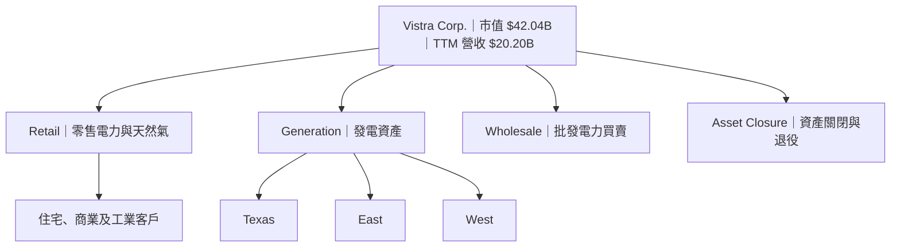
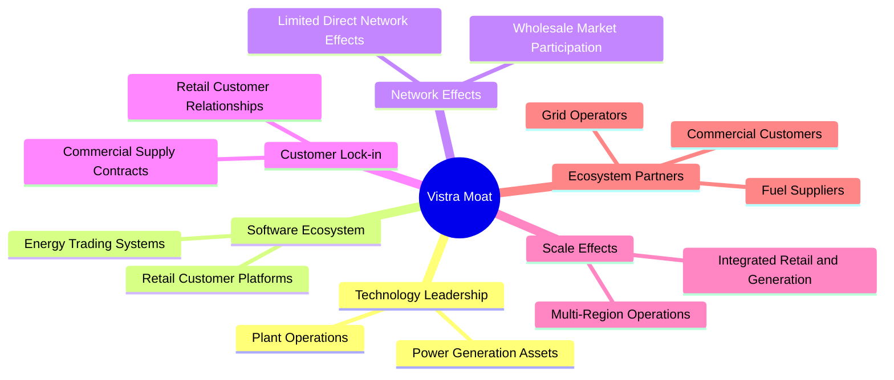
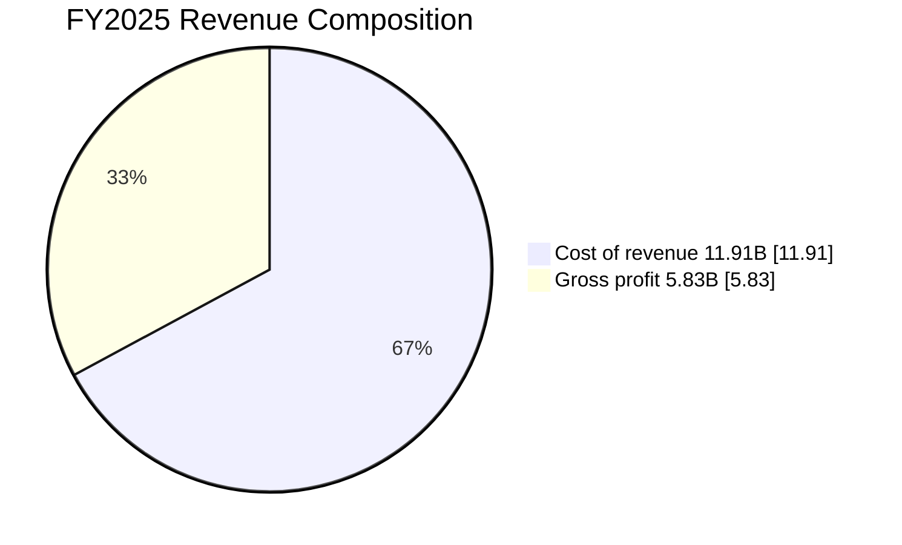
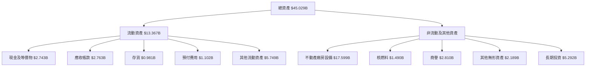
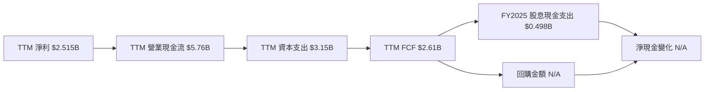
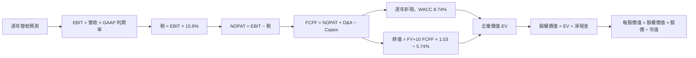
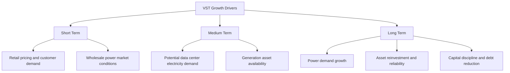
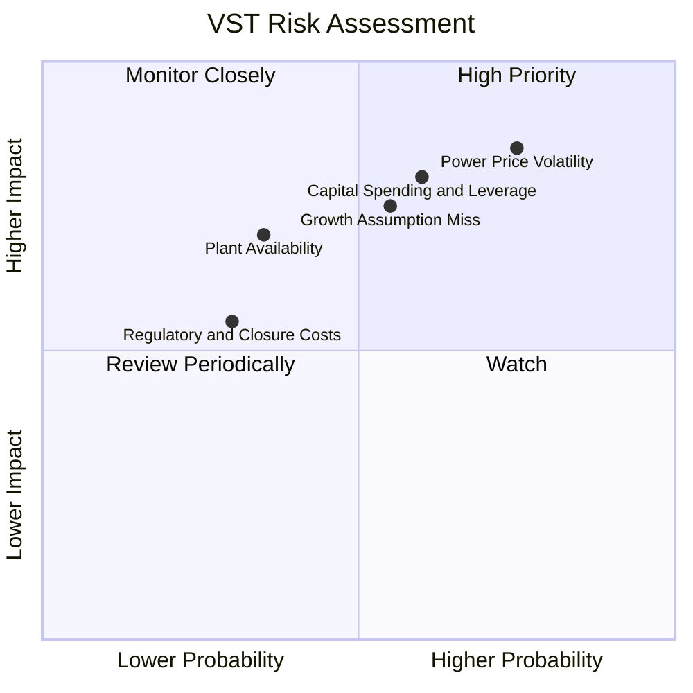
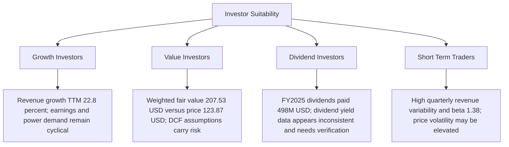

# VST 基本面深度分析報告
> **報告日期**：2026-11-24 ｜ **語言**：繁體中文 ｜ **數據來源**：SEC 申報資料 (XBRL)、Yahoo Finance、Finviz、StockAnalysis、Roic.ai ｜ **分析師**：CFA 級機構研究

## 目錄

| # | 章節 | 核心結論 |
|---|------|----------|
| 1 | 執行摘要 | 強烈買入；加權合理價值 $207.53；MOS +40.3% |
| 2 | 公司概覽與商業模式 | 一體化零售電力與發電業務，但分部收入與市場份額未提供 |
| 3 | 損益表深度分析 | TTM 營收 $20.20B、TTM 成長 22.8%；獲利具電力市場週期性 |
| 4 | 資產負債表分析 | 淨負債 $18.40B；流動性尚可但短期現金覆蓋不強 |
| 5 | 現金流量深度分析 | TTM FCF $2.61B、FCF Yield 6.20%；資本支出仍高 |
| 6 | 獲利能力與資本效率 | ROIC 13.5% 高於 WACC 8.74%，目前創造價值 |
| 7 | 相對估值分析 | P/E 低於同業中位數、自身歷史偏低；不同估值法分歧明顯 |
| 8 | DCF 內在價值評估 | DCF 基準值 $296.90；加權合理價值 $207.53 |
| 9 | 成長催化劑 | 電力需求與 AI／資料中心敘事可能利多，但公司專屬量化項目不足 |
| 10 | 風險矩陣 | 電價／商品波動、資本密集與槓桿、成長預期落差為主要風險 |
| 11 | 投資建議 | 依 MOS 評級為強烈買入；須同步追蹤 FCF、槓桿與利潤率 |

---

## 1. 執行摘要

截至 2026-11-23，VST 收盤價為 **$123.87**。SEC 申報資料及程式計算顯示，公司 TTM 營收 **$20.20B**、TTM 營收成長 **22.8%**、營業利益率 **21.0%**、FCF **$2.61B**、FCF Yield **6.20%**；TTM ROIC **13.5%** 高於 WACC **8.74%**。估值方面，DCF 基準值 **$296.90**，但同業 Forward P/E 法為 **$110.60**；依固定權重三角驗證後，加權合理價值為 **$207.53**，相對現價 MOS **+40.3%**、上行空間 **+67.5%**。因此依 MOS 門檻評為 **🟢 強烈買入**；此判斷高度依賴電力市場利潤可持續性及模型長期現金流假設。

### 1.0 一頁式投資儀表板（Portfolio Manager 30 秒速讀）

| 項目 | 內容 |
|------|------|
| **投資論點（3 句）** | ① TTM 營收成長 **22.8%**，最新一季營收年增 **25.4%**，反映近期需求及銷售規模擴大。② TTM FCF **$2.61B**、FCF Yield **6.20%**，代表獲利已有現金流支持，但 TTM Capex 仍達 **$3.15B**。③ ROIC **13.5%** 高於 WACC **8.74%**，加權合理價值 **$207.53** 高於現價 **$123.87**。 |
| **綜合評分** | **7.1/10**（引用 1.1 評分卡） |
| **財務健康** | 🟡 淨負債 **$18.40B**，Piotroski **7/8**；流動比率 **1.157**，但速動比率僅 **0.477**。 |
| **ROIC vs WACC** | **13.5% vs 8.74%**；高出 **4.76 個百分點**，目前創造股東價值。 |
| **FCF 趨勢** | FY2025 FCF 為 **$1.32B**；TTM FCF **$2.61B**。趨勢改善，但資本支出和電力市場週期使年度數字波動。FCF Yield **6.20%**。 |
| **估值** | Forward P/E **12.7x** ｜ EV/EBITDA（TTM）**8.101x** ｜ FCF Yield **6.20%** |
| **DCF 內在價值（基準）** | **$296.90** ｜ 現價相對 DCF 折價 **58.3%**（折溢價 = $123.87 ÷ $296.90 − 1）。 |
| **安全邊際（MOS）** | **+40.3%**＝($207.53 − $123.87) ÷ $207.53（加權合理價值；🟢 >25%）。 |
| **預期報酬（基準情境 12M）** | **+139.7%**（DCF 基準情境機械推算；非獨立 12 個月預測）。 |
| **關鍵風險（前二）** | 電力及燃料價格波動造成利潤率回落；高負債與高資本支出使自由現金流對市場衝擊敏感。 |
| **評級 + 信心度** | 🟢 **強烈買入** ｜ 信心：中。評級由 MOS +40.3% 且 ROIC > WACC 支持；但估值方法差距大，模型終值佔 EV 66.2%。 |

### 1.1 綜合評分卡（全報告唯一）

| 維度 | 評分（1–10） | 主要依據（引用數字與其來源章節） |
|------|--------------|----------------------------------|
| 成長性 | 8.0 | TTM 營收成長 22.8%、最新一季營收年增 25.4%（第 3 章）；但季增及季節性波動明顯。 |
| 獲利能力 | 8.0 | TTM 營業利益率 21.0%、ROIC 13.5% 對 WACC 8.74%、F-Score 7/8（第 3、6 章）。 |
| 財務健康 | 5.5 | 淨負債 $18.40B、流動比率 1.157、速動比率 0.477；CCC 34 天（第 4 章）。 |
| 估值 | 8.0 | MOS +40.3%；P/E 16.7x 低於 5 年中位數 25.2x，但同業 Forward P/E 法估值低於現價（第 7、8 章）。 |
| 護城河 | 7.0 | 發電資產與零售客戶平台形成一體化優勢；但分部收入、客戶留存及市場份額數據未提供（第 2 章）。 |
| 管理層與資本配置 | 6.0 | FY2025 Capex $2.75B、股息現金支出 $498M、SBC $113M；長期債務指標未通過 F-Score 測試（第 5、6 章）。 |
| **綜合評分** | **7.1** | 六項算術平均：(8.0 + 8.0 + 5.5 + 8.0 + 7.0 + 6.0) ÷ 6 = **7.1**。 |

### 1.2 五大投資論點 + 三大核心風險

| 類型 | 項目 | 具體依據 | 信心度 |
|------|------|----------|--------|
| 🟢 **投資論點①** | 營收動能仍在 | TTM 營收 $20.20B、年增 22.8%；最新一季年增 25.4%，規模擴大有利於固定成本吸收。 | 🟢 高 |
| 🟢 **投資論點②** | 現金流覆蓋具有實質性 | TTM OCF $5.76B、Capex $3.15B、FCF $2.61B；FCF Yield 6.20%。 | 🟢 高 |
| 🟢 **投資論點③** | 資本回報高於資金成本 | ROIC 13.5% 對 WACC 8.74%，利差 +4.76 個百分點。 | 🟢 高 |
| 🟢 **投資論點④** | 估值未達自身歷史中位數 | P/E 16.7x，低於自身 5 年中位數 25.2x；目前處於歷史 20 百分位。 | 🟡 中 |
| 🟢 **投資論點⑤** | 營運資金表現可控 | DSO 50 天、DIO 30 天、DPO 45 天、CCC 34 天；DSO 較一年前 52 天改善 2 天。 | 🟡 中 |
| 🟡 **風險①** | 發電毛利與電價週期性 | FY2025 毛利由 FY2024 $7.53B 降至 $5.83B，說明單年獲利易受市場價格與能源組合影響。 | 🟡 中 |
| 🔴 **風險②** | 淨負債與資本支出壓力 | 淨負債 $18.40B、TTM Capex $3.15B；若現金流回落，去槓桿及股東回報可能受限。 | 🔴 高衝擊 |
| 🟡 **風險③** | DCF 終值及成長假設偏敏感 | 基準 DCF 的終值 PV 占 EV 66.2%；DCF 基準值 $296.90 遠高於同業 Forward P/E 值 $110.60。 | 🟡 中 |

### 1.3 快速統計卡片

| 指標 | 公司實際值（期間） | 同業中位數 | 狀態 |
|------|--------------------|------------|------|
| 營收成長（TTM） | **22.8%** | — | 🟢 |
| 營收成長（最新一季年增） | **25.4%** | **45.4%** | 🟡 |
| 毛利率（TTM） | **N/A**（VERIFIED FIGURES 未提供） | **25.2%**（同業） | 🟡 公司值缺資料，不作直接比較 |
| 營業利益率（TTM） | **21.0%** | — | 🟢 |
| ROIC（TTM） | **13.5%** | — | 🟢 |
| Forward P/E | **12.7x** | **11.3x** | 🟡 |
| FCF Yield（TTM） | **6.20%** | — | 🟢 |
| Piotroski F-Score | **7 / 8** | — | 🟢 |

### 1.4 投資結論

╔══════════════════════════════════════════════════════════════════╗  
║                    📊 投資結論摘要                               ║  
╠══════════════════════════════════════════════════════════════════╣  
║ 評級：強烈買入（MOS +40.3%，且 ROIC 13.5% > WACC 8.74%）          ║  
║ 價格（2026-11-23 收盤）：$123.87                                 ║  
║ DCF 內在價值（基準）：$296.90（現價折價 58.3%）                  ║  
║ 安全邊際 MOS：+40.3%（＝($207.53−$123.87)÷$207.53）             ║  
║ 加權合理價值（8.8）：$207.53                                     ║  
║ DCF 情境價值：                                                    ║  
║   悲觀情境：$100.12（-19.2%）                                    ║  
║   基準情境：$296.90（+139.7%）                                   ║  
║   樂觀情境：$697.84（+463.4%）                                   ║  
║ 綜合評分：7.1/10（引用 1.1）                                     ║  
║ 適合投資人：能承受電力價格週期與高波動的成長／價值混合型投資人    ║  
╚══════════════════════════════════════════════════════════════════╝

---

## 2. 公司概覽與商業模式

Vistra Corp. 是美國綜合型零售電力與發電公司，涵蓋零售供電、發電、批發電力交易與相關資產管理。公司列出的營運分部為 Retail、Texas、East、West、Asset Closure。員工數 **6,390 人**。以下營收以 VERIFIED FIGURES TTM **$20.20B** 為準；其他資料表另列 $20.588B，因口徑不一致，本報告不混用。

### 2.1 業務結構與收入來源

財務資料未提供各分部營收、營業利益或收入佔比，故無法可靠拆分分部金額。以下只呈現已知的公司總覽及業務關係，不推估分部占比。

**業務理解**：零售端可提供客戶關係及銷售渠道，發電端可提供供應能力並參與批發市場；整合可緩和單一市場環節風險，但也使公司同時暴露於零售競爭、燃料成本、電價波動、電廠營運及退役責任。

### 2.2 市場份額

市場份額資料未提供，沒有可靠的市占率數字可引用。以規模而言，VST TTM 營收為 **$20.20B**；同業中，CEG、NRG、TLN 最新一季營收年增率分別為 **45.4%**、**24.0%**、**96.1%**，但因缺乏一致的公司營收額及市場總量，不能以成長率推導市場份額。

### 2.3 競爭護城河分析

下圖為質化護城河分類，不代表經量化驗證的強度或市場份額。

### 2.4 護城河強度

| 護城河項目 | 強度（強／中／弱） | 證據（引用數字或事實） | 會削弱它的情況 |
|------------|--------------------|------------------------|----------------|
| 垂直整合與資產規模 | 中 | 零售、Texas、East、West、Asset Closure 多分部營運，TTM 營收 $20.20B。 | 發電資產停機、燃料價格上升或零售端價格競爭使整合優勢被成本抵銷。 |
| 客戶關係與供電渠道 | 中 | 公司服務美國住宅、商業與工業客戶；客戶數及續約率未提供。 | 客戶轉換成本低、競爭者降價、客戶自建供能。 |
| 網路效應 | 弱 | 電力市場交易與客戶平台存在，但未提供能顯示網路效應的用戶或流動性指標。 | 客戶與發電商可多方交易，平台規模不必然轉化為鎖定。 |
| 技術與軟體 | 弱至中 | 有發電與零售管理所需技術，但專利、研發投入、軟體收入均未提供。 | 技術未形成可量化成本優勢或差異化。 |
| 合作夥伴生態 | 中 | 依賴燃料供應商、電網及工商業客戶；合約覆蓋率未提供。 | 供應限制、電網瓶頸或合約再議價。 |

**1.1「護城河」評分為 7.0/10**，依據是公司具多區域發電與零售整合、營收規模達 $20.20B，但客戶留存、市占、分部獲利與軟體收入均缺量化證據，故不給更高評價。

---

## 3. 損益表深度分析

### 3.1 年度收入成長趨勢（近 4 年）

年度財務資料顯示 FY2022 至 FY2025 營收逐年增加，但增速不均。FY2024 營收加速，FY2025 則明顯放緩。以下 YoY 由所列年度營收計算，四捨五入至一位小數。

╔══════════════════════════════════════════════════════════════════╗  
║              Vistra 年度收入趨勢（FY2022–FY2025）                ║  
╠══════════════════════════════════════════════════════════════════╣  
║ FY2022  $13.73B  ████████████████░░░░░░░░  基期                 ║  
║ FY2023  $14.78B  █████████████████░░░░░░░  YoY: +7.6% 🟢       ║  
║ FY2024  $17.22B  ████████████████████░░░░░  YoY: +16.5% 🟢      ║  
║ FY2025  $17.74B  █████████████████████░░░░  YoY: +3.0% 🟡       ║  
╠══════════════════════════════════════════════════════════════════╣  
║ FY2022–FY2025 營收 CAGR = (17.74 ÷ 13.73)^(1/3) − 1 = 8.9%      ║  
╚══════════════════════════════════════════════════════════════════╝

FY2025 成長減速至 **3.0%**，而 TTM 成長率升至 **22.8%**。這種落差顯示近期收入受到季節性、商品價格或電力交易組合影響；若增長主要來自價格或批發交易額，而非穩定零售客戶擴張，收入增長未必同幅轉化為可持續利潤。

### 3.2 季度收入趨勢分析

QoQ 以 VERIFIED FIGURES 財報期間的季度營收計算；YoY 僅在資料中可取得比較季度時列示。最新一季 YoY 另以 VERIFIED FIGURES **25.4%** 為準，不以其他來源的 27.68% 替代。

| 季度 | 營收 | QoQ | YoY | 備註 |
|------|------:|----:|----:|------|
| 2025 Q4 | $4.58B | — | — | 起始比較季度；季節性影響不可忽略。 |
| 2026 Q1 | $5.64B | **+23.1%** | **+43.4%** | 相較 2025 Q1 $3.93B；收入躍升可能包含電價及交易組合影響。 |
| 2026 Q2 | $4.02B | **-28.7%** | **-5.4%** | 相較 2026 Q1 回落；年增轉負，顯示季度營收波動。 |
| 2026 Q3 | $6.35B | **+58.0%** | **+25.4%** | 相較 2026 Q2 增加；季節性需求及批發市場變化可能是因素，但分部拆解未提供。 |

QoQ 算式例：2026 Q3 QoQ = ($6.35B ÷ $4.02B) − 1 = **58.0%**。季度收入不宜簡單年化，因電力需求與價格受季節及供需影響。

### 3.3 利潤率演變分析

年度財報未提供 VERIFIED FIGURES 指定口徑的完整年度利潤率序列；下表以提供的年度收入、毛利、營業利益、淨利及 EBITDA 計算年度比率。TTM 口徑則只採 VERIFIED FIGURES 數字。

| 利潤率指標 | FY2022 | FY2023 | FY2024 | FY2025 | 趨勢 | 評估 |
|------------|--------:|--------:|--------:|--------:|------|------|
| **毛利率** | 12.2% | 37.3% | 43.7% | 32.9% | FY2025 較 FY2024 下滑 10.8 個百分點 | 🟡 |
| **營業利益率** | -8.0% | 18.3% | 23.7% | 12.0% | FY2025 下滑 11.7 個百分點 | 🟡 |
| **淨利率** | -9.0% | 9.1% | 15.4% | 5.3% | FY2025 下滑 10.1 個百分點 | 🟡 |
| **TTM 營業利益率** | — | — | — | **21.0%** | TTM 高於 FY2025 年度值 | 🟢 |

年度毛利率與營業利益率計算分別以該年度毛利、營業利益除以營收。FY2025 毛利從 FY2024 **$7.53B** 降至 **$5.83B**，而營收仍由 **$17.22B** 增至 **$17.74B**，說明營收增加沒有保護毛利；能源定價、對沖結果、發電組合或批發市場變化都可能影響結果，但分項資料不足以精確歸因。TTM 營業利益率回升至 **21.0%**，應視為後續需用季度分部數據驗證的改善，而非已證實的結構性趨勢。

### 3.4 費用結構分析

沒有足夠資料拆分銷售、一般管理、燃料、維修及折舊等完整費用結構，因此不繪製虛構費用比例。FY2025 已知營收 **$17.74B**、毛利 **$5.83B**，由此計算營業成本約 **$11.91B**；該數字為營收減毛利，不代表各成本項目的細分。

╔══════════════════════════════════════════════════════════════════╗  
║ FY2025 營收 $17.74B                                              ║  
║ ├─ 營業成本（營收 − 毛利）：$17.74B − $5.83B = $11.91B          ║  
║ └─ 毛利：$5.83B                                                   ║  
║ 毛利率：$5.83B ÷ $17.74B = 32.9%                                 ║  
╚══════════════════════════════════════════════════════════════════╝

### 3.5 季度 EPS 趨勢與盈餘品質（Quality of Earnings）

EPS 預期值及實際值資料庫在最近四季均顯示缺漏，因此無法判定「超預期／不及預期」。以下只列已提供的實際 EPS 與同比變化；EPS 為不同來源，與分拆後股數等口徑可能存在差異。

| 季度 | EPS 實際 | 可比季度 EPS | EPS YoY | 超預期／不及預期 |
|------|---------:|-------------:|-------:|------------------|
| 2025 Q4 | $0.55 | 2024 Q4 $1.16 | **-52.6%** | N/A（預期值缺漏） |
| 2026 Q1 | $2.90 | 2025 Q1 -$0.93 | 無穩定同比百分比可比 | N/A（預期值缺漏） |
| 2026 Q2 | $0.77 | 2025 Q2 $0.82 | **-6.1%** | N/A（預期值缺漏） |
| 2026 Q3 | $3.26 | 2025 Q3 $1.78 | **+83.1%** | N/A（預期值缺漏） |

| 盈餘品質項目 | 數值／佔比 | 評估 |
|--------------|-----------|------|
| 股權薪酬 SBC / 營收 | 約 **0.63%**；最近四季 SBC 合計 $127M ÷ TTM 營收 $20.20B | 🟢 比例不高，但仍造成股東經濟成本；最近四季數字由季度現金流資料加總。 |
| SBC / 營業現金流 | 約 **2.2%**；$127M ÷ $5.76B | 🟢 佔 OCF 比重有限。 |
| FCF / 淨利（現金轉換率） | 約 **103.8%**；$2.61B ÷ StockAnalysis TTM 淨利 $2.515B | 🟢 FCF 大致覆蓋淨利；淨利數據來源與期間須注意口徑差異。 |
| 一次性／非經常性損益 | N/A（未提供足以核實的 TTM 明細） | 🟡 無法確認是否有重大一次性收益或費用。 |
| 有效稅率異常 | **15.9%**（最近年度有效稅率） | 🟢／🟡 未見單靠稅率證明盈餘被稅務利益美化；但單年有效稅率可能波動。 |
| 資本化支出 vs 費用化 | TTM Capex **$3.15B**；資本化政策及維修／成長性 Capex 拆分 N/A | 🟡 電廠資產密集，Capex 對自由現金流影響顯著；無法判斷是否存在成本遞延。 |

**盈餘品質結論**：現金流品質整體尚可，TTM FCF 約為淨利的 103.8%，而 SBC 相對營收及 OCF 佔比不高。不過能源公司資產折舊、維修與擴建需求使「會計淨利」與「可分配現金」並非同一概念；估值宜以扣除 Capex 後的 FCF 為重要交叉檢驗，不宜只看 EPS。

---

## 4. 資產負債表分析

### 4.1 資產結構分解

最新 TTM 資產負債表數據列示總資產 **$45.029B**。以下分項採 StockAnalysis 2026-09-30 資料；合計因資料列中可能包含未詳分類資產，僅展示已列明項目，不強行補平。

資產基礎中 PPE、核燃料及長期投資占有份量，符合發電資產密集特性；同時也意味著維修、環境合規及資產退役成本是長期現金流的重要約束。

### 4.2 流動性與營運資金分析

| 指標 | 最新 TTM | 一年前 TTM | 變化 | 解讀 |
|------|----------|------------|------|------|
| 流動比率 | **1.157** | N/A | N/A | 短期資產大於流動負債，但緩衝有限。 |
| 速動比率 | **0.477** | N/A | N/A | 扣除存貨後，流動資產對短期負債覆蓋偏低。 |
| DSO 應收帳款天數 | **50 天** | **52 天** | **-2 天** | 收款天數略縮短，營運資金占用方向改善。 |
| DIO 存貨天數 | **30 天** | **N/A** | N/A | 一年前缺少可比數據，無法判斷存貨週轉趨勢。 |
| DPO 應付帳款天數 | **45 天** | **N/A** | N/A | 供應商付款天數缺少一年前可比值。 |
| CCC 現金轉換週期 | **34 天** | **N/A** | N/A | 最新 CCC 為 DSO + DIO − DPO；歷史比較值不可用。 |

營運資金指標依期末餘額與 TTM 流量計算，可能受季末時點及電力交易結算影響；資料中 DIO、DPO 及 CCC 的歷史 N/A 不予推算補值。

### 4.3 債務結構分析

VERIFIED FIGURES 顯示現金及短期投資 **$2.74B**、總債務 **$21.15B**、淨負債 **$18.40B**。較其他資料來源列出的總債務 $21.77B、淨負債 $19.02B，本報告的核心分析採 VERIFIED FIGURES 原值。

╔══════════════════════════════════════════════════════════════════╗  
║                   Vistra 債務健康診斷                            ║  
╠══════════════════════════════════════════════════════════════════╣  
║ 總債務：       $21.15B  ████████████████████  🔴                 ║  
║ 現金及短投：    $2.74B  ███░░░░░░░░░░░░░░░░░  🟡                 ║  
║ 淨負債：       $18.40B  █████████████████░░░  🟡                 ║  
║ Debt / EBITDA：N/A（未提供可一致核對的 VERIFIED EBITDA）         ║  
║ 利息保障倍數： N/A（未提供利息費用及同口徑 EBIT 資料）           ║  
║ 流動比率：      1.157  🟡；速動比率：0.477 🟡                    ║  
╚══════════════════════════════════════════════════════════════════╝

淨負債並不等同即刻償債壓力，但在發電公司 Capex 與維修需求高的情況下，需以持續性 FCF 而非單季獲利判斷去槓桿能力。F-Score 中「長期負債 ÷ 總資產低於一年前」測試未通過，也值得持續追蹤。

### 4.4 股東權益趨勢

以下採用年度資產負債表列示股東權益：

╔══════════════════════════════════════════════════════════════════╗  
║                 Vistra 股東權益變化（年度）                      ║  
╠══════════════════════════════════════════════════════════════════╣  
║ FY2022  $4.90B  ███████████████████░  YoY 基期                   ║  
║ FY2023  $5.31B  ████████████████████  YoY +8.4%                  ║  
║ FY2024  $5.57B  █████████████████████ YoY +4.9%                  ║  
║ FY2025  $5.10B  ██████████████████░░  YoY -8.4%                  ║  
╚══════════════════════════════════════════════════════════════════╝

FY2025 股東權益下降 **$0.47B**，即使該年度仍錄得淨利，可能涉及股東分配、其他綜合損益或其他權益變動；細項不足，不能將下滑單一歸因於回購或股息。

---

## 5. 現金流量深度分析

### 5.1 現金流量瀑布圖

圖中分別列示 TTM 的營業現金流、Capex、FCF，以及 FY2025 股息支出；時間口徑不同，不將 FY2025 股息誤當成 TTM 分配。

### 5.2 FCF 轉換率趨勢

| 期間 | FCF | 淨利 | FCF / 淨利 | 解讀 |
|------|----:|-----:|-----------:|------|
| FY2022 | -$0.816B | -$1.377B | 不列（雙負數比率易誤導） | 當年經營及資本配置使自由現金流為負。 |
| FY2023 | $3.78B | $1.343B | **281.5%** | 現金流顯著高於會計淨利，仍需考慮能源交易及營運資金波動。 |
| FY2024 | $2.48B | $2.467B | **100.5%** | FCF 約與淨利相當。 |
| FY2025 | $1.32B | $0.752B | **175.5%** | 現金轉換優於淨利，但年度 OCF、Capex 變動大。 |
| TTM 至 2026-09-30 | $2.61B | 約 $2.515B | **103.8%** | 大致一比一轉換，為較近期營運現金支持的證據。 |

年度 FCF 與淨利由不同來源彙整，TTM 淨利採 StockAnalysis 資料；比率僅供方向性分析。

### 5.3 自由現金流趨勢

╔══════════════════════════════════════════════════════════════════╗  
║               自由現金流趨勢（年度與 TTM）                       ║  
╠══════════════════════════════════════════════════════════════════╣  
║ FY2022  -$0.82B  ◀░░░░░░░░░░░░░░░░░░░░  FCF 為負               ║  
║ FY2023  +$3.78B  ████████████████████░  反彈                    ║  
║ FY2024  +$2.48B  █████████████░░░░░░░░  回落                    ║  
║ FY2025  +$1.32B  ███████░░░░░░░░░░░░░░  再降                    ║  
║ TTM     +$2.61B  ██████████████░░░░░░░  近期回升                ║  
╠══════════════════════════════════════════════════════════════════╣  
║ TTM FCF Yield = 6.20%；各年度 FCF Yield 未提供，故不補算         ║  
╚══════════════════════════════════════════════════════════════════╝

TTM FCF 高於 FY2025，與最新季度 OCF 改善相符，但 FY2023 至 FY2025 FCF 由 **$3.78B** 降至 **$1.32B**，提醒投資者不要將最新 TTM 改善直接外推為穩定長期成長。

### 5.4 資本配置評估

回購金額與 TTM 資本配置完整拆分未提供，故不繪製佔比圓餅圖。可核實項目如下：

| 資本配置項目 | 已知數字 | 分析 |
|--------------|---------|------|
| 資本支出 | TTM $3.15B；FY2025 $2.75B | 發電公司資本密集；須區分維修、合規及成長性支出，但拆分未提供。 |
| 股息 | FY2025 現金股息 $498M | 相對 FY2025 FCF $1.32B 約 37.7%；該比例跨年度數字比較，僅作近似參照。 |
| SBC | FY2025 $113M | SBC 造成稀釋成本；Piotroski 稀釋股數測試通過，但不代表未來無稀釋。 |
| 股票回購 | N/A | 金額未提供，不評斷回購效率。 |
| 留存／償債 | N/A | 無法從現有資料拆分 FCF 餘額用途。 |

---

## 6. 獲利能力與資本效率

### 6.1 ROE / ROA / ROIC 趨勢

歷年同口徑 ROIC、ROA 與 ROE 序列未完整提供；不可用來源不同或定義不同的數字拼接出假趨勢。

| 指標 | 可核實數值 | 評估 |
|------|------------|------|
| ROE（TTM） | **42.9%** | 高回報，但權益乘數 7.14，槓桿對 ROE 貢獻重要。 |
| ROA（TTM） | N/A（VERIFIED FIGURES 未提供） | 其他資料源有 7.1%，但非本報告統一核實口徑，故不替代。 |
| ROIC（TTM） | **13.5%** | 高於 WACC 8.74%，目前價值創造為正。 |
| 行業均值 | N/A（沒有同口徑來源） | 不填入估計均值。 |

### 6.2 ROIC vs WACC 分析（核心價值創造判斷）

WACC 直接採用資本成本計算所列 **8.74%**；Beta 使用調整後 Beta **1.25**，不是原始 Beta **1.38**。資本成本所列權重為股權 **66.5%**、債務 **33.5%**；依規則不重新另建 WACC。

╔══════════════════════════════════════════════════════════════════╗  
║                ROIC vs WACC 深度分析                            ║  
╠══════════════════════════════════════════════════════════════════╣  
║ WACC 組成（依資本成本資料）：                                    ║  
║ ├─ 無風險利率：4.92%（指定 10Y Treasury；觀察日期未提供）        ║  
║ ├─ ERP：5.00%（採用值；假設溢酬）                                ║  
║ ├─ 原始 Beta：1.38；調整後 Beta：1.25                             ║  
║ ├─ 股權成本：4.92% + 1.25 × 5.00% = 11.17%                      ║  
║ ├─ 稅前債務成本：4.64%；有效稅率：15.9%                          ║  
║ ├─ 股權／債務權重：66.5%／33.5%                                  ║  
║ └─ WACC（指定值）：8.74%                                         ║  
║                                                                  ║  
║ ROIC（TTM）：13.5%                                                ║  
║ EVA 利差：13.5% − 8.74% = +4.76 個百分點                         ║  
║ ROIC：13.5%  ▓▓▓▓▓▓▓▓▓▓▓▓▓▓▓░░░░░  高於資金成本               ║  
║ WACC： 8.74% ▓▓▓▓▓▓▓▓▓░░░░░░░░░░░  折現率                       ║  
╠══════════════════════════════════════════════════════════════════╣  
║ 結論：目前 ROIC 高於 WACC，創造價值；若 ROIC 持續低於 8.74%，   ║  
║ 則經濟利潤轉負。                                                ║  
╚══════════════════════════════════════════════════════════════════╝

股權成本算式採用資料所列已調整 Beta。稅後債務成本由給定輸入可計為 **4.64% × (1 − 15.9%) = 3.90%**；按所列權重估算，WACC 約 **8.74%**，與採用值一致（精度受輸入四捨五入影響）。此處不另以未提供的利息費用或平均負債重算 WACC。

### 6.3 杜邦三因素分解

| 因素 | 數值（TTM） | 解讀 |
|------|-------------|------|
| 淨利率 | **13.4%** | 淨利占收入比率。 |
| 資產週轉率 | **0.45** | 每單位資產產生約 0.45 單位收入。 |
| 權益乘數 | **7.14** | 槓桿較高，是 ROE 被放大的重要來源。 |
| **ROE** | **42.9%** | 13.4% × 0.45 × 7.14 = 43.0%，與披露 ROE 42.9% 的小差異來自輸入四捨五入。 |

ROE 不應單獨解讀為資本效率：權益乘數 7.14 顯示槓桿放大作用顯著。相比之下，ROIC 13.5% 對 WACC 8.74% 是較直接的經營資本價值創造指標。

### 6.4 財務體質：Piotroski F-Score

Piotroski F-Score 為 **7/8**；有一項因缺少毛利率比較資料而無法判定，因此分母為 8，不是 9。

| 測試 | 結果 | 解讀 |
|------|------|------|
| ROA > 0 | ✅ 通過 | TTM 營運有正獲利。 |
| 營業現金流 > 0 | ✅ 通過 | TTM OCF 為 $5.76B。 |
| ROA 高於一年前 | ✅ 通過 | 年比方向為改善。 |
| 營業現金流 > 淨利（應計品質） | ✅ 通過 | 現金流高於淨利，盈餘現金支持較好。 |
| 長期負債 ÷ 總資產低於一年前 | ❌ 未通過 | 槓桿比率未改善，與淨負債 $18.40B 的風險相符。 |
| 流動比率高於一年前 | ✅ 通過 | 短期流動性相對改善，但目前速動比率僅 0.477。 |
| 稀釋股數未增加 | ✅ 通過 | 比較期間稀釋股數測試通過；不代表未來不會稀釋。 |
| 毛利率高於一年前 | — 無法判定 | 缺少可用比較輸入，不作推論。 |
| 資產週轉率高於一年前 | ✅ 通過 | 資產使用效率比較測試通過。 |

---

## 7. 相對估值分析

### 7.1 同業估值比較表格

本公司估值欄採 VERIFIED FIGURES 中市場估值數字；同業採指定 Peer multiples。VST P/E(TTM)及 EV/EBITDA(TTM)也同時存在跨來源差異，本節以市場數據區的 P/E **16.73919x** 與 EV/EBITDA **8.101x** 展示，並在自身歷史比較中另採指定歷史序列。

| 估值指標 | **VST** | **CEG** | **NRG** | **TLN** | 本公司評估 |
|----------|--------:|--------:|--------:|--------:|-----------|
| **Trailing P/E** | 16.7x | 20.2x | 17.1x | N/A | 🟢 低於可計算的同業兩家公司；TLN 無數據。 |
| **Forward P/E** | 12.7x | 18.8x | 10.1x | 11.3x | 🟡 接近同業中位數 11.3x，高於中位數約 1.4x。 |
| **P/S Ratio** | 2.0x | 2.6x | 0.6x | 3.5x | 🟡 位於同業兩端之間；同業中位數 2.6x。 |
| **EV / EBITDA** | 8.1x | 11.8x | 10.8x | 37.3x | 🟢 低於同業中位數 11.8x；TLN 倍數高，令中位數高於 CEG、NRG。 |
| **最新一季營收年增** | 25.4% | 45.4% | 24.0% | 96.1% | 🟡 低於同業中位數 45.4%，但高於 NRG。 |
| **毛利率（TTM）** | N/A | 25.2% | 20.2% | 42.7% | N/A 公司口徑缺漏，不作比較。 |

Forward P/E 同業中位數為 CEG **18.8x**、NRG **10.1x**、TLN **11.3x** 的中位數 **11.3x**。TLN EV/EBITDA **37.3x** 的高倍數拉高同業中位數至 **11.8x**，因此不可將其視為完全同質的成熟估值錨。

### 7.2 歷史估值區間分析

╔══════════════════════════════════════════════════════════════════╗  
║            VST P/E 自身歷史區間（TTM，5 年）                    ║  
╠══════════════════════════════════════════════════════════════════╣  
║ 歷史低點 7.2x ├────────●──────────────●──────────────┤ 74.3x 高點║  
║               │ 現值 16.7x              │ 中位數 25.2x          ║  
║               └ percentile rank：20%                           ║  
║                                                                  ║  
║ P/S：現值 2.1x｜中位數 1.8x｜區間 0.5x–4.2x｜百分位 52%        ║  
║ EV/EBITDA：現值 9.5x｜中位數 11.0x｜區間 2.3x–40.7x｜百分位35%║  
╚══════════════════════════════════════════════════════════════════╝

P/E 目前在自身五年區間偏低位置，可能反映市場對近期高盈利可持續性的折價，也可能代表相對估值吸引力。P/S 高於自身中位數，顯示市場仍給予一定收入估值；兩項指標訊號不一致。

### 7.3 情境價值（Bear / Base / Bull，照抄 DCF MODEL 的 Scenarios）

| 情境 | 第 1 年營收成長 | 期末營業利潤率 | WACC | 每股價值 | 相對現價 | 機率 | 會發生的條件 |
|------|----------------|----------------|------|----------|----------|------|--------------|
| 🔴 悲觀 | 11.4% | 16.4% | 9.74% | **$100.12** | **-19.2%** | 25% | 電力需求增速放慢、發電利潤及零售定價回落，資金成本上升。 |
| 🟡 基準 | 22.8% | 19.3% | 8.74% | **$296.90** | **+139.7%** | 50% | TTM 高成長延續一段時間，後續逐步降至 3.0%，利潤率逐步收斂至 19.3%。 |
| 🟢 樂觀 | 34.3% | 21.2% | 7.74% | **$697.84** | **+463.4%** | 25% | 電力需求與定價超基準、發電及零售組合改善且折現率下降。 |

三情境均為模型結果，樂觀情境的高價值尤其敏感於高成長與較低 WACC 同時成立，不能視為單一目標價。機率加權價值 **$347.94** 只作情境參照；第 8.8 節估值權重使用基準 DCF 值，而非此機率加權值。

### 7.4 相對估值隱含價格區間

╔══════════════════════════════════════════════════════════════════╗  
║                 相對估值隱含價值（每股）                         ║  
╠══════════════════════════════════════════════════════════════════╣  
║ 同業 Forward P/E：$110.60 ── 現價 $123.87 ── 同業 EV/EBITDA：$165.62║  
║ 分析師共識目標價：$197.18 ── DCF 基準：$296.90                  ║  
╚══════════════════════════════════════════════════════════════════╝

| 方法 | 隱含每股價值 | 相對現價 | 依據 |
|------|-------------:|---------:|------|
| 同業 Forward P/E | **$110.60** | **-10.7%** | CEG、NRG、TLN 同業 Forward P/E 中位數 **11.3x** × VST Forward EPS **$9.76**。 |
| 同業 EV/EBITDA | **$165.62** | **+33.7%** | 同業 EV/EBITDA 中位數 **11.8x** × VST TTM EBITDA，再加回淨現金／扣除淨負債的橋接；最終價值照列示模型。 |

同業 Forward P/E 法指向低於現價，而 EV/EBITDA 法則高於現價，反映電力公司的資產負債表、EBITDA 週期及每股盈餘估計會造成估值差異。

---

## 8. DCF 內在價值評估（Discounted Cash Flow）

### 8.0 估值推理鏈（Thinking Logic：在算之前先想清楚）

**Step 1 — 價值由哪些變數決定？**

本模型核心命題是：VST 的企業價值由零售與發電整合業務的現金流、營收成長路徑及長期營業利潤率決定。已知總營收 TTM **$20.20B**，但 Retail、Texas、East、West 等分部營收比例未提供，無法將總營收可靠拆成「成熟底盤」與「新成長曲線」；故不能為各業務虛構佔比。模型敏感度矩陣顯示，**WACC 與永續成長率 g 的組合**對估值有很大影響；營收成長及利潤率也共同決定現金流底盤。

**Step 2 — 模型選擇**

| 決策點 | 本報告採用 | 理由（含數字） | 曾考慮但否決 | 否決理由 |
|--------|-----------|----------------|--------------|----------|
| 現金流定義 | FCFF | 以 WACC 8.74% 折現，先估 EV 再做淨負債橋接；與資本結構相容。 | FCFE | 債務與資本結構影響較大，FCFF 便於分離營運價值與融資。 |
| 預測期 N | 10 年 | DCF MODEL 固定預測 10 年；公司有發電資產及長週期資本支出。 | 5 年 | 5 年可能無法呈現模型採用的成長淡出路徑；遵循指定模型不另改 N。 |
| 終值方法 | Gordon Growth | WACC 8.74% 高於 g 3.0%，公式可用；模型終值 PV 占 EV 66.2%。 | 退出倍數 | DCF MODEL 未提供退出倍數計算結果，不能另建模型補數。 |
| EBIT 基礎 | GAAP EBIT | 使用 GAAP 營業利益率；模型標示 SBC 已在 GAAP EBIT 中作為費用。 | 非 GAAP EBIT | 會造成加回與扣除 SBC 處理不一致。 |

**Step 3 — 關鍵假設推導鏈**

- **營收成長路徑**：錨點＝VERIFIED TTM 營收成長 **22.8%** → 調整＝基準情境採用第 1 年 22.8%，並線性降至第 10 年 3.0%，反映當前高增速不宜永久延續 → **採用 FY+1 22.8%、FY+10 3.0%** → 曾考慮全期維持 22.8%，但以 10 年持續高增長外推過度樂觀，故否決。模型年度增長率逐年由 22.8% 降至 3.0%。
- **期末營業利潤率**：錨點＝TTM 營業利益率 **21.0%**，模型引用近五年年度中位數（含 TTM）為期末錨點 → 調整＝模型假設利潤率逐年收斂 → **採用 FY+10 19.3%** → 曾考慮維持 21.0%，但電力市場利潤週期性意味高利潤不宜永久延續；亦未採用更低的 16.4%，因它屬悲觀情境而非基準。
- **永續成長率 g**：錨點＝成熟經濟長期名目成長需低於折現率；可用的模型輸入為 3.0% → 調整＝不讓終值永久延續高於長期經濟成長的電力需求假設 → **採用 3.0%** → 曾考慮 4.0%，但終值敏感度提高且不符合較保守的成熟期假設；g 必須低於 WACC 8.74%。
- **預測期 N**：錨點＝模型指定 10 年 → 調整＝不作模型外變更 → **採用 10 年** → 曾考慮 5 年，但會改變指定估值框架，故否決。
- **Capex／營收**：錨點＝TTM Capex $3.15B ÷ TTM 營收 $20.20B 約 **15.6%** → 調整＝假設資本支出強度逐步降至約 1.1 倍 D&A 的水平 → **採用 FY+1 15.6% 緩降至 FY+10 11.5%** → 曾考慮維持 15.6% 全期不變，但模型認為長期強度可收斂；若收斂慢於假設，估值偏高。
- **EBIT 基礎、SBC 及稀釋**：錨點＝模型明示 GAAP EBIT，且 SBC 已計入費用；股數不額外稀釋 → **採用組合 (A)：GAAP EBIT + 固定股數，年稀釋率 0%，FCFF 不另扣 SBC** → 否決「再扣 SBC」或「再稀釋股數」，因會重複計入成本。
- **D&A／營收**：錨點＝TTM **10.4%** → **採用 10.4% 固定**；若 D&A 與維修需求不匹配，模型可能錯估資產更新負擔。
- **有效稅率**：錨點＝最近年度有效稅率 **15.9%** → **採用 15.9%**；長期稅率不同會改變 NOPAT。
- **營運資金**：模型未建模 Working Capital，故 **不扣 ΔWC**；不是認定營運資金需求為零，而是依指定模型處理。公司現金轉換週期 34 天，若收入擴張引致額外營運資金需求，模型會高估 FCFF。
- **WACC**：錨點＝成本資本資料所列 **8.74%**，組成詳見 8.2；**採用 8.74%**。否決自行按其他來源重算，避免與模型固定折現率不一致。

**Step 4 — 最脆弱環節**

最脆弱環節是高成長收入能否轉成現金流，同時讓 Capex／營收由 15.6% 下降至 11.5%；若不成立，基準價值會向下，且終值已占 EV **66.2%**，估值對長期假設敏感。

**Step 5 — 計算路徑圖**

### 8.1 模型假設總表（Model Inputs）

| 假設項目 | 採用值 | 依據／來源 | 敏感度 |
|----------|--------|-------------|--------|
| 預測期長度 **N** | **10 年** | DCF MODEL 指定；不是本報告自行調整。 | 🟡 中 |
| 營收成長 | FY+1 **22.8%** 緩降至 FY+10 **3.0%** | TTM vs prior TTM 成長 22.8%；模型逐年線性淡出。 | 🔴 高 |
| 營業利潤率 | FY+1 **21.0%** 至 FY+10 **19.3%** | TTM 營業利益率 21.0%；末年收斂至近五年中位數。 | 🔴 高 |
| 有效稅率 | **15.9%** | 最近年度有效稅率。 | 🟢 低 |
| Capex / 營收 | **15.6%** 至 **11.5%** | TTM 比例及模型長期逐步收斂假設。 | 🟡 中 |
| D&A / 營收 | **10.4%** | TTM 比例，模型固定。 | 🟢 低 |
| 營運資金變動 | 不建模 | DCF MODEL 明示不建模；與 CCC 34 天的實際營運存在模型簡化。 | 🟢 低 |
| EBIT 基礎 | **GAAP EBIT** | 模型指定使用 GAAP EBIT。 | 🟡 中 |
| 股權薪酬 SBC | GAAP EBIT 已計費，不另扣 | 模型指定組合 (A)，SBC 影響反映一次。 | 🟡 中 |
| 年稀釋率 | **0%** | 與 GAAP EBIT + 固定股數組合相容。 | 🟡 中 |
| 永續成長率 g | **3.0%** | DCF MODEL 指定；低於 WACC 8.74%。 | 🔴 高 |
| 終值方法 | Gordon Growth | DCF MODEL 提供 Gordon 終值；退出倍數計算值未提供。 | 🔴 高 |
| WACC | **8.74%** | 成本資本資料指定值，見 8.2。 | 🔴 高 |

**FCFF 定義**：FCFF = NOPAT + D&A − Capex；模型未建模營運資金，故不列 ΔWC。**本模型採用 (A)：GAAP EBIT + 固定股數 + 不另扣 SBC，故 SBC 影響已計入一次。**

### 8.2 折現率推導（WACC）

╔══════════════════════════════════════════════════════════════════╗  
║                    WACC 推導（折現率）                           ║  
╠══════════════════════════════════════════════════════════════════╣  
║ 股權成本 Ke（CAPM）：                                            ║  
║ ├─ 無風險利率 Rf：4.92%（10Y Treasury；資料未列觀察日期）        ║  
║ ├─ ERP：5.00%（指定假設值；來源未提供更細依據）                   ║  
║ ├─ 原始 Beta：1.38；調整 Beta：1.25 = ⅔×1.38 + ⅓×1.00           ║  
║ ├─ 規模／國別溢酬：0.00%（未另加）                                ║  
║ └─ Ke = 4.92% + 1.25 × 5.00% = 11.17%                            ║  
║                                                                  ║  
║ 債務成本：                                                       ║  
║ ├─ 稅前 Kd：4.64%（指定：利息 ÷ 債務）                            ║  
║ ├─ 有效稅率：15.9%                                                ║  
║ └─ 稅後 Kd = 4.64% × (1 − 15.9%) = 3.90%                         ║  
║                                                                  ║  
║ 資本結構（指定市場權重）：                                       ║  
║ ├─ 股權權重 E：66.5%                                              ║  
║ ├─ 債務權重 D：33.5%                                              ║  
║ └─ WACC：0.665×11.17% + 0.335×3.90% = 約 8.74%                   ║  
╚══════════════════════════════════════════════════════════════════╝

逐步演算：

1. **Ke（CAPM）** = Rf + β × ERP + 溢酬 = 4.92% + 1.25 × 5.00% + 0.00% = **11.17%**。
2. **稅前 Kd** = **4.64%**（直接採資本成本資料的「利息 ÷ 債務」計算值）；該資料未提供可重新核對的利息費用與平均計息負債明細，故不虛構金額。
3. **稅後 Kd** = 4.64% × (1 − 15.9%) = **3.90%**。
4. **權重** = 股權 **66.5%**、債務 **33.5%**；66.5% + 33.5% = **100.0%**。股權權重由資本成本資料直接提供，債務權重同理；未以帳面權益替代市值權重。
5. **WACC** = 66.5% × 11.17% + 33.5% × 3.90% = 7.43% + 1.31% = **8.74%**（以區塊指定值為準；分項四捨五入會有尾差）。

### 8.3 逐年自由現金流預測（基準情境）

金額單位為 USD billions；顯示數字依 DCF MODEL 原值。折現因子保留三位小數。資料未列 ΔWC，模型明示不建模；組合 (A) 不另列 SBC 扣除。

| 年度 | FY+1 | FY+2 | FY+3 | FY+4 | FY+5 | FY+6 | FY+7 | FY+8 | FY+9 | FY+10 |
|------|-----:|-----:|-----:|-----:|-----:|-----:|-----:|-----:|-----:|------:|
| 營收 | 24.81 | 29.93 | 35.45 | 41.20 | 46.98 | 52.54 | 57.59 | 61.85 | 65.07 | 67.03 |
| 營收 YoY | 22.8% | 20.6% | 18.4% | 16.2% | 14.0% | 11.8% | 9.6% | 7.4% | 5.2% | 3.0% |
| 營業利潤率 | 21.0% | 20.8% | 20.6% | 20.4% | 20.2% | 20.0% | 19.8% | 19.6% | 19.4% | 19.3% |
| EBIT（GAAP） | 5.20 | 6.22 | 7.29 | 8.40 | 9.49 | 10.51 | 11.41 | 12.14 | 12.65 | 12.91 |
| − 稅 | (0.83) | (0.99) | (1.16) | (1.34) | (1.51) | (1.68) | (1.82) | (1.94) | (2.02) | (2.06) |
| = NOPAT | 4.37 | 5.22 | 6.13 | 7.06 | 7.98 | 8.84 | 9.60 | 10.21 | 10.64 | 10.85 |
| + D&A | 2.58 | 3.12 | 3.69 | 4.29 | 4.89 | 5.47 | 6.00 | 6.44 | 6.78 | 6.98 |
| − Capex | (3.88) | (4.54) | (5.21) | (5.86) | (6.47) | (6.99) | (7.40) | (7.66) | (7.75) | (7.68) |
| − ΔWC | 未建模 | 未建模 | 未建模 | 未建模 | 未建模 | 未建模 | 未建模 | 未建模 | 未建模 | 未建模 |
| = FCFF | **3.08** | **3.80** | **4.61** | **5.49** | **6.40** | **7.32** | **8.20** | **8.99** | **9.66** | **10.15** |
| 折現因子 @8.74% | 0.920 | 0.846 | 0.778 | 0.715 | 0.658 | 0.605 | 0.556 | 0.512 | 0.471 | 0.433 |
| FCFF 現值 PV | **2.83** | **3.22** | **3.59** | **3.93** | **4.21** | **4.43** | **4.56** | **4.60** | **4.54** | **4.39** |

預測期現值合計的完整加總：

**$2.83 + $3.22 + $3.59 + $3.93 + $4.21 + $4.43 + $4.56 + $4.60 + $4.54 + $4.39 = $40.30B**

逐步演算（FY+1；模型採用未四捨五入中間值，表格顯示至兩位小數）：

1. **營收** = $20.20B × (1 + 22.8%) = **$24.81B**。
2. **EBIT** = $24.81B × 21.0% = 約 **$5.20B**（模型輸出值；中間精度未列）。
3. **稅** = $5.20B × 15.9% = 約 **$0.83B**。
4. **NOPAT** = $5.20B − $0.83B = 約 **$4.37B**。
5. **D&A** = $24.81B × 10.4% = 約 **$2.58B**。
6. **Capex** = $24.81B × 15.6% = 約 **$3.88B**。
7. **ΔWC** = 模型不建模，故 FCFF 不扣除。
8. **FCFF** = 模型輸出 **$3.08B**。以表中兩位小數顯示值直接相減，4.37 + 2.58 − 3.88 = 3.07；差額 $0.01B 來自未展示的模型中間精度，依要求不改寫模型輸出。
9. **折現因子** = 1 ÷ (1 + 8.74%)¹ = **0.920**；PV = 模型輸出 **$2.83B**。

合理性自檢：

- 預測 FCF CAGR（FY+1 至 FY+10）= (10.15 ÷ 3.08)^(1/9) − 1 ≈ **14.2%**；FY2022 至 FY2025 歷史 FCF CAGR 不宜計算，因起點為負值；FY2023 至 FY2025 FCF 為 $3.78B 降至 $1.32B，代表模型預測反轉幅度大，須以成長及 Capex 收斂假設支撐。
- FY+10 FCF 利潤率 = $10.15B ÷ $67.03B = **15.1%**；目前 TTM FCF 利潤率 = $2.61B ÷ $20.20B = **12.9%**。同業最佳值未提供，不能比較「超越產業最佳」。
- 預測期所有年度 FCFF 均為正；若營收、利潤率或資本支出假設不達標，正 FCFF 預測仍可能高估價值。

╔══════════════════════════════════════════════════════════════════╗  
║            自由現金流：歷史實際 vs 模型預測                      ║  
╠══════════════════════════════════════════════════════════════════╣  
║ FY2023（實） $3.78B ████████████████████  高於後續年度            ║  
║ FY2024（實） $2.48B █████████████░░░░░░░  較前一年下降            ║  
║ FY2025（實） $1.32B ███████░░░░░░░░░░░░░  繼續回落                ║  
║ FY+1（預）   $3.08B ████████████████░░░░  基準模型回升            ║  
║ FY+10（預） $10.15B ████████████████████  CAGR 約 14.2%           ║  
╠══════════════════════════════════════════════════════════════════╣  
║ ⚠️ 模型預測由 FY+1 $3.08B 升至 FY+10 $10.15B；與 FY2023–FY2025   ║  
║ 的波動歷史相比，前提是高增長延續且 Capex 強度逐步下降。         ║  
╚══════════════════════════════════════════════════════════════════╝

### 8.4 終值計算（Terminal Value）

適用性檢查：**WACC 8.74% vs g 3.0% → WACC > g？✅**

| 方法 | 計算式 | 終值 TV | TV 現值 | 佔總 EV 比重 |
|------|--------|---------:|--------:|--------------:|
| Gordon Growth | 10.15 × (1 + 3.0%) ÷ (8.74% − 3.0%) | **$182.26B** | **$78.87B** | **66.2%** |
| 退出倍數法 | DCF MODEL 未提供退出倍數計算值 | N/A | N/A | N/A |

逐步演算：

1. **FY+N FCFF** = FY+10 **$10.15B**。
2. **分子** = $10.15B × (1 + 3.0%) = **$10.4545B**。
3. **分母** = 8.74% − 3.0% = **5.74%**；TV = $10.4545B ÷ 5.74% = **$182.26B**（模型輸出）。
4. **PV(TV)** = $182.26B × FY+10 折現因子 **0.433** = 模型輸出 **$78.87B**。按三位小數折現因子直接乘會因精度與模型未四捨五入值而略有差異，保留模型數值。
5. **終值佔比** = $78.87B ÷ $119.17B = **66.2%**。

退出倍數交叉驗證沒有足夠模型數字可計算，故不另造 EBITDA 退出倍數或終值。終值占 EV 66.2%，未超過 75% 警戒線，但仍代表價值大部分來自 FY+10 之後現金流。

### 8.5 企業價值 → 每股內在價值（Bridge）

╔══════════════════════════════════════════════════════════════════╗  
║              企業價值 → 每股內在價值 橋接表                      ║  
╠══════════════════════════════════════════════════════════════════╣  
║ 預測期 FCF 現值合計            +$40.30B                           ║  
║ 終值現值 PV(TV)                +$78.87B                           ║  
║ = 企業價值 EV                  $119.17B                           ║  
║ + 現金及短期投資               +$2.74B                            ║  
║ − 總債務                       −$21.15B                           ║  
║ = 股權價值                     $100.77B                           ║  
║ 每股模型基準價值               $296.90                            ║  
║ 現價（2026-11-23 收盤）        $123.87                            ║  
║ 折溢價：現價 ÷ DCF 價值 − 1    -58.3%（折價）                    ║  
╚══════════════════════════════════════════════════════════════════╝

逐步演算：

1. **EV** = 預測期 PV 合計 $40.30B + PV(TV) $78.87B = **$119.17B**。
2. **股權價值** = EV $119.17B + 現金及短期投資 $2.74B − 總債務 $21.15B = **$100.76B**；模型列示 **$100.77B**，差額 $0.01B 為輸入四捨五入尾差，沿用模型的股權價值。
3. **每股內在價值** = 股權價值 $100.77B × 價格 $123.87 ÷ 市值 $42.04B = **$296.90**（按 DCF MODEL 指定公式）。
4. **折溢價** = $123.87 ÷ $296.90 − 1 = **-58.3%**，代表現價相對 DCF 基準值折價。
5. **本節不計算 MOS**；安全邊際統一以 8.8 加權合理價值為分母。

股數處理：模型指定使用固定股數、不再稀釋；以市場資料股份數約 **339.39M 股**作一致性參照。價格日期為 **2026-11-23**，現金、債務採 VERIFIED FIGURES 最新財務數據。模型每股換算方式依其提供的「股權價值 × 價格 ÷ 市值」，不另替換為其他股數假設。

### 8.6 敏感性分析（WACC × 永續成長率）

以下逐格照錄 DCF MODEL 敏感度矩陣；括號為相對 $123.87 現價的上行空間。四捨五入至小數點後兩位。

| g（列）／WACC（欄） | 6.74% | 7.74% | **8.74%（基準）** | 9.74% | 10.74% |
|-----------|------:|------:|-----------------:|------:|-------:|
| 2.0% | $413.95 (+234.2%) | $323.59 (+161.2%) | $260.48 (+110.3%) | $214.04 (+72.8%) | $178.52 (+44.1%) |
| 2.5% | $455.39 (+267.6%) | $349.04 (+181.8%) | $277.23 (+123.8%) | $225.61 (+82.1%) | $186.82 (+50.8%) |
| **3.0%（基準）** | $507.92 (+310.0%) | $379.87 (+206.6%) | **$296.90 (+139.7%)** | $238.91 (+92.9%) | $196.19 (+58.4%) |
| 3.5% | $576.68 (+365.5%) | $417.97 (+237.4%) | $320.32 (+158.6%) | $254.33 (+105.3%) | $206.85 (+66.9%) |
| 4.0% | $670.56 (+441.4%) | $466.28 (+276.4%) | $348.69 (+181.5%) | $272.44 (+119.9%) | $219.10 (+76.9%) |

逐步演算示範：所選格 **WACC = 9.74% > g = 3.0% ✅**。矩陣由程式計算；DCF MODEL 未提供該格逐年 PV 與新終值明細，因此不臆造其 EV 橋接中間數字。該格模型價值為 **$238.91**，相對現價上行空間 = ($238.91 − $123.87) ÷ $123.87 = **92.9%**。

**三情境 DCF**（依 DCF MODEL 原值）：

| 情境 | 第 1 年營收成長 | 期末營業利潤率 | g | WACC | 每股內在價值 | 相對現價 | 主觀機率 |
|------|----------------:|---------------:|--:|-----:|-------------:|---------:|---------:|
| 🔴 悲觀 | 11.4% | 16.4% | 3.0%（基準模型未另列情境 g） | 9.74% | $100.12 | -19.2% | 25% |
| 🟡 基準 | 22.8% | 19.3% | 3.0% | 8.74% | $296.90 | +139.7% | 50% |
| 🟢 樂觀 | 34.3% | 21.2% | 3.0%（基準模型未另列情境 g） | 7.74% | $697.84 | +463.4% | 25% |
| **機率加權** | — | — | — | — | **$347.94** | **+180.9%** | **100%** |

三情境的逐年收入、終年 FCFF 與終值拆解未在 DCF MODEL 情境表中列出，且規則要求不可另建模型；故只報告程式提供的假設及每股價值，不補造中間步驟。機率加權算式為：**$100.12 × 25% + $296.90 × 50% + $697.84 × 25% = $347.94**。

敏感度量化：

- **g +1 個百分點**：在 WACC 8.74% 下，g 由 3.0% 至 4.0%，價值由 **$296.90** 至 **$348.69**，增加 **$51.79／17.4%**。
- **WACC +1 個百分點**：在 g 3.0% 下，WACC 由 8.74% 至 9.74%，價值由 **$296.90** 至 **$238.91**，減少 **$57.99／19.5%**。
- **期末營業利潤率每 +1 個百分點**：DCF MODEL 未提供單變數利潤率敏感度格，故 **N/A（不可另建模型計算）**。
- 矩陣可確認 WACC 在指定區間內對價值的影響很大；終值占 EV 66.2%，因此估值主導因素是長期現金流與折現率，與 8.0 所述方向一致。

### 8.7 反推 DCF（Reverse DCF：市場在預期什麼）

Reverse DCF 模型提供的可用解只有兩項，其餘變數固定為基準模型值；其他未知數未計算，不自行求解。

| 求解的變數（一次一個） | 其餘變數設定 | 市場隱含值（令 DCF = 現價） | 公司歷史／基準 | 判斷 |
|------------------------|--------------|------------------------------:|---------------|------|
| 第 1 年營收成長 | 其他基準輸入固定 | **6.2%** | 基準 22.8%；TTM 成長 22.8% | 🟢 市場隱含成長低於當前 TTM，估值角度偏保守。 |
| 固定營業利潤率 | 其他基準輸入固定 | **10.9%** | 基準由 21.0% 收斂至 19.3% | 🟢 市場隱含利潤率遠低於基準模型。 |
| 永續成長率 g | 未計算 | **未計算** | — | N/A（模型未提供）。 |
| 預測期 N | 未計算 | **未計算** | — | N/A（模型未提供）。 |

模型提供的反推結果沒有呈現逐次試算軌跡、收入終值或每股價值中間數字，因此無法在不自行重建模型的前提下列出求解迭代表。其可用結論是：以其餘基準輸入固定，現價只需 **6.2%** 第一年收入增長或 **10.9%** 固定營業利潤率即可與模型價格相符；這是市場定價隱含條件，不是對公司實際業績的預測。

### 8.8 估值三角驗證與安全邊際

| 估值方法 | 隱含每股價值 | 上行空間（÷現價） | 權重 | 說明 |
|----------|--------------:|-------------------:|------:|------|
| DCF（基準） | $296.90 | +139.7% | 40% | 10 年 FCFF、WACC 8.74%、g 3.0%。 |
| 同業 Forward P/E | $110.60 | -10.7% | 25% | 同業中位數 11.3x × VST Forward EPS $9.76。 |
| 同業 EV/EBITDA | $165.62 | +33.7% | 25% | 同業中位數 11.8x × TTM EBITDA，並作淨負債橋接。 |
| 分析師共識目標價 | $197.18 | +59.2% | 10% | 23 位分析師平均目標價。 |
| **加權合理價值** | **$207.53** | **+67.5%** | **100%** | — |

逐步演算：  
**$296.90 × 40% + $110.60 × 25% + $165.62 × 25% + $197.18 × 10%**  
= $118.760 + $27.650 + $41.405 + $19.718  
= $207.533  
= **$207.53**（四捨五入至美分；方法為盈利型公司固定權重，未剔除方法）。

╔══════════════════════════════════════════════════════════════════╗  
║                  估值區間與安全邊際                              ║  
╠══════════════════════════════════════════════════════════════════╣  
║ 悲觀 DCF $100.12 ─ 現價 $123.87 ─ [加權合理值 $207.53] ─ DCF $296.90║  
║                                                                  ║  
║ MOS = ($207.53 − $123.87) ÷ $207.53 = +40.3%                   ║  
║ MOS 評估：🟢 >25% 充足                                           ║  
║ 上行空間 = ($207.53 − $123.87) ÷ $123.87 = +67.5%              ║  
║                                                                  ║  
║ 建議買入區間：$123.87 以下；若依 MOS≥10% 上限則 $186.78         ║  
║ 合理持有區間：$186.78–$207.53                                    ║  
║ 減碼考慮區間：高於 $296.90，需重新檢視成長假設與市場定價         ║  
╚══════════════════════════════════════════════════════════════════╝

買入上限依 MOS ≥10% 對加權合理價值的條件計算：價格上限 = $207.53 × (1 − 10%) = **$186.78**。買入區間下限是估值參考而非價格保證；若公司基本面惡化，不能因價格下跌而機械加碼。現價 **$123.87** 低於區間上限，符合強烈買入評級的一致性要求。

> 🔎 **程式複算（Python，依本節各項自動重算）**
>
> 加權合理價值 = $296.90 × 40% + $110.60 × 25% + $165.62 × 25% + $197.18 × 10% = **$207.53**（權重合計 100%）
>
> 以價格 $123.87 計：MOS = **+40.3%**，上行空間 = **+67.5%**
>
> ✅ 與本節所寫數值一致。

### 8.9 DCF 模型的局限與失效條件

- **終值依賴度**：終值 PV **$78.87B** ÷ EV **$119.17B** = **66.2%**，估值有相當部分取決於 FY+10 之後的現金流。
- **最脆弱假設**：其一，營收成長由 FY+1 **22.8%** 逐步降至 FY+10 **3.0%**；其二，Capex／營收由 **15.6%** 降至 **11.5%**。若收入增長較慢或資本需求較高，FCFF 和內在價值均下修。
- **模型簡化**：不建模營運資金；GAAP EBIT 不再額外扣 SBC，股數固定；若實際 CCC 延長、營運資金需求增加或股份稀釋，模型每股價值可能偏高。
- **週期性風險**：FY2025 毛利率約 32.9%，低於 FY2024 約 43.7%；歷史變動顯示一個平均利潤率假設未必能捕捉電價和能源市場大幅波動。
- **方法交叉驗證**：DCF 基準 $296.90 高於同業 Forward P/E 法 $110.60；因此加權合理價值 $207.53 比單一 DCF 更審慎，但仍包含較大 DCF 權重。
- **與第 10 章連結**：電價或燃料價格下跌衝擊收入增長與營業利潤率；利率上升使 WACC 上升；設備維修或合規要求增加會阻礙 Capex／營收下降，直接降低 FCFF。

### 8.10 複算檢核表（Audit Trail）

| # | 檢核項目 | 檢查方式 | 結果 |
|---|----------|----------|------|
| 1 | 高／中敏感度輸入有推導 | 對照 8.0 Step 3 及 8.1 | ⚠️ 已逐項列出；個別中間營運拆分資料缺漏。 |
| 2 | 每個假設都有來歷 | 核對 8.1 依據欄 | ✅ 已列模型值、歷史錨點或缺漏。 |
| 3 | WACC 五步與算式 | 核對 Ke、Kd、稅率、權重及 WACC | ⚠️ WACC 原值照用；利息與平均負債金額未提供，不能獨立重算 Kd。 |
| 4 | Kd 分母與債務權重範圍一致 | 檢查計息債務明細 | ⚠️ 缺少計息負債範圍、租賃及平均餘額明細；採用指定 WACC，不另造拆分。 |
| 5 | WACC 與第 6.2 節一致 | 比對兩處 | ✅ 均為 8.74%。 |
| 6 | 逐年欄位數等於 N，無省略 | 核對 FY+1 至 FY+10 | ✅ 10 年完整列示。 |
| 7 | FY+1 九步算式 | 核對顯示精度 | ⚠️ 未四捨五入中間值未提供；表內 FCFF 3.08B 與顯示值相減 3.07B 差 $0.01B，已揭露。 |
| 8 | 預測期 PV 加總 | $2.83 + …（逐項已列） | ✅ 逐項加總 $40.30B。 |
| 9 | WACC > g | 8.74% > 3.0% | ✅ 成立。 |
| 10 | 終值以 FY+N、折現 N 期 | FY+10、因子 0.433 | ✅ 模型指定；顯示因子四捨五入可能造成尾差。 |
| 11 | 橋接 EV 至每股 | 核對 EV、股權價值、每股 | ⚠️ 現金及債務橋接以已四捨五入數字相加差 $0.01B，沿用模型股權價值 $100.77B。 |
| 12 | SBC 三要素相容 | GAAP EBIT、無 SBC 列、0% 稀釋 | ✅ 組合 (A)，沒有重複扣除。 |
| 13 | 矩陣基準格等於 DCF 基準值 | 8.6 與 8.5 | ✅ 均為 $296.90。 |
| 14 | 矩陣示範格有效 | 9.74% > 3.0% | ✅ 有效；模型未提供中間橋接值，未補造。 |
| 15 | 三情境機率加總 | 25% + 50% + 25% | ✅ 100%；加權值 $347.94。 |
| 16 | Reverse DCF 每列只放開一個變數 | 核對模型輸出 | ⚠️ 僅有兩項解；未提供疊代軌跡，其他變數標示未計算。 |
| 17 | MOS、折溢價分母一致 | MOS 用加權值；折溢價用 DCF 值 | ✅ MOS +40.3%；DCF 折價 58.3%。 |
| 18 | 報告到第 11 章 | 檢查章節完整性 | ✅ 已列至第 11 章。 |
| 19 | 加權合理價值可重算 | 四項價值乘權重加總 | ✅ $207.533B／股，四捨五入為 $207.53。 |
| 20 | 評級符合 MOS 門檻 | MOS +40.3%，ROIC 13.5% > WACC 8.74% | ✅ 強烈買入，未作一級調整。 |

---

## 9. 成長催化劑

### 9.1 催化劑時間軸

公司專屬的已公告投運日期、投資時程及量化產能增量未提供；不臆造具體年份或 gantt 任務區間。可追蹤的短、中、長期催化劑如下，時間分類是分析框架而非公司正式財測。

| 時間範圍 | 可能催化劑 | 可查核指標 |
|----------|----------|------------|
| 短期：未來數季 | 電力需求、零售定價與批發市場條件 | 單季營收年增；營業利益率；OCF 與 Capex |
| 中期：未來 1–3 年 | 資料中心及電力密集型客戶需求 | 公司是否披露新增合約、負荷量或新增發電容量；目前量化數據未提供 |
| 長期：3 年以上 | 發電資產更新、電力供需與能源轉型 | 投資回報、利用率、維修及退役資本需求；公司量化路徑未提供 |

### 9.2 TAM 市場規模分析

**N/A（TAM 數據未提供）**。資料中沒有公司可服務市場的總額、年份及來源，因此不估算 TAM 或滲透率。VST TTM 營收為 **$20.20B**、TTM 成長 **22.8%**，顯示公司業務規模與近期營收增長；但不能以總營收直接推導其可取得市場規模。

### 9.3 成長驅動力結構圖

以下為質化驅動關係；新增容量、AI 客戶收入或合約金額均未提供，不代表已確認的財務貢獻。

---

## 10. 風險矩陣

### 10.1 風險評分矩陣

下圖是分析師對相對可能性及影響的主觀分類，位置不是歷史統計機率，也不代表公司揭露的風險概率。

### 10.2 風險清單詳細分析

機率與評分為研究上的風險排序估計，並非公司或市場已發布的統計發生率；潛在財務衝擊沒有足夠數據可量化為收入百分比，故不造收入衝擊數字。

| # | 風險項目 | 發生機率 | 財務衝擊 | 風險評分 | 緩解措施 |
|---|----------|----------|----------|----------|----------|
| 1 | 🔴 **電價、燃料及批發交易波動** | 中高（分析估計） | 高；可壓縮毛利與營業利益率，幅度 N/A | 🔴 8/10 | 追蹤分部利潤、對沖披露、毛利與營業利潤率；避免只用單季高獲利外推。 |
| 2 | 🔴 **高資本支出與淨負債** | 中（分析估計） | 高；淨負債 $18.40B、TTM Capex $3.15B | 🔴 8/10 | 監測 FCF、債務到期分布、利息成本與資本支出回報；分辨維修和擴張支出。 |
| 3 | 🟠 **成長率與估值假設落差** | 中（分析估計） | 高；悲觀 DCF $100.12，低於現價 | 🟠 7/10 | 每季核對營收年增、利潤率及 Capex；若增長低於反推 6.2% 或利潤率走弱，重估。 |
| 4 | 🟡 **電廠停機或可用率下降** | 低至中（分析估計） | 高；收入及現金流影響未提供 | 🟡 6/10 | 追蹤發電可用率、維修與非計畫停機披露。 |
| 5 | 🟡 **退役、環境與監管成本** | 低至中（分析估計） | 中至高；公司另有 Asset Closure 分部，金額 N/A | 🟡 6/10 | 關注退役義務、環境負債及監管要求變化。 |

---

## 11. 投資建議

### 11.1 最終評級與評分

依 8.8 加權合理價值 $207.53 與現價 $123.87 計算，MOS 為 **+40.3%**；ROIC **13.5%** 高於 WACC **8.74%**，按規則 20 評級為 **🟢 強烈買入**，沒有因質化因素調整一級。公司綜合評分 **7.1/10**，六項分數依序為成長性 8.0、獲利能力 8.0、財務健康 5.5、估值 8.0、護城河 7.0、管理層與資本配置 6.0；評分不取代 MOS 評級。

### 11.2 合理價值與隱含報酬率

| 估值參考 | 每股價值 | 相對現價 | 機率／權重 |
|----------|---------:|---------:|----------:|
| 加權合理價值 | **$207.53** | **+67.5%** | 固定方法權重合計 100% |
| DCF 悲觀情境 | **$100.12** | **-19.2%** | 25% |
| DCF 基準情境 | **$296.90** | **+139.7%** | 50% |
| DCF 樂觀情境 | **$697.84** | **+463.4%** | 25% |
| DCF 機率加權（參照） | **$347.94** | **+180.9%** | 100% |

機率加權 DCF 只作情境資訊，不取代 8.8 加權合理價值，也不作 MOS 分母。情境報酬是靜態估值比較，不是對實際 12 個月報酬的承諾。

### 11.3 買入時機與觸發因素

╔══════════════════════════════════════════════════════════════════╗  
║                  ✅ 買入觸發因素 Checklist                      ║  
╠══════════════════════════════════════════════════════════════════╣  
║ 目前觀察：現價 $123.87，低於加權合理價值 $207.53。               ║  
║                                                                  ║  
║ 立即買入觸發條件（多數符合）：                                   ║  
║ ✅ MOS 仍高於 25%：目前 +40.3%。                                 ║  
║ ✅ ROIC 維持高於 WACC：目前 13.5% > 8.74%。                      ║  
║ ✅ TTM FCF 維持正數：目前 $2.61B，FCF Yield 6.20%。              ║  
║                                                                  ║  
║ 加碼觸發條件（出現以下一項或多項）：                             ║  
║ ☐ 新一季營收年增仍高於 20%，且營業利益率不低於 21.0%。           ║  
║ ☐ TTM FCF 高於 $2.61B，且不是單靠延後維修或資本支出下降。        ║  
║ ☐ 淨負債 $18.40B 開始下降，且流動性指標未惡化。                  ║  
║                                                                  ║  
║ 減碼／停損觸發條件（出現以下任一）：                             ║  
║ ☐ 連續兩季營收年增低於 6.2%（Reverse DCF 市場隱含門檻）。         ║  
║ ☐ TTM ROIC 跌至 WACC 8.74% 以下。                                ║  
║ ☐ TTM FCF 轉負，或 Capex 高企並導致持續去槓桿失敗。              ║  
║ ☐ 營業利益率顯著低於 19.3% 的基準末年假設且無明確改善。         ║  
╚══════════════════════════════════════════════════════════════════╝

### 11.4 投資人適配度分析

適配度為質化分類，非新增評分卡。

- **成長型投資人**：可關注 TTM 營收年增 22.8% 及電力需求題材，但需接受季度營收波動。
- **價值型投資人**：估值相對自身歷史偏低，但加權合理價值仍受 DCF 假設及同業倍數分歧影響。
- **股息型投資人**：FY2025 現金股息支出為 $498M；股息殖利率資料顯示 80.0%，與股息現金流資料不一致，不宜未核實前用作投資依據。
- **短期交易者**：Beta 1.38，近 24 個月股價波動明顯；需設定風險限額，避免把題材行情等同基本面改善。

### 11.5 每季財報監控清單（Quarterly Watch List）

| 監控指標 | 目前基準 | 觸發加碼 | 觸發減碼／重新評估 |
|----------|----------|----------|---------------------|
| 營收成長 | TTM +22.8%；最新季 YoY +25.4% | 季度 YoY 維持 >20%，且獲利同步改善 | 連續兩季低於 6.2% 或連續減速且低於預期 |
| 營業利益率 | TTM 21.0%；最新季 28.5% | TTM 維持 ≥21.0% | TTM 低於 19.3%，或連續兩季走弱 |
| 營業現金流 | TTM $5.76B | TTM 維持正值且覆蓋 Capex | OCF 轉負或顯著低於 Capex |
| Capex | TTM $3.15B | 投資帶動營運能力且回報可驗證 | Capex 上升、FCF 同時轉負或淨負債上升 |
| FCF | TTM $2.61B；Yield 6.20% | FCF 高於目前基準且現金轉換率穩定 | FCF 轉負或連續兩季下降並伴隨負債增加 |
| 淨負債 | $18.40B | 淨負債持續下降 | 淨負債增加且利息保障能力變弱 |
| ROIC / WACC | 13.5% / 8.74% | ROIC 維持高於 WACC | ROIC ≤ 8.74% |
| 應收與現金週期 | DSO 50 天；CCC 34 天 | DSO 不高於 50 天附近，CCC 穩定 | DSO 顯著上升或 CCC 持續延長 |
| 分部／客戶與電力需求 | 分部收入及新增合約未提供 | 公司披露新增需求、合約或可核實容量提升 | 新增需求未落實、合約經濟性不佳或供電能力受限 |
| 財測與資本配置 | 公司財測細節未提供 | 財測上修且資本配置可支持去槓桿 | 財測下修、Capex 超支或回報低於資金成本 |

### 11.6 反面論證：什麼會證明論點錯誤（What Would Change My Mind）

╔══════════════════════════════════════════════════════════════════╗  
║              ⚠️ 論點失效條件（Disconfirming Evidence）           ║  
╠══════════════════════════════════════════════════════════════════╣  
║ 本投資論點在下列情況成立時應重新檢視或退出：                    ║  
║ ☐ 營收年增連續兩季低於 6.2%，即低於 Reverse DCF 隱含成長。       ║  
║ ☐ TTM 營業利益率跌破 19.3% 且連續兩季未改善。                   ║  
║ ☐ TTM FCF 轉負，或 FCF／淨利持續低於 100% 且無營運資金解釋。     ║  
║ ☐ ROIC 跌破 WACC 8.74%，代表經濟價值創造轉負。                 ║  
║ ☐ 淨負債高於目前 $18.40B 且 FCF 同步下降，顯示槓桿風險加大。     ║  
║ ☐ Capex／營收無法從目前約 15.6% 朝模型長期假設 11.5% 收斂，      ║  
║   或資本支出增加卻未帶來可驗證的營收及現金流回報。               ║  
║ ☐ 電廠可用率、退役責任或監管成本使營業利潤率及 FCF 結構性惡化。 ║  
╚══════════════════════════════════════════════════════════════════╝

---

> **免責聲明**：本報告為 AI 自動生成，僅供研究參考，不構成投資建議。投資有風險，入市需謹慎。

---

## 資料與來源

| 項目 | 內容 |
|------|------|
| 價格 | 123.87 USD，2026-11-23 收盤（Yahoo Finance 日線） |
| 財務報表 | SEC 10-Q filed 2026-11-09，最新季度 2026-09-30（FY2026 Q3） |
| 有回應的資料來源 | SEC 申報資料 (XBRL)、Yahoo Finance、Finviz、StockAnalysis、Roic.ai |
| 由程式計算 | TTM 數字、WACC、DCF 模型、估值方法與權重、加權合理價值、MOS、評級門檻、F-Score、杜邦分解、營運資金天數、綜合評分 |
| 撰寫模型 | openai / gpt-6-luna |

> 本區塊由產生報告的程式依實際取得的資料填寫，非模型撰寫。「由程式計算」的數字不是模型的估計；其餘判斷（評分、情境、策略）是模型的分析。
