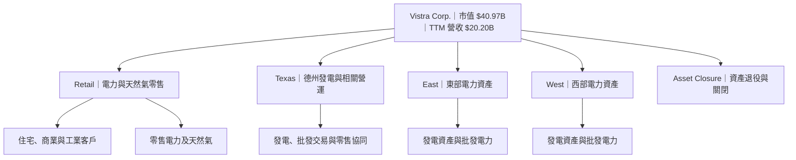
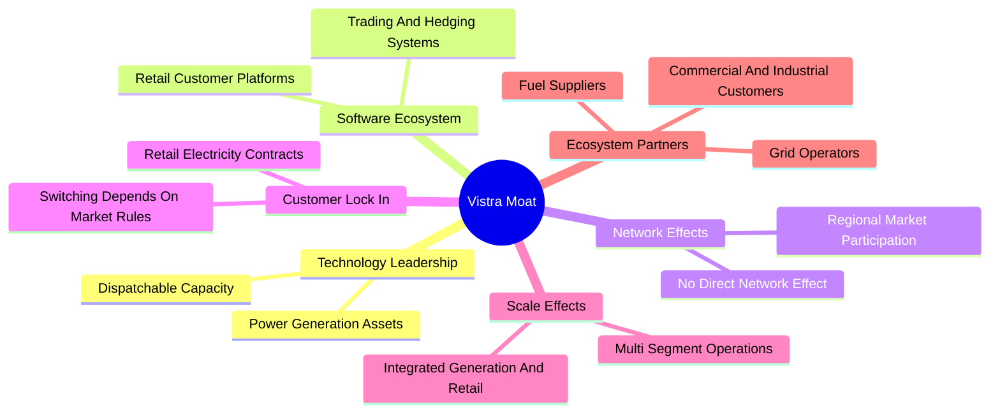
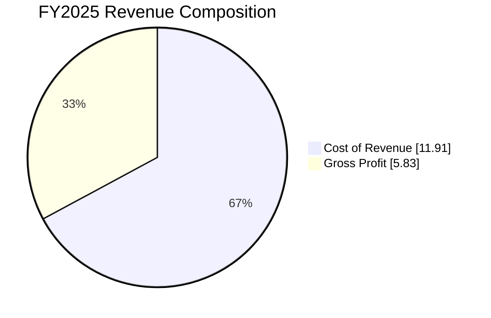
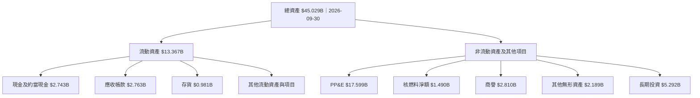
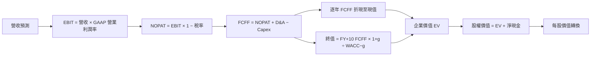
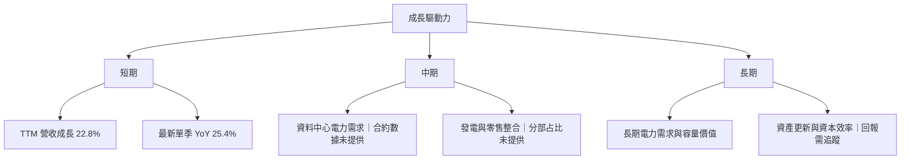
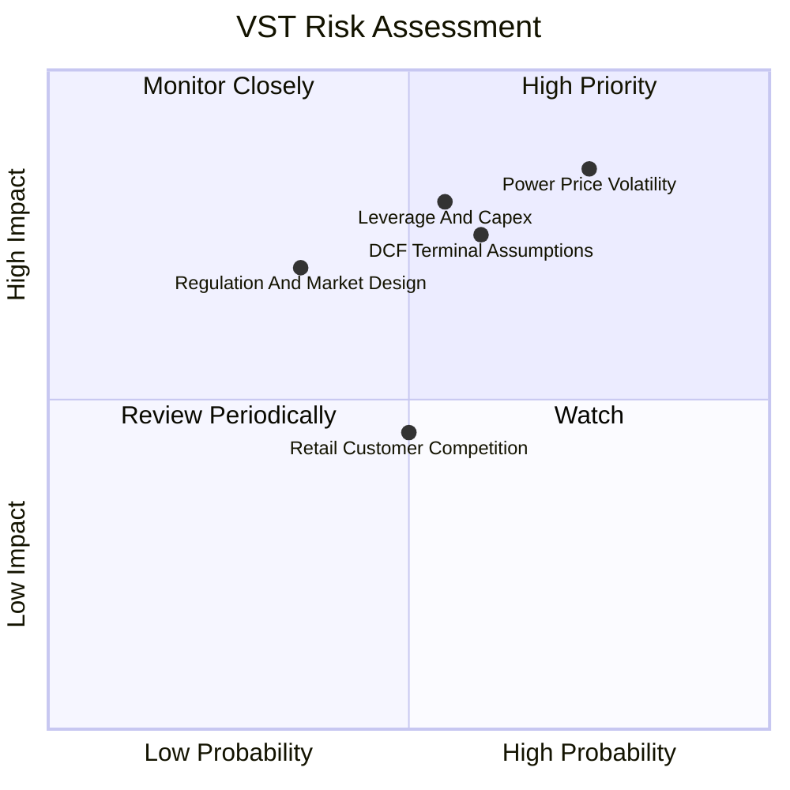
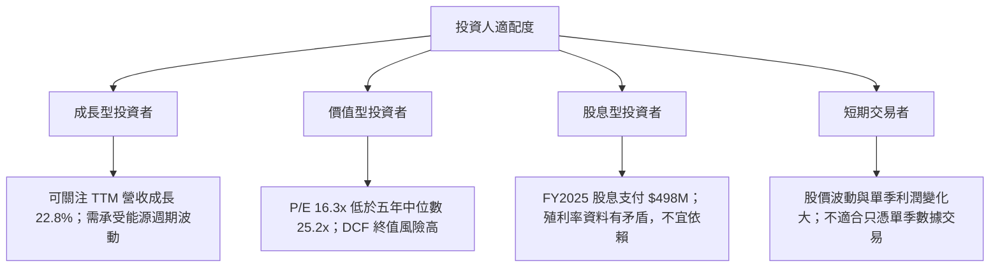

# VST 基本面深度分析報告
> **報告日期**：2026-11-25 ｜ **語言**：繁體中文 ｜ **數據來源**：SEC 申報資料 (XBRL)、Yahoo Finance、Finviz、StockAnalysis、Roic.ai ｜ **分析師**：CFA 級機構研究

## 目錄

| # | 章節 | 核心結論 |
|---|------|----------|
| 1 | 執行摘要 | 強烈買入；加權合理價值 $206.45；MOS 41.5% |
| 2 | 公司概覽與商業模式 | 發電資產與零售電力整合具規模優勢，市場份額數據未提供 |
| 3 | 損益表深度分析 | TTM 營收 $20.20B、TTM 成長 22.8%；最新單季年增 25.4%，利潤率有明顯波動 |
| 4 | 資產負債表分析 | 淨負債 $18.40B；流動性改善但槓桿仍需監控 |
| 5 | 現金流量深度分析 | TTM FCF $2.61B、FCF Yield 6.36%；資本支出高且現金流具週期性 |
| 6 | 獲利能力與資本效率 | ROIC 13.5% 高於 WACC 8.69%，目前創造經濟價值 |
| 7 | 相對估值分析 | P/E 低於自身五年中位數；不同估值法給出的價值區間分歧大 |
| 8 | DCF 內在價值評估 | 基準 DCF 每股 $300.42；終值佔 EV 66.4%，對長期假設敏感 |
| 9 | 成長催化劑 | 電力需求與資料中心相關需求是潛在推力；TAM 與可量化合約資料未提供 |
| 10 | 風險矩陣 | 電力價格／商品波動、資本需求與槓桿、DCF 終值假設為主要風險 |
| 11 | 投資建議 | 維持強烈買入評級；以季度 FCF、ROIC、資本支出與負債作為監控重點 |

---

## 1. 執行摘要

VST 的 **2026-11-24 收盤價為 $120.72**。截至 2026-09-30 的 TTM 營收為 **$20.20B**，TTM 年增 **22.8%**；TTM 營業利益率 **21.0%**、ROIC **13.5%**，高於 **8.69% WACC**，顯示目前投入資本仍創造正經濟價值。TTM FCF 為 **$2.61B**、FCF Yield **6.36%**。估值方面，DCF 基準價值為 **$300.42**，但同業 Forward P/E 法回推僅 **$105.40**；四種方法加權後合理價值為 **$206.45**，MOS **41.5%**。依規則 20，MOS ≥25% 且 ROIC > WACC，評級為 **強烈買入**；不作質化調整。需注意，DCF 對長期現金流假設依賴偏高，且公司淨負債 **$18.40B**。

### 1.0 一頁式投資儀表板（Portfolio Manager 30 秒速讀）

| 項目 | 內容 |
|------|------|
| **投資論點（3 句）** | ① TTM 營收年增 **22.8%**，最新單季年增 **25.4%**，業務需求與營收基礎仍在擴張。② TTM ROIC **13.5%** 高於 WACC **8.69%**，目前資本回報高於資金成本。③ TTM FCF **$2.61B**、FCF Yield **6.36%**，但須考量淨負債 **$18.40B** 和高資本支出。 |
| **綜合評分** | **7.2/10**（引用 1.1 評分卡） |
| **財務健康** | 🟡 現金及短期投資 **$2.74B**，總債務 **$21.15B**、淨負債 **$18.40B**；流動比率補充資料為 **1.157**，但速動比率 **0.477**。 |
| **ROIC vs WACC** | **13.5% vs 8.69%**；正利差 **4.81 個百分點**，目前創造股東價值。 |
| **FCF 趨勢** | TTM FCF **$2.61B**；年度 FCF 由 2023 年 **$3.78B** 降至 2025 年 **$1.32B**，雖 TTM FCF Yield 達 **6.36%**，仍需觀察持續性。 |
| **估值** | Forward P/E **12.375014x** ｜ EV/EBITDA（市場資料）**7.965x** ｜ FCF Yield **6.36%**。歷史估值比較的 EV/EBITDA 口徑為 **9.3x**，來源口徑不同，不混用。 |
| **DCF 內在價值（基準）** | **$300.42** ｜ 相對現價折價 **59.8%**（折溢價＝$120.72 ÷ $300.42 − 1）。 |
| **安全邊際（MOS）** | **41.5%＝($206.45 − $120.72) ÷ $206.45**（分母為第 8.8 節加權合理價值）｜ 🟢 >25% 充足。 |
| **預期報酬（基準情境 12M）** | DCF 基準情境相對現價 **+148.9%**；此為模型情境結果，不是保證的 12 個月報酬。 |
| **關鍵風險（前二）** | 電力價格與燃料／商品波動造成利潤率回落；淨負債與高資本支出壓抑可分配現金流。 |
| **評級 + 信心度** | 🟢 **強烈買入** ｜ 信心：中（DCF 與同業估值分歧顯著） |

### 1.1 綜合評分卡（全報告唯一）

| 維度 | 評分（1–10） | 主要依據（引用數字與其來源章節） |
|------|--------------|----------------------------------|
| 成長性 | 8.0 | TTM 營收成長 **22.8%**、最新單季 YoY **25.4%**（第 3 章）；成長受電力價格與需求週期影響。 |
| 獲利能力 | 8.0 | TTM 營業利益率 **21.0%**、ROIC **13.5%** 高於 WACC **8.69%**，Piotroski **7/8**（第 3、6 章）。 |
| 財務健康 | 6.0 | 淨負債 **$18.40B**；流動比率 **1.157**、速動比率 **0.477**（第 4 章）。 |
| 估值 | 8.0 | MOS **41.5%**；P/E **16.3x** 低於自身五年中位數 **25.2x**，但同業 Forward P/E 法回推低於現價（第 7、8 章）。 |
| 護城河 | 7.0 | 綜合發電與零售業務、六個營運區段提供整合及規模優勢；但市場份額、客戶留存等量化資料未提供（第 2 章）。 |
| 管理層與資本配置 | 6.0 | 2025 年股權薪酬 **$113M**、現金股息支付 **$498M**；稀釋股數測試通過，但資本支出與負債均高（第 5、6 章）。 |
| **綜合評分** | **7.2** | 六項算術平均：**(8.0 + 8.0 + 6.0 + 8.0 + 7.0 + 6.0) ÷ 6 = 7.2**。 |

### 1.2 五大投資論點 + 三大核心風險

| 類型 | 項目 | 具體依據 | 信心度 |
|------|------|----------|--------|
| 🟢 **投資論點①** | 營收增長加快 | TTM 營收 **$20.20B**、YoY **22.8%**；最新季度 YoY **25.4%**，擴大收入基礎可提升既有資產利用效率。 | 🟢 高 |
| 🟢 **投資論點②** | 資本回報超過資金成本 | ROIC **13.5%** 對比 WACC **8.69%**，利差 **4.81pp**；若維持，新增投資可創造價值。 | 🟢 高 |
| 🟢 **投資論點③** | TTM 現金流有支撐 | OCF **$5.76B** 減 Capex **$3.15B** 得 FCF **$2.61B**，FCF Yield **6.36%**。 | 🟢 高 |
| 🟢 **投資論點④** | P/E 低於自身歷史中位數 | P/E **16.3x**，低於五年中位數 **25.2x**，目前百分位 **20%**；若盈利能維持，估值有修復空間。 | 🟢 中 |
| 🟡 **投資論點⑤** | 資料中心與電力需求提供選擇權 | 近期新聞提及資料中心開發能見度及公司管理層評論，但沒有可核實的合約金額或收入貢獻。 | 🟡 中 |
| 🟡 **風險①** | 商品及電力價格循環 | 2025 年營業利益 **$2.13B**，低於 2024 年 **$4.08B**；價格或套期保值結果可使利潤大幅波動。 | 🟡 中 |
| 🔴 **風險②** | 淨負債與再投資壓力 | 淨負債 **$18.40B**，TTM Capex **$3.15B**；若 FCF 回落，降槓桿及股東回報會互相競爭。 | 🔴 高 |
| 🔴 **風險③** | DCF 終值與估值方法分歧 | 基準 DCF **$300.42**，同業 Forward P/E 法 **$105.40**；終值佔 EV **66.4%**，長期假設不成立時價值下修空間大。 | 🔴 高 |

### 1.3 快速統計卡片

| 指標 | 公司實際值（期間） | 同業中位數 | 狀態 |
|------|--------------------|------------|------|
| 營收成長（TTM） | **22.8%** | — | 🟢 |
| 營收成長（最新一季年增） | **25.4%** | **45.4%**（CEG、NRG、TLN） | 🟡 |
| 毛利率（TTM） | **N/A**（VERIFIED FIGURES 未列出） | **25.2%**（Peer multiples 所列三家公司中位數） | 🟡 |
| 營業利益率（TTM） | **21.0%** | — | 🟢 |
| ROIC（TTM） | **13.5%** | — | 🟢 |
| Forward P/E | **12.375014x** | **10.8x** | 🟡 |
| FCF Yield（TTM） | **6.36%** | — | 🟢 |
| Piotroski F-Score | **7 / 8** | — | 🟢 |

### 1.4 投資結論

```text
╔══════════════════════════════════════════════════════════════════╗
║                    📊 投資結論摘要                               ║
╠══════════════════════════════════════════════════════════════════╣
║  評級：強烈買入（依 MOS 41.5% 且 ROIC 13.5% > WACC 8.69%）      ║
║  價格（2026-11-24 收盤）：$120.72                                ║
║  DCF 內在價值（基準）：$300.42（折價 59.8%）                    ║
║  安全邊際 MOS：41.5%（＝(加權合理價值−現價)÷加權合理價值）       ║
║  加權合理價值（8.8）：$206.45                                    ║
║  DCF 情境價值：                                                   ║
║    悲觀情境：$101.41（-16.0%）                                   ║
║    基準情境：$300.42（+148.9%）                                  ║
║    樂觀情境：$707.06（+485.7%）                                  ║
║  綜合評分：7.2/10（引用 1.1）                                    ║
║  適合投資人：可承受電力價格與估值波動的成長型、長線投資人        ║
╚══════════════════════════════════════════════════════════════════╝
```

---

## 2. 公司概覽與商業模式

### 2.1 業務結構與收入來源

公司資料顯示 Vistra 在美國經營整合式零售電力與發電業務，主要分為 Retail、Texas、East、West、Asset Closure 五個區段。**各區段營收金額與占比未提供**，故不以推估比例繪圖；以下以已知營收與業務分部呈現，不將五個分部誤當成等額。



### 2.2 市場份額

市場份額數據未提供，無法可靠計算 Vistra 在全美或各區域的發電量、零售客戶數或市場份額。可觀察的量化位置是 TTM 營收 **$20.20B**，最新單季營收 YoY **25.4%**；CEG、NRG、TLN 的最新單季營收成長分別為 **45.4%、24.0%、96.1%**，但各公司規模與業務組合不同，單季成長率不能直接視為市場份額比較。

### 2.3 競爭護城河分析



### 2.4 護城河強度

| 護城河項目 | 強度（強／中／弱） | 證據（引用數字或事實） | 會削弱它的情況 |
|------------|--------------------|------------------------|----------------|
| 技術與資產組合 | 中 | 公司有 Texas、East、West 等發電營運區段，但裝置容量、機組效率、可用率未提供。 | 資產老化、檢修與退役成本上升，或新電源成本快速下降。 |
| 軟體與交易系統 | 中 | 整合式發電、批發交易與零售營運需要調度、風險管理和客戶系統；系統效率數據未提供。 | 風險管理失誤、交易損失或技術投入未轉化為成本優勢。 |
| 網路效應 | 弱 | 電力供應具區域網絡及市場參與特性，但缺乏平台式雙邊網路效應證據。 | 市場規則改變或區域連結改善，削弱既有地理優勢。 |
| 客戶鎖定 | 中 | 零售電力合約可能形成一定轉換成本，但客戶留存率、合約期限與客戶數未提供。 | 客戶可低成本轉換供應商、電價競爭加劇。 |
| 規模效應 | 中至強 | 五個營運區段、TTM 營收 **$20.20B**，且發電與零售整合可支援資產及客戶端協同。 | 燃料、電力價格與監管變化侵蝕整合效益。 |
| 生態夥伴 | 中 | 業務依賴電網、燃料供應商與企業客戶；關鍵合約數字未提供。 | 供應中斷、輸電瓶頸或大型客戶合約流失。 |

1.1 護城河評分為 **7.0/10**，依據是公司具多區段發電與零售整合規模，但客戶鎖定、市場份額及資產優勢缺少直接量化佐證。

---

## 3. 損益表深度分析

### 3.1 年度收入成長趨勢（近4年）

下列年度收入來自年度損益表補充資料，與 SEC 最新 TTM 數據口徑不同，年度資料用於歷史趨勢，不取代 TTM **$20.20B**。

```text
╔══════════════════════════════════════════════════════════════════╗
║                Vistra 年度收入趨勢（FY2022–FY2025）              ║
╠══════════════════════════════════════════════════════════════════╣
║  FY2022  $13.73B  ███████████████░░░░░░░░░░░░░  YoY：基期      ║
║  FY2023  $14.78B  ████████████████░░░░░░░░░░░░  YoY：+7.7%    ║
║  FY2024  $17.22B  ███████████████████░░░░░░░░░  YoY：+16.5%   ║
║  FY2025  $17.74B  ████████████████████░░░░░░░░  YoY：+3.0%    ║
║                                                                  ║
║  FY2022–FY2025 三年 CAGR：約 +8.9%                               ║
╚══════════════════════════════════════════════════════════════════╝
```

年度營收由 **$13.73B** 升至 **$17.74B**，三年 CAGR 約 **8.9%**；但 2025 年增速放慢至約 **3.0%**。與此不同，最新 TTM 營收成長為 **22.8%**，顯示近四季動能顯著高於 FY2025 年度結果，可能反映能源價格、供需或業務組合變化；是否可持續需由後續季度驗證。

### 3.2 季度收入趨勢分析

季營收依已列季度損益資料；最新季度 YoY 成長以 VERIFIED FIGURES **25.4%** 為準。表內 QoQ 為依季度表面數字計算，存在與其餘資料來源的口徑差異，解讀應著重季節性而非單季年化。

| 季度 | 營收 | QoQ | YoY | 備註 |
|------|------:|----:|----:|------|
| 2025-12-31 | $4.58B | 約 **-18.8%** | 約 **+13.5%** | 相對 2025-09 季度回落；電力業務季節性可能影響季度比較。 |
| 2026-03-31 | $5.64B | 約 **+23.1%** | 約 **+43.4%** | 季度營收反彈；單季變化不等於全年趨勢。 |
| 2026-06-30 | $4.02B | 約 **-28.7%** | 約 **-5.5%** | QoQ 下滑，顯示季度數據波動明顯。 |
| 2026-09-30 | $6.35B | 約 **+58.0%** | **+25.4%**（VERIFIED FIGURES） | 最新季 YoY 以 SEC 計算值為準；其他資料來源顯示的季度營收或成長率有差異。 |

### 3.3 利潤率演變分析

以下年度毛利率與營業利益率依年度損益表金額計算，僅作歷史比較；TTM 營業利益率採 VERIFIED FIGURES 的 **21.0%**。

| 利潤率指標 | FY2022 | FY2023 | FY2024 | FY2025 | 趨勢 | 評估 |
|------------|-------:|-------:|-------:|-------:|------|------|
| **毛利率** | 約 12.2% | 約 37.3% | 約 43.7% | 約 32.9% | 先升後降，電力價格與發電／零售組合對毛利影響大 | 🟡 |
| **營業利益率** | 約 -8.0% | 約 18.3% | 約 23.7% | 約 12.0% | 2024 高點後 2025 收縮；反映營運利潤波動 | 🟡 |
| **淨利率** | 約 -9.0% | 約 9.1% | 約 15.5% | 約 5.3% | 淨利受營業結果、利息與非營運項目共同影響 | 🟡 |

**利潤率演變深度解析：** FY2024 營業利益率約 **23.7%**，FY2025 降至約 **12.0%**，與營業利益由 **$4.08B** 降至 **$2.13B** 一致。年度營收仍增加約 **3.0%**，但毛利與營業利益下降，意味營收成長並未轉化為同比例的利潤增長。電力批發價格、燃料成本、避險結果及發電／零售組合可能是重要驅動因素，但提供的資料不足以拆分各因素貢獻。TTM 營業利益率 **21.0%** 及最新季度 **28.5%** 高於 FY2025，顯示最近期間改善；需警惕該改善可能受價格或單季組合影響。

### 3.4 費用結構分析

2025 年收入 **$17.74B**、毛利 **$5.83B**，可推得營業成本約 **$11.91B**。以下只拆分「營業成本與毛利」，不是完整營業費用表，也不代表各種費用項目的全貌。



```text
╔══════════════════════════════════════════════════════════════════╗
║                 FY2025 收入至毛利的簡化拆分                     ║
╠══════════════════════════════════════════════════════════════════╣
║  營收            $17.74B  ██████████████████████████████         ║
║  營業成本        $11.91B  ████████████████████                   ║
║  毛利             $5.83B  ██████████                             ║
║  毛利率：約 32.9%                                                  ║
║  註：不含未提供的各項營業費用明細。                               ║
╚══════════════════════════════════════════════════════════════════╝
```

### 3.5 季度 EPS 趨勢與盈餘品質（Quality of Earnings）

EPS 預估值在四個季度均為 NaN，因此無法判斷實際 EPS 是否超預期或不及預期。以下實際 EPS 參考 StockAnalysis 數據，來源間口徑有差異，不能代替 SEC 申報中的一致化 EPS 序列。

| 季度 | 實際 EPS（補充資料） | QoQ 變化 | 超預期／不及預期 | 解讀 |
|------|---------------------:|---------:|------------------|------|
| 2025-12-31 | $0.54 | — | N/A：預估值缺漏 | 盈利為正，但無法比較共識。 |
| 2026-03-31 | $2.87 | 約 **+431.5%** | N/A：預估值缺漏 | 季度獲利大幅上升；季節性或能源價格可能造成波動。 |
| 2026-06-30 | $0.76 | 約 **-73.5%** | N/A：預估值缺漏 | EPS 回落，凸顯季度盈利波動。 |
| 2026-09-30 | $3.23 | 約 **+325.0%** | N/A：預估值缺漏 | 最新季度 EPS 回升；來源間淨利數字不同，須以 SEC 報表核對。 |

| 盈餘品質項目 | 數值/佔比 | 評估 |
|--------------|-----------|------|
| 股權薪酬 SBC / 營收 | FY2025 **$113M ÷ $17.74B ≈ 0.64%** | 🟢 比重低於 1%；仍是股東成本，須留意稀釋。 |
| SBC / 營業現金流 | FY2025 **$113M ÷ $4.07B ≈ 2.8%** | 🟢 相對 OCF 不高。 |
| FCF / 淨利（現金轉換率） | TTM 淨利未在 VERIFIED FIGURES 提供，**N/A** | 無法以統一 TTM 口徑計算；不可用其他來源數字替代。 |
| 一次性／非經常性損益 | 無法由已列資料定量拆分 | 🟡 電力企業可能受商品避險、資產交易與減損影響，須以 10-Q 附註核對。 |
| 有效稅率異常 | **15.9%**（最新年度有效稅率） | 🟢 DCF 採此值；單一年度稅率不一定代表長期邊際稅率。 |
| 資本化支出 vs 費用化 | TTM Capex **$3.15B**；資本化／費用化細目未提供 | 🟡 電廠資本支出依資產壽命資本化並折舊；未提供明細，不能判斷是否遞延成本。 |

**盈餘品質結論：** TTM OCF **$5.76B** 大於 TTM FCF **$2.61B**，差額反映 **$3.15B** 資本支出。SBC 以 FY2025 作代理，約佔營收 **0.64%**，稀釋壓力目前不大；但未提供一致口徑 TTM 淨利，無法計算現金轉換率。因營業利益與淨利年度波動大，估值應以多年度現金流而非單季 EPS 外推。

---

## 4. 資產負債表分析

### 4.1 資產結構分解

資產結構引用截至 2026-09-30 的 StockAnalysis 補充資料：總資產 **$45.029B**、流動資產 **$13.367B**、PP&E **$17.599B**。其餘項目為資產表所列明細；未列項目不作推算。



### 4.2 流動性與營運資金分析

| 流動性指標 | 最新可得值 | 趨勢／評估 |
|------------|-----------:|------------|
| 流動比率 | **1.157**（補充市場財務資料） | 略高於 1，短期流動資產約可覆蓋流動負債，但安全緩衝不厚。 |
| 速動比率 | **0.477**（補充市場財務資料） | 低於 1，除存貨外的短期資產覆蓋能力有限。 |
| 現金及短期投資 | **$2.74B** | 對比總債務 **$21.15B**，現金緩衝有限。 |

營運資金天數依 QUALITY FIGURES 照錄，不重算：

| 指標 | 最新 TTM | 一年前 TTM | 變化 | 解讀 |
|------|---------:|----------:|------:|------|
| DSO 應收帳款天數 | **50 天** | **52 天** | **-2 天** | 收款週期略縮短，對營運資金占用有利；未提供客戶組合資料，無法判斷原因。 |
| DIO 存貨天數 | **30 天** | **N/A** | N/A | 一年前公司未報告相應存貨餘額或資料不足，不補推。 |
| DPO 應付帳款天數 | **45 天** | **N/A** | N/A | 一年前資料不足，不能判斷付款期限變化。 |
| CCC 現金轉換週期 | **34 天** | **N/A** | N/A | 最新值為 50 + 30 − 45 = 35 天，但 VERIFIED FIGURES 指定 CCC **34 天**；照錄來源值，不以公開四捨五入數重算。 |

### 4.3 債務結構分析

```text
╔══════════════════════════════════════════════════════════════════╗
║                    Vistra 債務健康診斷                           ║
╠══════════════════════════════════════════════════════════════════╣
║  總債務：        $21.15B  █████████████████████  🟡             ║
║  現金及短期投資： $2.74B  ███░░░░░░░░░░░░░░░░░░  🟡             ║
║  淨負債：        $18.40B  ██████████████████░░░  🔴             ║
║                                                                  ║
║  ROIC：          13.5%    高於資本成本，但非去槓桿指標           ║
║  WACC：           8.69%    ROIC-WACC 利差為 +4.81pp              ║
║  Debt/EBITDA：    N/A      缺少 VERIFIED TTM EBITDA 對應口徑     ║
║  利息保障倍數：   N/A      缺少一致口徑利息費用及 EBIT 明細       ║
╚══════════════════════════════════════════════════════════════════╝
```

市場資料另列總債務 **$21.77B**、淨負債 **$19.02B**，與 VERIFIED FIGURES 的 **$21.15B**、**$18.40B** 不同。本報告依優先規則在核心分析採用 VERIFIED FIGURES；差異可能來自資料時間點、負債項目範圍或資料庫更新時間，需以 10-Q 資產負債表核對。

### 4.4 股東權益趨勢

| 年末 | 股東權益 |
|------|---------:|
| 2022-12-31 | $4.90B |
| 2023-12-31 | $5.31B |
| 2024-12-31 | $5.57B |
| 2025-12-31 | $5.10B |

```text
╔══════════════════════════════════════════════════════════════════╗
║                 股東權益歷史變化（年度）                         ║
╠══════════════════════════════════════════════════════════════════╣
║  2022  $4.90B  ██████████████████░░                             ║
║  2023  $5.31B  ████████████████████                             ║
║  2024  $5.57B  █████████████████████                            ║
║  2025  $5.10B  ███████████████████                              ║
║  2024→2025：減少 $0.47B；原因需以完整權益變動表核對。          ║
╚══════════════════════════════════════════════════════════════════╝
```

---

## 5. 現金流量深度分析

### 5.1 現金流量瀑布圖

季度與年度現金流項目在資料中可取得，但最新 TTM 淨利、回購及淨現金變化拆分不完整。圖示按已知 TTM 數字呈現，沒有資料的節點明確標為未提供。


### 5.2 FCF 轉換率趨勢

| 年度 | FCF | 淨利 | FCF / 淨利 |
|------|----:|-----:|-----------:|
| 2022 | **-$0.816B** | **-$1.23B** | 約 **66.3%**；負值分子與分母下，經濟含義有限 |
| 2023 | **$3.78B** | **$1.49B** | 約 **253.7%** |
| 2024 | **$2.48B** | **$2.66B** | 約 **93.2%** |
| 2025 | **$1.32B** | **$0.944B**（年度損益表） | 約 **139.8%** |
| TTM 至 2026-09-30 | **$2.61B** | N/A（VERIFIED FIGURES 未提供 TTM 淨利） | N/A |

年度 FCF/淨利比率受發電業資本支出及商品週期影響，不宜只看單一年。FY2023 比率高，FY2024 降至約 **93.2%**，FY2025 再升至約 **139.8%**；2025 年淨利低於 FCF，可能由營運資金、折舊及資本支出時間差共同造成，完整現金流調節表未提供，不能進一步歸因。

### 5.3 自由現金流趨勢

| 年度 | FCF | YoY | FCF Yield |
|------|----:|----:|---------:|
| 2022 | **-$0.816B** | — | N/A |
| 2023 | **$3.78B** | — | N/A |
| 2024 | **$2.48B** | 約 **-34.4%** | N/A |
| 2025 | **$1.32B** | 約 **-46.8%** | N/A |
| TTM 至 2026-09-30 | **$2.61B** | 相較 FY2025 不作期間錯配比較 | **6.36%** |

```text
╔══════════════════════════════════════════════════════════════════╗
║                 FCF 歷史實際與最新 TTM                           ║
╠══════════════════════════════════════════════════════════════════╣
║  FY2022  -$0.816B  ◀ 低於零                                      ║
║  FY2023   $3.780B  ████████████████████                         ║
║  FY2024   $2.480B  █████████████                                ║
║  FY2025   $1.320B  ███████                                      ║
║  TTM      $2.610B  ██████████████  FCF Yield：6.36%             ║
╚══════════════════════════════════════════════════════════════════╝
```

### 5.4 資本配置評估

FY2025 可取得的股息、資本支出與股權薪酬數字如下；回購、留存及公司總投資用途未完整提供，故不作百分比分配圖。

| 資本配置項目 | FY2025 數值 | 解讀 |
|--------------|-----------:|------|
| 資本支出 | **$2.75B** | 維持及擴張發電資產需大量資本；資本支出下降可能提升 FCF，但也可能影響資產可靠度或成長。 |
| 現金股息支付 | **$498M** | 約為 FY2025 FCF **$1.32B** 的 37.7%；資料庫另列殖利率 **75.0%**，與 payout ratio **12.4%** 明顯矛盾，不採用該殖利率作投資依據。 |
| 股票回購 | N/A | 未提供年度回購金額。 |
| 股權薪酬 | **$113M** | FY2025 股權薪酬；Piotroski 稀釋股數測試通過，但仍須觀察未來股數變化。 |
| 留存／債務償還 | N/A | 未提供足夠分拆數字。 |

---

## 6. 獲利能力與資本效率

### 6.1 ROE / ROA / ROIC 趨勢

只有最新 TTM ROIC、ROE 可由 VERIFIED FIGURES 直接引用；歷年 ROIC、ROA 未以同一計算口徑提供，避免混入其他資料來源的不同算法。

| 指標 | 可用數值 | 評估 |
|------|---------:|------|
| ROIC（TTM） | **13.5%** | 高於 WACC **8.69%**，正利差 **4.81pp**。 |
| ROE（TTM） | **42.9%** | 表面回報高，但權益乘數 **7.14x** 顯示槓桿對 ROE 有顯著放大。 |
| ROA（TTM） | N/A（VERIFIED FIGURES 未提供；QUALITY FIGURES 只提供 F-Score 測試結果） | 不補算。 |
| 歷年趨勢／行業均值 | N/A | 一致口徑歷史與同業 ROIC／ROA 數據未提供。 |

### 6.2 ROIC vs WACC 分析（核心價值創造判斷）

```text
╔══════════════════════════════════════════════════════════════════╗
║                ROIC vs WACC 深度分析                            ║
╠══════════════════════════════════════════════════════════════════╣
║  WACC（採用 VERIFIED FIGURES）：                                 ║
║  ├── 無風險利率（10Y 美債）：       4.90%                       ║
║  ├── 市場風險溢酬 ERP：             5.00%                       ║
║  ├── Beta（調整後）：               1.25                        ║
║  ├── 股權成本 Ke：                  11.15%                      ║
║  ├── 稅前債務成本 Kd：              4.64%                       ║
║  ├── 稅後債務成本：                 3.90%                       ║
║  ├── 資本結構 E / D：               66.0% / 34.0%               ║
║  └── ✅ WACC：                      8.69%                       ║
║                                                                  ║
║  ROIC（TTM）：                 13.5%                             ║
║  EVA 利差：                    13.5% − 8.69% = +4.81pp          ║
║                                                                  ║
║  ROIC  13.5%  ▓▓▓▓▓▓▓▓▓▓▓▓▓▓▓░░░░░  高於 WACC                  ║
║  WACC   8.69% ▓▓▓▓▓▓▓▓▓░░░░░░░░░░░  資本成本基準                ║
║                                                                  ║
║  結論：ROIC / WACC = 13.5% ÷ 8.69% ≈ 1.55 倍，現階段創造價值。 ║
╚══════════════════════════════════════════════════════════════════╝
```

依 VERIFIED FIGURES，股權成本 **11.15%**、稅前債務成本 **4.64%**、有效稅率 **15.9%**、E/D 權重 **66.0%/34.0%**。檢核式為：**11.15% × 66.0% + [4.64% × (1 − 15.9%)] × 34.0% ≈ 8.69%**。債務成本取數據庫計算值；利息費用與平均計息負債的原始金額未提供，故無法自行重建 Kd 分子與分母。

ROIC **13.5%** 高於 WACC **8.69%**，目前利差為正；若競爭或資產退役成本使 ROIC 跌至 8.69% 以下，新增投資便可能不再創造價值。此 ROIC 是 TTM 指標，不代表每個發電項目或未來新增投資均有相同回報。

### 6.3 杜邦三因素分解

| 因素 | 數值（TTM） | 解讀 |
|------|-------------|------|
| 淨利率 | **13.4%** | 淨利對收入的貢獻。 |
| 資產週轉率 | **0.45x** | 資產密集型發電業的收入轉換效率。 |
| 權益乘數 | **7.14x** | 槓桿放大 ROE，是高 ROE 的重要來源。 |
| **ROE** | **42.9%** | **13.4% × 0.45 × 7.14 = 43.0%**，與來源列示 **42.9%** 的差異為四捨五入。 |

ROE 不宜直接解讀為純營運回報：權益乘數 **7.14x** 表示財務槓桿貢獻顯著，須與 ROIC **13.5%**、淨負債 **$18.40B** 同時評估。

### 6.4 財務體質：Piotroski F-Score

QUALITY FIGURES 列示 **7 / 8**；毛利率測試因缺少輸入而排除，分母因此不是九項。

| 測試 | 結果 | 解讀 |
|------|------|------|
| ROA > 0 | ✅ 通過 | 盈利能力測試為正。 |
| 營業現金流 > 0 | ✅ 通過 | TTM OCF 為 **$5.76B**。 |
| ROA 高於一年前 | ✅ 通過 | 獲利趨勢改善。 |
| 營業現金流 > 淨利 | ✅ 通過 | 現金流高於淨利，應計品質測試通過。 |
| 長期負債 ÷ 總資產低於一年前 | ❌ 未通過 | 負債占資產比未改善，反映槓桿仍需關注。 |
| 流動比率高於一年前 | ✅ 通過 | 短期流動性相對改善。 |
| 稀釋股數未增加 | ✅ 通過 | 股數測試通過，但不能因此視為 SBC 沒有股東成本。 |
| 毛利率高於一年前 | — 無法判定 | 缺少資料，按規則排除。 |
| 資產週轉率高於一年前 | ✅ 通過 | 資產效率測試通過。 |

---

## 7. 相對估值分析

### 7.1 同業估值比較表格

同業倍數依 Peer multiples 區塊照錄；VST 市場倍數採估值資料，Forward P/E 本公司為補充市場數據值 **12.375014x**。VST EV/EBITDA 市場資料 **7.965x**，與自身歷史序列 **9.3x** 口徑／時間點不同，表內以市場估值欄為參考，並在歷史比較另列歷史數值。

| 估值指標 | **VST** | **CEG** | **NRG** | **TLN** | 本公司評估 |
|----------|--------:|-------:|-------:|-------:|-----------|
| **Trailing P/E** | **16.3x** | 19.7x | 15.9x | N/A | 🟡 位於兩家有資料同業之間。 |
| **Forward P/E** | **12.375014x** | 18.3x | 9.4x | 10.8x | 🟡 高於三家同業中位數 **10.8x**，但低於 CEG。 |
| **P/S Ratio** | **2.0x** | 2.5x | 0.5x | 3.4x | 🟡 高於 NRG，低於 CEG、TLN；業務組合差異大。 |
| **EV/EBITDA（TTM）** | **7.965x** | 11.5x | 10.4x | 36.2x | 🟢 低於同業中位數 **11.5x**；TLN 倍數偏高，對中位數有影響。 |
| **最新季度營收 YoY** | **25.4%** | 45.4% | 24.0% | 96.1% | 🟡 高於 NRG、低於 CEG 與 TLN。 |
| **毛利率（TTM）** | N/A | 25.2% | 20.2% | 42.7% | — VST VERIFIED FIGURES 未提供一致口徑數值。 |

### 7.2 歷史估值區間分析

```text
╔══════════════════════════════════════════════════════════════════╗
║                    VST 五年 P/E 歷史位置                         ║
╠══════════════════════════════════════════════════════════════════╣
║  五年低點：7.2x ───── 中位數：25.2x ───── 高點：74.3x             ║
║  現在：16.3x；百分位排名：20%                                    ║
║  P/E：低於中位數；現值接近自身歷史區間低端。                    ║
║                                                                  ║
║  P/S：現在 2.0x｜中位數 1.8x｜範圍 0.5x–4.2x｜百分位 52%       ║
║  EV/EBITDA：現在 9.3x｜中位數 11.0x｜範圍 2.3x–40.7x｜百分位 35%║
╚══════════════════════════════════════════════════════════════════╝
```

歷史 P/E 百分位 **20%** 支持「低於自身常態」的觀察，但能源業盈利具週期性，低 P/E 也可能反映市場預期利潤回落，不能單獨作為低估證明。

### 7.3 情境價值（Bear / Base / Bull）

以下數據照錄 DCF MODEL。概率為模型情境權重，不等於客觀發生機率。

| 情境 | 第 1 年營收成長 | 期末營業利潤率 | WACC | 每股價值 | 相對現價 | 機率 | 會發生的條件 |
|------|----------------:|----------------:|-----:|----------:|---------:|-----:|--------------|
| 🔴 悲觀 | **11.4%** | **16.4%** | **9.69%** | **$101.41** | **-16.0%** | **25%** | 電力價格與發電毛利正常化、增長降速，資本成本上升。 |
| 🟡 基準 | **22.8%** | **19.3%** | **8.69%** | **$300.42** | **+148.9%** | **50%** | TTM 高增長延續初期，之後逐步放緩，成熟期利潤率仍接近歷史中位數。 |
| 🟢 樂觀 | **34.3%** | **21.2%** | **7.69%** | **$707.06** | **+485.7%** | **25%** | 電力需求增長強於基準、利潤率保持較高，且資金成本下降。 |

### 7.4 相對估值隱含價格區間

```text
╔══════════════════════════════════════════════════════════════════╗
║                  相對估值與股價位置                              ║
╠══════════════════════════════════════════════════════════════════╣
║  $105.40 ───── $120.72 ───── $160.86 ───── $197.18 ───── $300.42║
║  Forward P/E       現價       EV/EBITDA     分析師共識    DCF基準║
╚══════════════════════════════════════════════════════════════════╝
```

| 方法 | 每股價值 | 依據 |
|------|---------:|------|
| 同業 Forward P/E | **$105.40** | 同業中位數 **10.8x** × 公司 Forward EPS **$9.76**。 |
| 同業 EV/EBITDA | **$160.86** | 同業中位數 **11.5x** × TTM EBITDA，再加回淨現金／扣除淨負債的模型橋接。 |
| 分析師共識目標價 | **$197.18** | 23 位分析師平均目標價。 |
| DCF 基準 | **$300.42** | 10 年 FCFF、WACC **8.69%**、永續成長 **3.0%**。 |

Forward P/E 法指向現價以下，EV/EBITDA 法、分析師共識及 DCF 高於現價；估值分歧顯示市場對 VST 中長期利潤持續性的判斷不同。

---

## 8. DCF 內在價值評估（Discounted Cash Flow）

> 數據採用程式計算的 DCF MODEL，不另建模型、不調整任何模型輸入。金額單位為美元十億，股價為美元。模型輸出小數受四捨五入影響；表內逐項展示值與模型未四捨五入結果可能有不超過 1% 的尾差。

### 8.0 估值推理鏈（Thinking Logic：在算之前先想清楚）

**Step 1 — 價值由何而來？**  
模型價值由既有發電與零售業務所產生的現金流，以及電力需求成長的延伸共同決定；五個區段營收占比未提供，不能把成長來源拆成具體占比。主導估值變數是 **終值現金流與折現率差距 WACC−g**：基準 DCF 的終值現值佔 EV **66.4%**，因此長期成長率或 WACC 的小幅變動會明顯改變價值。

**Step 2 — 模型選擇**

| 決策點 | 本報告採用 | 理由（含數字） | 曾考慮但否決 | 否決理由 |
|--------|-----------|----------------|--------------|----------|
| 現金流定義 | FCFF | 以 WACC 折現後得到 EV，再用淨負債橋接股權價值。 | FCFE | 債務資本結構不應在模型現金流中先行扣除。 |
| 預測期 N | **10 年** | DCF MODEL 固定 10 年；收入增長由 **22.8%** 線性降至 **3.0%**。 | 5 年 | 無法照抄既定模型，且高成長淡出需要更長期呈現。 |
| 終值方法 | Gordon Growth | 模型指定永續成長率 **3.0%**，且低於 WACC **8.69%**。 | 退出倍數作主模型 | MODEL 未提供退出倍數終值數據，不自行增加。 |
| EBIT 基礎 | GAAP EBIT | TTM 營業利潤率 **21.0%**；GAAP EBIT 已將 SBC 列為費用。 | 非 GAAP EBIT | 未提供統一非 GAAP 調整數據。 |

**Step 3 — 假設推導鏈**

- **營收成長**：錨點＝TTM 營收年增 **22.8%** → 調整＝模型以線性淡出反映高基期及成長逐步正常化 → **第 1 年採 22.8%，第 10 年 3.0%** → 曾考慮永久維持 22.8%，但否決，因不符合成熟期成長遞減的長期邏輯。
- **營業利潤率**：錨點＝TTM **21.0%**；近年年度營業利益率約由 2024 年 **23.7%** 降至 2025 年 **12.0%** → 調整＝模型使用最近五個財年的中位數作期末回歸錨點 → **第 1 年 21.0%，第 10 年 19.3%** → 曾考慮採 23.7%，但否決，因 2024 高點可能不具持續性。
- **永續成長率 g**：錨點＝長期名目經濟成長的保守參考；該參考值在數據中未列明 → 調整＝以成熟公司長期成長低於短期高增長處理 → **採用 3.0%（模型值）** → 否決高於 3.0% 的基準值，避免終值增長假設過度激進；且必須小於 WACC。
- **預測期 N**：錨點＝模型預測期指定 **10 年** → 調整＝不另調整，完整呈現高增長淡出 → **採用 10 年** → 否決縮短至 5 年，因與已計算模型不同。
- **Capex/營收**：錨點＝TTM Capex/營收 **15.6%** → 調整＝模型逐步下降至折舊攤銷的 **1.1 倍** → **第 1 年 15.6%，第 10 年 11.5%** → 不採永久固定 15.6%，因成熟階段投資強度可收斂，但該收斂仍有執行風險。
- **GAAP EBIT、SBC、股數**：錨點＝GAAP EBIT、公司年度 SBC FY2025 **$113M**，Piotroski 稀釋股數測試通過 → 採用組合 **(A)**，模型已假設 EBIT 含 SBC、FCFF 不再扣 SBC、股數不再額外稀釋 → 否決另扣 SBC 或另加稀釋率，避免重複計算。
- **D&A/營收**：錨點＝TTM **10.4%** → **採用 10.4% 固定**；數據未提供足夠歷史序列作其他調整。
- **有效稅率**：錨點＝最新年度 **15.9%** → **採用 15.9%**；模型不另行假設長期稅率變化。
- **ΔWC**：模型明確未建模，故不在 FCFF 中另扣；營運資金天數有最新值，但缺少模型完整營運資金變動序列，不能擅自補入。
- **WACC**：錨點＝程式計算 **8.69%**，組成見 8.2 → 按規則直接採用，不另調高或調低；否決自行重新估算替代 WACC，避免和模型結果不一致。
- **終值方法**：採模型已計算的 Gordon Growth；因未提供退出倍數終值，不能把同業倍數擅自加進模型作另一個終值。

**Step 4 — 最脆弱環節**  
最脆弱環節是 10 年收入增長與 19.3% 期末利潤率的組合；若實際成長與毛利正常化快於模型，價值會向悲觀情境 **$101.41** 靠攏，而非基準 **$300.42**。

**Step 5 — 計算路徑圖**



### 8.1 模型假設總表（Model Inputs）

| 假設項目 | 採用值 | 依據 / 來源 | 敏感度 |
|----------|--------|-------------|--------|
| 預測期長度 **N** | **10 年** | DCF MODEL 指定；收入成長由 22.8% 淡出至 3.0%。 | 🟡 中 |
| 營收成長 | 第 1 年 **22.8%**，第 10 年 **3.0%** | TTM vs prior TTM 成長 **22.8%**；模型線性淡出。 | 🔴 高 |
| 營業利潤率 | 第 1 年 **21.0%** → 第 10 年 **19.3%** | TTM 營業利益率 21.0%；期末取近五年中位數模型值。 | 🔴 高 |
| 有效稅率 | **15.9%** | 最新年度有效稅率。 | 🟢 低 |
| Capex / 營收 | 第 1 年 **15.6%** → 第 10 年 **11.5%** | TTM 值 15.6%，淡出至 1.1×D&A。 | 🟡 中 |
| D&A / 營收 | **10.4%** | TTM 比率，模型固定。 | 🟢 低 |
| 營運資金變動 | **未建模／0 列項** | DCF MODEL 明確不建模 working capital；不是資料已證明 WC 不變。 | 🟢 低 |
| EBIT 基礎 | **GAAP EBIT** | 模型明列 GAAP EBIT；TTM 營業利益率 21.0%。 | 🟡 中 |
| SBC 處理 | **組合 (A)：GAAP EBIT + 固定股數** | GAAP 已含 SBC 費用，模型不再扣 SBC、不再增加稀釋。 | 🟡 中 |
| 年稀釋率 | **0%（模型固定股數）** | 配合 SBC 組合 (A)，避免重複扣成本。 | 🟡 中 |
| 永續成長率 g | **3.0%** | DCF MODEL；且 3.0% < WACC 8.69%。 | 🔴 高 |
| 終值方法 | **Gordon Growth** | 模型直接提供終值計算；未提供退出倍數結果。 | 🔴 高 |
| WACC | **8.69%** | Cost of capital VERIFIED FIGURES；詳見 8.2。 | 🔴 高 |

模型使用 FCFF，基礎算式為 **NOPAT + D&A − Capex**，因 working capital 未建模，未列 ΔWC。**本模型採用 (A)：GAAP EBIT + 固定股數，故 SBC 影響已計入一次。**

### 8.2 折現率推導（WACC）

```text
╔══════════════════════════════════════════════════════════════════╗
║                    WACC 推導（折現率）                           ║
╠══════════════════════════════════════════════════════════════════╣
║  股權成本 Ke（CAPM）：                                            ║
║  ├── 無風險利率 Rf：                   4.90%                     ║
║  ├── 市場風險溢酬 ERP：                 5.00%                     ║
║  ├── 原始 Beta：                        1.38                      ║
║  ├── 調整後 Beta：                      1.25                      ║
║  ├── 規模／國別溢酬：                   0.00%（模型未加計）       ║
║  └── Ke = 4.90% + 1.25 × 5.00% =      11.15%                    ║
║                                                                  ║
║  債務成本 Kd：                                                    ║
║  ├── 稅前 Kd：                          4.64%                     ║
║  ├── 有效稅率：                         15.9%                     ║
║  └── 稅後 Kd = 4.64% × (1−15.9%) =      3.90%                    ║
║                                                                  ║
║  資本權重：E = 66.0%；D = 34.0%                                  ║
║  ✅ WACC = 66.0%×11.15% + 34.0%×3.90% = 8.69%                   ║
╚══════════════════════════════════════════════════════════════════╝
```

1. **Ke（CAPM）** = Rf + β × ERP = **4.90% + 1.25 × 5.00% = 11.15%**。原始 Beta **1.38**，調整方式為 **⅔ × 1.38 + ⅓ × 1 = 1.25**；10 年美債利率及 ERP 日期／具體估計方法未提供，照錄成本資本資料。
2. **稅前 Kd** = **4.64%**（程式計算值）。利息費用金額與平均計息負債分母未提供，故無法重建金額除法；此處不將應付帳款當作債務。
3. **稅後 Kd** = 4.64% × (1 − 15.9%) = **3.90224% ≈ 3.90%**。
4. **權重** = E **66.0%**、D **34.0%**，合計 **100.0%**。Cost of capital 區塊以市值／債務權重直接提供；市值數據為 **$40.97B**，債務權重口徑由程式計算。原始輸入未提供同一期末計息負債與股權市值權重完整重建明細。
5. **WACC** = 66.0% × 11.15% + 34.0% × [4.64% × (1 − 15.9%)] = 7.359% + 1.32676% = **8.68576% ≈ 8.69%**。

第 6.2 節與 DCF 一律使用 **8.69%**，不另估第二套 WACC。Kd 金額重建資料不足，是 WACC 稽核限制。

### 8.3 逐年自由現金流預測（基準情境）

| 年度 | FY+1 | FY+2 | FY+3 | FY+4 | FY+5 | FY+6 | FY+7 | FY+8 | FY+9 | FY+10 |
|------|-----:|-----:|-----:|-----:|-----:|-----:|-----:|-----:|-----:|------:|
| 營收 | 24.81 | 29.93 | 35.45 | 41.20 | 46.98 | 52.54 | 57.59 | 61.85 | 65.07 | 67.03 |
| 營收 YoY | 22.8% | 20.6% | 18.4% | 16.2% | 14.0% | 11.8% | 9.6% | 7.4% | 5.2% | 3.0% |
| 營業利潤率 | 21.0% | 20.8% | 20.6% | 20.4% | 20.2% | 20.0% | 19.8% | 19.6% | 19.4% | 19.3% |
| EBIT（GAAP） | 5.20 | 6.22 | 7.29 | 8.40 | 9.49 | 10.51 | 11.41 | 12.14 | 12.65 | 12.91 |
| − 稅 | (0.83) | (0.99) | (1.16) | (1.34) | (1.51) | (1.68) | (1.82) | (1.94) | (2.02) | (2.06) |
| = NOPAT | 4.37 | 5.22 | 6.13 | 7.06 | 7.98 | 8.84 | 9.60 | 10.21 | 10.64 | 10.85 |
| + D&A | 2.58 | 3.12 | 3.69 | 4.29 | 4.89 | 5.47 | 6.00 | 6.44 | 6.78 | 6.98 |
| − Capex | (3.88) | (4.54) | (5.21) | (5.86) | (6.47) | (6.99) | (7.40) | (7.66) | (7.75) | (7.68) |
| **= FCFF** | **3.08** | **3.80** | **4.61** | **5.49** | **6.40** | **7.32** | **8.20** | **8.99** | **9.66** | **10.15** |
| 折現因子 @8.69% | 0.920 | 0.847 | 0.779 | 0.717 | 0.659 | 0.607 | 0.558 | 0.514 | 0.473 | 0.435 |
| **FCFF 現值 PV** | **2.83** | **3.22** | **3.59** | **3.93** | **4.22** | **4.44** | **4.57** | **4.62** | **4.56** | **4.41** |

預測期 PV 逐項加總（以表內已四捨五入 PV）：  
**$2.83 + $3.22 + $3.59 + $3.93 + $4.22 + $4.44 + $4.57 + $4.62 + $4.56 + $4.41 = $40.39B**。模型未四捨五入合計為 **$40.41B**，差異約 **0.05%**，在四捨五入尾差範圍內。

**逐步演算（FY+1；金額以模型表列小數呈現）：**

1. **營收** = $20.20B × (1 + 22.8%) = **$24.81B**。
2. **EBIT** = $24.81B × 21.0% = **$5.20B**。
3. **稅** = $5.20B × 15.9% = **$0.83B**。
4. **NOPAT** = $5.20B − $0.83B = **$4.37B**。
5. **D&A** = $24.81B × 10.4% = **$2.58B**。
6. **Capex** = $24.81B × 15.6% = **$3.88B**。
7. **ΔWC** = DCF MODEL 未建模，FCFF 中不列該項。
8. **FCFF** = NOPAT + D&A − Capex；模型內部未四捨五入計算，表列結果為 **$3.08B**。以表中顯示的兩位小數直接計算會有尾差，故不將四捨五入中間數冒充精確底層數字。
9. **折現因子** = 1 ÷ (1 + 8.69%)¹ = **0.920**；PV = 模型未四捨五入 FCFF × 0.920 = **$2.83B**。

**合理性自檢：**
- 預測 FCFF：FY+1 **$3.08B** 至 FY+10 **$10.15B**；預測期 CAGR 約 **12.7%**（以 10 年間隔計算），高於 FY2023 至 FY2025 FCF 下降趨勢，差異依賴收入增長與 Capex/營收下行，風險偏高。
- FY+10 FCFF 利潤率 = **$10.15B ÷ $67.03B ≈ 15.1%**；TTM FCF 利潤率 = **$2.61B ÷ $20.20B ≈ 12.9%**。同業最佳 FCF 利潤率未提供，不能判斷是否超過產業最佳。
- 預測期各年度 FCFF 均為正值；不代表營運週期不會出現短期負現金流。

```text
╔══════════════════════════════════════════════════════════════════╗
║            自由現金流：歷史實際 vs 模型預測                      ║
╠══════════════════════════════════════════════════════════════════╣
║  FY2023(實)  $3.78B  ████████░░░░░░░░░░░░  YoY：N/A            ║
║  FY2024(實)  $2.48B  █████░░░░░░░░░░░░░░░  YoY：-34.4%         ║
║  FY2025(實)  $1.32B  ███░░░░░░░░░░░░░░░░░  YoY：-46.8%         ║
║  FY+1 (預)   $3.08B  ██████░░░░░░░░░░░░░░  模型值              ║
║  FY+10(預)  $10.15B  ████████████████████  模型值              ║
╠══════════════════════════════════════════════════════════════════╣
║  模型 FCFF CAGR 約 12.7%；歷史 FCF 起伏大，未來增長依賴模型假設。║
╚══════════════════════════════════════════════════════════════════╝
```

### 8.4 終值計算（Terminal Value）

**適用性檢查：** **WACC 8.69% vs g 3.0% → WACC > g ✅**

| 方法 | 計算式 | 終值 TV | TV 現值 | 佔總 EV 比重 |
|------|--------|--------:|--------:|-------------:|
| Gordon Growth | FCFF(FY+10) × (1+g) ÷ (WACC−g) | **$183.90B** | **$79.96B** | **66.4%** |
| 退出倍數法 | N/A：DCF MODEL 未提供退出倍數終值 | N/A | N/A | N/A |

**逐步演算：**

1. FY+10 FCFF = **$10.15B**（DCF MODEL 表列值）。
2. 分子 = **$10.15B × (1 + 3.0%)**；模型未四捨五入分子支援終值計算。
3. 分母 = **8.69% − 3.0% = 5.69%**；模型列示 TV = **$183.90B**。
4. PV(TV) = **$183.90B × 模型第 10 年折現因子 0.435 ≈ $79.96B**；展示值尾差來自折現因子及終值未四捨五入。
5. 終值佔 EV = **$79.96B ÷ $120.36B = 66.4%**。

終值佔比 **66.4%**，未高於 75% 警示線，但超過企業價值的一半，仍代表估值很大程度由第 10 年以後的假設決定。未提供退出倍數終值，因此不以公司或同業倍數另造交叉驗證值。

### 8.5 企業價值 → 每股內在價值（Bridge）

```text
╔══════════════════════════════════════════════════════════════════╗
║              企業價值 → 每股內在價值 橋接表                      ║
╠══════════════════════════════════════════════════════════════════╣
║  預測期 FCF 現值合計             +$40.41B                        ║
║  終值現值 PV(TV)                 +$79.96B                        ║
║  ─────────────────────────────────────────────                  ║
║  = 企業價值 EV                    $120.36B                       ║
║  + 淨現金（負值代表淨負債）       -$18.40B                       ║
║  ─────────────────────────────────────────────                  ║
║  = 股權價值                       $101.96B                       ║
║  每股轉換：股權價值 × 股價 ÷ 市值                                 ║
║  ★ 每股內在價值                   $300.42                         ║
║    當前股價                       $120.72                         ║
║    折溢價                         -59.8%（現價相對 DCF 折價）     ║
╚══════════════════════════════════════════════════════════════════╝
```

1. EV = 預測期 PV **$40.41B** + PV(TV) **$79.96B** = **$120.36B**（獨立四捨五入造成約 $0.01B 尾差）。
2. 股權價值 = EV **$120.36B** + 淨現金 **-$18.40B** = **$101.96B**。
3. 每股內在價值 = 股權價值 × 股價 ÷ 市值 = **$101.96B × $120.72 ÷ $40.97B = $300.42**（按 DCF MODEL 原公式與底層未四捨五入值）。
4. 折溢價 = **$120.72 ÷ $300.42 − 1 = -59.8%**。
5. **本節不計算 MOS**；MOS 僅在 8.8 以加權合理價值為分母。

股數相關市場資料為 **339.39M 股**；模型每股換算採 DCF MODEL 所列「股權價值 × 價格 ÷ 市值」公式。現金與債務採 VERIFIED FIGURES：現金及短期投資 **$2.74B**、總債務 **$21.15B**，淨現金為 **-$18.40B**。採 SBC 組合 (A)，沒有額外股數稀釋假設。

### 8.6 敏感性分析（WACC × 永續成長率）

| g（列）／WACC（欄） | 6.69% | 7.69% | **8.69%（基準）** | 9.69% | 10.69% |
|-----------|------:|------:|------------------:|------:|-------:|
| **2.0%** | $419.62（+247.6%） | $327.42（+171.2%） | $263.24（+118.0%） | $216.11（+79.0%） | $180.13（+49.2%） |
| **2.5%** | $462.20（+282.9%） | $353.47（+192.8%） | $280.33（+132.2%） | $227.89（+88.8%） | $188.56（+56.2%） |
| **3.0%（基準）** | $516.34（+327.7%） | $385.07（+218.9%） | **$300.42（+148.9%）** | $241.44（+100.0%） | $198.09（+64.1%） |
| **3.5%** | $587.48（+386.6%） | $424.23（+251.4%） | $324.39（+168.7%） | $257.18（+113.1%） | $208.95（+73.1%） |
| **4.0%** | $685.10（+467.6%） | $474.01（+292.7%） | $353.47（+192.8%） | $275.68（+128.4%） | $221.44（+83.4%） |

基準格照錄 DCF MODEL：**$300.42**。相對現價百分比按「估值÷$120.72−1」表示，四捨五入至一位小數。

**矩陣演算示例限制：** 選擇有效格 **WACC 9.69% > g 3.0% ✅**。DCF MODEL 提供此格每股值 **$241.44**，但未提供該格逐年折現現金流現值及終值現值拆分；依照不得另建或改動模型的要求，不以自行重算的中間值替代程式模型輸出。可查核的矩陣輸出為：**WACC 9.69%、g 3.0% → $241.44/股**。

**三情境 DCF（改變營運假設，照錄模型）：**

| 情境 | 營收成長假設 | 期末營業利潤率 | g | WACC | 每股內在價值 | 相對現價 | 機率 |
|------|-------------|----------------:|---:|-----:|--------------:|---------:|-----:|
| 🔴 悲觀 | 第 1 年 **11.4%** | **16.4%** | 3.0%（模型基準情境未另列變動值） | **9.69%** | **$101.41** | **-16.0%** | **25%** |
| 🟡 基準 | 第 1 年 **22.8%** | **19.3%** | **3.0%** | **8.69%** | **$300.42** | **+148.9%** | **50%** |
| 🟢 樂觀 | 第 1 年 **34.3%** | **21.2%** | 3.0%（模型基準情境未另列變動值） | **7.69%** | **$707.06** | **+485.7%** | **25%** |
| **機率加權** | — | — | — | — | **$352.33** | **+191.9%** | **100%** |

情境模組未列各情境的 FY+10 營收、FCFF、TV 中間值，也未明確列出各情境 g 的獨立假設，故不補推其逐步算式。情境價值與概率照錄模型。加權檢核為 **$101.41 × 25% + $300.42 × 50% + $707.06 × 25% = $352.33**。

**敏感度結論：**

- g 每增加 1pp（由 3.0% 至 4.0%，WACC 8.69% 不變）：價值由 **$300.42** 變為 **$353.47**，增加 **$53.05／約 17.7%**。
- WACC 每增加 1pp（由 8.69% 至 9.69%，g 3.0% 不變）：價值由 **$300.42** 變為 **$241.44**，減少 **$58.98／約 19.6%**。
- 期末營業利潤率每增加 1pp：DCF MODEL 未提供單變數敏感度，**N/A**；不能用其他估值格反推。
- 在現有矩陣所示測試範圍內，WACC 增加 1pp 的價值影響絕對額高於 g 增加 1pp；主導風險仍是終值折現與長期現金流假設，與 8.0 Step 1 的判斷一致。

### 8.7 反推 DCF（Reverse DCF：市場在預期什麼）

模型提供兩個單變數反推結果，均以其餘基準假設固定為前提。其他反推欄位不自行新增解。

| 求解的變數（一次一個） | 其餘變數設定 | 市場隱含值（令 DCF = 現價） | 公司歷史實際 | 判斷 |
|------------------------|--------------|------------------------------|--------------|------|
| 第 1 年營收成長 | 其餘基準值固定 | **5.6%** | TTM 成長 **22.8%** | 🟢 相對保守：市場價格可由遠低於當前 TTM 成長的模型增長解釋。 |
| 固定營業利潤率 | 其餘基準值固定 | **10.7%** | TTM **21.0%**，模型第 10 年 **19.3%** | 🟢 相對保守：隱含利潤率顯著低於目前。 |
| 永續成長率 g | 未提供反推結果 | **N/A** | — | N/A：模型未列出此變數的解。 |
| 預測期長度 N | 未提供反推結果 | **N/A** | — | N/A：模型未列出此變數的解。 |

完整基準固定輸入為 WACC **8.69%**、稅率 **15.9%**、Capex 由營收 **15.6%** 淡出至 **11.5%**、ΔWC 未建模、N **10 年**、固定股數組合 (A)。Reverse DCF 區塊未提供 0.5pp 級距的逐次試算表或收斂軌跡，故不虛構迭代過程。就已提供的兩個反推值而言，現價隱含的營收成長 **5.6%** 或營業利潤率 **10.7%** 均低於目前營運數值；但市場也可能同時在折價電力價格週期、負債、資本需求及模型風險。

### 8.8 估值三角驗證與安全邊際

| 估值方法 | 隱含每股價值 | 上行空間（÷現價） | 權重 | 說明 |
|----------|--------------:|-------------------:|-----:|------|
| DCF（基準） | **$300.42** | **+148.9%** | **40%** | 10 年 FCFF，WACC 8.69%，terminal growth 3.0%。 |
| 同業 Forward P/E | **$105.40** | **-12.7%** | **25%** | 同業中位數 10.8x × Forward EPS 9.76。 |
| 同業 EV/EBITDA | **$160.86** | **+33.3%** | **25%** | 同業中位數 11.5x × TTM EBITDA，依模型淨負債橋接。 |
| 分析師共識目標價 | **$197.18** | **+63.3%** | **10%** | 23 位分析師平均目標價。 |
| **加權合理價值** | **$206.45** | **+71.0%** | **100%** | 四種方法按獲利公司權重加權。 |

逐步演算：  
**$300.42 × 40% + $105.40 × 25% + $160.86 × 25% + $197.18 × 10%**  
**= $120.168 + $26.350 + $40.215 + $19.718 = $206.451 ≈ $206.45**。  
權重合計 **40% + 25% + 25% + 10% = 100%**。公司類型為獲利公司；四種方法均依模型列入，沒有剔除方法。

```text
╔══════════════════════════════════════════════════════════════════╗
║                  估值區間與安全邊際                              ║
╠══════════════════════════════════════════════════════════════════╣
║  $101.41 ── $120.72 ── [$206.45] ── $300.42 ── $707.06          ║
║  悲觀DCF       現價      加權合理值      基準DCF       樂觀DCF    ║
║                                                                  ║
║  MOS = ($206.45 − $120.72) ÷ $206.45 = 41.5%                   ║
║  MOS 評估：🟢 >25% 充足                                          ║
║  上行空間 = ($206.45 − $120.72) ÷ $120.72 = 71.0%               ║
║                                                                  ║
║  建議買入區間：$120.72 – $185.81                                 ║
║  合理持有區間：$185.81 – $206.45                                 ║
║  減碼考慮區間：高於 $300.42，並重新檢視成長與終值假設            ║
╚══════════════════════════════════════════════════════════════════╝
```

買入區間上限 **$185.81** 以加權合理價值下 **10% MOS** 對應價格計算：**$206.45 × (1 − 10%) = $185.805 ≈ $185.81**。由於評級為強烈買入，買入區間下限採現價 **$120.72**，符合規則要求上限不低於現價。

> 🔎 **程式複算（Python，依本節各項自動重算）**
>
> 加權合理價值 = $300.42 × 40% + $105.40 × 25% + $160.86 × 25% + $197.18 × 10% = **$206.45**（權重合計 100%）
>
> 以價格 $120.72 計：MOS = **+41.5%**，上行空間 = **+71.0%**
>
> ✅ 與本節所寫數值一致。

### 8.9 DCF 模型的局限與失效條件

- **終值依賴度：**終值現值佔 EV **66.4%**，長期現金流假設決定估值大部分價值。
- **最脆弱假設：**基準第 1 年收入成長 **22.8%** 與期末營業利潤率 **19.3%**；若增長／利潤率走向悲觀情境，模型每股價值為 **$101.41**，相對現價 **-16.0%**。
- **模型適用性：**目前 TTM FCF 為正 **$2.61B**，可使用 DCF；但年度 FCF 從 FY2023 **$3.78B** 降至 FY2025 **$1.32B**，現金流週期性降低單年外推可靠度。可用同業倍數及分析師共識交叉驗證，但兩者本身也有週期與預測誤差。
- **風險連結：**電力價格下行會壓低 EBIT 利潤率；資本支出提高會降低 FCFF；利率或風險溢酬上升會抬高 WACC；資產退役成本上升會侵蝕股權價值。
- **方法缺口：**模型未提供工作資本、退出倍數終值、各敏感度格的中間計算與完整情境現金流，因此相關數字不應被解讀成可從公開摘要完整重建的獨立估值模型。

### 8.10 複算檢核表（Audit Trail）

| # | 檢核項目 | 檢查方式 | 結果 |
|---|----------|----------|------|
| 1 | 所有 🔴高 / 🟡中敏感度輸入都有四段式推導 | 對照 8.0 Step 3 與 8.1 | ✅ 已逐項說明；模型缺少的輸入明列未提供。 |
| 2 | 每個假設都有來歷 | 檢查 8.1 依據欄 | ✅ 有來源或明示模型未提供。 |
| 3 | WACC 五步算式與加權正確 | 重算 CAPM、稅後 Kd、權重及 WACC | ✅ 算術約 **8.69%**；但 Kd 金額分子／分母未提供，不能金額級重建。 |
| 4 | Kd 分母與債務權重 D 範圍一致 | 檢查原始計息負債資料 | ⚠️ 缺平均計息負債及 D 詳細範圍，採用程式提供的 WACC，不自行補造。 |
| 5 | WACC 與第 6.2 節同值 | 比對數值 | ✅ 兩節均為 **8.69%**。 |
| 6 | 預測期年度數等於 N 且無省略 | 計數 FY+1 至 FY+10 | ✅ 10 年完整列出。 |
| 7 | FY+1 算式可複算 | 對照模型未四捨五入中間值 | ⚠️ 顯示值有小數尾差；已明示使用模型值，不冒充精確中間值。 |
| 8 | 預測期 PV 加總 | 表列 PV 相加與模型合計比較 | ✅ 表列合計 **$40.39B**，模型精確合計 **$40.41B**，尾差約 0.05%。 |
| 9 | WACC > g | 比較 8.69% 與 3.0% | ✅ |
| 10 | 終值基於 FY+N 並折現 N 期 | 檢查 FY+10、10 年因子 | ✅ 依 DCF MODEL 照錄。 |
| 11 | 橋接 EV 至每股價值 | 核對模型橋接 | ✅ 按模型公式與數值照錄；各項四捨五入有約 $0.01B 尾差。 |
| 12 | SBC 組合經濟一致 | GAAP EBIT、SBC 列、股數稀釋三項檢查 | ✅ 組合 (A)：GAAP EBIT、無額外 SBC 扣除、固定股數。 |
| 13 | 敏感度基準格等於 DCF 基準 | 比對 8.5 與矩陣 | ✅ 均為 **$300.42**。 |
| 14 | 矩陣示範格為有效格 | WACC 9.69% > g 3.0% | ✅；中間拆分未提供，明示限制。 |
| 15 | 三情境概率與加權 | 25% + 50% + 25% | ✅ 合計 100%；加權價值 $352.33。 |
| 16 | 反推每列只放開一個變數且有迭代軌跡 | 檢查 Reverse DCF 輸出 | ⚠️ 模型只提供兩個解，未提供試算軌跡；未自行偽造。 |
| 17 | MOS 與折溢價基準一致 | MOS 用 $206.45；折溢價用 $300.42 | ✅ MOS **41.5%**；DCF 折溢價 **-59.8%**。 |
| 18 | 報告完整至第 11 章 | 檢查章節 | ✅ 已完成。 |
| 19 | 加權合理價值等於加總且未微調 | 逐項重算加權值 | ✅ $206.451 四捨五入為 **$206.45**。 |
| 20 | 評級符合 MOS 門檻 | MOS **41.5%**，ROIC **13.5%** > WACC **8.69%** | ✅ 強烈買入，未作質化調整。 |

---

## 9. 成長催化劑

### 9.1 催化劑時間軸

資料未提供已簽署的新增供電合約金額、商轉日期或資本計畫時點，因此不製作帶有臆測日期的 Gantt 圖。以下按監控期限分類，並將具體時間標為資料缺口。

| 時間範圍 | 潛在催化劑 | 可追蹤數據 | 目前證據 |
|----------|------------|------------|----------|
| 短期：未來季度 | 電力需求及現有資產營運表現 | 單季營收成長、營業利益率、OCF、Capex | 最新單季 YoY 成長 **25.4%**；季度營收與利潤波動大。 |
| 中期：未來數年 | 資料中心及大型負載帶動用電需求 | 新增合約容量、合約期、客戶投資承諾及資本需求 | 新聞提及資料中心開發議題，但可核實的合約及金額未提供。 |
| 長期：未提供明確年份 | 電力資產組合與供需緊張度 | 發電可用率、退役／新增容量、區域電價與容量收入 | 公司有 Texas、East、West 等區段；長期產能與市場價格資料未提供。 |

### 9.2 TAM 市場規模分析

**N/A（TAM 數據未提供）**。可核實的公司規模為 TTM 營收 **$20.20B**，TTM 年增 **22.8%**；這能說明公司成長速度，不能代替全美電力供應、零售電力或資料中心用電的 TAM。由於未提供 TAM 與各區段營收，不能計算滲透率或市場份額。

### 9.3 成長驅動力結構圖



---

## 10. 風險矩陣

### 10.1 風險評分矩陣

以下機率與衝擊位置為研究判斷，不是公司公布的財務數字。



### 10.2 風險清單詳細分析

| # | 風險項目 | 發生機率 | 財務衝擊 | 風險評分 | 緩解措施 |
|---|----------|----------|----------|----------|----------|
| 1 | 🔴 **電力價格、燃料與避險波動** | 中高（研究判斷） | 高；年度營業利益由 2024 年 **$4.08B** 降至 2025 年 **$2.13B**，約減少 **47.8%** | 🔴 高 | 追蹤避險比例、實現電價、燃料成本與不同區段利潤；以多年度 FCF 而非峰值利潤估值。 |
| 2 | 🔴 **淨負債與資本支出需求** | 中（研究判斷） | 高；淨負債 **$18.40B**，TTM Capex **$3.15B** | 🔴 高 | 監控淨負債、利息保障、債務到期與資本支出回報；若 FCF 下降，優先保障資產可靠度與去槓桿。 |
| 3 | 🔴 **DCF 長期假設失準** | 中高（研究判斷） | 高；終值佔 EV **66.4%**，基準價 **$300.42**、悲觀情境 **$101.41** | 🔴 高 | 每季核對營收、利潤率、Capex/營收及 WACC；若實際路徑偏離模型，重估而非只沿用目標價。 |
| 4 | 🟡 **監管及市場設計變動** | 中（研究判斷） | 中高；可能改變容量收入、調度與零售競爭條件，具體量化影響 N/A | 🟡 中 | 追蹤聯邦、州級與區域電力市場規則，以及新規對資產收益的影響。 |
| 5 | 🟡 **零售市場價格競爭與客戶流失** | 中（研究判斷） | 中；客戶留存與分部盈利未提供，無法量化 | 🟡 中 | 追蹤零售客戶數、留存率、合約更新及零售毛利；數據未披露時避免把總營收成長等同客戶增長。 |

---

## 11. 投資建議

### 11.1 最終評級與評分

依第 8.8 節 MOS **41.5%**，且 ROIC **13.5%** 高於 WACC **8.69%**，規則 20 對應 **強烈買入**；未作質化調整。公司綜合評分為 **7.2/10**，六項分數依序為成長性 **8.0**、獲利能力 **8.0**、財務健康 **6.0**、估值 **8.0**、護城河 **7.0**、管理層與資本配置 **6.0**；該分數反映公司品質與風險，不取代 MOS 評級。

### 11.2 合理價值與隱含報酬率

| 估值 | 每股價值 | 相對現價 | 權重／機率 | 解讀 |
|------|---------:|---------:|-----------:|------|
| 加權合理價值 | **$206.45** | **+71.0%** | 估值方法權重 100% | MOS 的唯一基準價值。 |
| 悲觀 DCF 情境 | **$101.41** | **-16.0%** | **25%** | 增長與期末利潤率下降，WACC 上升。 |
| 基準 DCF 情境 | **$300.42** | **+148.9%** | **50%** | 維持基準增長淡出及 19.3% 期末營業利潤率。 |
| 樂觀 DCF 情境 | **$707.06** | **+485.7%** | **25%** | 增長、期末利潤率及 WACC 同向改善。 |
| DCF 情境機率加權 | **$352.33** | **+191.9%** | **100%** | 僅供情境參考；第 8.8 節加權合理價值仍採模型規定的基準 DCF 與其他方法。 |

### 11.3 買入時機與觸發因素

```text
╔══════════════════════════════════════════════════════════════════╗
║                  ✅ 買入觸發因素 Checklist                       ║
╠══════════════════════════════════════════════════════════════════╣
║  目前投資條件：                                                  ║
║  ✅ 2026-11-24 收盤 $120.72，低於加權合理價值 $206.45            ║
║  ✅ MOS 41.5%，符合強烈買入門檻                                  ║
║  ✅ ROIC 13.5% 高於 WACC 8.69%                                   ║
║  ✅ TTM FCF $2.61B、FCF Yield 6.36%                               ║
║                                                                  ║
║  加碼觸發條件（擇一或多項）：                                    ║
║  ☐ 股價回落至 $120.72 以下且基本面未惡化                         ║
║  ☐ 連續季度維持正 FCF，TTM FCF 不低於 $2.61B                     ║
║  ☐ ROIC 持續高於 WACC 8.69%，且淨負債沒有擴大                    ║
║                                                                  ║
║  減碼／重新評估觸發條件：                                        ║
║  ☐ 股價超過加權合理價值 $206.45，且盈利預期未同步上修            ║
║  ☐ ROIC 跌破 WACC 8.69%                                          ║
║  ☐ TTM FCF 轉負或淨負債高於 $18.40B 且持續上升                   ║
║  ☐ 營業利潤率明顯低於 DCF 期末假設 19.3%                         ║
╚══════════════════════════════════════════════════════════════════╝
```

### 11.4 投資人適配度分析



### 11.5 每季財報監控清單（Quarterly Watch List）

| 監控指標 | 最新基準 | 加碼觀察條件 | 減碼／重估條件 |
|----------|---------:|--------------|----------------|
| 營收成長 | TTM **22.8%**；最新單季 YoY **25.4%** | 單季成長保持正值，且營收提升能轉化為現金流 | 連續兩季營收 YoY 低於 0%，或營收成長但利潤與 OCF 同時下滑 |
| TTM 營業利益率 | **21.0%** | 維持約 20% 或以上 | 明顯跌破 19.3% DCF 期末利潤率假設，重新檢視終值 |
| OCF | TTM **$5.76B** | 持續正值，且與盈利方向一致 | OCF 連續惡化或低於維持性資本需求 |
| Capex | TTM **$3.15B** | 投資提升後續產能或收益，且 FCF 仍正 | Capex 上升而營收、毛利及 FCF 未改善 |
| FCF | TTM **$2.61B** | TTM FCF 維持正值並逐步增長 | 轉負或顯著低於現值且持續兩季以上 |
| 淨負債 | **$18.40B** | 維持或下降 | 持續增加且同期 FCF 下滑 |
| ROIC | TTM **13.5%** | 高於 WACC **8.69%** | ROIC 跌破 WACC，代表經濟利潤消失 |
| DSO / CCC | DSO **50 天**；CCC **34 天** | DSO 不惡化、CCC 維持可控 | DSO 持續增加，或營運資金占用快速擴大 |
| 資料中心等新增負載 | 合約與金額未提供 | 追蹤已簽約容量、價格、期限與投資回收 | 僅有市場意向、沒有可核實合約或回報數據 |
| 股數與 SBC | FY2025 SBC **$113M**；Piotroski 稀釋測試通過 | 稀釋股數維持穩定 | SBC 增幅或稀釋股數持續上升，侵蝕每股價值 |

### 11.6 反面論證：什麼會證明論點錯誤（What Would Change My Mind）

```text
╔══════════════════════════════════════════════════════════════════╗
║              ⚠️ 論點失效條件（Disconfirming Evidence）           ║
╠══════════════════════════════════════════════════════════════════╣
║  本投資論點在下列情況成立時應重新檢視或退出：                    ║
║  ☐ 營收 YoY 連續兩季低於 0%，而非單季季節性波動                  ║
║  ☐ 營業利益率持續低於 DCF FY+10 假設 19.3%                      ║
║  ☐ TTM FCF 轉負，或由 $2.61B 持續顯著下滑                        ║
║  ☐ ROIC 低於 WACC 8.69%，經濟價值利差消失                        ║
║  ☐ 淨負債高於 $18.40B 並持續上升，同時現金流惡化                ║
║  ☐ Capex 增加但營收、利潤率及 FCF 沒有相應改善                  ║
║  ☐ 電力市場或監管變化使發電／零售整合優勢下降                   ║
║  ☐ 資料中心需求未轉化為已簽合約，或回報低於資本成本             ║
╚══════════════════════════════════════════════════════════════════╝
```

> **免責聲明**：本報告為 AI 自動生成，僅供研究參考，不構成投資建議。投資有風險，入市需謹慎。

---

## 資料與來源

| 項目 | 內容 |
|------|------|
| 價格 | 120.72 USD，2026-11-24 收盤（Yahoo Finance 日線） |
| 財務報表 | SEC 10-Q filed 2026-11-09，最新季度 2026-09-30（FY2026 Q3） |
| 有回應的資料來源 | SEC 申報資料 (XBRL)、Yahoo Finance、Finviz、StockAnalysis、Roic.ai |
| 由程式計算 | TTM 數字、WACC、DCF 模型、估值方法與權重、加權合理價值、MOS、評級門檻、F-Score、杜邦分解、營運資金天數、綜合評分 |
| 撰寫模型 | openai / gpt-6-luna |

> 本區塊由產生報告的程式依實際取得的資料填寫，非模型撰寫。「由程式計算」的數字不是模型的估計；其餘判斷（評分、情境、策略）是模型的分析。
