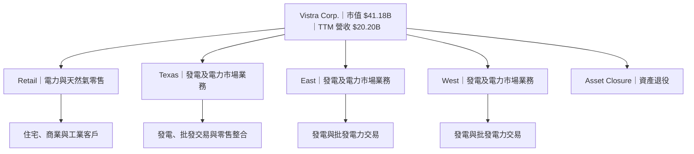
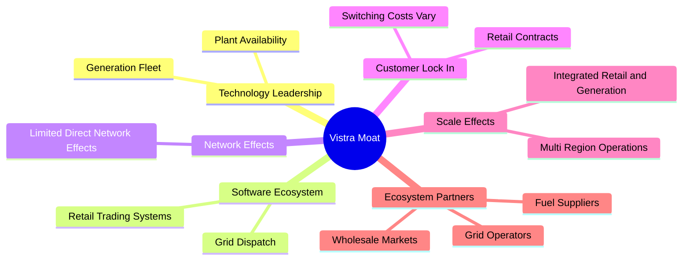
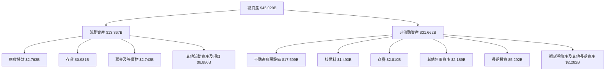
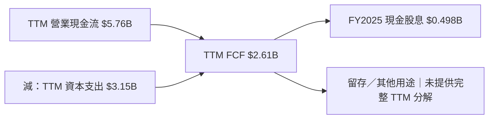
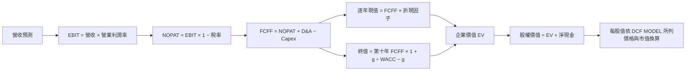
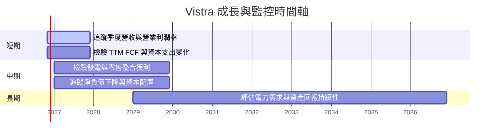
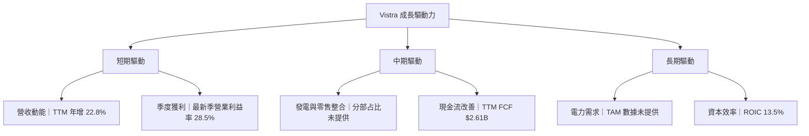
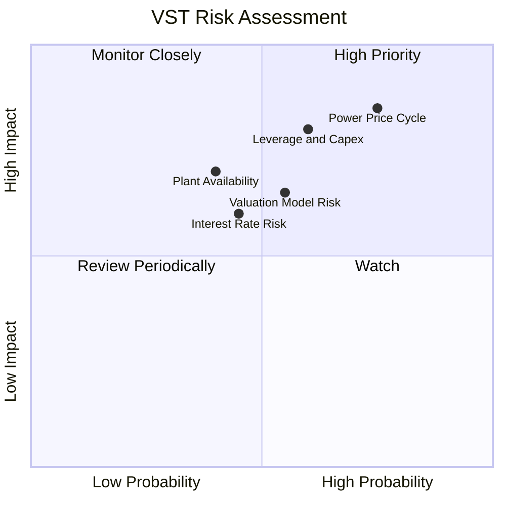
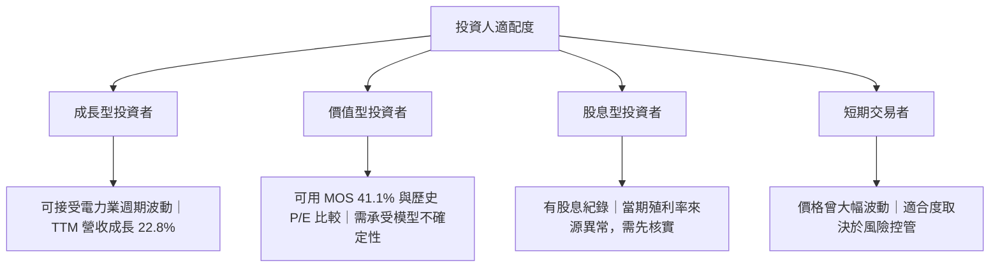

# VST 基本面深度分析報告
> **報告日期**：2026-11-26 ｜ **語言**：繁體中文 ｜ **數據來源**：SEC 申報資料 (XBRL)、Yahoo Finance、Finviz、StockAnalysis、Roic.ai ｜ **分析師**：CFA 級機構研究

## 目錄

| # | 章節 | 核心結論 |
|---|------|----------|
| 1 | 執行摘要 | 強烈買入；加權合理價值 $205.91；MOS +41.1% |
| 2 | 公司概覽與商業模式 | 發電與零售一體化；各業務收入占比未提供 |
| 3 | 損益表深度分析 | TTM 營收 $20.20B、年增 22.8%；獲利受批發電價與產品組合影響 |
| 4 | 資產負債表分析 | 淨負債 $18.40B；流動比率 1.157，短期流動性尚可但槓桿高 |
| 5 | 現金流量深度分析 | TTM FCF $2.61B、FCF Yield 6.33%；資本支出高且現金流具波動性 |
| 6 | 獲利能力與資本效率 | ROIC 13.5% 高於 WACC 8.66%，目前創造股東價值 |
| 7 | 相對估值分析 | 本益比低於自身五年中位數；同業估值指標分化 |
| 8 | DCF 內在價值評估 | 基準 DCF $302.44；加權合理價值與 MOS 採 8.8 節數值 |
| 9 | 成長催化劑 | 電力需求與電力供應價值是潛在驅動因素；量化 TAM 未提供 |
| 10 | 風險矩陣 | 主要風險為電價循環、資本密集與高負債 |
| 11 | 投資建議 | 買入評級；以加權合理價值作估值錨，嚴格追蹤現金流與資本支出 |

---

## 1. 執行摘要

### 1.0 一頁式投資儀表板（Portfolio Manager 30 秒速讀）

| 項目 | 內容 |
|------|------|
| **投資論點（3 句）** | ① TTM 營收 $20.20B、年增 22.8%，顯示電力零售與發電組合近期擴張。② TTM FCF 為 $2.61B、FCF Yield 6.33%，但投資支出高且歷史 FCF 起伏明顯。③ ROIC 13.5% 高於 WACC 8.66%，而估值方法加權後合理價值為 $205.91。 |
| **綜合評分** | **7.0/10**（引用 1.1 評分卡） |
| **財務健康** | 🟡 淨負債 $18.40B；流動比率 1.157、速動比率 0.477，長期槓桿與流動性需監控。 |
| **ROIC vs WACC** | **13.5% vs 8.66%**；目前資本報酬高於資本成本。 |
| **FCF 趨勢** | TTM FCF $2.61B，較 FY2025 的 $1.32B 高；TTM FCF Yield **6.33%**。 |
| **估值** | Forward P/E **12.4x** ｜ EV/EBITDA **7.991x**（市場資料）｜ FCF Yield **6.33%** |
| **DCF 內在價值（基準）** | **$302.44** ｜相對此 DCF 基準值的折溢價 **−59.9%**（計算：$121.32 ÷ $302.44 − 1） |
| **安全邊際（MOS）** | **+41.1%**＝（加權合理價值 **$205.91** − 現價 **$121.32**）÷ 加權合理價值；🟢 >25% 充足 |
| **預期報酬（基準情境 12M）** | **+149.3%**（DCF MODEL 基準情境相對現價；非加權合理價值上行空間） |
| **關鍵風險（前二）** | 電力市場價格與發電組合波動；高負債及持續性資本支出。 |
| **評級 + 信心度** | 🟢 **強烈買入** ｜ 信心：中（估值模型輸入與 DCF 顯示值存在可複算差異，見第 8 章） |

> **評級推導**：加權合理價值 $205.91、現價 $121.32，MOS 為 +41.1%；ROIC 13.5% 高於 WACC 8.66%，因此符合規則 20 的「強烈買入」門檻。TTM FCF $2.61B 提供現金流支持，但淨負債 $18.40B、電力價格循環及 DCF 算式核對差異，降低了估值結論的信心度。

### 1.1 綜合評分卡（全報告唯一）

| 維度 | 評分（1–10） | 主要依據（引用數字與其來源章節） |
|------|--------------|----------------------------------|
| 成長性 | 8.0 | TTM 營收成長 22.8%，最新一季營收年增 25.4%（第 3 章）；成長受能源市場與季度基期影響。 |
| 獲利能力 | 8.0 | TTM 營業利益率 21.0%、ROIC 13.5% 高於 WACC 8.66%、Piotroski F-Score 7/8（第 6 章）。 |
| 財務健康 | 5.5 | 淨負債 $18.40B；流動比率 1.157、速動比率 0.477；CCC 34 天（第 4 章）。 |
| 估值 | 7.5 | MOS +41.1%；P/E 16.4x，低於五年中位數 25.2x，但 DCF 終值占比高（第 7–8 章）。 |
| 護城河 | 7.0 | 發電資產與零售客戶業務相結合，營運跨 Texas、East、West 等區域；分部收入及市占率數據未提供（第 2 章）。 |
| 管理層與資本配置 | 6.0 | FY2025 SBC $113M、股數測試未增加；年度資本支出 $2.75B，投資需求大，回購資料未提供（第 5 章）。 |
| **綜合評分** | **7.0** | 六項算術平均：（8.0 + 8.0 + 5.5 + 7.5 + 7.0 + 6.0）÷ 6 = **7.0**。 |

### 1.2 五大投資論點 + 三大核心風險

| 類型 | 項目 | 具體依據 | 信心度 |
|------|------|----------|--------|
| 🟢 **投資論點①** | 營收動能增強 | TTM 營收 $20.20B，TTM 年增 22.8%；最新一季單季年增 25.4%。若電力需求與定價延續，可能支撐營業槓桿。 | 🟢 高 |
| 🟢 **投資論點②** | 現金流具估值支持 | TTM OCF $5.76B、資本支出 $3.15B，依定義 FCF 為 $2.61B，FCF Yield 6.33%。 | 🟢 高 |
| 🟢 **投資論點③** | 資本回報高於資本成本 | ROIC 13.5% 對 WACC 8.66%，差距 4.84 個百分點；目前投資回報創造經濟價值。 | 🟢 高 |
| 🟢 **投資論點④** | 估值低於自身歷史本益比中位數 | P/E 16.4x，低於五年中位數 25.2x；當前歷史百分位為 20%。 | 🟡 中 |
| 🟢 **投資論點⑤** | 近期資產效率與應計品質有支持 | Piotroski F-Score 7/8；營業現金流高於淨利，稀釋股數測試通過。 | 🟡 中 |
| 🟡 **風險①** | 電力價格與發電量波動 | 批發市場價格、天候、機組可用率可令季度毛利與營業利益率變動；最新季度營業利益率 28.5%，高於 TTM 21.0%。 | 🟡 中 |
| 🔴 **風險②** | 淨負債與再投資壓力 | 淨負債 $18.40B；TTM 資本支出 $3.15B，若現金流回落，去槓桿速度可能下降。 | 🔴 高衝擊 |
| 🟡 **風險③** | DCF 終值與模型核對風險 | 終值現值占 DCF EV 的 66.6%；報表中展示的部分 DCF 中間值無法以顯示位數完全重算，估值應以區間而非單點理解。 | 🟡 中 |

### 1.3 快速統計卡片

| 指標 | 公司實際值（期間） | 同業中位數 | 狀態 |
|------|--------------------|------------|------|
| 營收成長（TTM） | **22.8%** | — | 🟢 |
| 營收成長（最新一季年增） | **25.4%** | 45.4% | 🟡 |
| 毛利率（TTM） | **N/A**（來源數值互有差異，見第 3 章） | 25.2% | 🟡 |
| 營業利益率（TTM） | **21.0%** | — | 🟢 |
| ROIC（TTM） | **13.5%** | — | 🟢 |
| Forward P/E | **12.436521x** | 10.9x | 🟡 |
| FCF Yield（TTM） | **6.33%** | — | 🟢 |
| Piotroski F-Score | **7 / 8** | — | 🟢 |

### 1.4 投資結論

```text
╔══════════════════════════════════════════════════════════════════╗
║                    📊 投資結論摘要                               ║
╠══════════════════════════════════════════════════════════════════╣
║  評級：強烈買入（依 MOS +41.1%，且 ROIC 13.5% > WACC 8.66%）     ║
║  價格（2026-11-25 收盤）：$121.32                                ║
║  DCF 內在價值（基準）：$302.44（折價 59.9%）                    ║
║  安全邊際 MOS：+41.1%（以加權合理價值為分母）                   ║
║  加權合理價值（8.8）：$205.91                                    ║
║  DCF 情境價值：                                                   ║
║    悲觀情境：$102.15（−15.8%）                                   ║
║    基準情境：$302.44（+149.3%）                                  ║
║    樂觀情境：$712.37（+487.2%）                                  ║
║  綜合評分：7.0/10（引用 1.1）                                    ║
║  適合投資人：可承受商品價格波動的長線投資人、成長型投資人        ║
╚══════════════════════════════════════════════════════════════════╝
```

---

## 2. 公司概覽與商業模式

### 2.1 業務結構與收入來源

Vistra Corp. 在美國經營整合式電力零售與發電業務，另有天然氣零售及資產退役業務。公司分為 Retail、Texas、East、West、Asset Closure 五個分部。財務資料未提供各分部收入、營業利益或占比，因此不以估算比例繪製分部收入圖。



TTM 營收 $20.20B、成長 22.8%，但未提供各分部營收，不能確認成長由零售、發電或市場價格中哪一項主導。該缺口也限制了對業務組合穩定性及分部估值的判斷。

### 2.2 市場份額

市場份額數據未提供，且公司所處電力市場依地區與市場機制而異，不宜將全美單一比率當作可比市占。以規模觀察，VST TTM 營收為 $20.20B；同業 CEG、NRG、TLN 的最新一季營收年增率分別為 45.4%、24.0%、96.1%，但缺少同口徑營收金額與市場份額資料，無法據此比較市場排名。

### 2.3 競爭護城河分析



### 2.4 護城河強度

| 護城河項目 | 強度（強／中／弱） | 證據（引用數字或事實） | 會削弱它的情況 |
|------------|--------------------|------------------------|----------------|
| 技術與營運能力 | 中 | 公司經營發電、批發交易及零售電力業務，員工 6,390 人；機組可用率與成本資料未提供。 | 機組故障、燃料供應或營運成本惡化。 |
| 軟體生態系統 | 弱至中 | 具零售與發電交易營運，但軟體收入、客戶數及系統優勢數據未提供。 | 競爭者以更低成本或更佳風險管理取得客戶。 |
| 網路效應 | 弱 | 財務資料未顯示用戶增長會直接提升其他用戶價值。 | 電力商品市場本身可替代性高。 |
| 客戶鎖定 | 中 | 零售業務服務住宅、商業及工業客戶；合約期限、流失率未提供。 | 客戶轉換成本低、價格競爭加劇。 |
| 規模效應 | 中至強 | 五個營運分部、TTM 營收 $20.20B；規模可支援跨區域資產與零售整合，但分部獲利未提供。 | 地區市場監管或資產成本差異削弱整合效益。 |
| 生態夥伴 | 中 | 業務依賴電網、燃料供應商及批發市場；合作合約資料未提供。 | 電網限制、燃料價格衝擊或市場規則變更。 |

護城河評分 **7.0/10** 的理由：公司具跨區域發電與零售整合及 $20.20B TTM 營收規模，但直接網路效應、客戶留存與分部回報等關鍵護城河數據欠缺。

---

## 3. 損益表深度分析

### 3.1 年度收入成長趨勢（近 4 年）

下列年度營收採年度損益表，美元取兩位小數；2022–2025 CAGR 約 8.9%。

```text
╔══════════════════════════════════════════════════════════════════╗
║              Vistra 年度收入趨勢（FY2022–FY2025）               ║
╠══════════════════════════════════════════════════════════════════╣
║  FY2022  $13.73B  ████████████████████░░░░░░░░░░  YoY: —        ║
║  FY2023  $14.78B  ██████████████████████░░░░░░░░  YoY: +7.7%    ║
║  FY2024  $17.22B  ██████████████████████████░░░░  YoY: +16.5%   ║
║  FY2025  $17.74B  ███████████████████████████░░░  YoY: +3.0%    ║
║  2022–2025 營收 CAGR：約 +8.9%                                   ║
╚══════════════════════════════════════════════════════════════════╝
```

營收從 FY2022 的 $13.73B 增至 FY2025 的 $17.74B。FY2024 年增 16.5%，FY2025 放緩至 3.0%；這表明單看年度收入會低估近期變化，因 TTM 成長已達 22.8%，但電力業務的商品價格與結算時點可能放大季度波動。

### 3.2 季度收入趨勢分析

| 季度 | 營收 | QoQ 成長 | YoY 成長 | 備註 |
|------|------|----------|----------|------|
| 2025 Q4 | $4.58B | +16.6% | +13.5% | 高於 2025 Q3；季度資料來源口徑與 TTM 資料存在差異。 |
| 2026 Q1 | $5.64B | +23.0% | +43.4% | 季度收入回升；年增受比較基期影響。 |
| 2026 Q2 | $4.02B | −28.8% | −5.5% | 季度間回落，與電力業務季節性及市場結算波動相符。 |
| 2026 Q3 | $6.35B | +58.0% | **+25.4%**（VERIFIED FIGURES） | 最新季單季年增率以 SEC 計算資料的 25.4% 為準；其他財務匯總顯示不同數值，故不混用。 |

QoQ 係依表列季度收入計算；最新一季 YoY 則遵守 SEC 計算資料的 25.4%。不同資料來源對季度收入與最新一季年增率有差異，投資追蹤時應以申報報表的同一口徑重建季度序列。

### 3.3 利潤率演變分析

年度利潤率依年度損益表的營收、毛利與營業利益計算；TTM 與最新季度營業利益率則引用 SEC 計算資料，不與其他匯總口徑混合。

| 利潤率指標 | FY2022 | FY2023 | FY2024 | FY2025 | 趨勢 | 評估 |
|------------|--------|--------|--------|--------|------|------|
| **毛利率** | 12.2% | 37.3% | 43.7% | 32.9% | FY2024 升高、FY2025 回落 | 🟡 |
| **營業利益率** | −8.0% | 18.3% | 23.7% | 12.0% | FY2024 高點後收縮 | 🟡 |
| **淨利率** | −9.0% | 10.1% | 15.4% | 5.3% | FY2025 顯著下降 | 🟡 |

計算例：FY2025 毛利率 = $5.83B ÷ $17.74B = 32.9%；營業利益率 = $2.13B ÷ $17.74B = 12.0%。SEC 計算資料的 TTM 營業利益率為 21.0%，不同於 FY2025 年度比率，反映 2026 年較近期間獲利改善，也可能受到電力價格、區域市場與發電組合影響。

最新季度營業利益率 28.5%，高於 TTM 21.0%，但單季不宜直接外推。年度毛利率與營業利益率變化幅度大，符合發電業受市場電價、燃料成本、避險安排及資產可用率影響的特性；分部損益與燃料成本細節未提供，無法精確拆解各因素貢獻。

### 3.4 費用結構分析

可用資料未提供按費用項目拆分的 TTM 營業成本、折舊、維修、燃料及行政費用明細，因此不繪製費用結構圓餅圖。FY2025 年營收 $17.74B、毛利 $5.83B、營業利益 $2.13B，代表毛利以下費用合計約 $3.70B（$5.83B − $2.13B）；此為算術差額，不是單一費用科目。

### 3.5 季度 EPS 趨勢與盈餘品質（Quality of Earnings）

最近四季 EPS 預估值與實際值欄均為缺失值，無法驗證超預期或不及預期；因此不將季度 EPS 年增率誤稱為盈餘驚喜。

| 季度 | EPS 預估 | EPS 實際 | 超預期／不及預期 | 可觀察的營運資訊 |
|------|----------|----------|------------------|----------------|
| 2025 Q4 | N/A | N/A | 無法判定 | 季度淨利 $233M。 |
| 2026 Q1 | N/A | N/A | 無法判定 | 季度淨利 $1.03B。 |
| 2026 Q2 | N/A | N/A | 無法判定 | 季度淨利 $305M。 |
| 2026 Q3 | N/A | N/A | 無法判定 | 季度淨利 $1.14B；季度營收 $6.35B。 |

| 盈餘品質項目 | 數值／佔比 | 評估 |
|--------------|-----------|------|
| 股權薪酬 SBC / 營收 | 約 **0.63%**（四個列示季度 SBC 合計 $127M ÷ TTM 營收 $20.20B） | 🟢 占比低；可能造成股權稀釋，但稀釋股數測試未增加。 |
| SBC / 營業現金流 | 約 **2.20%**（$127M ÷ $5.76B） | 🟢 相對 OCF 不高；SBC 為非現金費用，不應與現金流等同。 |
| FCF / 淨利（現金轉換率） | 約 **103.8%**（TTM FCF $2.61B ÷ StockAnalysis TTM 淨利 $2.515B） | 🟢 現金流略高於淨利；來源期間與四捨五入可能造成小幅差異。 |
| 一次性／非經常性損益 | **N/A**（未提供 TTM 調整項明細） | 無法判斷是否有重大一次性項目美化盈餘。 |
| 有效稅率異常 | **15.9%**（最新年度有效稅率） | 🟢/🟡 未見極端稅率，但未提供多年稅率與稅務調節表，仍需追蹤。 |
| 資本化支出 vs 費用化 | TTM 資本支出 $3.15B；資本化明細 N/A | 發電資產本身資本密集；沒有資本化利息及維修資本支出的分拆，無法量化費用遞延。 |

FY2025 SBC $113M，占該年營收 $17.74B 約 0.64%；最新四個列示季度 SBC 合計 $127M，季度資料年度跨期與 TTM口徑不同，以上估算只作量級參考。綜合而言，FCF 對淨利轉換略高於 100%，SBC 占比不高；但電力業折舊與資本支出規模大，不能只以 GAAP 淨利評估可分配現金。資本化支出是否高於維持性需求，資料不足以判斷。

---

## 4. 資產負債表分析

### 4.1 資產結構分解

採 StockAnalysis 2026-09-30 資產負債表，單位為 $B。下列科目合計為總資產 $45.029B。



### 4.2 流動性與營運資金分析

| 指標 | 最新 TTM | 一年前 TTM | 變化 | 解讀 |
|------|----------|------------|------|------|
| DSO 應收帳款天數 | 50 天 | 52 天 | −2 天 | 收款天數改善，可能有助現金回收；未提供應收帳款帳齡，不能確認壞帳風險變化。 |
| DIO 存貨天數 | 30 天 | N/A | N/A | 公司一年前未報告可計算所需存貨餘額，不作補推。 |
| DPO 應付帳款天數 | 45 天 | N/A | N/A | 一年前資料缺漏，無法比較供應商付款速度。 |
| CCC 現金轉換週期 | 34 天 | N/A | N/A | 最新 CCC = 50 + 30 − 45 = 35 天，品質指標區塊列示 34 天；依規則照抄 34 天，可能是底層未四捨五入造成差異。 |

流動比率 1.157，略高於 1；速動比率 0.477，低於 1，表示排除存貨與其他流動資產後，流動資產對短期負債的覆蓋較有限。流動資產從 FY2025 的 $9.18B 增至 TTM $13.367B，但現金與短期投資 $2.74B，仍遠低於總債務。

### 4.3 債務結構分析

```text
╔══════════════════════════════════════════════════════════════════╗
║                   Vistra 債務健康診斷                            ║
╠══════════════════════════════════════════════════════════════════╣
║  總債務：        $21.15B  █████████████████████  槓桿偏高        ║
║  現金及短期投資： $2.74B  ███░░░░░░░░░░░░░░░░░░  緩衝有限        ║
║  淨負債：        $18.40B  ██████████████████░░░  需持續去槓桿    ║
║                                                                  ║
║  流動比率：      1.157x   🟡 略高於 1                            ║
║  速動比率：      0.477x   🔴 短期流動性偏緊                      ║
║  Debt / EBITDA： N/A      TTM EBITDA 口徑未與債務同源核實         ║
║  Interest Coverage：N/A   利息費用與同期 EBIT 未提供一致口徑      ║
╚══════════════════════════════════════════════════════════════════╝
```

債務數值採 VERIFIED FIGURES 的總債務 $21.15B 與淨負債 $18.40B；其他彙整資料列出的總債務為 $21.77B 或 $20.07B，期間或來源口徑不同，故不混用。按淨負債定義，$2.74B 現金及短期投資與 $21.15B 債務相差約 $18.41B，與資料列示淨負債 $18.40B 的差異屬四捨五入。

### 4.4 股東權益趨勢

```text
╔══════════════════════════════════════════════════════════════════╗
║                 Vistra 歷年股東權益（$B）                        ║
╠══════════════════════════════════════════════════════════════════╣
║  FY2022  4.90  ████████████████████░░░░░░░░░░░                 ║
║  FY2023  5.31  ██████████████████████░░░░░░░░                   ║
║  FY2024  5.57  ███████████████████████░░░░░░                   ║
║  FY2025  5.10  █████████████████████░░░░░░░░                   ║
╚══════════════════════════════════════════════════════════════════╝
```

股東權益 FY2024 升至 $5.57B，FY2025 回落至 $5.10B。公司具有高 ROE，但杜邦分析顯示權益乘數 7.14，槓桿對 ROE 的放大效果顯著，不能將 ROE 單獨視為資產負債表穩健的證據。

---

## 5. 現金流量深度分析

### 5.1 現金流量瀑布圖

現有季度淨利合計與 TTM 現金流期間存在口徑差異，因此瀑布圖以 TTM OCF、資本支出與 FCF 為主，並將資本配置流向標示為已知年度資料。



### 5.2 FCF 轉換率趨勢

| 期間 | FCF | 淨利 | FCF / 淨利 | 趨勢解讀 |
|------|-----|------|------------|----------|
| FY2022 | −$0.816B | −$1.23B | 不具經濟解讀性 | 兩者皆為負值，不以比率判斷盈餘轉換。 |
| FY2023 | $3.78B | $1.49B | 約 253.7% | FCF 明顯高於淨利，可能受營運資金與資本支出時點影響。 |
| FY2024 | $2.48B | $2.66B | 約 93.2% | 現金轉換接近但略低於淨利。 |
| FY2025 | $1.32B | $0.944B | 約 139.8% | FCF 高於淨利，但年度 FCF 明顯低於前兩年。 |
| TTM 至 2026-09-30 | $2.61B | 約 $2.515B | 約 103.8% | 以 StockAnalysis TTM 淨利計算；現金轉換大致接近淨利。 |

### 5.3 自由現金流趨勢

```text
╔══════════════════════════════════════════════════════════════════╗
║              自由現金流趨勢（FCF = OCF − Capex）                ║
╠══════════════════════════════════════════════════════════════════╣
║  FY2022  −$0.816B  ◀ 負值                                       ║
║  FY2023   $3.78B   ████████████████████                         ║
║  FY2024   $2.48B   █████████████                                 ║
║  FY2025   $1.32B   ███████                                       ║
║  TTM      $2.61B   ██████████████  FCF Yield：6.33%              ║
╚══════════════════════════════════════════════════════════════════╝
```

FY2023 至 FY2025 FCF 逐年下降，TTM 回升至 $2.61B。FY2025 OCF $4.07B、資本支出 $2.75B；TTM OCF $5.76B、資本支出 $3.15B。這顯示現金流改善不能只歸因於營收增長，資本支出安排與市場營運資金變化亦可能是重要因素。

### 5.4 資本配置評估

FY2025 資本配置中已披露項目如下；不繪製資本配置圓餅圖，因投資支出、債務償還及回購的完整同期間總額未提供。

| 項目 | FY2025 金額 | 解讀 |
|------|-------------|------|
| 資本支出 | $2.75B | 維持與擴充發電資產的資金需求高。 |
| 現金股息 | $0.498B | 約為 FY2025 FCF $1.32B 的 37.7%；比率只作同年度簡單計算。 |
| SBC | $0.113B | 占 FY2025 營收約 0.64%，規模相對營收有限。 |
| 股票回購 | N/A | 未提供可核實金額。 |
| 債務償還／新增借款 | N/A | 無法由年度現金流資料完整拆分。 |

---

## 6. 獲利能力與資本效率

### 6.1 ROE / ROA / ROIC 趨勢

| 指標 | FY2022 | FY2023 | FY2024 | FY2025／TTM 最新 | 評估 |
|------|--------|--------|--------|------------------|------|
| ROE | N/A | N/A | N/A | **42.9% TTM**（品質指標） | 高，但受 7.14 倍權益乘數放大。 |
| ROA | N/A | N/A | N/A | 7.1%（市場彙整資料）；F-Score 使用 ROA 為正且高於一年前 | 資產回報為正，期間口徑應以申報資料核對。 |
| ROIC | N/A | N/A | N/A | **13.5% TTM** | 高於 WACC 8.66%，目前創造價值。 |

行業均值資料未提供，不列行業均值比較。ROE 的品質應與槓桿一併理解，不宜將 42.9% 解讀成低風險獲利能力。

### 6.2 ROIC vs WACC 分析（核心價值創造判斷）

```text
╔══════════════════════════════════════════════════════════════════╗
║                ROIC vs WACC 深度分析                            ║
╠══════════════════════════════════════════════════════════════════╣
║  WACC（採成本資本資料原值）：                                    ║
║  ├── 無風險利率（10Y 美債）：      4.85%                         ║
║  ├── 市場風險溢酬（ERP）：          5.00%                         ║
║  ├── 原始 Beta：                    1.38                          ║
║  ├── 調整後 Beta：                  1.25                          ║
║  ├── 股權成本：                     4.85% + 1.25 × 5.00% = 11.10% ║
║  ├── 稅前債務成本：                 4.64%                         ║
║  ├── 稅後債務成本：                 4.64% × (1 − 15.9%) = 3.90%   ║
║  ├── 資本權重：                     股權 66.1%／債務 33.9%        ║
║  └── WACC：                         8.66%                         ║
║                                                                  ║
║  ROIC（TTM）：                     13.5%                         ║
║  ROIC − WACC：                     13.5% − 8.66% = 4.84 個百分點 ║
║                                                                  ║
║  ROIC  13.5%  ▓▓▓▓▓▓▓▓▓▓▓▓▓▓▓░░░░░░░░░                         ║
║  WACC   8.66% ▓▓▓▓▓▓▓▓▓░░░░░░░░░░░░░░░                         ║
║                                                                  ║
║  結論：ROIC 高於 WACC，依目前 TTM 指標創造股東價值。             ║
╚══════════════════════════════════════════════════════════════════╝
```

WACC 直接採成本資本資料的 **8.66%**，不另行估算替代值；其組成與 8.2 一致。ROIC 13.5% 高於 WACC 4.84 個百分點，表示目前投入資本回報高於資金成本。但若電價回落、發電資產利用率下降或新增投資回報下滑，ROIC 可能收斂，價值創造也會減弱。

### 6.3 杜邦三因素分解

| 因素 | 數值（TTM） | 解讀 |
|------|-------------|------|
| 淨利率 | 13.4% | 每一美元收入的淨利貢獻。 |
| 資產週轉率 | 0.45 | 資產密集型發電業務周轉率較低。 |
| 權益乘數 | 7.14 | 財務槓桿高，是 ROE 放大的重要來源。 |
| **ROE** | **42.9%** | 品質指標照抄：13.4% × 0.45 × 7.14 = 42.9%（小數位差異來自四捨五入）。 |

ROE 不只是淨利率推動，7.14 倍權益乘數反映槓桿是主要放大因素之一；因此評估股東回報需同步觀察淨負債與利息承擔。

### 6.4 財務體質：Piotroski F-Score

**Piotroski F-Score：7 / 8**。品質計算略去一項無法判定的毛利率測試，故分母為 8，並非完整 9 項皆可判定。

| 測試 | 結果 | 解讀 |
|------|------|------|
| ROA > 0 | ✅ 通過 | 獲利為正。 |
| 營業現金流 > 0 | ✅ 通過 | TTM OCF 為 $5.76B。 |
| ROA 高於一年前 | ✅ 通過 | 資產獲利能力改善。 |
| 營業現金流 > 淨利 | ✅ 通過 | 應計品質測試通過，現金流支持會計獲利。 |
| 長期負債 ÷ 總資產低於一年前 | ❌ 未通過 | 長期負債相對資產沒有改善，符合高槓桿需注意的訊號。 |
| 流動比率高於一年前 | ✅ 通過 | 短期流動性相對改善，但速動比率仍為 0.477。 |
| 稀釋股數未增加 | ✅ 通過 | 該測試期間稀釋股數未增加。 |
| 毛利率高於一年前 | — 無法判定 | 缺少可比較的同口徑輸入。 |
| 資產週轉率高於一年前 | ✅ 通過 | 資產使用效率改善。 |

---

## 7. 相對估值分析

### 7.1 同業估值比較表格

公司估值倍數依市場資料；同業數字採 Yahoo Finance 同業倍數資料。VST 與同業的資料時間與市場估值口徑可能略有差異。

| 估值指標 | **VST** | **CEG** | **NRG** | **TLN** | VST 評估 |
|----------|---------:|--------:|--------:|--------:|-----------|
| **Trailing P/E** | 16.4x | 18.9x | 16.1x | N/A | 🟡 接近 NRG，低於 CEG；TLN 缺值。 |
| **Forward P/E** | 12.4x | 17.6x | 9.6x | 10.9x | 🟡 高於 NRG 與 TLN，低於 CEG。 |
| **P/S Ratio** | 2.0x | 2.4x | 0.6x | 3.4x | 🟡 介於同業分布中；同業中位數 2.4x。 |
| **EV/EBITDA** | 7.991x | 11.2x | 10.5x | 36.4x | 🟢 低於三家同業列示值；TLN 倍數明顯偏高。 |
| **最新季營收 YoY** | 25.4% | 45.4% | 24.0% | 96.1% | 🟡 高於 NRG，低於 CEG、TLN。 |
| **毛利率 TTM** | N/A | 25.2% | 20.2% | 42.7% | 不作同口徑比較；公司來源數值不一致。 |

三家同業 Forward P/E 中位數為 **10.9x**；EV/EBITDA 中位數為 **11.2x**。這些是估值方法輸入，不應與 VST 的自身當前倍數混為一談。

### 7.2 歷史估值區間分析

```text
╔══════════════════════════════════════════════════════════════════╗
║            VST 五年估值區間（TTM）                               ║
╠══════════════════════════════════════════════════════════════════╣
║  P/E        7.2x ├────────────●────────────────┤ 74.3x          ║
║                         現值 16.4x｜中位數 25.2x｜百分位 20%     ║
║  P/S        0.5x ├────────────────●───────────┤ 4.2x            ║
║                         現值 2.0x｜中位數 1.8x｜百分位 52%      ║
║  EV/EBITDA  2.3x ├──────────────●─────────────┤ 40.7x           ║
║                         現值 9.4x｜中位數 11.0x｜百分位 35%     ║
╚══════════════════════════════════════════════════════════════════╝
```

P/E 16.4x 位於自身五年區間第 20 百分位，低於中位數 25.2x；EV/EBITDA 9.4x 亦低於中位數 11.0x。相較之下，P/S 2.0x 略高於中位數 1.8x，顯示獲利倍數相對歷史較低，但銷售倍數並非明顯折價。

### 7.3 情境價值（Bear / Base / Bull）

| 情境 | 第 1 年營收成長 | 期末營業利潤率 | WACC | 每股價值 | 相對現價 | 機率 | 會發生的條件 |
|------|----------------|----------------|------|----------|----------|------|--------------|
| 🔴 悲觀 | 11.4% | 16.4% | 9.66% | $102.15 | −15.8% | 25% | 電力價格或發電量走弱、投資支出維持高位、折現率上升。 |
| 🟡 基準 | 22.8% | 19.3% | 8.66% | $302.44 | +149.3% | 50% | TTM 成長率可延續一段時間，後續逐步放緩，利潤率降至歷史中位數假設。 |
| 🟢 樂觀 | 34.3% | 21.2% | 7.66% | $712.37 | +487.2% | 25% | 成長加速、長期利潤率高於基準，且資本成本下降。 |

情境價值與假設照錄 DCF MODEL；其情境機率加權值為 $354.85（僅供參考，估值方法加權仍依 8.8 基準 DCF $302.44）。

### 7.4 相對估值隱含價格區間

```text
╔══════════════════════════════════════════════════════════════════╗
║              估值方法隱含每股價值（USD）                        ║
╠══════════════════════════════════════════════════════════════════╣
║  $106.59      $121.32       $154.27       $197.18       $302.44 ║
║  Forward P/E  現價          EV/EBITDA     共識目標價    基準 DCF ║
╚══════════════════════════════════════════════════════════════════╝
```

| 方法 | 每股價值 | 依據 |
|------|---------:|------|
| 同業 Forward P/E | $106.59 | 同業中位數 10.9x × VST Forward EPS $9.76。 |
| 同業 EV/EBITDA | $154.27 | 同業中位數 11.2x × TTM EBITDA，再加回淨現金／扣除淨負債。 |
| 分析師共識 | $197.18 | 23 位分析師平均目標價。 |
| DCF 基準 | $302.44 | 十年 FCFF、WACC 8.66%、終值成長率 3.0%。 |

同業估值方法形成 $106.59–$154.27 的相對估值帶；分析師共識與 DCF 基準則更高。VST 的發電資產、資本支出與週期性，使單一倍數法與長期 DCF 得出較大差距。

---

## 8. DCF 內在價值評估（Discounted Cash Flow）

> 本章只採用 DCF MODEL 列示的基準假設與逐年模型數字，不另建替代模型。DCF 表中個別顯示值以 $B 取兩位小數、比率取一位小數、折現因子取三位小數；由於模型底層可能使用未顯示的小數位，按已顯示數值重算時會出現差異，本文不以重算結果替換原始模型值。

### 8.0 估值推理鏈（Thinking Logic）

#### Step 1 — 價值由哪些變數決定？

模型將價值拆成：（1）現有整合式零售與發電業務形成的現金流底盤；（2）營收成長與營業利潤率變化形成的中期成長；（3）預測期後終值所代表的成熟期現金流。公司沒有提供各業務分部收入占比，因此不能將這些來源量化拆分。模型中營收由 TTM $20.20B 起算，終值現值占 EV 66.6%；故主導估值的變數是長期現金流及 WACC、永續成長率的組合。

#### Step 2 — 模型選擇

| 決策點 | 本報告採用 | 理由（含數字） | 曾考慮但否決 | 否決理由 |
|--------|-----------|----------------|--------------|----------|
| 現金流定義 | FCFF | 使用 NOPAT + D&A − Capex；與 WACC 折現、求 EV 的模型一致。 | FCFE | DCF MODEL 已採 FCFF，改用 FCFE 會改變折現率與資本結構處理。 |
| 預測期 N | 10 年 | 模型固定以 10 年逐步淡化成長與利潤率假設。 | 5 年 | 會偏離既定 DCF MODEL，且終值起算年不同。 |
| 終值方法 | Gordon Growth | DCF MODEL 以 g = 3.0% 及 WACC = 8.66% 計算。 | 僅退出倍數 | 模型未提供退出倍數終值，不能自行補入。 |
| EBIT 基礎 | GAAP EBIT | 模型指定 GAAP EBIT，SBC 已列為費用。 | 非 GAAP EBIT | 會與既定現金流表及 SBC 處理不同。 |

#### Step 3 — 關鍵假設推導鏈

- **營收成長**：錨點＝VERIFIED FIGURES 的 TTM 成長 22.8% → 調整＝模型將第 1 年採當前 TTM 成長，後續線性淡化至第 10 年 3.0% → **採用第 1 年 22.8%、第 10 年 3.0%** → 曾考慮直接使用 FY2022–FY2025 約 8.9% CAGR，但模型採用當前成長作為起點，故不替換；若短期需求不支持，基準會偏樂觀。
- **期末營業利潤率**：錨點＝TTM 營業利益率 21.0% → 調整＝模型由 21.0% 線性淡化至近五財年中位數 19.3% → **採用 19.3%** → 曾考慮維持 21.0%，因模型明確以歷史中位數作成熟期錨點而否決。
- **永續成長率 g**：錨點＝模型長期成長假設 3.0% → 調整＝成熟期增長需低於折現率；基準 WACC 為 8.66% → **採用 3.0%** → 曾考慮更高長期增長，但未有公司 TAM 或長期電力需求量化資料支撐，故不採用。
- **預測期 N**：錨點＝模型提供 10 年逐年 FCFF → 調整＝本報告遵守既定模型預測期，不自行延長或縮短 → **採用 10 年** → 曾考慮較短預測期，但會改變模型輸出，不採用。
- **Capex / 營收**：錨點＝TTM 15.6% → 調整＝模型逐年淡化至第 10 年 11.5%，其依據為高於 D&A 時向 1.1 倍 D&A 收斂 → **採用第 1 年 15.6%、第 10 年 11.5%** → 曾考慮全期固定在 15.6%，因模型假設成熟期資本支出率降低，故未採用。
- **GAAP EBIT、SBC、年稀釋率**：錨點＝模型使用 GAAP EBIT、當期股數且不另稀釋 → GAAP EBIT 已將 SBC 當費用 → **採用組合 (A)：GAAP EBIT + 固定股數、年稀釋率 0%，不再扣 SBC** → 曾考慮非 GAAP EBIT 加回 SBC，但沒有一致的 SBC 年度預測可支持，故不採用。
- **終值方法**：錨點＝模型列出 Gordon Growth，且 WACC 8.66% 高於 g 3.0% → **採用 Gordon Growth** → 曾考慮退出倍數交叉驗證，但 DCF MODEL 未提供退出倍數或相應終值數字，故不能自行建模。
- **WACC**：錨點＝Cost of capital 區塊 WACC 8.66% → 採用同一數值，以維持和第 6.2 節一致 → **採用 8.66%** → 不另算其他 WACC；個別組成詳見 8.2。
- **有效稅率**：錨點＝最新年度有效稅率 15.9% → **採用 15.9%**；多年稅率明細未提供。
- **D&A / 營收**：錨點＝TTM 10.4% → **採用 10.4% 固定**；模型假設不變，未另行調整。
- **營運資金變動**：模型明確未建模，故不加減 ΔWC；其影響方向未反映在 DCF FCFF 中。

#### Step 4 — 最脆弱的一環

模型最脆弱之處是長期 FCFF、終值及其顯示算式的可複算性：終值現值占 EV 66.6%，且已列出的中間數字以計算機重算有差異；若終值或資本支出率偏樂觀，DCF 價值會下修。

#### Step 5 — 計算路徑圖



### 8.1 模型假設總表（Model Inputs）

| 假設項目 | 採用值 | 依據／來源 | 敏感度 |
|----------|--------|-------------|--------|
| 預測期長度 N | 10 年 | DCF MODEL 固定預測長度。 | 🟡 中 |
| 營收成長 | 第 1 年 22.8% → 第 10 年 3.0% | 第 1 年錨定 TTM 成長 22.8%，逐年線性淡化。 | 🔴 高 |
| 營業利潤率 | 第 1 年 21.0% → 第 10 年 19.3% | 第 1 年採 TTM 21.0%；期末採近五財年中位數，含 TTM。 | 🔴 高 |
| 有效稅率 | 15.9% | 最新年度有效稅率。 | 🟢 低 |
| Capex / 營收 | 第 1 年 15.6% → 第 10 年 11.5% | TTM 15.6%，逐步淡化至 1.1 倍 D&A 附近。 | 🟡 中 |
| D&A / 營收 | 10.4% | TTM 比率，模型固定。 | 🟢 低 |
| ΔWC / 營收增額 | 未建模 | DCF MODEL 明示 working capital is not modelled。 | 🟢 低 |
| EBIT 基礎 | GAAP EBIT | 模型採 GAAP 營業利益。 | 🟡 中 |
| SBC 處理 | 組合 (A)：GAAP EBIT、不另扣 SBC | SBC 已列為費用，股數不再稀釋。 | 🟡 中 |
| 年稀釋率 | 0% | 固定股數；與組合 (A) 一致。 | 🟡 中 |
| 永續成長率 g | 3.0% | DCF MODEL 基準值；低於 WACC 8.66%。 | 🔴 高 |
| 終值方法 | Gordon Growth | DCF MODEL 已計算；退出倍數交叉驗證未提供。 | 🔴 高 |
| WACC | 8.66% | Cost of capital 區塊；詳見 8.2。 | 🔴 高 |

FCFF 定義採模型指定的 **FCFF = NOPAT + D&A − Capex**，ΔWC 未建模。**本模型採用組合 (A)，故 SBC 影響已計入一次**：GAAP EBIT 已含 SBC，不在 FCFF 重複扣除，且不另以股數稀釋處理。

### 8.2 折現率推導（WACC）

Cost of capital 區塊的 WACC 及權重由計算資料直接提供；以下將所列組成展開。原始 Beta 1.38，調整後 Beta 按 ⅔ × 原始 Beta + ⅓ 計算，採用值為 1.25。資料未提供 10Y 殖利率的觀測日期，故不另填日期。

```text
╔══════════════════════════════════════════════════════════════════╗
║                    WACC 推導（折現率）                           ║
╠══════════════════════════════════════════════════════════════════╣
║  股權成本 Ke（CAPM）：                                           ║
║  ├── 無風險利率 Rf（10Y 美債）：      4.85%                      ║
║  ├── 市場風險溢酬 ERP：               5.00%                      ║
║  ├── 原始 Beta（Yahoo）：              1.38                       ║
║  ├── 調整後 Beta：                     1.25                       ║
║  ├── 規模／國別溢酬：                  未另加                     ║
║  └── Ke = 4.85% + 1.25 × 5.00% = 11.10%                         ║
║                                                                  ║
║  債務成本 Kd：                                                   ║
║  ├── 稅前 Kd（利息 ÷ 債務）：           4.64%                     ║
║  ├── 有效稅率：                         15.9%                     ║
║  └── 稅後 Kd = 4.64% × (1 − 15.9%) = 3.90%                      ║
║                                                                  ║
║  資本結構（區塊提供權重）：                                      ║
║  ├── 股權權重 E：                       66.1%                     ║
║  ├── 債務權重 D：                       33.9%                     ║
║  └── WACC = 66.1% × 11.10% + 33.9% × 3.90% = 8.66%              ║
╚══════════════════════════════════════════════════════════════════╝
```

**逐步演算與資料限制**

1. **Ke（CAPM）** = 4.85% + 1.25 × 5.00% + 0.00% = **11.10%**。
2. **稅前 Kd**：區塊給定利息費用 ÷ 債務比率 **4.64%**；利息費用金額、平均計息負債明細未提供，因此不能安全地補出金額分子與分母。
3. **稅後 Kd** = 4.64% × (1 − 15.9%) = 4.64% × 0.841 = **3.90224%**，約 **3.90%**。
4. **權重**：股權 66.1%、債務 33.9%，合計 **66.1% + 33.9% = 100.0%**。市值與債務權重的完整原始構成未提供，依指示照用區塊權重，不另推導。
5. **WACC** = 66.1% × 11.10% + 33.9% × 3.90% = 7.3371% + 1.3221% = **8.6592% ≈ 8.66%**。

本節與第 6.2 節均採 WACC 8.66%。由於來源未提供利息費用金額及同一範圍的平均計息負債，不能完成以美元金額呈現的 Kd 分子、分母審核；因此此處是對已提供成本資本輸入的算術展開，不是獨立重建 WACC。

### 8.3 逐年自由現金流預測（基準情境）

金額單位為 $B。下表逐年照錄 DCF MODEL；折現因子保留三位小數。營運資金不納入模型。

| 年度 | FY+1 | FY+2 | FY+3 | FY+4 | FY+5 | FY+6 | FY+7 | FY+8 | FY+9 | FY+10 |
|------|------:|------:|------:|------:|------:|------:|------:|------:|------:|-------:|
| 營收 | 24.81 | 29.93 | 35.45 | 41.20 | 46.98 | 52.54 | 57.59 | 61.85 | 65.07 | 67.03 |
| 營收 YoY | 22.8% | 20.6% | 18.4% | 16.2% | 14.0% | 11.8% | 9.6% | 7.4% | 5.2% | 3.0% |
| 營業利潤率 | 21.0% | 20.8% | 20.6% | 20.4% | 20.2% | 20.0% | 19.8% | 19.6% | 19.4% | 19.3% |
| 營業利益 EBIT（GAAP） | 5.20 | 6.22 | 7.29 | 8.40 | 9.49 | 10.51 | 11.41 | 12.14 | 12.65 | 12.91 |
| − 稅 | (0.83) | (0.99) | (1.16) | (1.34) | (1.51) | (1.68) | (1.82) | (1.94) | (2.02) | (2.06) |
| = NOPAT | 4.37 | 5.22 | 6.13 | 7.06 | 7.98 | 8.84 | 9.60 | 10.21 | 10.64 | 10.85 |
| + D&A | 2.58 | 3.12 | 3.69 | 4.29 | 4.89 | 5.47 | 6.00 | 6.44 | 6.78 | 6.98 |
| − Capex | (3.88) | (4.54) | (5.21) | (5.86) | (6.47) | (6.99) | (7.40) | (7.66) | (7.75) | (7.68) |
| − ΔWC | 未建模 | 未建模 | 未建模 | 未建模 | 未建模 | 未建模 | 未建模 | 未建模 | 未建模 | 未建模 |
| **= FCFF** | **3.08** | **3.80** | **4.61** | **5.49** | **6.40** | **7.32** | **8.20** | **8.99** | **9.66** | **10.15** |
| 折現因子 @ 8.66% | 0.920 | 0.847 | 0.780 | 0.717 | 0.660 | 0.608 | 0.559 | 0.515 | 0.474 | 0.436 |
| **FCFF 現值 PV** | **2.83** | **3.22** | **3.60** | **3.94** | **4.23** | **4.45** | **4.58** | **4.63** | **4.57** | **4.43** |

模型列示的預測期 PV 加總為 **$40.47B**。按表內列示值直接相加為：

**$2.83 + $3.22 + $3.60 + $3.94 + $4.23 + $4.45 + $4.58 + $4.63 + $4.57 + $4.43 = $40.48B**。

與模型列示 $40.47B 相差 $0.01B，屬逐項四捨五入尾差範圍。

**FY+1 逐步演算（採用模型顯示值）**

1. **營收** = $20.20B × (1 + 22.8%) = $20.20B × 1.228 = **$24.8056B ≈ $24.81B**。
2. **EBIT** = $24.81B × 21.0% = **$5.2101B ≈ $5.20B**（模型列示 $5.20B；顯示位數運算有小幅差異）。
3. **稅** = $5.20B × 15.9% = **$0.8268B ≈ $0.83B**。
4. **NOPAT** = $5.20B − $0.83B = **$4.37B**。
5. **D&A** = $24.81B × 10.4% = **$2.5802B ≈ $2.58B**。
6. **Capex** = $24.81B × 模型第 1 年 Capex 比率 15.6% = **約 $3.87B**；模型表列 $3.88B。模型未提供未四捨五入的逐年資本支出率，因此以表列值為準。
7. **ΔWC** = **未建模**，不計入 FCFF。
8. **FCFF**：按模型所列 NOPAT、D&A、Capex 算式為 $4.37B + $2.58B − $3.88B = **$3.07B**；模型表列 **$3.08B**。此差異略大於顯示數字單純四捨五入可完全解釋的範圍，故保留模型原值並列為複算限制。
9. **折現因子** = 1 ÷ (1 + 8.66%)¹ = **約 0.920**；PV 按模型列示為 $3.08B × 0.920 = **$2.83B**（模型表列值）。

**合理性自檢**

- 預測期 FCFF 由 FY+1 $3.08B 增至 FY+10 $10.15B；九年間 CAGR 約 **14.2%**。歷史 FY2023–FY2025 FCF 由 $3.78B 降至 $1.32B，歷史呈下降，故預測反彈主要依賴收入成長延續與 Capex/營收率下降。
- FY+10 FCFF 利潤率 = $10.15B ÷ $67.03B = **15.1%**；目前 TTM FCF 利潤率 = $2.61B ÷ $20.20B = **12.9%**。同業最佳 FCF 利潤率資料未提供，不能判斷是否超越同業。
- 模型所列各年 FCFF 均為正值；此結果依賴高營業利潤率與資本支出率逐步降低的假設。

```text
╔══════════════════════════════════════════════════════════════════╗
║            自由現金流：歷史實際 vs 模型預測                      ║
╠══════════════════════════════════════════════════════════════════╣
║  FY2023（實）  $3.78B  ████████████████████                      ║
║  FY2024（實）  $2.48B  █████████████                             ║
║  FY2025（實）  $1.32B  ███████                                   ║
║  TTM（實）     $2.61B  ██████████████                            ║
║  FY+1（預）    $3.08B  ████████████████                          ║
║  FY+10（預）  $10.15B  ████████████████████████████████████████  ║
╠══════════════════════════════════════════════════════════════════╣
║  ⚠️ 預測期 FCFF CAGR 約 14.2%；歷史年度 FCF 波動且 FY2025 下滑。  ║
╚══════════════════════════════════════════════════════════════════╝
```

### 8.4 終值計算（Terminal Value）

**適用性檢查**：WACC **8.66%** vs g **3.0%** → WACC > g？✅

| 方法 | 計算式 | 終值 TV | TV 現值 | 佔總 EV 比重 |
|------|--------|---------|---------|--------------|
| Gordon Growth | 模型列示：10.15 × (1 + 3.0%) ÷ (8.66% − 3.0%) | $184.84B | $80.58B | 66.6% |
| 退出倍數法 | N/A（DCF MODEL 未提供退出倍數終值） | N/A | N/A | N/A |

**Gordon Growth 逐步演算**

1. FY+N FCFF：**$10.15B**（取自 FY+10）。
2. 分子：$10.15B × (1 + 3.0%) = **$10.4545B**。
3. 分母：8.66% − 3.0% = **5.66%**；按列示數字重算，$10.4545B ÷ 5.66% ≈ **$184.71B**，而模型列示 **$184.84B**。兩者有差異，顯示模型底層使用精度或顯示數字與輸出欄位不完全一致；本報告依要求照錄模型值，不替換。
4. PV(TV)：模型列示 $184.84B × 0.436 = **$80.58B**；以已顯示的乘數重算約 $80.59B，屬顯示精度差異。
5. 終值佔 EV：$80.58B ÷ $121.05B = **66.6%**。

終值占 EV 66.6%，低於 75% 警示線，但仍代表估值多數來自預測期以後的現金流。退出倍數法沒有模型輸入，故不能自行產生交叉驗證值。

### 8.5 企業價值 → 每股內在價值（Bridge）

```text
╔══════════════════════════════════════════════════════════════════╗
║              企業價值 → 每股內在價值 橋接表                      ║
╠══════════════════════════════════════════════════════════════════╣
║  預測期 FCF 現值合計             +$40.47B                         ║
║  終值現值 PV(TV)                 +$80.58B                         ║
║  ─────────────────────────────────────────────                   ║
║  = 企業價值 EV                    $121.05B                        ║
║  + 淨現金（−代表淨負債）          −$18.40B                         ║
║  ─────────────────────────────────────────────                   ║
║  = 股權價值                       $102.65B                        ║
║  每股換算：股權價值 × 價格 ÷ 市值                                 ║
║  ★ 每股 DCF 基準價值               $302.44                         ║
║    現價（2026-11-25 收盤）         $121.32                         ║
║    折溢價（現價 ÷ DCF 值 − 1）     −59.9%（折價）                 ║
╚══════════════════════════════════════════════════════════════════╝
```

**逐步演算與橋接限制**

1. **EV** = $40.47B + $80.58B = **$121.05B**。
2. **股權價值** = $121.05B − $18.40B = **$102.65B**。
3. 模型列示每股換算：**股權價值 × 現價 ÷ 市值**；$102.65B × $121.32 ÷ $41.18B ≈ **$302.44**。此換算不是一般的「股權價值 ÷ 流通股數」寫法，但遵照模型提供的每股公式。市場資料列示流通股數 339.39M，股數除法與模型指定換算的呈現方式不同，故不擅自替換。
4. **折溢價** = $121.32 ÷ $302.44 − 1 = **−59.9%**。
5. **本節不計算 MOS**；MOS 只在 8.8 以加權合理價值為分母計算。

現金與債務採 2026-09-30 TTM 財務數據所列現金及短期投資 $2.74B、總債務 $21.15B；模型淨現金欄為 −$18.40B。DCF 採固定股數、年稀釋率 0%，與組合 (A) 一致。

### 8.6 敏感性分析（WACC × 永續成長率）

下表每股價值照錄 DCF MODEL；括號內為相對 2026-11-25 收盤價 $121.32 的上行空間。基準格以粗體標示。

| g（列）／WACC（欄） | 6.66% | 7.66% | **8.66%（基準）** | 9.66% | 10.66% |
|-----------|------:|------:|------------------:|------:|-------:|
| **2.0%** | $422.88（+248.3%） | $329.62（+171.7%） | $264.82（+118.3%） | $217.30（+79.1%） | $181.05（+49.2%） |
| **2.5%** | $466.14（+284.3%） | $356.01（+193.4%） | $282.10（+132.5%） | $229.20（+88.9%） | $189.56（+56.3%） |
| **3.0%** | $521.22（+329.7%） | $388.07（+219.9%） | **$302.44（+149.3%）** | $242.89（+100.2%） | $199.18（+64.2%） |
| **3.5%** | $593.75（+389.4%） | $427.84（+252.7%） | $326.73（+169.3%） | $258.81（+113.3%） | $210.15（+73.2%） |
| **4.0%** | $693.58（+471.8%） | $478.49（+294.4%） | $356.22（+193.6%） | $277.54（+128.8%） | $222.77（+83.6%） |

**矩陣示範格限制**：可選非基準有效格，例如 WACC 9.66% > g 3.0% ✅；模型給出的每股價值為 $242.89。但模型沒有提供該格的新預測期 PV 合計、終值現值及股權橋接中間值，且規則要求不得另建 DCF，因此不能捏造中間數字假裝完成逐步複算。該格的數值照錄，獨立重算核驗標示為未完成。

**三情境 DCF（模型輸出照錄）**

| 情境 | 第 1 年營收成長 | 期末營業利潤率 | 永續成長 g | WACC | 每股價值 | 相對現價 | 主觀機率 |
|------|----------------|----------------|------------|------|----------|----------|----------|
| 🔴 悲觀 | 11.4% | 16.4% | DCF MODEL 未另列 | 9.66% | $102.15 | −15.8% | 25% |
| 🟡 基準 | 22.8% | 19.3% | 3.0% | 8.66% | $302.44 | +149.3% | 50% |
| 🟢 樂觀 | 34.3% | 21.2% | DCF MODEL 未另列 | 7.66% | $712.37 | +487.2% | 25% |
| **機率加權** | — | — | — | — | **$354.85** | **+192.5%** | **100%** |

三情境的逐年營收、FY+10 FCFF、終值拆分未在模型摘要中提供；依照不另建模型的要求，不補造「CAGR → FY+10 營收 → FCFF → 終值」中間數字。機率加權算式為：$102.15 × 25% + $302.44 × 50% + $712.37 × 25% = **$354.85**（以未四捨五入輸出計算，顯示值可能有尾差）。

**敏感度結論**

- **g 每 +1pp**：以基準 WACC 8.66% 的模型矩陣，g 2.0% 對應 $264.82，g 3.0% 對應 $302.44；差額 **+$37.62，約 +14.2%**（以 $264.82 為分母）。
- **WACC 每 +1pp**：在 g 3.0% 下，WACC 8.66% $302.44、9.66% $242.89；差額 **−$59.55，約 −19.7%**（以 $302.44 為分母）。
- **期末營業利潤率每 +1pp**：DCF MODEL 未提供單獨利潤率敏感度，無法量化每股變動，亦不能自行試算替代模型。
- 目前可量化的 WACC 變化影響大於上述 g 變動範例；這與 8.0 所指「長期現金流與折現假設主導估值」一致，但因缺少單變數利潤率敏感度，不能判定營運假設中哪一項影響最大。

### 8.7 反推 DCF（Reverse DCF：市場在預期什麼）

固定輸入依基準模型：WACC 8.66%、稅率 15.9%、D&A/營收 10.4%、預測期 10 年；Capex 依模型逐年遞減，營運資金不建模，股數依組合 (A) 固定。當前股價採 2026-11-25 收盤 $121.32。

| 求解的變數（一次一個） | 其餘變數設定 | 市場隱含值（令 DCF = 現價） | 歷史／基準比較 | 判斷 |
|------------------------|--------------|------------------------------|--------------|------|
| 第 1 年營收成長 | 其餘維持基準值 | **5.6%** | 基準 22.8%；FY2022–FY2025 年營收 CAGR 約 8.9% | 🟢 市場價格可由低於近期歷史 CAGR 的成長假設解釋。 |
| 固定營業利潤率 | 其餘維持基準值 | **10.7%** | 基準路徑 21.0% → 19.3% | 🟢 市場價格隱含較低利潤率。 |
| 永續成長率 g | 未提供解 | N/A | — | DCF MODEL 未列出該反推值。 |
| 預測期長度 N | 未提供解 | N/A | — | DCF MODEL 未列出以 N 為單一變數的求解結果。 |

原始反推模型提供營收成長 5.6% 與固定營業利潤率 10.7% 的結果，但沒有迭代軌跡或中間每股估值，故不能重建求解步驟或宣稱已達特定誤差。結論是：模型所示現價可由較低的長期成長或較低利潤率解釋；市場不必然要求基準情境的全套樂觀假設。

### 8.8 估值三角驗證與安全邊際

| 估值方法 | 隱含每股價值 | 上行空間（÷現價） | 權重 | 說明 |
|----------|--------------:|-------------------:|------:|------|
| DCF（基準） | $302.44 | +149.3% | 40% | 10 年 FCFF，WACC 8.66%，終值成長 3.0%。 |
| 同業 Forward P/E | $106.59 | −12.1% | 25% | 同業中位數 P/E 10.9x × VST Forward EPS $9.76。 |
| 同業 EV/EBITDA | $154.27 | +27.2% | 25% | 同業 EV/EBITDA 中位數 11.2x，依模型加回／扣除淨現金。 |
| 分析師共識目標價 | $197.18 | +62.5% | 10% | 23 位分析師平均目標價。 |
| **加權合理價值** | **$205.91** | **+69.7%** | **100%** | 公司類型為獲利型公司；固定權重照錄。 |

**權重與加權合理價值演算**

$302.44 × 40% + $106.59 × 25% + $154.27 × 25% + $197.18 × 10%  
= $120.976 + $26.6475 + $38.5675 + $19.718  
= $205.909 ≈ **$205.91**。

MOS 與上行空間的計算如下：

- **MOS** =（加權合理價值 − 現價）÷ 加權合理價值  
  =（$205.91 − $121.32）÷ $205.91  
  = $84.59 ÷ $205.91 = **+41.1%**。
- **上行空間** =（加權合理價值 − 現價）÷ 現價  
  = $84.59 ÷ $121.32 = **+69.7%**。

```text
╔══════════════════════════════════════════════════════════════════╗
║                  估值區間與安全邊際                              ║
╠══════════════════════════════════════════════════════════════════╣
║  $102.15 ─── $121.32 ─── [$205.91] ─── $302.44 ─── $712.37     ║
║  悲觀 DCF      現價       加權合理值    基準 DCF     樂觀 DCF    ║
║                                                                  ║
║  安全邊際 MOS = ($205.91 − $121.32) ÷ $205.91 = +41.1%          ║
║  MOS 評估：🟢 >25% 充足 ｜ 🟡 10–25% 有限 ｜ 🔴 <10% 無          ║
║  上行空間 = ($205.91 − $121.32) ÷ $121.32 = +69.7%              ║
║                                                                  ║
║  建議買入區間：$121.32 – $185.32（MOS ≥ 10% 的數學上限）         ║
║  合理持有區間：$185.32 – $205.91                                 ║
║  減碼考慮區間：高於 $712.37（超過模型樂觀情境）                 ║
╚══════════════════════════════════════════════════════════════════╝
```

買入區間上限的推導：若 MOS ≥ 10%，價格上限 = $205.91 × (1 − 10%) = **$185.32**。為與「買入」評級一致，買入區間下限涵蓋現價 $121.32。該區間是以加權合理價值計算的估值門檻，不代表價格短期必然回歸。

> 🔎 **程式複算（Python，依本節各項自動重算）**
>
> 加權合理價值 = $302.44 × 40% + $106.59 × 25% + $154.27 × 25% + $197.18 × 10% = **$205.91**（權重合計 100%）
>
> 以價格 $121.32 計：MOS = **+41.1%**，上行空間 = **+69.7%**
>
> ✅ 與本節所寫數值一致。

### 8.9 DCF 模型的局限與失效條件

- **終值依賴度**：終值現值占 EV **66.6%**，估值主要受 FY+10 以後的假設影響。
- **最脆弱假設**：第一，Capex/營收從 15.6% 下降至 11.5%；若發電資產維持或擴建需求使支出率降不下來，FCFF 低於模型預測。第二，基準 WACC 8.66% 與 g 3.0% 的差距是終值分母，利率上升會壓低價值；敏感度表顯示 WACC 由 8.66% 升至 9.66%、g 固定 3.0% 時，模型值由 $302.44 降至 $242.89。
- **不適用情境**：公司目前 FCF 為正，但 FY2022 FCF −$0.816B、FY2023 $3.78B、FY2025 $1.32B，波動明顯。DCF 可作為框架，仍應配合同業倍數、資產負債表及現金流跟蹤。
- **模型算術限制**：終值列示 $184.84B 與顯示輸入重算值約 $184.71B 不一致；FY+1 FCFF 顯示行的 NOPAT + D&A − Capex 為 $3.07B，模型列 $3.08B；逐年 PV 加總 $40.48B，而模型合計 $40.47B。故基準 DCF $302.44 嚴格照錄，但單點估值信心應下調。
- **與第 10 章連結**：電價及發電量下滑會壓低營收成長與營業利潤率；機組更新或擴建支出增加會推高 Capex/營收；利率上升會抬升 WACC，三者都會直接降低 DCF 價值。

### 8.10 複算檢核表（Audit Trail）

| # | 檢核項目 | 檢查方式 | 結果 |
|---|----------|----------|------|
| 1 | 所有高／中敏感度輸入有推導 | 逐項對照 8.1 與 8.0 Step 3；部分輸入缺少歷史明細，已標明限制。 | ⚠️ 有限 |
| 2 | 每個假設都有來歷 | 8.1 列出模型或財務資料錨點；ΔWC 未建模。 | ✅ |
| 3 | WACC 五步算式與乘加 | 權重合計 100%；算術重算約 8.66%。 | ✅ |
| 4 | Kd 分母與債務權重範圍一致 | 缺少利息費用金額及平均計息負債明細，不能獨立核實。 | ⚠️ 不可獨立核實 |
| 5 | WACC 與第 6.2 節同值 | 兩處均 8.66%。 | ✅ |
| 6 | 年度數等於 N，無省略 | FY+1 至 FY+10 共 10 年。 | ✅ |
| 7 | FY+1 算式可複算 | 顯示行 FCFF 算得 $3.07B，模型列 $3.08B。 | ❌ 顯示值有差異 |
| 8 | 預測期 PV 加總 | 表列 PV 相加 $40.48B，模型合計 $40.47B，差 $0.01B。 | ⚠️ 尾差 |
| 9 | WACC > g | 8.66% > 3.0%。 | ✅ |
| 10 | 終值基期與折現期 | 使用 FY+10 FCFF，折現 10 期；顯示值算式有差異。 | ⚠️ |
| 11 | EV 至每股橋接 | EV $121.05B、股權價值 $102.65B；按模型指定每股換算。 | ⚠️ 股數公式非一般除股數形式 |
| 12 | SBC 組合相容 | GAAP EBIT、不另扣 SBC、固定股數 0% 稀釋。 | ✅ |
| 13 | 敏感性基準格等於 8.5 | 矩陣基準格 $302.44，與 8.5 相同。 | ✅ |
| 14 | 矩陣有效格條件 | WACC 最低 6.66% 高於最高 g 4.0%，全格有效。 | ✅ |
| 15 | 三情境機率與加權 | 25% + 50% + 25% = 100%；模型加權值 $354.85。 | ✅ |
| 16 | Reverse DCF 單變數求解及軌跡 | 模型給兩個單變數解，未提供試算軌跡。 | ⚠️ 未提供軌跡 |
| 17 | MOS 與折溢價基準 | MOS 以 $205.91 計；DCF 折溢價以 $302.44 計。 | ✅ |
| 18 | 報告至第 11 章 | 全部章節均列出。 | ✅ |
| 19 | 加權合理價值等於加權總和 | 四項加權結果為 $205.909，四捨五入 $205.91。 | ✅ |
| 20 | 評級符合 MOS 門檻 | MOS +41.1%，且 ROIC 13.5% > WACC 8.66%。 | ✅ |

複算結果顯示 FY+1 FCFF、終值與表列 PV 存在模型顯示值差異；本文依規定保留模型原值，未自行重建或修正 DCF。此項限制使 DCF 基準價值的信心度低於相對估值與現金流指標所支持的判斷。

---

## 9. 成長催化劑

### 9.1 催化劑時間軸

財務資料未提供各項計畫的確切投產日期或管理層時程，因此時間軸表示需追蹤的營運窗口，不代表公司已公告特定專案日期。



### 9.2 TAM 市場規模分析

**N/A（TAM 數據未提供）**。目前可觀察到的規模是 TTM 營收 $20.20B、TTM 營收成長 22.8%，最新一季單季年增 25.4%。缺少可引用的市場規模、可服務市場與公司滲透率數字，故不填入推估 TAM。

### 9.3 成長驅動力結構圖



---

## 10. 風險矩陣

### 10.1 風險評分矩陣

以下座標是分析師對風險機率與衝擊的定性排序，不是財務數據，也不是公司公布的概率估計。



### 10.2 風險清單詳細分析

表中發生機率及影響區間為分析師定性估計，不是 SEC 財務數據或公司指引；財務衝擊無足夠細節時不虛構營收百分比。

| # | 風險項目 | 發生機率 | 財務衝擊 | 風險評估 | 緩解措施 |
|---|----------|----------|----------|----------|----------|
| 1 | 🔴 **電價、燃料與發電組合波動** | 中高；定性估計 | 營收及利潤率波動；具體損失金額 N/A | 🔴 高 | 追蹤 TTM 與單季營業利益率、避險披露、發電量及燃料成本；資料缺項時不推估損失值。 |
| 2 | 🔴 **高負債與資本支出** | 中；定性估計 | 淨負債 $18.40B、TTM Capex $3.15B；若 OCF 下滑，去槓桿能力下降。 | 🔴 高 | 每季追蹤 OCF、Capex、淨負債及利息成本；若 FCF 持續轉負，重新評估。 |
| 3 | 🟡 **機組可用率與維修風險** | 中；定性估計 | 發電量及季度毛利受影響；未提供機組故障率。 | 🟡 中高 | 追蹤停機、維修支出、發電可用率與區域電價。 |
| 4 | 🟡 **利率上升與估值折現** | 中；定性估計 | DCF 矩陣中 WACC 由 8.66% 升至 9.66%、g 3.0% 時，模型價值由 $302.44 降至 $242.89。 | 🟡 中高 | 追蹤美債殖利率與公司融資成本，避免只以低本益比判斷便宜。 |
| 5 | 🟡 **DCF 模型與終值風險** | 中；定性估計 | 終值現值占 EV 66.6%；模型中間值有可複算差異。 | 🟡 中 | 用同業倍數、FCF Yield、ROIC/WACC 交叉檢驗；新披露出現後更新模型。 |

---

## 11. 投資建議

### 11.1 最終評級與評分

評級為 **強烈買入**，依據是加權合理價值 $205.91、現價 $121.32 所得 MOS +41.1%，且 ROIC 13.5% 高於 WACC 8.66%；依 MOS 門檻不需調整一級。公司綜合評分 **7.0/10**，六項分數依序為成長性 8.0、獲利能力 8.0、財務健康 5.5、估值 7.5、護城河 7.0、管理層與資本配置 6.0；此分數反映品質與估值的整體印象，不取代 MOS 評級。

### 11.2 合理價值與隱含報酬率

| 價值參考 | 每股價值 | 相對現價 | 機率／權重 | 解讀 |
|----------|---------:|----------:|------------:|------|
| 加權合理價值 | **$205.91** | **+69.7%** | 估值方法權重 100% | 本報告 MOS 基準。 |
| DCF 悲觀情境 | $102.15 | −15.8% | 25% | 需求或利潤率走弱、WACC 上升。 |
| DCF 基準情境 | $302.44 | +149.3% | 50% | 按模型成長與利潤率淡化假設。 |
| DCF 樂觀情境 | $712.37 | +487.2% | 25% | 成長、利潤率與資本成本同時有利。 |
| DCF 情境機率加權 | $354.85 | +192.5% | 100% | 僅為 DCF 情境參考，不取代 $205.91 加權合理價值。 |

### 11.3 買入時機與觸發因素

```text
╔══════════════════════════════════════════════════════════════════╗
║                  ✅ 買入觸發因素 Checklist                       ║
╠══════════════════════════════════════════════════════════════════╣
║  立即建立／分批買入條件（多數符合）：                            ║
║  ✅ 價格不高於加權合理價值所推導的 MOS 10% 門檻 $185.32           ║
║  ✅ TTM FCF 維持正值；目前為 $2.61B、FCF Yield 6.33%              ║
║  ✅ ROIC 維持高於 WACC 8.66%                                      ║
║                                                                  ║
║  加碼觸發條件（出現以下任一）：                                  ║
║  ☐ 營收成長穩定且季度營業利益率維持 TTM 21.0% 附近或以上         ║
║  ☐ 淨負債下降，且降債未以犧牲必要資產維修為代價                  ║
║  ☐ 新季報顯示 FCF 上升並能與資本支出、營運資金變化對得上          ║
║                                                                  ║
║  減碼／停損觸發條件（出現以下任一）：                            ║
║  ☐ FCF 連續轉負，或營業現金流無法覆蓋維持性資本支出              ║
║  ☐ ROIC 跌至 WACC 8.66% 以下                                      ║
║  ☐ 淨負債上升而營業利益率持續下滑                                 ║
╚══════════════════════════════════════════════════════════════════╝
```

### 11.4 投資人適配度分析



股息殖利率資料列示 77.0%，與支付率 12.4% 及 2025 年股息支出 $498M 的其他資料口徑不易互相核對，故不將 77.0% 當作可靠股息投資依據；收益型投資人應先核對公司正式股息及股價資料。

### 11.5 每季財報監控清單（Quarterly Watch List）

| 追蹤指標 | 最新基準 | 觸發加碼 | 觸發減碼／重新評估 |
|----------|----------|----------|----------------------|
| TTM 營收成長 | 22.8% | 成長維持正值且分部披露顯示非單一短期因素 | 連續兩季營收年增轉負，且沒有可信的季節性解釋 |
| 最新一季營收年增 | 25.4% | 維持雙位數且轉化成現金流 | 連續兩季低於 0% |
| TTM 營業利益率 | 21.0% | 維持或改善，且無短期價格暴利依賴 | 下降超過 3 個百分點並持續兩季 |
| 單季營業利益率 | 28.5% | 回落後仍不低於 TTM 水平太多 | 單季大幅下滑且同時 FCF 惡化 |
| TTM OCF／Capex／FCF | $5.76B／$3.15B／$2.61B | FCF 維持正值且逐步改善 | FCF 轉負或 OCF 不足以支持資本支出 |
| 淨負債 | $18.40B | 下降且不損害必要維修支出 | 淨負債上升、利息負擔增加 |
| ROIC 對 WACC | 13.5% 對 8.66% | ROIC 維持高於 WACC | ROIC 跌破 8.66% |
| Piotroski F-Score | 7/8 | 保持高分並改善負債測試 | 負債測試及流動性測試同時惡化 |
| SBC／稀釋股數 | FY2025 SBC $113M；稀釋股數測試通過 | 股數穩定、SBC 占營收低 | 稀釋股數增加且 SBC 占營收持續攀升 |
| Capex / 營收 | TTM 約 15.6%（DCF 輸入） | 資本支出帶來可驗證的產能或回報 | Capex 升高但 ROIC 與 FCF 同時下降 |
| 管理層財測 | 未提供 | 財測與實際結果持續一致 | 多季下修或無法解釋預測落差 |

### 11.6 反面論證：什麼會證明論點錯誤（What Would Change My Mind）

```text
╔══════════════════════════════════════════════════════════════════╗
║              ⚠️ 論點失效條件（Disconfirming Evidence）           ║
╠══════════════════════════════════════════════════════════════════╣
║  本投資論點在下列情況成立時應重新檢視或退出：                    ║
║  ☐ 營收年增率連續兩季低於 0%，且電力零售或發電量同步轉弱          ║
║  ☐ TTM 營業利益率由 21.0% 下滑超過 3 個百分點且未能回升           ║
║  ☐ TTM FCF 轉負，或營業現金流無法支持必要資本支出                 ║
║  ☐ ROIC 跌破 WACC 8.66%，代表資本配置開始摧毀經濟價值             ║
║  ☐ 淨負債高於目前 $18.40B，且同期利潤率與現金流下降               ║
║  ☐ DCF 基準下 Capex/營收無法由 15.6% 向模型假設的 11.5% 收斂      ║
║  ☐ 後續 SEC 申報資料證實 DCF 現金流或資本支出品質顯著弱於模型      ║
╚══════════════════════════════════════════════════════════════════╝
```

> **免責聲明**：本報告為 AI 自動生成，僅供研究參考，不構成投資建議。投資有風險，入市需謹慎。

---

## 資料與來源

| 項目 | 內容 |
|------|------|
| 價格 | 121.32 USD，2026-11-25 收盤（Yahoo Finance 日線） |
| 財務報表 | SEC 10-Q filed 2026-11-09，最新季度 2026-09-30（FY2026 Q3） |
| 有回應的資料來源 | SEC 申報資料 (XBRL)、Yahoo Finance、Finviz、StockAnalysis、Roic.ai |
| 由程式計算 | TTM 數字、WACC、DCF 模型、估值方法與權重、加權合理價值、MOS、評級門檻、F-Score、杜邦分解、營運資金天數、綜合評分 |
| 撰寫模型 | openai / gpt-6-luna |

> 本區塊由產生報告的程式依實際取得的資料填寫，非模型撰寫。「由程式計算」的數字不是模型的估計；其餘判斷（評分、情境、策略）是模型的分析。
