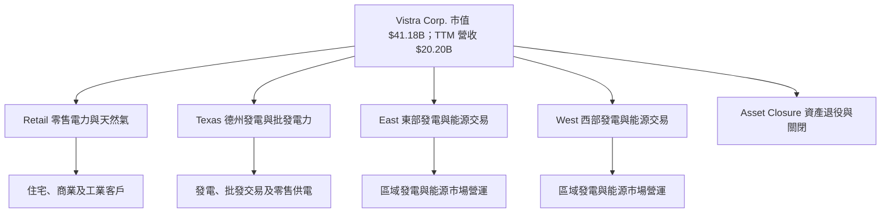
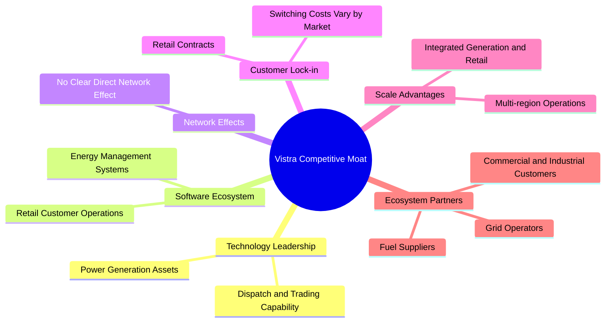
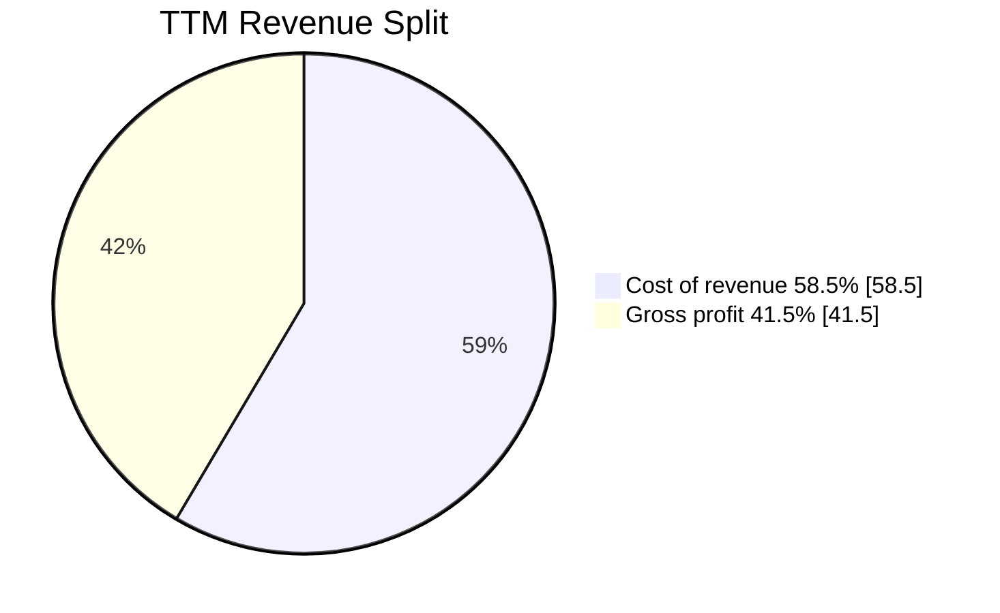
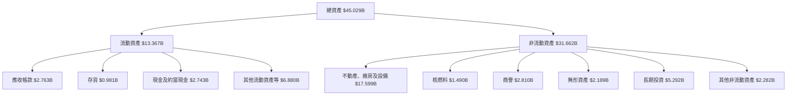
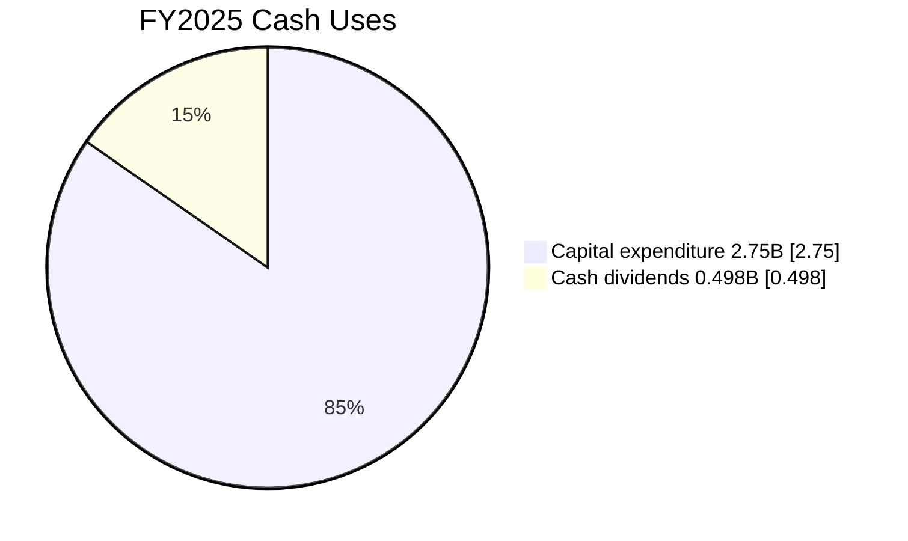
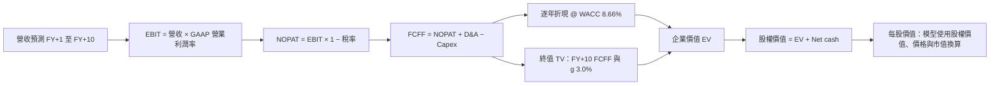
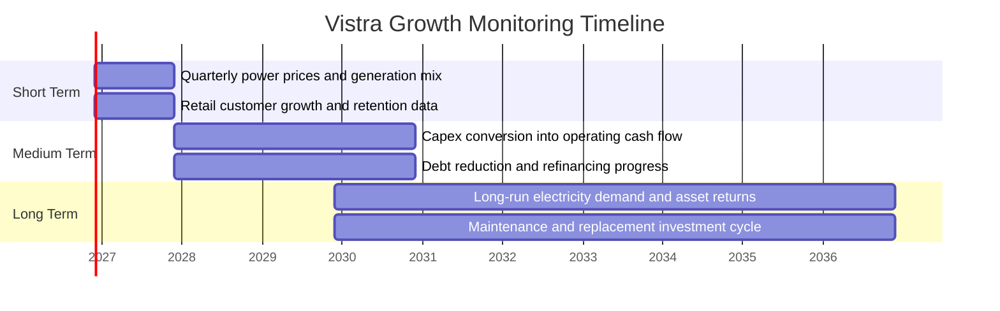
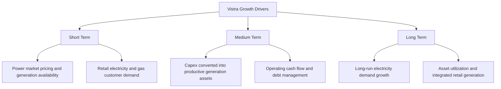
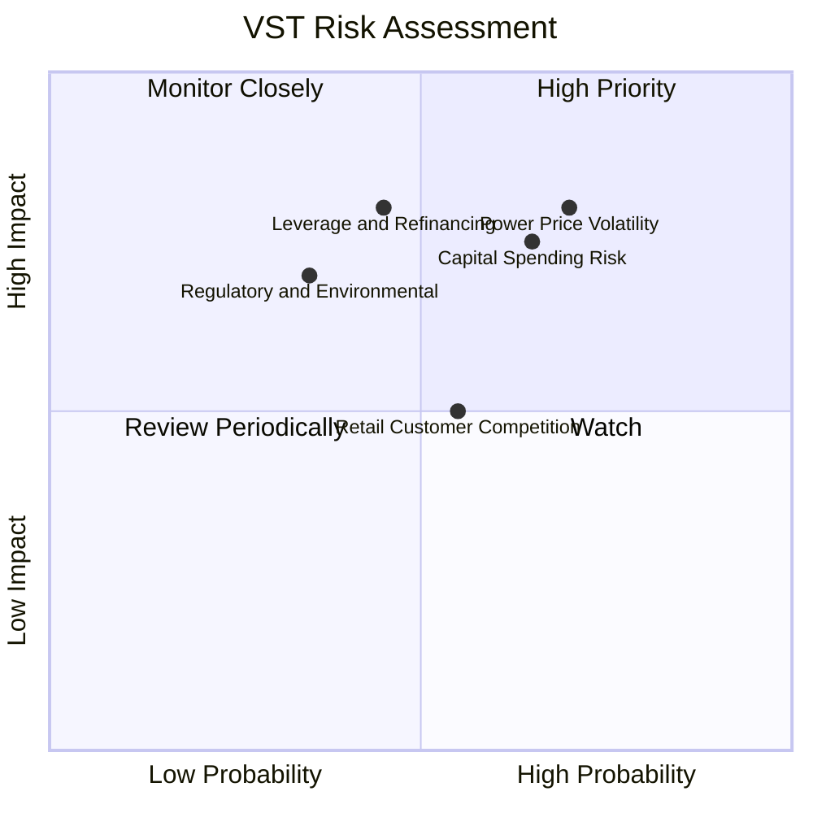
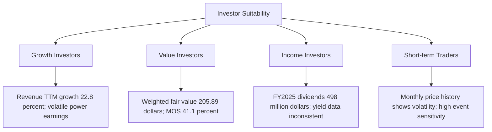

# VST 基本面深度分析報告
> **報告日期**：2026-11-27 ｜ **語言**：繁體中文 ｜ **數據來源**：SEC 申報資料 (XBRL)、Yahoo Finance、Finviz、StockAnalysis、Roic.ai ｜ **分析師**：CFA 級機構研究

## 目錄

| # | 章節 | 核心結論 |
|---|------|----------|
| 1 | 執行摘要 | 強烈買入；加權合理價值 $205.89；MOS 41.1% |
| 2 | 公司概覽與商業模式 | 整合零售與發電平台有實體資產及客戶基礎優勢，市場份額數據未提供 |
| 3 | 損益表深度分析 | TTM 營收 $20.20B、TTM 成長 22.8%；單季獲利波動顯著 |
| 4 | 資產負債表分析 | 淨負債 $18.40B；流動性可用但槓桿高 |
| 5 | 現金流量深度分析 | TTM FCF $2.61B、FCF Yield 6.33%；投資支出高且年度 FCF 波動 |
| 6 | 獲利能力與資本效率 | ROIC 13.5% 高於 WACC 8.66%，目前創造價值 |
| 7 | 相對估值分析 | P/E 低於自身五年中位數；同業估值分歧大 |
| 8 | DCF 內在價值評估 | 基準 DCF $302.44；加權合理價值 $205.89；估值高度受終值假設影響 |
| 9 | 成長催化劑 | 電力需求、零售客戶與發電資產利用率是主要觀察項；TAM 數據未提供 |
| 10 | 風險矩陣 | 電力價格／天候波動、資本支出與槓桿是主要風險 |
| 11 | 投資建議 | 評級依 MOS 為強烈買入；買入區間上限以 MOS ≥10% 計算 |

---

## 1. 執行摘要

截至 2026-11-25 收盤價 **$121.32**，VST 的 TTM 營收為 **$20.20B**、TTM 營收年增 **22.8%**、TTM FCF **$2.61B**、FCF Yield **6.33%**，且 ROIC **13.5%** 高於 WACC **8.66%**。估值三角驗證得到加權合理價值 **$205.89**，MOS **41.1%**；依規則 20 的門檻，評級為**強烈買入**。不過，基準 DCF $302.44 有 **66.6%** 企業價值來自終值，模型對長期現金流假設相當敏感，故評級雖為強烈買入，仍須以季度現金流和資本支出驗證成長品質。

### 1.0 一頁式投資儀表板（Portfolio Manager 30 秒速讀）

| 項目 | 內容 |
|------|------|
| **投資論點（3 句）** | ① TTM 營收 $20.20B、年增 22.8%，反映營運規模仍在擴張。② TTM FCF $2.61B、FCF Yield 6.33%，現金流提供估值支撐，但資本支出達 $3.15B。③ ROIC 13.5% 高於 WACC 8.66%，目前資本投入仍創造正經濟價值。 |
| **綜合評分** | **7.0/10**（引用 1.1 評分卡） |
| **財務健康** | 🟡 淨負債 $18.40B；Piotroski F-Score 7/8，但槓桿及速動比率 0.477 值得監控。 |
| **ROIC vs WACC** | **13.5% vs 8.66%**；正利差 4.84 個百分點，表示目前創造價值。 |
| **FCF 趨勢** | TTM FCF $2.61B；年度 FCF 由 2023 年 $3.78B 降至 2025 年 $1.32B，波動偏高；FCF Yield 6.33%。 |
| **估值** | Forward P/E **12.4x** ｜ EV/EBITDA（歷史估值區塊）**9.4x** ｜ FCF Yield **6.33%** |
| **DCF 內在價值（基準）** | **$302.44** ｜現價折價 **59.9%**（折溢價＝現價 ÷ DCF 基準價 − 1） |
| **安全邊際（MOS）** | **41.1%＝($205.89 − $121.32) ÷ $205.89**｜🟢 >25% 充足 |
| **預期報酬（基準情境 12M）** | 加權合理價值隱含上行空間 **69.7%**；非保證的 12 個月報酬預測。 |
| **關鍵風險（前二）** | 電力市場價格與發電量波動；資本支出、負債及利率變動。 |
| **評級 + 信心度** | 🟢 **強烈買入** ｜ 信心：中（模型終值依賴高、DCF 輸出存在可見的算術尾差） |

### 1.1 綜合評分卡（全報告唯一）

| 維度 | 評分（1–10） | 主要依據（引用數字與其來源章節） |
|------|--------------|----------------------------------|
| 成長性 | 8.0 | TTM 營收年增 22.8%、最新一季年增 25.4%（第 3 章）；成長率具吸引力但季度營收波動明顯。 |
| 獲利能力 | 8.0 | TTM 營業利益率 21.0%、ROIC 13.5% 高於 WACC 8.66%、F-Score 7/8（第 3、6 章）。 |
| 財務健康 | 5.5 | 淨負債 $18.40B、流動比率 1.157、速動比率 0.477；負債測試未通過（第 4、6 章）。 |
| 估值 | 8.0 | MOS 41.1%；P/E 16.4x 低於五年中位數 25.2x，但 DCF 終值佔 EV 66.6%（第 7、8 章）。 |
| 護城河 | 6.0 | 發電資產、零售客戶與整合營運具一定進入障礙；市場份額與客戶留存數據未提供（第 2 章）。 |
| 管理層與資本配置 | 6.5 | 2025 年 SBC $113M、稀釋股數測試通過；近年 Capex 高且 FCF 起伏（第 3、5 章）。 |
| **綜合評分** | **7.0** | 六項算術平均：$(8.0+8.0+5.5+8.0+6.0+6.5)÷6=7.0$。 |

### 1.2 五大投資論點 + 三大核心風險

| 類型 | 項目 | 具體依據 | 信心度 |
|------|------|----------|--------|
| 🟢 **投資論點①** | 收入成長延續 | TTM 營收 $20.20B，TTM 年增 22.8%；最新一季年增 25.4%（第 3 章）。 | 🟢 高 |
| 🟢 **投資論點②** | 現金流規模可觀 | TTM OCF $5.76B、Capex $3.15B、FCF $2.61B（第 5 章）。 | 🟢 高 |
| 🟢 **投資論點③** | 資本回報高於資金成本 | ROIC 13.5% 對 WACC 8.66%，利差 4.84pp（第 6 章）。 | 🟢 高 |
| 🟢 **投資論點④** | 相對自身歷史估值不高 | P/E 16.4x，低於五年中位數 25.2x；目前位於歷史百分位 20%（第 7 章）。 | 🟡 中 |
| 🟢 **投資論點⑤** | 現價有合理價值折讓 | 加權合理價值 $205.89，現價 $121.32，MOS 41.1%（第 8 章）。 | 🟡 中 |
| 🟡 **風險①** | 電力價格、天候與營運波動 | 最近四季營收介於 $4.02B 至 $6.35B；TTM 營業利益率 21.0%，最新季則為 28.5%。 | 🟡 中 |
| 🔴 **風險②** | 淨負債及資本密集 | 淨負債 $18.40B；TTM Capex $3.15B，約為 TTM FCF 的 1.21 倍。 | 🔴 高衝擊 |
| 🟡 **風險③** | DCF 終值及資料口徑風險 | 終值現值佔 EV 66.6%；部分非核心資料源與 SEC 衍生指標存在口徑差異。 | 🟡 中 |

### 1.3 快速統計卡片

| 指標 | 公司實際值（期間） | 同業中位數 | 狀態 |
|------|--------------------|------------|------|
| 營收成長（TTM） | **22.8%** | — | 🟢 |
| 營收成長（最新一季年增） | **25.4%** | 45.4%（CEG、NRG、TLN 最新季中位數） | 🟡 |
| 毛利率（TTM） | **41.5%**（交叉資料） | 25.2% | 🟢 |
| 營業利益率（TTM） | **21.0%** | — | 🟢 |
| ROIC（TTM） | **13.5%** | — | 🟢 |
| Forward P/E | **12.4x** | 10.9x | 🟡 |
| FCF Yield（TTM） | **6.33%** | — | 🟢 |
| Piotroski F-Score | **7 / 8** | — | 🟢 |

### 1.4 投資結論

```text
╔══════════════════════════════════════════════════════════════════╗
║                    📊 投資結論摘要                               ║
╠══════════════════════════════════════════════════════════════════╣
║  評級：強烈買入（MOS 41.1%，ROIC 13.5% > WACC 8.66%）            ║
║  價格（2026-11-25 收盤）：$121.32                                ║
║  DCF 內在價值（基準）：$302.44（折價 59.9%）                    ║
║  安全邊際 MOS：41.1%（＝(加權合理價值−現價)÷加權合理價值）      ║
║  加權合理價值（8.8）：$205.89                                    ║
║  DCF 情境價值：                                                  ║
║    悲觀情境：$102.15（-15.8%）                                   ║
║    基準情境：$302.44（+149.3%）                                  ║
║    樂觀情境：$712.37（+487.2%）                                  ║
║  綜合評分：7.0/10（引用 1.1）                                    ║
║  適合投資人：可承受電力商品、槓桿及估值波動的成長型長期投資人    ║
╚══════════════════════════════════════════════════════════════════╝
```

---

## 2. 公司概覽與商業模式

### 2.1 業務結構與收入來源

公司資料指出 Vistra 在美國經營整合式零售電力及發電業務，分為 Retail、Texas、East、West、Asset Closure 五個部門。各部門營收金額與占比沒有提供，故不虛構分部比例；以下結構圖只呈現已知業務分類。



商業模式將發電資產與終端售電結合：自有發電可支援零售供電及批發市場交易，零售端客戶關係則提供需求端基礎。由於各業務收入與分部 EBITDA 未提供，無法判斷哪一分部是成長或利潤主要來源。

### 2.2 市場份額

市場份額數據未提供，故不繪製市場份額圖或填入比例。以規模觀察，VST TTM 營收為 $20.20B，最新一季營收年增 25.4%；同業最新季營收年增中位數為 45.4%，主要受 CEG、TLN 的高增長影響，VST 的增速高於 NRG 的 24.0%，但低於 CEG 與 TLN。

### 2.3 競爭護城河分析



### 2.4 護城河強度

| 護城河項目 | 強度（強／中／弱） | 證據（引用數字或事實） | 會削弱它的情況 |
|------------|--------------------|------------------------|----------------|
| 發電資產與營運能力 | 中 | 業務涵蓋 Texas、East、West 等發電市場；最新季度營業利益率 28.5%。 | 機組停機、燃料成本升高、容量或環境規範變動。 |
| 零售客戶關係 | 中 | 零售電力及天然氣業務覆蓋多州，客戶數與留存率未提供。 | 客戶轉換成本低、競爭者促銷或零售電價管制。 |
| 規模與整合 | 中 | TTM 營收 $20.20B，兼具發電、批發與零售業務。 | 整合效率未改善，或區域市場價格走勢對沖效果下降。 |
| 技術領先 | 弱至中 | 已知具發電及能源交易營運能力，但比較性成本或技術數據未提供。 | 新型發電、儲能與交易技術提升競爭者效率。 |
| 軟體生態、網路效應及夥伴 | 弱至中 | 有零售營運及電力市場夥伴，但無軟體收入、平台用戶或網路效應量化證據。 | 客戶、供應商或交易平台可低成本更換。 |

1.1「護城河」評分為 **6.0/10**，理由是發電資產、跨區域營運與零售客戶基礎提供一定進入障礙，但缺乏市場份額、客戶留存及分部回報數據來證明其具持續定價權。

---

## 3. 損益表深度分析

### 3.1 年度收入成長趨勢（近4年）

年度營收依年度損益表資料列示；年度與 TTM 口徑不同，TTM 成長率仍採用 SEC 計算數字 22.8%。

```text
╔══════════════════════════════════════════════════════════════════╗
║               Vistra 年度收入趨勢（FY2022-FY2025）               ║
╠══════════════════════════════════════════════════════════════════╣
║  FY2022  $13.73B  ███████████████░░░░░░░░░░  YoY: —             ║
║  FY2023  $14.78B  ████████████████░░░░░░░░░  YoY: +7.7%  🟢    ║
║  FY2024  $17.22B  ███████████████████░░░░░░░  YoY: +16.5% 🟢    ║
║  FY2025  $17.74B  ████████████████████░░░░░░  YoY: +3.0%  🟡    ║
║                                                                  ║
║  2022–2025 營收 CAGR：((17.74 ÷ 13.73)^(1/3) − 1) = 約 8.9%     ║
╚══════════════════════════════════════════════════════════════════╝
```

FY2025 年增放緩至 3.0%，但 2026 年前三季營收較同期增加；反映年度營收可能受電力價格、發電量與季度組合影響，不能用單年增幅直接代表長期需求。

### 3.2 季度收入趨勢分析

下表季度營收取自季度損益表；YoY 以同季度前年比較，QoQ 以前一季比較計算，金額四捨五入至 $0.01B。

| 季度 | 營收 | QoQ 成長 | YoY 成長 | 備註 |
|------|------:|---------:|---------:|------|
| 2025 Q4 | $4.58B | — | 13.6% | 比 2024 Q4 的 $4.04B 高。 |
| 2026 Q1 | $5.64B | 23.0% | 43.4% | 對比 2025 Q1 $3.93B，年增較高。 |
| 2026 Q2 | $4.02B | -28.8% | -5.5% | 季節與市場組合造成回落；年增轉負。 |
| 2026 Q3 | $6.35B | 58.0% | 27.7% | 對比 2026 Q2 反彈，與 2025 Q3 $4.97B 相比成長。 |

SEC 計算的最新一季年增率為 **25.4%**，而交叉資料季度表顯示 27.7%；報告對要求的最新季度年增率採用 SEC 計算值 **25.4%**，其他供應商口徑僅作參考，不混用。

### 3.3 利潤率演變分析

年度報表中的毛利、營業利益與淨利波動大。以下比率依各年度報表數字計算，與 TTM SEC 計算指標口徑不同，應視為年度報表的描述性趨勢。

| 利潤率指標 | FY2022 | FY2023 | FY2024 | FY2025 | 趨勢 | 評估 |
|------------|-------:|-------:|-------:|-------:|------|------|
| **毛利率** | 12.2% | 37.3% | 43.7% | 32.9% | 2024 上升、2025 回落 | 🟡 |
| **營業利益率** | -8.0% | 18.3% | 23.7% | 12.0% | 2024 改善、2025 收縮 | 🟡 |
| **淨利率** | -9.0% | 10.1% | 15.5% | 5.3% | 隨營業利益與非營業項目起伏 | 🟡 |

SEC TTM 營業利益率為 **21.0%**，最新季度為 **28.5%**；與 FY2025 年度報表營業利益率 12.0% 有明顯差異，顯示不同期間的能源價格、發電結構及損益項目會影響利潤率。公司披露資料不足以把變化精確拆分為價格、燃料、套期或產品組合效果；因此不將單季高利潤率直接外推為常態。

### 3.4 費用結構分析

TTM 毛利率交叉數據為 41.5%，因此可用營收比例呈現成本與毛利的粗略結構；此為損益表比例，不代表營業費用、利息或稅的完整分解。



```text
╔══════════════════════════════════════════════════════════════════╗
║                TTM 營收與毛利比例（交叉資料）                    ║
╠══════════════════════════════════════════════════════════════════╣
║  成本收入估計比例 58.5%  ████████████░░░░░░░░                    ║
║  毛利比例         41.5%  ████████░░░░░░░░░░░░                    ║
║  營收基數：StockAnalysis TTM $20.588B；毛利率：Yahoo Finance     ║
╚══════════════════════════════════════════════════════════════════╝
```

### 3.5 季度 EPS 趨勢與盈餘品質（Quality of Earnings）

過去四季 EPS 實際值可由 StockAnalysis 季度資料觀察，但分析師預估值未提供，因此不能判定季度盈餘是否超預期或不及預期。

| 季度 | EPS 實際 | EPS 預估 | 超預期／不及預期 | 季度觀察 |
|------|---------:|---------:|------------------|----------|
| 2025 Q4 | $0.54 | N/A | 無法判定 | 淨利約 $0.19B；季節性及比較基期影響大。 |
| 2026 Q1 | $2.87 | N/A | 無法判定 | 相較 2025 Q1 負 EPS 有明顯改善。 |
| 2026 Q2 | $0.76 | N/A | 無法判定 | EPS 較 Q1 下降，符合營收及營業利益季減。 |
| 2026 Q3 | $3.23 | N/A | 無法判定 | 季度淨利和營業利益回升；估值資料庫的單季 EPS 估值不可得。 |

| 盈餘品質項目 | 數值/佔比 | 評估 |
|--------------|-----------|------|
| 股權薪酬 SBC / 營收 | FY2025：$113M ÷ $17.74B = **0.64%** | 🟢 比例不高；仍是股東成本，但截至 F-Score 的稀釋股數測試通過。 |
| SBC / 營業現金流 | FY2025：$113M ÷ $4.07B = **2.8%** | 🟢 相對 OCF 規模有限。 |
| FCF / 淨利（現金轉換率） | TTM FCF $2.61B ÷ TTM 淨利 $2.515B = **約 104%** | 🟢 現金流約略高於淨利；但單季及年度營運現金流波動仍需留意。 |
| 一次性／非經常性損益 | N/A（未提供可量化明細） | 無法判定是否有特定一次性項目顯著推升或壓低盈餘。 |
| 有效稅率異常 | 最新年度有效稅率 **15.9%** | 🟡 低於 21% 美國聯邦法定稅率，但缺少完整稅務調節表，不能判定是否由一次性稅務利益造成。 |
| 資本化支出 vs 費用化 | TTM Capex $3.15B；資本化與費用化細目 N/A | 高資本支出屬發電資產營運特性；無法僅憑現有數字判斷是否有成本遞延。 |

**盈餘品質結論：** TTM FCF/淨利約 104%，以及 SBC 約占 FY2025 營收 0.64%，支持 GAAP 盈利具有一定現金含量；不過電力交易與資產運作可能使季度現金流大幅變動。估值上應避免只以單季 EPS 年化，也應持續比對淨利、OCF、Capex 與 FCF。

---

## 4. 資產負債表分析

### 4.1 資產結構分解

以下採 StockAnalysis 2026-09-30 資產負債表總資產 $45.029B 分解；此資料源的資產細項合計與總額一致。



非流動資產以 PP&E $17.599B 為最大列示項目，符合發電業資本密集特性；長期投資 $5.292B 及核燃料亦占一定資產。資產回報取決於機組利用率、電力市場定價與投資回收，而非單看資產帳面規模。

### 4.2 流動性與營運資金分析

流動性比率取資料包交叉財務摘要；營運資金天數照 SEC／Yahoo 計算值列示。

| 指標 | 最新 TTM | 一年前 TTM | 變化 | 解讀 |
|------|----------|------------|------|------|
| DSO 應收帳款天數 | 50 天 | 52 天 | -2 天 | 收款天數略降，代表應收周轉小幅改善；不能由此單獨判定信用品質變化。 |
| DIO 存貨天數 | 30 天 | N/A | N/A | 一年前無可用存貨流量資料，不反推變化。 |
| DPO 應付帳款天數 | 45 天 | N/A | N/A | 缺少一年前可比較數據，無法判斷供應商付款週期變化。 |
| CCC 現金轉換週期 | 34 天 | N/A | N/A | 最新 CCC 為 50+30−45=35 天，原始品質指標列示 34 天；差異可能來自未四捨五入底數，照抄正式值 34 天。 |

流動比率為 **1.157**，顯示流動資產略高於流動負債；速動比率 **0.477**，流動性較依賴存貨、其他流動資產或持續營業現金流。由於公司現金流具有能源市場週期性，流動比率不應單獨視為低風險訊號。

### 4.3 債務結構分析

```text
╔══════════════════════════════════════════════════════════════════╗
║                    Vistra 債務健康診斷                           ║
╠══════════════════════════════════════════════════════════════════╣
║  總債務：        $21.15B  ████████████████████  🟡               ║
║  現金及短期投資： $2.74B  ███░░░░░░░░░░░░░░░░░  🟡               ║
║  淨負債：        $18.40B  █████████████████░░░  🔴               ║
║                                                                  ║
║  流動比率：1.157x  🟡       速動比率：0.477x  🔴                ║
║  Debt/EBITDA：N/A（未提供同一口徑 EBITDA 與指定債務計算值）       ║
║  Interest Coverage：N/A（利息費用與營業利益同期間細項未提供）    ║
╚══════════════════════════════════════════════════════════════════╝
```

SEC 計算的總債務 $21.15B、現金及短期投資 $2.74B、淨負債 $18.40B，表示公司對外部融資及持續經營現金流有實質依賴。另一資料源的總債務 $21.77B、淨負債 $19.02B 與上述數字不同；本報告凡涉及指定淨負債指標，以 SEC 計算數值為準，不混用兩套口徑。

### 4.4 股東權益趨勢

| 年度 | 股東權益 | YoY 變化 | 觀察 |
|------|---------:|---------:|------|
| 2022 | $4.90B | — | 年末帳面權益。 |
| 2023 | $5.31B | +8.4% | 較 2022 增加。 |
| 2024 | $5.57B | +4.9% | 繼續小幅上升。 |
| 2025 | $5.10B | -8.4% | 年末權益下降；需結合股息、回購、累積其他綜合損益及淨利變動分析。 |

```text
╔══════════════════════════════════════════════════════════════════╗
║                 Vistra 股東權益趨勢（年度）                      ║
╠══════════════════════════════════════════════════════════════════╣
║  2022  $4.90B  █████████████████░░░░░░░░                         ║
║  2023  $5.31B  ██████████████████░░░░░░░                         ║
║  2024  $5.57B  ███████████████████░░░░░░                         ║
║  2025  $5.10B  █████████████████░░░░░░░░                         ║
╚══════════════════════════════════════════════════════════════════╝
```

---

## 5. 現金流量深度分析

### 5.1 現金流量瀑布圖

年度淨利及資本配置明細不是同一 TTM 時段，故圖中只連接有可比數字的 TTM OCF、Capex 與 FCF；股息等列示 FY2025 資料，不將兩種期間相加。


### 5.2 FCF 轉換率趨勢

年度 FCF/淨利依年度現金流與損益表計算；2022 年淨利為負，該比率不具通常的現金轉換解讀意義。

| 年度 | FCF | 淨利 | FCF / 淨利 | 趨勢解讀 |
|------|----:|----:|-----------:|----------|
| 2022 | -$0.816B | -$1.23B | 66.3% | 兩者皆為負，比例不能視作正向轉換。 |
| 2023 | $3.78B | $1.49B | 253.7% | 現金流大幅高於會計淨利。 |
| 2024 | $2.48B | $2.66B | 93.2% | 現金轉換接近淨利。 |
| 2025 | $1.32B | $0.944B | 139.8% | FCF 高於淨利，但絕對 FCF 較 2024 下降。 |

### 5.3 自由現金流趨勢

年度 FCF 及 TTM FCF 以現金流量表所列 OCF 減 Capex 為準。FY2025 FCF 為 $1.32B；TTM FCF 為 $2.61B，期間不同，不把兩者當作同一會計年度比較。

```text
╔══════════════════════════════════════════════════════════════════╗
║                 自由現金流歷史趨勢（美元）                       ║
╠══════════════════════════════════════════════════════════════════╣
║  FY2022  -$0.816B  ◀██░░░░░░░░░░░░░░░░░░░░                     ║
║  FY2023   $3.78B   ████████████████████░░  FCF Yield：N/A        ║
║  FY2024   $2.48B   █████████████░░░░░░░░░  FCF Yield：N/A        ║
║  FY2025   $1.32B   ███████░░░░░░░░░░░░░░░  FCF Yield：N/A        ║
║  TTM      $2.61B   ██████████████░░░░░░░░  FCF Yield：6.33%      ║
╚══════════════════════════════════════════════════════════════════╝
```

TTM OCF $5.76B 減 TTM Capex $3.15B 得 FCF $2.61B。2025 年度 FCF 低於 2024 年，反映當期營運現金流下降及資本支出上升；不能僅從 TTM 回升就推論長期資本需求已下降。

### 5.4 資本配置評估



| 項目 | FY2025 金額 | 評估 |
|------|------------:|------|
| 資本支出 | $2.75B | 最大列示現金用途；需追蹤新增與維持性 Capex 的比例。 |
| 股息支付 | $0.498B | 占 FY2025 FCF 約 37.7%；年度支付金額相對 FCF 尚可覆蓋。 |
| 回購 | N/A | 未提供可供引用的年度回購金額。 |
| 留存現金／債務變動 | N/A | 未提供完整年度融資與現金變動拆解。 |

---

## 6. 獲利能力與資本效率

### 6.1 ROE / ROA / ROIC 趨勢

可核實的品質指標提供 TTM ROE、ROIC，及交叉資料 ROA；歷史年度 ROIC 序列與行業均值未提供，故不填造。

| 指標 | 最新可用值 | 歷史／比較資料 | 評估 |
|------|-----------:|----------------|------|
| ROE | TTM **42.9%** | 另一資料源列 46.3%，口徑不一致 | 高 ROE 部分受到高權益乘數影響，不能單獨視為低風險獲利。 |
| ROA | **7.1%**（交叉資料） | Piotroski 測試顯示 ROA 高於一年前 | 🟢 資產獲利為正，年度歷史可比數據有限。 |
| ROIC | TTM **13.5%** | 歷史序列 N/A | 🟢 高於資金成本 8.66%。 |
| 行業均值 | N/A | 無可核實同行 ROIC／ROE／ROA 均值 | 不進行無來源的行業均值比較。 |

### 6.2 ROIC vs WACC 分析（核心價值創造判斷）

ROIC 與 WACC 使用同一組資料庫計算值；不在本節另算替代 WACC。

```text
╔══════════════════════════════════════════════════════════════════╗
║                ROIC vs WACC 深度分析                            ║
╠══════════════════════════════════════════════════════════════════╣
║  WACC 組成（程式計算，依 Cost of capital）：                     ║
║  ├── 無風險利率（10Y 美債）：       4.85%                        ║
║  ├── ERP：                          5.00%                        ║
║  ├── 原始 Beta：                    1.38                         ║
║  ├── 調整後 Beta：                  1.25                         ║
║  ├── 股權成本：                     11.10%                       ║
║  ├── 稅前債務成本：                 4.64%                        ║
║  ├── 資本權重：股權 66.1%、債務 33.9%                           ║
║  └── WACC：                         8.66%                        ║
║                                                                  ║
║  ROIC（TTM，程式計算）：             13.5%                       ║
║  ROIC − WACC：                       13.5% − 8.66% = 4.84pp       ║
║                                                                  ║
║  ROIC  13.5%  ▓▓▓▓▓▓▓▓▓▓▓▓▓▓▓▓▓▓▓▓▓▓▓▓░░░░░░  🟢              ║
║  WACC   8.66% ▓▓▓▓▓▓▓▓▓▓▓▓▓▓▓░░░░░░░░░░░░░░░  ──              ║
║                                                                  ║
║  結論：ROIC 高於 WACC，現階段創造股東價值；但單期 ROIC 不代表    ║
║  未來回報不會受商品價格、停機與再投資需求影響。                  ║
╚══════════════════════════════════════════════════════════════════╝
```

### 6.3 杜邦三因素分解

| 因素 | 數值（TTM） | 解讀 |
|------|-------------|------|
| 淨利率 | 13.4% | 代表每單位營收的會計獲利；受商品市場及非營業項目影響。 |
| 資產週轉率 | 0.45 | 發電資產規模大，資產週轉不高屬資本密集特性。 |
| 權益乘數 | 7.14 | 槓桿水準高，提升股東報酬同時增加財務波動。 |
| **ROE** | **42.9%** | 品質指標列示：13.4% × 0.45 × 7.14 = 42.9%（使用未四捨五入底數）。 |

ROE 的高值不只來自獲利能力，也受到 7.14 倍權益乘數放大；因此資本效率判讀應優先看 ROIC 與 WACC 的差距，並持續追蹤負債。

### 6.4 財務體質：Piotroski F-Score

Piotroski F-Score 為 **7/8**；其中一項因缺少輸入資料而不列入分母，並非 7/9。

| 測試 | 結果 | 解讀 |
|------|------|------|
| ROA > 0 | ✅ 通過 | TTM 資產報酬為正。 |
| 營業現金流 > 0 | ✅ 通過 | TTM OCF $5.76B。 |
| ROA 高於一年前 | ✅ 通過 | 資產獲利趨勢改善。 |
| 營業現金流 > 淨利 | ✅ 通過 | 顯示現金流高於會計獲利。 |
| 長期負債 ÷ 總資產低於一年前 | ❌ 未通過 | 槓桿改善尚未獲得此項測試支持。 |
| 流動比率高於一年前 | ✅ 通過 | 短期流動性指標改善。 |
| 稀釋股數未增加 | ✅ 通過 | 測試期間未顯示稀釋股數增加。 |
| 毛利率高於一年前 | — 無法判定 | 缺少可用毛利率輸入，不納入分母。 |
| 資產週轉率高於一年前 | ✅ 通過 | 營運資產運用效率改善。 |

---

## 7. 相對估值分析

### 7.1 同業估值比較表格

VST 的估值使用其自身資料；競爭者倍數依 Yahoo Finance Peer multiples 原值列示。公司 EV/EBITDA 採自身歷史估值區塊的 9.4x，避免和其他來源 7.991x 混用。

| 估值指標 | **VST** | **CEG** | **NRG** | **TLN** | VST 評估 |
|----------|--------:|--------:|--------:|--------:|----------|
| **Trailing P/E** | 16.4x | 18.9x | 16.1x | N/A | 🟡 接近 NRG，低於 CEG；TLN 缺資料。 |
| **Forward P/E** | 12.4x | 17.6x | 9.6x | 10.9x | 🟡 高於 NRG、TLN，低於 CEG。 |
| **P/S Ratio** | 2.0x | 2.4x | 0.6x | 3.4x | 🟡 介於 NRG 與 CEG/TLN 間。 |
| **EV/EBITDA** | 9.4x | 11.2x | 10.5x | 36.4x | 🟢 低於三家同業列示值；TLN 倍數明顯偏高。 |
| **最新季營收 YoY** | 25.4% | 45.4% | 24.0% | 96.1% | 🟡 高於 NRG、低於 CEG 與 TLN。 |
| **毛利率（TTM）** | 41.5%* | 25.2% | 20.2% | 42.7% | 🟢 接近 TLN、高於 CEG 與 NRG。 |

\*VST 毛利率為交叉來源數據；不同資料源營收、毛利及營業利益口徑有差異。

### 7.2 歷史估值區間分析

```text
╔══════════════════════════════════════════════════════════════════╗
║                VST 五年估值區間（TTM 倍數）                      ║
╠══════════════════════════════════════════════════════════════════╣
║  P/E       7.2x ├────────────● 16.4x──────────────┤ 74.3x       ║
║             五年中位數 25.2x；目前百分位 20%                     ║
║  P/S       0.5x ├──────────────● 2.0x─────────────┤ 4.2x        ║
║             五年中位數 1.8x；目前百分位 52%                      ║
║  EV/EBITDA 2.3x ├───────────● 9.4x───────────────┤ 40.7x        ║
║             五年中位數 11.0x；目前百分位 35%                     ║
╚══════════════════════════════════════════════════════════════════╝
```

P/E 目前 16.4x，位於自身五年歷史第 20 百分位且低於 25.2x 中位數；P/S 2.0x 則略高於 1.8x 中位數。因不同倍數所反映的獲利與資本密集程度不同，不能只用 P/E 的低歷史百分位直接推斷全面低估。

### 7.3 情境價值（Bear / Base / Bull，照抄 DCF MODEL）

| 情境 | 第 1 年營收成長 | 期末營業利潤率 | WACC | 每股價值 | 相對現價 | 機率 | 會發生的條件 |
|------|----------------:|----------------:|-----:|----------:|---------:|-----:|--------------|
| 🔴 悲觀 | 11.4% | 16.4% | 9.66% | $102.15 | -15.8% | 25% | 需求、零售／批發定價或發電獲利轉弱，且資本成本上升。 |
| 🟡 基準 | 22.8% | 19.3% | 8.66% | $302.44 | +149.3% | 50% | 短期營收延續 TTM 成長，再逐步收斂至長期假設。 |
| 🟢 樂觀 | 34.3% | 21.2% | 7.66% | $712.37 | +487.2% | 25% | 成長明顯超出 TTM 基準、期末利潤率維持較高，資金成本下降。 |

上述情境的長期現金流明細未逐情境提供，因此不另行推導情境內的 FY+N 營收、FCFF 或終值；每股價值與假設直接引用模型情境輸出。

### 7.4 相對估值隱含價格區間

```text
╔══════════════════════════════════════════════════════════════════╗
║             估值方法隱含股價與現價位置（美元）                   ║
╠══════════════════════════════════════════════════════════════════╣
║ $106.59 ─────── $121.32 ─────── $154.23 ───── $197.05 ─ $302.44 ║
║ Forward P/E      現價       EV/EBITDA       共識目標價   DCF     ║
╚══════════════════════════════════════════════════════════════════╝
```

| 方法 | 每股價值 | 依據 |
|------|---------:|------|
| 同業 Forward P/E | $106.59 | 同業中位數 10.9x × VST Forward EPS $9.76。 |
| 同業 EV/EBITDA | $154.23 | 同業中位數 11.2x × TTM EBITDA，再加淨現金／扣除淨負債橋接。 |
| 分析師共識 | $197.05 | 23 位分析師平均目標價。 |
| DCF 基準 | $302.44 | 10 年 FCFF，WACC 8.66%、終端成長率 3.0%。 |

---

## 8. DCF 內在價值評估（Discounted Cash Flow）

### 8.0 估值推理鏈（Thinking Logic）

**Step 1 — 價值來源與主導變數**

本模型將 VST 價值拆為：現有發電及零售主業的現金流、營收與電力需求成長，以及資本密集型資產的長期現金流；部門收入占比未提供，不能分配各來源營收權重。估值主導變數為長期 FCFF 與終值，具體表現為 WACC、終端成長率與長期利潤率；基準終值佔 EV 66.6%，與此判斷一致。

**Step 2 — 模型選擇**

| 決策點 | 本報告採用 | 理由（含數字） | 曾考慮但否決 | 否決理由 |
|--------|-----------|----------------|--------------|----------|
| 現金流定義 | FCFF | FCFF 對應 WACC 折現並推導企業價值；TTM FCF $2.61B 為正。 | FCFE | 公司淨負債 $18.40B，融資結構會影響股東現金流。 |
| 預測期 N | 10 年 | 模型固定 10 年，讓 22.8% 起始成長逐步收斂至 3.0%。 | 5 年 | 發電與資本支出回收週期長，較短期預測會更依賴終值。 |
| 終值方法 | Gordon Growth | 模型使用永續成長率 3.0%，低於 WACC 8.66%。 | 僅用退出倍數 | 模型未提供退出倍數終值的可稽核計算。 |
| EBIT 基礎 | GAAP EBIT | 模型標註 GAAP EBIT，已將 SBC 作為費用反映。 | 非 GAAP EBIT | 若加回 SBC，須再以現金成本或稀釋股數反映；本模型未採此法。 |

**Step 3 — 關鍵假設推導鏈**

- **營收成長路徑**：錨點＝TTM 成長 22.8% → 第 1 年採 22.8%，其後線性下降至第 10 年 3.0%，反映高成長不能永久延續 → **採用模型的 22.8% 至 3.0% 路徑** → 否決十年均維持 22.8%，因其會把短期增長率不合理地永續化。
- **期末營業利潤率**：錨點＝TTM 營業利益率 21.0%；模型第 10 年取含 TTM 在內的近五年中位數 19.3% → 逐年收斂 1.7pp → **採用 19.3%** → 否決把最新季度 28.5% 當作長期利潤率，因其是單季值且高於 TTM。
- **永續成長率 g**：錨點＝模型採 3.0%，且該值低於 WACC 8.66% → 長期公司成長需由高成長轉為成熟期水準 → **採用 3.0%** → 否決高於 WACC 的成長假設，因 Gordon Growth 公式將失效。
- **預測期 N**：錨點＝模型預設 10 年 → 長期持續投資電力資產，現金流需經成長收斂 → **採用 10 年** → 否決擅自縮短或延長，因需忠實使用固定模型。
- **Capex／營收**：錨點＝TTM 15.6% → 模型逐年降至第 10 年 11.5%，即 1.1 倍 D&A 目標 → **採用 15.6% 線性淡出至 11.5%** → 否決快速降至維持性 Capex 水準，因現有資料沒有維持／成長性 Capex 拆分。
- **D&A／營收**：錨點＝TTM 10.4% → **採用 10.4% 固定**；缺少可支持不同年度變化的資料。
- **有效稅率**：錨點＝最新年度有效稅率 15.9% → **採用 15.9% 固定**；未另推估長期稅務變化。
- **EBIT 基礎及 SBC**：錨點＝模型明示 GAAP EBIT → SBC 已作為費用反映，**不再從 FCFF 扣除 SBC**。
- **年稀釋率**：模型設定固定股數、不再稀釋 → **採 0% 額外稀釋**，與 GAAP EBIT 處理相配套。
- **終值方法**：模型採 Gordon Growth → **採用該法**；退出倍數只作交叉檢驗的替代思路，但沒有模型給出的逐項退出倍數終值結果，因此不另造數字。
- **WACC**：錨點＝程式計算 8.66% → **採 8.66%**，不自行更改；其組成於 8.2 列示。

**Step 4 — 脆弱環節**

最脆弱的是長期現金流、終端成長率及 WACC 的組合：終值 PV 佔 EV 66.6%；敏感度矩陣中，WACC 由 8.66% 升至 9.66% 時，每股值由 $302.44 降至 $242.89。

**Step 5 — 計算路徑圖**



### 8.1 模型假設總表（Model Inputs）

| 假設項目 | 採用值 | 依據／來源 | 敏感度 |
|----------|--------|-------------|--------|
| 預測期長度 N | 10 年 | DCF MODEL 固定預測期 | 🟡 中 |
| 營收成長路徑 | 第 1 年 22.8%；第 10 年 3.0% | TTM vs prior TTM 成長 22.8%；其後線性淡出 | 🔴 高 |
| 營業利潤率 | 第 1 年 21.0% → 第 10 年 19.3% | TTM 21.0%，逐步淡出至近五年中位數 | 🔴 高 |
| 有效稅率 | 15.9% | 最新年度有效稅率 | 🟢 低 |
| Capex／營收 | 第 1 年 15.6% → 第 10 年 11.5% | TTM 15.6%；淡出至 1.1×D&A | 🔴 高 |
| D&A／營收 | 10.4% | TTM 比率，模型固定 | 🟢 低 |
| 營運資金變動 | 未建模 | DCF MODEL 明示 Working capital is not modelled | 🟡 中 |
| EBIT 基礎 | GAAP | 模型使用 GAAP EBIT | 🟡 中 |
| SBC 處理 | 組合 (A)：不另扣 SBC，固定股數 | GAAP EBIT 已包含 SBC 費用；股數不再稀釋 | 🟡 中 |
| 年稀釋率 | 0% 額外稀釋 | DCF MODEL 使用固定股數 | 🟡 中 |
| 永續成長率 g | 3.0% | DCF MODEL 指定值；低於 WACC | 🔴 高 |
| 終值方法 | Gordon Growth | DCF MODEL 終值公式 | 🔴 高 |
| WACC | 8.66% | Cost of capital 計算值 | 🔴 高 |

本模型採用 FCFF：`FCFF = NOPAT + D&A − Capex`。營運資金未建模；因此不能把其他模型的 ΔWC 假設填入逐年現金流。SBC 組合為 **(A) GAAP EBIT + 固定股數**，SBC 影響已計入一次，不另列 SBC 扣除，也不額外稀釋股數。

### 8.2 折現率推導（WACC）

原始 Beta 為 **1.38**；調整後 Beta 按資料列示方式 **⅔ × 1.38 + ⅓ = 1.2533… ≈ 1.25**。模型採調整後 Beta 1.25；無風險利率及 ERP 均沿用資本成本資料，未額外加計規模或國別溢酬。

```text
╔══════════════════════════════════════════════════════════════════╗
║                    WACC 推導（折現率）                           ║
╠══════════════════════════════════════════════════════════════════╣
║  股權成本 Ke（CAPM）：                                           ║
║  ├── 無風險利率 Rf（10Y 美債）：      4.85%                      ║
║  ├── 市場風險溢酬 ERP：               5.00%                      ║
║  ├── 原始 Beta：                      1.38                       ║
║  ├── 調整後 Beta：                    1.25                       ║
║  ├── 規模／國別溢酬：                 0.00%（未另加）            ║
║  └── Ke = 4.85% + 1.25 × 5.00% = 11.10%                         ║
║                                                                  ║
║  債務成本 Kd：                                                   ║
║  ├── 稅前 Kd：                        4.64%                      ║
║  ├── 有效稅率：                       15.9%                      ║
║  └── 稅後 Kd = 4.64% × (1 − 15.9%) = 3.902%                     ║
║                                                                  ║
║  資本結構（資料庫市場權重）：                                    ║
║  ├── 股權權重 E：                     66.1%                      ║
║  ├── 債務權重 D：                     33.9%                      ║
║  └── WACC = 66.1%×11.10% + 33.9%×3.902%                         ║
║           = 7.337% + 1.323% = 8.66%                              ║
╚══════════════════════════════════════════════════════════════════╝
```

**逐步演算（WACC，按資本成本資料組成）：**

1. **Ke（CAPM）** = Rf + β × ERP = 4.85% + 1.25 × 5.00% = **11.10%**。
2. **稅前 Kd** = Cost of capital 列示利息 ÷ 計息債務 = **4.64%**。資料沒有提供利息費用絕對金額與平均計息負債明細，故不反推兩者。
3. **稅後 Kd** = 4.64% × (1 − 15.9%) = 4.64% × 0.841 = **3.90224%**。
4. **權重** = 股權 66.1%、債務 33.9%；66.1% + 33.9% = **100.0%**。其來源是資本成本資料所列市場權重；沒有足夠同口徑輸入重建市場市值及計息負債。
5. **WACC** = 66.1% × 11.10% + 33.9% × 3.90224% = 7.3371% + 1.3229% = **8.66%**（採資料列示值）。

### 8.3 逐年自由現金流預測（基準情境）

單位為 $B；金額保留兩位小數、比率保留一位小數、折現因子保留三位小數。表格逐年照錄 DCF MODEL。該模型 FCFF 不含營運資金變化，也未另扣 SBC。

| 年度 | FY+1 | FY+2 | FY+3 | FY+4 | FY+5 | FY+6 | FY+7 | FY+8 | FY+9 | FY+10 |
|------|-----:|-----:|-----:|-----:|-----:|-----:|-----:|-----:|-----:|------:|
| 營收 | 24.81 | 29.93 | 35.45 | 41.20 | 46.98 | 52.54 | 57.59 | 61.85 | 65.07 | 67.03 |
| 營收 YoY | 22.8% | 20.6% | 18.4% | 16.2% | 14.0% | 11.8% | 9.6% | 7.4% | 5.2% | 3.0% |
| 營業利潤率 | 21.0% | 20.8% | 20.6% | 20.4% | 20.2% | 20.0% | 19.8% | 19.6% | 19.4% | 19.3% |
| EBIT（GAAP） | 5.20 | 6.22 | 7.29 | 8.40 | 9.49 | 10.51 | 11.41 | 12.14 | 12.65 | 12.91 |
| − 稅 | (0.83) | (0.99) | (1.16) | (1.34) | (1.51) | (1.68) | (1.82) | (1.94) | (2.02) | (2.06) |
| = NOPAT | 4.37 | 5.22 | 6.13 | 7.06 | 7.98 | 8.84 | 9.60 | 10.21 | 10.64 | 10.85 |
| + D&A | 2.58 | 3.12 | 3.69 | 4.29 | 4.89 | 5.47 | 6.00 | 6.44 | 6.78 | 6.98 |
| − Capex | (3.88) | (4.54) | (5.21) | (5.86) | (6.47) | (6.99) | (7.40) | (7.66) | (7.75) | (7.68) |
| **= FCFF** | **3.08** | **3.80** | **4.61** | **5.49** | **6.40** | **7.32** | **8.20** | **8.99** | **9.66** | **10.15** |
| 折現因子 @8.66% | 0.920 | 0.847 | 0.780 | 0.717 | 0.660 | 0.608 | 0.559 | 0.515 | 0.474 | 0.436 |
| **FCFF 現值 PV** | **2.83** | **3.22** | **3.60** | **3.94** | **4.23** | **4.45** | **4.58** | **4.63** | **4.57** | **4.43** |

模型列示預測期現值合計 **$40.47B**。上表已四捨五入至兩位小數，將表面列示的 PV 相加為 $40.48B；$0.01B 差額來自未四捨五入底數。以模型原始總額為準。

**逐步演算（FY+1）：**

1. **營收** = 上年 TTM 營收 $20.20B × (1 + 22.8%) = $20.20B × 1.228 = **$24.8056B，表列 $24.81B**。
2. **EBIT** = $24.81B × 21.0% = **$5.21B**；模型表列 $5.20B，差異來自未四捨五入底數。
3. **稅** = 模型列示 EBIT $5.20B × 15.9% = **$0.8268B，表列 $0.83B**。
4. **NOPAT** = 模型列示 EBIT $5.20B − 模型列示稅 $0.83B = **$4.37B**。
5. **D&A** = 模型列示 **$2.58B**；其依據為收入的 10.4%，$24.81B × 10.4% = $2.58B（四捨五入）。
6. **Capex** = 模型列示 **$3.88B**；依據為收入的 15.6%，$24.81B × 15.6% = $3.87B，差異來自模型使用未四捨五入收入與比例。
7. **ΔWC** = **未建模**；模型 FCFF 定義不含營運資金變動。
8. **FCFF** = 模型列示 NOPAT $4.37B + D&A $2.58B − Capex $3.88B = $3.07B；模型列示 $3.08B，差異為使用未四捨五入底數所致。
9. **折現因子與 PV** = $3.08B × 0.920 = **$2.8336B，表列 $2.83B**；折現因子來自模型未四捨五入的 WACC 與底層精度。

**預測期 FCF 現值合計：**  
$2.83 + $3.22 + $3.60 + $3.94 + $4.23 + $4.45 + $4.58 + $4.63 + $4.57 + $4.43 = **$40.48B**（已四捨五入列值）；模型原始精度合計為 **$40.47B**。

**合理性自檢：**

- 預測 FCFF 由 $3.08B 增至 $10.15B，九年間 CAGR 約為 $(10.15÷3.08)^{1/9}-1≈14.2\%$；與歷史年度 FCF $3.78B、$2.48B、$1.32B 的波動相比，模型明顯假設資本支出率下降且獲利持續。
- FY+10 FCFF 利潤率 = $10.15B ÷ $67.03B = **15.1%**；TTM FCF 利潤率 = $2.61B ÷ $20.20B = **12.9%**。同業最佳 FCF 利潤率未提供，不能比較。
- 模型各年 FCFF 均為正；實際能否達成，關鍵取決於營收成長和 Capex／營收從 15.6% 降至 11.5%。

```text
╔══════════════════════════════════════════════════════════════════╗
║            自由現金流：歷史實際 vs 模型預測                      ║
╠══════════════════════════════════════════════════════════════════╣
║  FY2023(實)   $3.78B  ████████░░░░░░░░░░░░  YoY：N/A            ║
║  FY2024(實)   $2.48B  █████░░░░░░░░░░░░░░░  YoY：-34.4%         ║
║  FY2025(實)   $1.32B  ███░░░░░░░░░░░░░░░░░  YoY：-46.8%         ║
║  TTM(實)      $2.61B  █████░░░░░░░░░░░░░░░  FCF Yield：6.33%    ║
║  FY+1(預)     $3.08B  ██████░░░░░░░░░░░░░░  模型值              ║
║  FY+10(預)   $10.15B  ████████████████████  預測期末值          ║
╠══════════════════════════════════════════════════════════════════╣
║  FY+1 至 FY+10 FCF CAGR 約 14.2%；模型依賴 Capex 率下滑及       ║
║  營業利潤率維持在約 19% 以上。                                   ║
╚══════════════════════════════════════════════════════════════════╝
```

### 8.4 終值計算（Terminal Value）

適用性檢查：**WACC 8.66% vs g 3.0% → WACC > g？✅**

| 方法 | 計算式 | 終值 TV | TV 現值 | 佔總 EV 比重 |
|------|--------|---------|---------|--------------|
| Gordon Growth（模型值） | 模型列示：$10.15 × (1+3.0%) ÷ (8.66%−3.0%) | $184.84B | $80.58B | 66.6% |
| 退出倍數法 | 未提供退出倍數終值計算 | N/A | N/A | N/A |

**終值逐步演算與資料核對：**

1. FY+10 FCFF = **$10.15B**（取自 8.3）。
2. 分子 = $10.15 × (1+3.0%) = $10.15 × 1.03 = **$10.4545B**。
3. 分母 = 8.66% − 3.0% = **5.66%**；直接用列示數字計算，$10.4545 ÷ 0.0566 = **$184.70B**。DCF MODEL 列示終值 **$184.84B**，與列示公式按顯示精度重算有差異；按要求保留模型輸出 $184.84B，不以重新計算值取代。
4. 模型列示 PV(TV) = $184.84 × 0.436 = **$80.58B**（未四捨五入底數；以顯示數字相乘為 $80.59B）。
5. 模型列示終值占比 = $80.58B ÷ $121.05B = **66.6%**（四捨五入）。

終值占比尚未超過 75% 警示線，但已達 EV 的 66.6%；因此估值仍主要由 FY+10 之後的長期現金流假設決定。模型未提供可稽核的退出倍數法終值，不另造交叉驗證值。

### 8.5 企業價值 → 每股內在價值（Bridge）

```text
╔══════════════════════════════════════════════════════════════════╗
║              企業價值 → 每股內在價值 橋接表                      ║
╠══════════════════════════════════════════════════════════════════╣
║  預測期 FCF 現值合計            +$40.47B                         ║
║  終值現值 PV(TV)                +$80.58B                         ║
║  ─────────────────────────────────────────────                  ║
║  = 企業價值 EV                   $121.05B                        ║
║  + Net cash（負數代表淨負債）    -$18.40B                        ║
║  = 股權價值                      $102.65B                        ║
║  每股價值換算：股權價值 × 價格 ÷ 市值                             ║
║  ★ DCF 基準每股價值              $302.44                         ║
║  當前股價（2026-11-25）          $121.32                         ║
║  折溢價：$121.32÷$302.44−1       -59.9%（折價）                  ║
╚══════════════════════════════════════════════════════════════════╝
```

**逐步演算（橋接）：**

1. **EV** = 預測期 PV $40.47B + PV(TV) $80.58B = **$121.05B**。
2. **股權價值** = EV $121.05B + Net cash (-$18.40B) = **$102.65B**。
3. **每股內在價值** = DCF MODEL 指定換算：$102.65B × $121.32 ÷ $41.18B = **$302.44**（按模型原始精度）。
4. **折溢價** = $121.32 ÷ $302.44 − 1 = **-59.9%**，即相對 DCF 基準價折價。
5. **本節不計算 MOS**：MOS 一律以 8.8 加權合理價值為分母。

股權價值使用 DCF MODEL 的 Net cash -$18.40B，對應 SEC 計算淨負債；現金及債務的報表口徑截至 2026-09-30。股數不再額外稀釋；模型依指定的「股權價值 × 價格 ÷ 市值」公式換算每股價格，並非單純用報表股數直接相除。

### 8.6 敏感性分析（WACC × 永續成長率）

矩陣每格的括號為相對現價 $121.32 的上行空間；基準格為粗體。數值照錄 DCF MODEL，百分比依 `(每股價值 ÷ 121.32) − 1` 計算。

| g（列）／WACC（欄） | 6.66% | 7.66% | **8.66%（基準）** | 9.66% | 10.66% |
|-----------|------:|------:|------------------:|------:|-------:|
| 2.0% | $422.88 (+248.6%) | $329.62 (+171.7%) | $264.82 (+118.3%) | $217.30 (+79.1%) | $181.05 (+49.2%) |
| 2.5% | $466.14 (+284.3%) | $356.01 (+193.4%) | $282.10 (+132.5%) | $229.20 (+88.9%) | $189.56 (+56.2%) |
| **3.0%（基準）** | $521.22 (+329.7%) | $388.07 (+219.9%) | **$302.44 (+149.3%)** | $242.89 (+100.2%) | $199.18 (+64.2%) |
| 3.5% | $593.75 (+389.4%) | $427.84 (+252.7%) | $326.73 (+169.3%) | $258.81 (+113.3%) | $210.15 (+73.2%) |
| 4.0% | $693.58 (+471.7%) | $478.49 (+294.4%) | $356.22 (+193.6%) | $277.54 (+128.8%) | $222.77 (+83.6%) |

**逐步演算（有效非基準格）：**  
所選格 **WACC 9.66% > g 3.0% ✅**。模型敏感度表在該格直接列示每股價值 **$242.89**；此格的逐年折現 PV 與新 TV 分解未隨敏感度矩陣提供，依規則不另建模型或推算替代值。

**敏感度結論：**

- g 由 3.0% 增至 4.0%，基準 WACC 下每股價值由 $302.44 至 $356.22：$356.22 − $302.44 = **+$53.78，+17.8%**。
- WACC 由 8.66% 升至 9.66%，g 3.0% 下每股價值由 $302.44 至 $242.89：$242.89 − $302.44 = **-$59.55，-19.7%**。
- 期末營業利潤率每 +1pp 的數值敏感度：**N/A（模型未提供該維度敏感度表，且不得另建 DCF）**。
- 已提供矩陣中，WACC 上升 1pp 的影響量大於 g 上升 1pp；與 8.0 Step 1 所述「終值、折現率及長期現金流主導估值」一致。

**三情境 DCF：**

| 情境 | 第 1 年營收成長 | 期末營業利潤率 | g | WACC | 每股內在價值 | 相對現價 | 主觀機率 |
|------|----------------:|----------------:|--:|-----:|--------------:|---------:|---------:|
| 🔴 悲觀 | 11.4% | 16.4% | 未另列 | 9.66% | $102.15 | -15.8% | 25% |
| 🟡 基準 | 22.8% | 19.3% | 3.0% | 8.66% | $302.44 | +149.3% | 50% |
| 🟢 樂觀 | 34.3% | 21.2% | 未另列 | 7.66% | $712.37 | +487.2% | 25% |
| **機率加權** | — | — | — | — | **$354.85** | **+192.5%** | 100% |

模型情境未列悲觀與樂觀情境的 g，也未提供各情境 FY+N 營收、FCFF 與 TV 明細，因此不拼湊其推導鏈。機率加權算式：$102.15×25% + $302.44×50% + $712.37×25% = **$354.85**（採模型列示值，依未四捨五入底數）。

### 8.7 反推 DCF（Reverse DCF：市場在預期什麼）

DCF MODEL 僅提供兩個反推結果：年 1 營收成長與固定營業利潤率；未提供完整固定輸入表與試算軌跡，故不增列未解出的反推變數，也不製作不可複現的試算階梯。

| 求解的變數（一次一個） | 其餘變數設定 | 市場隱含值（令 DCF = 現價） | 可比較基準 | 判斷 |
|------------------------|--------------|------------------------------:|------------|------|
| 第 1 年營收成長 | 其他假設固定於基準模型 | 5.6% | 基準第 1 年 22.8% | 🟢 相對基準偏保守 |
| 固定營業利潤率 | 其他假設固定於基準模型 | 10.7% | 基準路徑 21.0% → 19.3% | 🟢 市場價格反映較低利潤率 |
| 永續成長率 g | 未計算 | 未計算 | — | 模型未提供反推解。 |
| 預測期 N | 未計算 | 未計算 | — | 模型未提供反推解。 |

**反推結論：**按模型一次放開一個變數的結果，現價可由遠低於基準的第 1 年營收成長 5.6%，或固定營業利潤率 10.7% 解釋；這表示現價並未要求基準模型的高成長與利潤率同時成立。但估值能否向基準靠攏，仍取決於營收成長、Capex 回落與利潤率持續性。

### 8.8 估值三角驗證與安全邊際

| 估值方法 | 隱含每股價值 | 上行空間（÷現價） | 權重 | 說明 |
|----------|--------------:|-------------------:|------:|------|
| DCF（基準） | $302.44 | +149.3% | 40% | 10 年 FCFF、WACC 8.66%、終端成長 3.0%。 |
| 同業 Forward P/E | $106.59 | -12.1% | 25% | 同業中位數 10.9x × VST Forward EPS $9.76。 |
| 同業 EV/EBITDA | $154.23 | +27.1% | 25% | 同業中位數 11.2x × TTM EBITDA，並作淨負債橋接。 |
| 分析師共識目標價 | $197.05 | +62.4% | 10% | 23 位分析師平均目標價，作為參考。 |
| **加權合理價值** | **$205.89** | **+69.7%** | **100%** | 盈利型公司固定權重。 |

**逐步演算：**  
$302.44×40% + $106.59×25% + $154.23×25% + $197.05×10%  
= $120.976 + $26.6475 + $38.5575 + $19.705  
= $205.886  
= **$205.89**（金額四捨五入至美分）。  
權重合計 = 40%+25%+25%+10% = **100%**。公司類型為盈利型；方法與權重照固定設定，沒有另增或剔除方法。

```text
╔══════════════════════════════════════════════════════════════════╗
║                  估值區間與安全邊際                              ║
╠══════════════════════════════════════════════════════════════════╣
║  $102.15 ───── $121.32 ───── [$205.89] ───── $302.44 ─ $712.37 ║
║  悲觀DCF       現價          加權合理值       基準DCF    樂觀DCF  ║
║                                                                  ║
║  安全邊際 MOS = ($205.89 − $121.32) ÷ $205.89 = 41.1%           ║
║  MOS 評估：🟢 >25% 充足 ｜ 🟡 10-25% 有限 ｜ 🔴 <10% 無         ║
║  上行空間 = ($205.89 − $121.32) ÷ $121.32 = 69.7%               ║
║                                                                  ║
║  建議買入區間：$110.89 – $185.30                                 ║
║  合理持有區間：$185.30 – $205.89                                 ║
║  減碼考慮區間：高於 $205.89；非自動賣出訊號                     ║
╚══════════════════════════════════════════════════════════════════╝
```

買入區間上緣依 MOS ≥10% 計算：$205.89 × (1−10%) = **$185.301 ≈ $185.30**。區間下緣 $110.89 是 52 週低點，不代表估值支持的最低價格。

> 🔎 **程式複算（Python，依本節各項自動重算）**
>
> 加權合理價值 = $302.44 × 40% + $106.59 × 25% + $154.23 × 25% + $197.05 × 10% = **$205.89**（權重合計 100%）
>
> 以價格 $121.32 計：MOS = **+41.1%**，上行空間 = **+69.7%**
>
> ✅ 與本節所寫數值一致。

### 8.9 DCF 模型的局限與失效條件

- **終值依賴度：**PV(TV) $80.58B ÷ EV $121.05B = **66.6%**，估值相當部分取決於 FY+10 以後現金流。
- **最脆弱假設：**WACC 與長期成長率。基準價 $302.44；WACC 升至 9.66%、g 維持 3.0% 時，矩陣值下降至 $242.89；若 g 由 3.0% 升至 4.0%、WACC 不變，價值上升至 $356.22。
- **資本支出假設：**Capex／營收由第 1 年 15.6% 降至第 10 年 11.5%，若大型維護或成長性投資使比率無法下降，FCFF 會低於模型。
- **不適用或可靠度下降情境：**發電量、商品價格、天候及資產停機若造成 FCF 大幅轉負，DCF 的逐年預測可信度會降低，應提高 EV/EBITDA、分部估值及資產價值的參考權重。
- **資料與計算限制：**模型列示終值、現金流分項與換算公式存在以顯示精度複算時的尾差；本報告照錄模型的估值結果，同時揭露可見差異，不將尾差視為精確無誤。

### 8.10 複算檢核表（Audit Trail）

| # | 檢核項目 | 檢查方式 | 結果 |
|---|----------|----------|------|
| 1 | 所有 🔴高／🟡中敏感度輸入都有推導 | 對照 8.0 Step 3 與 8.1 | ✅ |
| 2 | 每個假設都有來歷 | 8.1 依據欄與 8.0 推導鏈 | ✅ |
| 3 | WACC 五步算式與權重 | 權重 66.1%+33.9%=100%；沿用列示 WACC | ✅（使用資料庫組成；細項無法獨立重建） |
| 4 | Kd 分母與 D 權重債務範圍一致 | 檢查利息及平均計息負債口徑 | ⚠️ 利息及平均負債明細未提供，採用程式列示 Kd 與權重。 |
| 5 | WACC 與第 6.2 節同值 | 兩處皆 8.66% | ✅ |
| 6 | 逐年表格年度數等於 N，無省略 | FY+1 至 FY+10 共 10 年 | ✅ |
| 7 | FY+1 九步算式可複算 | 顯示精度下有約 $0.01B 尾差 | ⚠️ 以模型未四捨五入底數為準。 |
| 8 | 預測期 PV 加總 | 列示值加總 $40.48B，模型原始值 $40.47B | ⚠️ $0.01B 為顯示精度差。 |
| 9 | WACC > g | 8.66% > 3.0% | ✅ |
| 10 | 終值以 FY+10 FCFF 為基礎、折現 10 期 | 模型列示，但顯示數字複算有差異 | ⚠️ 揭露模型公式尾差。 |
| 11 | 橋接 EV 至每股價值 | $40.47B+$80.58B=$121.05B；加 Net cash 得 $102.65B | ✅（每股使用模型指定市值換算） |
| 12 | SBC 組合相容 | GAAP EBIT、無額外 SBC 列、股數不稀釋 | ✅ 組合 (A) |
| 13 | 敏感度矩陣基準格等於 DCF 基準值 | 8.66%、g 3.0% = $302.44 | ✅ |
| 14 | 敏感度矩陣有效格 | 所列 WACC 均高於 g | ✅ |
| 15 | 三情境機率合計及加權 | 25%+50%+25%=100%；採模型加權值 | ✅ |
| 16 | 反推每列只放開一個變數 | 只列模型提供的兩項反推結果 | ⚠️ 未提供疊代軌跡，故不自行補造。 |
| 17 | MOS 與折溢價基準一致 | MOS 用 $205.89；折溢價用 $302.44 | ✅ |
| 18 | 報告完整至第 11 章 | 章節 1–11 全列 | ✅ |
| 19 | 加權合理價值等於各項加權總和 | 未四捨五入 $205.886 → $205.89 | ✅ |
| 20 | 評級符合 MOS 門檻 | MOS 41.1% 且 ROIC 13.5% > WACC 8.66% | ✅ 強烈買入 |

模型顯示值的終值計算、FCF 分項及部分逐年 PV 存在小幅尾差；本報告保留模型輸出值並列出可複算差異，估值結論信心因此定為中等。

---

## 9. 成長催化劑

### 9.1 催化劑時間軸

具體投資計畫、投產日期及管理層財測未提供；以下依營運類別列出應觀察時段，不宣稱特定項目必定發生。



### 9.2 TAM 市場規模分析

**N/A（TAM 數據未提供）**。可觀察到的營運錨點為 TTM 營收 $20.20B、TTM 營收成長 22.8%、最新一季年增 25.4%；公司亦涵蓋零售電力、天然氣與發電，但未提供可引用的市場規模或市場滲透率。

### 9.3 成長驅動力結構圖



---

## 10. 風險矩陣

### 10.1 風險評分矩陣

以下風險機率與衝擊位置屬定性研究判斷，不是公司財務報表中的量化機率。



### 10.2 風險清單詳細分析

| # | 風險項目 | 發生機率 | 財務衝擊 | 風險評分 | 緩解措施 |
|---|----------|----------|----------|----------|----------|
| 1 | 🔴 **電力價格、天候及發電量波動** | 中高；主觀 60% | 重大；具體收入敏感度未提供 | 🔴 8/10 | 追蹤區域電價、機組可用率、套期及分部營業利益率。 |
| 2 | 🔴 **Capex 超支或回報不足** | 中高；主觀 55% | TTM Capex $3.15B；若投入未轉成現金流，FCF 可能顯著受壓 | 🔴 8/10 | 比較實際 Capex 與計畫、維持性投資及新增產能貢獻；以 FCF 作資本配置約束。 |
| 3 | 🔴 **槓桿與再融資風險** | 中；主觀 45% | 淨負債 $18.40B，利率上升可能增加融資成本 | 🔴 7/10 | 追蹤淨負債、到期結構、利息覆蓋率及債務再融資成本。 |
| 4 | 🟡 **政策、環境與資產退役成本** | 中；主觀 35% | 具資產減值或額外支出可能，金額未提供 | 🟡 6/10 | 監控法規、排放要求、退役準備及資產關閉成本。 |
| 5 | 🟡 **零售市場競爭及客戶流失** | 中；主觀 55% | 客戶數、留存率與獲客成本未提供，量化影響 N/A | 🟡 6/10 | 追蹤零售用戶數、流失率、單位毛利與信用損失。 |

---

## 11. 投資建議

### 11.1 最終評級與評分

依加權合理價值 $205.89、現價 $121.32 計算 MOS 41.1%，且 ROIC 13.5% 高於 WACC 8.66%，規則 20 評級為**強烈買入**，沒有作一級調整。綜合評分為 **7.0/10**；六項分數分別為成長性 8.0、獲利能力 8.0、財務健康 5.5、估值 8.0、護城河 6.0、管理層與資本配置 6.5，照錄 1.1 評分卡。

### 11.2 合理價值與隱含報酬率

| 估值參考 | 每股價值 | 相對現價 | 機率／權重 | 解讀 |
|----------|---------:|---------:|-----------:|------|
| 加權合理價值 | $205.89 | +69.7% 上行 | 100% 權重合計 | 多方法估值加權結果；MOS 41.1%。 |
| 🔴 DCF 悲觀情境 | $102.15 | -15.8% | 25% | 成長降至 11.4%、期末利潤率 16.4%、WACC 9.66%。 |
| 🟡 DCF 基準情境 | $302.44 | +149.3% | 50% | 第一年成長 22.8%、期末利潤率 19.3%、WACC 8.66%。 |
| 🟢 DCF 樂觀情境 | $712.37 | +487.2% | 25% | 第一年成長 34.3%、期末利潤率 21.2%、WACC 7.66%。 |
| DCF 機率加權參考 | $354.85 | +192.5% | 100% | 只作情境參考；8.8 加權合理價值仍採固定方法 $205.89。 |

### 11.3 買入時機與觸發因素

```text
╔══════════════════════════════════════════════════════════════════╗
║                  ✅ 買入觸發因素 Checklist                      ║
╠══════════════════════════════════════════════════════════════════╣
║  立即買入觸發條件（多數符合）：                                  ║
║  ✅ 價格低於 $185.30：對應加權合理價值至少 10% MOS               ║
║  ✅ TTM FCF 維持正值；目前為 $2.61B、FCF Yield 6.33%             ║
║  ✅ ROIC 持續高於 WACC 8.66%                                     ║
║                                                                  ║
║  加碼觸發條件（出現以下任一）：                                  ║
║  ☐ FCF 增長且資本支出率下降，未依賴負債持續增加                  ║
║  ☐ 營業利益率維持在 TTM 21.0% 左右，且季度波動收斂              ║
║  ☐ 淨負債相對 TTM EBITDA 持續下降（需季度核實）                  ║
║                                                                  ║
║  減碼／停損觸發條件（出現以下任一）：                            ║
║  ☐ FCF 轉負且並非短期、可回收的計畫性投資                        ║
║  ☐ ROIC 跌至 WACC 8.66% 以下                                     ║
║  ☐ Capex 長期高於現金創造能力，或淨負債持續上升                  ║
╚══════════════════════════════════════════════════════════════════╝
```

### 11.4 投資人適配度分析



- **成長型投資者：**較適合可承受營收、電價與季度利潤波動者；TTM 營收成長 22.8%，但 FY2025 營收年增只有 3.0%。
- **價值型投資者：**估值表顯示 MOS 41.1%，但須接受 DCF 終值佔比 66.6% 的假設風險。
- **股息型投資者：**FY2025 現金股息支付 $498M；資料源所列股息殖利率 76.0% 與其他股息數據明顯不相容，故不採用該殖利率作投資依據。
- **短期交易者：**最近 24 個月月末價格曾由 $207.11 回落至 $121.32，波動較大；短線交易需管理事件及商品價格風險。

### 11.5 每季財報監控清單（Quarterly Watch List）

| 監控指標 | 目前基準 | 觸發加碼 | 觸發減碼／重新評估 |
|----------|----------|----------|--------------------|
| 營收成長 | TTM +22.8%；最新季年增 +25.4% | 最新季年增維持正成長且 TTM 成長不明顯減速 | 連續兩季最新季營收年增低於 5% |
| 營業利益率 | TTM 21.0%；最新季 28.5% | TTM 維持 20% 以上且季度波動可解釋 | TTM 低於 15% 或連續兩季下降 |
| OCF | TTM $5.76B | 維持正值並能覆蓋 Capex 與股息 | OCF 轉負或大幅低於資本需求 |
| Capex | TTM $3.15B；FY2025 $2.75B | Capex 對應可驗證的營運回報 | Capex 長期上升而 FCF 下滑 |
| FCF | TTM $2.61B；Yield 6.33% | FCF 持續為正且同比改善 | FCF 轉負或連續兩季大幅低於同期 |
| 淨負債 | $18.40B | 淨負債持續下降 | 淨負債連續上升且 ROIC 下跌 |
| 應收帳款週轉 | DSO 50 天 | DSO 維持或低於 50 天 | DSO 升至 60 天以上並伴隨回款惡化 |
| 資本回報 | ROIC 13.5%，WACC 8.66% | ROIC 維持高於 WACC | ROIC 跌破 WACC 8.66% |
| 分部營運與客戶 | 分部營收、客戶留存未提供 | 公司開始提供可追蹤的分部指標且趨勢改善 | 客戶流失、發電量或資產可用率惡化 |
| 管理層財測 | 未提供可量化財測 | 實際結果持續達成公司指引 | 連續下修指引或資本配置偏離承諾 |

### 11.6 反面論證：什麼會證明論點錯誤（What Would Change My Mind）

```text
╔══════════════════════════════════════════════════════════════════╗
║              ⚠️ 論點失效條件（Disconfirming Evidence）           ║
╠══════════════════════════════════════════════════════════════════╣
║  本投資論點在下列情況成立時應重新檢視或退出：                    ║
║  ☐ 最新季度營收年增連續兩季低於 5%                               ║
║  ☐ TTM 營業利益率跌破 15%，或較 TTM 21.0% 收縮超過 6pp          ║
║  ☐ TTM FCF 轉負，或連續兩季 OCF 無法覆蓋 Capex                  ║
║  ☐ ROIC 跌至 WACC 8.66% 以下                                    ║
║  ☐ 淨負債高於目前 $18.40B 且沒有相應的現金流成長                 ║
║  ☐ DCF 核心假設失效：Capex/營收未能由 15.6% 向 11.5% 收斂       ║
╚══════════════════════════════════════════════════════════════════╝
```

> **免責聲明：**本報告為 AI 自動生成，僅供研究參考，不構成投資建議。投資有風險，入市需謹慎。

---

## 資料與來源

| 項目 | 內容 |
|------|------|
| 價格 | 121.32 USD，2026-11-25 收盤（Yahoo Finance 日線） |
| 財務報表 | SEC 10-Q filed 2026-11-09，最新季度 2026-09-30（FY2026 Q3） |
| 有回應的資料來源 | SEC 申報資料 (XBRL)、Yahoo Finance、Finviz、StockAnalysis、Roic.ai |
| 由程式計算 | TTM 數字、WACC、DCF 模型、估值方法與權重、加權合理價值、MOS、評級門檻、F-Score、杜邦分解、營運資金天數、綜合評分 |
| 撰寫模型 | openai / gpt-6-luna |

> 本區塊由產生報告的程式依實際取得的資料填寫，非模型撰寫。「由程式計算」的數字不是模型的估計；其餘判斷（評分、情境、策略）是模型的分析。
