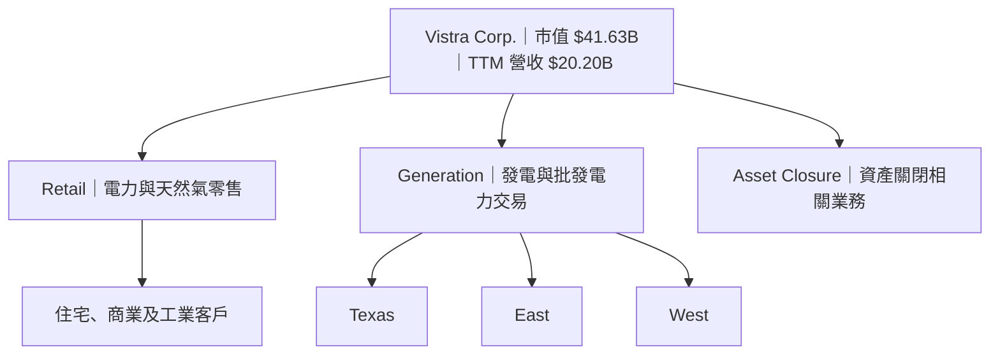
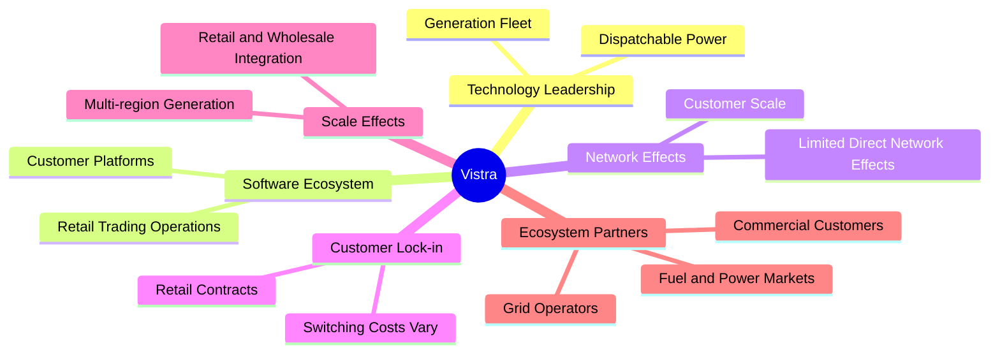
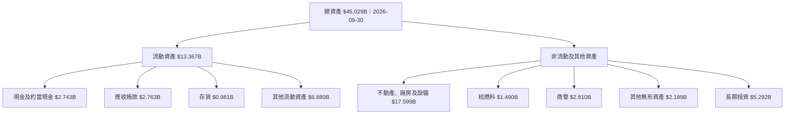
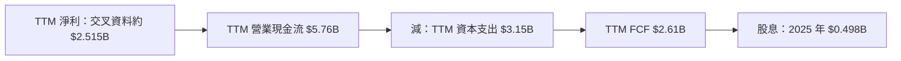
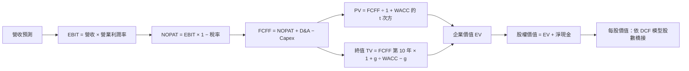
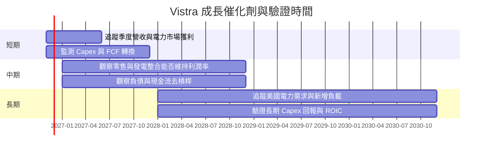
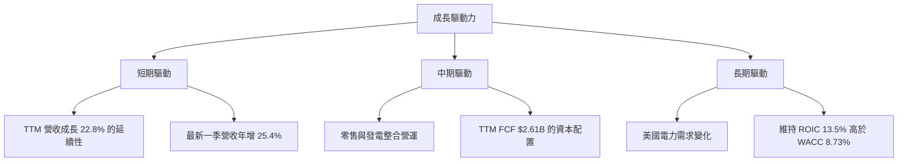
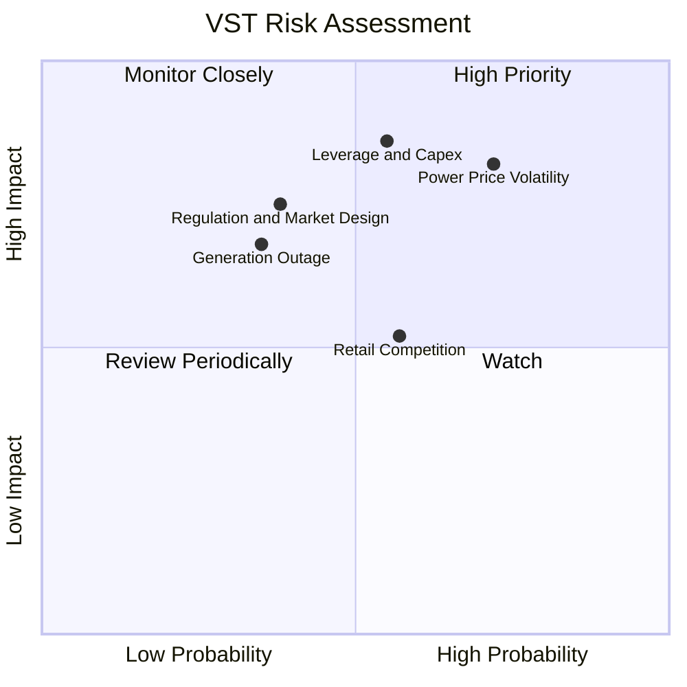
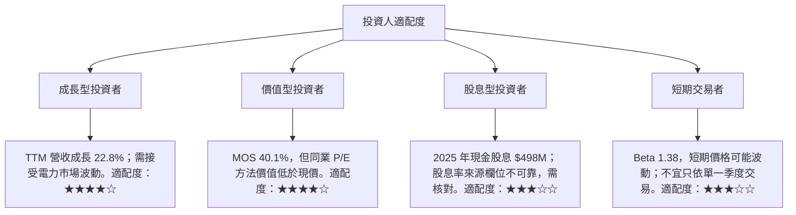

# VST 基本面深度分析報告
> **報告日期**：2026-11-28 ｜ **語言**：繁體中文 ｜ **數據來源**：SEC 申報資料 (XBRL)、Yahoo Finance、Finviz、StockAnalysis、Roic.ai ｜ **分析師**：CFA 級機構研究

## 目錄

| # | 章節 | 核心結論 |
|---|------|----------|
| 1 | 執行摘要 | 強烈買入；加權合理價值 $204.88；MOS +40.1% |
| 2 | 公司概覽與商業模式 | 發電與零售整合，市場份額數據未提供；具資產與規模優勢 |
| 3 | 損益表深度分析 | TTM 營收 $20.20B、TTM 成長 22.8%；季度獲利波動明顯 |
| 4 | 資產負債表分析 | 淨負債 $18.40B；營運資金改善但資本結構仍有槓桿 |
| 5 | 現金流量深度分析 | TTM FCF $2.61B、FCF Yield 6.26%；資本支出需求高 |
| 6 | 獲利能力與資本效率 | ROIC 13.5% 高於 WACC 8.73%，目前創造經濟價值 |
| 7 | 相對估值分析 | 同業估值分歧大；自身 P/E 低於五年中位數 |
| 8 | DCF 內在價值評估 | DCF 基準 $297.18；估值高度依賴長期現金流與終值 |
| 9 | 成長催化劑 | 電力需求、零售與發電組合具成長潛力；量化 TAM 未提供 |
| 10 | 風險矩陣 | 主要風險為電價／商品波動、負債與高資本支出、政策監管 |
| 11 | 投資建議 | 強烈買入；以 $184.39 作為 MOS 10% 對應買入上限 |

---

## 1. 執行摘要

VST 最新收盤價為 **2026-11-27 的 $122.65**。SEC 申報資料與程式計算顯示，公司 TTM 營收 **$20.20B**、TTM 營收成長 **22.8%**、TTM 營業利益率 **21.0%**、TTM FCF **$2.61B**，而 **ROIC 13.5% 高於 WACC 8.73%**，代表現階段資本回報超過資本成本。估值方面，DCF 基準價值為 **$297.18**，但同業 Forward P/E 與 EV/EBITDA 方法分別僅支持 **$109.02** 與 **$156.18**；四種方法加權後合理價值為 **$204.88**，相對現價安全邊際 **MOS +40.1%**。依 MOS 評級規則為**強烈買入**；未作質化調整，但須留意 DCF 終值佔 EV **66.2%**，估值對長期假設敏感。

### 1.0 一頁式投資儀表板（Portfolio Manager 30 秒速讀）

| 項目 | 內容 |
|------|------|
| **投資論點（3 句）** | ① TTM 營收成長 **22.8%**，最新一季年增 **25.4%**，顯示營收動能仍在。② ROIC **13.5%** 高於 WACC **8.73%**，現階段資本回報高於資金成本。③ TTM FCF **$2.61B**、FCF Yield **6.26%**，但 DCF 終值佔 EV **66.2%**，長期假設是估值關鍵。 |
| **綜合評分** | **7.4/10**（引用 1.1 評分卡） |
| **財務健康** | 🟡 現金及短期投資 **$2.74B**，總債務 **$21.15B**，淨負債 **$18.40B**；有正 FCF，但槓桿不可忽略。 |
| **ROIC vs WACC** | **13.5% vs 8.73%**；正利差 **4.77 個百分點**，目前創造股東價值。 |
| **FCF 趨勢** | TTM FCF **$2.61B**；歷年 FCF 波動，最新 FCF Yield **6.26%**。 |
| **估值** | Forward P/E **12.57x**（市場資料）；EV/EBITDA **8.048x**（市場資料）；FCF Yield **6.26%**。同業估值計算採第 7 章所列同業倍數資料。 |
| **DCF 內在價值（基準）** | **$297.18**；現價相對 DCF 折價 **58.7%**（折溢價 = 現價 ÷ DCF 價值 − 1）。 |
| **安全邊際（MOS）** | **+40.1%**＝（加權合理價值 **$204.88** − 現價 **$122.65**）÷ **$204.88**｜🟢 >25% 充足。 |
| **預期報酬（基準情境 12M）** | DCF 基準情境相對現價 **+142.3%**；這是模型情境結果，不是保證的 12 個月報酬。 |
| **關鍵風險（前二）** | 電力／燃料價格與區域供需波動；淨負債 **$18.40B** 及資本支出 **$3.15B** 的資金需求。 |
| **評級 + 信心度** | 🟢 **強烈買入**｜信心：中；主要折扣來自相對估值與 DCF 假設分歧。 |

### 1.1 綜合評分卡（全報告唯一）

| 維度 | 評分（1–10） | 主要依據（引用數字與其來源章節） |
|------|--------------|----------------------------------|
| 成長性 | 8.0 | TTM 營收成長 **22.8%**、最新一季年增 **25.4%**（第 3 章）；同業營收成長中位數 **45.4%**，VST 並非同業最高（第 7 章）。 |
| 獲利能力 | 8.5 | TTM 營業利益率 **21.0%**、ROIC **13.5%** 高於 WACC **8.73%**、Piotroski **7/8**（第 3、6 章）。 |
| 財務健康 | 6.0 | 淨負債 **$18.40B**，但 TTM 營業現金流 **$5.76B**、流動比率（市場資料）**1.157**；CCC **34 天**（第 4 章）。 |
| 估值 | 8.5 | MOS **+40.1%**；P/E **16.6x** 低於五年中位數 **25.2x**，惟同業 Forward P/E 法估值低於現價（第 7、8 章）。 |
| 護城河 | 7.0 | 發電資產、零售客戶與整合營運提供規模及組合優勢；缺少市場份額與分部營收數字，量化證據有限（第 2 章）。 |
| 管理層與資本配置 | 6.5 | TTM FCF **$2.61B**、2025 年股權薪酬 **$113M**；歷年資本支出高且年度 FCF 波動（第 5 章）。 |
| **綜合評分** | **7.4** | 六項算術平均：**(8.0 + 8.5 + 6.0 + 8.5 + 7.0 + 6.5) ÷ 6 = 7.4**。 |

### 1.2 五大投資論點 + 三大核心風險

| 類型 | 項目 | 具體依據 | 信心度 |
|------|------|----------|--------|
| 🟢 **投資論點①** | 營收成長仍具動能 | TTM 營收 **$20.20B**、TTM 年增 **22.8%**；最新一季年增 **25.4%**，但季度營收受批發電價及季節性影響。 | 🟢 高 |
| 🟢 **投資論點②** | 資本回報高於資金成本 | ROIC **13.5%**、WACC **8.73%**，利差 **4.77 個百分點**；若維持，新增投資可創造經濟價值。 | 🟢 高 |
| 🟢 **投資論點③** | 現金流可支撐投資與股東回報 | TTM OCF **$5.76B**、Capex **$3.15B**、FCF **$2.61B**；FCF Yield **6.26%**。 | 🟢 中高 |
| 🟢 **投資論點④** | 自身估值低於歷史 P/E 中位數 | 現在 P/E **16.6x**，五年中位數 **25.2x**，當前處於自身歷史第 **20 百分位**。 | 🟢 中 |
| 🟢 **投資論點⑤** | 評分及營運效率指標尚可 | Piotroski **7/8**；DSO **50 天**、CCC **34 天**，DSO 較一年前 **52 天**略降。 | 🟢 中 |
| 🟡 **風險①** | 商品價格及發電組合波動 | 年度營業利益由 2024 年 **$4.08B** 降至 2025 年 **$2.13B**，顯示獲利會受市場價格與營運條件影響。 | 🟡 中 |
| 🔴 **風險②** | 淨負債與資本支出壓力 | 淨負債 **$18.40B**、TTM Capex **$3.15B**；若現金流回落，去槓桿與投資彈性會收窄。 | 🔴 高衝擊 |
| 🟡 **風險③** | DCF 對終值假設敏感 | 終值現值佔 EV **66.2%**；WACC 及永續成長率的變化可使估值大幅波動。 | 🟡 中高 |

### 1.3 快速統計卡片

| 指標 | 公司實際值（期間） | 同業中位數 | 狀態 |
|------|--------------------|------------|------|
| 營收成長（TTM） | **22.8%** | — | 🟢 |
| 營收成長（最新一季年增） | **25.4%** | **45.4%** | 🟡 |
| 毛利率（TTM） | **41.5%**（交叉資料來源） | **25.2%** | 🟢 |
| 營業利益率（TTM） | **21.0%** | — | 🟢 |
| ROIC（TTM） | **13.5%** | — | 🟢 |
| Forward P/E | **12.57x**（市場資料） | **11.2x** | 🟡 |
| FCF Yield（TTM） | **6.26%** | — | 🟢 |
| Piotroski F-Score | **7 / 8** | — | 🟢 |

### 1.4 投資結論

╔══════════════════════════════════════════════════════════════════╗  
║                    📊 投資結論摘要                               ║  
╠══════════════════════════════════════════════════════════════════╣  
║  評級：強烈買入（依 MOS 評級規則；未作質化調整）                 ║  
║  價格（2026-11-27 收盤）：$122.65                                ║  
║  DCF 內在價值（基準）：$297.18（現價折價 58.7%）                ║  
║  安全邊際 MOS：+40.1%（以加權合理價值為分母）                   ║  
║  加權合理價值（8.8）：$204.88                                    ║  
║  DCF 情境價值：                                                   ║  
║    悲觀情境：$100.22（-18.3%）                                   ║  
║    基準情境：$297.18（+142.3%）                                  ║  
║    樂觀情境：$698.57（+469.6%）                                  ║  
║  綜合評分：7.4/10（引用 1.1）                                    ║  
║  適合投資人：能承受電力市場波動、採分批布局的中長期投資人         ║  
╚══════════════════════════════════════════════════════════════════╝  

---

## 2. 公司概覽與商業模式

### 2.1 業務結構與收入來源

公司概況為美國整合型零售電力與發電企業，經營 Retail、Texas、East、West、Asset Closure 五個分部。各分部營收、發電量及收入占比未提供，因此不以比例推算或繪製分部金額圖。

公司以零售客戶關係與自有／管理發電資產互相配合，能降低單一業務的暴露，但發電與零售仍同受區域供需、燃料成本及電力價格影響。各板塊營收分配未提供，不能量化內部對沖程度。

### 2.2 市場份額

市場份額數據未提供，亦無可引用的年份與來源，因此不繪製市場份額圖。以營收規模而言，VST TTM 營收 **$20.20B**，TTM 成長 **22.8%**；同業 CEG、NRG、TLN 最新一季營收年增分別為 **45.4%**、**24.0%**、**96.1%**，但成長率不等於市場份額，且各公司營運組合不同。

### 2.3 競爭護城河分析

### 2.4 護城河強度

| 護城河項目 | 強度（強／中／弱） | 證據（引用數字或事實） | 會削弱它的情況 |
|------------|--------------------|------------------------|----------------|
| 發電資產與營運能力 | 中 | 公司涵蓋 Texas、East、West 等發電分部；TTM 營業利益率 **21.0%**。裝置容量與成本曲線資料未提供。 | 機組停運、燃料成本上升、電力市場價格下跌。 |
| 零售客戶關係 | 中 | 在多州銷售電力與天然氣予住宅、商業及工業客戶。客戶數、流失率與單客獲利未提供。 | 客戶轉換成本低、競爭者折價搶客。 |
| 整合及規模 | 中 | 同時經營零售與發電，並有多區域營運；TTM 營收 **$20.20B**。分部毛利與內部對沖量未提供。 | 區域市場高度相關，整合未能抵銷市場價格變動。 |
| 技術／網路效應／軟體 | 弱至中 | 沒有可量化軟體收入、技術專利或網路效應指標。 | 競爭者更低成本的交易、預測或客戶管理能力。 |
| 生態夥伴 | 中 | 與電力市場、電網及多類客戶交易；沒有合作收入或合約年限數據。 | 市場規則改變、交易對手信用風險或合約重訂價。 |

**1.1 護城河分數為 7.0/10**：評估基於多區域發電、零售與整合營運的規模優勢；但缺少市占、客戶留存、分部利潤及資產成本數據，故不給更高分。

---

## 3. 損益表深度分析

### 3.1 年度收入成長趨勢（近 4 年）

╔══════════════════════════════════════════════════════════════════╗  
║                 Vistra 年度收入趨勢（FY2022–FY2025）             ║  
╠══════════════════════════════════════════════════════════════════╣  
║ FY2022  $13.73B  ████████████████░░░░░░░░  YoY：基期             ║  
║ FY2023  $14.78B  █████████████████░░░░░░░  YoY：+7.7% 🟢         ║  
║ FY2024  $17.22B  ████████████████████░░░░  YoY：+16.5% 🟢        ║  
║ FY2025  $17.74B  █████████████████████░░░  YoY：+3.0% 🟡         ║  
╠══════════════════════════════════════════════════════════════════╣  
║ FY2022–FY2025 營收 CAGR：約 +8.9%                                 ║  
╚══════════════════════════════════════════════════════════════════╝  

FY2025 成長放慢至 **3.0%**，但 TTM 營收成長為 **22.8%**。這顯示年度數字與近期 TTM 營運狀況不同；電力企業收入會受到市場價格、零售銷售量、能源交易與產品組合影響，不能只用單一年度增速外推。

### 3.2 季度收入趨勢分析

| 季度 | 營收 | QoQ 成長 | YoY 成長 | 備註 |
|------|------|----------|----------|------|
| 2025 Q4 | $4.58B | -7.9% | +13.4% | QoQ 比較 2025 Q3；YoY 比較 2024 Q4 $4.037B。 |
| 2026 Q1 | $5.64B | +23.1% | +43.4% | YoY 依 2025 Q1 $3.933B 計算。 |
| 2026 Q2 | $4.02B | -28.7% | -5.4% | 季度基數與季節性可能造成波動。 |
| 2026 Q3 | $6.35B | +58.0% | **+25.4%** | YoY 使用程式計算的最新一季年增率；不是 TTM 成長率。 |

QoQ 按季度營收表計算至一位小數；最新一季 YoY 成長率遵循 SEC 申報資料計算值 **25.4%**。電力營收具季節性，單季 QoQ 不宜直接視為全年趨勢。

### 3.3 利潤率演變分析

| 利潤率指標 | FY2022 | FY2023 | FY2024 | FY2025 | 趨勢 | 評估 |
|------------|--------|--------|--------|--------|------|------|
| **毛利率** | 12.2% | 37.4% | 43.7% | 32.9% | 2024 上升、2025 回落 | 🟡 |
| **營業利益率** | -8.0% | 18.3% | 23.7% | 12.0% | 2025 明顯收縮 | 🟡 |
| **淨利率** | -9.0% | 9.1% | 15.4% | 5.3% | 對年度損益及稅項敏感 | 🟡 |

計算基礎為年度毛利、營業利益及淨利除以年度營收。FY2025 營業利益為 **$2.13B**，低於 FY2024 的 **$4.08B**；但 TTM 營業利益率為 **21.0%**，高於 FY2025 年度水準，反映期間組成及近期業務情況不同。年度變化可能來自批發市場價格、燃料成本、衍生品與商品避險、發電資產可用率及零售產品組合；目前沒有分部毛利與單位成本資料，無法將各因素分拆量化。

### 3.4 費用結構分析

未提供可一致拆分的 TTM 營業費用、折舊、燃料成本及管理費用細項，因此不繪製費用結構圓餅圖。已知 TTM 營業利益率 **21.0%**，TTM 折舊攤銷／營收假設為 **10.4%**（DCF 模型輸入）；兩者代表資產密集型發電業務的折舊負擔不可忽視。

### 3.5 季度 EPS 趨勢與盈餘品質（Quality of Earnings）

| 季度 | EPS 實際值 | EPS 預估值 | 超預期／不及預期 |
|------|------------|------------|------------------|
| 2025 Q4 | $0.55 | N/A | N/A；估計值資料缺漏 |
| 2026 Q1 | $2.90 | N/A | N/A；估計值資料缺漏 |
| 2026 Q2 | $0.77 | N/A | N/A；估計值資料缺漏 |
| 2026 Q3 | $3.26 | N/A | N/A；估計值資料缺漏 |

目前 EPS Est 欄位為 nan，故無法可靠判定過去四季超預期或不及預期。上述 EPS 實際值來自 StockAnalysis，與其他資料源的季度淨利數字存在差異，採用時應以公司 SEC 報表核對。

| 盈餘品質項目 | 數值／佔比 | 評估 |
|--------------|-----------|------|
| 股權薪酬 SBC / 營收 | TTM SBC 約 **$127M**；佔 TTM 營收 $20.20B 約 **0.63%** | 🟢 比例不高；仍是股東成本，需監測稀釋。 |
| SBC / 營業現金流 | 約 **2.2%**（$127M ÷ $5.76B） | 🟢 對現金流規模影響有限。 |
| FCF / 淨利（現金轉換率） | 約 **103.8%**（FCF $2.61B ÷ TTM 淨利 $2.515B） | 🟢 現金流略高於淨利；數據來源期間口徑需一致核對。 |
| 一次性／非經常性損益 | N/A | 未提供足以拆分一次性項目的資料，不能判定本期盈餘是否受單次項目美化。 |
| 有效稅率異常 | **15.9%**（最新年度有效稅率） | 🟡 DCF 使用該稅率；單年度稅率可能受稅務項目影響，缺少多年稅率序列。 |
| 資本化支出 vs 費用化 | TTM Capex **$3.15B** | 資本支出為現金流項目；維持性與成長性 Capex 拆分 N/A，無法判定是否有成本遞延。 |

**盈餘品質結論**：TTM FCF **$2.61B** 高於交叉資料所列 TTM 淨利 **$2.515B**，且 SBC 約佔營收 **0.63%**，支持獲利具一定現金含量。另一方面，電力交易、商品價格與稅務因素可能造成季度獲利波動；缺少完整非經常性項目與維持性 Capex 分拆，盈餘品質評估為中等偏正面，而非無條件確認。

---

## 4. 資產負債表分析

### 4.1 資產結構分解

以下使用 2026-09-30 StockAnalysis 資產負債表的資產類別；總資產為 **$45.029B**。非流動資產細項加總與報表列示可能因摘要欄位及四捨五入不完全一致。

### 4.2 流動性與營運資金分析

| 指標 | 最新值 | 歷史值／比較 | 評估 |
|------|--------|--------------|------|
| 現金及短期投資 | **$2.74B** | — | 🟡 足以支應營運緩衝，但低於債務規模。 |
| 總債務 | **$21.15B** | — | 🔴 槓桿規模大，需持續產生現金流。 |
| 流動比率 | **1.157**（市場資料） | 年末報表列示流動資產／流動負債可見歷史波動 | 🟡 高於 1，但需關注負債到期與資產流動性。 |
| 速動比率 | **0.477**（市場資料） | — | 🔴 不含存貨後的短期流動性較緊。 |

營運資金天數依 QUALITY FIGURES 計算結果照錄：

| 指標 | 最新 TTM | 一年前 TTM | 變化 | 解讀 |
|------|----------|------------|------|------|
| DSO 應收帳款天數 | **50 天** | **52 天** | **-2 天** | 收款週期略縮短，方向正面；不能單憑兩天變化判定客戶信用改善。 |
| DIO 存貨天數 | **30 天** | **N/A** | N/A | 一年前公司未報告可用存貨餘額數據，不作填補。 |
| DPO 應付帳款天數 | **45 天** | **N/A** | N/A | 一年前缺少可比數據，無法判斷付款天數變化。 |
| CCC 現金轉換週期 | **34 天** | **N/A** | N/A | 最新週期為 34 天；一年前缺少 DIO、DPO，不能反推。 |

CCC 的組成可直接核對：**DSO 50 + DIO 30 − DPO 45 = 35 天**，而品質指標報告的 CCC 為 **34 天**；差異約 1 天，屬各項天數取整造成的尾差，直接引用 CCC 原值 **34 天**。

### 4.3 債務結構分析

╔══════════════════════════════════════════════════════════════════╗  
║                   Vistra 債務健康診斷                            ║  
╠══════════════════════════════════════════════════════════════════╣  
║  總債務：             $21.15B  ████████████████████  🔴           ║  
║  現金及短期投資：      $2.74B  ███░░░░░░░░░░░░░░░░░  🟡           ║  
║  淨負債：             $18.40B  █████████████████░░░  🔴           ║  
║  TTM 營業現金流：       $5.76B  可提供償債現金來源               ║  
║  TTM Capex：           $3.15B  資本支出需求高                     ║  
║  Debt/EBITDA：         N/A（未提供可一致核對 EBITDA 與債務口徑）  ║  
║  Interest Coverage：  N/A（利息費用及 TTM EBIT 同口徑資料不足）  ║  
╚══════════════════════════════════════════════════════════════════╝  

淨負債按程式計算數字為 **$18.40B**（總債務 **$21.15B** 減現金及短期投資 **$2.74B**，考慮底層未四捨五入資料）。其他摘要欄位出現不同總債務值，本報告採用 SEC 計算區塊原值。

### 4.4 股東權益趨勢

╔══════════════════════════════════════════════════════════════════╗  
║               Vistra 年末股東權益（交叉資料來源）                 ║  
╠══════════════════════════════════════════════════════════════════╣  
║ FY2022  $4.90B  █████████████████░░░░░░░░░                      ║  
║ FY2023  $5.31B  ██████████████████░░░░░░░                      ║  
║ FY2024  $5.57B  ███████████████████░░░░░░                      ║  
║ FY2025  $5.10B  █████████████████░░░░░░░░                      ║  
╚══════════════════════════════════════════════════════════════════╝  

股東權益由 FY2024 **$5.57B** 降至 FY2025 **$5.10B**；權益變動可能同時受淨利、分配、回購及其他綜合損益影響，缺少完整權益變動表拆解，不能單因一年下滑推論資本配置惡化。

---

## 5. 現金流量深度分析

### 5.1 現金流量瀑布圖

可供精確逐段核對的是 TTM OCF、Capex、FCF 與現金分配；淨利及淨現金變化的期間現金流橋接數據未提供完整，因此圖中不臆造數字。

### 5.2 FCF 轉換率趨勢

| 年度 | FCF | 淨利 | FCF／淨利 | 評估 |
|------|-----|------|-----------|------|
| FY2022 | -$0.816B | -$1.23B | 66.3%（負值／負值） | 🟡 經濟意義有限，虧損年度不宜只看比值。 |
| FY2023 | $3.78B | $1.49B | 253.7% | 🟢 現金流高於淨利；可能受營運資金與非現金項目影響。 |
| FY2024 | $2.48B | $2.66B | 93.2% | 🟡 現金轉換接近淨利。 |
| FY2025 | $1.32B | $0.944B（年度報表摘要） | 139.8% | 🟢 但年度淨利在不同資料源出現差異，須以申報文件核對。 |
| TTM | **$2.61B** | 約 **$2.515B**（交叉來源） | 約 **103.8%** | 🟢 以相近期間資料估算，非另行替代官方品質數字。 |

FY2022–FY2025 的年度 FCF 分別為 **-$0.816B、$3.78B、$2.48B、$1.32B**，顯示現金流波動顯著，不能將單一年份高轉換率視為穩態。

### 5.3 自由現金流趨勢

╔══════════════════════════════════════════════════════════════════╗  
║                 Vistra 自由現金流：歷史實際                      ║  
╠══════════════════════════════════════════════════════════════════╣  
║ FY2022  -$0.816B  ◀░░░░░░░░░░░░░░░░░░░░  FCF 為負             ║  
║ FY2023   $3.780B  ████████████████████░░░  年度高點              ║  
║ FY2024   $2.480B  █████████████░░░░░░░░░  年減 34.4%            ║  
║ FY2025   $1.320B  ███████░░░░░░░░░░░░░░░  年減 46.8%            ║  
║ TTM      $2.610B  ██████████████░░░░░░░░  FCF Yield 6.26%       ║  
╚══════════════════════════════════════════════════════════════════╝  

TTM FCF 與年度 FCF的期間不同，不能將 TTM 視為 FY2026 全年實績。FCF Yield **6.26%** 為 TTM FCF 除以市值，代表現價下的現金流收益率，但不代表全部可分配給股東，因公司仍需投資、償債並維持資產。

### 5.4 資本配置評估

2025 年現金股息支出為 **$498M**，年度 Capex 為 **$2.75B**；未提供同年度回購金額與可比留存現金分項，故不繪製比例圓餅圖。

| 資本配置項目 | 已知數據 | 評估 |
|--------------|----------|------|
| 資本支出 | 2025 年 **$2.75B**；TTM **$3.15B** | 發電資產密集，Capex 會實質壓低可分配 FCF。維持性／成長性拆分 N/A。 |
| 股息 | 2025 年現金股息 **$498M** | 相對 TTM FCF 有現金流覆蓋，但未提供完整政策及未來承諾。 |
| 回購 | N/A | 未提供可核對回購金額。 |
| 留存／償債 | N/A | 現金流分配用途未完整提供；淨負債 **$18.40B** 使去槓桿仍具財務價值。 |
| 股權薪酬 | 2025 年 **$113M**；近四季約 **$127M** | 對營收比例約 **0.6%**，需留意稀釋與員工留任成本。 |

---

## 6. 獲利能力與資本效率

### 6.1 ROE／ROA／ROIC 趨勢

| 指標 | 已提供最新值 | 歷史趨勢資料 | 評估 |
|------|--------------|--------------|------|
| ROE | **42.9%**（品質指標，TTM） | 其他市場資料為 **46.3%**，口徑不同 | 🟡 高 ROE 部分由權益乘數 **7.14** 支撐。 |
| ROA | **7.1%**（交叉資料） | 品質指標確認 ROA 高於一年前，但未提供兩期精確數值 | 🟡 資產密集型業務的回報需與資本成本合看。 |
| ROIC | **13.5%**（TTM） | 歷年可比序列 N/A | 🟢 高於 WACC **8.73%**。 |

行業均值未提供，因此不列行業對比欄。

### 6.2 ROIC vs WACC 分析（核心價值創造判斷）

╔══════════════════════════════════════════════════════════════════╗  
║                ROIC vs WACC 深度分析                             ║  
╠══════════════════════════════════════════════════════════════════╣  
║  資本成本輸入（程式計算）：                                       ║  
║  ├── 無風險利率（10Y 美債）：       4.94%                        ║  
║  ├── 市場風險溢酬（假設）：          5.00%                        ║  
║  ├── 原始 Beta：                     1.38                         ║  
║  ├── 調整後 Beta：                   1.25                         ║  
║  ├── Ke = 4.94% + 1.25 × 5.00% = 11.19%                         ║  
║  ├── 稅前債務成本：                  4.64%                        ║  
║  ├── 稅後 Kd = 4.64% × (1−15.9%) = 3.90%                        ║  
║  ├── 股權／債務權重：                66.3%／33.7%                  ║  
║  └── WACC：                          8.73%                        ║  
║                                                                  ║  
║  ROIC（TTM）：                         13.50%                      ║  
║  EVA 利差 = ROIC − WACC：               +4.77 個百分點             ║  
║  ROIC  13.50%  ▓▓▓▓▓▓▓▓▓▓▓▓▓▓▓▓▓▓░░░░░░░                        ║  
║  WACC   8.73%  ▓▓▓▓▓▓▓▓▓▓▓░░░░░░░░░░░░░                        ║  
║  結論：目前 ROIC 高於 WACC，正在創造經濟價值                     ║  
╚══════════════════════════════════════════════════════════════════╝  

債務權重使用資本成本區塊給定的 **33.7%**；此處不另以其他資料口徑重估 WACC。ROIC **13.5%** 是程式計算值，不重建另一套投入資本或 NOPAT 口徑。

### 6.3 杜邦三因素分解

| 因素 | 數值（TTM） | 解讀 |
|------|-------------|------|
| 淨利率 | **13.4%** | 每一美元營收轉化為約 13.4 美分淨利。 |
| 資產週轉率 | **0.45** | 資產密集型業務，營收相對總資產周轉不高。 |
| 權益乘數 | **7.14** | 槓桿放大股東權益報酬，也提高財務風險。 |
| **ROE** | **42.9%** | 品質指標原值：**13.4% × 0.45 × 7.14 = 42.9%**（中間數四捨五入）。 |

ROE 並非純由淨利率推動；權益乘數 **7.14** 顯示財務槓桿是重要來源。因此評估股東回報應同時看 ROIC、自由現金流與債務，而非只看 ROE。

### 6.4 財務體質：Piotroski F-Score

**Piotroski F-Score：7 / 8**。毛利率測試因缺少輸入未納入，故分母是可判定測試數 **8**，不是完整九項分母。

| 測試 | 結果 | 解讀 |
|------|------|------|
| ROA > 0 | ✅ 通過 | 資產報酬為正。 |
| 營業現金流 > 0 | ✅ 通過 | TTM OCF 為正。 |
| ROA 高於一年前 | ✅ 通過 | 年對年方向改善。 |
| 營業現金流 > 淨利（應計品質） | ✅ 通過 | 現金流高於淨利，獲利現金支撐較佳。 |
| 長期負債 ÷ 總資產低於一年前 | ❌ 未通過 | 槓桿相對資產沒有改善，與淨負債 **$18.40B** 的風險方向一致。 |
| 流動比率高於一年前 | ✅ 通過 | 短期流動性指標改善。 |
| 稀釋股數未增加 | ✅ 通過 | 該測試期間稀釋股數沒有增加。 |
| 毛利率高於一年前 | — 無法判定 | 缺少可比輸入，不計入分母。 |
| 資產週轉率高於一年前 | ✅ 通過 | 資產使用效率改善。 |

---

## 7. 相對估值分析

### 7.1 同業估值比較表格

公司目前倍數採 VERIFIED FIGURES；同業倍數取 Yahoo Finance Peer multiples。公司 Forward P/E **12.57x** 來自市場估值資料，與相對估值方法使用的同業中位數口徑分開列示。

| 估值指標 | **VST** | **CEG** | **NRG** | **TLN** | VST 評估 |
|----------|---------|---------|---------|---------|-----------|
| **Trailing P/E** | **16.6x** | 19.1x | 16.4x | N/A | 🟡 接近 CEG、NRG；TLN 無可用 TTM P/E。 |
| **Forward P/E** | **12.57x** | 17.8x | 9.7x | 11.2x | 🟡 位於 NRG 與 CEG 之間，高於同業中位數 **11.2x**。 |
| **P/S Ratio** | **2.1x** | 2.4x | 0.6x | 3.5x | 🟡 高於 NRG、低於 CEG 與 TLN；商業組合不同。 |
| **EV/EBITDA** | **9.4x**（估值歷史區塊口徑） | 11.3x | 10.6x | 36.9x | 🟢 低於三家同業中位數 **11.3x**；TLN 倍數顯著偏高。 |
| **最新一季營收年增** | **25.4%** | 45.4% | 24.0% | 96.1% | 🟡 VST 高於 NRG、低於 CEG 與 TLN。 |
| **毛利率（TTM）** | **41.5%**（交叉資料） | 25.2% | 20.2% | 42.7% | 🟢 高於 CEG、NRG，略低於 TLN。 |

同業中位數在可計算時：Forward P/E 為 **11.2x**，P/S 為 **2.4x**，EV/EBITDA 為 **11.3x**。VST 的 Forward P/E 高於同業中位數，但 EV/EBITDA 低於同業中位數；因此不能只用單一倍數判斷便宜與否。

### 7.2 歷史估值區間分析

╔══════════════════════════════════════════════════════════════════╗  
║                 VST 五年估值位置（TTM）                          ║  
╠══════════════════════════════════════════════════════════════════╣  
║ P/E：      7.2x ─────────●16.6x──────────── 74.3x              ║  
║                         中位數 25.2x｜目前百分位 20%             ║  
║ P/S：      0.5x ───────────●2.1x─────────── 4.2x               ║  
║                         中位數 1.8x｜目前百分位 52%              ║  
║ EV/EBITDA：2.3x ─────────●9.4x───────────── 40.7x              ║  
║                         中位數 11.0x｜目前百分位 35%             ║  
╚══════════════════════════════════════════════════════════════════╝  

P/E 現在 **16.6x**，低於五年中位數 **25.2x**，位於歷史第 **20 百分位**；EV/EBITDA **9.4x** 低於五年中位數 **11.0x**，位於第 **35 百分位**。P/S **2.1x** 則略高於五年中位數 **1.8x**，估值折價主要不是所有倍數一致呈現。

### 7.3 情境價值（Bear / Base / Bull，照抄 DCF MODEL 的 Scenarios）

| 情境 | 第 1 年營收成長 | 期末營業利潤率 | WACC | 每股價值 | 相對現價 | 機率 | 會發生的條件 |
|------|----------------|----------------|------|----------|----------|------|--------------|
| 🔴 悲觀 | **11.4%** | **16.4%** | **9.73%** | **$100.22** | **-18.3%** | **25%** | 零售或批發市場增長放緩、利潤率較基準下滑，資本成本上升。 |
| 🟡 基準 | **22.8%** | **19.3%** | **8.73%** | **$297.18** | **+142.3%** | **50%** | TTM 成長動能逐年正常化，營業利潤率由 21.0% 漸降至 19.3%。 |
| 🟢 樂觀 | **34.3%** | **21.2%** | **7.73%** | **$698.57** | **+469.6%** | **25%** | 電力需求與發電定價有利，成長高於基準且資本成本下降。 |

上述每股價值與概率依 DCF 模型原值引用；情境值差距非常大，反映模型假設敏感，不應將樂觀情境視為短期目標價。

### 7.4 相對估值隱含價格區間

╔══════════════════════════════════════════════════════════════════╗  
║                各估值法每股價值與現價位置                        ║  
╠══════════════════════════════════════════════════════════════════╣  
║ $109.02        $122.65        $156.18       $197.05       $297.18║  
║ Forward P/E     現價           EV/EBITDA     分析師共識    DCF基準 ║  
╚══════════════════════════════════════════════════════════════════╝  

| 方法 | 每股價值 | 相對現價 | 依據 |
|------|----------|----------|------|
| 同業 Forward P/E | **$109.02** | **-11.1%** | CEG、NRG、TLN 同業 Forward P/E 中位數 **11.2x** × VST Forward EPS **$9.76**。 |
| 同業 EV/EBITDA | **$156.18** | **+27.3%** | 同業 EV/EBITDA 中位數 **11.3x** × VST TTM EBITDA，再加淨現金／扣除淨負債。 |
| 分析師共識目標價 | **$197.05** | **+60.7%** | 23 位分析師平均目標價。 |
| DCF 基準 | **$297.18** | **+142.3%** | 10 年 FCFF、WACC **8.73%**、永續成長 **3.0%**。 |

---

## 8. DCF 內在價值評估（Discounted Cash Flow）

### 8.0 估值推理鏈（Thinking Logic）

**Step 1 — 價值由哪些變數決定？**  
VST 價值主要由現有零售與發電資產的現金流底盤、電力需求與市場定價能否延續，以及長期資本支出和折現率共同決定；因分部營收未提供，無法把各業務占比拆分。DCF 基準假設將 TTM 營收 **$20.20B** 作為起點，且終值佔 EV **66.2%**，因此長期 FCFF、WACC 與永續成長率是估值主導變數。

**Step 2 — 模型選擇**

| 決策點 | 本報告採用 | 理由（含數字） | 曾考慮但否決 | 否決理由 |
|--------|-----------|----------------|--------------|----------|
| 現金流定義 | FCFF | 對應 WACC 折現並先求 EV；公司淨負債 **$18.40B**。 | FCFE | 需預測債務變化與利息融資，模型未提供。 |
| 預測期 N | **10 年** | DCF 模型固定 10 年，營收成長由 **22.8%** 線性降至 **3.0%**。 | 5 年 | 無法沿用程式給定 DCF；亦不足以涵蓋模型所設成長淡出期。 |
| 終值方法 | Gordon Growth | 模型給定永續成長 **3.0%**、WACC **8.73%**。 | 僅退出倍數 | DCF 模型未提供退出倍數終值的計算值。 |
| EBIT 基礎 | GAAP EBIT | 模型明確採用 GAAP EBIT。 | 非 GAAP | 避免將 SBC 從費用中加回。 |

**Step 3 — 關鍵假設推導鏈**

- **營收成長**：錨點＝TTM 成長 **22.8%** → 調整＝採用模型規定在 10 年內線性降至 **3.0%**，反映近期高增長不宜永續 → **第 1 年採用 22.8%，第 10 年 3.0%** → 曾考慮全期維持 22.8%，但否決，因會將近期增速永久化。
- **期末營業利潤率**：錨點＝TTM **21.0%**；五年財年中位數由模型定義為期末收斂點 → 調整＝模型從第 1 年 **21.0%** 線性降至第 10 年 **19.3%** → **採用 19.3%** → 曾考慮維持 21.0%，否決，因模型採用歷史中位數作成熟期回歸。
- **永續成長率 g**：錨點＝長期成熟企業成長應低於經濟名目成長上限；模型指定 **3.0%** → WACC **8.73%** 高於 g，Gordon Growth 有效 → **採用 3.0%** → 不採用高於 3.0% 的永續增長，避免長期假設過度樂觀。
- **預測期 N**：錨點＝DCF 模型指定 **10 年** → 調整理由＝需涵蓋成長由 **22.8%** 淡出至 **3.0%** 的期間 → **採用 10 年** → 不自行改為 5 年或更長，因不得改寫程式模型。
- **Capex／營收**：錨點＝TTM **15.6%** → 模型逐年淡出至第 10 年 **11.5%**，設定為約 D&A 的 **1.1 倍** → **第 1 年 15.6%、第 10 年 11.5%** → 不採用直接維持 15.6%，因模型假設投資率逐步正常化；此假設若不成立，FCFF 可能高估。
- **EBIT 與 SBC**：錨點＝採 GAAP EBIT，已含 SBC 費用 → **採組合 (A)：GAAP EBIT + 固定股數，SBC 不再另扣，年稀釋率 0%** → 不採用非 GAAP 加回 SBC，避免漏計或重複計算成本。
- **WACC**：錨點＝資本成本程式給定 **8.73%** → 直接採用該值，以保持和第 6.2 節一致 → 不另建第二套 WACC，避免模型口徑不一致。
- **ΔWC**：模型明確未建模營運資金，故不在 FCFF 中另列或反推；此為模型限制，不代表營運資金現金影響實際為零。
- **D&A／營收**：錨點＝TTM **10.4%** → 模型維持常數 **10.4%**。
- **終值方法**：錨點＝WACC **8.73%**、g **3.0%** → **採 Gordon Growth**；退出倍數交叉驗證沒有程式輸出值，因此不自行補算。
- **稀釋率**：模型採組合 (A)，固定股數、年稀釋率 **0%**；不另外把 SBC 轉為股數稀釋，因其已在 GAAP EBIT 中費用化。

**Step 4 — 最脆弱環節**  
最脆弱的一環是長期 FCFF 與終值假設：終值現值佔 EV **66.2%**，若長期增長或資本支出假設不利，內在價值可能大幅下修；敏感性矩陣在 WACC **9.73%**、g **3.0%** 時每股價值為 **$239.11**，而悲觀營運情境為 **$100.22**。

**Step 5 — 計算路徑圖**

### 8.1 模型假設總表（Model Inputs）

| 假設項目 | 採用值 | 依據／來源 | 敏感度 |
|----------|--------|-------------|--------|
| 預測期長度 N | **10 年** | DCF 模型給定；營收成長由 22.8% 淡出至 3.0%。 | 🟡 中 |
| 營收成長 | 第 1 年 **22.8%**；第 10 年 **3.0%** | TTM 成長 22.8%；模型線性淡出。 | 🔴 高 |
| 營業利潤率 | 第 1 年 **21.0%**；第 10 年 **19.3%** | TTM 營業利益率及模型採用近五年中位數終點。 | 🔴 高 |
| 有效稅率 | **15.9%** | 最新年度有效稅率。 | 🟢 低 |
| Capex／營收 | 第 1 年 **15.6%**；第 10 年 **11.5%** | TTM Capex／營收；模型逐步降至 1.1 倍 D&A。 | 🟡 中 |
| D&A／營收 | **10.4%** | TTM 比率，模型維持不變。 | 🟢 低 |
| 營運資金變動 | **未建模** | DCF 模型明確不含 working capital。 | 🟢 低 |
| EBIT 基礎 | **GAAP EBIT** | 模型設定。 | 🟡 中 |
| SBC 處理 | **組合 (A)** | GAAP EBIT 已費用化 SBC；不再扣 SBC。 | 🟡 中 |
| 年稀釋率 | **0%** | 組合 (A)，股數固定、不再另計稀釋。 | 🟡 中 |
| 永續成長率 g | **3.0%** | DCF 模型設定，低於 WACC **8.73%**。 | 🔴 高 |
| 終值方法 | **Gordon Growth** | 模型提供 TV；未提供可交叉核對的退出倍數結果。 | 🔴 高 |
| WACC | **8.73%** | Cost of capital 原值；推導見 8.2。 | 🔴 高 |

**FCFF 定義**：依程式模型採用 **FCFF = NOPAT + D&A − Capex**；模型未包含 ΔWC。  
**SBC 防重複計算**：本模型採用 **(A) GAAP EBIT + 固定股數**，故 SBC 影響已計入一次，FCFF 不再減 SBC，年稀釋率採 **0%**。

### 8.2 折現率推導（WACC）

╔══════════════════════════════════════════════════════════════════╗  
║                    WACC 推導（折現率）                           ║  
╠══════════════════════════════════════════════════════════════════╣  
║ 股權成本 Ke（CAPM）：                                             ║  
║ ├── 無風險利率 Rf（10Y 美債）：       4.94%                      ║  
║ ├── 市場風險溢酬 ERP（假設）：          5.00%                      ║  
║ ├── 原始 Beta（Yahoo）：                1.38                       ║  
║ ├── 調整後 Beta：                      1.25                       ║  
║ ├── Beta 調整：2/3×1.38 + 1/3×1 = 1.25                           ║  
║ └── Ke = 4.94% + 1.25×5.00% = 11.19%                            ║  
║                                                                  ║  
║ 債務成本 Kd：                                                      ║  
║ ├── 稅前 Kd：                           4.64%                      ║  
║ ├── 有效稅率：                          15.9%                      ║  
║ └── 稅後 Kd = 4.64%×(1−15.9%) = 3.90%                           ║  
║                                                                  ║  
║ 資本結構：                                                         ║  
║ ├── 股權權重：                          66.3%                      ║  
║ ├── 債務權重：                          33.7%                      ║  
║ └── WACC = 66.3%×11.19% + 33.7%×3.90% = 8.73%                  ║  
╚══════════════════════════════════════════════════════════════════╝  

Rf 使用資本成本資料所列 **10 年期美債利率 4.94%**；具體觀察日期未提供。ERP **5.00%** 為模型假設。Beta 原始值 **1.38**，採調整值 **1.25 = ⅔ × 1.38 + ⅓ × 1.00**。未另加規模或國別溢酬。此節直接採用程式給定的稅前 Kd、有效稅率、權重與 WACC，不以其他口徑改寫。

**逐步演算（WACC）**

1. **Ke（CAPM）** = 4.94% + 1.25 × 5.00% = **11.19%**。
2. **稅前 Kd** = 程式計算的利息／債務成本 **4.64%**；利息金額與平均計息負債的明細未提供，不能自行反推。
3. **稅後 Kd** = 4.64% × (1 − 15.9%) = 4.64% × 84.1% = **3.90%**。
4. **權重**：股權 **66.3%**；債務 **33.7%**；**66.3% + 33.7% = 100.0%**。對應市值與債務明細使用程式給定權重，避免跨資料源重新計算。
5. **WACC** = 66.3% × 11.19% + 33.7% × 3.90% = 7.42% + 1.31% = **8.73%**（四捨五入）。

### 8.3 逐年自由現金流預測（基準情境）

金額單位為 **$B**；折現因子保留三位小數，其他金額取兩位小數。各項為 DCF 模型原值，底層計算採未四捨五入數字；表內 rounded values 可能出現 **$0.01B** 尾差。

| 年度 | FY+1 | FY+2 | FY+3 | FY+4 | FY+5 | FY+6 | FY+7 | FY+8 | FY+9 | FY+10（FY+N） |
|------|------|------|------|------|------|------|------|------|------|-------------|
| 營收 | 24.81 | 29.93 | 35.45 | 41.20 | 46.98 | 52.54 | 57.59 | 61.85 | 65.07 | 67.03 |
| 營收 YoY | 22.8% | 20.6% | 18.4% | 16.2% | 14.0% | 11.8% | 9.6% | 7.4% | 5.2% | 3.0% |
| 營業利潤率 | 21.0% | 20.8% | 20.6% | 20.4% | 20.2% | 20.0% | 19.8% | 19.6% | 19.4% | 19.3% |
| EBIT（GAAP） | 5.20 | 6.22 | 7.29 | 8.40 | 9.49 | 10.51 | 11.41 | 12.14 | 12.65 | 12.91 |
| − 稅 | (0.83) | (0.99) | (1.16) | (1.34) | (1.51) | (1.68) | (1.82) | (1.94) | (2.02) | (2.06) |
| NOPAT | 4.37 | 5.22 | 6.13 | 7.06 | 7.98 | 8.84 | 9.60 | 10.21 | 10.64 | 10.85 |
| + D&A | 2.58 | 3.12 | 3.69 | 4.29 | 4.89 | 5.47 | 6.00 | 6.44 | 6.78 | 6.98 |
| − Capex | (3.88) | (4.54) | (5.21) | (5.86) | (6.47) | (6.99) | (7.40) | (7.66) | (7.75) | (7.68) |
| − ΔWC | 未建模 | 未建模 | 未建模 | 未建模 | 未建模 | 未建模 | 未建模 | 未建模 | 未建模 | 未建模 |
| **FCFF** | **3.08** | **3.80** | **4.61** | **5.49** | **6.40** | **7.32** | **8.20** | **8.99** | **9.66** | **10.15** |
| 折現因子 @8.73% | 0.920 | 0.846 | 0.778 | 0.715 | 0.658 | 0.605 | 0.557 | 0.512 | 0.471 | 0.433 |
| **FCFF 現值 PV** | **2.83** | **3.22** | **3.59** | **3.93** | **4.21** | **4.43** | **4.56** | **4.60** | **4.55** | **4.39** |

預測期現值加總：  
**$2.83 + $3.22 + $3.59 + $3.93 + $4.21 + $4.43 + $4.56 + $4.60 + $4.55 + $4.39 = $40.31B**。

**逐步演算（FY+1）**

1. **營收** = TTM 營收 $20.20B × (1 + 22.8%) = **$24.81B**。
2. **EBIT** = $24.81B × 21.0% = **$5.20B**。
3. **稅** = $5.20B × 15.9% = **$0.83B**。
4. **NOPAT** = $5.20B − $0.83B = **$4.37B**。
5. **D&A** = $24.81B × 10.4% = **$2.58B**。
6. **Capex** = $24.81B × 15.6% = **$3.88B**。
7. **ΔWC** = 模型未建模，故不列入 FCFF 計算；不代表實際現金影響為零。
8. **FCFF** = 模型原值 **$3.08B**。以表中四捨五入數重算為 $4.37 + $2.58 − $3.88 = **$3.07B**；與模型原值差 **$0.01B**，屬未四捨五入底層數字造成的尾差。
9. **折現因子** = 1 ÷ (1 + 8.73%)¹ = **0.920**；**PV** = $3.08B × 0.920，模型原值為 **$2.83B**。

**合理性自檢**

- FY+1 至 FY+10 FCFF 由 **$3.08B** 增至 **$10.15B**；其十年 CAGR 約 **12.7%**。歷史年度 FCF FY2022–FY2025 從 **-$0.816B** 至 **$1.32B**，受基期負值與波動影響，不宜直接比較 CAGR。
- FY+10 FCFF 利潤率 = **$10.15B ÷ $67.03B = 15.1%**；目前 TTM FCF 利潤率 = **$2.61B ÷ $20.20B = 12.9%**。同業最佳可比 FCF 利潤率未提供，不能判斷是否超越同業。
- 模型所有年度 FCFF 為正；但未建模營運資金，且終值依賴長期 FCFF，估值需保留折扣看待。

╔══════════════════════════════════════════════════════════════════╗  
║            自由現金流：歷史實際 vs 模型預測                      ║  
╠══════════════════════════════════════════════════════════════════╣  
║ FY2022（實） -$0.816B  ◀░░░░░░░░░░░░░░░░░░░░░                   ║  
║ FY2023（實）  $3.780B  ████████████████████░░░                   ║  
║ FY2025（實）  $1.320B  ███████░░░░░░░░░░░░░░░                   ║  
║ FY+1（預）    $3.080B  ████████████████░░░░░░                   ║  
║ FY+10（預）  $10.150B  ██████████████████████                   ║  
╠══════════════════════════════════════════════════════════════════╣  
║ 預測現金流逐年擴大；歷史 FCF 波動大，模型延伸風險不可忽略。     ║  
╚══════════════════════════════════════════════════════════════════╝  

### 8.4 終值計算（Terminal Value）

**適用性檢查**：WACC **8.73%** vs g **3.0%** → **WACC > g ✅**。

| 方法 | 計算式 | 終值 TV | TV 現值 | 佔總 EV 比重 |
|------|--------|---------|---------|--------------|
| Gordon Growth | FCFF(FY+10) × (1+g) ÷ (WACC − g) | **$182.39B** | **$78.96B** | **66.2%** |
| 退出倍數法 | N/A | N/A | N/A | N/A |

**逐步演算**

1. FY+N 的 FCFF = **$10.15B**。
2. 分子 = $10.15B × (1 + 3.0%) = **$10.4545B**。
3. 分母 = 8.73% − 3.0% = **5.73%**；TV = $10.4545B ÷ 5.73% = **$182.39B**。
4. PV(TV) = $182.39B × 0.433 = **$78.96B**（以未四捨五入折現因子計算；顯示值乘算可能有尾差）。
5. 終值佔比 = $78.96B ÷ $119.26B = **66.2%**。

退出倍數法的逐年 EBITDA 終值與選定倍數未由 DCF 模型提供，故不自行另建方法或數值。終值現值佔 EV **66.2%**，低於 75% 警示門檻，但仍是估值的主要部分。

### 8.5 企業價值 → 每股內在價值（Bridge）

╔══════════════════════════════════════════════════════════════════╗  
║              企業價值 → 每股內在價值 橋接表                      ║  
╠══════════════════════════════════════════════════════════════════╣  
║ 預測期 FCF 現值合計              +$40.31B                        ║  
║ 終值現值 PV(TV)                  +$78.96B                        ║  
║ = 企業價值 EV                     $119.26B                        ║  
║ + 淨現金（負值代表淨負債）         -$18.40B                        ║  
║ = 股權價值                        $100.86B                        ║  
║ 每股內在價值（模型原值）            $297.18                         ║  
║ 2026-11-27 收盤價                  $122.65                         ║  
║ 折溢價（現價÷DCF價值−1）            -58.7%（折價）                  ║  
╚══════════════════════════════════════════════════════════════════╝  

逐步演算：

1. **EV** = $40.31B + $78.96B = **$119.27B**；DCF 模型原值 **$119.26B**，差異 **$0.01B** 為顯示值四捨五入尾差，橋接採模型原值。
2. **股權價值** = EV $119.26B + 淨現金 **-$18.40B** = **$100.86B**。
3. **每股價值**：DCF 模型指定計算式為 **股權價值 × 價格 ÷ 市值**；代入 **$100.86B × $122.65 ÷ $41.63B = $297.18**（按模型底層未四捨五入值）。模型原值照錄，不以顯示值另建股數橋接替代。
4. **折溢價** = $122.65 ÷ $297.18 − 1 = **-58.7%**。
5. **本節不計算 MOS**；MOS 僅以 8.8 加權合理價值為分母。

橋接所用淨現金／淨負債為 SEC 計算區塊最新值；其構成為現金及短期投資 **$2.74B**、總債務 **$21.15B**，模型淨負債原值 **$18.40B**。股數為模型每股計算指定口徑，採固定股數、年稀釋率 **0%**，與 SBC 組合 (A) 一致。

### 8.6 敏感性分析（WACC × 永續成長率）

下表每股價值照 DCF 敏感度矩陣原值；括號為用 **(每股價值 − $122.65) ÷ $122.65** 計算的近似上行空間，金額取兩位小數、百分比取一位小數。

| g（列）／WACC（欄） | 6.73% | 7.73% | **8.73%（基準）** | 9.73% | 10.73% |
|-----------|------|------|------------------|------|-------|
| **2.0%** | $414.40（+237.9%） | $323.89（+164.0%） | $260.70（+112.5%） | $214.21（+74.6%） | $178.64（+45.6%） |
| **2.5%** | $455.93（+271.7%） | $349.39（+184.8%） | $277.48（+126.2%） | $225.80（+84.1%） | $186.95（+52.4%） |
| **3.0%（基準）** | $508.59（+314.7%） | $380.28（+210.0%） | **$297.18（+142.3%）** | $239.11（+94.9%） | $196.34（+60.1%） |
| **3.5%** | $577.53（+370.8%） | $418.47（+241.2%） | $320.65（+161.4%） | $254.56（+107.5%） | $207.02（+68.8%） |
| **4.0%** | $671.70（+447.2%） | $466.89（+280.7%） | $349.07（+184.6%） | $272.70（+122.3%） | $219.29（+78.8%） |

**逐步演算（非基準格：WACC 9.73%、g 3.0%）**  
所選格 **WACC 9.73% > g 3.0% ✅**。矩陣原值為每股 **$239.11**。預測期 PV、終值及橋接在此情境下的逐項中間值未由 DCF 模型區塊提供；依規則不自行重建或宣稱另一組計算值。此格相對現價的上行為 **($239.11 − $122.65) ÷ $122.65 = 94.9%**。

**三情境推導資料限制**：程式模型提供三情境的營收成長、期末營業利潤率、WACC、每股價值與機率，但未提供每一情境下 FY+N 營收、FCFF、TV 的逐項橋接值。依估值數字不得自行另建模型的要求，以下只能照錄情境輸出，不能補造中間推導：

| 情境 | 營收 CAGR／年 1 成長 | 期末營業利潤率 | g | WACC | 每股價值 | 相對現價 | 機率 |
|------|--------------------|----------------|---|------|----------|----------|------|
| 🔴 悲觀 | **11.4%** | **16.4%** | 情境表未提供 | **9.73%** | **$100.22** | **-18.3%** | **25%** |
| 🟡 基準 | **22.8%** | **19.3%** | **3.0%** | **8.73%** | **$297.18** | **+142.3%** | **50%** |
| 🟢 樂觀 | **34.3%** | **21.2%** | 情境表未提供 | **7.73%** | **$698.57** | **+469.6%** | **25%** |
| **機率加權** | — | — | — | — | **$348.29** | **+184.0%** | **100%** |

機率加權算式：**$100.22 × 25% + $297.18 × 50% + $698.57 × 25% = $348.29**。情境表缺少悲觀與樂觀 g 及逐年營運明細，因此不補造各情境的 FY+N FCFF 與終值。

**敏感度結論（依矩陣）**

- **g +1.0pp**（2.0% 到 3.0%，WACC 8.73%）：每股價值 **$260.70 → $297.18**，增加 **$36.48**，約 **+14.0%**。
- **WACC +1.0pp**（8.73% 到 9.73%，g 3.0%）：每股價值 **$297.18 → $239.11**，減少 **$58.07**，約 **-19.5%**。
- **期末營業利潤率每 +1pp**：矩陣未單獨改變利潤率的敏感度輸出，**N/A（模型未提供單因子敏感度）**。
- 矩陣顯示在測試範圍內 WACC 一個百分點變動的影響大於 g 一個百分點變動；與 8.0 所述「長期現金流、WACC 與 g 是主要估值變數」一致。

### 8.7 反推 DCF（Reverse DCF：市場在預期什麼）

程式模型提供的一次一變數反推結果如下；其餘輸入固定於基準值，但逐次試算軌跡未提供，故不杜撰迭代表。

| 求解的變數（一次一個） | 其餘變數設定 | 市場隱含值（令 DCF = 現價） | 對照基準 | 判斷 |
|------------------------|--------------|------------------------------|----------|------|
| 第 1 年營收成長 | 利潤率與其他輸入固定基準 | **6.1%** | 基準 **22.8%** | 🟢 現價隱含成長低於基準假設。 |
| 固定營業利潤率 | 其他輸入固定基準 | **10.9%** | 基準由 **21.0%** 降至 **19.3%** | 🟢 現價隱含利潤率低於基準模型。 |
| 永續成長率 g | N/A | 未提供 | — | N/A。 |
| 預測期長度 N | N/A | 未提供 | 基準 10 年 | N/A。 |

被固定輸入包括 WACC **8.73%**、有效稅率 **15.9%**、Capex／營收逐步淡出（15.6% 至 11.5%）、ΔWC 未建模、預測期 **10 年**與固定股數。現價所隱含的成長率 **6.1%** 低於基準首年 **22.8%**，但這只是一次一變數的模型反推，不代表市場只預期 6.1% 全期成長。

### 8.8 估值三角驗證與安全邊際

| 估值方法 | 隱含每股價值 | 上行空間（÷現價） | 權重 | 說明 |
|----------|--------------|-------------------|------|------|
| DCF（基準） | **$297.18** | **+142.3%** | **40%** | 10 年 FCFF、WACC 8.73%、永續成長率 3.0%。 |
| 同業 Forward P/E | **$109.02** | **-11.1%** | **25%** | 同業中位數 **11.2x** × Forward EPS **$9.76**。 |
| 同業 EV/EBITDA | **$156.18** | **+27.3%** | **25%** | 同業中位數 **11.3x** × TTM EBITDA，再橋接淨負債。 |
| 分析師共識目標價 | **$197.05** | **+60.7%** | **10%** | 23 位分析師平均目標價。 |
| **加權合理價值** | **$204.88** | **+67.0%** | **100%** | 四種方法依可獲利公司固定權重加權。 |

逐步演算：  
**$297.18 × 40% + $109.02 × 25% + $156.18 × 25% + $197.05 × 10%**  
**= $118.872 + $27.255 + $39.045 + $19.705 = $204.877 ≈ $204.88**。  
權重合計：**40% + 25% + 25% + 10% = 100%**。公司類型為可獲利企業；四個方法均已計算，沒有剔除的方法。

╔══════════════════════════════════════════════════════════════════╗  
║                  估值區間與安全邊際                              ║  
╠══════════════════════════════════════════════════════════════════╣  
║ $100.22 ─── $122.65 ─── [$204.88] ─── $297.18 ─── $698.57       ║  
║ 悲觀情境       現價       加權合理值      基準DCF      樂觀情境   ║  
║                                                                  ║  
║ MOS = ($204.88 − $122.65) ÷ $204.88 = +40.1%                   ║  
║ MOS 評估：🟢 >25% 充足                                          ║  
║ 上行空間 = ($204.88 − $122.65) ÷ $122.65 = +67.0%              ║  
║ 建議買入區間：$110.89 – $184.39                                 ║  
║ 合理持有區間：$184.39 – $297.18                                 ║  
║ 減碼考慮區間：高於 $698.57，或估值前提已不再成立時               ║  
╚══════════════════════════════════════════════════════════════════╝  

買入區間上限依 MOS **10%** 門檻計算：**$204.88 × (1 − 10%) = $184.39**；下限參照 52 週低點 **$110.89**，僅作價格區間錨點，不是內在價值保證。MOS **+40.1%** 與上行空間 **+67.0%** 分母不同，不可互換。

> 🔎 **程式複算（Python，依本節各項自動重算）**
>
> 加權合理價值 = $297.18 × 40% + $109.02 × 25% + $156.18 × 25% + $197.05 × 10% = **$204.88**（權重合計 100%）
>
> 以價格 $122.65 計：MOS = **+40.1%**，上行空間 = **+67.0%**
>
> ✅ 與本節所寫數值一致。

### 8.9 DCF 模型的局限與失效條件

- **終值依賴度**：終值現值佔 EV **66.2%**；約三分之二企業價值由第 10 年後現金流假設決定。
- **最脆弱假設**：首年營收成長 **22.8%** 與 Capex／營收由 **15.6%** 降至 **11.5%**。若營收增長快速回落、或資本支出比例不降，FCFF 及每股價值將低於基準。
- **情境下行參考**：DCF 模型悲觀情境為 **$100.22**；敏感度矩陣在 WACC **9.73%**、g **3.0%** 為 **$239.11**。兩者是不同情境設定，不可混為同一估值。
- **不適用／可靠度限制**：VST TTM FCF 為正 **$2.61B**，DCF 可作參考；但歷史年度 FCF 在 **-$0.816B 至 $3.78B** 間波動，且模型不含 ΔWC，Capex 未分維持性與成長性。宜與 EV/EBITDA、同業 Forward P/E 交叉檢驗。
- **與第 10 章風險連結**：電價或燃料價格下跌會打擊收入成長與 EBIT margin；高資本支出會使模型 Capex／營收假設偏低；利率上升會推高 WACC，降低終值現值。

### 8.10 複算檢核表（Audit Trail）

| # | 檢核項目 | 檢查方式 | 結果 |
|---|----------|----------|------|
| 1 | 高／中敏感度輸入均有推導 | 對照 8.0 Step 3 與 8.1 | ✅ 已逐項說明；部分替代估值未提供，明示不另造數字。 |
| 2 | 每個假設均有來歷 | 8.1 依據欄核對 | ✅ |
| 3 | WACC 五步算式與權重 | 66.3% + 33.7% = 100%；WACC 原值 8.73% | ✅ |
| 4 | Kd 與債務權重範圍一致 | 採程式給定 Kd 與權重；底層負債細項未提供 | 🟡 不另行反推負債範圍。 |
| 5 | WACC 與第 6.2 節相同 | 兩處均為 8.73% | ✅ |
| 6 | 預測年度數為 N | FY+1 至 FY+10 共 10 年 | ✅ |
| 7 | FY+1 演算可核對 | rounded components 產生 $0.01B 尾差，已揭露 | ✅（尾差已標示） |
| 8 | 預測期 PV 加總 | 十項現值合計 **$40.31B** | ✅ |
| 9 | WACC > g | 8.73% > 3.0% | ✅ |
| 10 | 終值使用 FY+N 並折現 N 期 | FY+10 FCFF $10.15B、折現因子 0.433 | ✅ |
| 11 | 橋接可複算 | 顯示值有約 $0.01B 四捨五入差異，模型原值照錄 | ✅（尾差已揭露） |
| 12 | SBC 組合相容 | GAAP EBIT、無 SBC 列、年稀釋率 0% | ✅ |
| 13 | 矩陣基準格與 DCF 基準值一致 | 8.6 基準格 **$297.18**；8.5 **$297.18** | ✅ |
| 14 | 矩陣示範格有效 | WACC 9.73% > g 3.0% | ✅ |
| 15 | 情境機率與加權值 | 25% + 50% + 25% = 100%；加權值 $348.29 | ✅ |
| 16 | 反推每列只放開一個變數 | 僅照錄程式提供的兩個解 | ✅；未提供逐次迭代軌跡，未另行編造。 |
| 17 | MOS 與折溢價口徑 | MOS 以 $204.88 為基準；折溢價以 $297.18 為基準 | ✅ |
| 18 | 報告完整至第 11 章 | 檢查章節 | ✅ |
| 19 | 加權合理價值等於加權總和 | 計算為 $204.877，四捨五入 $204.88 | ✅ |
| 20 | 評級符合 MOS 門檻 | MOS +40.1%、ROIC 13.5% > WACC 8.73% | ✅ 強烈買入 |

---

## 9. 成長催化劑

### 9.1 催化劑時間軸

可量化的專案投產日期或管理層財測未提供；以下將催化劑按需要追蹤的期間呈現，不表示確定發生日期。

### 9.2 TAM 市場規模分析

**N/A（TAM 數據未提供）**。公司 TTM 營收 **$20.20B**、TTM 成長 **22.8%**，最新一季營收年增 **25.4%**，顯示營運規模與成長動能，但未提供可靠的美國可服務市場規模、VST 市占或具年份的 TAM 來源，故不自行估算市場金額。

### 9.3 成長驅動力結構圖

---

## 10. 風險矩陣

### 10.1 風險評分矩陣

機率與影響座標為研究判斷，非財務申報數字；圖內風險名稱使用英文以符合 Mermaid 語法要求。

### 10.2 風險清單詳細分析

| # | 風險項目 | 發生機率 | 財務衝擊 | 風險評分 | 緩解措施 |
|---|----------|----------|----------|----------|----------|
| 1 | 🔴 **電力價格、燃料與區域供需波動** | 中高（研究判斷） | 高；營業利益率及 FCF 可能收縮，精確收入敏感度 N/A | 🔴 8.0/10 | 追蹤 Texas、East、West 分部營運數據、避險政策、機組可用率與季度利潤率；目前分部明細未提供。 |
| 2 | 🔴 **淨負債與資本支出壓力** | 中 | 高；淨負債 **$18.40B**、TTM Capex **$3.15B** | 🔴 8.0/10 | 監測淨負債、利息成本、資本支出與 FCF；若 FCF 持續低於股息加維持性投資，重估分配政策。 |
| 3 | 🟠 **監管及電力市場設計變更** | 中低 | 高；可能改變容量、電價或資產回報機制，無量化衝擊資料 | 🟠 7.0/10 | 追蹤各主要營運市場規則與監管決策，檢查長期合約及資產回報假設。 |
| 4 | 🟡 **機組停運或重大維修** | 中低 | 中高；可能造成發電量下降與維修費用增加，無機組數據 | 🟡 6.5/10 | 監控非計畫停機、維修資本支出、核能燃料與安全指標。 |
| 5 | 🟡 **零售競爭與客戶流失** | 中 | 中；可能壓低零售毛利，客戶流失率及單客獲利 N/A | 🟡 5.5/10 | 追蹤客戶數、留存率、零售毛利與新約定價；未公開數據需從季報補充。 |

---

## 11. 投資建議

### 11.1 最終評級與評分

依 8.8 加權合理價值 **$204.88** 與 2026-11-27 收盤價 **$122.65** 計算，MOS 為 **+40.1%**；ROIC **13.5%** 高於 WACC **8.73%**，故依評級門檻為**強烈買入**，未作質化調整。公司綜合評分為 **7.4/10**；六項分數依序為成長性 **8.0**、獲利能力 **8.5**、財務健康 **6.0**、估值 **8.5**、護城河 **7.0**、管理層與資本配置 **6.5**。

### 11.2 合理價值與隱含報酬率

| 價值參考 | 每股價值 | 相對現價 | 機率／權重 | 說明 |
|----------|----------|----------|------------|------|
| 加權合理價值 | **$204.88** | **+67.0%** | 估值權重 100% | 四種估值方法按固定權重加權。 |
| 🔴 悲觀 DCF 情境 | **$100.22** | **-18.3%** | **25%** | 成長 11.4%、期末營業利潤率 16.4%、WACC 9.73%。 |
| 🟡 基準 DCF 情境 | **$297.18** | **+142.3%** | **50%** | 成長 22.8%、期末營業利潤率 19.3%、WACC 8.73%。 |
| 🟢 樂觀 DCF 情境 | **$698.57** | **+469.6%** | **25%** | 成長 34.3%、期末營業利潤率 21.2%、WACC 7.73%。 |
| 機率加權 DCF（參考） | **$348.29** | **+184.0%** | **100%** | 不取代 8.8 的加權合理價值與 MOS 評級基準。 |

### 11.3 買入時機與觸發因素

╔══════════════════════════════════════════════════════════════════╗  
║                  ✅ 買入觸發因素 Checklist                       ║  
╠══════════════════════════════════════════════════════════════════╣  
║  分批布局條件：                                                   ║  
║  ✅ 股價低於 $184.39：對應加權合理價值的 MOS 至少 10%。           ║  
║  ✅ TTM FCF 維持正值，且高於目前 $2.61B 的下行幅度有限。          ║  
║  ✅ ROIC 維持高於 WACC 8.73%，並至少接近目前 13.5%。             ║  
║                                                                  ║  
║  加碼觸發條件：                                                   ║  
║  ☐ 營收增長延續：TTM 成長維持在 15% 以上，並由申報資料確認。     ║  
║  ☐ TTM 營業利益率維持 19% 以上，且不是單季一次性價格暴增。       ║  
║  ☐ 淨負債下降，同時 FCF 不因 Capex 急升而轉負。                  ║  
║                                                                  ║  
║  減碼／重新評估條件：                                             ║  
║  ☐ 股價高於 $297.18 基準 DCF，且營運數據未同步上修。             ║  
║  ☐ FCF 轉負或 ROIC 跌至 WACC 8.73% 以下。                        ║  
║  ☐ 電力市場、監管或資產停機使營業利益率連續收縮。               ║  
╚══════════════════════════════════════════════════════════════════╝  

### 11.4 投資人適配度分析

### 11.5 每季財報監控清單（Quarterly Watch List）

| 監控指標 | 最新基準 | 觸發加碼 | 觸發減碼／重新評估 |
|----------|----------|----------|--------------------|
| TTM 營收成長 | **22.8%** | 維持 **≥15%**，並由新一期 SEC 申報確認 | 連續兩季 TTM 成長低於 **10%** |
| 最新一季營收年增 | **25.4%** | 維持正成長且季度利潤率未惡化 | 連續兩季轉負或低於 **0%** |
| TTM 營業利益率 | **21.0%** | 維持 **≥19%** | 低於 **17%** 或連續兩季下滑 |
| TTM OCF | **$5.76B** | 持續覆蓋 Capex 與股息 | 明顯低於 Capex 加現金分配需求 |
| TTM Capex | **$3.15B** | Capex 增加能帶來後續 FCF／ROIC 改善 | Capex 上升而 FCF 持續下降 |
| TTM FCF | **$2.61B** | 維持正值並改善 | FCF 轉負，或低於 **$1.0B** |
| ROIC vs WACC | **13.5% vs 8.73%** | ROIC 維持高於 WACC | ROIC 跌破 **8.73%** |
| 淨負債 | **$18.40B** | 持續下降 | 淨負債增加且 FCF 同時走弱 |
| DSO／CCC | **50 天／34 天** | DSO 不高於 **55 天**、CCC 不持續拉長 | DSO 超過 **60 天**或 CCC 明顯延長 |
| SBC | 近四季約 **$127M** | SBC／營收維持約 **1% 以下** | SBC／營收持續超過 **1%** 且稀釋股數上升 |
| 財測與資本配置 | 管理層財測資料 N/A | 實際營運與資本計畫相符 | 財測下修、重大 Capex 超支或負債惡化 |

### 11.6 反面論證：什麼會證明論點錯誤（What Would Change My Mind）

╔══════════════════════════════════════════════════════════════════╗  
║              ⚠️ 論點失效條件（Disconfirming Evidence）            ║  
╠══════════════════════════════════════════════════════════════════╣  
║ 本投資論點在下列情況成立時應重新檢視或退出：                     ║  
║ ☐ TTM 營收成長連續兩季低於 10%，且不是單季季節性因素。            ║  
║ ☐ TTM 營業利益率低於 17%，或較目前 21.0% 收縮超過 4 個百分點。 ║  
║ ☐ TTM FCF 轉負，或低於 $1.0B 且無明確一次性原因。                ║  
║ ☐ ROIC 跌破 WACC 8.73%，顯示資本投入不再創造經濟價值。          ║  
║ ☐ 淨負債高於 $18.40B 且連續兩季增加，同時 OCF 走弱。            ║  
║ ☐ Capex／營收未按模型由 15.6% 逐步下降，造成 FCFF 明顯低於基準。 ║  
║ ☐ 電力市場或監管變動使長期利潤率無法維持在 17% 以上。           ║  
╚══════════════════════════════════════════════════════════════════╝  

> **免責聲明**：本報告為 AI 自動生成，僅供研究參考，不構成投資建議。投資有風險，入市需謹慎。

---

## 資料與來源

| 項目 | 內容 |
|------|------|
| 價格 | 122.65 USD，2026-11-27 收盤（Yahoo Finance 日線） |
| 財務報表 | SEC 10-Q filed 2026-11-09，最新季度 2026-09-30（FY2026 Q3） |
| 有回應的資料來源 | SEC 申報資料 (XBRL)、Yahoo Finance、Finviz、StockAnalysis、Roic.ai |
| 由程式計算 | TTM 數字、WACC、DCF 模型、估值方法與權重、加權合理價值、MOS、評級門檻、F-Score、杜邦分解、營運資金天數、綜合評分 |
| 撰寫模型 | openai / gpt-6-luna |

> 本區塊由產生報告的程式依實際取得的資料填寫，非模型撰寫。「由程式計算」的數字不是模型的估計；其餘判斷（評分、情境、策略）是模型的分析。
