# VTI 基本面深度分析報告
> **報告日期**：2026-11-13 ｜ **語言**：繁體中文 ｜ **數據來源**：Yahoo Finance、Finviz ｜ **分析師**：CFA 級機構研究

> **分析口徑說明**：VTI 是追蹤美國全市場指數的 ETF，不是有營收、營業利益、企業自由現金流或公司資本結構的營運公司。因此，本報告改以 ETF 的指數曝險、費用、分散度、追蹤品質、價格歷史及底層市場估值分析；公司損益表、ROIC、WACC、公司 DCF 等項目標示為不適用或 N/A，不以虛構數據填補。題供資料的股息殖利率 **106.0%** 與一般 ETF 殖利率量級明顯不一致，視為資料異常，不納入收益或估值計算。

## 目錄

| # | 章節 | 核心結論 |
|---|------|----------|
| 1 | 執行摘要 | 暫列持有；加權合理價值與 MOS 因欠缺底層估值資料為 N/A |
| 2 | 公司概覽與商業模式 | 美國全市場被動式 ETF；護城河來自規模、低成本與指數化營運 |
| 3 | 損益表深度分析 | ETF 無公司損益表；收入、利潤率及 EPS 均不適用 |
| 4 | 資產負債表分析 | 不適用公司資產負債表分析；基金債務、現金及流動性資料 N/A |
| 5 | 現金流量深度分析 | 基金分配與投資人現金流不等於公司 FCF；TTM FCF N/A |
| 6 | 獲利能力與資本效率 | ROIC/WACC 不適用；以投資組合曝險及基金成本效率替代 |
| 7 | 相對估值分析 | trailing P/E 為 23.54578；同業倍數及歷史估值區間 N/A |
| 8 | DCF 內在價值評估 | 公司 DCF 不適用；加權合理價值、MOS 與內在價值 N/A |
| 9 | 成長催化劑 | 長期報酬主要由美國企業盈利、估值與股息再投資驅動 |
| 10 | 風險矩陣 | 主要風險為股票市場回檔、估值收縮及大型股集中 |
| 11 | 投資建議 | 適合長期、廣泛美股配置；現價不是可由資料包證明的買入折價 |

---

## 1. 執行摘要

### 1.0 一頁式投資儀表板（Portfolio Manager 30 秒速讀）

| 項目 | 內容 |
|------|------|
| **投資論點（3 句）** | ① VTI 追蹤 CRSP U.S. Total Market Index，涵蓋可投資美股市場，基金政策要求正常情況下至少 80% 淨資產投資於指數成分股。② 題供價格資料顯示 2026-11-12 收盤價為 **$372.62**，距 52 週高點 $384.15 約低 **3.00%**，距 52 週低點 $308.73 高 **20.69%**。③ trailing P/E 為 **23.54578x**；由於 forward EPS、同業倍數、估值歷史區間及底層現金流資料均缺漏，無法可靠判定市場折價程度。 |
| **護城河評分** | **7.0/10**：低成本、廣泛分散與指數化規模形成產品優勢；ETF 本身不擁有底層公司競爭護城河。 |
| **管理層/資本配置評分** | **7.0/10**：被動追蹤、低週轉架構有利控制成本；最新追蹤誤差與投資組合週轉率 N/A。 |
| **財務健康** | **🟡 不適用**：基金不是企業；基金資產、現金、負債與流動性細項未提供。 |
| **ROIC vs WACC** | **N/A vs N/A**：不適用 ETF；不可把底層公司 ROIC 或 WACC 當成 VTI 基金自身指標。 |
| **FCF 趨勢** | **N/A**；ETF 無公司營業現金流及資本支出，TTM FCF Yield N/A。 |
| **估值** | Trailing P/E **23.54578x** ｜ Forward P/E **N/A** ｜ EV/EBITDA **N/A** ｜ FCF Yield **N/A** |
| **DCF 內在價值（基準）** | **N/A**；現有資料不足以對指數成分股做可稽核的 DCF。 |
| **安全邊際（MOS）** | **N/A**＝（加權合理價值 − 現價）÷ 加權合理價值；加權合理價值資料不足，不能計算。 |
| **預期報酬（基準情境 12M）** | **N/A**；沒有可驗證的市場報酬預測或目標價資料。 |
| **關鍵風險（前二）** | 美國股市整體估值收縮；市值加權指數對最大型成分股集中曝險。 |
| **評級 + 信心度** | **🟡 暫列持有 ｜ 信心：低**。這是資料不完整下的審慎配置評級，不是由 MOS 門檻計算得出。 |

**評級依據與限制：**VTI 近 12 個月的月末價比較，由 2025-11 的 $332.51 至 2026-11-12 的 $372.62，上漲約 **12.06%**；目前價格距題供 52 週高點約 **3.00%**，而 trailing P/E 為 **23.54578x**。上述數據顯示價格處於近一年區間偏高位置，但缺少底層盈利預測、基金歷史 P/E 分位、同業倍數及可驗證的合理價，故不能據此推導低估。**依可觀察證據採暫列持有；不套用 MOS 評級門檻，因 MOS 本身無法計算。**

### 1.1 核心評分儀表板

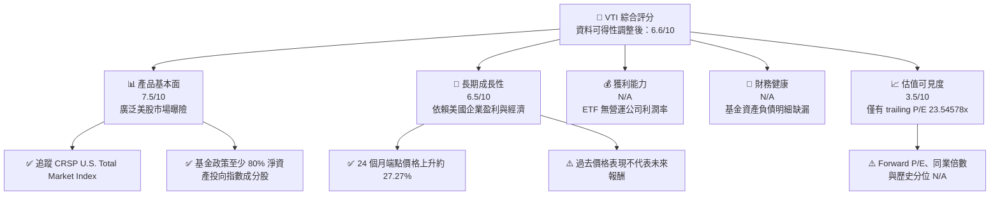

> 綜合評分 6.6/10 是研究可用性的概括分數，並非把 N/A 指標當成零分；各項目仍應以本報告所列資料限制解讀。

### 1.2 評分進度條視覺化

```
╔══════════════════════════════════════════════════════════════╗
║                 VTI 多維度評分儀表板（1–10分）               ║
╠══════════════════════════════════════════════════════════════╣
║ 產品基本面   7.5 ▓▓▓▓▓▓▓▓▓▓▓▓▓▓▓░░░░░  ★★★★☆             ║
║ 成長動能     6.5 ▓▓▓▓▓▓▓▓▓▓▓░░░░░░░░░  ★★★☆☆             ║
║ 獲利品質      N/A（ETF 無公司 GAAP 獲利資料）                ║
║ 財務健康      N/A（基金資產負債明細未提供）                  ║
║ 估值可見度   3.5 ▓▓▓▓▓▓▓░░░░░░░░░░░░░  ★★☆☆☆             ║
║ 護城河深度   7.0 ▓▓▓▓▓▓▓▓▓▓▓▓▓▓░░░░░░  ★★★★☆             ║
║ 執行/成本    7.0 ▓▓▓▓▓▓▓▓▓▓▓▓▓▓░░░░░░  ★★★★☆             ║
╠══════════════════════════════════════════════════════════════╣
║ 暫定總評     6.6 ▓▓▓▓▓▓▓▓▓▓▓▓▓░░░░░░░  🟡 持有觀察          ║
╚══════════════════════════════════════════════════════════════╝
```

### 1.3 五大投資論點 + 三大核心風險

| 類型 | 項目 | 具體依據 | 信心度 |
|------|------|----------|--------|
| 🟢 **投資論點①** | 美國股票市場一籃子曝險 | 基金追蹤 CRSP U.S. Total Market Index，目標涵蓋可投資美股市場；政策要求至少 80% 淨資產投資指數成分股。 | 🟢 高 |
| 🟢 **投資論點②** | 被動化降低個股選擇風險 | 分散持有全市場股票的結構，可降低單一企業事件對整體基金的影響；實際持股數與集中度資料 N/A。 | 🟢 中高 |
| 🟢 **投資論點③** | 低費用架構有助長期複利 | Vanguard 基金產品資料通常列示 VTI 費用率 **0.03%**；題供資料包未附費用率欄位，實際下單前應以最新基金說明書核對。 | 🟡 中 |
| 🟢 **投資論點④** | 近期價格動能為正 | 2024-11 月末價 $292.79 至 2026-11-12 $372.62，端點漲幅 **27.27%**；這是價格變化，不含股息，亦不代表未來預期報酬。 | 🟢 高 |
| 🟢 **投資論點⑤** | 單一基金可作美股核心配置 | 產品設計涵蓋大型、中型及小型美國上市公司；實際市值權重與產業權重未提供，不能量化分散程度。 | 🟢 中 |
| 🟡 **風險①** | 美國股票系統性回檔 | VTI 是股票 ETF，價格可能因經濟、利率、盈利及風險偏好變化而大幅波動；題供資料沒有最大回撤或波動率序列。 | 🟡 中高 |
| 🔴 **風險②** | 市值加權大型股集中 | 全市場指數仍可能由市值最大的少數公司主導報酬；持股權重未提供，集中比例 N/A。 | 🔴 高衝擊 |
| 🔴 **風險③** | 估值與資料品質風險 | trailing P/E 為 23.54578x，但 forward P/E、歷史區間皆 N/A；題供殖利率 106.0% 不可信，未採用。 | 🔴 高 |

### 1.4 快速統計卡片

| 指標 | 基金實際值 | 同類型參考 | S&P 500 參考 | 狀態 |
|------|-------------|------------|--------------|------|
| 2025-11 至 2026-11 月末價格變化 | **+12.06%** | N/A | N/A | 🟢 過去價格表現為正 |
| 24 個月端點價格變化 | **+27.27%** | N/A | N/A | 🟢 過去價格表現為正 |
| Trailing P/E | **23.54578x** | 同業倍數未提供 | N/A | 🟡 缺少可比估值 |
| Forward P/E | **N/A** | N/A | N/A | 🟡 缺漏 |
| 費用率 | **0.03%**（產品公開資料；非本數據包欄位） | VOO/ITOT 等需核最新說明書 | — | 🟢 低成本；請核對現行文件 |
| 追蹤誤差 | **N/A** | N/A | — | 🟡 無資料 |
| 基金 AUM | **N/A** | N/A | — | 🟡 無資料 |
| 殖利率 | 數據包為 **106.0%**，判定異常 | N/A | N/A | 🔴 不採用 |

### 1.5 投資結論

```
╔══════════════════════════════════════════════════════════════════╗
║                    📊 投資結論摘要                               ║
╠══════════════════════════════════════════════════════════════════╣
║  評級：🟡 持有（暫定；不是由 MOS 門檻計算）                     ║
║  價格（2026-11-12 收盤）：$372.62                               ║
║  DCF 內在價值（基準）：N/A（ETF 公司式 DCF 不適用）              ║
║  加權合理價值：N/A（缺少可比較估值與底層預測）                  ║
║  安全邊際 MOS：N/A（合理價值不可得，不能計算）                  ║
║  目標價區間：N/A（沒有足夠資料支撐內在價值區間）                ║
║  24 個月端點價格變化：+27.27%（不含股息，不是預期報酬）         ║
║  投資評分：6.6/10；估值信心低                                   ║
║  適合投資人：尋求廣泛美股曝險、可承受股票市場波動的長期投資人  ║
╚══════════════════════════════════════════════════════════════════╝
```

---

## 2. 公司概覽與商業模式

### 2.1 業務結構與收入來源

VTI 的經濟實質是基金份額，而非自行銷售商品或服務的營運企業。投資人報酬主要來自底層股票價格變化及基金收到後再分配的股息；基金費用則由基金資產按費率扣除。產品資料顯示基金追蹤 CRSP U.S. Total Market Index，並在正常情況下至少將 80% 淨資產投入指數成分股。

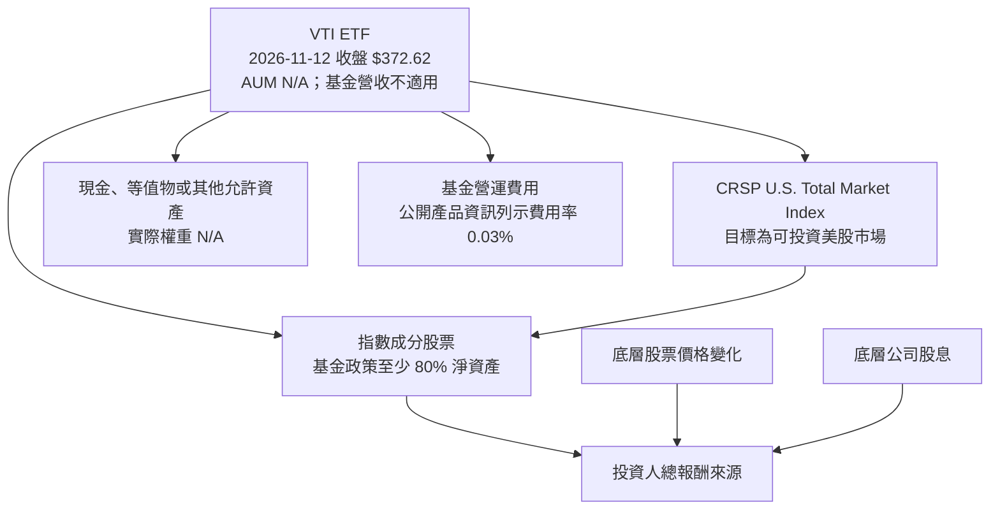

**結構性收入說明：**VTI 沒有「公司營收」或「分部營收」；基金收取的費用屬基金營運費用結構的一部分，不能用一般公司 P/S 或營業利潤率分析。AUM、淨申購、持股股數與實際現金比例皆 N/A。

### 2.2 市場份額

VTI 所處的是美國上市 ETF 市場，但題供資料沒有 AUM、基金淨流入或同業市佔率，無法提供可核實的市場份額百分比。為避免把示意圖誤當成實際市佔，以下呈現基金內部曝險政策，而非市場份額估算。

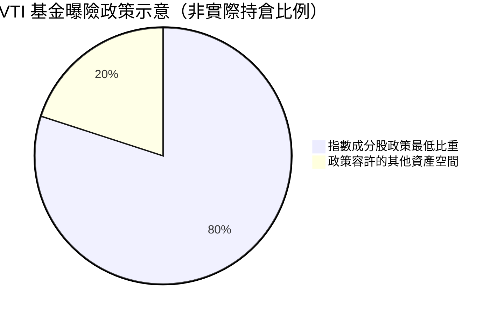

> 圖中 80/20 表示基金文件所述的政策最低投資門檻與剩餘空間，不代表 2026-11-13 的實際持倉分布；實際股票、現金及其他資產比重 N/A。

### 2.3 競爭護城河分析

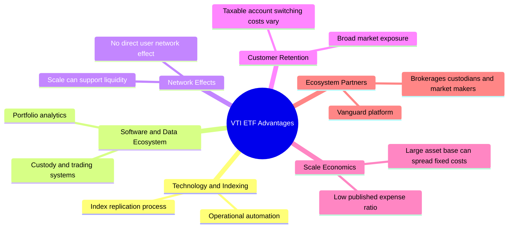

| 護城河來源 | 對 VTI 的意義 | 限制 |
|------------|---------------|------|
| 規模經濟 | 大規模被動基金可把管理與營運固定成本分攤至大量資產。 | AUM 未提供，不能量化規模優勢。 |
| 低成本 | 公開產品資料列示費用率 0.03%；低費用有助減少長期費用拖累。 | 應以現行基金說明書核實；費用率不代表追蹤品質。 |
| 指數化與市場曝險 | 一檔基金提供廣泛美股市場曝險，降低投資人自行選股與再平衡成本。 | 指數方法與市值加權仍會帶來大型股集中。 |
| 交易與流動性 | ETF 形式通常可於交易時段買賣。 | 買賣價差、成交深度及追蹤誤差資料未提供。 |
| 網路效應 | 可能透過平台、保管、做市與基金規模提升便利性。 | 不是典型軟體或社群型網路效應。 |

### 2.4 護城河強度評分

```
╔══════════════════════════════════════════════════════════════╗
║                    VTI 護城河強度評分                         ║
╠══════════════════════════════════════════════════════════════╣
║ 低費用優勢       8/10 ▓▓▓▓▓▓▓▓▓▓▓▓▓▓▓▓░░░░ 🟢 公開費率具競爭力║
║ 市場覆蓋廣度     8/10 ▓▓▓▓▓▓▓▓▓▓▓▓▓▓▓▓░░░░ 🟢 涵蓋美股全市場  ║
║ 規模效應         7/10 ▓▓▓▓▓▓▓▓▓▓▓▓▓▓░░░░░░ 🟡 AUM 未提供      ║
║ 追蹤執行         6/10 ▓▓▓▓▓▓▓▓▓▓▓▓░░░░░░░░ 🟡 追蹤誤差 N/A    ║
║ 客戶鎖定         4/10 ▓▓▓▓▓▓▓▓░░░░░░░░░░░░ 🟡 轉換成本有限    ║
║ 網路效應         3/10 ▓▓▓▓▓▓░░░░░░░░░░░░░░ 🟡 非主要護城河    ║
╠══════════════════════════════════════════════════════════════╣
║ 綜合護城河       7.0/10 ▓▓▓▓▓▓▓▓▓▓▓▓▓▓░░░░░░ 🟢 產品型護城河  ║
╚══════════════════════════════════════════════════════════════╝
```

---

## 3. 損益表深度分析

### 3.1 年度收入成長趨勢（近 4 年）

VTI 沒有企業營收；四年收入趨勢、YoY 成長率及營收 CAGR 不適用。以題供月末收盤價替代觀察基金價格歷史，但價格報酬不等於基金收入或含股息總報酬。

```
╔══════════════════════════════════════════════════════════════════╗
║                VTI 價格歷史錨點（非公司營收）                    ║
╠══════════════════════════════════════════════════════════════════╣
║  2024-11  $292.79  ███████████████░░░░░░░░░░  起點               ║
║  2025-11  $332.51  █████████████████░░░░░░░░  端點同比 +13.57%   ║
║  2026-11  $372.62  ███████████████████░░░░░░  端點同比 +12.06%   ║
║                                                                  ║
║  2024-11 至 2026-11 端點價格變化：+27.27%                       ║
║  基金公司營收、收入 CAGR：不適用                                 ║
╚══════════════════════════════════════════════════════════════════╝
```

計算說明（使用題供端點價格；百分比四捨五入至小數點後兩位）：

- 2025-11 至 2026-11：\((372.62 ÷ 332.51) - 1 = 12.06\%\)
- 2024-11 至 2026-11：\((372.62 ÷ 292.79) - 1 = 27.27\%\)

以上為價格變化，不含期間分配的股息、交易成本及稅負，亦非基金 NAV 總報酬。

### 3.2 季度收入趨勢分析

| 季度 | 基金公司收入 | QoQ | YoY | 備註 |
|------|--------------:|----:|----:|------|
| 最近一季 | N/A | N/A | N/A | ETF 不適用公司營收；資料包無基金季度財務表。 |
| 前一季 | N/A | N/A | N/A | 同上。 |
| 前二季 | N/A | N/A | N/A | 同上。 |
| 前三季 | N/A | N/A | N/A | 同上。 |

**趨勢解讀：**基金資產規模可能隨申購、贖回及市場漲跌變動，但這些是基金資產流量，不應當作公司營收成長。

### 3.3 利潤率演變分析

| 利潤率指標 | FY-3 | FY-2 | FY-1 | 最新 TTM | 趨勢 | 評估 |
|------------|------|------|------|----------|------|------|
| 毛利率 | N/A | N/A | N/A | N/A | 不適用 | ETF 無產品銷售毛利。 |
| 營業利益率 | N/A | N/A | N/A | N/A | 不適用 | 無營業公司損益表。 |
| EBITDA 利潤率 | N/A | N/A | N/A | N/A | 不適用 | 不適用於基金份額。 |
| 淨利率 | N/A | N/A | N/A | N/A | 不適用 | 基金投資收益與公司淨利概念不同。 |

**利潤率演變深度解析：**沒有公司產品組合、營運成本、營業利益或有效稅率資料，因此不能合理聲稱利潤率改善或惡化。可分析的基金成本指標是費用率；公開產品資料列示 **0.03%**，但題供財務資料包未包含該欄位，且未提供歷史費用率序列，無法計算費用率 YoY 或 QoQ 變化。

### 3.4 費用結構分析

基金費用率 0.03% 可視為每年基金資產費用的比例指標，不是一般企業營業費用率。基金年度實際費用金額需要 AUM 與費用率在相應期間的資料，AUM 未提供，故不能推算費用美元金額。

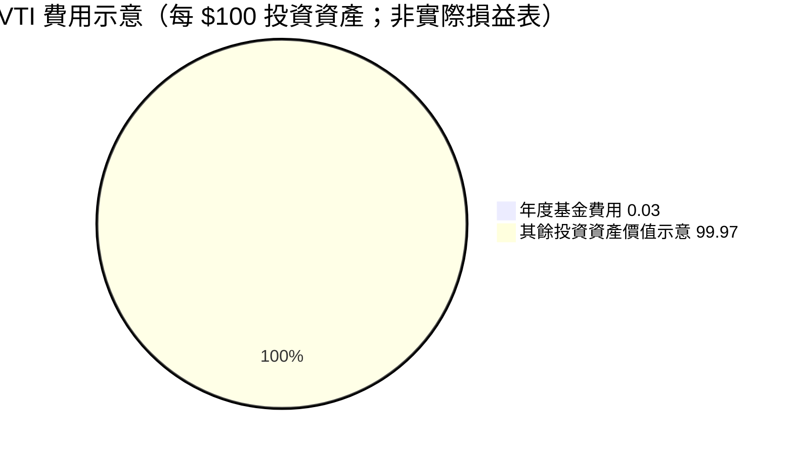

```
╔══════════════════════════════════════════════════════════════╗
║                 費用率示意（不代表基金財務報表）              ║
╠══════════════════════════════════════════════════════════════╣
║ 每 $100 投資資產                                               ║
║ 基金費用率約 $0.03   ▓░░░░░░░░░░░░░░░░░░░░░░░░░░░░░░░░      ║
║ 資產其餘部分約 $99.97（費用前示意）                           ║
║ 年度實際費用總額：AUM 未提供，N/A                             ║
╚══════════════════════════════════════════════════════════════╝
```

### 3.5 季度 EPS 趨勢與盈餘品質（Quality of Earnings）

ETF 無公司季度 EPS，也沒有可按公司口徑計算的 SBC、淨利、營業現金流或 FCF 轉換率。以下資料不得以推算方式填補：

| 盈餘品質項目 | 數值/佔比 | 評估 |
|--------------|-----------|------|
| 最近 4 季 EPS 超預期/不及預期 | N/A | ETF 不發布公司 EPS；題供盈餘紀錄亦無資料。 |
| 股權薪酬 SBC / 營收 | N/A | 基金並非營運公司。 |
| SBC / 營業現金流 | N/A | 營業現金流 N/A。 |
| FCF / 淨利 | N/A | TTM FCF 與淨利均不適用。 |
| 一次性/非經常性損益 | N/A | 無基金損益明細可供拆分。 |
| 有效稅率異常 | N/A | 基金層級稅務資料未提供。 |
| 資本化支出 vs 費用化 | N/A | 公司資本支出分析不適用。 |

**盈餘品質結論：**VTI 的投資報酬含金量應以底層持股盈利、股息、基金費用、追蹤差異及稅務處理衡量，而非 ETF 的 GAAP 淨利或 FCF。題供資料不足以量化上述項目，故盈餘品質評級為 N/A。

---

## 4. 資產負債表分析

### 4.1 資產結構分解

基金資產負債表不等於營運公司的資產負債表；題供資料沒有基金淨資產、持股市值、應收應付或現金細項。以下僅呈現產品政策所描述的資產結構，不表示實際持倉：

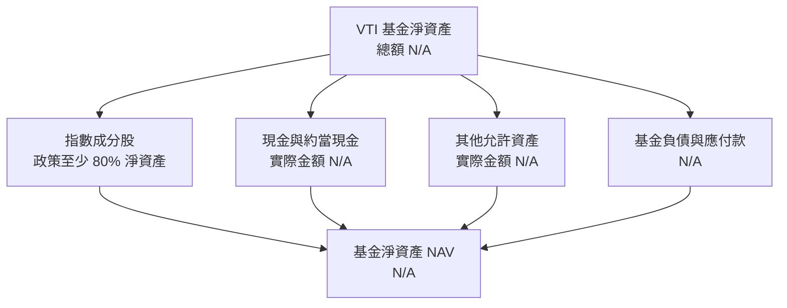

### 4.2 流動性指標分析

| 指標 | VTI | 同類 ETF 參考 | 評估 |
|------|----:|---------------|------|
| 基金現金 | N/A | N/A | 題供資料沒有基金資產明細。 |
| 基金負債 | N/A | N/A | 不應將公司借款比率套用於 ETF。 |
| Current Ratio | N/A | N/A | 基金的流動性應觀察持倉、成交量、買賣價差與贖回機制。 |
| Quick Ratio | N/A | N/A | 不適用公司財報口徑。 |
| AUM | N/A | N/A | 無法量化規模與資金流。 |
| 買賣價差 | N/A | N/A | 題供資料未提供報價簿或交易成本。 |

### 4.3 債務結構分析

```
╔══════════════════════════════════════════════════════════════════╗
║                  VTI 基金債務與流動性診斷                         ║
╠══════════════════════════════════════════════════════════════════╣
║  基金總負債：      N/A（未提供基金資產負債明細）                 ║
║  基金現金：        N/A                                             ║
║  基金淨現金/負債： N/A；數據包的 $0.00 不足以代表基金總體負債     ║
║  Debt/EBITDA：     不適用（ETF 無公司 EBITDA）                    ║
║  利息保障倍數：    不適用（利息費用與企業 EBIT 未提供）            ║
║  風險判斷：        不對缺漏數據推定基金無負債或零風險              ║
╚══════════════════════════════════════════════════════════════════╝
```

### 4.4 股東權益趨勢

VTI 的基金淨資產會受市場價格、投資人申購贖回、股息及基金支出影響。題供資料沒有年度基金淨資產時間序列，因此無法產生有證據支持的趨勢圖。

```
╔══════════════════════════════════════════════════════════════╗
║                   基金淨資產變化（資料限制）                   ║
╠══════════════════════════════════════════════════════════════╣
║ FY-3   N/A                                                     ║
║ FY-2   N/A                                                     ║
║ FY-1   N/A                                                     ║
║ 最新   N/A                                                     ║
║ AUM、申購贖回、基金淨資產 CAGR：均無可用數據                  ║
╚══════════════════════════════════════════════════════════════╝
```

---

## 5. 現金流量深度分析

### 5.1 現金流量瀑布圖

ETF 的持股公司會產生營運現金流，但這些現金流屬於底層公司；VTI 作為基金收到股息後，依基金政策處理分配或再投資。基金本身沒有可直接引用的「淨利 → OCF → Capex → FCF」公司現金流瀑布。

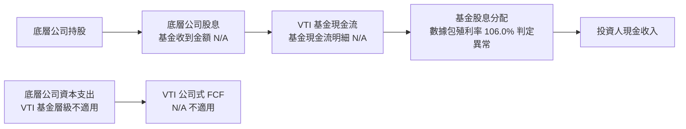

### 5.2 FCF 轉換率趨勢

| 期間 | VTI FCF / 淨利 | 公司式 FCF 轉換率 | 說明 |
|------|----------------:|------------------:|------|
| 近 4 年 | N/A | N/A | ETF 不適用營運公司口徑。 |
| TTM | N/A | N/A | 題供 FCF（OCF − Capex）為 N/A；不可改用其他定義。 |

### 5.3 自由現金流趨勢

```
╔══════════════════════════════════════════════════════════════╗
║              VTI 公司式 FCF（營業現金流 − 資本支出）          ║
╠══════════════════════════════════════════════════════════════╣
║ TTM OCF：       N/A                                           ║
║ TTM Capex：     N/A                                           ║
║ TTM FCF：       N/A                                           ║
║ TTM FCF Yield： N/A                                           ║
║                                                                      ║
║ 企業式 FCF 不適用 ETF；不得以底層公司 FCF 加總冒充 VTI FCF。  ║
╚══════════════════════════════════════════════════════════════╝
```

### 5.4 資本配置評估

| 資本配置項目 | VTI 資料 | 評估 |
|--------------|----------|------|
| 股票投資 | 正常情況下至少 80% 淨資產投資於指數成分股 | 🟢 符合指數追蹤目的。 |
| 現金與其他資產 | 實際比例 N/A | 🟡 無法評估現金拖累。 |
| 基金股息分配 | 數據包殖利率 106.0%，判定為異常 | 🔴 不採用；須查證官方分配紀錄。 |
| 回購 | 不適用基金公司股東回購口徑 | — |
| 資本支出 | 不適用基金營運公司口徑 | — |

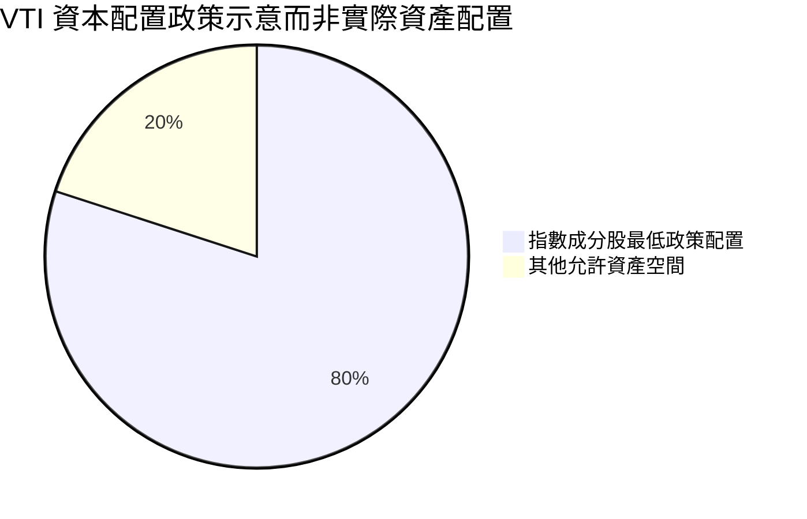

---

## 6. 獲利能力與資本效率

### 6.1 ROE / ROA / ROIC 趨勢

| 指標 | FY-3 | FY-2 | FY-1 | TTM | 評估 |
|------|------|------|------|-----|------|
| ROE | N/A | N/A | N/A | N/A | 基金不是營運企業，且沒有相應財報資料。 |
| ROA | N/A | N/A | N/A | N/A | 不適用企業淨利與總資產口徑。 |
| ROIC | N/A | N/A | N/A | N/A | ETF 無營運投入資本。 |
| 同業平均 | N/A | N/A | N/A | N/A | 沒有同業公司可用的可比口徑。 |

### 6.2 ROIC vs WACC 分析（核心價值創造判斷）

```
╔══════════════════════════════════════════════════════════════════╗
║                  ROIC vs WACC 深度分析                           ║
╠══════════════════════════════════════════════════════════════════╣
║  VTI 基金不是營運企業，ROIC 與 WACC 不適用。                     ║
║                                                                  ║
║  無風險利率 Rf：         N/A（題供資料未附 Cost of capital inputs）║
║  市場風險溢酬 ERP：      N/A                                      ║
║  Beta：                  N/A（基金 Beta 欄位未提供）             ║
║  債務成本 Kd：           N/A                                      ║
║  E/D 資本結構權重：      N/A                                      ║
║  WACC：                  N/A                                      ║
║  NOPAT / 投入資本：      不適用                                   ║
║  ROIC − WACC：           N/A                                      ║
║                                                                  ║
║  結論：不能據此聲稱 VTI 本身創造或摧毀企業經濟價值；              ║
║        投資人的長期回報取決於成分股盈利、估值與基金追蹤成本。     ║
╚══════════════════════════════════════════════════════════════════╝
```

### 6.3 杜邦三因素分解

杜邦公式適用於營運企業的 ROE 分解，VTI 沒有適用的公司淨利率、資產週轉率與財務槓桿數據，故不計算：

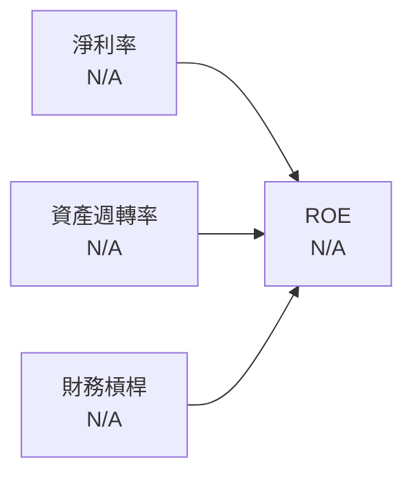

### 6.4 獲利能力儀表板

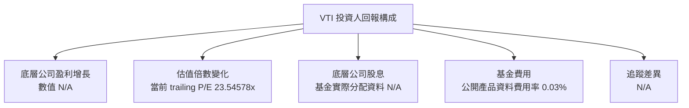

---

## 7. 相對估值分析

### 7.1 同業估值比較表格

VTI 的競爭產品包含 Vanguard S&P 500 ETF（VOO）、iShares Core S&P Total U.S. Stock Market ETF（ITOT）及 Nasdaq-100 ETF（QQQ）。這些基金的指數範圍與集中度不同；題供資料沒有同業倍數。依數據規則，未提供的同業估值不以未標示的估計數字替代。

| 估值指標 | **VTI** | **VOO** | **ITOT** | **QQQ** | VTI 評估 |
|----------|--------:|--------:|---------:|--------:|----------|
| **Trailing P/E** | **23.54578x** | N/A | N/A | N/A | 🟡 缺少同日期同口徑比較 |
| **Forward P/E** | N/A | N/A | N/A | N/A | 🟡 無法判斷預期盈利估值 |
| **P/S Ratio** | N/A | N/A | N/A | N/A | 🟡 未提供 |
| **P/B Ratio** | N/A | N/A | N/A | N/A | 🟡 未提供 |
| **EV/EBITDA** | N/A | N/A | N/A | N/A | ETF 不具一般公司 EV/EBITDA 口徑 |
| **費用率** | 0.03%（產品公開資訊；應核最新文件） | N/A | N/A | N/A | 🟢 VTI 費用率資訊具參考價值，但同業數字未取用 |

**同業差異：**VOO 集中於 S&P 500 大型股，ITOT 與 VTI 均以美國全市場曝險為目標但追蹤指數不同，QQQ 則集中 Nasdaq-100 成分股，不能直接用單一估值倍數視為完全同類。Peer multiples 欄位未提供，因此本節不估填同業數字。

### 7.2 歷史估值區間分析

題供資料沒有「Valuation vs own history」估值區間或 P/E 歷史分位數，故不能聲稱目前估值位於歷史第幾百分位。

```
╔══════════════════════════════════════════════════════════════╗
║                   VTI 歷史估值位置                            ║
╠══════════════════════════════════════════════════════════════╣
║ 當前 trailing P/E：23.54578x                                  ║
║ 歷史 P/E 低點：N/A                                             ║
║ 歷史 P/E 中位數：N/A                                           ║
║ 歷史 P/E 高點：N/A                                             ║
║ 當前歷史分位：N/A                                               ║
║ 判斷：有一個當前倍數，沒有歷史分布，不作百分位推論。            ║
╚══════════════════════════════════════════════════════════════╝
```

### 7.3 情境目標價（假設驅動，Bear / Base / Bull）

由於 EPS（TTM）及 Forward EPS 均為 N/A，不能把假設 P/E 倍數轉換為可複算的每股目標價。以下列示可用的情境框架，不提供無數據支持的價格目標。

| 情境 | 營收 CAGR | 營業利潤率 | 退出倍數 | 隱含目標價 | 相對現價 |
|------|-----------|-----------|----------|------------|----------|
| 🔴 悲觀 | N/A | 不適用 | N/A | N/A | N/A |
| 🟡 基準 | N/A | 不適用 | N/A | N/A | N/A |
| 🟢 樂觀 | N/A | 不適用 | N/A | N/A | N/A |

> **估值方法說明：**VTI 不是單一營運公司，不適合以基金自身營收、EBITDA 或 FCF 建模。可行方法是以指數成分股盈利與指數預期報酬建模，或用成分股加權估值；這些輸入在題供資料中皆缺漏。

### 7.4 相對估值隱含價格區間

```
╔══════════════════════════════════════════════════════════════╗
║              相對估值隱含價格區間（題供資料可得性）            ║
╠══════════════════════════════════════════════════════════════╣
║ Forward P/E 回推：   N/A（Forward EPS N/A）                    ║
║ EV/EBITDA 回推：     N/A（ETF 不適用一般企業 EV/EBITDA）      ║
║ EV/Sales 回推：      N/A（基金營收與企業價值 N/A）             ║
║ FCF Yield 回推：     N/A（TTM FCF Yield N/A）                  ║
║ 最新收盤價：         $372.62（2026-11-12）                     ║
║ 可比估值區間：       N/A                                        ║
╚══════════════════════════════════════════════════════════════╝
```

---

## 8. DCF 內在價值評估（Discounted Cash Flow）

### 8.0 估值推理鏈（Thinking Logic：在算之前先想清楚）

**Step 1 — VTI 的價值由哪些變數決定？**

VTI 的合理價值不是基金公司的企業價值，而是底層美股組合的市場價值；主要來源為底層公司未來盈利及股息、投資人要求報酬率所決定的估值倍數，以及基金費用與追蹤偏差。三項當前權重及其對應盈利占比均未提供；目前可用的估值觀察只有 trailing P/E **23.54578x**。主導估值的變數是底層企業長期盈利路徑與折現率，但題供資料沒有成分股盈利預測與市場資本成本輸入。

**Step 2 — 用哪一種模型、為什麼？**

| 決策點 | 本報告採用 | 理由（含數字） | 曾考慮但否決 | 否決理由 |
|--------|-----------|----------------|--------------|----------|
| 現金流定義 | 不建立基金 FCFF/FCFE | VTI 是基金；OCF、Capex、FCF TTM 均 N/A | VTI 公司式 FCFF | 缺少公司財報，概念亦不適用 |
| 預測期 N | N/A | 沒有底層成分股盈利預測或分年度現金流 | 5 年或 10 年 DCF | 會憑空製造營收、利潤率及現金流假設 |
| 終值方法 | N/A | 無基準年度 FCFF | Gordon Growth、退出倍數 | 缺少終值基礎與可比退出倍數 |
| EBIT 基礎 | 不適用 | VTI 無公司 EBIT；ETF 的 trailing P/E 為 23.54578x | GAAP/非 GAAP EBIT | 不適用於基金 |

**Step 3 — 關鍵假設推導鏈**

由於此基金不具備 DCF 所需的企業財務輸入，不設定營收 CAGR、營業利潤率、稅率、Capex、D&A、營運資金、SBC、稀釋股數、WACC 或永續成長率。對這些項目指定數值會造成表面上可計算、實際上無來源的假精確。

**Step 4 — 最脆弱的一環**

如果未來取得成分股逐項盈利與股息預測，合理估值仍會高度依賴盈利增長、利率及市場風險溢酬；目前這些資料全部缺漏，因此不能判定 $372.62 相對內在價值的偏離幅度。

**Step 5 — 計算路徑圖**

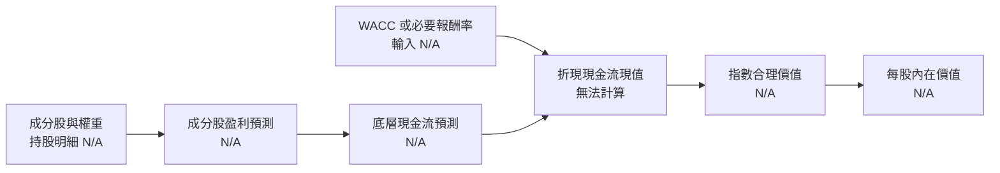

### 8.1 模型假設總表（Model Inputs）

| 假設項目 | 採用值 | 依據 / 來源 | 敏感度 |
|----------|--------|-------------|--------|
| 預測期長度 N | N/A | 沒有底層公司逐年預測 | 🔴 高 |
| 營收 CAGR | N/A | ETF 無公司營收；成分股預測缺漏 | 🔴 高 |
| 營業利潤率 | N/A | ETF 無公司營業利益 | 🔴 高 |
| 有效稅率 | N/A | 基金與成分股稅務明細未提供 | 🟢 低 |
| Capex / 營收 | N/A | 沒有成分股加權 Capex 資料 | 🟡 中 |
| D&A / 營收 | N/A | 沒有成分股加權 D&A 資料 | 🟢 低 |
| ΔWC / 營收增額 | N/A | 沒有成分股營運資金資料 | 🟢 低 |
| EBIT 基礎 | 不適用 | VTI 無基金公司 EBIT | 🟡 中 |
| SBC 處理 | 不適用 | 無合併成分股 SBC 與股數輸入 | 🟡 中 |
| 年稀釋率 | N/A | 指數公司逐項股數變化未提供 | 🟡 中 |
| 永續成長率 g | N/A | 無可用 FCFF 終值基礎 | 🔴 高 |
| 終值方法 | N/A | 缺少 FCFF 與可比退出倍數 | 🔴 高 |
| WACC | N/A | Cost of capital inputs 缺漏；Beta N/A | 🔴 高 |

**FCF 定義：**本報告不計算 FCFF 或 FCFE。題供 TTM FCF 欄位 N/A，亦不得以其他自由現金流定義替代。

**SBC 防呆說明：**不建立企業 DCF，因此不採用組合 (A)、(B) 或 (C)；不將底層公司 SBC 加回或扣除，也不設定稀釋股數。

### 8.2 折現率推導（WACC）

```
╔══════════════════════════════════════════════════════════════════╗
║                    WACC 推導（折現率）                           ║
╠══════════════════════════════════════════════════════════════════╣
║  股權成本 Ke（CAPM）：N/A                                       ║
║  ├── 無風險利率 Rf：N/A（題供 Cost of capital inputs 未提供）   ║
║  ├── 市場風險溢酬 ERP：N/A                                      ║
║  ├── Beta：N/A（市場資料 Beta N/A）                              ║
║  ├── 規模/國別溢酬：N/A                                         ║
║  └── Ke = N/A                                                    ║
║                                                                  ║
║  債務成本 Kd：N/A（基金計息負債與利息支出明細未提供）            ║
║  資本結構權重：N/A                                               ║
║  WACC：N/A                                                       ║
║                                                                  ║
║  不執行公司 ROIC vs WACC 比較；第 6.2 節亦為 N/A。               ║
╚══════════════════════════════════════════════════════════════════╝
```

**逐步演算（WACC）：**CAPM 所需 Rf、ERP、Beta、計息負債、利息費用與資本結構權重均未提供。故五步計算均為 N/A，不以基金市場價格或題供的 $0.00 Net Cash / Debt 反推 WACC。

### 8.3 逐年自由現金流預測（基準情境）

由於 8.1 的預測期 N 為 N/A，無法依要求列出 FY+1 至 FY+N 的數字欄位。用企業營收、EBIT、稅、NOPAT、D&A、Capex、ΔWC 或 FCFF 填表，會將不存在的 VTI 公司財報當成事實。

| 項目 | FY+1 至 FY+N |
|------|--------------|
| 營收與 YoY | N/A |
| EBIT、稅與 NOPAT | N/A |
| D&A、Capex、ΔWC | N/A |
| FCFF 與折現因子 | N/A |
| 預測期 FCFF 現值合計 | N/A |

**逐步演算：**營收、利潤率、稅率、D&A、Capex、ΔWC 及 WACC 均無適用輸入，九步 FCFF 演算無法執行。公司歷史 FCF CAGR、歷史 FCFF 利潤率及同業最佳值皆 N/A。

```
╔══════════════════════════════════════════════════════════════╗
║           自由現金流：基金層級公司式預測不適用               ║
╠══════════════════════════════════════════════════════════════╣
║ 歷史 TTM FCF：N/A                                             ║
║ FY+1 至 FY+N 預測 FCFF：N/A                                   ║
║ 預測 FCF CAGR：N/A                                            ║
║ 原因：VTI 是 ETF，沒有可用公司式 OCF 與 Capex。               ║
╚══════════════════════════════════════════════════════════════╝
```

### 8.4 終值計算（Terminal Value）

**適用性檢查：**`WACC N/A vs g N/A → WACC > g？無法判定；Gordon Growth 不適用。`

| 方法 | 計算式 | 終值 TV | TV 現值 | 佔總 EV 比重 |
|------|--------|---------|---------|--------------|
| Gordon Growth | N/A；無 FCFF、WACC、g | N/A | N/A | N/A |
| 退出倍數法 | N/A；無 EBITDA 或退出倍數 | N/A | N/A | N/A |

逐步演算的 FCFF(FY+N)、終值分子、折現因子與 EV 均 N/A。故無法估算終值佔企業價值比例。

### 8.5 企業價值 → 每股內在價值（Bridge）

```
╔══════════════════════════════════════════════════════════════════╗
║              企業價值 → 每股內在價值橋接表                       ║
╠══════════════════════════════════════════════════════════════════╣
║  預測期 FCF 現值合計            N/A                              ║
║  終值現值 PV(TV)                N/A                              ║
║  = 企業價值 EV                  N/A（ETF 公司式 EV 不適用）       ║
║  + 現金及短期投資               N/A                              ║
║  − 總債務                       N/A                              ║
║  = 股權價值                      N/A                              ║
║  ÷ 稀釋後流通股數                N/A                              ║
║  ★ 每股內在價值                  N/A                              ║
║  當前股價                        $372.62（2026-11-12 收盤）       ║
║  折溢價                          N/A                              ║
╚══════════════════════════════════════════════════════════════════╝
```

1. EV = 預測期 PV 合計 N/A + PV(TV) N/A = N/A。  
2. 股權價值 = EV N/A + 現金 N/A − 總債務 N/A = N/A。  
3. 每股內在價值 = 股權價值 N/A ÷ 稀釋股數 N/A = N/A。  
4. 折溢價 = 現價 $372.62 ÷ DCF 內在價值 N/A − 1 = N/A。  
5. **本節不計算 MOS**；MOS 應以 8.8 加權合理價值為分母，但該數值亦為 N/A。

**股數來歷：**VTI 基金份額數未提供；基金份額不是單一營運公司的稀釋股數。基金現金與負債的期末明細亦未提供。

### 8.6 敏感性分析（WACC × 永續成長率）

DCF 需要 FCFF、WACC、永續成長率、稀釋股數與淨負債等輸入，均無可用數值。以下 5×5 敏感性矩陣無法形成：

| g（列）／WACC（欄） | WACC N/A | WACC N/A | WACC N/A | WACC N/A | WACC N/A |
|----------------------|----------|----------|----------|----------|----------|
| g N/A | N/A | N/A | N/A | N/A | N/A |
| g N/A | N/A | N/A | N/A | N/A | N/A |
| g N/A | N/A | N/A | N/A | N/A | N/A |
| g N/A | N/A | N/A | N/A | N/A | N/A |
| g N/A | N/A | N/A | N/A | N/A | N/A |

無法示範有效格的 DCF 重算；亦無法計算 g 每變動 1pp、WACC 每變動 1pp 或營業利潤率每變動 1pp 的每股價值彈性。

**三情境 DCF：**

| 情境 | 營收 CAGR | 期末營業利潤率 | 永續成長 g | WACC | 每股內在價值 | 相對現價 | 主觀機率 |
|------|-----------|----------------|------------|------|--------------|----------|----------|
| 🔴 悲觀 | N/A | N/A | N/A | N/A | N/A | N/A | N/A |
| 🟡 基準 | N/A | N/A | N/A | N/A | N/A | N/A | N/A |
| 🟢 樂觀 | N/A | N/A | N/A | N/A | N/A | N/A | N/A |
| **機率加權** | — | — | — | — | **N/A** | **N/A** | N/A |

每一情境的營收 CAGR → FY+N 營收 → FY+N FCFF → TV → 每股價值之推導鏈均無所需輸入，不能為情境任意指派機率或目標價。

### 8.7 反推 DCF（Reverse DCF：市場在預期什麼）

| 求解的變數（一次一個） | 固定其餘變數 | 市場隱含值 | 公司/基金歷史實際 | 判斷 |
|------------------------|-------------|------------|------------------|------|
| 未來 N 年營收 CAGR | WACC、稅率、Capex、ΔWC、利潤率均無基準 | N/A | 不適用 | 無解：沒有 DCF 起始現金流 |
| 期末營業利潤率 | 其他 DCF 輸入無基準 | N/A | 不適用 | 無解 |
| 永續成長率 g | WACC 與 FCFF 無基準 | N/A | — | 無解 |
| 高成長持續年數 N | CAGR、利潤率與終值無基準 | N/A | 不適用 | 無法在模型內求解 |

現價只有一條方程式，而底層現金流與必要折現率未提供；因此無法逐一反解任何一項市場隱含假設，也沒有可複算的迭代軌跡。

### 8.8 估值三角驗證與安全邊際

| 估值方法 | 隱含每股價值 | 上行空間（÷現價） | 權重 | 說明 |
|----------|--------------|-------------------|------|------|
| DCF | N/A | N/A | N/A | 不適用於基金公司；缺少成分股現金流模型。 |
| 同業 Forward P/E | N/A | N/A | N/A | Forward EPS 與 Peer multiples 未提供。 |
| EV/EBITDA 倍數 | N/A | N/A | N/A | ETF 不具一般企業 EV/EBITDA 口徑。 |
| FCF Yield 回推 | N/A | N/A | N/A | FCF Yield N/A。 |
| 分析師共識目標價 | N/A | N/A | N/A | 題供資料無分析師目標價。 |
| **加權合理價值** | **N/A** | **N/A** | **N/A** | 缺少可計算方法與可用權重。 |

不能計算「方法價值 × 權重」加總，因各方法價值及可支持的權重均 N/A；不製造加權合理價值，也不把收盤價本身冒充合理價值。

```
╔══════════════════════════════════════════════════════════════════╗
║                  估值區間與安全邊際                              ║
╠══════════════════════════════════════════════════════════════════╣
║  悲觀價值 N/A ── 現價 $372.62 ── 加權合理價值 N/A               ║
║                                                                  ║
║  安全邊際 MOS：N/A                                               ║
║  公式：(加權合理價值 − 現價) ÷ 加權合理價值                     ║
║  上行空間：N/A；分母為現價 $372.62                              ║
║  折溢價：N/A；基準應為 8.5 節 DCF 內在價值                      ║
║                                                                  ║
║  買入區間：N/A（無法依合理價值設定）                            ║
║  持有區間：N/A（無法依內在價值量化）                            ║
║  減碼區間：N/A（無可驗證樂觀情境價值）                           ║
╚══════════════════════════════════════════════════════════════════╝
```

### 8.9 DCF 模型的局限與失效條件

- **終值依賴度：**N/A。未建立 FCFF 模型，無法計算終值占 EV 比重。
- **最脆弱的假設：**無法識別具體 DCF 假設；關鍵缺漏為成分股盈利預測、必要報酬率與持倉權重。
- **不適用情境：**以 VTI 基金本身的企業 DCF 估值不適用。若要對指數建模，應取得指數成分股權重、成分股預期盈利、股息、估值及折現率，做成分股加權估值或市場總報酬情境分析。
- **與第 10 章風險連結：**盈利下修或折現率上升會壓低成分股估值；大型股集中會使少數公司財測下修對基金影響高於等權重組合。
- **市場資訊對照：**Trailing P/E **23.54578x** 可作為當下估值快照，但缺少歷史分位及 Forward P/E，無法判斷目前倍數相對長期均值的差異。

### 8.10 複算檢核表（Audit Trail：輸出前自我驗算）

| # | 檢核項目 | 檢查方式 | 結果 |
|---|----------|----------|------|
| 1 | 🔴高 / 🟡中輸入都有四段式推導 | 不建立公司 DCF；營收、利潤率等輸入均明示 N/A | N/A：不適用 |
| 2 | 每個假設都有來歷 | 8.1 已說明資料缺漏或不適用 | ✅ |
| 3 | WACC 五步算式齊全且相乘相加正確 | Rf、ERP、Beta、債務資料皆 N/A | N/A：無法計算 |
| 4 | Kd 分母與債務權重範圍一致 | 基金計息負債資料 N/A | N/A：無法計算 |
| 5 | WACC 與第 6.2 節同值 | 兩處均 N/A | ✅ 一致 |
| 6 | 逐年表格年度數等於 N，且無省略符號 | N 未定義；明示無法建立預測表 | N/A：模型不適用 |
| 7 | 代表年度九步算式可複算 | 所需輸入均 N/A | N/A：無法計算 |
| 8 | 預測期 PV 逐項加總 | 無年度 FCFF | N/A：無法計算 |
| 9 | WACC > g | WACC 與 g 均 N/A | N/A：無法判定 |
| 10 | 終值依 FY+N FCFF、折現 N 期 | 無 FCFF 與 N | N/A：無法計算 |
| 11 | EV 至每股價值橋接 | 現金、負債、股數及 EV N/A | N/A：無法計算 |
| 12 | SBC 三要素組合相容 | 不建立公司 DCF，不重複計入 SBC | N/A：不適用 |
| 13 | 矩陣基準格等於 8.5 每股價值 | 兩者皆 N/A | N/A：未建立矩陣 |
| 14 | 矩陣有效格與 WACC ≤ g 格子 | WACC、g 不存在 | N/A：未建立矩陣 |
| 15 | 三情境機率合計 100% | 沒有可驗證情境價值與機率 | N/A：未建立情境 |
| 16 | 反推 DCF 每列只放開一項且有軌跡 | DCF 無基準現金流 | N/A：無法求解 |
| 17 | MOS 基準與 1.0 一致；折溢價基準與 8.5 一致 | 兩處均 N/A，沒有替代分母 | ✅ 一致 |
| 18 | 報告至第 11 章完整 | 章節 1–11 均已列示 | ✅ |
| 19 | 8.8 加權價值等於各項價值加權和 | 方法價值與權重未提供，不虛構總和 | N/A：無法計算 |
| 20 | 評級符合 MOS 門檻或說明調整 | MOS N/A；評級採暫列持有且明示非規則 20 推導 | ✅ 已說明限制 |

---

## 9. 成長催化劑

### 9.1 催化劑時間軸

下列是監測框架，不是已確認的未來事件或公司財測。

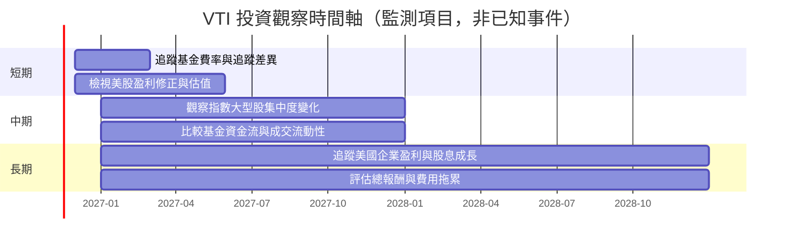

### 9.2 TAM 市場規模分析

VTI 的相關市場是美國可投資股票，而非企業產品 TAM。題供資料沒有美國股票市場總市值、基金 AUM、市佔率或投資人資產流入數據，故不能填入 TAM 金額及滲透率。

```
╔══════════════════════════════════════════════════════════════╗
║                 VTI 市場機會與資料可得性                      ║
╠══════════════════════════════════════════════════════════════╣
║ 美國可投資股票市場規模：N/A                                   ║
║ ETF 市場總 AUM：N/A                                           ║
║ VTI AUM 與市場滲透率：N/A                                     ║
║ 可能的長期驅動：美國企業盈利、股息、投資人股票配置需求         ║
║ 可量化 VTI 收入貢獻：不適用；基金不是營運公司                 ║
╚══════════════════════════════════════════════════════════════╝
```

### 9.3 成長驅動力結構圖

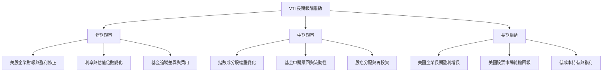

**解讀：**VTI 的長期成長不是基金營收或產品銷量的成長，而是成分股市值、股息與再投資的長期變化。近期 24 個月端點價格上漲 **27.27%**，不能單獨外推為未來 CAGR。

---

## 10. 風險矩陣

### 10.1 風險評分矩陣

下列機率與衝擊座標為定性分析分數，不是歷史頻率統計；風險名稱按要求使用英文以符合 Mermaid quadrantChart 語法限制。

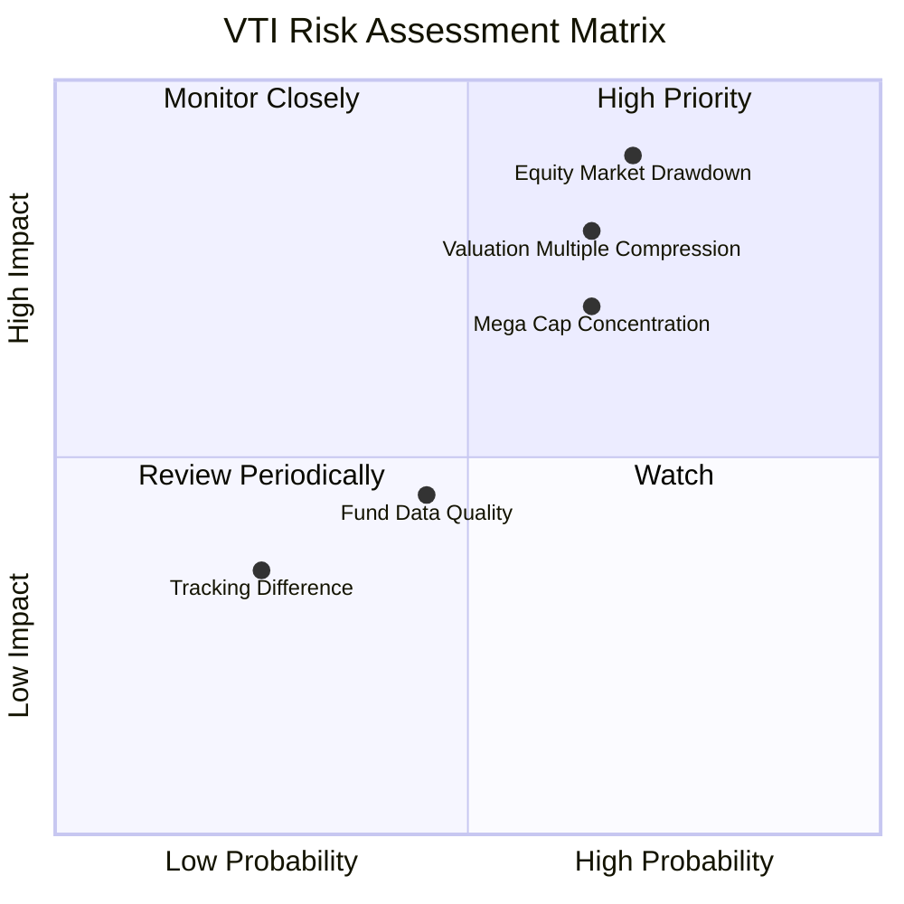

### 10.2 風險清單詳細分析

| # | 風險項目 | 發生機率 | 財務衝擊 | 風險評分 | 緩解措施 |
|---|----------|----------|----------|----------|----------|
| 1 | 🔴 **美國股票市場回檔** | 中高；機率無統計資料 | 市值與基金份額價格可能顯著下跌；題供資料無最大回撤可量化 | 🔴 8.5/10 | 以投資期限、資產配置與再平衡管理，不以短期資金承擔股票波動。 |
| 2 | 🔴 **估值倍數收縮** | 中；無市場預測資料 | trailing P/E 為 23.54578x；若盈利未增而倍數下修，價格可能承壓，幅度無法由資料包計算 | 🔴 7.5/10 | 監控盈利修正、利率及估值分位；避免以單一倍數當作未來報酬保證。 |
| 3 | 🔴 **大型股集中** | 中高；實際權重 N/A | 市值加權下，最大型成分股表現可能主導指數；集中度無法量化 | 🔴 7.0/10 | 定期檢查前十大持股與產業權重，必要時搭配非美股或債券資產分散。 |
| 4 | 🟡 **追蹤差異與市場摩擦** | 低至中；實際追蹤誤差 N/A | 基金報酬可能與指數不同；未提供追蹤誤差及買賣價差 | 🟡 4.0/10 | 核對基金報酬、指數報酬、費用率及交易成本。 |
| 5 | 🟡 **數據品質與分配資訊異常** | 已觀察到資料疑點 | 殖利率 106.0% 不符合一般解讀，若誤用將嚴重扭曲收益估計 | 🔴 6.5/10 | 不採用該殖利率；以基金官方分配公告和最新說明書核對。 |

---

## 11. 投資建議

### 11.1 最終綜合評級雷達圖

```
╔══════════════════════════════════════════════════════════════╗
║                   VTI 最終綜合評分                            ║
╠══════════════════════════════════════════════════════════════╣
║ 產品基本面    7.5 ▓▓▓▓▓▓▓▓▓▓▓▓▓▓▓░░░░░  ★★★★☆             ║
║ 長期成長性    6.5 ▓▓▓▓▓▓▓▓▓▓▓░░░░░░░░░  ★★★☆☆             ║
║ 獲利能力       N/A  ETF 不適用公司獲利能力指標                ║
║ 財務健康       N/A  基金資產負債資料未提供                    ║
║ 估值可見度    3.5 ▓▓▓▓▓▓▓░░░░░░░░░░░░░  ★★☆☆☆             ║
║ 護城河深度    7.0 ▓▓▓▓▓▓▓▓▓▓▓▓▓▓░░░░░░  ★★★★☆             ║
║ 成本效率      7.0 ▓▓▓▓▓▓▓▓▓▓▓▓▓▓░░░░░░  ★★★★☆             ║
╠══════════════════════════════════════════════════════════════╣
║ 綜合研究評分  6.6 ▓▓▓▓▓▓▓▓▓▓▓▓▓░░░░░░░  🟡 暫列持有          ║
╚══════════════════════════════════════════════════════════════╝
```

### 11.2 目標價與隱含報酬率

| 情境 | 目標價 | 隱含報酬率 | 機率權重 | 主要假設 |
|------|--------|------------|----------|----------|
| 🔴 悲觀 | N/A | N/A | N/A | 缺少可驗證的市場下行情境與指數盈利假設。 |
| 🟡 基準 | N/A | N/A | N/A | 缺少成分股預測、折現率與基金目標價。 |
| 🟢 樂觀 | N/A | N/A | N/A | 缺少盈利成長、估值倍數與情境機率。 |
| **加權目標價** | **N/A** | **N/A** | N/A | 不以未經支持的數字製造目標價。 |

題供 24 個月月末價格資料可供回顧，但不能作為目標價模型。2024-11 的 $292.79 至 2026-11-12 的 $372.62 上漲 **27.27%**，為歷史價格端點變化，不含股息、亦非前瞻預期報酬。

### 11.3 買入時機與觸發因素

```
╔══════════════════════════════════════════════════════════════════╗
║                  ✅ 買入觸發因素 Checklist                       ║
╠══════════════════════════════════════════════════════════════════╣
║  目前判斷：不以缺乏內在價值依據的數字設定機械式買入區間。        ║
║                                                                  ║
║  增加配置前檢查：                                                ║
║  ☐ 以最新基金說明書確認費用率、指數方法與風險揭露               ║
║  ☐ 取得最新持倉與前十大權重，評估大型股集中度                   ║
║  ☐ 取得追蹤差異、買賣價差及 AUM，確認交易品質                   ║
║  ☐ 查核官方分配紀錄，釐清題供 106.0% 殖利率異常                 ║
║                                                                  ║
║  考慮分批加碼：                                                  ║
║  ☐ 投資期限足夠長，且投資組合可承受美股大幅回檔                 ║
║  ☐ 美國盈利前景未出現持續性下修，且估值與自身風險預算相符       ║
║                                                                  ║
║  減碼或重新評估：                                                ║
║  ☐ 資金用途由長期轉為短期，無法承受股票波動                     ║
║  ☐ 基金費用、追蹤品質或指數方法出現不利變化                     ║
║  ☐ 持倉集中度超出投資人既定風險承受範圍                         ║
╚══════════════════════════════════════════════════════════════════╝
```

### 11.4 投資人適配度分析

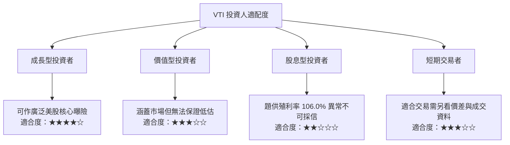

### 11.5 每季財報監控清單（Quarterly Watch List）

VTI 本身沒有公司財報季度，因此監控對象應是基金資料、指數成分股與市場估值。

| 監控項目 | 目前資料 | 加碼/持有觀察條件 | 減碼/重新評估條件 |
|----------|----------|--------------------|-------------------|
| 基金費用率 | 公開產品資訊列示 0.03%；本資料包無此欄位 | 核對現行說明書，費用率維持低位 | 費用率或其他成本明顯上升 |
| 追蹤差異 | N/A | 取得基金與指數的同期報酬後確認差異可接受 | 追蹤差異持續擴大，且無合理解釋 |
| AUM 與資金流 | N/A | 取得最新 AUM、淨申購贖回資料 | 持續大幅流出或流動性指標轉差 |
| 前十大持股權重 | N/A | 核對持股集中度仍符合整體組合風險預算 | 集中度高於投資人可承受上限 |
| 底層盈利趨勢 | N/A | 追蹤成分股盈利預測修正與財報表現 | 盈利下修廣泛且持續 |
| 估值 | Trailing P/E 23.54578x；Forward P/E N/A | 補充歷史分位與 forward 盈利後再比較 | 估值上升但盈利支持不足 |
| 分配與殖利率 | 數據包列示 106.0%，判定異常 | 使用官方基金分配紀錄核實 | 未核對前不得將該殖利率用作配置依據 |
| 基金交易品質 | 買賣價差與成交資料 N/A | 以實際交易時段報價確認價差 | 價差擴大或交易深度不足 |

### 11.6 反面論證：什麼會證明論點錯誤（What Would Change My Mind）

VTI 的核心投資論點不是個別公司的高成長承諾，而是以低成本取得廣泛美股市場曝險。以下情況會削弱或推翻該配置論點：

```
╔══════════════════════════════════════════════════════════════════╗
║              ⚠️ 論點失效條件（Disconfirming Evidence）           ║
╠══════════════════════════════════════════════════════════════════╣
║  ☐ 官方基金文件顯示費用率大幅上升，且相較同類 ETF 失去成本優勢  ║
║  ☐ 追蹤差異連續多期擴大，且不能由費用或指數處理解釋            ║
║  ☐ 前十大成分股集中度超過投資人可接受風險上限                    ║
║  ☐ 底層企業盈利出現廣泛、連續的下修，且經濟基本面持續惡化        ║
║  ☐ 估值倍數進一步擴張，但盈利與現金流成長無法支撐                ║
║  ☐ 官方分配資料證實收益與預期顯著不符，或數據來源持續不可靠      ║
║                                                                  ║
║  資料缺漏時的量化界線：                                          ║
║  底層盈利成長、ROIC、FCF、ROIC-WACC 與歷史估值分位目前均 N/A；   ║
║  不以虛構門檻填值，應在取得基金持倉及成分股資料後再設定數值條件。║
╚══════════════════════════════════════════════════════════════════╝
```

> **免責聲明**：本報告為 AI 自動生成，僅供研究參考，不構成投資建議。投資有風險，入市需謹慎。