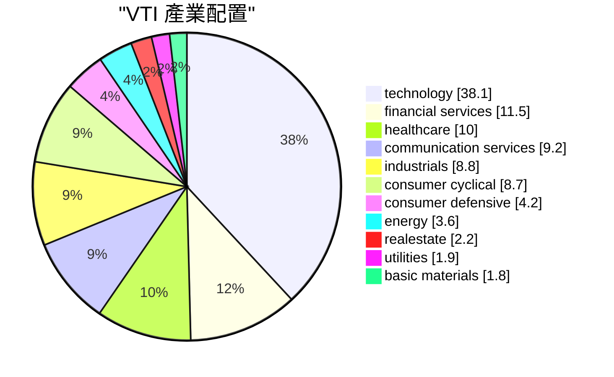

# VTI ETF 分析報告

> **報告日期**：2026-11-14 ｜ **語言**：繁體中文 ｜ **數據來源**：Yahoo Finance、Finviz ｜ **類型**：ETF／指數基金

## 目錄

| # | 章節 | 核心結論 |
|---|------|----------|
| 1 | 執行摘要 | 以美國股票市場為投資範圍，費用率低；持股涵蓋多檔股票，但前十大權重仍值得留意。 |
| 2 | 基金概況 | 採指數化投資方式，目標追蹤 CRSP U.S. Total Market Index。 |
| 3 | 成本與規模 | 費用率低於同類平均；資產規模大，折價幅度有限。 |
| 4 | 持股與集中度 | 前十大持股合計不到資產的一半，但科技大型股仍占重要位置。 |
| 5 | 產業配置 | 科技業權重最高，基金曝險與科技業表現關聯較高。 |
| 6 | 績效與風險 | 歷史價格報酬為正，但期間報酬不代表未來表現；基準比較資料未提供。 |
| 7 | 估值與配息 | P/E、P/B 是成分股加權數據；配息殖利率為 1.06%。 |
| 8 | 適合對象、風險與觀察重點 | 適合作為美股配置工具；投資人仍需承受市場、產業與匯率風險。 |

---

## 1. 執行摘要

VTI 為 Vanguard 的美國股票指數 ETF，採指數化投資方式，追蹤 CRSP U.S. Total Market Index；資料所列目標指數代表指數提供者認定的 100% 可投資美國股票市場。  
費用率為 0.03%，同類平均為 0.72%；前十大持股合計為 34.7%，最大持股 NVDA 在持股清單中的權重為 7.13%。  
截至 2026-11-12，基金的 1 年、3 年與 5 年價格報酬分別為 +11.0%、+72.4% 與 +54.3%；相對基準的超額報酬資料均為 N/A（資料未提供）。  
2026-11-13 收盤價為 371.11 USD；年化波動率為 13.9%，歷史最大回撤為 -35.0%，代表投資人仍須承受明顯的股市波動。

### 1.1 一頁式摘要

| 項目 | 內容 |
|------|------|
| 追蹤標的／類別 | CRSP U.S. Total Market Index／Vanguard／Large Blend |
| 費用率（同類平均） | 0.03%（0.72%） |
| 資產規模 | 1.82T USD |
| 前十大合計權重／最大持股 | 34.7%／最大持股 NVDA，持股清單所列權重為 7.13% |
| 1 年／3 年／5 年價格報酬 | +11.0%／+72.4%／+54.3% |
| 相對基準的超額報酬（1 年／3 年／5 年） | N/A（資料未提供）／N/A（資料未提供）／N/A（資料未提供） |
| 年化波動率／最大回撤 | 13.9%／-35.0% |
| 折溢價 | -0.37%（折價） |
| 定位 | 核心持有 |

### 1.2 五項評分

| 評分項目 | 分數（0–10） | 依據（引用數字） |
|----------|-------------:|------------------|
| 成本 | 10 | 費用率為 0.03%，低於同類平均 0.72%；依低成本特性評分。 |
| 規模與流動性 | 10 | 資產規模為 1.82T USD；本項依資產規模評估，未提供成交量或買賣價差資料。 |
| 分散度 | 7 | 前十大持股合計 34.7%，未達資產的一半；最大持股權重在持股清單中為 7.13%。 |
| 相對績效 | 8 | 基準報酬與超額報酬為 N/A（資料未提供）；依絕對價格報酬 +11.0%、+72.4%、+54.3% 評分。 |
| 風險 | 5 | 年化波動率為 13.9%，歷史最大回撤為 -35.0%；回撤幅度顯示持有期間可能面臨顯著帳面損失。 |

> **評分視覺化（每個方格代表一分）**
>
> | 評分項目 | 進度條 |
> |----------|--------|
> | 成本 | ▓▓▓▓▓▓▓▓▓▓ |
> | 規模與流動性 | ▓▓▓▓▓▓▓▓▓▓ |
> | 分散度 | ▓▓▓▓▓▓▓░░░ |
> | 相對績效 | ▓▓▓▓▓▓▓▓░░ |
> | 風險 | ▓▓▓▓▓░░░░░ |

╔══════════════════════════════════════════════════════════════════╗  
║ 定位：核心持有                                                  ║  
╠══════════════════════════════════════════════════════════════════╣  
║ 費用率為 0.03%，資產規模為 1.82T USD，持股涵蓋美國股票市場；     ║  
║ 但年化波動率為 13.9%、最大回撤為 -35.0%，仍須承受股市風險。     ║  
╚══════════════════════════════════════════════════════════════════╝

## 2. 基金概況

| 項目 | 資料 |
|------|------|
| 代號 | VTI |
| 名稱 | Vanguard Morningstar Total Stock Market ETF |
| 基金家族／類別 | Vanguard／Large Blend |
| 投資方式 | 指數化投資 |
| 目標指數 | CRSP U.S. Total Market Index |
| 基金持有方式 | 正常情況下，至少將淨資產的 80%，加上投資目的借款金額，投資於構成目標指數的股票。 |
| 產業／國家／員工 | N/A（資料未提供） |

基金簡介說明，目標指數代表指數提供者認定的 100% 可投資美國股票市場。  
本報告僅引用上述市場範圍描述，不延伸補充未提供的指數編製規則或成分股數量。

VTI 在投資組合中通常可作為美國股票部位的廣泛市場配置工具。  
它不是全球股票基金，也不等同於債券或現金部位。  
持有 VTI，代表投資人接受美國股票市場及其產業權重帶來的報酬與風險。  
其投資結果會受到基金持股價格變動影響，並非固定收益型投資。

## 3. 成本與規模

### 3.1 費用率與持有成本

| 項目 | 數值 | 解讀 |
|------|------|------|
| VTI 費用率 | 0.03% | 基金資料所列的淨費用率。 |
| 同類平均費用率 | 0.72% | 可作為成本比較參考；同類基金個別費用仍可能不同。 |
| 10 年費用試算 | 3,000 USD | 以 1,000,000 USD 為例，依目前費用率、不假設投資報酬的簡化試算。 |

以上費用試算是簡化比較，不代表投資人實際支付金額或未來基金費用一定維持不變。  
實際持有成本也可能受到交易成本、稅負及買賣價差影響；這些項目的數值為 N/A（資料未提供）。

### 3.2 資產規模、週轉率與折溢價

| 項目 | 數值 | 解讀 |
|------|------|------|
| 資產規模 | 1.82T USD | 資產規模可用於了解基金體量；不等於保證未來報酬或流動性。 |
| 年持股週轉率 | 3.0% | 反映資料所列的年度持股週轉情況；不直接代表投資人交易成本。 |
| 2026-11-13 收盤價 | 371.11 USD | 最近一個已完成交易日的收盤價。 |
| NAV | 372.50 USD | 基金淨值。 |
| 折溢價 | -0.37% | 價格相對 NAV 為折價；此為資料所列數值。 |

基金的資產規模與週轉率提供基金體量及持股調整程度的參考。  
資產規模本身不代表價格不會波動，也不保證任何時點都能以特定價格成交。  
折溢價是價格與 NAV 的相對狀態，不能據此推導基金的合理價值或未來價格方向。

## 4. 持股與集中度

### 4.1 前十大持股

| 排名 | 代號 | 名稱 | 權重 |
|-----:|------|------|-----:|
| 1 | NVDA | NVIDIA Corp | 7.13% |
| 2 | AAPL | Apple Inc | 6.63% |
| 3 | MSFT | Microsoft Corp | 5.20% |
| 4 | AMZN | Amazon.com Inc | 3.30% |
| 5 | GOOGL | Alphabet Inc Class A | 2.76% |
| 6 | AVGO | Broadcom Inc | 2.28% |
| 7 | META | Meta Platforms Inc Class A | 2.18% |
| 8 | GOOG | Alphabet Inc Class C | 2.18% |
| 9 | MU | Micron Technology Inc | 1.64% |
| 10 | TSLA | Tesla Inc | 1.37% |

資料所列前十大持股合計為 34.7%，最大持股為 7.1%。  
個別持股清單中，NVDA 權重列為 7.13%；本報告保留個別持股表與基金資料摘要各自提供的精度，不自行換算或四捨五入。

前十大合計權重未達資產的一半，表示基金不完全由前十大持股構成。  
不過，前十大持股仍占有相當比重，少數大型公司股價的變化可能對基金報酬造成影響。  
目前資料僅列出前十大持股；其他持股名稱與權重為 N/A（資料未提供），不在本報告列示。

### 4.2 集中度的投資含義

| 觀察面向 | 資料與解讀 |
|----------|------------|
| 前十大合計 | 34.7%；前十大以外的持股合計比例未另行重算。 |
| 最大單一持股 | NVDA；持股清單列示 7.13%，基金摘要所列最大持股為 7.1%。 |
| 主要集中來源 | 前十大包含多家大型科技及通訊相關企業；個別公司表現可能影響基金報酬。 |
| 分散效果 | 持股涵蓋不只前十大公司，但成分股數量與完整持股清單為 N/A（資料未提供）。 |

「全市場」投資範圍不代表每家公司權重相同。  
基金仍可能因大型持股權重較高，而對這些公司價格變動較敏感。  
投資人評估分散程度時，可同時觀察前十大合計與最大持股，而不只看基金名稱所描述的市場範圍。

## 5. 產業配置

### 5.1 產業權重

| 產業 | 權重 |
|------|-----:|
| technology | 38.1% |
| financial services | 11.5% |
| healthcare | 10.0% |
| communication services | 9.2% |
| industrials | 8.8% |
| consumer cyclical | 8.7% |
| consumer defensive | 4.2% |
| energy | 3.6% |
| realestate | 2.2% |
| utilities | 1.9% |
| basic materials | 1.8% |

technology 權重為 38.1%，是表列產業中權重最高者。  
因此，持有 VTI 不只是押注美國股市整體，也承受科技業在基金中的重要權重及其價格波動。  
financial services 權重為 11.5%，healthcare 權重為 10.0%；其他產業配置依表列權重分布。  
產業分類與權重以基金資料列示為準，本報告不自行合併或重分類。

## 6. 績效與風險

### 6.1 各期間價格報酬

以下報酬為價格報酬，資料截止日為 2026-11-12，未計入配息。

| 期間 | VTI 價格報酬 | 基準報酬 | 相對基準超額報酬 |
|------|--------------:|----------|------------------|
| 1 個月 | -1.1% | N/A（資料未提供） | N/A（資料未提供） |
| 3 個月 | -2.9% | N/A（資料未提供） | N/A（資料未提供） |
| 6 個月 | +1.4% | N/A（資料未提供） | N/A（資料未提供） |
| 1 年 | +11.0% | N/A（資料未提供） | N/A（資料未提供） |
| 3 年 | +72.4% | N/A（資料未提供） | N/A（資料未提供） |
| 5 年 | +54.3% | N/A（資料未提供） | N/A（資料未提供） |

基金資料說明目標為追蹤 CRSP U.S. Total Market Index，但此處沒有提供各期間的基準報酬或超額報酬。  
因此，不能據此判定 VTI 在這些期間相對指數的領先或落後幅度。  
追蹤誤差為 N/A（資料未提供）。

### 6.2 歷史價格與風險指標

| 指標 | 數值 | 解讀 |
|------|------:|------|
| 年化波動率（1Y） | 13.9% | 表示基金價格在觀察期間的波動程度。 |
| 最大回撤 | -35.0% | 儲存歷史期間內的最大回撤；谷底日期為 2020-03-23。 |
| 最大回撤觀察歷史 | 10.0 years | 資料庫所列的最大回撤歷史期間。 |
| 儲存歷史期間 CAGR | 12.8% | 歷史年化複合成長率；不代表未來報酬。 |

最大回撤代表高點至後續低點的歷史跌幅，與一般期間報酬的衡量方式不同。  
依資料所列試算，以 1,000,000 USD 為例，最大回撤對應的帳面減少金額為 350,000 USD。  
此為歷史情境下的帳面變動試算，不表示未來一定出現相同幅度的回撤。  
股票基金的價格可能在市場下跌期間大幅回落，投資人應確認自身能否承受波動並持續持有。

### 6.3 24 個月價格資料

下表列示資料提供的月收盤價；不另行計算期間漲跌幅。

| 月份 | 收盤價 |
|------|-------:|
| 2024-11 | 292.79 |
| 2024-12 | 283.89 |
| 2025-01 | 292.50 |
| 2025-02 | 286.97 |
| 2025-03 | 270.17 |
| 2025-04 | 268.18 |
| 2025-05 | 284.95 |
| 2025-06 | 299.67 |
| 2025-07 | 306.53 |
| 2025-08 | 313.74 |
| 2025-09 | 324.47 |
| 2025-10 | 331.63 |
| 2025-11 | 332.51 |
| 2025-12 | 332.43 |
| 2026-01 | 337.68 |
| 2026-02 | 335.90 |
| 2026-03 | 319.08 |
| 2026-04 | 352.28 |
| 2026-05 | 370.54 |
| 2026-06 | 369.11 |
| 2026-07 | 367.28 |
| 2026-08 | 377.20 |
| 2026-09 | 374.24 |
| 2026-10 | 371.57 |
| 2026-11 | 371.11 |

歷史月收盤價可用來觀察價格曾有起伏，但不能單獨作為未來價格預測。  
月收盤價與各期間價格報酬的截止日及計算口徑可能不同，應各自依資料欄位解讀。

## 7. 估值與配息

| 項目 | 數值 | 說明 |
|------|------:|------|
| 投資組合 P/E | 23.6x | Yahoo Finance 所列的加權投資組合 P/E。 |
| 投資組合 P/B | 4.7x | Yahoo Finance 所列的加權投資組合 P/B。 |
| 配息殖利率 | 1.06% | 基金資料所列殖利率；配息紀錄為 N/A（資料未提供）。 |

P/E 與 P/B 反映的是基金成分股的加權評價指標，不是對 VTI 本身的合理價值估算。  
這些倍數不能單獨用來推導基金合理價值、目標價或未來報酬。  
配息殖利率可作為收益特性參考，但不代表固定配息，也不能據此推定未來配息金額。  
配息頻率、歷次配息金額與配息成長情形為 N/A（資料未提供）。

## 8. 適合對象、風險與觀察重點

### 8.1 適合與不適合的投資人

| 投資人類型 | 適合度 | 原因（引用數字） |
|------------|--------|------------------|
| 想配置美國股票市場、接受股票價格波動的長期投資人 | 較適合 | 基金目標指數代表指數提供者認定的 100% 可投資美國股票市場；年化波動率為 13.9%，仍須承受波動。 |
| 重視投資成本的投資人 | 較適合 | 費用率為 0.03%，同類平均為 0.72%。 |
| 希望投資組合只配置單一產業或少數股票的投資人 | 不適合 | 基金涵蓋多個產業，technology 權重為 38.1%；前十大持股合計為 34.7%。 |
| 不能接受明顯帳面回撤的投資人 | 不適合 | 歷史最大回撤為 -35.0%；以 1,000,000 USD 為例，對應帳面減少金額為 350,000 USD。 |
| 以穩定現金配息為主要需求的投資人 | 未必適合 | 配息殖利率為 1.06%，配息紀錄為 N/A（資料未提供），不能據此假設配息固定。 |
| 需要排除美元匯率波動的投資人 | 資料不足，需另行確認 | 基金價格以 USD 列示；避險狀態與匯率曝險幅度為 N/A（資料未提供）。 |

### 8.2 主要風險

| 風險 | 對應資料 | 投資人應留意之處 |
|------|----------|------------------|
| 大型持股集中風險 | 前十大持股合計 34.7%；NVDA 權重列為 7.13%。 | 即使基金涵蓋廣泛市場，少數大型公司仍可能影響整體報酬。 |
| 產業配置風險 | technology 權重為 38.1%。 | 科技業價格或產業環境變動，可能對基金造成較大影響。 |
| 美國股票市場風險 | 目標指數代表指數提供者認定的 100% 可投資美國股票市場。 | 市場下跌時，基金可能跟隨持股價格下跌；最大回撤資料為 -35.0%。 |
| 評價風險 | 投資組合 P/E 為 23.6x，P/B 為 4.7x。 | 估值倍數是成分股加權數據；市場重新評價可能影響基金價格，數值本身不能預測報酬。 |
| 匯率風險 | 基金收盤價以 USD 表示；匯率避險資訊為 N/A（資料未提供）。 | 以其他貨幣衡量資產的投資人，實際報酬可能受匯率變動影響；曝險幅度未提供。 |

### 8.3 什麼情況下要重新評估

| 可查核條件 | 重新評估方式 |
|------------|--------------|
| 最大持股權重高於目前持股清單列示的 7.13% | 檢視單一公司權重上升是否改變個人可接受的集中度。 |
| 前十大合計權重高於目前資料列示的 34.7% | 重新確認前十大持股集中程度與自身分散配置需求是否相符。 |
| 費用率不再是 0.03% | 查核更新後的費用率，並與屆時可取得的同類平均資料比較。 |
| 同類平均費用率資料改變 | 以更新後可查證的同類基金資料重新評估成本相對位置。 |
| 可取得基準報酬與超額報酬資料 | 再比較 1 年、3 年與 5 年期間的基金報酬與基準表現；目前相關資料為 N/A（資料未提供）。 |
| 資產規模出現明顯縮減 | 查核更新後的資產規模及基金資料；目前資料未提供縮減幅度或警戒門檻。 |
| 折溢價與 NAV 的關係改變 | 以更新的價格與 NAV 資料重新檢視折溢價；目前折溢價為 -0.37%。 |
| 個人投資目標、投資期限或可承受風險改變 | 重新檢查是否能接受 13.9% 年化波動率與 -35.0% 歷史最大回撤。 |

---

> **免責聲明**：本報告為 AI 自動生成，僅供研究與教育參考，不構成投資建議。報酬為價格報酬，未計入配息、稅負與交易成本；投資有風險。