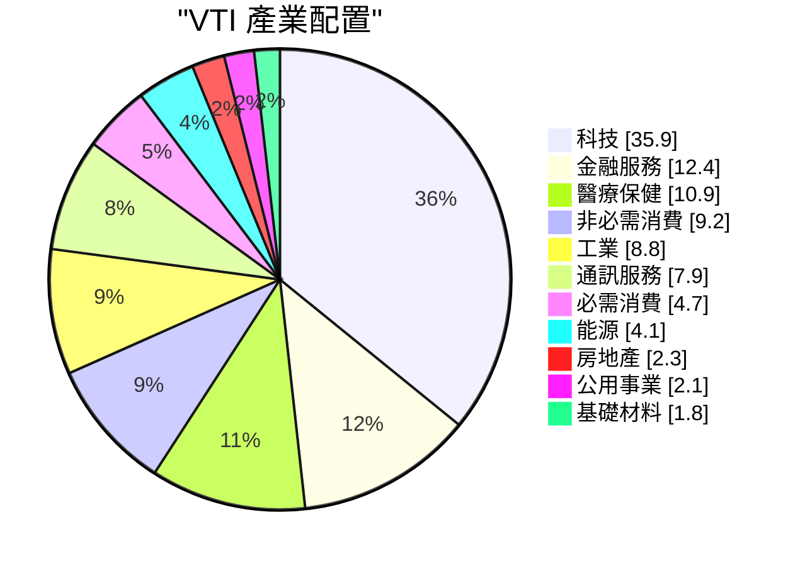

# VTI ETF 分析報告

> **報告日期**：2026-11-21 ｜ **語言**：繁體中文 ｜ **數據來源**：Yahoo Finance、Finviz ｜ **類型**：ETF／指數基金

## 目錄

| # | 章節 | 核心結論 |
|---|------|----------|
| 1 | 執行摘要 | 低費用、涵蓋美國股票市場，但前十大持股占有相當比重。 |
| 2 | 基金概況 | 以指數化方式追蹤美國股票市場，適合作為股票配置的廣泛市場部位。 |
| 3 | 成本與規模 | 費用率低於類別平均，資產規模大；折溢價仍應配合交易時點留意。 |
| 4 | 持股與集中度 | 前十大持股占資產 33.1%，最大單一持股為 6.9%。 |
| 5 | 產業配置 | 科技業占 35.9%，是最主要的產業曝險。 |
| 6 | 績效與風險 | 1 年、3 年、5 年價格報酬為正；基準報酬未提供，無法比較超額報酬。 |
| 7 | 估值與配息 | 投資組合 P/E 為 22.8x、P/B 為 4.6x，配息殖利率為 1.06%。 |
| 8 | 適合對象、風險與觀察重點 | 可作為廣泛美股配置；投資人仍須承受股票市場、科技業及大型持股風險。 |

---

## 1. 執行摘要

VTI 是 Vanguard 管理的指數型 ETF，目標追蹤 CRSP U.S. Total Market Index；該指數代表指數提供者認定的 100% 可投資美國股票市場。  
基金費用率為 0.03%，類別平均為 0.72%；資產規模為 1.82T USD。  
前十大持股合計占資產 33.1%，最大單一持股權重為 6.9%，因此雖持股涵蓋面廣，報酬仍可能受到少數大型公司的影響。  
VTI 在 2026-11-20 的收盤價為 340.02 USD；1 年、3 年、5 年價格報酬分別為 +8.7%、+58.6%、+46.9%，但相對基準的超額報酬資料未提供。

### 1.1 一頁式摘要

| 項目 | 內容 |
|------|------|
| 追蹤標的／類別 | CRSP U.S. Total Market Index／Large Blend |
| 費用率（同類平均） | 0.03%（0.72%） |
| 資產規模 | 1.82T USD |
| 前十大合計權重／最大持股 | 33.1%／6.9% |
| 1 年／3 年／5 年價格報酬 | +8.7%／+58.6%／+46.9% |
| 相對基準的超額報酬（1 年／3 年／5 年） | N/A（資料未提供）／N/A（資料未提供）／N/A（資料未提供） |
| 年化波動率／最大回撤 | 14.1%／-35.0% |
| 折溢價 | -3.50% |
| 定位 | 核心持有 |

### 1.2 五項評分

| 評分項目 | 分數（0–10） | 依據（引用數字） |
|----------|-------------:|------------------|
| 成本 | 10 | 費用率為 0.03%，低於類別平均 0.72%；依低費用的比較結果評分。 |
| 規模與流動性 | 10 | 資產規模為 1.82T USD，依資產規模評分；成交量、買賣價差等交易流動性指標為 N/A（資料未提供）。 |
| 分散度 | 7 | 前十大持股合計 33.1%，最大單一持股 6.9%；前十大並未占基金資產過半，但大型持股仍有影響力。 |
| 相對績效 | 7 | 基準報酬與超額報酬為 N/A（資料未提供）；依可得的 1 年 +8.7%、3 年 +58.6%、5 年 +46.9% 絕對價格報酬評分。 |
| 風險 | 5 | 年化波動率為 14.1%，最大回撤為 -35.0%；最大回撤顯示股票市場下跌時仍可能出現明顯資產縮水。 |

## 2. 基金概況

| 項目 | 資料 |
|------|------|
| 代號 | VTI |
| 基金名稱 | Vanguard Morningstar Total Stock Market ETF |
| 基金公司 | Vanguard |
| 基金類別 | Large Blend |
| 追蹤標的 | CRSP U.S. Total Market Index |
| 基金性質 | ETF／指數基金 |
| 部門、產業、國家、員工資料 | N/A（資料未提供） |

VTI 採用指數化投資方式，目標是追蹤 CRSP U.S. Total Market Index 的表現。基金簡介指出，該指數代表指數提供者認定的 100% 可投資美國股票市場；一般情況下，基金至少將淨資產及投資用途借款金額的 80% 投資於組成目標指數的股票。

以上為基金簡介所提供的投資範圍與配置描述。指數的具體選股、加權與調整規則為 N/A（資料未提供），本報告不對未提供的指數編製細節作推定。

### 在投資組合中的角色

- 追蹤標的是美國股票市場，而非單一產業或單一公司。
- 可作為投資組合中的美股股票核心部位；是否適合，仍取決於投資人的整體資產配置與風險承受度。
- 基金雖追蹤廣泛市場，持股權重仍會受大型公司影響；前十大持股合計占資產 33.1%。
- 基金持有股票，因此並非低波動或本金保證產品。

## 3. 成本與規模

### 3.1 費用與週轉率

| 指標 | VTI |
|------|-----:|
| 淨費用率 | 0.03% |
| 類別平均費用率 | 0.72% |
| 年度持股週轉率 | 3.0% |

VTI 的費用率低於所列類別平均。費用率是持有基金期間的重要成本項目之一；實際投資結果還會受到市場報酬、交易成本、稅負及投資人持有期間等因素影響。

基金年度持股週轉率為 3.0%。週轉率可用來觀察基金持股調整程度，但單一週轉率數字並不等同於基金的全部交易成本；交易成本資料為 N/A（資料未提供）。

### 3.2 費用簡化試算

| 試算條件 | 結果 |
|----------|------|
| 投資金額 | 1,000,000 USD |
| 試算期間 | 10 年 |
| 試算假設 | 以目前費用率、不假設任何報酬 |
| 試算費用 | 3,000 USD |

此試算是**不計報酬的簡化試算**，金額依提供的試算數值列示。它不代表個別投資人的實際費用或未來投資結果。

### 3.3 資產規模與折溢價

| 指標 | 數值 |
|------|------:|
| 資產規模 | 1.82T USD |
| NAV | 352.35 USD |
| 市價相對 NAV 折溢價 | -3.50% |

資產規模可作為基金規模的參考；但僅憑資產規模，不能完整判斷特定交易時點的買賣價差或成交深度，相關資料為 N/A（資料未提供）。

目前列示的市價相對 NAV 折溢價為 -3.50%。折溢價是市價與基金淨值關係的觀察指標，投資人下單時仍應留意當時市價與淨值的差異。

## 4. 持股與集中度

### 4.1 前十大持股

| 代號 | 名稱 | 權重 |
|------|------|-----:|
| AAPL | Apple Inc | 6.91% |
| NVDA | NVIDIA Corp | 6.44% |
| MSFT | Microsoft Corp | 5.33% |
| AMZN | Amazon.com Inc | 3.21% |
| GOOGL | Alphabet Inc Class A | 2.26% |
| AVGO | Broadcom Inc | 2.13% |
| META | Meta Platforms Inc Class A | 1.86% |
| GOOG | Alphabet Inc Class C | 1.79% |
| LLY | Eli Lilly and Co | 1.65% |
| TSLA | Tesla Inc | 1.55% |

### 4.2 集中度解讀

- 前十大持股合計占基金資產 33.1%。
- 最大單一持股權重為 6.9%。
- 前十大持股合計未達基金資產的一半，表示基金資產並非全部集中於少數幾檔股票。
- 但前十大仍占有三分之一左右的資產權重，因此大型持股的股價表現可能對基金報酬造成可觀影響。
- 表內 GOOGL 與 GOOG 為分別列出的兩個持股代號；本報告依提供的持股名稱與權重呈現，不另行合併或推算。

### 4.3 持股資料範圍

本節只列出資料中提供的前十大持股。前十大以外的持股名稱與權重為 N/A（資料未提供），因此不推測或補列其他成分股。

## 5. 產業配置

| 產業 | 權重 |
|------|-----:|
| 科技 | 35.9% |
| 金融服務 | 12.4% |
| 醫療保健 | 10.9% |
| 非必需消費 | 9.2% |
| 工業 | 8.8% |
| 通訊服務 | 7.9% |
| 必需消費 | 4.7% |
| 能源 | 4.1% |
| 房地產 | 2.3% |
| 公用事業 | 2.1% |
| 基礎材料 | 1.8% |

科技業權重為 35.9%，是表列產業中最大的單一產業曝險。持有 VTI 不只是配置於「整體美國股票市場」；投資人也承擔了科技業及大型科技相關持股對基金表現的影響。

產業配置呈現的是基金資產在各產業的權重。投資人應同時留意產業配置與前十大持股，因為產業曝險與個別大型公司曝險可能共同影響基金報酬。

## 6. 績效與風險

### 6.1 各期間價格報酬與基準比較

| 期間 | VTI 價格報酬 | 基準報酬 | 相對基準超額報酬 |
|------|-------------:|---------:|------------------:|
| 1 個月 | -7.1% | N/A（資料未提供） | N/A（資料未提供） |
| 3 個月 | -6.8% | N/A（資料未提供） | N/A（資料未提供） |
| 6 個月 | -3.5% | N/A（資料未提供） | N/A（資料未提供） |
| 1 年 | +8.7% | N/A（資料未提供） | N/A（資料未提供） |
| 3 年 | +58.6% | N/A（資料未提供） | N/A（資料未提供） |
| 5 年 | +46.9% | N/A（資料未提供） | N/A（資料未提供） |

上述報酬為價格報酬，未包含配息。雖然基金的目標指數名稱與追蹤目標有提供，基準各期間報酬及相對基準超額報酬仍為 N/A（資料未提供），因此無法據此判斷基金是否跑贏或落後基準。

### 6.2 歷史價格資料

| 月份 | 收盤價（USD） |
|------|--------------:|
| 2024-11 | 292.79 |
| 2024-12 | 283.89 |
| 2025-01 | 292.50 |
| 2025-02 | 286.97 |
| 2025-03 | 270.17 |
| 2025-04 | 268.18 |
| 2025-05 | 284.95 |
| 2025-06 | 299.67 |
| 2025-07 | 306.53 |
| 2025-08 | 313.74 |
| 2025-09 | 324.47 |
| 2025-10 | 331.63 |
| 2025-11 | 332.51 |
| 2025-12 | 332.43 |
| 2026-01 | 337.68 |
| 2026-02 | 335.90 |
| 2026-03 | 319.08 |
| 2026-04 | 352.28 |
| 2026-05 | 370.54 |
| 2026-06 | 369.11 |
| 2026-07 | 367.28 |
| 2026-08 | 377.20 |
| 2026-09 | 374.24 |
| 2026-10 | 371.57 |
| 2026-11 | 340.02 |

此表為每月收盤價資料，不能取代含配息的總報酬資料。歷史價格也不代表未來走勢。

### 6.3 波動與回撤

| 風險指標 | 數值 |
|----------|-----:|
| 年化波動率（1 年） | 14.1% |
| 最大回撤 | -35.0% |
| 最大回撤觀察歷史 | 10.0 年 |
| 最大回撤低點日期 | 2020-03-23 |
| 所提供歷史期間 CAGR | 12.0% |

年化波動率反映價格報酬的波動程度；最大回撤呈現所列歷史資料中由高點至低點的最大跌幅。歷史最大回撤不代表未來損失上限，投資人仍須考慮市場下跌期間可能出現的資產縮水。

### 6.4 最大回撤金額試算

| 試算條件 | 結果 |
|----------|------|
| 投資金額 | 1,000,000 USD |
| 套用的最大回撤 | -35.0% |
| 對應帳面減少金額 | 350,000 USD |

此為最大回撤對應的帳面減少試算，並非對未來損失的預測。

## 7. 估值與配息

| 指標 | 數值 |
|------|-----:|
| 投資組合 P/E | 22.8x |
| 投資組合 P/B | 4.6x |
| 配息殖利率 | 1.06% |

P/E 與 P/B 是 Yahoo Finance 所列的投資組合加權指標，反映基金持股成分股整體的評價概況，不是對 ETF 本身計算的合理價值。這些倍數不應被解讀為基金的合理價格，也不足以單獨推導目標價。

配息殖利率為 1.06%。配息紀錄、各次配息金額與配息時程為 N/A（資料未提供）；上述殖利率也不代表固定或保證的未來配息。

## 8. 適合對象、風險與觀察重點

### 8.1 適合與不適合的投資人

| 投資人類型 | 適合度 | 原因（引用數字） |
|------------|--------|------------------|
| 希望持有廣泛美國股票市場的長期投資人 | 較適合 | 基金目標指數代表指數提供者認定的 100% 可投資美國股票市場；基金以指數化方式追蹤該市場。 |
| 重視基金費用的投資人 | 較適合 | 費用率為 0.03%，低於類別平均 0.72%。 |
| 希望股票投資報酬不受大型公司影響的投資人 | 較不適合 | 前十大持股占資產 33.1%，最大單一持股權重為 6.9%。 |
| 無法承受股票市場明顯下跌的投資人 | 較不適合 | 年化波動率為 14.1%，歷史最大回撤為 -35.0%。 |
| 需要穩定、可預期現金配息的投資人 | 資料不足 | 配息殖利率為 1.06%，但配息紀錄與未來配息金額為 N/A（資料未提供）。 |
| 需要評估外幣波動影響的非美元投資人 | 需另行評估 | 基金追蹤美國股票市場；匯率避險資訊與匯率風險量化資料為 N/A（資料未提供）。 |

### 8.2 主要風險

| 風險 | 對應資料 | 說明 |
|------|----------|------|
| 大型持股集中風險 | 前十大合計 33.1%；最大持股 6.9% | 基金涵蓋廣泛市場，但大型持股的股價波動仍可能影響基金表現。 |
| 科技業曝險 | 科技業權重 35.9% | 科技業是表列最大的產業配置；產業表現不佳時，可能對基金報酬造成較大影響。 |
| 股票市場回撤風險 | 年化波動率 14.1%；最大回撤 -35.0% | 歷史資料顯示基金價格曾出現明顯回撤；過去數據不構成未來跌幅上限。 |
| 評價風險 | 投資組合 P/E 22.8x、P/B 4.6x | 這些是成分股整體的加權評價指標；若成分股評價下降，基金價格可能受影響，但單憑倍數不能推定未來報酬。 |
| 匯率風險 | 追蹤美國股票市場；匯率與避險資料 N/A（資料未提供） | 對以非美元作為生活或報酬衡量基準的投資人，美元匯率變動可能影響換算後的投資結果；實際影響未提供量化數據。 |

### 8.3 什麼情況下要重新評估

| 可查核條件 | 重新評估方向 |
|------------|--------------|
| 基金公布的費用率高於目前的 0.03% | 重新比較基金成本與同類產品成本，並檢視費用調整的影響。 |
| 前十大合計權重高於目前的 33.1%，或最大持股權重高於目前的 6.9% | 檢視持股集中度是否已不符合原先的分散配置考量。 |
| 科技業權重高於目前的 35.9%，或產業配置出現明顯變化 | 重新檢視投資組合對科技業的曝險是否符合自身風險承受度。 |
| 公布了可比較的基準報酬，且基金在可比較期間落後基準 | 重新檢視追蹤結果；目前基準報酬與超額報酬為 N/A（資料未提供）。 |
| 資產規模相對目前的 1.82T USD 明顯縮減 | 查核後續基金規模變化及相關基金公告；現有資料未提供資產規模的歷史變化。 |
| 折溢價相較目前的 -3.50% 出現明顯變化 | 下單前重新核對市價與 NAV，並確認交易時點的折溢價狀況。 |
| 自身投資期限、現金需求或承受虧損能力改變 | 重新檢視股票配置比例；歷史最大回撤為 -35.0%，不代表未來損失上限。 |

### 定位

**核心持有。** VTI 的投資目標涵蓋指數提供者認定的 100% 可投資美國股票市場，費用率為 0.03%，資產規模為 1.82T USD，適合作為廣泛美股配置的核心候選標的；但前十大持股占資產 33.1%、科技業權重為 35.9%，且歷史最大回撤為 -35.0%，投資人仍須確認自己能承受大型持股集中與股票市場回撤風險。此定位是基金配置角色說明，不是買賣建議。

---

> **免責聲明**：本報告為 AI 自動生成，僅供研究與教育參考，不構成投資建議。報酬為價格報酬，未計入配息、稅負與交易成本；投資有風險。

---

## 資料與來源

| 項目 | 內容 |
|------|------|
| 價格 | 340.02 USD，2026-11-20 收盤（Yahoo Finance 日線） |
| 基金資料 | Yahoo Finance（持股、費用率、規模）；績效與回撤由價格資料庫計算 |
| 有回應的資料來源 | Yahoo Finance、Finviz |
| 未回應的資料來源 | SEC 申報資料 (XBRL)、StockAnalysis、Roic.ai |
| 由程式計算 | 基金的集中度、績效、費用與回撤試算 |
| 撰寫模型 | openai / gpt-6-luna |

> 本區塊由產生報告的程式依實際取得的資料填寫，非模型撰寫。「由程式計算」的數字不是模型的估計；其餘判斷（評分、情境、策略）是模型的分析。
