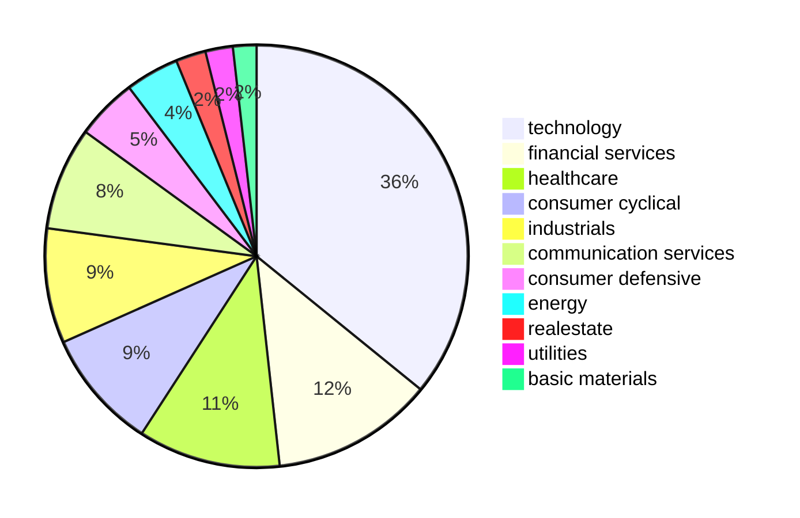

# VTI ETF 分析報告

> **報告日期**：2026-11-24 ｜ **語言**：繁體中文 ｜ **數據來源**：Yahoo Finance、Finviz ｜ **類型**：ETF／指數基金

## 目錄

| # | 章節 | 核心結論 |
|---|------|----------|
| 1 | 執行摘要 | 以美國股票市場為投資範圍，費用率低；前十大持股權重及科技產業配置是主要集中來源。 |
| 2 | 基金概況 | 採指數化投資方式，目標追蹤 CRSP U.S. Total Market Index。 |
| 3 | 成本與規模 | 費用率為 0.03%，資產規模為 1.82T USD。 |
| 4 | 持股與集中度 | 前十大合計權重為 33.1%，最大單一持股權重為 6.9%。 |
| 5 | 產業配置 | 科技業權重為 35.9%，為最大產業配置。 |
| 6 | 績效與風險 | 基準報酬資料未提供；年化波動率為 14.5%，歷史最大回撤為 -35.0%。 |
| 7 | 估值與配息 | 投資組合加權 P/E 為 22.8x，配息殖利率為 1.06%。 |
| 8 | 適合對象、風險與觀察重點 | 可作為美國股票市場配置工具；仍須留意大型持股與科技業風險。 |

---

## 1. 執行摘要

VTI 以 CRSP U.S. Total Market Index 為追蹤標的，基金簡介指出該指數代表投資標的供應商認定的美國可投資股票市場；基金正常情況下至少將 80% 淨資產及投資用途借款投入指數成分股。  
基金費用率為 0.03%，同類平均為 0.72%；前十大持股合計占資產 33.1%，最大單一持股權重為 6.9%。  
本基金 1 年、3 年及 5 年價格報酬分別為 +4.5%、+52.7% 及 +40.6%；基準報酬及相對基準超額報酬均為 N/A（資料未提供）。  
2026-11-23 最近一個完整交易日收盤價為 355.27 USD；基金年化波動率為 14.5%，歷史最大回撤為 -35.0%。

### 1.1 一頁式摘要

| 項目 | 內容 |
|------|------|
| 追蹤標的／類別 | CRSP U.S. Total Market Index／Large Blend |
| 費用率（同類平均） | 0.03%（0.72%） |
| 資產規模 | 1.82T USD |
| 前十大合計權重／最大持股 | 33.1%／6.9% |
| 1 年／3 年／5 年價格報酬 | +4.5%／+52.7%／+40.6% |
| 相對基準的超額報酬（1 年／3 年／5 年） | N/A（資料未提供）／N/A（資料未提供）／N/A（資料未提供） |
| 年化波動率／最大回撤 | 14.5%／-35.0% |
| 折溢價 | +0.03% 溢價 |
| 最近一個完整交易日收盤價 | 355.27 USD（2026-11-23） |
| 定位 | **核心持有**；理由為涵蓋美國股票市場、費用率為 0.03%，且前十大持股合計權重為 33.1%。 |

### 1.2 五項評分

| 評分項目 | 分數（0–10） | 依據（引用數字） |
|----------|-------------:|------------------|
| 成本 | 10 | 費用率為 0.03%，同類平均為 0.72%；依兩者的絕對水準評分。 |
| 規模與流動性 | 10 | 資產規模為 1.82T USD；依資產規模評分。成交量與買賣價差資料未提供，不另行推定實際交易流動性。 |
| 分散度 | 7 | 前十大持股合計權重為 33.1%，最大持股權重為 6.9%；基金資料將其標示為 Diversified。 |
| 相對績效 | 7 | 基準報酬未提供，因此依絕對價格報酬評分：1 年 +4.5%、3 年 +52.7%、5 年 +40.6%。 |
| 風險 | 6 | 年化波動率為 14.5%，歷史最大回撤為 -35.0%；兩項風險指標均納入評分判斷。 |

## 2. 基金概況

| 項目 | 資料 |
|------|------|
| 代號 | VTI |
| 名稱 | Vanguard Morningstar Total Stock Market ETF |
| 基金家族 | Vanguard |
| 類別 | Large Blend |
| 基金性質 | ETF／指數基金 |
| 追蹤標的 | CRSP U.S. Total Market Index |
| Sector | N/A（資料未提供） |
| Industry | N/A（資料未提供） |
| Country | N/A（資料未提供） |
| Employees | N/A（資料未提供） |

基金採取指數化投資方式，目標是追蹤 CRSP U.S. Total Market Index 的表現。基金簡介說明，該指數代表指數供應商認定的美國可投資股票市場。

基金正常情況下至少將淨資產及投資用途借款中的 80% 投資於目標指數成分股。資料未提供更細的指數編製規則、成分股數量或個別市場區段的納入門檻，因此本報告不補述這些細節。

對一般投資人而言，VTI 可用來建立美國股票市場曝險，作為投資組合中的股票配置核心之一。它仍是股票型基金，持有期間可能受到整體股市下跌、產業集中及大型成分股波動影響，並不等同於低風險或保本配置。

## 3. 成本與規模

### 3.1 費用、資產與週轉

| 項目 | 數值 | 解讀 |
|------|------|------|
| 淨費用率 | 0.03% | 基金年度費用率資料。 |
| 類別平均費用率 | 0.72% | Yahoo Finance 列示的類別平均。 |
| 淨資產 | 1.82T USD | 基金資產規模資料。 |
| 年度持股週轉率 | 3.0% | 反映基金持股交易週轉程度；不代表實際交易成本或稅負。 |

VTI 費用率為 0.03%，同類平均為 0.72%。以這兩個資料點比較，VTI 的列示費用率低於同類平均。基金費用是長期持有時應持續留意的成本項目，但實際投資結果仍會受到市場表現、交易成本、稅負及配息等因素影響。

### 3.2 費用試算

| 試算情境 | 金額 | 說明 |
|----------|------:|------|
| 1,000,000 USD 持有 10 年的費用試算 | 3,000 USD | 依目前費用率計算，假設沒有投資報酬；這是不計報酬的簡化試算。 |

以上金額依資料所列試算引用，不代表實際帳戶費用，也未納入投資報酬、費率變動、稅負或交易成本。

### 3.3 折溢價

| 項目 | 數值 |
|------|------:|
| 最近收盤價 | 355.27 USD |
| NAV | 355.18 USD |
| 價格相對 NAV | +0.03% 溢價 |

價格相對淨值的折溢價為 +0.03%。這是資料列示的當期折溢價，不代表其他交易日的折溢價水準，也不應被解讀為基金的合理價值判斷。

## 4. 持股與集中度

### 4.1 前十大持股

| 排名 | 代號 | 名稱 | 權重 |
|-----:|------|------|-----:|
| 1 | AAPL | Apple Inc | 6.91% |
| 2 | NVDA | NVIDIA Corp | 6.44% |
| 3 | MSFT | Microsoft Corp | 5.33% |
| 4 | AMZN | Amazon.com Inc | 3.21% |
| 5 | GOOGL | Alphabet Inc Class A | 2.26% |
| 6 | AVGO | Broadcom Inc | 2.13% |
| 7 | META | Meta Platforms Inc Class A | 1.86% |
| 8 | GOOG | Alphabet Inc Class C | 1.79% |
| 9 | LLY | Eli Lilly and Co | 1.65% |
| 10 | TSLA | Tesla Inc | 1.55% |

資料列示的前十大持股合計權重為 33.1%；最大單一持股為 Apple，資料摘要列示其權重為 6.9%。單一持股權重與前十大合計權重顯示，基金整體配置並非只由單一公司決定，但大型持股的股價變動仍可能對基金報酬造成影響。

基金資料將前十大持股描述為低於基金資產的一半，並標示為 Diversified。這不代表持股權重完全平均，也不代表大型成分股或同類型企業同步下跌時，基金不會承受明顯影響。

前十大以外的持股資料未列出，本報告不列示或推測其他個別持股。完整持股數量與持股清單為 N/A（資料未提供）。

## 5. 產業配置

| 產業 | 權重 |
|------|-----:|
| technology | 35.9% |
| financial services | 12.4% |
| healthcare | 10.9% |
| consumer cyclical | 9.2% |
| industrials | 8.8% |
| communication services | 7.9% |
| consumer defensive | 4.7% |
| energy | 4.1% |
| realestate | 2.3% |
| utilities | 2.1% |
| basic materials | 1.8% |

科技業權重為 35.9%，是資料列示的最大產業配置。持有 VTI 不只是持有多家公司，也代表對美國股票市場整體及其產業結構曝險；其中科技業配置較大，科技公司的估值、獲利前景與市場情緒變化可能對基金表現具有較大影響。

其他產業亦有配置，包括 financial services、healthcare、consumer cyclical、industrials 與 communication services。產業權重提供的是基金產業分布資訊，並不代表各產業未來報酬或風險會相同。

## 6. 績效與風險

### 6.1 各期間價格報酬

| 期間 | 本基金價格報酬 | 基準報酬 | 相對基準超額報酬 |
|------|---------------:|---------:|-----------------:|
| 1 個月 | -9.3% | N/A（資料未提供） | N/A（資料未提供） |
| 3 個月 | -9.8% | N/A（資料未提供） | N/A（資料未提供） |
| 6 個月 | -7.3% | N/A（資料未提供） | N/A（資料未提供） |
| 1 年 | +4.5% | N/A（資料未提供） | N/A（資料未提供） |
| 3 年 | +52.7% | N/A（資料未提供） | N/A（資料未提供） |
| 5 年 | +40.6% | N/A（資料未提供） | N/A（資料未提供） |

上述報酬為價格報酬，不含配息。資料沒有提供相同期間的基準報酬，因此無法判斷這些期間的相對基準超額報酬，也不據此推算追蹤誤差。

### 6.2 波動與回撤

| 風險指標 | 數值 | 資料說明 |
|----------|-----:|----------|
| 年化波動率 | 14.5% | 1 年年化波動率。 |
| 最大回撤 | -35.0% | 以儲存的 10.0 年歷史資料計算；低點日期為 2020-03-23。 |
| 儲存歷史期間 CAGR | 11.6% | 資料列示的儲存歷史期間年化報酬率。 |

最大回撤表示資料所列歷史期間內，基金曾由高點跌至低點的幅度；它不代表未來最大可能跌幅，也不是預測值。對股票型基金而言，投資人需要能承受淨值下跌及恢復可能耗時的風險。

### 6.3 最大回撤的帳面影響試算

| 試算情境 | 金額 | 說明 |
|----------|------:|------|
| 1,000,000 USD 對應最大回撤的帳面減少 | 350,000 USD | 直接引用資料提供的試算；不是實際損失預測。 |

### 6.4 近期價格資料

下表依價格資料庫列示的月收盤價呈現，不代表總報酬；價格報酬不含配息。

| 月份 | 收盤價 USD |
|------|-----------:|
| 2024-11 | 292.79 |
| 2024-12 | 283.89 |
| 2025-01 | 292.50 |
| 2025-02 | 286.97 |
| 2025-03 | 270.17 |
| 2025-04 | 268.18 |
| 2025-05 | 284.95 |
| 2025-06 | 299.67 |
| 2025-07 | 306.53 |
| 2025-08 | 313.74 |
| 2025-09 | 324.47 |
| 2025-10 | 331.63 |
| 2025-11 | 332.51 |
| 2025-12 | 332.43 |
| 2026-01 | 337.68 |
| 2026-02 | 335.90 |
| 2026-03 | 319.08 |
| 2026-04 | 352.28 |
| 2026-05 | 370.54 |
| 2026-06 | 369.11 |
| 2026-07 | 367.28 |
| 2026-08 | 377.20 |
| 2026-09 | 374.24 |
| 2026-10 | 371.57 |
| 2026-11 | 355.27 |

月收盤價資料呈現不同月份的價格變化，但單靠月收盤價不能判定基金未來走勢，也不能取代含配息的總報酬資料。

## 7. 估值與配息

| 項目 | 數值 |
|------|-----:|
| 投資組合加權 P/E | 22.8x |
| 投資組合加權 P/B | 4.6x |
| 配息殖利率 | 1.06% |

P/E 與 P/B 是 Yahoo Finance 列示的投資組合加權倍數，反映成分股整體評價指標，不是對 VTI 本身的合理價值估算。這些倍數不能單獨用來判定基金價格是否便宜或昂貴，也不構成基金目標價。

配息殖利率為 1.06%。資料未提供配息紀錄、配息頻率、各次配息金額或未來配息預測，因此不延伸推算配息收入。配息殖利率也不等於總報酬。

## 8. 適合對象、風險與觀察重點

### 8.1 適合與不適合的投資人

| 投資人類型 | 適合度 | 原因（引用數字） |
|------------|--------|------------------|
| 希望取得美國股票市場曝險，並以單一 ETF 作為股票配置核心者 | 較適合 | 基金目標為追蹤代表美國可投資股票市場的指數，費用率為 0.03%。 |
| 重視低基金費用、願意承擔股票市場波動者 | 較適合 | 費用率為 0.03%；年化波動率為 14.5%，歷史最大回撤為 -35.0%。 |
| 希望投資組合避免大型科技股影響者 | 較不適合 | technology 權重為 35.9%；前十大持股合計權重為 33.1%。 |
| 需要穩定本金或不能承受明顯帳面下跌者 | 較不適合 | 歷史最大回撤為 -35.0%；股票型基金不保證本金。 |
| 需要固定配息金額或可預測現金流者 | 資料不足以判定 | 殖利率為 1.06%，但配息紀錄與配息金額資料為 N/A（資料未提供）。 |
| 主要需要非美國市場分散配置者 | 不宜單獨作為完整配置 | 基金追蹤標的為美國股票市場；基金 Country 欄位為 N/A（資料未提供）。 |

### 8.2 主要風險

| 風險 | 對應資料 | 可能影響 |
|------|----------|----------|
| 大型持股集中風險 | 前十大持股合計權重為 33.1%；最大持股權重為 6.9%。 | 主要成分股若同步下跌，可能對基金表現造成較明顯影響；分散持有不代表沒有集中風險。 |
| 科技業產業風險 | technology 權重為 35.9%。 | 科技業景氣、估值或市場風格轉變，可能影響基金的產業曝險與價格表現。 |
| 股票市場整體下跌風險 | 年化波動率為 14.5%；歷史最大回撤為 -35.0%。 | 市場下跌期間，基金淨值可能出現顯著回落。歷史資料不代表未來回撤上限。 |
| 估值風險 | 投資組合加權 P/E 為 22.8x，P/B 為 4.6x。 | 成分股評價倍數可能隨市場預期變化；倍數資料本身不能預測未來報酬。 |
| 匯率風險 | 基金價格與資產規模以 USD 列示；個別投資人的本位幣及匯率資料為 N/A（資料未提供）。 | 以非美元本位幣計價的投資人，實際投資結果可能受到匯率變動影響；本報告沒有匯率數據可供量化。 |

### 8.3 什麼情況下要重新評估

| 可查核條件 | 重新評估方式 |
|------------|--------------|
| 最大單一持股權重高於目前資料列示的 6.9% | 檢視單一成分股對基金的影響是否增加，並重新檢視前十大持股權重。 |
| 前十大持股合計權重高於目前資料列示的 33.1% | 重新評估基金大型持股集中度與自身可承受風險。 |
| 基金費用率不再是 0.03% | 核對最新公開費用資料，並與屆時可取得的同類平均比較。 |
| 基準報酬資料開始可取得，且基金在連續觀察期間落後基準 | 使用相同期間、相同報酬口徑比較；目前基準報酬及超額報酬為 N/A（資料未提供）。 |
| 淨資產相較目前列示的 1.82T USD 明顯縮減 | 查核最新基金資產規模，並了解變化是否影響交易與基金運作。 |
| 科技業權重高於目前列示的 35.9% | 檢視產業集中變化及其與個人投資組合其他科技曝險的重疊程度。 |
| 年化波動率或最大回撤明顯高於目前列示的 14.5% 或 -35.0% | 更新風險承受度評估；比較時須確認計算期間與口徑一致。 |
| 個人投資目標、可承受回撤或資金使用時間改變 | 重新評估股票型基金的配置比例是否仍符合自身需求。 |

> **免責聲明**：本報告為 AI 自動生成，僅供研究與教育參考，不構成投資建議。報酬為價格報酬，未計入配息、稅負與交易成本；投資有風險。

---

## 資料與來源

| 項目 | 內容 |
|------|------|
| 價格 | 355.27 USD，2026-11-23 收盤（Yahoo Finance 日線） |
| 基金資料 | Yahoo Finance（持股、費用率、規模）；績效與回撤由價格資料庫計算 |
| 有回應的資料來源 | Yahoo Finance、Finviz |
| 未回應的資料來源 | SEC 申報資料 (XBRL)、StockAnalysis、Roic.ai |
| 由程式計算 | 基金的集中度、績效、費用與回撤試算 |
| 撰寫模型 | openai / gpt-6-luna |

> 本區塊由產生報告的程式依實際取得的資料填寫，非模型撰寫。「由程式計算」的數字不是模型的估計；其餘判斷（評分、情境、策略）是模型的分析。
