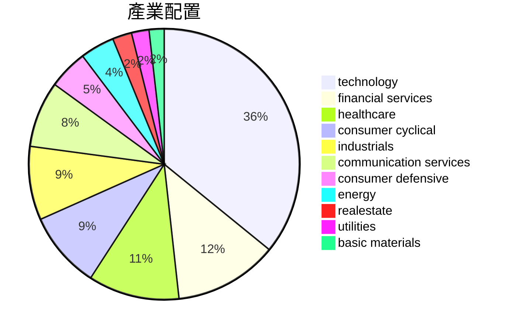

# VTI ETF 分析報告

> **報告日期**：2026-11-28 ｜ **語言**：繁體中文 ｜ **數據來源**：Yahoo Finance、Finviz ｜ **類型**：ETF／指數基金

## 目錄

| # | 章節 | 核心結論 |
|---|------|----------|
| 1 | 執行摘要 | 低費用、規模大，持有廣泛美國股票，但大型科技股與科技產業權重仍值得留意。 |
| 2 | 基金概況 | 以指數化方式追蹤美國股票市場，定位偏向股票投資組合的廣泛市場部位。 |
| 3 | 成本與規模 | 費用率低於資料所列同類平均，資產規模大；折溢價資料顯示小幅溢價。 |
| 4 | 持股與集中度 | 前十大合計權重為 33.1%，最大單一持股權重為 6.9%。 |
| 5 | 產業配置 | 科技業是最大產業曝險，占 35.9%。 |
| 6 | 績效與風險 | 提供期間價格報酬、波動率與最大回撤；相對基準數據未提供。 |
| 7 | 估值與配息 | 列示投資組合 P/E、P/B 與配息殖利率，不據此推導基金合理價值。 |
| 8 | 適合對象、風險與觀察重點 | 適合重視美國股票市場廣泛曝險與低基金費用的投資人；仍須承受股票市場及產業集中風險。 |

---

## 1. 執行摘要

VTI 的基金說明稱其採指數化投資方式，目標追蹤 CRSP U.S. Total Market Index，基金分類為 Large Blend，投資範圍是美國股票市場。  
基金淨費用率為 0.03%，資料列示同類平均為 0.72%；前十大持股合計權重為 33.1%，最大單一持股權重為 6.9%。  
價格資料庫列示的價格報酬為 1 年 +7.5%、3 年 +57.1%、5 年 +46.1%；相對基準的報酬與超額報酬均為 N/A（資料未提供）。  
最近一個已完成交易日收盤價為 **359.40 USD，日期為 2026-11-27**；年化波動率為 15.0%，歷史最大回撤為 -35.0%。

### 1.1 一頁式摘要

| 項目 | 內容 |
|------|------|
| 追蹤標的／類別 | CRSP U.S. Total Market Index／Large Blend；基金說明稱其代表可投資的美國股票市場 |
| 費用率（同類平均） | 0.03%（0.72%） |
| 資產規模 | 1.82T USD |
| 前十大合計權重／最大持股 | 33.1%／6.9% |
| 1 年／3 年／5 年價格報酬 | +7.5%／+57.1%／+46.1% |
| 相對基準的超額報酬（1 年／3 年／5 年） | N/A（資料未提供）／N/A（資料未提供）／N/A（資料未提供） |
| 年化波動率／最大回撤 | 15.0%／-35.0% |
| 折溢價 | +0.11%（溢價） |
| 定位 | **核心持有**：適合作為美國股票市場的廣泛曝險部位；仍須留意科技業配置及股票市場回撤風險。 |

### 1.2 五項評分

| 評分項目 | 分數（0–10） | 依據（引用數字） |
|----------|-------------:|------------------|
| 成本 | 10 | 淨費用率為 0.03%，同類平均為 0.72%；依費用率絕對水準及所列同類平均評分。 |
| 規模與流動性 | 10 | 資產規模為 1.82T USD，基金規模龐大；交易量、買賣價差等流動性細節為 N/A（資料未提供）。 |
| 分散度 | 7 | 前十大合計權重為 33.1%，最大單一持股權重為 6.9%；區塊標示為 Diversified。 |
| 相對績效 | 7 | 基準報酬與超額報酬為 N/A（資料未提供）；依要求改以絕對價格報酬判斷，1 年 +7.5%、3 年 +57.1%、5 年 +46.1%。 |
| 風險 | 5 | 年化波動率為 15.0%，歷史最大回撤為 -35.0%；回撤幅度顯示仍可能面臨明顯帳面損失。 |

---

## 2. 基金概況

### 2.1 基本資料

| 項目 | 資料 |
|------|------|
| 代號 | VTI |
| 基金名稱 | Vanguard Morningstar Total Stock Market ETF |
| 基金公司／家族 | Vanguard |
| 基金類別 | Large Blend |
| 基金性質 | ETF／指數基金 |
| 追蹤標的 | CRSP U.S. Total Market Index |
| 基金公司簡介所述投資方式 | 採指數化投資方式，目標追蹤上述指數的表現 |
| 持有指數成分股的政策說明 | 正常情況下，至少將淨資產的 80%，加上投資用途借款金額，投資於構成目標指數的股票 |
| Sector／Industry／Country | N/A（資料未提供） |

基金資料將基金名稱列為 Vanguard Morningstar Total Stock Market ETF，基金簡介則稱其目標追蹤 CRSP U.S. Total Market Index。  
本報告依照提供的基金名稱與基金簡介分別列示，不自行補充或調整指數資訊。  
指數編製規則細節、成分股數量及其他未列出的指數方法資料，均為 N/A（資料未提供）。

### 2.2 在投資組合中的角色

VTI 的投資範圍是美國股票市場，適合用來建立廣泛的美國股票曝險。  
基金的 Large Blend 分類與指數化投資方式，表示它不是單一產業或單一主題基金。  
不過，廣泛持有股票市場並不代表各產業、各公司權重平均分配。  
目前最大產業是科技業，占 35.9%；前十大持股合計占基金資產 33.1%。  
因此，持有 VTI 可取得廣泛美股曝險，但仍會受到大型持股與科技業表現影響。  
基金是否適合擔任投資組合核心，仍取決於投資人的整體資產配置、投資期限與風險承受度。

---

## 3. 成本與規模

### 3.1 費用、規模與週轉率

| 項目 | 數值 | 解讀 |
|------|------:|------|
| 淨費用率 | 0.03% | 基金資料列示的年度淨費用率。 |
| 同類平均費用率 | 0.72% | 可作為費用比較參考；同類產品的實際投資策略及服務內容可能不同。 |
| 資產規模 | 1.82T USD | 資產規模大，能反映基金具有相當規模；不代表未來報酬或流動性保證。 |
| 年度持股週轉率 | 3.0% | 代表資料列示的年度持股週轉率；不是基金報酬率，也不等同投資人的交易成本。 |

費用率與同類平均的比較顯示，VTI 的列示費用率較低。  
費用是長期持有時值得持續檢視的項目，但基金實際投資結果也會受市場走勢、持股組成及交易成本影響。  
週轉率可提供基金持股更替程度的參考，但資料未提供基金追蹤誤差或交易成本明細。  
**追蹤誤差：N/A（資料未提供）。**

### 3.2 費用試算

| 試算項目 | 資料列示結果 | 說明 |
|----------|--------------:|------|
| 以 1,000,000 USD 為例，依目前費用率計算 10 年費用，不假設投資報酬 | 3,000 USD | 這是依資料列示的簡化試算，不計投資報酬；不是投資人實際費用的保證值。 |

### 3.3 NAV 與折溢價

| 項目 | 數值 |
|------|------:|
| 最近列示價格 | 359.40 USD |
| NAV | 359.02 USD |
| 價格相對 NAV 的折溢價 | +0.11% |

資料列示價格相對 NAV 為小幅溢價。  
折溢價是價格與 NAV 的相對差異，不等同基金長期績效，也不能單獨用來判斷基金是否值得投資。  
上述價格為 2026-11-27 已完成交易日收盤價；折溢價數值依基金資料列示。

---

## 4. 持股與集中度

### 4.1 前十大持股

| 排名 | 代號 | 名稱 | 權重 |
|-----:|------|------|-----:|
| 1 | AAPL | Apple Inc | 6.91% |
| 2 | NVDA | NVIDIA Corp | 6.44% |
| 3 | MSFT | Microsoft Corp | 5.33% |
| 4 | AMZN | Amazon.com Inc | 3.21% |
| 5 | GOOGL | Alphabet Inc Class A | 2.26% |
| 6 | AVGO | Broadcom Inc | 2.13% |
| 7 | META | Meta Platforms Inc Class A | 1.86% |
| 8 | GOOG | Alphabet Inc Class C | 1.79% |
| 9 | LLY | Eli Lilly and Co | 1.65% |
| 10 | TSLA | Tesla Inc | 1.55% |

### 4.2 集中度解讀

| 指標 | 數值 | 解讀 |
|------|------:|------|
| 前十大持股合計權重 | 33.1% | 基金資產有一部分集中於大型持股，但資料標示這些持股合計低於基金的一半。 |
| 最大單一持股權重 | 6.9% | 最大單一持股對基金表現有影響，但不是基金的全部曝險。 |
| 持股分散度標示 | Diversified | 依資料區塊中的分散度標示列示。 |

前十大表格使用資料所列個別持股權重；合計權重與最大單一持股則依資料區塊的彙總數字列示。  
基金持有多檔股票，但前十大仍占有一定權重，因此不能將「廣泛市場基金」理解為各持股權重均等。  
大型持股價格波動可能影響基金整體報酬；若這些公司同時受到相似產業或市場因素影響，持股數量本身也不一定能完全消除相關風險。  
前十大以外的持股未列示，本報告不列出或推測其他持股。  
成分股總數：N/A（資料未提供）。

---

## 5. 產業配置

### 5.1 產業權重

| 產業 | 權重 |
|------|-----:|
| technology | 35.9% |
| financial services | 12.4% |
| healthcare | 10.9% |
| consumer cyclical | 9.2% |
| industrials | 8.8% |
| communication services | 7.9% |
| consumer defensive | 4.7% |
| energy | 4.1% |
| realestate | 2.3% |
| utilities | 2.1% |
| basic materials | 1.8% |

### 5.2 配置解讀

科技業權重為 35.9%，是資料列示的最大產業配置。  
其次為 financial services，權重為 12.4%；healthcare 權重為 10.9%。  
因此，投資 VTI 並非只是在產業間平均分配資金，而是持有一個有明確科技業曝險的美國股票組合。  
科技業景氣、相關公司獲利與市場評價變動，可能對基金表現造成較明顯影響。  
其他產業的權重仍有助於形成跨產業曝險，但不代表可避免整體股市下跌風險。

---

## 6. 績效與風險

### 6.1 各期間價格報酬

| 期間 | 本基金價格報酬 | 基準報酬 | 相對基準超額報酬 |
|------|---------------:|---------:|------------------:|
| 1 個月 | -6.5% | N/A（資料未提供） | N/A（資料未提供） |
| 3 個月 | -7.2% | N/A（資料未提供） | N/A（資料未提供） |
| 6 個月 | -5.0% | N/A（資料未提供） | N/A（資料未提供） |
| 1 年 | +7.5% | N/A（資料未提供） | N/A（資料未提供） |
| 3 年 | +57.1% | N/A（資料未提供） | N/A（資料未提供） |
| 5 年 | +46.1% | N/A（資料未提供） | N/A（資料未提供） |

以上均為價格報酬，**不包含配息**。  
價格報酬資料期間截至 2026-11-25；不得將這些數字解讀為含配息的總報酬。  
基準的各期間報酬與相對基準超額報酬為 N/A（資料未提供），因此無法判定各期間是否跑贏或落後基準。  
資料未提供可供計算的比較基準報酬，本報告不自行推算超額報酬。

### 6.2 風險指標

| 指標 | 數值 | 資料範圍／說明 |
|------|------:|----------------|
| 年化波動率 | 15.0% | 1 年 |
| 最大回撤 | -35.0% | 儲存歷史期間為 10.0 年；谷底日期為 2020-03-23 |
| 儲存歷史期間 CAGR | 11.9% | 資料所列的儲存歷史期間年化成長率；不代表未來報酬。 |

年化波動率反映價格變動程度，並不保證未來波動會維持在相同水準。  
最大回撤描述歷史資料中從高點至低點的最大跌幅；未來仍可能出現不同幅度的下跌。  
歷史最大回撤對應的帳面減少示例為：以 1,000,000 USD 為例，帳面減少 **350,000 USD**。  
該金額為資料區塊提供的示例，不是未來損失預測，也不是所有投資人的實際損失。  
投資人若有短期資金需求，應留意股票型 ETF 可能出現顯著回撤的情況。

---

## 7. 估值與配息

| 項目 | 數值 | 解讀 |
|------|------:|------|
| 投資組合 P/E | 22.8x | Yahoo Finance 列示的加權投資組合倍數。 |
| 投資組合 P/B | 4.6x | Yahoo Finance 列示的加權投資組合倍數。 |
| 配息殖利率 | 1.06% | 基金資料列示的殖利率；不代表未來配息金額或殖利率固定。 |

P/E 與 P/B 是基金持有成分股的加權整體指標，反映持股公司的市場評價特徵。  
這些倍數不是 VTI 基金本身的合理價值，也不能單獨用來推導基金未來報酬。  
本報告不依 P/E、P/B 或收盤價推導合理價值、目標價或買賣價位。  
配息殖利率不等同保證收益；配息紀錄與配息頻率為 N/A（資料未提供）。  
資料未提供配息再投資後的各期間總報酬，因此前述報酬表不含配息。

---

## 8. 適合對象、風險與觀察重點

### 8.1 適合與不適合的投資人

| 投資人類型 | 適合度 | 原因（引用數字） |
|------------|--------|------------------|
| 希望取得廣泛美國股票曝險的長期投資人 | 較適合 | 基金目標追蹤 CRSP U.S. Total Market Index，並採指數化投資方式。 |
| 重視基金費用的投資人 | 較適合 | 淨費用率為 0.03%，資料列示同類平均為 0.72%。 |
| 希望以單一基金涵蓋多產業的投資人 | 可考慮 | 配置涵蓋多個產業，但科技業權重為 35.9%。 |
| 無法承受股票市場大幅下跌的投資人 | 不一定適合 | 年化波動率為 15.0%，歷史最大回撤為 -35.0%。 |
| 需要穩定配息金額或固定現金流的投資人 | 資料不足，應審慎評估 | 配息殖利率為 1.06%，但配息紀錄與配息頻率為 N/A（資料未提供）。 |
| 希望避免大型科技股影響的投資人 | 不一定適合 | 科技業權重為 35.9%；前十大持股合計權重為 33.1%。 |
| 以短期資金需求為主要目標的投資人 | 不一定適合 | 基金為股票型 ETF，歷史最大回撤為 -35.0%。 |

### 8.2 主要風險

1. **大型持股集中風險**  
   前十大持股合計權重為 33.1%，最大單一持股權重為 6.9%。  
   若大型持股表現明顯轉弱，基金可能受到相應影響；分散持有不代表單一公司風險完全消失。

2. **科技業配置風險**  
   科技業權重為 35.9%，是最大產業曝險。  
   當科技業或相關大型公司表現不佳時，基金可能承受較明顯的產業層面影響。

3. **股票市場回撤風險**  
   資料列示的年化波動率為 15.0%，歷史最大回撤為 -35.0%。  
   過往回撤不代表未來最大跌幅上限；投資人應確認自己能否承受淨值大幅下跌。

4. **持股評價變動風險**  
   投資組合 P/E 為 22.8x，P/B 為 4.6x。  
   若市場對成分股的評價下降，即使公司基本面變化有限，基金價格也可能受到影響。

5. **匯率與投資人計價貨幣風險**  
   基金最近列示收盤價以 USD 計價，為 359.40 USD。  
   以新台幣衡量投資結果的投資人，還須留意美元與新台幣匯率變動對換算結果的影響；基金匯率避險資訊為 N/A（資料未提供）。

### 8.3 什麼情況下要重新評估

| 可查核條件 | 重新評估原因 |
|------------|--------------|
| 最大單一持股權重高於目前列示的 6.9% | 檢視單一持股對整體基金表現的影響是否增加。 |
| 前十大合計權重高於目前列示的 33.1% | 重新檢視大型持股集中程度及投資人對集中風險的承受度。 |
| 科技業權重高於目前列示的 35.9% | 評估產業配置是否仍符合投資人的分散需求。 |
| 淨費用率不再是 0.03% | 核對基金費用變化，並重新比較同類平均費用率。 |
| 資產規模相較目前列示的 1.82T USD 明顯縮減 | 檢視基金規模變化及相關基金資訊；實際交易流動性仍需另外查核。 |
| 可取得同期間、同口徑的基準報酬後，基金連續期間落後基準 | 以可核對的基金與基準資料重新評估追蹤結果；目前相對基準報酬為 N/A（資料未提供）。 |
| 年化波動率或最大回撤明顯高於目前列示水準 | 重新檢視投資期限、資金需求及可承受的價格波動。 |
| 投資人的資金用途或風險承受度改變 | 即使基金資料未變，個人資產配置需求也可能已改變。 |

---

> **免責聲明**：本報告為 AI 自動生成，僅供研究與教育參考，不構成投資建議。報酬為價格報酬，未計入配息、稅負與交易成本；投資有風險。

---

## 資料與來源

| 項目 | 內容 |
|------|------|
| 價格 | 359.40 USD，2026-11-27 收盤（Yahoo Finance 日線） |
| 基金資料 | Yahoo Finance（持股、費用率、規模）；績效與回撤由價格資料庫計算 |
| 有回應的資料來源 | Yahoo Finance、Finviz |
| 未回應的資料來源 | SEC 申報資料 (XBRL)、StockAnalysis、Roic.ai |
| 由程式計算 | 基金的集中度、績效、費用與回撤試算 |
| 撰寫模型 | openai / gpt-6-luna |

> 本區塊由產生報告的程式依實際取得的資料填寫，非模型撰寫。「由程式計算」的數字不是模型的估計；其餘判斷（評分、情境、策略）是模型的分析。
