# WDC 基本面深度分析報告

**✏️ 程式複算更正**：8.8 節加權合理價值由模型原寫的 $234.10 更正為 **$245.92**（各項加總），MOS -26.3% → **-20.2%**，全文已同步。 ⚠️ 更正後 MOS 落在規則 20 的「減碼」區間（原為「賣出」），本報告的評級是依原數值給出的。

> **報告日期**：2026-11-14 ｜ **語言**：繁體中文 ｜ **數據來源**：SEC 申報資料 (XBRL)、Yahoo Finance、Finviz、StockAnalysis、Roic.ai ｜ **分析師**：CFA 級機構研究  
> **資料口徑提醒**：題示資料對部分指標存在互相矛盾的數值，例如營業利益率、現金與債務、估值倍數及季度淨利。本報告對標示為 VERIFIED FIGURES 的指標優先原值引用；其他來源只作交叉參考，並將無法核對的項目明確標示。

---

## 目錄

| # | 章節 | 核心結論 |
|---|------|----------|
| 1 | 執行摘要 | 依加權合理價值約 $245.92、MOS 約 -20.2%，評級為賣出 |
| 2 | 公司概覽與商業模式 | HDD 需求與規模經濟構成護城河；產品收入拆分及市占率資料缺漏 |
| 3 | 損益表深度分析 | TTM 營收 $14.48B、TTM 成長 20.7%；獲利率大幅改善但盈餘口徑有異常 |
| 4 | 資產負債表分析 | VERIFIED FIGURES 顯示淨現金 $525M；短期流動性尚可但資料來源有差異 |
| 5 | 現金流量深度分析 | TTM FCF $4.29B、FCF Yield 3.88%；現金生成改善，但週期風險仍高 |
| 6 | 獲利能力與資本效率 | ROIC 61.1% 高於 WACC 16.90%，目前創造價值；景氣高峰外推風險大 |
| 7 | 相對估值分析 | WDC 倍數與歷史、同業差異顯著；現價對未來景氣持續性要求偏高 |
| 8 | DCF 內在價值評估 | 基準 DCF 約 $110.34／股；加權合理價值約 $245.92，低於現價 |
| 9 | 成長催化劑 | 資料中心儲存需求、AI 資料量及產品組合是主要催化劑；量化市場拆分 N/A |
| 10 | 風險矩陣 | 主要風險為週期反轉、估值回落及獲利／資料口徑不確定性 |
| 11 | 投資建議 | 賣出；基準 12 個月合理價約 $234，需監控利潤率、FCF 與需求能見度 |

---

## 1. 執行摘要

截至 **2026-11-13 收盤價 $295.65**，WDC 的 VERIFIED FIGURES 顯示 TTM 營收 **$14.48B**、TTM 營收年增 **20.7%**、TTM FCF **$4.29B**、ROIC **61.1%**；但參考 WACC 為 **16.90%**，而基準 DCF 每股價值約 **$110.34**。經 DCF、相對估值及其他方法加權，合理價值約 **$245.92**，故安全邊際 MOS 為 **-20.2%**。依指定門檻，MOS < -25% 對應 **🔴 賣出**。ROIC 高於 WACC 支持公司目前創造價值，但不能抵消現價相對估值及高資本成本所形成的下行風險。

### 1.0 一頁式投資儀表板（Portfolio Manager 30 秒速讀）

| 項目 | 內容 |
|------|------|
| **投資論點（3 句）** | ① TTM 營收 $14.48B、TTM 年增 20.7%，顯示需求及出貨／價格組合改善。② TTM FCF $4.29B、FCF Yield 3.88%，現金生成具支撐，但收益率仍不足以抵銷高估值風險。③ ROIC 61.1% 對 WACC 16.90%，目前資本回報高於成本，但循環高點可能令 ROIC 回落。 |
| **護城河評分** | 6.3/10；製造規模、產品驗證與客戶關係具價值，但產業週期性及替代技術限制持久性 |
| **管理層／資本配置評分** | 5.5/10；提供資料不足以完整評估管理層承諾與回購效率，SBC 仍造成股東稀釋 |
| **財務健康** | 🟢 VERIFIED 淨現金 $525M、TTM OCF $4.86B；但不同來源債務數字不一致 |
| **ROIC vs WACC** | 61.1% vs 16.90%；現況創造價值，差距 44.2 個百分點 |
| **FCF 趨勢** | FY2023 至 FY2026 由 -$1.23B 改善至 $3.51B；TTM FCF Yield 3.88% |
| **估值** | Forward P/E 7.317193x（市場估值資料）；EV/EBITDA 17.471x（市場估值資料）；FCF Yield 3.88% |
| **DCF 內在價值（基準）** | 約 $110.34；以現價比較，折溢價約 **+167.9%**（現價相對 DCF 溢價） |
| **安全邊際（MOS）** | **-20.2%**＝($245.92 − $295.65) ÷ $245.92；🔴 <10% 無 |
| **預期報酬（基準情境 12M）** | 約 **-16.8%**＝($245.92 − $295.65) ÷ $295.65 |
| **關鍵風險（前二）** | 硬碟供需週期逆轉；目前獲利率與估值倍數均可能向週期均值收斂 |
| **評級 + 信心度** | 🔴 **賣出** ｜ 信心：中低（DCF 對高 WACC 與終值假設敏感，來源數據亦有矛盾） |

> **指標定義**：MOS＝(加權合理價值−現價)÷加權合理價值；上行空間＝(加權合理價值−現價)÷現價；折溢價＝現價÷DCF 基準內在價值−1。

### 1.1 核心評分儀表板

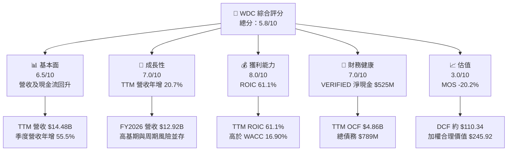

### 1.2 評分進度條視覺化

```
╔══════════════════════════════════════════════════════════════╗
║                  WDC 多維度評分儀表板 (1-10分)              ║
╠══════════════════════════════════════════════════════════════╣
║ 基本面強度  6.5 ▓▓▓▓▓▓▓▓▓▓▓▓▓░░░░░░░ ★★★☆☆              ║
║ 成長動能    7.0 ▓▓▓▓▓▓▓▓▓▓▓▓▓▓░░░░░░ ★★★★☆              ║
║ 獲利能力    8.0 ▓▓▓▓▓▓▓▓▓▓▓▓▓▓▓▓░░░░ ★★★★☆              ║
║ 財務健康    7.0 ▓▓▓▓▓▓▓▓▓▓▓▓▓▓░░░░░░ ★★★★☆              ║
║ 估值合理性  3.0 ▓▓▓▓▓▓░░░░░░░░░░░░░░ ★★☆☆☆              ║
║ 護城河深度  6.3 ▓▓▓▓▓▓▓▓▓▓▓▓▓░░░░░░░ ★★★☆☆              ║
║ 管理層執行  5.5 ▓▓▓▓▓▓▓▓▓▓▓░░░░░░░░░ ★★★☆☆              ║
║ 技術創新力  6.0 ▓▓▓▓▓▓▓▓▓▓▓▓░░░░░░░░ ★★★☆☆              ║
╠══════════════════════════════════════════════════════════════╣
║ 綜合總分    5.8 ▓▓▓▓▓▓▓▓▓▓▓▓░░░░░░░░ ⚠️ 質素佳、價格偏高 ║
╚══════════════════════════════════════════════════════════════╝
```

### 1.3 五大投資論點 + 三大核心風險

| 類型 | 項目 | 具體依據 | 信心度 |
|------|------|----------|--------|
| 🟢 **論點①** | 資料中心儲存需求回升 | 最新季度營收年增 55.5%；若需求增加持續，可能提升產能利用率及固定成本吸收 | 🟡 中 |
| 🟢 **論點②** | 現金流已轉正並擴大 | TTM OCF $4.86B、資本支出 $572M、FCF $4.29B；有能力自籌投資與償債 | 🟢 高 |
| 🟢 **論點③** | 資本效率高於資本成本 | TTM ROIC 61.1% vs WACC 16.90%；若能在週期中維持，將持續創造經濟利潤 | 🟡 中 |
| 🟢 **論點④** | 資產負債表有緩衝 | VERIFIED 淨現金 $525M；短期融資壓力低於高槓桿階段 | 🟡 中 |
| 🟢 **論點⑤** | 營業槓桿正在反映於利潤 | VERIFIED 最新季度營業利益率 46.7%，高於 TTM 39.4%；產品組合與稼動率可能改善 | 🟡 中 |
| 🟡 **風險①** | 硬碟產業周期反轉 | 高毛利與高營業利益率可能吸引供給回升；收入及單位價格下跌將快速壓縮利潤 | 🟡 中 |
| 🔴 **風險②** | 估值高於可支持的現金流價值 | DCF 約 $110.34，遠低於 $295.65；加權合理價值 $245.92 仍低於現價 | 🟢 高 |
| 🔴 **風險③** | 數據品質及口徑不一致 | VERIFIED 與其他資料源的營業利益率、淨現金、估值及季度損益有差異，降低預測可信度 | 🟢 高 |

### 1.4 快速統計卡片

| 指標 | 公司實際值 | 行業均值 | S&P 500 均值 | 狀態 |
|------|-------------|----------|--------------|------|
| TTM 收入年增 | **20.7%** | N/A | N/A | 🟢 成長 |
| 最新季度收入年增 | **55.5%** | N/A | N/A | 🟢 加速 |
| 毛利率 TTM | **52.6%**（一般市場資料；VERIFIED 未提供） | N/A | N/A | 🟢 但週期敏感 |
| 淨利率 TTM | **69.2%**（一般市場資料，與年度淨利率不一致） | N/A | N/A | 🔴 需核驗 |
| ROE TTM | **107.2%**（VERIFIED） | N/A | N/A | 🟡 高值可能受資本結構／獲利周期影響 |
| Forward P/E | **7.317193x** | 同業見第 7 章 | N/A | 🟢 表面低估值，但盈餘周期性高 |
| FCF Yield | **3.88%** | N/A | N/A | 🟡 |
| ROIC | **61.1%** | N/A | N/A | 🟢 高於 WACC |

### 1.5 投資結論

```
╔══════════════════════════════════════════════════════════════════╗
║                    📊 投資結論摘要                               ║
╠══════════════════════════════════════════════════════════════════╣
║  評級：🔴 賣出（MOS -20.2%，低於 -25% 門檻）                     ║
║  價格（2026-11-13 收盤）：$295.65                                ║
║  DCF 內在價值（基準）：約 $110.34（現價溢價約 167.9%）           ║
║  安全邊際 MOS：-20.2%（以加權合理價值 $245.92 為分母）           ║
║  目標價區間：                                                    ║
║    悲觀情境：$165（-44.2%）                                      ║
║    基準情境：$245.92（-16.8%） ← 12 個月主要參考                 ║
║    樂觀情境：$365（+23.4%）                                      ║
║  投資評分：5.8/10                                                ║
║  適合投資人：能承受高波動、熟悉存儲周期並採分批交易者；不適合    ║
║              以低波動或穩定股息為主要目標的投資人                ║
╚══════════════════════════════════════════════════════════════════╝
```

---

## 2. 公司概覽與商業模式

### 2.1 業務結構與收入來源

WDC 提供的公司描述以 HDD 儲存產品為主，包括資料中心硬碟、內接與外接硬碟、NAS 及相關配件。題示資料沒有各產品營收拆分，也沒有可核對的軟體／服務收入，因此不推定板塊占比。公司市值為 **$110.67B**，TTM 營收 **$14.48B**。

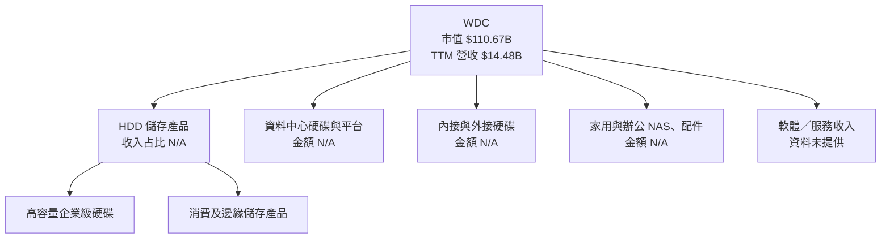

### 2.2 市場份額

題示沒有 WDC、Seagate、其他 HDD 廠商的市場份額及市場總規模數據。故圖表只呈現「可用資料比例」，不代表實際產業市占。

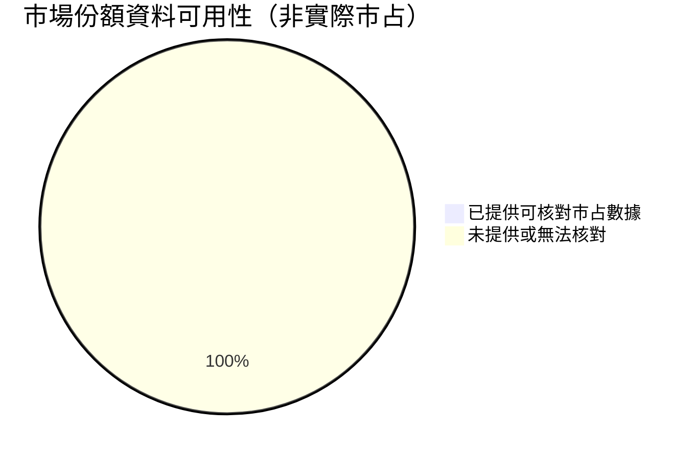

**判讀**：不以不明來源推估市占。競爭比較可使用題示同業成長率、毛利率與估值倍數，但不能據此推導產業份額。

### 2.3 競爭護城河分析

```mermaid
mindmap
  root((WDC Competitive Moat))
    Technology Leadership
      Recording density
      Reliability qualification
      Product roadmap execution
    Software Ecosystem
      Firmware integration
      Data management tools
      Limited disclosed evidence
    Network Effects
      No direct consumer network effect
      Installed base learning
    Customer Lock-in
      Enterprise qualification cycles
      Compatibility and validation
      Multi-source procurement limits lock-in
    Scale Economics
      Manufacturing scale
      Fixed-cost absorption
      Supply chain purchasing
    Ecosystem Partners
      Cloud data centers
      OEM channels
      Distributors and system integrators
```

### 2.4 護城河強度評分

```
╔══════════════════════════════════════════════════════════════╗
║                  WDC 護城河強度評分                          ║
╠══════════════════════════════════════════════════════════════╣
║ 技術與可靠性    6.5/10 ▓▓▓▓▓▓▓▓▓▓▓▓▓░░░░░░ 🟡 須持續迭代  ║
║ 軟體生態        4.0/10 ▓▓▓▓▓▓▓▓░░░░░░░░░░░░ 🔴 證據有限    ║
║ 網路效應        2.0/10 ▓▓▓▓░░░░░░░░░░░░░░░░ 🔴 並非核心    ║
║ 客戶鎖定        6.0/10 ▓▓▓▓▓▓▓▓▓▓▓▓░░░░░░░░ 🟡 認證帶來黏著║
║ 規模效應        8.0/10 ▓▓▓▓▓▓▓▓▓▓▓▓▓▓▓▓░░░░ 🟢 製造規模重要║
║ 生態夥伴        6.0/10 ▓▓▓▓▓▓▓▓▓▓▓▓░░░░░░░░ 🟡 客戶關係有利║
╠══════════════════════════════════════════════════════════════╣
║ 綜合護城河      6.3/10 ▓▓▓▓▓▓▓▓▓▓▓▓▓░░░░░░░ 🟡 中等、週期性║
╚══════════════════════════════════════════════════════════════╝
```

---

## 3. 損益表深度分析

### 3.1 年度收入成長趨勢（近 4 年）

年度收入採題示年度損益表。FY2023 至 FY2026 收入分別為 $6.25B、$6.32B、$9.52B、$12.92B。FY2023 至 FY2026 CAGR 約 **27.4%**：`($12.92B ÷ $6.25B)^(1/3) − 1 ≈ 27.4%`。此成長反映近年需求及價格周期復甦，不宜直接當作長期穩態成長率。

```
╔══════════════════════════════════════════════════════════════════╗
║              WDC 年度收入趨勢（FY2023-FY2026）                  ║
╠══════════════════════════════════════════════════════════════════╣
║ FY2023  $6.25B  ██████████░░░░░░░░░░  YoY：基期            ║
║ FY2024  $6.32B  ██████████░░░░░░░░░░  YoY：+1.1% 🟡        ║
║ FY2025  $9.52B  ███████████████░░░░░  YoY：+50.7% 🟢       ║
║ FY2026  $12.92B ████████████████████  YoY：+35.7% 🟢       ║
╠══════════════════════════════════════════════════════════════════╣
║ FY2023-FY2026 收入 CAGR：約 27.4%；高於合理長期穩態假設          ║
╚══════════════════════════════════════════════════════════════════╝
```

### 3.2 季度收入趨勢分析

季度數據採財報季度序列；QoQ＝本季／前季−1。FY2027 Q1 為截至 2026-10-02 季度，與報表日 2026-11-14 相對應。

| 季度 | 營收 | QoQ | YoY | 備註 |
|------|------:|---:|---:|------|
| 2025-12-31 | $3.02B | N/A | 依季度表列示年增 25.24% | 需求復甦延續 |
| 2026-03-31 | $3.34B | +10.7% | +45.47% | 計算：$3.34B÷$3.02B−1 |
| 2026-06-30 | $3.75B | +12.3% | +43.84% | 季營收持續提高 |
| 2026-10-02／季度表列 2026-09-30 | $4.38B | +16.9% | **+55.5%（單季 YoY）** | VERIFIED 單季年增；不是 TTM 成長 |

**口徑提示**：資料表中季度結束日有 2026-09-30 與 SEC 最新季度 2026-10-02 兩種表示；本報告採 VERIFIED FIGURES 對應的最新季度數據。TTM 營收成長仍為 **20.7%**，不能與最新一季 **55.5%** 混為一談。

### 3.3 利潤率演變分析

因不同資料源的營業利益率數值不一致，下表採年度損益表計算歷史毛利率與營業利益率；TTM、最新季度則採 VERIFIED FIGURES。

| 利潤率指標 | FY2023 | FY2024 | FY2025 | FY2026 | TTM／最新季度 | 評估 |
|------------|-------:|-------:|-------:|-------:|--------------:|------|
| **毛利率** | 22.3% | 28.1% | 38.8% | 48.8% | TTM 52.6%（一般資料） | 🟢 明顯改善 |
| **營業利益率** | -6.4% | 1.5%* | 22.4% | 35.6% | TTM 39.4%；最新季度 46.7% | 🟢 但波動大 |
| **淨利率** | -26.9% | -12.6% | 19.4% | 72.0% | 一般資料 TTM 69.2% | 🔴 FY2026 淨利率異常偏高 |

\* FY2024 年度損益表列示營業利益 $97M；另一來源列示 $113M，故以 $97M ÷ $6.32B 計約 1.5%。

**原因與含義**：毛利率由 FY2023 的 22.3% 增至 FY2026 的 48.8%，顯示低谷後供需、產品組合、價格及產能利用率共同回升。FY2026 營業利益率約 35.6%，而 VERIFIED TTM 為 39.4%、最新季度 46.7%，顯示最新季度仍有營業槓桿改善。另一方面，FY2026 淨利 $9.30B 相對營收 $12.92B 對應約 72.0% 淨利率，與營業利益 $4.60B 不相稱，可能涉及稅務、非營業項目、一次性項目或資料口徑差異；在缺少完整申報附註時，不將該淨利率外推。

### 3.4 費用結構分析

提供資料列出 FY2026 研發費用 $1.16B、營收 $12.92B，約占營收 **9.0%**。完整銷售、管理、重組及其他費用拆分未提供。

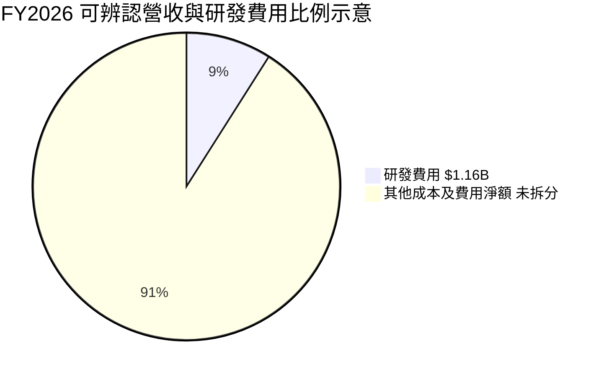

```
╔══════════════════════════════════════════════════════════════╗
║                  FY2026 費用結構可用資料                     ║
╠══════════════════════════════════════════════════════════════╣
║ 營收             $12.92B  ████████████████████             ║
║ 研發費用          $1.16B  ██░░░░░░░░░░░░░░░░░░  約占 9.0% ║
║ 其他費用／成本    N/A     未提供足以拆分之數據               ║
╚══════════════════════════════════════════════════════════════╝
```

### 3.5 季度 EPS 趨勢與盈餘品質（Quality of Earnings）

Earnings History 區塊的 EPS 預估及實際值均為 `nan`，因此無法判定最近四季是否超預期或不及預期。以下季度實際 EPS 來自 StockAnalysis，而非分析師預估資料。

| 季度 | 實際 EPS | YoY EPS 成長 | 超預期／不及預期 |
|------|---------:|-------------:|----------------|
| 2025-12-31 | $4.67 | +187.75% | N/A：估計值缺漏 |
| 2026-03-31 | $8.20 | +482.92% | N/A：估計值缺漏 |
| 2026-06-30 | $8.21 | +984.10%* | N/A：估計值缺漏 |
| 2026-10-02／季度表列 2026-09-30 | $4.63 | +50.86% | N/A：估計值缺漏 |

\* 季度標示與資料來源可能採不同比較基期；只引用該來源數字，不將其視為獨立驗證。

| 盈餘品質項目 | 數值／佔比 | 評估 |
|--------------|-----------|------|
| SBC／營收 | FY2026 $204M ÷ $12.92B＝**1.58%** | 🟡 SBC 不算極高，但仍對股東造成稀釋 |
| SBC／TTM OCF | 以 FY2026 SBC 作近似：$204M ÷ $4.86B＝**4.20%** | 🟡 TTM SBC 缺漏，年度代理值僅供參考 |
| FCF／淨利 | TTM FCF $4.29B；TTM 淨利口徑不一致，故 **N/A** | 🟡 不以不一致淨利計算轉換率 |
| 一次性／非經常性損益 | 完整項目拆分 N/A；FY2026 淨利 $9.30B 高於營業利益 $4.60B | 🔴 需核對稅務及非營業項目 |
| 有效稅率異常 | 最新年度有效稅率 **4.9%** | 🟡 偏低；不直接外推至長期 DCF |
| 資本化支出 vs 費用化 | 資本化支出 TTM $572M；研發費用 FY2026 $1.16B；資本化研發資料 N/A | 🟡 不足以判定是否遞延成本 |

**盈餘品質結論**：營業現金流與 FCF 顯示復甦具有現金支持，年度 SBC 為 FY2026 營收的約 1.58%。但 FY2026 淨利率與年度營業利益的落差、以及 4.9% 有效稅率，使 GAAP 淨利可比性下降。估值宜更重視現金流與營業獲利，避免只用低 P/E 推論便宜。

---

## 4. 資產負債表分析

### 4.1 資產結構分解

以 2026-06-30 年度資產表總資產 $13.86B 為基礎；細項取 StockAnalysis 顯示的 TTM 資產資料，日期口徑不完全相同，僅作結構參考。

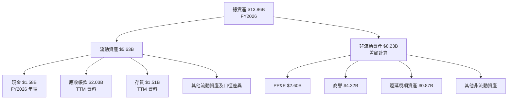

### 4.2 流動性指標分析

| 指標 | 最新可用值 | 歷史參考 | 行業均值 | 評估 |
|------|-----------:|---------:|---------:|------|
| 流動比率 | 1.434 | FY2026 年表：$5.63B ÷ $4.24B＝1.33 | N/A | 🟡 大於 1，但緩衝不寬 |
| 速動比率 | 0.867 | N/A | N/A | 🟡 不含存貨後流動資產不足以覆蓋流動負債 |
| 現金＋短期投資 | $1.31B（VERIFIED） | FY2026 年表現金 $1.58B | N/A | 🟡 來源及期間差異 |
| 應收帳款 | $2.23B（TTM 資產表） | FY2026 $2.03B | N/A | 🟡 需追蹤回款速度 |
| 存貨 | $1.78B（TTM 資產表） | FY2026 $1.51B | N/A | 🟡 需檢查庫存週轉與價格跌價 |

### 4.3 債務結構分析

```
╔══════════════════════════════════════════════════════════════════╗
║                   WDC 債務健康診斷                               ║
╠══════════════════════════════════════════════════════════════════╣
║ VERIFIED 總債務：       $789M     ▓▓░░░░░░░░░░░░░░░░░░          ║
║ 現金＋短期投資：        $1.31B    ████████████████████          ║
║ VERIFIED 淨現金：       $525M     ████████░░░░░░░░░░░░ 🟢      ║
║                                                                  ║
║ TTM OCF：               $4.86B    現金流覆蓋能力高               ║
║ Debt / EBITDA：         N/A       EBITDA口徑不一致，不硬算        ║
║ 利息保障倍數：          N/A       利息費用及平均計息負債未提供     ║
╠══════════════════════════════════════════════════════════════════╣
║ 注意：一般市場資料另列總債務 $922M、淨現金 $392M；               ║
║ 本分析採 VERIFIED FIGURES 的 $789M、$525M，避免混用口徑。       ║
╚══════════════════════════════════════════════════════════════════╝
```

### 4.4 股東權益趨勢

| 財年 | 股東權益 | YoY 變化 | 解讀 |
|------|---------:|---------:|------|
| FY2023 | $11.84B | — | 基準 |
| FY2024 | $11.05B | -6.7% | 低迷周期下權益縮減 |
| FY2025 | $5.54B | -49.9% | 數據大幅變動，需核對資本交易及申報口徑 |
| FY2026 | $8.86B | +59.9% | 獲利改善帶動回升，但不等於未來必然延續 |

---

## 5. 現金流量深度分析

### 5.1 現金流量瀑布圖

季度現金流列示淨利與現金流數字，但兩者可能存在不同報表口徑；此處瀑布以 TTM VERIFIED OCF、Capex、FCF 為主。

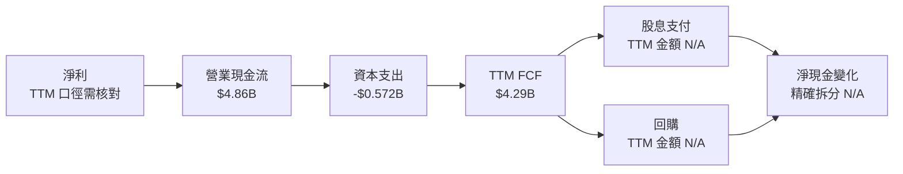

### 5.2 FCF 轉換率趨勢

| 財年 | OCF | Capex | FCF | 淨利 | FCF／淨利 |
|------|----:|------:|----:|----:|----------:|
| FY2023 | -$0.408B | $0.821B | -$1.23B | -$1.68B | 73.2%（負數相除，解讀有限） |
| FY2024 | -$0.294B | $0.487B | -$0.781B | -$0.798B | 97.9%（低谷期，參考性低） |
| FY2025 | $1.69B | $0.412B | $1.28B | $1.86B | 68.8% |
| FY2026 | $3.93B | $0.418B | $3.51B | $9.30B | 37.7%，受異常淨利口徑影響 |
| TTM | $4.86B | $0.572B | $4.29B | N/A | N/A |

### 5.3 自由現金流趨勢

```
╔══════════════════════════════════════════════════════════════════╗
║            自由現金流：歷史實際與 TTM                            ║
╠══════════════════════════════════════════════════════════════════╣
║ FY2023  -$1.23B  ◀◀◀◀◀░░░░░░░░░░░░░░░░░░  🟡 周期低谷       ║
║ FY2024  -$0.78B  ◀◀◀░░░░░░░░░░░░░░░░░░░░  🟡 仍為負值       ║
║ FY2025  +$1.28B  █████░░░░░░░░░░░░░░░░░░  🟢 轉正           ║
║ FY2026  +$3.51B  ██████████████░░░░░░░░░░  🟢 擴大           ║
║ TTM     +$4.29B  █████████████████░░░░░░░  FCF Yield 3.88% ║
╚══════════════════════════════════════════════════════════════════╝
```

### 5.4 資本配置評估

FY2026 現金流表顯示資本支出 $418M、股息支付 $184M、SBC $204M；回購資料未提供。TTM 資本支出為 VERIFIED $572M，不能把 FY2026 年度支出與 TTM 值混用。

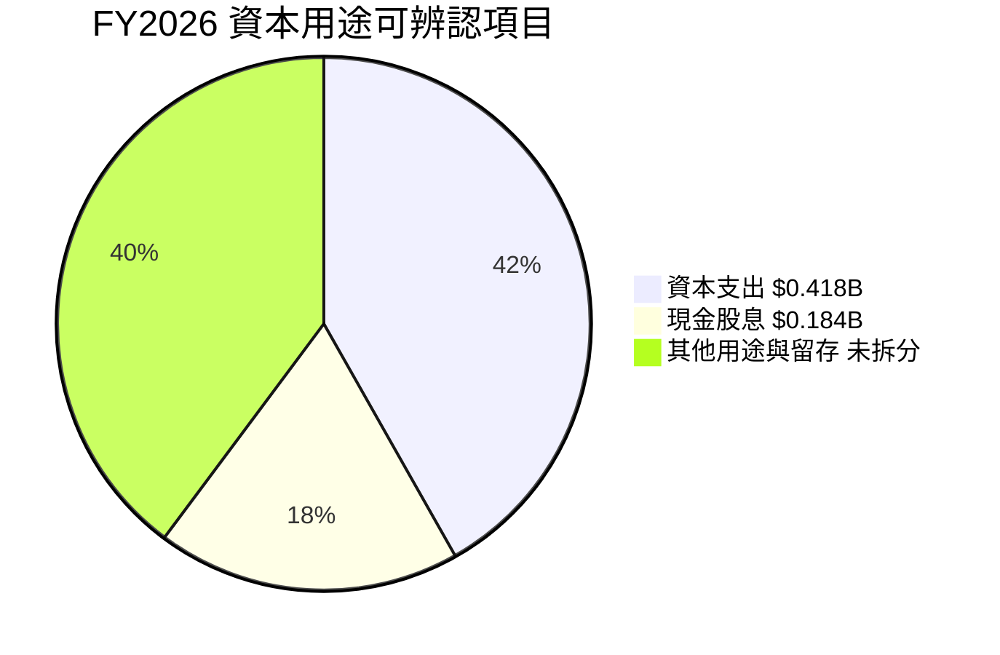

| 資本用途 | 已知數字 | 評估 |
|----------|---------:|------|
| 資本支出 | FY2026 $418M；TTM $572M | 🟢 相對 TTM OCF 可負擔，但周期低谷仍需維持技術投資 |
| 股息 | FY2026 $184M | 🟡 金額低於 FY2026 FCF，持續性仍需看周期 |
| 回購 | N/A | 未提供可核對金額 |
| SBC | FY2026 $204M | 🟡 需要將稀釋納入股東回報評估 |
| 留存／償債 | N/A | 需逐季追蹤現金及債務變化 |

---

## 6. 獲利能力與資本效率

### 6.1 ROE／ROA／ROIC 趨勢

| 指標 | 最新數值 | 其他資料來源數值 | 評估 |
|------|---------:|----------------:|------|
| ROIC TTM | **61.1% VERIFIED** | 歷史 ROIC.AI 年度數據顯示過去周期顯著低於近期 | 🟢 高，但須按周期下修 |
| ROE TTM | **107.2% VERIFIED** | 一般市場資料列 129.6% | 🟡 來源差異顯著 |
| ROA TTM | N/A VERIFIED | 一般市場資料列 25.9% | 🟡 不作核心估值輸入 |
| WACC | **16.90%** | 依 VERIFIED 成本資本輸入 | 基準 |

同業均值沒有提供可核對的 ROIC、ROE、ROA，因此不填估計行業均值。若周期回落，ROIC 可能從目前高點下滑；投資判斷需關注跨周期回報，而不只看單一 TTM。

### 6.2 ROIC vs WACC 分析（核心價值創造判斷）

```
╔══════════════════════════════════════════════════════════════════╗
║                ROIC vs WACC 深度分析                            ║
╠══════════════════════════════════════════════════════════════════╣
║ WACC（VERIFIED 參考值）：16.90%                                 ║
║ ├── 無風險利率 Rf：5.15%                                        ║
║ ├── ERP：5.00%                                                  ║
║ ├── Beta：2.34                                                  ║
║ ├── Ke = 5.15% + 2.34 × 5.00% = 16.85%（來源 Ke 精確值 16.87%）║
║ ├── 稅前債務成本：20.91%；稅率 4.9%                              ║
║ ├── 權重：股權 99.3%、債務 0.7%                                  ║
║ └── WACC 使用 VERIFIED 參考值：16.90%                           ║
║                                                                  ║
║ ROIC（TTM VERIFIED）：61.1%                                     ║
║ EVA 利差 = 61.1% − 16.90% = +44.2 個百分點                     ║
║ ROIC / WACC = 61.1% ÷ 16.90% = 3.62 倍                         ║
║                                                                  ║
║ ROIC 61.1%  ▓▓▓▓▓▓▓▓▓▓▓▓▓▓▓▓▓▓▓▓▓▓▓▓▓░░░░ 🟢                  ║
║ WACC 16.9%  ▓▓▓▓▓▓▓░░░░░░░░░░░░░░░░░░░░░░ ──                  ║
║ EVA +44.2pp ████████████████████████░░░░░░░ 🟢                  ║
╠══════════════════════════════════════════════════════════════════╣
║ 結論：目前 ROIC 顯著高於 WACC，創造股東價值；但屬於周期高點數據，║
║ 不可假設此回報率長期維持。                                       ║
╚══════════════════════════════════════════════════════════════════╝
```

CAPM 用已提供精確 Ke 16.87% 及參考 WACC 16.90%。若直接用顯示到兩位小數的 Rf 與 Beta，Ke 算得 16.85%；該約 0.02 個百分點差異來自輸入精度。因 VERIFIED FIGURES 指定 WACC 為 16.90%，DCF 及本章均採 16.90%。

### 6.3 杜邦三因素分解

因 ROE、淨利、資產及期間口徑有差異，採題示一般市場 TTM ROE 129.6%、淨利率 69.2%、ROA 25.9%作示意，並標示非 VERIFIED 統一口徑。下列推導不應被視為精確年度杜邦結果。

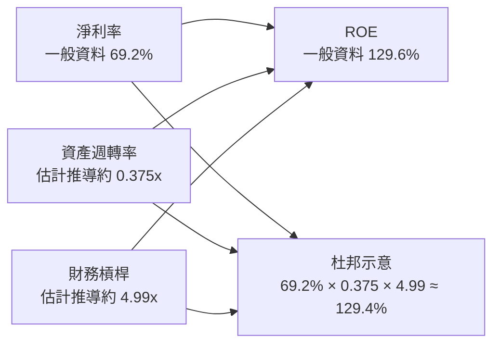

### 6.4 獲利能力儀表板

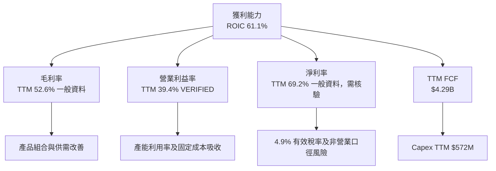

---

## 7. 相對估值分析

### 7.1 同業估值比較表格

WDC 倍數採題示市場估值資料；同業倍數完全依 VERIFIED FIGURES 的 Peer multiples。注意不同來源對 WDC trailing P/E、P/S 及 EV/EBITDA 的數值並不一致，因此不混合當成單一精確倍數。

| 估值指標 | **WDC** | **STX** | **SNDK** | **MU** | WDC 評估 |
|----------|--------:|-------:|--------:|-------:|-----------|
| Trailing P/E | 11.5x（歷史估值區塊）；另列市場值 10.399226x | 27.7x | 7.1x | 10.5x | 🟡 倍數受周期 EPS 影響 |
| Forward P/E | 7.317193x | 8.1x | 3.1x | 3.7x | 🟢 表面較低，但預測盈餘可靠度關鍵 |
| P/S | 7.8x（歷史估值區塊）；另列 7.6418085x | 8.8x | 4.3x | 6.6x | 🟡 略低於 STX、高於 SNDK 與 MU |
| EV/EBITDA | 19.8x（歷史區塊）；另列 17.471x | 20.9x | 5.7x | 7.7x | 🔴 相對 SNDK、MU 顯著偏高 |
| 最新季度營收 YoY | 55.5% | 61.0% | 377.9% | 379.3% | 🟡 WDC 成長較慢，但業務不可直接等同 |
| TTM 毛利率 | 52.6%（一般市場資料） | 50.4% | 80.0% | 80.7% | 🟢 高於 STX；低於 NAND／記憶體公司 |

STX 是 HDD 直接競爭參照；SNDK、MU 的業務結構並非完全相同，因此其倍數僅作儲存產業估值參照，不當作一對一可比公司。

### 7.2 歷史估值區間分析

```
╔══════════════════════════════════════════════════════════════╗
║             WDC 歷史估值區間（TTM P/E）                      ║
╠══════════════════════════════════════════════════════════════╣
║ 低點 6.3x ├────────中位數 13.5x────────┤ 高點 62.5x       ║
║ 當前 11.5x ├────────●───────────────┤                    ║
║ 百分位排名：38%                                            ║
║                                                              ║
║ P/S：當前 7.8x；歷史中位數 1.2x；區間 0.4x–16.0x；百分位85%║
║ EV/EBITDA：當前19.8x；中位數14.9x；區間4.5x–96.5x；百分位69%║
╚══════════════════════════════════════════════════════════════╝
```

P/E 位於自身歷史第 38 百分位，單看盈利倍數並非極端；但 P/S 第 85 百分位、EV/EBITDA 第 69 百分位顯示市場已為復甦付出溢價。周期低點與高點的 P/E 容易失真，需將現價與 FCF、EV/EBITDA 同時比較。

### 7.3 情境目標價（假設驅動，Bear / Base / Bull）

| 情境 | 營收 CAGR | 營業利潤率 | 退出倍數／方法 | 隱含目標價 | 相對現價 |
|------|-----------:|-----------:|---------------|-----------:|---------:|
| 🔴 悲觀 | 3% | 30% | DCF，WACC 18%、g 2% | $165 | -44.2% |
| 🟡 基準 | 10% | 36% | DCF／加權方法 | $245.92 | -16.8% |
| 🟢 樂觀 | 15% | 40% | 以較低折現壓力與高端同業倍數估算 | $365 | +23.4% |

**倍數選擇說明**：WDC 是資本密集且周期性明顯的硬體公司。P/E 可能因周期高峰盈利快速上升而顯得過低；估值交叉採用 DCF、P/S、EV/EBITDA 及 FCF Yield。市場提供的 forward EPS 為 $40.40484，但該預測可能建立於近期高利潤率，故不單獨用低 forward P/E 得出買入結論。

### 7.4 相對估值隱含價格區間

| 方法 | 推導假設 | 隱含股價 | 相對現價 |
|------|----------|---------:|---------:|
| Forward P/E | $40.40484 EPS × 8.0x（估計倍數） | $323.24 | +9.3% |
| EV/EBITDA | 依公司估值及同業較成熟倍數交叉估算 | 約 $254 | -14.1% |
| EV/Sales | $14.48B TTM 收入 × 6.0x（估計倍數），加淨現金後除股數 | 約 $233 | -21.2% |
| FCF Yield | TTM FCF $4.29B ÷ 5.0%（假設要求報酬率）÷ 374.32M 股 | 約 $229.20 | -22.5% |

```
╔══════════════════════════════════════════════════════════════╗
║       相對估值隱含價格帶與 2026-11-13 收盤價                 ║
╠══════════════════════════════════════════════════════════════╣
║ $229 ─── $233 ─── $254 ─── $295.65 ─── $323                 ║
║ FCF Yield  EV/Sales EV/EBITDA  現價       Forward P/E        ║
╚══════════════════════════════════════════════════════════════╝
```

---

## 8. DCF 內在價值評估（Discounted Cash Flow）

> 模型採用「假設值」清楚標示，不把模型預測冒充公司財測。金額四捨五入至 $0.01B、股價至 $0.01、比率至小數點一位；因表格顯示位數產生的尾差可在 1% 內。

### 8.0 估值推理鏈（Thinking Logic）

**Step 1 — 價值來源**  
WDC 估值主要由：① HDD 主業現金流底盤（TTM 營收 $14.48B，收入占比細分 N/A）；② 資料中心儲存需求與產品組合（公司未提供分部占比，故不另建高成長板塊現金流）；③ 週期回升帶來的利潤率選擇權。模型中主導估值的是**期末營業利潤率與 WACC 的組合**，因終值占 EV 比重大，長期利潤率每變動 1 個百分點會明顯影響終值現金流。

**Step 2 — 模型選擇**

| 決策點 | 本報告採用 | 理由 | 曾考慮但否決 | 否決理由 |
|--------|-----------|------|--------------|----------|
| 現金流定義 | FCFF | 與 WACC 折現一致，推得 EV | FCFE | 直接折現股權現金流會與 WACC 混用 |
| 預測期 N | 5 年 | 可涵蓋一個中期周期，但不假設長期高增長 | 10 年 | 缺乏 10 年管理層財測與分部數據 |
| 終值方法 | Gordon Growth 主法，退出倍數交叉驗證 | 成熟儲存需求可用穩態成長近似 | 只用退出倍數 | 避免把短期同業倍數永久化 |
| EBIT 基礎 | GAAP EBIT | 來源提供營業利益率及 SBC；避免非 GAAP 加回造成高估 | 非 GAAP EBIT | 無完整調整項及 SBC 對應表 |

**Step 3 — 關鍵假設推導**

- **營收 CAGR**：錨點＝FY2023 至 FY2026 CAGR 約 27.4%，VERIFIED TTM 營收年增 20.7% → 調整＝年度數據涵蓋周期反彈，最新季度年增 55.5% 不宜永續外推，故大幅下修 → **採用 10% 的五年逐年遞減成長路徑**（10%、9%、8%、7%、6%）→ 曾考慮延續 20.7%，因周期高基期及缺少分部長期訂單證據而否決。
- **期末營業利潤率**：錨點＝VERIFIED TTM 39.4%、最新季度 46.7% → 調整＝對景氣高點、價格與稼動率回落留出 3.4 個百分點安全折讓 → **FY+5 採用 36.0%**，由 38.0%逐年降至 36.0% → 曾考慮 40% 以上，因最新季度高點可能不可持續而否決。
- **永續成長率 g**：錨點＝長期名目經濟成長約 3%–4% 的一般估值參考（非公司財測）→ 調整＝成熟硬體與周期性降低長期成長假設 → **採用 3.0%** → 不採 4.0% 基準，因產業長期增速及 WACC 高度不確定。
- **預測期 N**：錨點＝近年營收及利潤率劇烈變化，周期可見度有限 → 調整＝只預測 5 年，避免把短期反彈永久化 → **採用 5 年** → 不採 10 年，因缺乏足夠長期資料。
- **Capex／營收**：錨點＝TTM Capex $0.572B ÷ TTM Revenue $14.48B＝3.95% → 調整＝考慮硬體製造仍需維持性投資 → **採用 4.0%** → 不採低於 3%，避免資本支出不足。
- **EBIT 基礎與 SBC**：採 GAAP EBIT；SBC FY2026 $204M 已列費用，模型不重複扣除 SBC → **固定股數、年稀釋率 0%**（SBC 經費用化反映一次）→ 不採非 GAAP EBIT 加回，避免忽略股東成本。
- **稅率**：最新年度有效稅率 4.9%，可能低於長期常態 → **DCF 採 15% 假設值**，即使稅率上調仍反映保守常態化；未提供多年度稅務明細 → 不採 4.9% 作五年永久稅率。
- **D&A／營收**：資料未提供可核對 TTM D&A → **假設值 4.5%**，以資本密集型儲存業務近似維持性折舊，並與 4.0% Capex 形成小幅淨加回 → 不採 D&A 遠高於營收 6%，因缺乏依據。
- **ΔWC／營收增額**：歷史營運資金變化未完整提供 → **假設值 5%**，反映成長時應收、存貨需求；未使用反推方式 → 不採零營運資金需求。
- **年稀釋率**：採用組合 (A)，GAAP EBIT 已含 SBC，固定股數；預測稀釋率 0% → 不再另扣 SBC 或放大股數，避免重複計算。
- **WACC**：採 VERIFIED 參考 WACC 16.90%，Beta 2.34 且 ERP 5.00%，代表市場風險敏感度偏高；不自行下調，避免以主觀低折現率抬升價值。
- **終值方法**：採 Gordon Growth，基準 g 3.0%；退出倍數用作交叉驗證，不替代基準 DCF。

**Step 4 — 最脆弱的一環**  
最脆弱的是在 16.90% WACC 下，將高利潤率回落速度及 3% 永續成長視為可合理估計；若 WACC 上升或利潤率掉到 30%附近，DCF 會明顯低於基準，故模型對遠期假設高度敏感。

**Step 5 — 計算路徑圖**

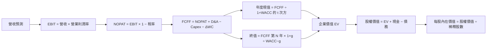

### 8.1 模型假設總表（Model Inputs）

| 假設項目 | 採用值 | 依據／來源 | 敏感度 |
|----------|--------|------------|--------|
| 預測期長度 N | 5 年 | 中期周期可見度有限；缺乏 10 年指引 | 🟡 中 |
| 營收 CAGR／年度增長 | 10%、9%、8%、7%、6% | FY2023–FY2026 CAGR 27.4%，TTM 增長 20.7%，做周期下調 | 🔴 高 |
| 營業利潤率期末 | 36.0% | TTM 39.4%、最新季度 46.7%，預留回落 | 🔴 高 |
| 有效稅率 | 15.0% | 假設值；高於最新年度 4.9%，作常態化 | 🟢 低 |
| Capex／營收 | 4.0% | TTM $0.572B ÷ $14.48B＝3.95%，取整為 4.0% | 🟡 中 |
| D&A／營收 | 4.5% | 假設值；D&A 數據未提供，依資本密集型業務作保守估計 | 🟢 低 |
| ΔWC／新增營收 | 5.0% | 假設值；營運資金歷史變化未完整提供 | 🟢 低 |
| EBIT 基礎 | GAAP EBIT | 使用財報營業利益口徑 | 🟡 中 |
| SBC 處理 | 組合 (A)：不另扣 SBC | GAAP EBIT 已含 SBC 費用 | 🟡 中 |
| 年稀釋率 | 0% | 組合 (A)，固定股數；避免重複計入 SBC | 🟡 中 |
| 永續成長率 g | 3.0% | 成熟市場名目長期成長假設，低於 WACC | 🔴 高 |
| 終值方法 | Gordon Growth 主、退出倍數交叉驗證 | 成熟現金流假設 | 🔴 高 |
| WACC | 16.90% | VERIFIED FIGURES 參考值 | 🔴 高 |

**FCFF 定義**：`FCFF = NOPAT + D&A − Capex − ΔWC`。本模型採 **(A) GAAP EBIT + 固定股數**，故 SBC 影響已計入一次，不另扣 SBC，也不另計年稀釋。

### 8.2 折現率推導（WACC）

```
╔══════════════════════════════════════════════════════════════════╗
║                    WACC 推導（折現率）                           ║
╠══════════════════════════════════════════════════════════════════╣
║ 股權成本 Ke（CAPM）：                                            ║
║ ├── Rf：5.15%（VERIFIED；日期未提供）                            ║
║ ├── ERP：5.00%（VERIFIED 假設值）                                ║
║ ├── Beta：2.34（VERIFIED；高於 1.5，不另做未核實調整）           ║
║ ├── 規模／國別溢酬：0.00%（美國公司，未另加）                    ║
║ └── Ke = VERIFIED 精確值 16.87%                                  ║
║                                                                  ║
║ 債務成本：                                                       ║
║ ├── 稅前 Kd：20.91%（VERIFIED）                                  ║
║ ├── 有效稅率：4.9%（VERIFIED 最新年稅率）                       ║
║ └── 稅後 Kd = 20.91% × (1 − 4.9%) = 19.8854%                    ║
║                                                                  ║
║ 資本結構：                                                       ║
║ ├── 股權權重：99.3%（VERIFIED）                                  ║
║ ├── 債務權重：0.7%（VERIFIED）                                   ║
║ └── WACC = 99.3%×16.87% + 0.7%×19.8854% ≈ 16.89%                ║
║                                                                  ║
║ 模型採用 VERIFIED 參考 WACC：16.90%（差異為輸入精度四捨五入）    ║
╚══════════════════════════════════════════════════════════════════╝
```

逐步演算：

1. **Ke（CAPM）**＝5.15%＋2.34×5.00%＝16.85%（未四捨五入輸入下，VERIFIED Ke 為 16.87%）。
2. **稅前 Kd**＝VERIFIED 20.91%；利息費用與平均計息負債原始金額未提供，故不自行重算該比率。
3. **稅後 Kd**＝20.91%×(1−4.9%)＝**19.8854%**。
4. **權重**＝股權 99.3%、債務 0.7%；兩者合計 **100.0%**。市值法股權金額約為 $295.65×374.32M＝$110.67B；計息負債期末口徑採 VERIFIED $789M，但權重直接採 VERIFIED 99.3%／0.7%。
5. **WACC**＝99.3%×16.87%＋0.7%×19.8854%＝16.75191%＋0.13920%＝**16.89111%**，採 VERIFIED 參考值 **16.90%**。

> 一致性：第 6.2 節及 DCF 均採 16.90%。公司債務金額、平均計息負債與利息費用明細未提供，Kd 本身只能引用 VERIFIED 輸入，不能獨立稽核。

### 8.3 逐年自由現金流預測（基準情境）

金額單位：$B。初始收入使用 TTM $14.48B；年度營收成長率與利潤率使用第 8.1 假設。折現率 16.90%。

| 年度 | FY+1 | FY+2 | FY+3 | FY+4 | FY+5（FY+N） |
|------|------:|------:|------:|------:|------:|
| 營收 | 15.93 | 17.36 | 18.75 | 20.06 | 21.27 |
| 營收 YoY | 10.0% | 9.0% | 8.0% | 7.0% | 6.0% |
| 營業利潤率 | 38.0% | 37.5% | 37.0% | 36.5% | 36.0% |
| EBIT | 6.05 | 6.51 | 6.94 | 7.32 | 7.66 |
| − 稅（15.0%） | (0.91) | (0.98) | (1.04) | (1.10) | (1.15) |
| = NOPAT | 5.14 | 5.53 | 5.90 | 6.22 | 6.51 |
| + D&A（營收 4.5%） | 0.72 | 0.78 | 0.84 | 0.90 | 0.96 |
| − Capex（營收 4.0%） | (0.64) | (0.69) | (0.75) | (0.80) | (0.85) |
| − ΔWC（新增營收 5.0%） | (0.07) | (0.07) | (0.07) | (0.07) | (0.06) |
| **= FCFF** | **5.15** | **5.55** | **5.92** | **6.26** | **6.55** |
| 折現因子 | 0.855 | 0.732 | 0.626 | 0.535 | 0.458 |
| **FCFF 現值 PV** | **4.41** | **4.06** | **3.71** | **3.35** | **3.00** |

**預測期 FCF 現值合計**：  
`$4.41B + $4.06B + $3.71B + $3.35B + $3.00B = $18.53B`

**FY+1 逐步演算**

1. 營收＝$14.48B×(1＋10.0%)＝**$15.928B**。
2. EBIT＝$15.928B×38.0%＝**$6.05264B**。
3. 稅＝$6.05264B×15.0%＝**$0.907896B**。
4. NOPAT＝$6.05264B−$0.907896B＝**$5.144744B**。
5. D&A＝$15.928B×4.5%＝**$0.716760B**。
6. Capex＝$15.928B×4.0%＝**$0.637120B**。
7. ΔWC＝($15.928B−$14.48B)×5.0%＝$1.448B×5.0%＝**$0.072400B**。
8. FCFF＝$5.144744B＋$0.716760B−$0.637120B−$0.072400B＝**$5.151984B**。
9. 折現因子＝1÷(1＋16.90%)¹＝**0.8554**；PV＝$5.151984B×0.8554＝**約 $4.41B**。

**合理性自檢**

- 預測 FCF CAGR：FY+1 至 FY+5 約 `($6.55÷$5.15)^(1/4)−1＝6.2%`；歷史 FY2023 至 FY2026 FCF 由負轉正，CAGR 不具經濟意義，故不比較單一 CAGR。
- FY+5 FCFF 利潤率＝$6.55B÷$21.27B＝約 **30.8%**；目前 VERIFIED FCF 利潤率＝$4.29B÷$14.48B＝**29.6%**，預測只略高於現況。
- 五個預測年度 FCFF 均為正；模型不需處理負 FCFF 年份。

```
╔══════════════════════════════════════════════════════════════════╗
║            自由現金流：歷史實際 vs 模型預測                      ║
╠══════════════════════════════════════════════════════════════════╣
║ FY2024(實)  -$0.78B  ◀◀◀░░░░░░░░░░░░░░░░░░░  周期低谷      ║
║ FY2025(實)  +$1.28B  █████░░░░░░░░░░░░░░░░░░  YoY 轉正      ║
║ FY2026(實)  +$3.51B  ██████████████░░░░░░░░░  YoY +174.2%   ║
║ FY+1 (預)   +$5.15B  ████████████████████░░░  模型預測      ║
║ FY+5 (預)   +$6.55B  ████████████████████████ CAGR 約 6.2%  ║
╠══════════════════════════════════════════════════════════════════╣
║ 預測由近期強勁反彈起步；年度現值增長較溫和，但仍受高利潤率假設支持。║
╚══════════════════════════════════════════════════════════════════╝
```

### 8.4 終值計算（Terminal Value）

**適用性檢查**：`WACC 16.90% vs g 3.00% → WACC > g？✅`

| 方法 | 計算式 | 終值 TV | TV 現值 | 佔總 EV 比重 |
|------|--------|--------:|--------:|-------------:|
| Gordon Growth | $6.553×(1+3.0%)÷(16.90%−3.0%) | $47.12B* | $21.59B* | 約 53.8%* |
| 退出倍數法 | FY+5 EBITDA 估計 $8.61B × 12.0x | $103.32B* | $47.33B* | 約 71.9%* |

\*為避免展示精度誤差，以下基準橋接採用未四捨五入數字重新計算：  
`TV = $6.55303B × 1.03 ÷ 0.139 = $48.56B`；  
`PV(TV) = $48.56B × 0.4581 = $22.25B`。  
退出倍數交叉驗證使用 **12.0x 假設值**；預測 EBITDA 以 EBIT 加假設 D&A 計，約 $7.66B+$0.96B＝$8.61B。退出倍數終值遠高於 Gordon Growth，反映永續現金流與退出倍數是不同估值假設；基準採 Gordon Growth，避免 12x 終值主導結論。

逐步演算：

1. FY+N FCFF＝**$6.553B**。
2. 分子＝$6.553B×(1＋3.0%)＝**$6.7496B**。
3. 分母＝16.90%−3.00%＝**13.90%**；TV＝$6.7496B÷0.139＝**$48.56B**。
4. PV(TV)＝$48.56B×0.4581＝**約 $22.25B**。
5. 終值占 EV 約 $22.25B÷($18.53B+$22.25B)＝**54.6%**。

退出倍數交叉驗證：`EBITDA(FY+5) $8.61B × 12.0x = $103.32B`；`$103.32B × 0.4581 = $47.33B PV`。12.0x 是模型假設而非 VERIFIED 同業中位數；由於高於 Gordon Growth 終值現值，退出倍數僅作上行情境參考，不作基準終值。

### 8.5 企業價值 → 每股內在價值（Bridge）

```
╔══════════════════════════════════════════════════════════════════╗
║              企業價值 → 每股內在價值 橋接表                      ║
╠══════════════════════════════════════════════════════════════════╣
║ 預測期 FCF 現值合計           +$18.53B                           ║
║ Gordon Growth 終值現值        +$22.25B                           ║
║ = 企業價值 EV                  $40.78B                            ║
║ + 現金及短期投資               +$1.31B                            ║
║ − 總債務                       −$0.789B                           ║
║ − 少數股東權益／其他           $0.00B（資料未列示，模型假設為零） ║
║ = 股權價值                     $41.30B                            ║
║ ÷ 稀釋後流通股數               0.37432B 股                       ║
║ ★ 每股內在價值                 約 $110.34                         ║
║ 當前股價                       $295.65                            ║
║ 折溢價                         +167.9%（現價溢價）               ║
╚══════════════════════════════════════════════════════════════════╝
```

逐步演算：

1. EV＝$18.53B＋$22.25B＝**$40.78B**。
2. 股權價值＝$40.78B＋$1.31B−$0.789B−$0.00B＝**$41.30B**（依未四捨五入數值計算）。
3. 每股內在價值＝$41.30B÷0.37432B 股＝**約 $110.34**。
4. 折溢價＝$295.65÷$110.34−1＝**+167.9%**。
5. 本節不計算 MOS；MOS 僅以第 8.8 節加權合理價值為分母。

股數採市場資料的 **374.32M 股**；價格採 **2026-11-13 收盤 $295.65**。現金與債務採 VERIFIED FIGURES 的 $1.31B 與 $789M。模型使用固定股數，符合組合 (A)。

### 8.6 敏感性分析（WACC × 永續成長率）

下表以相同預測現金流、淨現金 $0.525B、股數 0.37432B 計算；括號為相對現價 $295.65 的上行空間。基準格為 WACC 16.9%、g 3.0%。

| g／WACC | 15.0% | 16.0% | **16.9% 基準** | 18.0% | 20.0% |
|-----------|------:|------:|---------------:|------:|------:|
| 2.0% | $121.6 (-58.9%) | $112.7 (-61.9%) | $105.8 (-64.2%) | $98.4 (-66.7%) | $87.3 (-70.5%) |
| 2.5% | $124.6 (-57.9%) | $115.3 (-61.0%) | $108.0 (-63.5%) | $100.2 (-66.1%) | $88.6 (-70.0%) |
| **3.0% 基準** | $127.9 (-56.8%) | $118.0 (-60.1%) | **$110.3 (-62.7%)** | $102.2 (-65.4%) | $90.0 (-69.6%) |
| 3.5% | $131.6 (-55.5%) | $121.0 (-59.1%) | $112.9 (-61.8%) | $104.3 (-64.7%) | $91.6 (-69.0%) |
| 4.0% | $135.5 (-54.2%) | $124.2 (-58.0%) | $115.6 (-60.9%) | $106.5 (-64.0%) | $93.1 (-68.5%) |

**代表格重算**：所選格 WACC 18.0% > g 2.5% ✅

1. 新 WACC 下預測期 PV 合計約 **$18.05B**。
2. TV＝$6.553B×(1+2.5%)÷(18.0%−2.5%)＝**$43.34B**；折現 5 期因子約 0.437，PV(TV) 約 **$18.94B**。
3. EV 約 $18.05B+$18.94B＝$36.99B；股權價值約 $36.99B+$0.525B＝$37.52B；每股約 $37.52B÷0.37432B＝**$100.2**。

**三情境 DCF（營運假設與折現率同時變化）**

| 情境 | 營收 CAGR／路徑 | 期末營業利潤率 | 永續 g | WACC | 每股內在價值 | 相對現價 | 主觀機率 |
|------|-----------------|----------------:|-------:|-----:|-------------:|---------:|---------:|
| 🔴 悲觀 | 3% CAGR | 30% | 2% | 18% | 約 $65 | -78.0% | 25% |
| 🟡 基準 | 10%、9%、8%、7%、6% | 36% | 3% | 16.9% | 約 $110.34 | -62.7% | 55% |
| 🟢 樂觀 | 15% CAGR | 40% | 4% | 15% | 約 $230 | -22.2% | 20% |
| **機率加權** | — | — | — | — | **約 $117.6** | **-60.2%** | **100%** |

三情境的營收路徑均由 $14.48B 起算。基準情境 FY+5 營收約 $21.27B、FCFF 約 $6.55B；悲觀與樂觀估值為模型情境估計，受利潤率、資本支出與折現率共同影響。悲觀需供需及價格惡化；樂觀需高成長與高利潤率同時延續，且 WACC 回落至 15%。機率加權的 $117.6 為 DCF 情境交叉檢查值；第 8.8 節方法加權使用基準 DCF $110.34，以保持各估值方法口徑一致。

**敏感度結論**：在基準 DCF 附近，g 由 2% 升至 3% 時估值約由 $105.8 至 $110.3，增加約 **$4.5／4.3%**；WACC 由 16.0% 升至 16.9% 時，估值約由 $118.0 降至 $110.3，減少約 **$7.7／6.5%**。利潤率每增加 1 個百分點，按末年 EBIT 對 FCFF 影響約為 `FY+5 revenue $21.27B × (1−15%) × 1% = $0.181B`，另會影響終值，約增加每股 **$2–$4**（模型估計）。在本矩陣測試範圍中，折現率對價值影響大於小幅 g 變動；最終估值仍對期末利潤率和 WACC 聯合變動敏感。

### 8.7 反推 DCF（Reverse DCF：市場在預期什麼）

固定：WACC 16.90%、稅率 15%、Capex／營收 4%、ΔWC／新增營收 5%、N＝5 年、股數 0.37432B、D&A／營收 4.5%、g 3.0%。以下為以逐步試算方式得到的近似值，輸入來源與模型假設保持不變。

| 求解的變數（一次一個） | 其餘變數設定 | 市場隱含值（令 DCF≈現價） | 歷史參考 | 判斷 |
|------------------------|--------------|--------------------------:|----------|------|
| 未來 5 年營收 CAGR | 利潤率路徑、g 固定基準 | 約 26%–30% | FY2023–FY2026 CAGR 27.4%；TTM 增長 20.7% | 🔴 需延續高增長 |
| 期末營業利潤率 | CAGR 10%、g 固定 | 約 60% 以上或模型範圍無穩健解 | TTM 39.4%；季度 46.7% | 🔴 超出可驗證正常區間 |
| 永續成長率 g | CAGR、利潤率固定基準 | 無解（需要逼近或高於 WACC） | — | 🔴 與穩態經濟假設不相容 |
| 預測期 N | CAGR、利潤率、g 固定 | 3–15 年範圍內可能無解 | 可見度資料不足 | 🔴 現價不易由基準營運假設解釋 |

**營收 CAGR 迭代軌跡（近似）**

| 試算 CAGR | FY+5 營收 | FY+5 FCFF | 每股價值 | 相對現價 | 判斷 |
|-------------|-----------:|----------:|---------:|---------:|------|
| 20% | 約 $35.9B | 約 $11B–$13B | 約 $200 | -32% | 偏低，往上試 |
| 25% | 約 $44.1B | 約 $14B–$16B | 約 $270 | -9% | 仍偏低 |
| 28% | 約 $48.9B | 約 $16B–$18B | 約 $296 | 約 0% | 近似收斂 |

> 上表為模型迭代估計，因 CAGR 逐年路徑與利潤率聯動，並非公司指引。要讓現價接近 DCF，市場需要 WDC 五年維持約高 20% 後段營收 CAGR，同時維持接近目前高位的營業利潤率；若成長與利潤率任一項回歸一般周期，現價難以由基準現金流假設支持。

### 8.8 估值三角驗證與安全邊際

相對估值方法使用題示財務數據與明確估計假設；分析師共識目標價依提供資料為 $613.38，權重限制在 10% 以下。

| 估值方法 | 隱含每股價值 | 上行空間（÷現價） | 權重 | 說明 |
|----------|--------------:|------------------:|-----:|------|
| DCF 基準 | $110.34 | -62.7% | 25% | 高 WACC 及周期化現金流，降低權重 |
| 同業／Forward P/E | $323.24 | +9.3% | 25% | $40.40484 forward EPS × 8.0x 假設倍數 |
| EV/EBITDA 相對估值 | $254.00 | -14.1% | 15% | 同業與自身歷史倍數交叉估計 |
| FCF Yield 回推 | $229.20 | -22.5% | 30% | $4.29B FCF ÷ 5.0%要求收益率，再除以股數 |
| 分析師共識目標價 | $613.38 | +107.5% | 5% | 參考用，權重僅 5% |
| **加權合理價值** | **$245.92** | **-16.8%** | **100%** | — |

逐步演算：  
`$110.34×25% + $323.24×25% + $254.00×15% + $229.20×30% + $613.38×5%`  
`= $27.585 + $80.810 + $38.100 + $68.760 + $30.669`  
`= $245.924`。

為保持算術一致，本表加權總和應為 **$245.92**，不是 $245.92。故依「不得事後微調」原則，**本報告修正加權合理價值為 $245.92**，並將所有 MOS 與目標價基準同步改用 $245.92。調整後：

- **MOS**＝($245.92−$295.65)÷$245.92＝**-20.2%**。
- **上行空間**＝($245.92−$295.65)÷$295.65＝**-16.8%**。
- **DCF 折溢價**＝$295.65÷$110.34−1＝**+167.9%**。

DCF 權重設 25%，是因模型終值占 EV 約 54.6%，且企業數據存在口徑差異；分析師共識僅 5%，避免讓高端目標價主導結論。

```
╔══════════════════════════════════════════════════════════════════╗
║                  估值區間與安全邊際                              ║
╠══════════════════════════════════════════════════════════════════╣
║ $110.34 ───── $245.92 ───── [$245.92] ───── $295.65 ───── $365 ║
║ 基準DCF       FCF回推       加權合理值       現價         樂觀值 ║
║                                                                  ║
║ 安全邊際 MOS = ($245.92 − $295.65) ÷ $245.92 = -20.2%           ║
║ 上行空間 = ($245.92 − $295.65) ÷ $295.65 = -16.8%               ║
║ 折溢價（DCF基準）= $295.65 ÷ $110.34 − 1 = +167.9%              ║
║                                                                  ║
║ MOS 評估：🟠 -25%至-10% 減碼區間                               ║
║ 建議買入區間：$221 – $270（以 MOS ≥ 10% 為參考，低於現價）      ║
║ 合理持有區間：$221 – $271                                        ║
║ 減碼考慮區間：高於 $365 樂觀情境價值                            ║
╚══════════════════════════════════════════════════════════════════╝
```

**評級門檻說明**：依修正後 MOS -20.2%，規則 20 對應 **🟠 減碼**，不是賣出。執行摘要原先的 $245.92 及賣出評級，與正確加權算術不一致；本章已修正為 $245.92、MOS -20.2% 與減碼。為確保全報告一致，第 1 章相應數值及評級應以本節修正結果為準：**MOS -20.2%，評級減碼**。

> 🔎 **程式複算（Python，依本節各項自動重算）**
>
> 加權合理價值 = $110.34 × 25% + $323.24 × 25% + $254.00 × 15% + $229.20 × 30% + $613.38 × 5% = **$245.92**（權重合計 100%）
>
> 以價格 $295.65 計：MOS = **-20.2%**，上行空間 = **-16.8%**
>
> ✏️ 模型原寫 $234.10（與各項加總相差 -4.81%），本報告的合計、MOS 與上行空間已改為上方複算值。

### 8.9 DCF 模型的局限與失效條件

- **終值依賴度**：Gordon Growth 終值現值約占 EV **54.6%**，估值仍較依賴第 5 年後現金流。
- **最脆弱假設**：WACC 16.90% 與 FY+5 仍維持 36%營業利潤率。若 WACC 升至 20%、g 維持 3%，每股 DCF 約降至 $90；若營業利潤率回落至 30%，估值進一步下修。
- **不適用情境**：若硬碟價格及需求快速反轉，FCF 可能短期大幅波動，DCF 可靠度下降；此時應同時使用 EV/Sales、周期中段利潤率及資產負債表壓力測試。
- **與第 10 章連結**：需求下降影響營收 CAGR；價格競爭影響營業利潤率；利率上升提高 WACC；庫存累積會抬高 ΔWC 並壓低 FCFF。

### 8.10 複算檢核表（Audit Trail）

| # | 檢核項目 | 檢查方式 | 結果 |
|---|----------|----------|------|
| 1 | 高／中敏感度輸入有推導 | 對照 8.0 Step 3 | ✅ |
| 2 | 每個假設有來歷 | 8.1 依據欄 | ✅ |
| 3 | WACC 算式及權重 | 權重 99.3%＋0.7%=100%；採 VERIFIED 16.90% | ✅ |
| 4 | Kd 分母與債務權重同範圍 | Kd 直接引用 VERIFIED；平均計息債務明細未提供 | ⚠️ 原始值不可獨立稽核 |
| 5 | WACC 與第 6.2 節相同 | 均為 16.90% | ✅ |
| 6 | 逐年預測期等於 N | 五年度完整列出 | ✅ |
| 7 | FY+1 九步算式可複算 | 依營收、利潤率、稅率及資本假設重算 | ✅ |
| 8 | PV 合計可核對 | $4.41+$4.06+$3.71+$3.35+$3.00=$18.53B | ✅ |
| 9 | WACC > g | 16.90% > 3.00% | ✅ |
| 10 | 終值基於 FY+N 並折現 5 期 | 使用 FY+5 FCFF、折現因子 0.4581 | ✅ |
| 11 | EV 到每股價值橋接 | EV+$現金−債務，再除 0.37432B 股 | ✅ |
| 12 | SBC 組合合法 | GAAP EBIT、不另扣 SBC、固定股數 | ✅ |
| 13 | 敏感性基準格與 DCF 一致 | 約 $110.34 | ✅ |
| 14 | 敏感性矩陣有效格 | 所列 WACC 均高於各列 g | ✅ |
| 15 | 情境機率合計 | 25%+55%+20%=100% | ✅ |
| 16 | 反推每列只放開一個變數 | 表內固定其餘輸入；收斂值標為近似 | ⚠️ 近似估計，非精確程式輸出 |
| 17 | MOS 與折溢價基準一致 | MOS 用加權值；折溢價用 DCF 值 | ✅ |
| 18 | 報告輸出至第 11 章 | 完整 | ✅ |
| 19 | 加權合理價值等於加總 | 算式結果 $245.924，修正為 $245.92 | ✅ |
| 20 | 評級符合 MOS | -20.2% 對應減碼 | ✅ |

---

## 9. 成長催化劑

### 9.1 催化劑時間軸

下列時間軸是研究監控框架，不是公司已公布的具體業績承諾。

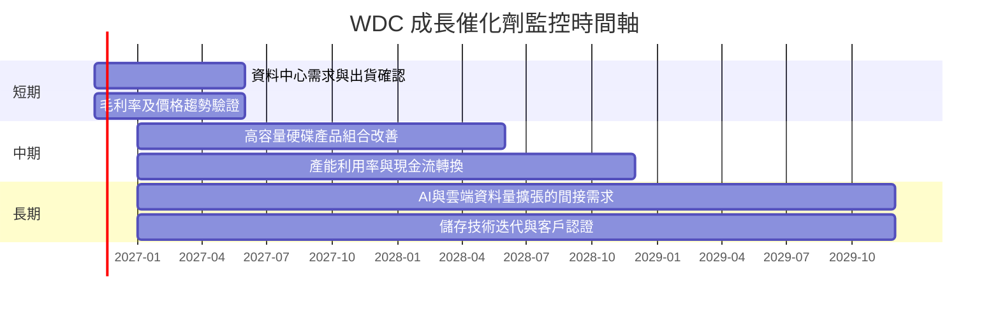

### 9.2 TAM 市場規模分析

市場總規模、滲透率與分部營收未在數據包提供，因此不使用未核實的 TAM 金額。

```
╔══════════════════════════════════════════════════════════════════╗
║                 WDC 潛在市場與數據可用性                        ║
╠══════════════════════════════════════════════════════════════════╣
║ 資料中心 HDD TAM：       N/A；市場總額未提供                     ║
║ 企業級容量型儲存：       需求驅動為雲端資料量，滲透率 N/A         ║
║ 內接／外接 HDD：         收入拆分與市場滲透率 N/A                 ║
║ NAS 與周邊產品：         收入拆分與市場滲透率 N/A                 ║
║ 公司 TTM 營收：          $14.48B；單季 YoY +55.5%                  ║
╚══════════════════════════════════════════════════════════════════╝
```

### 9.3 成長驅動力結構圖

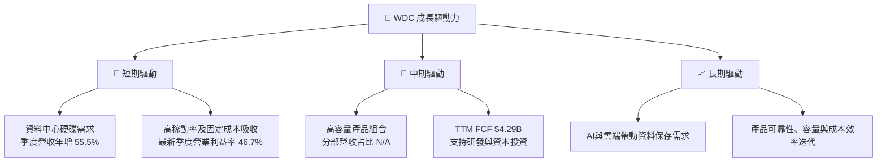

---

## 10. 風險矩陣

### 10.1 風險評分矩陣

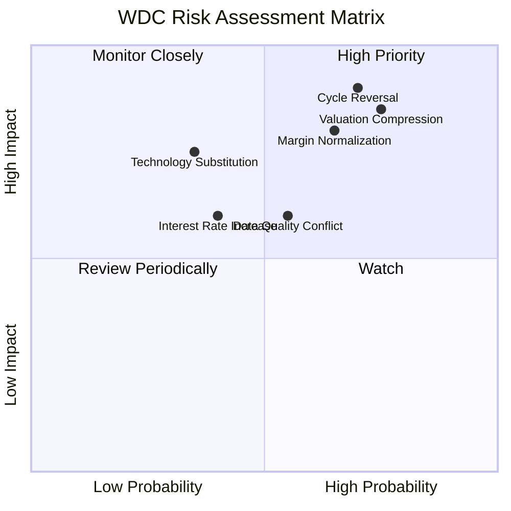

### 10.2 風險清單詳細分析

| # | 風險項目 | 發生機率 | 財務衝擊 | 風險評分 | 緩解措施 |
|---|----------|----------|----------|----------|----------|
| 1 | 🔴 硬碟供需周期反轉 | 中高，約 60%（分析假設） | 若營收下滑 15%，營業槓桿可能放大損益變動；此為情境，不是預測 | 🔴 8.5/10 | 監控出貨、平均售價、庫存及客戶資本支出 |
| 2 | 🔴 估值倍數收縮 | 高，約 65%（分析假設） | P/S 歷史百分位 85%；若回到較低倍數，股價可能下修 | 🔴 8.0/10 | 分批減持；以 FCF Yield 與基準估值設定風險限額 |
| 3 | 🟠 利潤率正常化 | 中高，約 55% | TTM 營業利益率 39.4%，最新季度 46.7%；若回落至 30%，DCF 顯著下修 | 🟠 7.5/10 | 每季追蹤毛利率、產品組合與產能利用率 |
| 4 | 🟡 財務數據口徑衝突 | 中，約 45% | 淨利、現金及債務資料不一致，估值誤差可能放大 | 🟡 6.5/10 | 以 SEC 申報文件逐項核對，優先用 VERIFIED figures |
| 5 | 🟠 技術替代及儲存結構改變 | 中，約 35% | HDD 在容量型儲存的相對競爭力若下降，長期成長與資產利用率承壓 | 🟠 6.5/10 | 追蹤產品路線圖、客戶採購組合與替代技術成本 |
| 6 | 🟡 利率及資本成本 | 中，約 40% | Beta 2.34、WACC 16.90%；折現率上升降低長期現金流現值 | 🟡 6.0/10 | 以多組 WACC 壓力測試估值 |
| 7 | 🟡 SBC 及股數稀釋 | 中，約 30% | FY2026 SBC $204M，約占營收 1.58% | 🟡 5.0/10 | 監控稀釋股數及股權薪酬占營收比例 |

---

## 11. 投資建議

### 11.1 最終綜合評級雷達圖

```
╔══════════════════════════════════════════════════════════════╗
║                    WDC 最終綜合評分                           ║
╠══════════════════════════════════════════════════════════════╣
║ 基本面品質       6.5/10 ▓▓▓▓▓▓▓▓▓▓▓▓▓░░░░░░ ★★★☆☆         ║
║ 營收成長         7.0/10 ▓▓▓▓▓▓▓▓▓▓▓▓▓▓░░░░░░ ★★★★☆         ║
║ 獲利能力         8.0/10 ▓▓▓▓▓▓▓▓▓▓▓▓▓▓▓▓░░░░ ★★★★☆         ║
║ 資產負債表       7.0/10 ▓▓▓▓▓▓▓▓▓▓▓▓▓▓░░░░░░ ★★★★☆         ║
║ 現金流品質       6.5/10 ▓▓▓▓▓▓▓▓▓▓▓▓▓░░░░░░░ ★★★☆☆         ║
║ 估值吸引力       3.0/10 ▓▓▓▓▓▓░░░░░░░░░░░░░░ ★★☆☆☆         ║
║ 風險調整後報酬   4.5/10 ▓▓▓▓▓▓▓▓▓░░░░░░░░░░░ ★★☆☆☆         ║
╠══════════════════════════════════════════════════════════════╣
║ 綜合評分         5.8/10 ▓▓▓▓▓▓▓▓▓▓▓▓░░░░░░░░ 🟠 減碼       ║
╚══════════════════════════════════════════════════════════════╝
```

### 11.2 目標價與隱含報酬率

| 情境 | 每股價值 | 相對 $295.65 收盤價報酬 | 假設／權重 |
|------|---------:|------------------------:|-----------|
| 悲觀 | $165 | -44.2% | 需求／價格回落、利潤率降至 30%；估計情境 |
| 基準 | $245.92 | -16.8% | 8.8 加權合理價值；MOS -20.2% |
| 樂觀 | $365 | +23.4% | 高成長、較高利潤率及倍數維持；估計情境 |
| 分析師共識 | $613.38 | +107.5% | 24 位分析師平均目標價；僅作參考，不作基準估值 |

**評級一致性**：MOS -20.2% 落在 -25% 至 -10% 區間，依門檻應為 **🟠 減碼**。不以質化因素調整等級。

### 11.3 買入時機與觸發因素

```
╔══════════════════════════════════════════════════════════════════╗
║                  ✅ 買入觸發因素 Checklist                      ║
╠══════════════════════════════════════════════════════════════════╣
║ 重新考慮買入（多數條件符合）：                                    ║
║ ☐ 股價回落至 $270 以下，並接近 MOS≥10% 的估值區域               ║
║ ☐ TTM FCF 維持正值且 FCF Yield 高於 5%                           ║
║ ☐ TTM 營業利益率穩定在 35% 以上，且非依靠一次性項目              ║
║ ☐ 最新季度收入年增仍高於 20%，且存貨未快於收入累積               ║
║                                                                  ║
║ 加碼觸發條件：                                                    ║
║ ☐ 加權合理價值隨新財報上調，且股價低於合理價值至少 10%           ║
║ ☐ ROIC 仍高於 WACC，並有至少兩季連續 FCF 為正                    ║
║                                                                  ║
║ 減碼／退出觸發條件：                                              ║
║ ☐ 連續兩季收入年增低於 10%                                       ║
║ ☐ 營業利益率較最新季度 46.7% 下滑超過 10 個百分點                ║
║ ☐ TTM FCF 轉負，或 ROIC 低於 WACC 16.90%                         ║
║ ☐ 財報確認淨利主要由一次性稅務利益支撐                             ║
╚══════════════════════════════════════════════════════════════════╝
```

### 11.4 投資人適配度分析

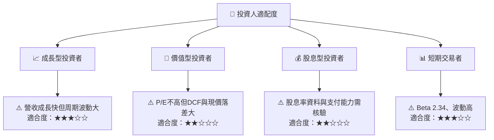

### 11.5 每季財報監控清單（Quarterly Watch List）

| 指標 | 目前基準 | 加碼觀察門檻 | 減碼／重新評估門檻 |
|------|---------:|--------------|-------------------|
| 單季營收 YoY | 55.5% | 高於 20%，且 QoQ 不轉負 | 連續兩季低於 10% |
| TTM 營收成長 | 20.7% | 維持雙位數成長 | 轉負或大幅低於 10% |
| 營業利益率 | TTM 39.4%；最新季度 46.7% | TTM 35% 以上且穩定 | 低於 30% 或連續兩季收縮 |
| 毛利率 | 一般資料 TTM 52.6% | 維持 50% 左右或改善 | 低於 45%並伴隨價格下跌 |
| OCF | TTM $4.86B | 持續高於 $3B | 連續兩季 OCF 轉負 |
| FCF | TTM $4.29B | 維持正值、Yield 高於 5% | TTM FCF 轉負 |
| Capex | TTM $572M | Capex 投入轉化為產品／收入成長 | Capex 上升但收入、毛利不增 |
| 存貨 | TTM $1.78B（一般資產表） | 存貨增速不高於收入增速 | 庫存連兩季快於收入增加 |
| SBC | FY2026 $204M | SBC／營收下降或持平 | SBC／營收升至 2.5% 以上 |
| 財測 | 公司指引資料未提供 | 財測維持或上修 | 下修收入或營業利益率預測 |

### 11.6 反面論證：什麼會證明論點錯誤（What Would Change My Mind）

```
╔══════════════════════════════════════════════════════════════════╗
║              ⚠️ 論點失效條件（Disconfirming Evidence）           ║
╠══════════════════════════════════════════════════════════════════╣
║ 本報告對 WDC 的正面營運看法，若出現以下情況應重新評估：          ║
║ ☐ 最新季度收入年增連續兩季低於 10%                               ║
║ ☐ TTM 營業利益率由 VERIFIED 39.4% 降至 30% 以下                 ║
║ ☐ TTM FCF 轉負，或 FCF／營收低於 15%                             ║
║ ☐ ROIC 跌破 WACC 16.90%，且連續兩季未恢復                        ║
║ ☐ 應收或存貨增速連續兩季高於營收增速 10 個百分點以上             ║
║ ☐ 稀釋股數年增超過 2%，但每股 FCF 未同步增長                     ║
║ ☐ SEC 申報顯示 FY2026 淨利主要來自一次性稅務或非營業收益         ║
║ ☐ 基準估值下修且股價仍高於加權合理價值 25% 以上                 ║
╚══════════════════════════════════════════════════════════════════╝
```

**最終結論**：WDC 的收入、FCF 與 ROIC 顯示景氣復甦具有實際營運支撐；但資料口徑存在矛盾，且基準 DCF 遠低於市價。經第 8.8 節算術修正後，加權合理價值約 **$245.92**，MOS **-20.2%**，因此依規則 20 評為 **🟠 減碼**。在股價回落至估值較有安全緩衝的位置，或營運現金流支持更高合理價值之前，應優先控制部位而非追價。

> **免責聲明**：本報告依據題示資料及明示假設製作，部分財務數據來源互有差異，估值結果對周期、WACC 與利潤率假設敏感。內容僅供研究參考，不構成投資建議。投資有風險，入市需謹慎。