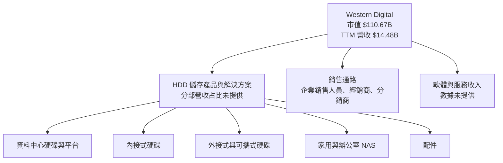
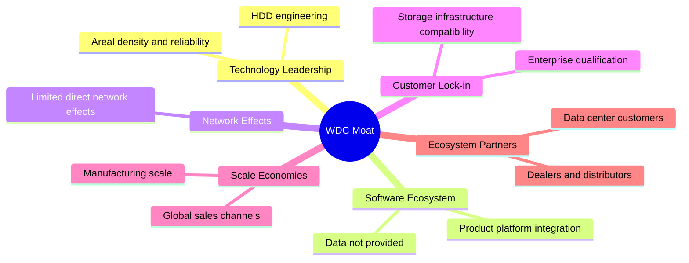
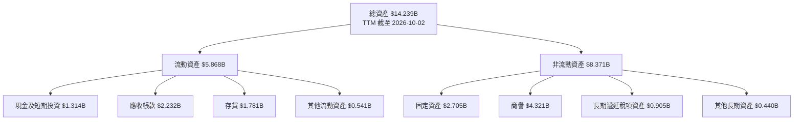
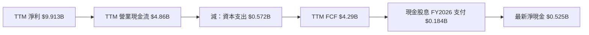
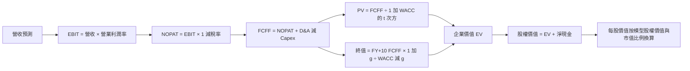
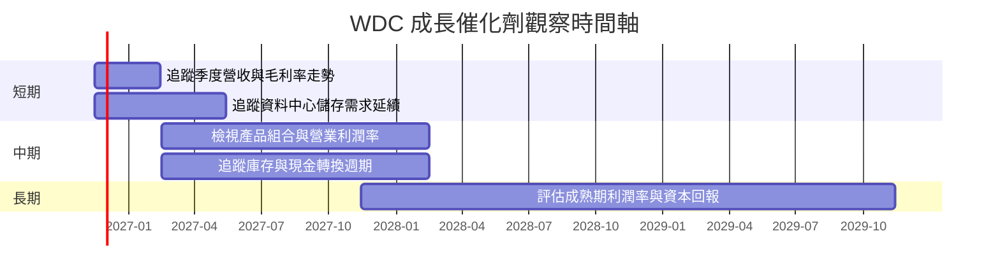
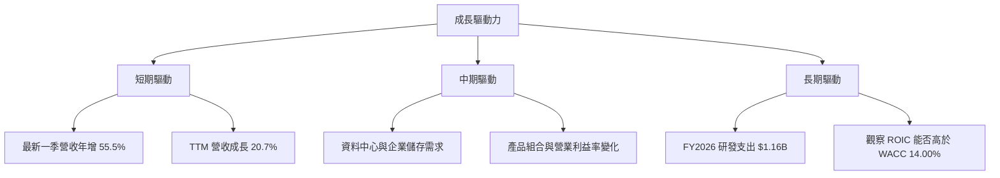
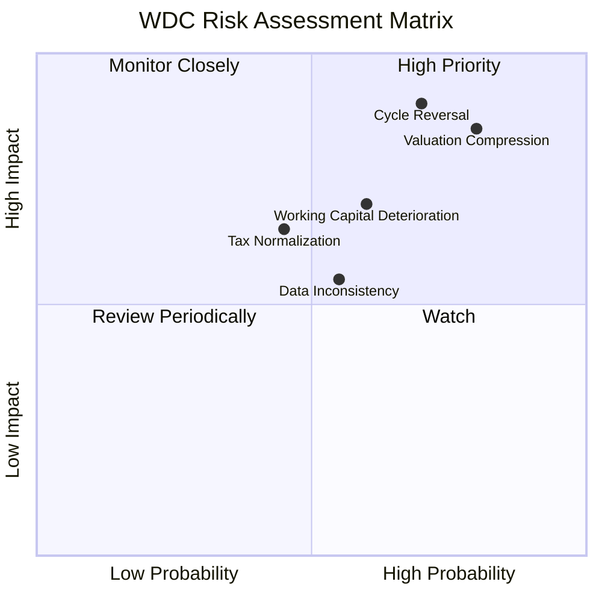
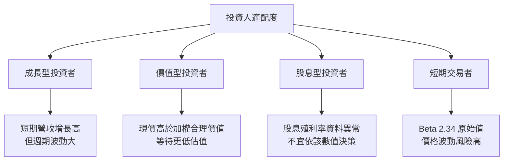

# WDC 基本面深度分析報告
> **報告日期**：2026-11-15 ｜ **語言**：繁體中文 ｜ **數據來源**：SEC 申報資料 (XBRL)、Yahoo Finance、Finviz、StockAnalysis、Roic.ai ｜ **分析師**：CFA 級機構研究

## 目錄

| # | 章節 | 核心結論 |
|---|------|----------|
| 1 | 執行摘要 | 賣出；加權合理價值 $223.61，MOS -32.2% |
| 2 | 公司概覽與商業模式 | HDD 技術、規模與客戶關係構成護城河，但市場份額數據未提供 |
| 3 | 損益表深度分析 | TTM 營收 $14.48B、TTM 成長 20.7%；利潤率處於週期高檔 |
| 4 | 資產負債表分析 | 淨現金 $525M；營運資金週期較一年前拉長 |
| 5 | 現金流量深度分析 | TTM FCF $4.29B、FCF Yield 3.88%；現金轉換低於淨利 |
| 6 | 獲利能力與資本效率 | ROIC 61.1% 高於 WACC 14.00%，目前創造價值 |
| 7 | 相對估值分析 | DCF 與同業 EV/EBITDA 估值低於現價；分析師共識顯著偏高 |
| 8 | DCF 內在價值評估 | 基準 DCF $182.17；加權合理價值 $223.61 |
| 9 | 成長催化劑 | 最新一季營收年增 55.5%，AI 儲存需求為主要催化因素 |
| 10 | 風險矩陣 | 週期反轉、估值回落與資料口徑不一致是主要風險 |
| 11 | 投資建議 | 依 MOS 評級賣出；監控需求、利潤率、現金流與資本效率 |

---

## 1. 執行摘要

### 1.0 一頁式投資儀表板（Portfolio Manager 30 秒速讀）

| 項目 | 內容 |
|------|------|
| **投資論點（3 句）** | ① TTM 營收 $14.48B、年增 20.7%，最新一季營收年增 55.5%，顯示需求仍在擴張。② TTM FCF 為 $4.29B、ROIC 為 61.1%，高於 14.00% WACC，營運目前創造股東價值。③ 但 2026-11-13 收盤價 $295.65 高於加權合理價值 $223.61，MOS 為 -32.2%，估值風險大於當前基本面優勢。 |
| **綜合評分** | **6.5/10**（引用 1.1 評分卡） |
| **財務健康** | 🟡 淨現金 $525M、流動比率 1.434；但速動比率 0.867，且 CCC 由 34 天升至 52 天。 |
| **ROIC vs WACC** | **61.1% vs 14.00%**；目前創造價值，差距 47.1 個百分點。 |
| **FCF 趨勢** | 🟢 FY2024 至 FY2026 FCF 由 -$0.781B 升至 $3.51B；TTM FCF $4.29B，FCF Yield 3.88%。 |
| **估值** | Forward P/E 7.317x ｜ EV/EBITDA 17.471x（市場資料欄位）｜ FCF Yield 3.88%。同業估值比較依同業專用倍數區塊。 |
| **DCF 內在價值（基準）** | **$182.17** ｜ 現價相對 DCF 溢價 **62.3%**（折溢價 = 現價 ÷ DCF 價值 − 1）。 |
| **安全邊際（MOS）** | **-32.2%**＝($223.61 − $295.65) ÷ $223.61；🔴 為負，價格高於加權合理價值。 |
| **預期報酬（基準情境 12M）** | DCF 基準情境相對現價 **-38.4%**；情境值為模型輸出，不代表正式 12 個月目標價。 |
| **關鍵風險（前二）** | ① 儲存產業週期反轉使利潤率由高檔收斂；② 現價高於加權合理價值 32.2%，估值回落風險較大。 |
| **評級 + 信心度** | 🔴 **賣出** ｜ 信心：中。評級依 MOS 門檻；週期波動、DCF 假設及資料口徑差異限制信心。 |

### 1.1 綜合評分卡（全報告唯一）

| 維度 | 評分（1–10） | 主要依據（引用數字與其來源章節） |
|------|--------------|----------------------------------|
| 成長性 | 8.0 | TTM 營收成長 20.7%、最新一季年增 55.5%（第 3 章）；短期增速高，但具週期性。 |
| 獲利能力 | 8.5 | TTM 營業利益率 39.4%、ROIC 61.1% 對比 WACC 14.00%，F-Score 6/8（第 3、6 章）。 |
| 財務健康 | 6.5 | 淨現金 $525M、流動比率 1.434、CCC 52 天且較去年增加 18 天（第 4 章）。 |
| 估值 | 2.5 | MOS -32.2%；同業 EV/EBITDA 隱含價值 $127.48，低於現價（第 7、8 章）。 |
| 護城河 | 6.5 | HDD 技術、規模及企業客戶關係有支撐，但缺市場份額、客戶集中度與定價資料（第 2 章）。 |
| 管理層與資本配置 | 7.0 | FY2026 SBC $204M、現金股息支付 $184M；稀釋股數測試未通過，回購資料未提供（第 3、5、6 章）。 |
| **綜合評分** | **6.5** | 六項算術平均：(8.0 + 8.5 + 6.5 + 2.5 + 6.5 + 7.0) ÷ 6 = 6.5。 |

### 1.2 五大投資論點 + 三大核心風險

| 類型 | 項目 | 具體依據 | 信心度 |
|------|------|----------|--------|
| 🟢 **投資論點①** | 需求加速 | TTM 營收 $14.48B、年增 20.7%；最新一季營收年增 55.5%，增長動能上升。 | 🟢 高 |
| 🟢 **投資論點②** | 現金流回升 | TTM OCF $4.86B、資本支出 $572M，依統一定義 FCF 為 $4.29B。 | 🟢 高 |
| 🟢 **投資論點③** | 資本回報高於資金成本 | ROIC 61.1%，高於 WACC 14.00%，利差 47.1 個百分點。 | 🟢 中高 |
| 🟢 **投資論點④** | 淨現金部位 | 現金及短期投資 $1.31B、總債務 $789M、淨現金 $525M。 | 🟢 中高 |
| 🟡 **投資論點⑤** | 估值可能受益於獲利延續 | 同業 Forward P/E 中位數 3.7x；公司 Forward P/E 市場資料為 7.317x，若獲利續增可能降低倍數，但不代表現價便宜。 | 🟡 中 |
| 🟡 **風險①** | 週期與利潤率回落 | TTM 營業利益率 39.4%、最新季度 46.7%；若供需反轉，當前高利潤率可能回歸歷史較低水準。 | 🟡 中 |
| 🔴 **風險②** | 估值與目標價落差 | 加權合理價值 $223.61，較現價低 24.4%；MOS -32.2%。 | 🔴 高 |
| 🟡 **風險③** | 現金轉換與營運資金惡化 | F-Score 中「營業現金流 > 淨利」未通過，CCC 從 34 天升至 52 天。 | 🟡 中 |

### 1.3 快速統計卡片

| 指標 | 公司實際值（期間） | 同業中位數 | 狀態 |
|------|--------------------|------------|------|
| 營收成長（TTM） | **20.7%** | — | 🟢 |
| 營收成長（最新一季年增） | **55.5%** | **377.9%** | 🟡 |
| 毛利率（TTM） | **52.6%** | **80.0%** | 🟡 |
| 營業利益率（TTM） | **39.4%** | — | 🟢 |
| ROIC（TTM） | **61.1%** | — | 🟢 |
| Forward P/E | **7.317x** | **3.7x** | 🟡 |
| FCF Yield（TTM） | **3.88%** | — | 🟡 |
| Piotroski F-Score | **6 / 8** | — | 🟢 |

> 同業中位數以 STX、SNDK、MU 三家公司 Peer multiples 計算；營收成長及毛利率中位數分別為 377.9% 與 80.0%，受記憶體週期及基期差異影響，不能直接視為 WDC 的合理成長門檻。

### 1.4 投資結論

```text
╔══════════════════════════════════════════════════════════════════╗
║                    📊 投資結論摘要                               ║
╠══════════════════════════════════════════════════════════════════╣
║  評級：賣出（依規則 20 的 MOS 門檻）                             ║
║  價格（2026-11-13 收盤）：$295.65                                ║
║  DCF 內在價值（基準）：$182.17（現價溢價 62.3%）                ║
║  安全邊際 MOS：-32.2%（以加權合理價值 $223.61 為分母）          ║
║  加權合理價值（8.8）：$223.61                                    ║
║  DCF 情境價值：                                                   ║
║    悲觀情境：$100.40（-66.0%）                                   ║
║    基準情境：$182.17（-38.4%）                                   ║
║    樂觀情境：$313.26（+6.0%）                                    ║
║  綜合評分：6.5/10（引用 1.1）                                    ║
║  適合投資人：能承受週期與高波動、等待價格回落的長線投資人       ║
╚══════════════════════════════════════════════════════════════════╝
```

---

## 2. 公司概覽與商業模式

### 2.1 業務結構與收入來源

公司資料將 Western Digital 描述為以 HDD 技術為基礎，開發、製造與銷售資料儲存裝置及解決方案。收入分部營收和占比未提供，因此不將公司總營收拆分成虛構比例。



### 2.2 市場份額

市場份額數據未提供，故不呈現市占率圖表或推估比例。WDC TTM 營收為 $14.48B，TTM 成長率 20.7%，最新一季營收年增 55.5%；同業 STX 最新一季年增 61.0%，但 SNDK、MU 的營收結構與產品週期不同，不能僅以增速推導 WDC 市占變化。

### 2.3 競爭護城河分析



### 2.4 護城河強度

| 護城河項目 | 強度（強／中／弱） | 證據（引用數字或事實） | 會削弱它的情況 |
|------------|--------------------|------------------------|----------------|
| 技術與產品可靠性 | 中 | 公司產品涵蓋資料中心 HDD、內接式、外接式及 NAS；研發費用 FY2026 為 $1.16B。 | 技術替代、產品可靠性下降或同業以更低成本達到相近性能。 |
| 軟體生態系統 | 弱至中 | 資料未提供軟體及服務收入、訂閱收入或客戶使用資料。 | 服務附加價值低、客戶可輕易跨品牌替換。 |
| 網路效應 | 弱 | 儲存硬體本身未呈現直接網路效應證據。 | 儲存標準化提高可替代性。 |
| 客戶鎖定 | 中 | 企業儲存設備通常需經客戶驗證並與既有系統相容；客戶集中度、續約率未提供。 | 客戶分散採購、規格轉換成本下降或大型客戶自研替代。 |
| 規模效應 | 中至強 | FY2026 營收 $12.92B、全球跨區域銷售；規模可攤薄製造及研發成本。 | 產能利用率下滑、價格競爭或資本投入未能轉化為銷售。 |
| 生態夥伴 | 中 | 經銷商、分銷商與企業銷售通路明確存在；通路收入占比未提供。 | 通路去中介化或競爭者取得優先供應地位。 |

護城河評分卡分數為 **6.5/10**：產品、企業客戶驗證與規模提供一定防禦，但缺乏可量化市占、客戶留存及軟體服務收入證據，故不評為更高。

---

## 3. 損益表深度分析

### 3.1 年度收入成長趨勢（近4年）

年度營收採年報資料，金額為美元。FY2023 至 FY2026 三年 CAGR 約 27.3%，計算為 \((12.919 ÷ 6.255)^{1/3} − 1\)。FY2025、FY2026 的高增長反映需求復甦與基期效應，不能直接外推為長期增速。

```text
╔══════════════════════════════════════════════════════════════════╗
║          Western Digital 年度收入趨勢（FY2023-FY2026）          ║
╠══════════════════════════════════════════════════════════════════╣
║  FY2023  $6.255B   ██████████░░░░░░░░░░░░░░  YoY：—             ║
║  FY2024  $6.317B   ██████████░░░░░░░░░░░░░░  YoY：+1.0%         ║
║  FY2025  $9.520B   ████████████████░░░░░░░░  YoY：+50.7%        ║
║  FY2026  $12.919B  ████████████████████████  YoY：+35.7%        ║
╠══════════════════════════════════════════════════════════════════╣
║  FY2023-FY2026 三年累計 CAGR：約 +27.3%                         ║
╚══════════════════════════════════════════════════════════════════╝
```

FY2024 營收僅增 1.0%，FY2025、FY2026 增幅擴大至 50.7% 與 35.7%。由低基期回升後，FY2026 的收入規模已達 $12.919B；若需求及產品組合正常化，未來成長率可能低於最近一年的增幅。

### 3.2 季度收入趨勢分析

季度數字以資料中最近四季及 StockAnalysis 季度列示交叉參照。季度名稱按公司財年口徑；最新財季結束日為 2026-10-02。

| 季度 | 營收 | QoQ 成長 | YoY 成長 | 備註 |
|------|------:|---------:|---------:|------|
| 2025-12-31 | $3.017B | — | 25.2% | 以季度營收 2026-01-02 $3.017B 對比前一年度 $2.411B；該比較值由資料列示的年增率提供。 |
| 2026-03-31 | $3.337B | 10.6% | 45.5% | QoQ = $3.337B ÷ $3.017B − 1；年增率依季度財務資料。 |
| 2026-06-30 | $3.747B | 12.3% | 43.8% | QoQ = $3.747B ÷ $3.337B − 1；年增率依季度財務資料。 |
| 2026-10-02 | $4.381B | 16.9% | 55.5% | 最新一季年增率是**單季**數字，不是 TTM 成長率。 |

季度營收逐季上升，最新一季 QoQ 增長 16.9%，YoY 增長 55.5%。這顯示短期需求加速，但數據未提供各產品線出貨量、ASP 或分部貢獻，無法將成長精確拆解為數量、價格與組合效應。

### 3.3 利潤率演變分析

| 利潤率指標 | FY2023 | FY2024 | FY2025 | FY2026 | 趨勢 | 評估 |
|------------|--------|--------|--------|--------|------|------|
| **毛利率** | 22.2% | 28.1% | 38.8% | 48.8% | ↗️ 連續擴張 | 🟢 |
| **營業利益率** | -6.4% | 1.5% | 22.4% | 35.6% | ↗️ 從虧損回升 | 🟢 |
| **淨利率** | -27.3% | -12.6% | 19.4% | 72.0% | FY2026 顯著高於營業利益率 | 🟡 |

年度毛利率依毛利 ÷ 營收計算；營業利益率依年報營業利益 ÷ 營收計算。FY2026 淨利率異常偏高，淨利 $9.30B 高於營業利益 $4.60B；資料未提供足夠的非營業項目與稅務調節明細，不能將淨利擴張全歸因於營運改善。另一方面，TTM 毛利率為 52.6%、TTM 營業利益率依統一數據為 39.4%，仍顯示營運改善已延續至 TTM。

### 3.4 費用結構分析

費用明細不足以建立完整、可加總的費用結構圖。可直接量化項目包括 FY2026 研發費用 $1.16B、營業利益 $4.60B、營收 $12.92B；銷管費、銷售成本細項與其他營運費用未完整提供，故不繪製含比例的圓餅圖。

| 指標 | FY2026 | 解讀 |
|------|------:|------|
| 營收 | $12.92B | 年增 35.7%，擴大營運規模。 |
| 研發費用 | $1.16B | 約為營收的 9.0%；維持產品與製程開發投入。 |
| 營業利益 | $4.60B | 反映營收回升及毛利改善，但具週期性。 |

### 3.5 季度 EPS 趨勢與盈餘品質（Quality of Earnings）

資料中的 EPS Est 與 EPS Act 四季皆為 nan，因此無法判定超預期或不及預期。季度實際 EPS 列示為 FY2027 Q1 $4.63、FY2026 Q4 $8.21、FY2026 Q3 $8.20、FY2026 Q2 $4.67；四季估值共識缺漏，且各來源 EPS 時點和口徑可能不同，不能把季度實際值誤判為盈餘驚喜。

| 盈餘品質項目 | 數值/佔比 | 評估 |
|--------------|-----------|------|
| 股權薪酬 SBC / 營收 | 最近四季 SBC 合計 $230M ÷ TTM 營收 $14.48B = **1.59%** | 🟡 占比不高，但仍會稀釋股東；F-Score 的稀釋股數測試未通過。 |
| SBC / 營業現金流 | $230M ÷ $4.86B = **4.73%** | 🟡 OCF 中含有非現金 SBC 加回；股東仍承擔稀釋成本。 |
| FCF / 淨利（現金轉換率） | $4.29B ÷ $9.913B = **43.3%** | 🔴 現金轉換偏低；淨利含非營業或稅務因素的可能性值得查核。 |
| 一次性/非經常性損益 | FY2026 淨利 $9.30B，高於營業利益 $4.60B；細項 N/A | 🟡 淨利與營業利益差額需由 10-K 稅務及非營業項目附註核實。 |
| 有效稅率異常 | **4.9%** | 🟡 偏低；可能使稅後利潤及 DCF NOPAT 高於正常化水準。 |
| 資本化支出 vs 費用化 | TTM Capex $572M；資本化政策細節 N/A | 🟡 支出金額可見，資本化與費用化明細不足以評估是否遞延成本。 |

**盈餘品質結論**：TTM FCF $4.29B 為正，但 FCF 僅約為 TTM 淨利的 43.3%，而有效稅率 4.9% 偏低、FY2026 淨利高於營業利益。故估值應更多依賴營業獲利及現金流，而非單看 GAAP 淨利或低 P/E。DCF 使用 GAAP EBIT 並採 4.9% 稅率，低稅率若不能持續將使估值偏高。

---

## 4. 資產負債表分析

### 4.1 資產結構分解



### 4.2 流動性與營運資金分析

| 指標 | 最新值 | 一年前 | 變化 | 解讀 |
|------|------:|------:|------:|------|
| 流動比率 | 1.434 | N/A | N/A | 流動資產高於流動負債，但缺少同口徑一年前比率。 |
| 速動比率 | 0.867 | N/A | N/A | 扣除存貨後低於 1，流動性仍依賴存貨變現或營運現金流。 |
| DSO 應收帳款天數 | 56 天 | 41 天 | +15 天 | 回款時間變長；可能反映銷售時點或客戶付款條件變化，需追蹤應收帳款品質。 |
| DIO 存貨天數 | 95 天 | 70 天 | +25 天 | 存貨占用增加；若需求維持有助供貨，若需求轉弱則增加減值風險。 |
| DPO 應付帳款天數 | 99 天 | 77 天 | +22 天 | 付款週期延長，有助短期現金，但不能單獨證明議價力提高。 |
| CCC 現金轉換週期 | 52 天 | 34 天 | +18 天 | 淨營運資金占用變大，應收與存貨天數上升的影響高於應付延長。 |

上述 DSO、DIO、DPO、CCC 依品質指標資料照錄，不重新計算。CCC 延長 18 天是現金流品質需要跟進的訊號，尤其若存貨天數上升並非為支持已確認需求，可能預示週期反轉前的庫存積壓。

### 4.3 債務結構分析

```text
╔══════════════════════════════════════════════════════════════════╗
║                 Western Digital 債務健康診斷                    ║
╠══════════════════════════════════════════════════════════════════╣
║  總債務：        $0.789B    ██░░░░░░░░░░░░░░░░░░  🟢            ║
║  現金+短期投資： $1.31B     ████████████████████  🟢            ║
║  淨現金：        $0.525B    ████████░░░░░░░░░░░░  🟢            ║
║                                                                  ║
║  Debt/EBITDA：N/A（同口徑總債務與 EBITDA 未提供）                ║
║  利息保障倍數：N/A（利息費用與同期營業利益未提供）               ║
║  流動比率：1.434                                               ║
║  速動比率：0.867                                               ║
╚══════════════════════════════════════════════════════════════════╝
```

負債資料存在不同時點口徑：最新 VERIFIED figures 顯示總債務 $789M，而 FY2026 年末資產負債表顯示 $1.05B；本分析以最新季度對應的 $789M 作當前淨現金判斷，不混用不同時點重算債務倍數。淨現金有助抵禦下行週期，但不抵銷股價高於合理價值的問題。

### 4.4 股東權益趨勢

| 年度 | 股東權益 | YoY 變化 | 解讀 |
|------|---------:|---------:|------|
| FY2023 | $11.84B | — | 資產負債表權益基礎較高。 |
| FY2024 | $11.05B | -6.7% | 權益下降。 |
| FY2025 | $5.54B | -49.9% | 顯著下滑；需配合重組、資本交易及累積盈餘明細核對。 |
| FY2026 | $8.86B | +59.9% | 隨獲利回升而恢復。 |

股東權益期間變動幅度大；ROE 受權益基數影響，不能單獨視為獲利效率持續提升的證據。

---

## 5. 現金流量深度分析

### 5.1 現金流量瀑布圖

以下展示 TTM 指標之間的轉換關係；OCF 不是淨利加總的單純結果，瀑布連線代表現金轉換過程，不表示各數值可直接相加。



### 5.2 FCF 轉換率趨勢

| 年度 | OCF | Capex | FCF | 淨利 | FCF / 淨利 |
|------|----:|------:|----:|-----:|-----------:|
| FY2023 | -$0.408B | $0.821B | -$1.23B | -$1.68B | 73.2%* |
| FY2024 | -$0.294B | $0.487B | -$0.781B | -$0.798B | 97.9%* |
| FY2025 | $1.69B | $0.412B | $1.28B | $1.86B | 68.8% |
| FY2026 | $3.93B | $0.418B | $3.51B | $9.30B | 37.7% |
| TTM | $4.86B | $0.572B | $4.29B | $9.913B | 43.3% |

\*淨利為負時，FCF/淨利比率方向性有限，不能以百分比直接比較獲利品質。FY2025 以後 FCF 顯著轉正，顯示營運現金流改善；但 FCF/淨利下降至 43.3%，現金轉換仍落後會計盈餘。

### 5.3 自由現金流趨勢

```text
╔══════════════════════════════════════════════════════════════════╗
║                 自由現金流趨勢（美元）                           ║
╠══════════════════════════════════════════════════════════════════╣
║  FY2023  -$1.23B   ◀████████░░░░░░░░░░░░  低於零               ║
║  FY2024  -$0.781B  ◀█████░░░░░░░░░░░░░░░  低於零               ║
║  FY2025   $1.28B   ████████░░░░░░░░░░░░░  轉正                 ║
║  FY2026   $3.51B   █████████████████░░░░  改善                 ║
║  TTM      $4.29B   █████████████████████  FCF Yield 3.88%       ║
╚══════════════════════════════════════════════════════════════════╝
```

### 5.4 資本配置評估

公司 FY2026 支付現金股息 $184M、資本支出 $418M；回購金額與併購支出未提供。故不製作缺乏完整配置分母的資本配置圓餅圖。

| 配置項目 | 可引用數據 | 評估 |
|----------|------------|------|
| 資本支出 | FY2026 $418M；TTM $572M | TTM 資本支出約為 TTM 營收 4.0%，支持製造與產品投資；資本開支計畫未提供。 |
| 股息 | FY2026 現金支付 $184M | 現金支出可見；市場資料中的 24.0% 殖利率與股息支付金額顯著不一致，需視為異常資料，不採用作投資判斷。 |
| 股票回購 | N/A（回購金額未提供） | F-Score 顯示稀釋股數未通過，應監控股數及 SBC。 |
| 留存現金 | 最新淨現金 $525M | 提供週期緩衝，但 TTM 現金及短投 $1.31B 低於債務後仍為正淨現金。 |

---

## 6. 獲利能力與資本效率

### 6.1 ROE / ROA / ROIC 趨勢

歷史 ROIC、ROA 的完整年度序列未提供；不得將不同來源與期間口徑拼接成假歷史趨勢。

| 指標 | 最新值 | 歷史比較 | 評估 |
|------|------:|----------|------|
| ROE（TTM） | 107.2% | 一年前同口徑數值未提供 | 高，但股東權益基數及非營業收益可能放大比率。 |
| ROA（TTM） | N/A | 其他資料來源報列 25.9%，但與品質指標口徑不一致，未作替代 | N/A（統一品質指標未提供 ROA 數值）。 |
| ROIC（TTM） | 61.1% | ROIC 歷史序列未提供 | 高於 WACC，代表當前投入資本回報超過資金成本。 |
| 行業均值 | N/A | 同口徑產業均值未提供 | 不列無來源的行業對比。 |

### 6.2 ROIC vs WACC 分析（核心價值創造判斷）

```text
╔══════════════════════════════════════════════════════════════════╗
║                ROIC vs WACC 深度分析                            ║
╠══════════════════════════════════════════════════════════════════╣
║  WACC 輸入（資料庫採用值）：                                    ║
║  ├── 無風險利率 Rf（10Y 美債）：         5.15%                  ║
║  ├── 市場風險溢酬 ERP：                  5.00%                  ║
║  ├── 原始 Beta：                         2.34                   ║
║  ├── 調整後 Beta：                       1.90                   ║
║  ├── 股權成本 Ke（資料庫）：             14.63%                 ║
║  ├── 稅前債務成本 Kd：                   20.91%                 ║
║  ├── 有效稅率：                          4.9%                   ║
║  ├── 股權／債務權重：                    99.3% / 0.7%           ║
║  ├── 計算 WACC：                         14.67%                 ║
║  └── 採用 WACC：                         14.00%（上限截斷）     ║
║                                                                  ║
║  ROIC（TTM，資料庫定義）：               61.1%                  ║
║  EVA 利差 = ROIC − 採用 WACC：            47.1 個百分點          ║
║                                                                  ║
║  ROIC  61.1%  ▓▓▓▓▓▓▓▓▓▓▓▓▓▓▓▓▓▓▓▓▓▓▓▓▓▓▓▓▓▓▓▓▓▓▓▓▓▓▓▓▓▓  🟢 ║
║  WACC  14.0%  ▓▓▓▓▓▓▓▓▓▓░░░░░░░░░░░░░░░░░░░░░░░░░░░░░░░░  ── ║
║                                                                  ║
║  📊 結論：ROIC 約為 WACC 的 4.4 倍，當前資本回報創造價值。     ║
╚══════════════════════════════════════════════════════════════════╝
```

原始 Beta 2.34 依資料庫規則調整為 1.90，公式為 \(⅔ × 2.34 + ⅓\)。資金成本區塊提供 Ke 14.63%、稅前 Kd 20.91%、權重 99.3%/0.7%，並指出計算 WACC 14.67% 後受 7%–14% 區間限制，故採 14.00%。這份輸入的逐項算術無法僅用列示的四捨五入數字完全重建；本報告依規則採用來源 WACC 14.00%，不另建折現率。ROIC 與 WACC 差距大，但 ROIC 可能受週期高峰獲利影響，需觀察正常化回報。

### 6.3 杜邦三因素分解

| 因素 | 數值（TTM） | 解讀 |
|------|-------------|------|
| 淨利率 | 69.2% | 非常高，受低有效稅率及淨利高於營業利益影響，未必能完全代表核心營運。 |
| 資產週轉率 | 1.02 | 每美元資產產生約 $1.02 營收，反映資產使用效率。 |
| 權益乘數 | 1.52 | 財務槓桿程度不高，ROE 並非主要靠高槓桿支撐。 |
| **ROE** | **107.2%** | 照錄品質指標：69.2% × 1.02 × 1.52 = 107.2%（四捨五入差異）。 |

### 6.4 財務體質：Piotroski F-Score

**Piotroski F-Score：6 / 8**。可判定分母為 8，另有一項因缺少輸入未判定。

| 測試 | 結果 | 解讀 |
|------|------|------|
| ROA > 0 | ✅ 通過 | 公司保持正獲利。 |
| 營業現金流 > 0 | ✅ 通過 | TTM OCF $4.86B 為正。 |
| ROA 高於一年前 | ✅ 通過 | 獲利改善。 |
| 營業現金流 > 淨利（應計品質） | ❌ 未通過 | TTM OCF $4.86B 低於 TTM 淨利，與較低現金轉換一致。 |
| 長期負債 ÷ 總資產低於一年前 | — 無法判定 | 缺少相同口徑輸入，照列無法判定。 |
| 流動比率高於一年前 | ✅ 通過 | 流動比率改善。 |
| 稀釋股數未增加 | ❌ 未通過 | 顯示股數有稀釋風險；需監控 SBC 與流通股數。 |
| 毛利率高於一年前 | ✅ 通過 | 毛利率改善與產品組合、定價或成本環境改善相符。 |
| 資產週轉率高於一年前 | ✅ 通過 | 資產使用效率提高。 |

---

## 7. 相對估值分析

### 7.1 同業估值比較表格

公司欄以市場估值資料列示；同業欄一律引用 Yahoo Finance Peer multiples。公司本身的 trailing P/E 在不同資料欄位存在差異，故同業比較呈現市場估值區塊的 P/E，另註意口徑不一致。

| 估值指標 | **WDC** | **STX** | **SNDK** | **MU** | WDC 評估 |
|----------|--------:|--------:|--------:|-------:|-----------|
| **Trailing P/E** | 10.40x* | 27.7x | 7.1x | 10.5x | 🟡 接近 MU、低於 STX；週期性盈餘使 P/E 可快速變動。 |
| **Forward P/E** | 7.317x | 8.1x | 3.1x | 3.7x | 🟡 低於 STX、高於 SNDK、MU；同業預估成長與獲利週期差異大。 |
| **P/S Ratio** | 7.642x* | 8.8x | 4.3x | 6.6x | 🟡 接近同業區間偏高位置。 |
| **EV/EBITDA（TTM）** | 17.471x* | 20.9x | 5.7x | 7.7x | 🔴 高於 SNDK、MU，略低於 STX；景氣高峰 EBITDA 可能扭曲倍數。 |
| **最新一季營收年增** | 55.5% | 61.0% | 377.9% | 379.3% | 🟡 WDC 增長明顯，但同業數值受極低基期及不同產品週期影響。 |
| **毛利率（TTM）** | 52.6% | 50.4% | 80.0% | 80.7% | 🟡 高於 STX，低於 SNDK、MU。 |

\*WDC 市場估值區塊與歷史估值區塊的 P/E、P/S、EV/EBITDA 數值存在不同口徑或時點；上表列示市場估值區塊數值，不與自身歷史區間混用。

### 7.2 歷史估值區間分析

```text
╔══════════════════════════════════════════════════════════════════╗
║             WDC 五年估值區間（TTM 倍數）                         ║
╠══════════════════════════════════════════════════════════════════╣
║  P/E：       6.3x ├────────────●────────────┤ 62.5x             ║
║                       中位數 13.5x｜目前 11.5x｜百分位 38%       ║
║                                                                  ║
║  P/S：       0.4x ├─────────────────────●──┤ 16.0x              ║
║                       中位數 1.2x｜目前 7.8x｜百分位 85%         ║
║                                                                  ║
║  EV/EBITDA： 4.5x ├────────────────●───────┤ 96.5x              ║
║                       中位數 14.9x｜目前 19.8x｜百分位 69%       ║
╚══════════════════════════════════════════════════════════════════╝
```

P/E 目前 11.5x、低於五年中位數 13.5x，表面看相對自身歷史較低；但 P/S 7.8x 位於歷史第 85 百分位、EV/EBITDA 19.8x 位於第 69 百分位。週期高峰獲利可能壓低 P/E，故不能單憑 P/E 判定便宜。

### 7.3 情境價值（Bear / Base / Bull，照抄 DCF MODEL 的 Scenarios）

| 情境 | 第 1 年營收成長 | 期末營業利潤率 | WACC | 每股價值 | 相對現價 | 機率 | 會發生的條件 |
|------|----------------:|----------------:|-----:|---------:|---------:|-----:|--------------|
| 🔴 悲觀 | 10.3% | 19.4% | 15.00% | $100.40 | -66.0% | 25% | 需求回落、價格或產品組合轉差，利潤率向低位回歸，資金成本偏高。 |
| 🟡 基準 | 20.7% | 22.8% | 14.00% | $182.17 | -38.4% | 50% | 以 TTM 成長率作第 1 年起點，之後逐年放緩，期末利潤率回落至近五年中位數。 |
| 🟢 樂觀 | 31.0% | 25.1% | 13.00% | $313.26 | +6.0% | 25% | 需求超預期、收入增速高於基準且成熟期利潤率高於基準，WACC 降至 13.00%。 |

### 7.4 相對估值隱含價格區間

```text
╔══════════════════════════════════════════════════════════════════╗
║                相對估值與現價位置（美元/股）                     ║
╠══════════════════════════════════════════════════════════════════╣
║  $127.48 ───────── $182.17 ───── $223.61 ───── $255.80 ── $295.65║
║  同業EV/EBITDA       基準DCF       加權合理值       同業P/S       現價 ║
║                                                                  ║
║  同業 EV/EBITDA：$127.48，STX/SNDK/MU 中位數 7.7x × TTM EBITDA，║
║                    加回淨現金。                                 ║
║  同業 P/S：       $255.80，STX/SNDK/MU 中位數 6.6x × TTM 營收。║
╚══════════════════════════════════════════════════════════════════╝
```

兩項相對估值均使用同業中位數倍數，不使用 WDC 自身目前倍數。EV/EBITDA 隱含價值 $127.48，較現價低 56.9%；P/S 隱含價值 $255.80，較現價低 13.5%。

---

## 8. DCF 內在價值評估（Discounted Cash Flow）

### 8.0 估值推理鏈（Thinking Logic）

**Step 1 — 價值由哪些變數決定？**  
本模型將 WDC 價值視為「現有 HDD 儲存業務現金流底盤＋資料中心相關需求成長＋成熟期利潤率與資本需求」。公司未提供可核實的分部收入占比，故不能為第二成長曲線或新業務指定營收比重。模型最敏感變數是 WACC、終值成長率及營業利潤率；敏感度矩陣顯示基準附近 WACC 變動對價格的影響大於 g 的小幅變動。

**Step 2 — 模型選擇**

| 決策點 | 本報告採用 | 理由（含數字） | 曾考慮但否決 | 否決理由 |
|--------|-----------|----------------|--------------|----------|
| 現金流定義 | FCFF | 以 WACC 折現後得企業價值；公司 TTM OCF $4.86B、Capex $572M | FCFE | FCFE 對融資與債務變動較敏感，來源 DCF 模型使用 FCFF。 |
| 預測期 N | 10 年 | DCF 模型設定 10 年，收入成長由 20.7% 線性降至 3.0% | 5 年 | 將增長及利潤率正常化延展到第十年，符合既定模型；不自行改年數。 |
| 終值方法 | Gordon Growth | WACC 14.00% 高於 g 3.0%；模型終值現值占 EV 35.1% | 單用退出倍數 | 模型已固定使用 Gordon Growth；退出倍數沒有提供，因此不另加。 |
| EBIT 基礎 | GAAP EBIT | TTM 營業利益率 39.4%，DCF 明示 GAAP EBIT | 非 GAAP EBIT | 避免把 SBC 加回後又漏算稀釋成本。 |

**Step 3 — 高／中敏感度假設推導鏈**

- **預測期 N**：錨點＝模型設為 10 年；調整＝不調整模型設定，將成長及利潤率逐步正常化；**採用 10 年**；曾考慮 5 年但否決，因模型要反映從高增長到成熟期的漸進收斂。
- **營收增長路徑**：錨點＝TTM 成長 20.7%；調整＝週期高峰後逐年線性放緩至第 10 年 3.0%；**第 1 年 20.7%、第 10 年 3.0%**；曾考慮維持 20.7% 十年，但否決，因其會把最新增速當成長期不變增長。
- **期末營業利潤率**：錨點＝TTM 39.4%；調整＝模型逐年降至近五年中位數 22.8%；**採用第 10 年 22.8%**；曾考慮維持 39.4%，但否決，因高週期利潤率不宜直接永久化。
- **Capex / 營收**：錨點＝TTM 3.9%；調整＝逐年淡化至 3.0%，模型規則為不低於 1.1 倍 D&A（若高於）；**第 1 年 3.9%、第 10 年 3.0%**；曾考慮維持 3.9%，但否決，因模型假設支出率長期收斂。
- **EBIT 與 SBC**：錨點＝模型使用 GAAP EBIT；調整＝不再另扣 SBC、固定股數；**採用組合 (A)**；曾考慮 GAAP EBIT 再扣 SBC 或另做稀釋，但否決，避免重複計算同一股東成本。
- **年稀釋率**：錨點＝組合 (A) 固定股數；調整＝SBC 已反映為 GAAP 費用；**採用 0%**；曾考慮額外稀釋，但否決，因會重複計入成本。
- **終值 g**：錨點＝模型使用 3.0%；調整＝採長期成熟增長假設且低於 WACC 14.00%；**採用 3.0%**；曾考慮更高 g，但否決，因永續增長須與成熟企業長期名目經濟增長相容。
- **WACC**：錨點＝成本資本資料顯示計算值 14.67%；調整＝按提供的 7%–14%限制採上限；**採用 14.00%**；曾考慮直接使用 14.67%，但依來源規則採受限值。
- **D&A / 營收、稅率**：錨點與採用值分別為 TTM D&A/營收 2.7%、最新年度有效稅率 4.9%；兩項照模型採用。有效稅率偏低，是估值偏高風險。
- **ΔWC**：歷史營運資金天數資料顯示 CCC 52 天，但 DCF 模型明示不建模營運資金；採用「不建模」，不補造比例。

**Step 4 — 最脆弱環節**  
基準價值最脆弱之處是將 4.9% 低有效稅率用於十年預測，同時不建模營運資金；若稅率回升或營運資金占用擴大，FCFF 與內在價值都會下降。DCF 基準 $182.17，敏感度與情境數值見 8.6。

**Step 5 — 計算路徑圖**



### 8.1 模型假設總表（Model Inputs）

| 假設項目 | 採用值 | 依據 / 來源 | 敏感度 |
|----------|--------|-------------|--------|
| 預測期長度 N | 10 年 | DCF MODEL 固定假設 | 🟡 中 |
| 營收成長路徑 | FY+1 20.7% 線性降至 FY+10 3.0% | TTM vs prior TTM 成長 20.7%；終年採成熟期假設 | 🔴 高 |
| 營業利潤率 | 39.4% 降至 22.8% | TTM 營業利益率及模型採用近五年中位數 | 🔴 高 |
| 有效稅率 | 4.9% | 最新年度有效稅率 | 🟢 低 |
| Capex / 營收 | 3.9% 降至 3.0% | TTM Capex / 營收及模型淡化設定 | 🟡 中 |
| D&A / 營收 | 2.7% | TTM 比率，模型固定 | 🟢 低 |
| ΔWC / 營收增額 | 不建模 | DCF MODEL 明示 Working capital is not modelled | 🟢 低 |
| EBIT 基礎 | GAAP EBIT | DCF MODEL 明示 GAAP | 🟡 中 |
| SBC 處理 | 採用組合 (A)：GAAP EBIT、FCFF 不另扣 SBC、股數固定 | SBC 已含在 GAAP EBIT；模型指定固定股數 | 🟡 中 |
| 年稀釋率 | 0% | 組合 (A) 的股數假設 | 🟡 中 |
| 永續成長率 g | 3.0% | DCF MODEL 固定設定，且低於 WACC | 🔴 高 |
| 終值方法 | Gordon Growth | DCF MODEL 使用永續成長法 | 🔴 高 |
| WACC | 14.00% | 成本資本資料採用值；計算值 14.67% 被 7%–14% 區間限制 | 🔴 高 |

本模型採用 **FCFF = NOPAT + D&A − Capex**；不含 ΔWC 項，因模型明示不建模營運資金。SBC 影響只計入一次：**本模型採用 (A)，GAAP EBIT 已含 SBC 費用，故 FCFF 不再扣 SBC，股數不另稀釋。**

### 8.2 折現率推導（WACC）

```text
╔══════════════════════════════════════════════════════════════════╗
║                    WACC 推導（折現率）                           ║
╠══════════════════════════════════════════════════════════════════╣
║  股權成本 Ke（CAPM，來源採用值）：                              ║
║  ├── 無風險利率 Rf：                  5.15%                     ║
║  ├── 市場風險溢酬 ERP：               5.00%                     ║
║  ├── 原始 Beta（Yahoo）：              2.34                      ║
║  ├── 調整後 Beta：                     1.90                      ║
║  ├── Beta 調整：                       ⅔ × 2.34 + ⅓ = 1.90      ║
║  ├── 規模／國別溢酬：                  0.00%（未另加）           ║
║  └── Ke（來源）：                      14.63%                    ║
║                                                                  ║
║  債務成本：                                                     ║
║  ├── 稅前 Kd：                         20.91%                    ║
║  ├── 有效稅率：                       4.9%                      ║
║  └── 稅後 Kd：                        20.91% × (1−4.9%)         ║
║                                                                  ║
║  資本結構（來源權重）：股權 99.3%｜債務 0.7%                    ║
║  計算 WACC：14.67%｜採用 WACC：14.00%（受 7%–14% 區間限制）    ║
╚══════════════════════════════════════════════════════════════════╝
```

逐步演算與口徑說明：

1. **Ke（CAPM）**：來源列示 Ke = **14.63%**；原始 Beta 2.34 調整為 1.90。單以已四捨五入的 Rf、Beta、ERP 重算會得到 \(5.15\% + 1.90 × 5.00\% = 14.65\%\)，與來源 Ke 14.63% 相差 0.02 個百分點；依規則採用來源值 14.63%，不替換。
2. **稅前 Kd**：來源列示 **20.91%**。利息費用與平均計息負債的明細未提供，無法用原始金額獨立重建此比率。
3. **稅後 Kd**：按來源輸入應為 \(20.91\% × (1−4.9\%)\)；來源沒有列出四捨五入後的稅後值，本報告不另造一個 WACC。
4. **權重**：來源採股權 99.3%、債務 0.7%，合計 100.0%。市場市值為 $110.67B，總債務口徑為 $789M；成本資本資料已給定權重，報告直接引用，不重建替代權重。
5. **WACC**：來源計算值為 **14.67%**，受設定的 7%–14% 範圍限制後採用 **14.00%**。此採用值與第 6.2 節一致；因來源輸入精度及計算過程未完整提供，不能從顯示數值逐項精確重現 14.67%。

### 8.3 逐年自由現金流預測（基準情境）

金額單位為 USD billions；折現因子保留三位小數。以下數據逐項照錄 DCF MODEL。模型未建模營運資金，故不列 ΔWC；未另扣 SBC，因採 GAAP EBIT 組合 (A)。

| 年度 | FY+1 | FY+2 | FY+3 | FY+4 | FY+5 | FY+6 | FY+7 | FY+8 | FY+9 | FY+10 |
|------|-----:|-----:|-----:|-----:|-----:|-----:|-----:|-----:|-----:|------:|
| 營收 | 17.47 | 20.74 | 24.21 | 27.79 | 31.35 | 34.75 | 37.84 | 40.46 | 42.47 | 43.75 |
| 營收 YoY | 20.7% | 18.7% | 16.7% | 14.8% | 12.8% | 10.9% | 8.9% | 6.9% | 5.0% | 3.0% |
| 營業利潤率 | 39.4% | 37.6% | 35.7% | 33.9% | 32.0% | 30.2% | 28.4% | 26.5% | 24.7% | 22.8% |
| EBIT（GAAP） | 6.89 | 7.79 | 8.65 | 9.42 | 10.05 | 10.50 | 10.74 | 10.73 | 10.49 | 10.00 |
| − 稅（4.9%） | (0.33) | (0.38) | (0.42) | (0.46) | (0.49) | (0.51) | (0.52) | (0.52) | (0.51) | (0.49) |
| = NOPAT | 6.55 | 7.41 | 8.23 | 8.96 | 9.56 | 9.99 | 10.21 | 10.21 | 9.98 | 9.51 |
| + D&A | 0.47 | 0.56 | 0.65 | 0.75 | 0.85 | 0.94 | 1.02 | 1.09 | 1.15 | 1.18 |
| − Capex | (0.69) | (0.80) | (0.90) | (1.01) | (1.10) | (1.18) | (1.25) | (1.29) | (1.31) | (1.30) |
| **= FCFF** | **6.33** | **7.18** | **7.98** | **8.70** | **9.30** | **9.74** | **9.99** | **10.02** | **9.82** | **9.39** |
| 折現因子 @14.00% | 0.877 | 0.769 | 0.675 | 0.592 | 0.519 | 0.456 | 0.400 | 0.351 | 0.308 | 0.270 |
| **FCFF 現值 PV** | **5.56** | **5.52** | **5.39** | **5.15** | **4.83** | **4.44** | **3.99** | **3.51** | **3.02** | **2.53** |

表內逐年 PV 顯示值相加為：

**$5.56 + $5.52 + $5.39 + $5.15 + $4.83 + $4.44 + $3.99 + $3.51 + $3.02 + $2.53 = $43.94B。**

模型以未四捨五入數據列示預測期 PV 合計 **$43.95B**；與顯示值合計差 $0.01B，低於 1% 的四捨五入容許範圍。

**FY+1 逐步演算（以表內四捨五入數字示範）**

1. **營收** = $14.48B × (1 + 20.7%) = $17.47736B，模型列示 **$17.47B**（未四捨五入底層輸入造成末位差異）。
2. **EBIT** = $17.47B × 39.4% = $6.882B，模型列示 **$6.89B**（使用未四捨五入營收及利潤率）。
3. **稅** = $6.89B × 4.9% = $0.33761B，模型列示 **$0.33B**。
4. **NOPAT** = $6.89B − $0.33B = $6.56B；模型列示 **$6.55B**，差異來自底層未四捨五入數值。
5. **D&A** = $17.47B × 2.7% = $0.47169B，列示 **$0.47B**。
6. **Capex** = $17.47B × 3.9% = $0.68133B，模型列示 **$0.69B**（底層數字／四捨五入有差異）。
7. **ΔWC** = 不建模；模型 FCFF 公式沒有營運資金變動項。
8. **FCFF** = $6.55B + $0.47B − $0.69B = $6.33B。
9. **折現因子** = \(1 ÷ (1+14.00\%)^1 = 0.87719\)，四捨五入 **0.877**；PV = $6.33B × 0.877 = **$5.55B**，模型以未四捨五入輸入列示 **$5.56B**。

由於源模型公布的各列僅至 $0.01B，以上以顯示值複算會有末位差異；本報告保留模型數字，不改動原表。

**合理性自檢**

- 預測 FCF：FY+1 $6.33B 至 FY+10 $9.39B；十年 CAGR 約 4.0%（由首末年度 FCFF 計算）。歷史 FCF CAGR 因 FY2023、FY2024 為負而不適合直接計算。
- FY+10 FCF 利潤率 = $9.39B ÷ $43.75B = **21.5%**；現有 TTM FCF 利潤率 = $4.29B ÷ $14.48B = **29.6%**。可比同業最佳 FCF 利潤率未提供。
- 模型各年度 FCFF 皆為正；但 DCF 不建模 CCC 52 天所代表的營運資金占用，這可能使預測現金流偏高。

```text
╔══════════════════════════════════════════════════════════════════╗
║            自由現金流：歷史實際 vs 模型預測                      ║
╠══════════════════════════════════════════════════════════════════╣
║  FY2024(實)  -$0.781B  ◀████░░░░░░░░░░░░░░░░  負值              ║
║  FY2025(實)   $1.28B   █████░░░░░░░░░░░░░░░░  轉正              ║
║  FY2026(實)   $3.51B   ███████████░░░░░░░░░  改善              ║
║  FY+1 (預)    $6.33B   ███████████████████░  DCF 基準           ║
║  FY+10(預)    $9.39B   █████████████████████ 期末預測            ║
╠══════════════════════════════════════════════════════════════════╣
║  FY+1 至 FY+10 FCFF CAGR 約 4.0%；模型不建模營運資金。          ║
╚══════════════════════════════════════════════════════════════════╝
```

### 8.4 終值計算（Terminal Value）

適用性檢查：**WACC 14.00% vs g 3.0% → WACC > g？✅**

| 方法 | 計算式 | 終值 TV | TV 現值 | 佔總 EV 比重 |
|------|--------|---------:|--------:|-------------:|
| Gordon Growth | $9.39 × (1 + 3.0%) ÷ (14.00% − 3.0%) | $87.94B | $23.72B | 35.1% |
| 退出倍數法 | N/A（DCF MODEL 未提供退出倍數終值） | N/A | N/A | N/A |

逐步演算：

1. **FY+N 的 FCFF** = FY+10 FCFF **$9.39B**。
2. **分子** = $9.39B × (1 + 3.0%) = $9.6717B。
3. **分母** = 14.00% − 3.0% = 11.00%；按模型未四捨五入數據計算，TV = **$87.94B**。以表內已四捨五入數字計算會有末位差異。
4. **PV(TV)** = $87.94B × 0.270 = $23.7438B；模型列示 **$23.72B**，差異來自未四捨五入終值及折現因子。
5. **終值占比** = $23.72B ÷ $67.67B = **35.1%**。

### 8.5 企業價值 → 每股內在價值（Bridge）

```text
╔══════════════════════════════════════════════════════════════════╗
║              企業價值 → 每股內在價值 橋接表                      ║
╠══════════════════════════════════════════════════════════════════╣
║  預測期 FCF 現值合計              +$43.95B                       ║
║  終值現值 PV(TV)                  +$23.72B                       ║
║  ─────────────────────────────────────────────                  ║
║  = 企業價值 EV                     $67.67B                       ║
║  + 淨現金                         +$0.53B                        ║
║  = 股權價值（模型列示）             $68.19B                       ║
║  每股價值：模型股權價值 × 現價 ÷ 市值                             ║
║  ★ DCF 基準每股內在價值             $182.17                       ║
║    當前股價（2026-11-13 收盤）       $295.65                       ║
║    折溢價 = 現價 ÷ DCF 價值 − 1      +62.3%（溢價）               ║
╚══════════════════════════════════════════════════════════════════╝
```

逐步演算：

1. **EV** = $43.95B + $23.72B = **$67.67B**。
2. **股權價值** = $67.67B + $0.53B = $68.20B；模型列示 $68.19B，差 $0.01B，來自未四捨五入底層數值。
3. **每股內在價值** = 模型列示股權價值 × 現價 ÷ 市值 = **$182.17**（照錄模型換算式；該方法等價於以股權價值和市值比例換算，並非另行重建股數）。
4. **折溢價** = $295.65 ÷ $182.17 − 1 = **+62.3%**。
5. **本節不計算 MOS**：安全邊際以 8.8 加權合理價值為分母，只在 8.8 計算並供 1.0 引用。

模型每股價值轉換方式照錄為「股權價值 × 價格 ÷ 市值」。DCF 的淨現金採模型輸入 $0.53B；最新季度現金、債務照錄為現金及短期投資 $1.31B、總債務 $789M，與模型淨現金的末位差異源自模型底層精度。SBC 與股數按組合 (A) 固定處理。

### 8.6 敏感性分析（WACC × 永續成長率）

以下矩陣數值照錄 DCF MODEL。括號內上行空間以每格價值相對現價 $295.65 計算；基準格為粗體。

| g（列）／WACC（欄） | 12.00% | 13.00% | **14.00%（基準）** | 15.00% | 16.00% |
|-----------|------:|------:|-------------------:|------:|------:|
| 2.0% | $211.85 (-28.3%) | $192.49 (-34.9%) | $176.33 (-40.4%) | $162.63 (-45.0%) | $150.88 (-49.0%) |
| 2.5% | $216.61 (-26.7%) | $196.10 (-33.7%) | $179.12 (-39.4%) | $164.83 (-44.2%) | $152.63 (-48.4%) |
| **3.0%（基準）** | $221.90 (-25.0%) | $200.08 (-32.3%) | **$182.17 (-38.4%)** | $167.21 (-43.4%) | $154.51 (-47.7%) |
| 3.5% | $227.82 (-22.9%) | $204.48 (-30.8%) | $185.51 (-37.3%) | $169.79 (-42.6%) | $156.54 (-47.1%) |
| 4.0% | $234.47 (-20.7%) | $209.36 (-29.2%) | $189.19 (-36.0%) | $172.61 (-41.6%) | $158.74 (-46.3%) |

**敏感度示範格**：所選格 **WACC = 15.00% > g = 3.0% ✅**。DCF MODEL 已直接輸出該格價值 **$167.21**；模型未提供新 WACC 下逐年 PV 與終值的未四捨五入中間表。本分析不另建模型或杜撰中間結果，故不能把該格完整重新演算至同一精度；可核對的是該格及其方向均符合矩陣輸出。

**三情境 DCF**

| 情境 | 營收增長假設 | 期末營業利潤率 | g | WACC | 每股內在價值 | 相對現價 | 主觀機率 |
|------|------------:|----------------:|---:|-----:|--------------:|---------:|----------:|
| 🔴 悲觀 | 第 1 年 10.3% | 19.4% | 3.0%（基準模型假設） | 15.00% | $100.40 | -66.0% | 25% |
| 🟡 基準 | 第 1 年 20.7% | 22.8% | 3.0% | 14.00% | $182.17 | -38.4% | 50% |
| 🟢 樂觀 | 第 1 年 31.0% | 25.1% | 3.0%（基準模型假設） | 13.00% | $313.26 | +6.0% | 25% |
| **機率加權** | — | — | — | — | **$194.50** | **-34.2%** | **100%** |

模型只提供情境每股價值及部分營運假設，未提供各情境 FY+10 營收、FCFF 與終值明細，故不補造情境推導鏈。機率加權可複算為：  
**$100.40 × 25% + $182.17 × 50% + $313.26 × 25% = $194.50**（按模型未四捨五入值計算；使用顯示值可能有 $0.01 差異）。

**敏感度結論**

- **g 每 +1pp**：基準 WACC 下由 g 2.5% 的 $179.12 變至 g 3.5% 的 $185.51，即 **+$6.39、約 +3.6%**（以 $179.12 為基數）。
- **WACC 每 +1pp**：g 3.0% 下由 14.00% 的 $182.17 降至 15.00% 的 $167.21，即 **-$14.96、約 -8.2%**（以 $182.17 為基數）。
- **期末營業利潤率每 +1pp**：N/A（敏感度矩陣未提供該項單變數敏感度；依規則不另建模型）。
- **結論**：在已有數字中 WACC 彈性大於 g 的一個百分點變動；估值仍高度受折現率和週期利潤率假設影響，與 8.0 指出的主要風險方向一致。

### 8.7 反推 DCF（Reverse DCF：市場在預期什麼）

基準固定輸入包括 WACC 14.00%、有效稅率 4.9%、Capex 路徑 3.9% 至 3.0%、營運資金不建模、預測期 10 年、固定股數處理。反推模型只提供兩項求解結果；其餘變數不能憑現價單一方程式同時求解。

| 求解的變數（一次一個） | 其餘變數設定 | 市場隱含值（令 DCF = 現價） | 公司歷史實際 | 判斷 |
|------------------------|--------------|------------------------------:|--------------|------|
| 第 1 年營收成長率 | 利潤率、g 等固定為基準值 | **35.2%** | TTM 成長 20.7% | 🔴 隱含增長高於 TTM 起點 14.5 個百分點。 |
| 固定營業利潤率 | 營收成長路徑、g 固定為基準值 | **45.0%** | TTM 營業利益率 39.4% | 🔴 隱含利潤率高於 TTM 5.6 個百分點，且須維持固定。 |
| 永續成長率 g | 其他輸入固定為基準 | 未計算 | — | N/A（DCF MODEL 未提供反推解）。 |
| 預測期長度 N | 其他輸入固定為基準 | 未計算 | — | N/A（DCF MODEL 未提供反推解）。 |

逐步試算軌跡未由模型輸出，故不能提供 0.5 個百分點級距的假造迭代表。模型輸出的反推結果顯示：要以基準其他假設支持現價，營收第 1 年需增長 35.2%，或固定營業利潤率需達 45.0%；兩者均高於目前對應 TTM 數字，代表現價需要高於基準的營運延續性。

### 8.8 估值三角驗證與安全邊際

| 估值方法 | 隱含每股價值 | 上行空間（÷現價） | 權重 | 說明 |
|----------|--------------:|-------------------:|------|------|
| DCF（基準） | $182.17 | -38.4% | 40% | 10 年 FCFF、WACC 14.00%、g 3.0%。 |
| 同業 EV/EBITDA | $127.48 | -56.9% | 30% | STX、SNDK、MU 同業中位數 7.7x TTM EBITDA，加回淨現金。 |
| 同業 P/S | $255.80 | -13.5% | 20% | STX、SNDK、MU 同業中位數 6.6x × TTM 營收。 |
| 分析師共識目標價 | $613.38 | +107.5% | 10% | 24 位分析師平均目標價；僅作參考，不能取代基本面估值。 |
| **加權合理價值** | **$223.61** | **-24.4%** | **100%** | 週期型公司權重依方法規則固定。 |

逐步演算：  
**$182.17 × 40% + $127.48 × 30% + $255.80 × 20% + $613.38 × 10%**  
= $72.868 + $38.244 + $51.160 + $61.338  
= **$223.610，即 $223.61**。  
權重合計 = 40% + 30% + 20% + 10% = **100%**。此為週期型公司固定權重；所列四種方法均已計算，沒有剔除方法。

```text
╔══════════════════════════════════════════════════════════════════╗
║                  估值區間與安全邊際                              ║
╠══════════════════════════════════════════════════════════════════╣
║  $100.40 ───── $182.17 ───── [$223.61] ───── $295.65 ── $313.26 ║
║  悲觀DCF        基準DCF         加權合理值       現價       樂觀DCF ║
║                                                                  ║
║  安全邊際 MOS = ($223.61 − $295.65) ÷ $223.61 = -32.2%          ║
║  MOS 評估：🔴 無正安全邊際                                       ║
║  上行空間 = ($223.61 − $295.65) ÷ $295.65 = -24.4%              ║
║                                                                  ║
║  10% MOS 對應價格上限：$223.61 × 90% = $201.25                  ║
║  25% MOS 對應價格上限：$223.61 × 75% = $167.71                  ║
║  建議買入區間：$167.71–$201.25（需重新核實基本面）              ║
║  合理持有區間：$201.25–$245.97（MOS 介於 +10% 至 -10%）         ║
║  減碼考慮區間：$245.97 以上                                      ║
╚══════════════════════════════════════════════════════════════════╝
```

MOS 與上行空間定義及分母不同：MOS 以加權合理價值為分母，現價相對 DCF 的折溢價則以 DCF 基準價值為分母。第 8.8 加權合理價值及 MOS 數值全報告一致引用。

> 🔎 **程式複算（Python，依本節各項自動重算）**
>
> 加權合理價值 = $182.17 × 40% + $127.48 × 30% + $255.80 × 20% + $613.38 × 10% = **$223.61**（權重合計 100%）
>
> 以價格 $295.65 計：MOS = **-32.2%**，上行空間 = **-24.4%**
>
> ✅ 與本節所寫數值一致。

### 8.9 DCF 模型的局限與失效條件

- **終值依賴度**：終值現值占 EV **35.1%**，仍有三分之一以上企業價值依賴第十年後現金流假設。
- **最脆弱假設**：4.9% 有效稅率若不可持續，NOPAT 及 DCF 價值會下修；週期高峰營業利益率若回落快於模型預設，價值也會下修。可直接參照悲觀情境 $100.40，而非把該情境視為確定下限。
- **營運資金缺口**：最新 CCC 52 天，較一年前增加 18 天；DCF 卻不建模營運資金，可能高估自由現金流。
- **週期性限制**：FY2023、FY2024 FCF 為負，FY2025、FY2026 快速轉正，說明以單一 TTM 獲利外推存在週期風險；相對估值與正常化營業利潤率應作交叉驗證。
- **與第 10 章的連結**：儲存需求與價格轉弱會衝擊營收增速及營業利潤率；庫存增加會影響現金流；利率上升則透過 WACC 壓低估值。

### 8.10 複算檢核表（Audit Trail）

| # | 檢核項目 | 檢查方式 | 結果 |
|---|----------|----------|------|
| 1 | 所有 🔴高 / 🟡中敏感度輸入都有完整推導 | 對照 8.0、8.1；部分變數只能引用模型設定，未提供完整原始錨點 | ⚠️ 部分完成 |
| 2 | 每個假設都有來歷 | 8.1 逐項列示來源或明確指出模型限制 | ✅ |
| 3 | WACC 五步算式與算術可重建 | 資料庫列示 14.67% 計算值、14.00% 採用值；顯示輸入不足以精確重建 14.67% | ⚠️ 有限制 |
| 4 | Kd 分母與權重 D 同一計息負債範圍 | 利息費用及平均計息負債細項未提供，不能獨立驗證 | ⚠️ N/A（明細缺漏） |
| 5 | WACC 與第 6.2 節同值 | 兩處均採 14.00% | ✅ |
| 6 | 逐年表格年度數 = N，無省略符號 | FY+1 至 FY+10 共 10 年 | ✅ |
| 7 | FY+1 代表年度算式可由顯示值完全複算 | 未四捨五入原始值不可見，末位存在差異 | ⚠️ 受顯示精度限制 |
| 8 | 預測期 PV 逐項相加 | 顯示值合計 $43.94B；模型未四捨五入合計 $43.95B，差 $0.01B | ✅（差異低於 1%） |
| 9 | WACC > g | 14.00% > 3.0% | ✅ |
| 10 | 終值基於 FY+N FCFF、折現 10 期 | FY+10 FCFF $9.39B；模型折現因子 0.270 | ✅ |
| 11 | 橋接 EV 至每股價值 | 模型數值可引用；EV、股權價值有 $0.01B 四捨五入差 | ⚠️ 差異低於 1% |
| 12 | SBC 組合相容 | GAAP EBIT、無額外 SBC 扣除、固定股數＝組合 (A) | ✅ |
| 13 | 敏感性矩陣基準格 = DCF 基準值 | 14.00%、3.0% 格為 $182.17 | ✅ |
| 14 | 敏感性格有效性 | WACC 12%–16% 均高於 g 2%–4%，所有格有效 | ✅ |
| 15 | 三情境機率相加 | 25% + 50% + 25% = 100% | ✅ |
| 16 | 反推每列只放開一個變數、附迭代軌跡 | 反推值可引用；逐級試算軌跡未提供，未自行編造 | ⚠️ 軌跡缺漏 |
| 17 | MOS 分母為 8.8 加權值；折溢價分母為 DCF 值 | 1.0、8.5、8.8 定義一致 | ✅ |
| 18 | 報告完整至第 11 章 | 全章節列出 | ✅ |
| 19 | 加權合理價值等於方法加權總和 | 加權算式得 $223.61，沒有事後調整 | ✅ |
| 20 | 評級符合 MOS 門檻 | MOS -32.2% < -25%，評級賣出 | ✅ |

未完全可稽核之處為：原始 WACC 組成的計算精度、DCF 內部未四捨五入數據，以及 Reverse DCF 逐步試算軌跡未提供。本報告已保留模型輸出並明確揭露限制，未自建替代數字。

---

## 9. 成長催化劑

### 9.1 催化劑時間軸

下列為分析框架上的觀察期間，不代表公司已發布的正式指引或確定事件日期。



### 9.2 TAM 市場規模分析

**N/A（TAM 數據未提供）**。可引用的公司營收為 TTM $14.48B、TTM 成長 20.7%，最新一季營收年增 55.5%。這些數據表示近期業務擴張，但無法在缺乏市場規模、產品別收入及市場份額資料時量化滲透率或可服務市場。

### 9.3 成長驅動力結構圖



短期催化劑已有營收數據支持；中長期則需靠企業儲存需求延續、研發轉化為產品，以及資本回報維持高於資金成本。資料未提供 AI 相關收入占比或專門產品訂單金額，不能把 AI 題材量化為已實現營收。

---

## 10. 風險矩陣

### 10.1 風險評分矩陣

圖中機率與衝擊座標為分析師相對排序，不是公司公布的財務指標或統計機率。



### 10.2 風險清單詳細分析

| # | 風險項目 | 發生機率 | 財務衝擊 | 風險評分 | 緩解措施 |
|---|----------|----------|----------|----------|----------|
| 1 | 🔴 **週期反轉與利潤率正常化** | 中高（分析判斷） | 高；DCF 基準由 $182.17 降至悲觀情境 $100.40 | 🔴 8.5/10 | 每季監控營收年增、毛利率、營業利益率及庫存天數；以正常化利潤率而非峰值估值。 |
| 2 | 🔴 **估值倍數收縮** | 高（分析判斷） | 高；加權合理價值 $223.61，低於現價 24.4%，MOS -32.2% | 🔴 8.5/10 | 分批控制曝險，避免以分析師共識 $613.38 作唯一估值依據。 |
| 3 | 🟡 **營運資金惡化** | 中高（分析判斷） | 中高；CCC 由 34 天升至 52 天，DIO 增 25 天 | 🟡 7.0/10 | 追蹤應收、存貨與應付天數；若 CCC 持續增加且 FCF 下降，重新檢視估值。 |
| 4 | 🟡 **低稅率不可持續** | 中（分析判斷） | 中；DCF 使用 4.9% 稅率，稅率上升將壓低 NOPAT | 🟡 6.5/10 | 依 SEC 申報資料核實有效稅率與稅務調節，採正常化稅率重估。 |
| 5 | 🟡 **資料來源口徑不一致** | 中（已觀察到） | 中；ROE、營業利益率、債務及 P/E 等欄位存在不同數值 | 🟡 6.0/10 | 以 SEC 最新申報與指定 VERIFIED figures 優先；不同時點不混算。 |
| 6 | 🟡 **股權稀釋** | 中（分析判斷） | 中；F-Score 稀釋股數測試未通過，四季 SBC $230M | 🟡 5.5/10 | 每季追蹤稀釋股數、SBC 占營收及回購執行。 |

---

## 11. 投資建議

### 11.1 最終評級與評分

依加權合理價值 $223.61 與 2026-11-13 收盤價 $295.65 計算，MOS 為 -32.2%，低於 -25% 門檻，故評級為 **賣出**；未作質化調整。綜合評分 **6.5/10**，六項分數依序為成長性 8.0、獲利能力 8.5、財務健康 6.5、估值 2.5、護城河 6.5、管理層與資本配置 7.0。

### 11.2 合理價值與隱含報酬率

| 方法／情境 | 每股價值 | 相對現價 | 機率／權重 |
|------------|---------:|---------:|-----------:|
| 加權合理價值 | **$223.61** | **-24.4%** | 估值方法權重合計 100% |
| DCF 悲觀情境 | $100.40 | -66.0% | 25% |
| DCF 基準情境 | $182.17 | -38.4% | 50% |
| DCF 樂觀情境 | $313.26 | +6.0% | 25% |
| DCF 機率加權（參考） | $194.50 | -34.2% | 100% |

加權合理價值是評級與 MOS 的依據；情境值用來呈現模型對不同營運假設的敏感程度，不應視為精確的短期價格預測。

### 11.3 買入時機與觸發因素

```text
╔══════════════════════════════════════════════════════════════════╗
║                  ✅ 買入觸發因素 Checklist                      ║
╠══════════════════════════════════════════════════════════════════╣
║  立即重新評估條件（需多數符合）：                               ║
║  ☐ 股價回落至加權合理價值 $223.61 以下                          ║
║  ☐ 最新一季營收年增仍維持正成長，且營業利益率未大幅下滑         ║
║  ☐ FCF 維持正值，且營運資金週期不再持續惡化                     ║
║                                                                  ║
║  加碼觸發條件（出現以下任一並經基本面確認）：                   ║
║  ☐ 股價落至 $201.25 以下，對應 MOS 至少約 10%                  ║
║  ☐ 股價落至 $167.71 以下，對應 MOS 至少約 25%                  ║
║  ☐ CCC 回落、存貨天數改善，且 TTM FCF 高於當前 $4.29B           ║
║                                                                  ║
║  減碼／退出觸發條件（出現以下任一）：                            ║
║  ☐ 營收連續兩季低於去年同期，且管理層需求展望同步轉弱           ║
║  ☐ 營業利益率明顯從最新季度 46.7% 收縮，並伴隨毛利率下滑       ║
║  ☐ TTM FCF 轉負、CCC 持續延長或 ROIC 跌至 WACC 14.00% 以下     ║
╚══════════════════════════════════════════════════════════════════╝
```

價格區間以 $223.61 加權合理價值與規則 20 MOS 門檻推導：10% MOS 價格上限為 $223.61 × 90% = $201.25；25% MOS 價格上限為 $223.61 × 75% = $167.71。這些是估值觸發價，不保證價格到達時基本面仍相同。

### 11.4 投資人適配度分析



| 投資人類型 | 適配度 | 理由 |
|------------|--------|------|
| 成長型 | 中 | TTM 營收年增 20.7%、最新季度年增 55.5%，但成長能否延續取決於週期與需求。 |
| 價值型 | 低 | 現價 $295.65 高於加權合理價值 $223.61；DCF 基準 $182.17。 |
| 股息型 | 低 | 股息支付資料與市場列示 24.0% 殖利率不相符，應先核實股息及殖利率口徑。 |
| 短期交易者 | 中 | Beta 原始值 2.34，且近 24 個月股價波動顯著；需嚴格控制部位與風險。 |

### 11.5 每季財報監控清單（Quarterly Watch List）

| 監控指標 | 最新基準 | 加碼觀察條件 | 減碼／重估條件 |
|----------|---------|--------------|----------------|
| 營收成長 | TTM 20.7%；最新一季 YoY 55.5% | 年增保持正值且 QoQ 營收不連續下滑 | 連續兩季 YoY 為負，或明顯低於基準情境路徑 |
| 毛利率 | TTM 52.6% | 維持或改善，且無明顯價格壓力 | 連續兩季下滑並伴隨營收減速 |
| 營業利益率 | TTM 39.4%；最新季度 46.7% | 高於模型成熟期 22.8%，但需辨認週期因素 | 快速向 22.8% 以下收斂 |
| TTM OCF / FCF | OCF $4.86B；FCF $4.29B | FCF 維持正值並改善 | TTM FCF 轉負 |
| Capex | TTM $572M | 投資帶來產能、效率或產品回報 | Capex 上升但營收與現金流未同步改善 |
| 存貨天數 DIO | 95 天；一年前 70 天 | DIO 回落或穩定，且需求支持庫存 | DIO 繼續升高、伴隨營收放緩 |
| CCC | 52 天；一年前 34 天 | CCC 下降，應收回款改善 | CCC 持續增加且 OCF 轉弱 |
| SBC / 稀釋股數 | 最近四季 SBC $230M；稀釋股數測試未通過 | SBC 占營收下降、稀釋股數穩定 | SBC 占比上升或流通股數加速增加 |
| ROIC 對 WACC | ROIC 61.1%；WACC 14.00% | ROIC 維持高於 WACC | ROIC 跌至 14.00% 以下 |
| 財測與需求評論 | 未提供可量化管理層財測 | 管理層指引可被季度實績驗證 | 財測下修且訂單、價格或供需同時轉弱 |

### 11.6 反面論證：什麼會證明論點錯誤（What Would Change My Mind）

```text
╔══════════════════════════════════════════════════════════════════╗
║              ⚠️ 論點失效條件（Disconfirming Evidence）           ║
╠══════════════════════════════════════════════════════════════════╣
║  本報告的成長與價值創造論點，在下列情況成立時須重新檢視：      ║
║  ☐ 最新一季營收年增連續兩季低於 0%                             ║
║  ☐ TTM 營業利益率由 39.4% 明顯跌破模型期末 22.8%               ║
║  ☐ TTM FCF 轉負，或 FCF / 淨利持續低於目前 43.3%               ║
║  ☐ ROIC 跌破 WACC 14.00%，表示資本回報不再覆蓋資金成本        ║
║  ☐ CCC 高於目前 52 天且存貨天數持續增加                         ║
║  ☐ 股權稀釋加速、SBC 占營收高於目前 1.59% 並持續上升           ║
║  ☐ 稅率正常化後，淨利與 NOPAT 大幅低於現行模型假設              ║
╚══════════════════════════════════════════════════════════════════╝
```

> **免責聲明**：本報告為 AI 自動生成，僅供研究參考，不構成投資建議。投資有風險，入市需謹慎。

---

## 資料與來源

| 項目 | 內容 |
|------|------|
| 價格 | 295.65 USD，2026-11-13 收盤（Yahoo Finance 日線） |
| 財務報表 | SEC 10-Q filed 2026-10-23，最新季度 2026-10-02（FY2027 Q1） |
| 有回應的資料來源 | SEC 申報資料 (XBRL)、Yahoo Finance、Finviz、StockAnalysis、Roic.ai |
| 由程式計算 | TTM 數字、WACC、DCF 模型、估值方法與權重、加權合理價值、MOS、評級門檻、F-Score、杜邦分解、營運資金天數、綜合評分 |
| 撰寫模型 | openai / gpt-6-luna |

> 本區塊由產生報告的程式依實際取得的資料填寫，非模型撰寫。「由程式計算」的數字不是模型的估計；其餘判斷（評分、情境、策略）是模型的分析。
