# WDC 基本面深度分析報告
> **報告日期**：2026-11-16 ｜ **語言**：繁體中文 ｜ **數據來源**：SEC 申報資料 (XBRL)、Yahoo Finance、Finviz、StockAnalysis、Roic.ai ｜ **分析師**：CFA 級機構研究

---

## 目錄

| # | 章節 | 核心結論 |
|---|------|----------|
| 1 | 執行摘要 | 賣出；加權合理價值 $223.61；MOS -32.2% |
| 2 | 公司概覽與商業模式 | 儲存設備業務受惠需求回升，但產品與市場份額數據不足以證明護城河廣度 |
| 3 | 損益表深度分析 | TTM 營收 $14.48B、TTM 成長 20.7%；最新季度年增 55.5%，利潤率高但含稅務與週期疑慮 |
| 4 | 資產負債表分析 | 最新季度淨現金 $525M；營運資金天數較一年前惡化 |
| 5 | 現金流量深度分析 | TTM FCF $4.29B、FCF Yield 3.88%；現金流改善，但淨利現金轉換率偏低 |
| 6 | 獲利能力與資本效率 | ROIC 61.1% 對 WACC 14.0%，目前創造價值；週期回落可能收窄利差 |
| 7 | 相對估值分析 | 相對同業 EV/EBITDA 與自身 P/S 歷史偏高 |
| 8 | DCF 內在價值評估 | DCF 基準 $182.17；加權合理價值 $223.61，均低於現價 |
| 9 | 成長催化劑 | 最新季度營收年增 55.5%；AI 儲存需求為潛在推動力，但 TAM 數據未提供 |
| 10 | 風險矩陣 | 週期反轉、估值收縮與高波動是主要風險 |
| 11 | 投資建議 | 評級賣出；以現價而言風險報酬不利，需監控需求、利潤率與 FCF |

---

## 1. 執行摘要

截至 **2026-11-13 收盤價 $295.65**，WDC 的 TTM 營收為 **$14.48B**、TTM 年增 **20.7%**，最新一季年增 **55.5%**；TTM FCF 為 **$4.29B**、FCF Yield **3.88%**，ROIC **61.1%**，高於採用的 WACC **14.00%**。然而，DCF 基準價值為 **$182.17**，加權合理價值為 **$223.61**；依規則計算 MOS 為 **-32.2%**，因此評級為 **🔴 賣出**。這一評級是估值結果，不代表對近期業務反彈的否定；當前價格已要求高成長與高利潤率延續。

### 1.0 一頁式投資儀表板（Portfolio Manager 30 秒速讀）

| 項目 | 內容 |
|------|------|
| **投資論點（3 句）** | ① TTM 營收 $14.48B、年增 20.7%，最新季度年增 55.5%，顯示需求及出貨動能明顯回升。② TTM ROIC 61.1% 對 WACC 14.00%，現階段資本回報高於資本成本。③ DCF 基準 $182.17、加權合理價值 $223.61，均低於 2026-11-13 收盤 $295.65，估值下檔風險較大。 |
| **綜合評分** | **6.1/10**（引用 1.1 評分卡） |
| **財務健康** | 🟡 現金 $1.31B、總債務 $789M、淨現金 $525M；但 CCC 從 34 天升至 52 天。 |
| **ROIC vs WACC** | **61.1% vs 14.00%**；目前創造股東價值，利差為 +47.1 個百分點。 |
| **FCF 趨勢** | 近年由負轉正並上升；TTM FCF $4.29B，FCF Yield **3.88%**。 |
| **估值** | Forward P/E **7.3x**（市場估值資料）；EV/EBITDA **19.8x**（自身歷史估值資料）；FCF Yield **3.88%**。來源口徑不同，倍數不可視為完全同口徑。 |
| **DCF 內在價值（基準）** | **$182.17**；現價相對 DCF 折溢價 **+62.3% 溢價**。 |
| **安全邊際（MOS）** | **-32.2%**＝($223.61 加權合理價值 − $295.65 現價) ÷ $223.61；🔴 無安全邊際。 |
| **預期報酬（基準情境 12M）** | **-38.4%**（DCF 基準情境價值 $182.17 相對現價）。 |
| **關鍵風險（前二）** | 儲存產業週期回落導致利潤率下修；高估值倍數在成長放緩時收縮。 |
| **評級 + 信心度** | 🔴 **賣出** ｜ 信心：中（基本面改善明確，但估值與資料口徑差異降低信心） |

### 1.1 綜合評分卡（全報告唯一）

| 維度 | 評分（1–10） | 主要依據（引用數字與其來源章節） |
|------|--------------|----------------------------------|
| 成長性 | 8.0 | TTM 營收年增 20.7%、最新一季年增 55.5%（第 3 章）；成長速度高，但週期性與基期效應明顯。 |
| 獲利能力 | 8.5 | TTM 營業利益率 39.4%、ROIC 61.1%，且高於 WACC 14.00%；F-Score 6/8（第 6 章）。 |
| 財務健康 | 6.0 | 淨現金 $525M、現金及短期投資 $1.31B；CCC 由 34 天升至 52 天，流動性並非無風險（第 4 章）。 |
| 估值 | 2.0 | MOS -32.2%，現價較 DCF 基準價值溢價 62.3%；自身 P/S 7.8x，高於 5 年中位數 1.2x（第 7、8 章）。 |
| 護城河 | 6.5 | 儲存設備技術、客戶認證及規模可能形成壁壘，但市場份額與各業務營收占比未提供（第 2 章）。 |
| 管理層與資本配置 | 5.5 | FY2026 股權薪酬 $204M、稀釋股數測試未通過；股息支出 $184M，回購數據未提供（第 3、5 章）。 |
| **綜合評分** | **6.1** | 六項算術平均：(8.0 + 8.5 + 6.0 + 2.0 + 6.5 + 5.5) ÷ 6 = 6.083，四捨五入至 1 位小數。 |

### 1.2 五大投資論點 + 三大核心風險

| 類型 | 項目 | 具體依據 | 信心度 |
|------|------|----------|--------|
| 🟢 **投資論點①** | 營收週期反彈 | TTM 營收年增 20.7%；最新季度年增 55.5%，季度營收從 $3.02B 上升至 $4.38B。出貨與產品組合改善若持續，將帶來營業槓桿。 | 🟢 高 |
| 🟢 **投資論點②** | 當前資本回報高 | ROIC 61.1%，高於 WACC 14.00% 共 47.1 個百分點；代表現階段營運資本獲利回報大幅高於資金成本。 | 🟢 高 |
| 🟢 **投資論點③** | FCF 已恢復 | TTM 營業現金流 $4.86B、資本支出 $572M、FCF $4.29B；相較 FY2024 FCF -$781M，現金產出已轉正。 | 🟢 高 |
| 🟢 **投資論點④** | 資產負債表為淨現金 | 最新季度現金及短期投資 $1.31B、總債務 $789M、淨現金 $525M，短期財務彈性較高。 | 🟢 中高 |
| 🟢 **投資論點⑤** | 同業需求仍具彈性 | 同業最新季度年增率：STX 61.0%、SNDK 377.9%、MU 379.3%。WDC 55.5% 低於同業中位數 377.9%，但仍顯示需求環境廣泛回升。 | 🟡 中 |
| 🟡 **風險①** | 週期反轉 | 最近季度營業利益率 46.7%，高於 TTM 39.4%；若價格、出貨或產品組合轉弱，利潤率回落會放大盈利下滑。 | 🔴 高衝擊 |
| 🔴 **風險②** | 現價超出內在價值 | DCF 基準 $182.17、加權合理價值 $223.61，分別較現價低 38.4% 與上行空間 -24.4%。 | 🔴 高 |
| 🟡 **風險③** | 盈餘受非營運項目扭曲 | FY2026 淨利 $9.30B，明顯高於營業利益 $4.60B；有效稅率 4.9%，FCF/TTM 淨利約 43.3%，淨利的現金轉換並不充分。 | 🟡 中高 |

### 1.3 快速統計卡片

| 指標 | 公司實際值（期間） | 同業中位數 | 狀態 |
|------|--------------------|------------|------|
| 營收成長（TTM） | **20.7%** | — | 🟢 |
| 營收成長（最新一季年增） | **55.5%** | **377.9%** | 🟡 |
| 毛利率（TTM） | **52.6%** | **80.0%** | 🟡 |
| 營業利益率（TTM） | **39.4%** | — | 🟢 |
| ROIC（TTM） | **61.1%** | — | 🟢 |
| Forward P/E | **7.3x** | **3.7x** | 🟡 |
| FCF Yield（TTM） | **3.88%** | — | 🟡 |
| Piotroski F-Score | **6 / 8** | — | 🟡 |

### 1.4 投資結論

╔══════════════════════════════════════════════════════════════════╗  
║                    📊 投資結論摘要                               ║  
╠══════════════════════════════════════════════════════════════════╣  
║  評級：🔴 賣出（MOS -32.2%，符合 MOS < -25% 門檻）              ║  
║  價格（2026-11-13 收盤）：$295.65                                ║  
║  DCF 內在價值（基準）：$182.17（現價溢價 +62.3%）              ║  
║  安全邊際 MOS：-32.2%＝($223.61−$295.65)÷$223.61               ║  
║  加權合理價值（8.8）：$223.61                                    ║  
║  DCF 情境價值：                                                   ║  
║    悲觀情境：$100.40（-66.0%）                                   ║  
║    基準情境：$182.17（-38.4%）                                   ║  
║    樂觀情境：$313.26（+6.0%）                                    ║  
║  綜合評分：6.1/10（引用 1.1）                                    ║  
║  適合投資人：能承受週期與高波動、已有部位並採嚴格風控者；       ║  
║              不適合以現價建立重倉的保守型價值投資人。           ║  
╚══════════════════════════════════════════════════════════════════╝

---

## 2. 公司概覽與商業模式

### 2.1 業務結構與收入來源

公司資料描述 WDC 開發、製造並銷售以 HDD 技術為基礎的資料儲存設備與解決方案。公司市值為 **$110.67B**，TTM 營收為 **$14.48B**。各產品線營收金額及占比未提供，因此不以圖表推定部門比例。

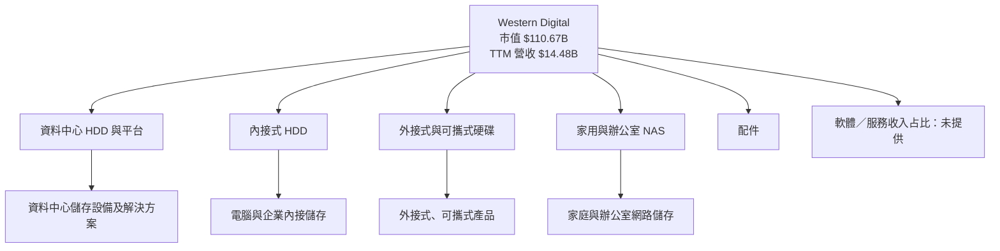

### 2.2 市場份額

市場份額資料未提供，無法可靠估算 WDC 在 HDD 或其他儲存市場的份額。以公司營收規模而言，WDC TTM 營收 $14.48B，最新季度年增 55.5%；同業 STX 最新季度年增 61.0%，而 SNDK、MU 的高成長率來自不同產品與基期，不能直接推論市場份額或產品可比性。

### 2.3 競爭護城河分析

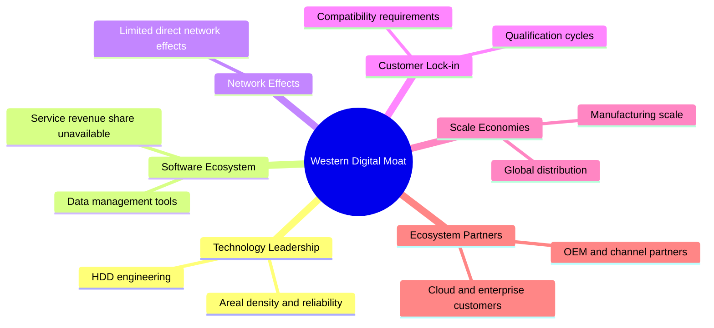

### 2.4 護城河強度

| 護城河項目 | 強度（強／中／弱） | 證據（引用數字或事實） | 會削弱它的情況 |
|------------|--------------------|------------------------|----------------|
| 技術與產品可靠性 | 中 | 公司產品涵蓋資料中心 HDD、內接式與外接儲存；但研發成果、專利與故障率數據未提供。 | 替代儲存技術進步、每 TB 成本競爭及產品差異化下降。 |
| 客戶認證與轉換成本 | 中 | 資料中心平台與企業儲存產品通常需導入與認證；資料未提供客戶留存率或轉換成本數字。 | 客戶多來源採購、供應商議價或硬體規格標準化。 |
| 規模與製造能力 | 中 | TTM 營收 $14.48B、員工 40,000 人，具相當規模；市占數字未提供。 | 產能利用率下降、固定成本吸收惡化或同業擴產。 |
| 軟體與服務生態 | 弱至中 | 公司有解決方案及平台描述，但軟體／服務收入占比、續約與經常性收入資料未提供。 | 收入仍主要依賴硬體週期、服務附加價值不足。 |
| 夥伴與通路 | 中 | 透過銷售人員、經銷商與分銷商銷售；通路收入比重未提供。 | 通路去庫存、客戶集中或經銷商轉向競品。 |

**1.1 護城河評分 6.5/10** 的依據是公司具備儲存技術、製造規模與企業客戶導入壁壘，但缺少市占、客戶留存、軟體收入占比等可量化證據，故不將護城河評為更高。

---

## 3. 損益表深度分析

### 3.1 年度收入成長趨勢（近 4 年）

年度收入採公司年度財務資料：FY2023 $6.25B、FY2024 $6.32B、FY2025 $9.52B、FY2026 $12.92B。四年中 FY2023 至 FY2026 的三年 CAGR 約 **27.4%**；成長主要集中在最近兩個財年，呈現從低谷反彈的週期特徵。

╔══════════════════════════════════════════════════════════════════╗  
║          Western Digital 年度收入趨勢（FY2023–FY2026）          ║  
╠══════════════════════════════════════════════════════════════════╣  
║ FY2023  $6.25B   ██████████░░░░░░░░░░░░░░  YoY：基期 🟡       ║  
║ FY2024  $6.32B   ██████████░░░░░░░░░░░░░░  YoY：+1.1% 🟡     ║  
║ FY2025  $9.52B   ████████████████░░░░░░░░  YoY：+50.7% 🟢    ║  
║ FY2026 $12.92B   ██████████████████████░░  YoY：+35.7% 🟢    ║  
╠══════════════════════════════════════════════════════════════════╣  
║ FY2023–FY2026 三年收入 CAGR：約 +27.4%                          ║  
╚══════════════════════════════════════════════════════════════════╝

> FY2026 至 FY2023 的 CAGR 算式：\((12.92 ÷ 6.25)^{1/3} - 1 \approx 27.4\%\)。這段增長包含週期回升，不能直接等同長期結構性成長率。各年收入數據取自年度損益表。

### 3.2 季度收入趨勢分析

| 季度 | 營收（$B） | QoQ | YoY | 備註 |
|------|-----------:|----:|----:|------|
| FY2026 Q2（2026-01） | 3.017 | +7.1% | +25.2% | 相較前一季 2025-10 營收 $2.818B。 |
| FY2026 Q3（2026-04） | 3.337 | +10.6% | +45.5% | 同比成長加速，反映需求回升及低基期。 |
| FY2026 Q4（2026-07） | 3.747 | +12.3% | +43.8% | 連續 QoQ 擴張。 |
| FY2027 Q1（2026-10） | 4.381 | +16.9% | **+55.5%** | 最新季度年增率為單季數據，不是 TTM 成長率。 |

QoQ 算式採季度營收逐季相除，例如最新季度：\((4.381 ÷ 3.747)-1 \approx 16.9\%\)。四季連續 QoQ 擴張代表短期需求仍有動能；但若產品價格與供應端重新失衡，這種成長可能隨週期逆轉。

### 3.3 利潤率演變分析

| 利潤率指標 | FY2023 | FY2024 | FY2025 | FY2026 | 趨勢 | 評估 |
|------------|-------:|-------:|-------:|-------:|------|------|
| **毛利率** | 22.2% | 28.1% | 38.8% | 48.8% | ↗️ 連續改善 | 🟢 |
| **營業利益率** | -6.1% | 1.5% | 22.4% | 35.6% | ↗️ 從虧損轉高獲利 | 🟢 |
| **淨利率** | -26.9% | -12.6% | 19.5% | 72.0% | ↗️ FY2026 大幅跳升 | 🟡 |

> 年度毛利率及營業利益率依年度損益表的毛利、營業利益除以營收計算。最新 TTM 營業利益率依指定口徑為 **39.4%**，最新季度營業利益率為 **46.7%**；不同期間不可混用。

**利潤率演變深度解析：** FY2023 至 FY2026 毛利率由 22.2% 升至 48.8%，與收入回升同期發生，顯示供需改善、價格／產品組合變化與固定製造成本吸收有助於營業槓桿。FY2026 營業利益率 35.6%，低於 TTM 39.4%，而最新一季為 46.7%，說明近期季度盈利動能仍強。另一方面，FY2026 淨利率約 72.0%，遠高於營業利益率，且有效稅率僅 4.9%；淨利受到非營業或稅務因素影響的可能性高，不應將其直接外推為持續性營運利潤率。

### 3.4 費用結構分析

有數據的 FY2026 收入與成本項目如下；因年度財務來源之收入／成本口徑與 TTM 不同，以下只呈現 FY2026 可計算的收入分解，不將未提供的費用項目補值。

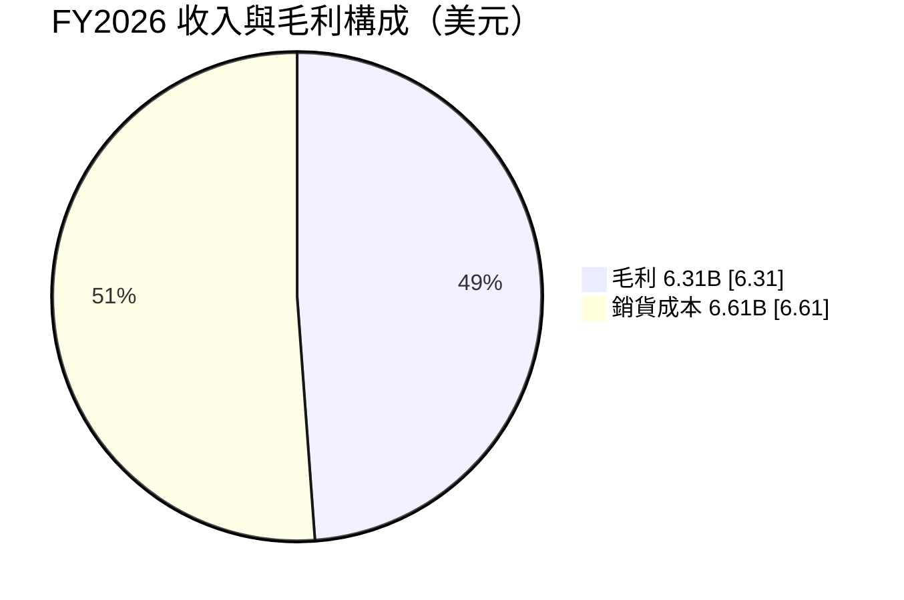

╔══════════════════════════════════════════════════════════════════╗  
║                   FY2026 費用與毛利摘要                          ║  
╠══════════════════════════════════════════════════════════════════╣  
║ 營收：$12.92B                                                    ║  
║ 毛利： $6.31B（約 48.8%）                                        ║  
║ 銷貨成本：$12.92B − $6.31B = $6.61B（約 51.2%）                ║  
║ 研發費用：$1.16B（FY2026）                                       ║  
║ 銷售、一般及管理費用：N/A（未提供可一致核對數字）               ║  
╚══════════════════════════════════════════════════════════════════╝

### 3.5 季度 EPS 趨勢與盈餘品質（Quality of Earnings）

| 季度 | EPS 實際值 | 市場預估 | 超預期／不及預期 | EPS YoY |
|------|-----------:|---------:|------------------|--------:|
| 2025-12-31 | $4.67 | N/A | N/A（預估資料缺漏） | +187.8% |
| 2026-03-31 | $8.20 | N/A | N/A（預估資料缺漏） | +482.9% |
| 2026-06-30 | $8.21 | N/A | N/A（預估資料缺漏） | +984.1% |
| 2026-09-30 | $4.63 | N/A | N/A（預估資料缺漏） | **+50.9%** |

四季 EPS 實際值可列示，但分析師預估欄為缺值，故不能據此判定超預期或不及預期。季度 EPS 先升至約 $8.2，最新季度降至 $4.63；同時最新季度淨利 $1.78B 低於前兩季 $3.07B、$3.21B，反映季間淨利波動及稅務／非營業項目可能影響每股盈利。EPS 年增仍為 50.9%，但不等於盈餘預估超越市場。

| 盈餘品質項目 | 數值/佔比 | 評估 |
|--------------|-----------|------|
| 股權薪酬 SBC / 營收 | 約 **1.59%**（四個已列季度 SBC 合計約 $230M ÷ TTM 營收 $14.48B） | 🟡 SBC 不是主要營收成本，但會稀釋股東；Piotroski 稀釋股數測試未通過。 |
| SBC / 營業現金流 | 約 **4.73%**（$230M ÷ $4.86B） | 🟡 現金流扣除 SBC 後仍具規模，但 SBC 仍是經濟成本。 |
| FCF / 淨利（現金轉換率） | 約 **43.3%**（TTM FCF $4.29B ÷ TTM 淨利 $9.913B） | 🔴 現金轉換率低於 100%；淨利包含非現金或非經常項目可能性較高。 |
| 一次性／非經常性損益 | 營業利益與淨利差距大；FY2026 淨利 $9.30B、營業利益 $4.60B | 🟡 需要核對稅務與非營業項目明細，未提供完整調節表。 |
| 有效稅率異常 | **4.9%** | 🟡 偏低稅率提升淨利，未必能持續；DCF 亦採用該稅率，構成偏樂觀風險。 |
| 資本化支出 vs 費用化 | TTM Capex $572M；資本化明細、資本化研發資料未提供 | 🟡 不足以判定是否遞延成本；需追蹤 PP&E 與折舊趨勢。 |

**盈餘品質結論：** 營業現金流與 FCF 均為正，但 TTM FCF/淨利約 43.3%，加上 4.9% 的低有效稅率和 FY2026 淨利高於營業利益甚多，GAAP 淨利的可持續性低於營收及營業現金流所顯示的營運改善。估值時應更重視 FCFF、營業利益率與營運現金流，而非只看 EPS。

---

## 4. 資產負債表分析

### 4.1 資產結構分解

以下採最新季度資產負債表數據，總資產 $14.239B；流動資產與非流動項目加總等於總資產。

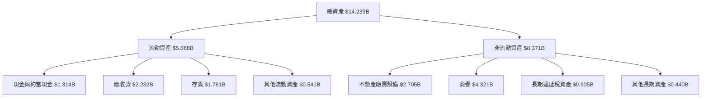

### 4.2 流動性與營運資金分析

| 指標 | 最新值 | 歷史／對照值 | 評估 |
|------|-------:|---------------:|------|
| 現金與短期投資 | $1.31B | FY2026 年末 $1.579B | 🟡 現金緩衝可觀，但較年末下降。 |
| 總債務 | $789M | 其他市場資料口徑為 $922M；年報資料為 $1.05B | 🟡 使用指定最新季度口徑 $789M；跨來源債務數字不同，需以最新 SEC 申報核對。 |
| 淨現金 | **$525M** | — | 🟢 淨現金提供財務緩衝。 |
| Current ratio | 1.434 | 最新年度資產負債表計算口徑約 1.33 | 🟡 來源口徑存在差異；整體短期流動性尚可，但不能僅依單一比率判斷。 |
| Quick ratio | 0.867 | — | 🟡 速動資產不足以完全覆蓋流動負債，仍依賴存貨變現與營運現金流。 |

**營運資金天數**（依 QUALITY FIGURES 原值列示）：

| 指標 | 最新 TTM | 一年前 TTM | 變化 | 解讀 |
|------|---------:|-----------:|-----:|------|
| DSO 應收帳款天數 | 56 天 | 41 天 | +15 天 | 收款周期變長，可能反映收入增長、客戶付款條件或季度期末組合；需觀察應收帳款是否快於營收增長。 |
| DIO 存貨天數 | 95 天 | 70 天 | +25 天 | 存貨占用資金上升，若需求維持可支撐供應；若出貨轉弱則可能增加跌價與去庫存風險。 |
| DPO 應付帳款天數 | 99 天 | 77 天 | +22 天 | 付款周期拉長可部分支撐現金，但不一定等同供應商議價力提升。 |
| CCC 現金轉換週期 | 52 天 | 34 天 | +18 天 | 現金被營運流程占用時間增加；若延續，會壓低 FCF 轉換。 |

### 4.3 債務結構分析

╔══════════════════════════════════════════════════════════════════╗  
║                   WDC 債務健康診斷                               ║  
╠══════════════════════════════════════════════════════════════════╣  
║ 總債務：        $0.789B  ███████░░░░░░░░░░░░░  🟢             ║  
║ 現金及短期投資：$1.31B   █████████████░░░░░░░  🟢             ║  
║ 淨現金：        $0.525B  █████░░░░░░░░░░░░░░░  🟢             ║  
║ 債務／EBITDA：  N/A（指定最新季度口徑未提供可配對 EBITDA）     ║  
║ 利息保障倍數：  N/A（利息費用與可比 EBIT 期間明細未提供）       ║  
║ 資料提醒：      其他來源總債務介於 $0.922B 至 $1.05B，口徑不同 ║  
╚══════════════════════════════════════════════════════════════════╝

### 4.4 股東權益趨勢

╔══════════════════════════════════════════════════════════════════╗  
║               WDC 歷年股東權益（年度）                           ║  
╠══════════════════════════════════════════════════════════════════╣  
║ FY2023  $11.84B  ████████████████████░░░░                    ║  
║ FY2024  $11.05B  ███████████████████░░░░░                    ║  
║ FY2025   $5.54B  █████████░░░░░░░░░░░░░░                    ║  
║ FY2026   $8.86B  ███████████████░░░░░░░░                    ║  
╚══════════════════════════════════════════════════════════════════╝

權益在 FY2025 大幅下降後，FY2026 回升至 $8.86B。變化可能與損益及資本交易有關，但完整權益變動表未提供，因此不將其歸因於單一項目。

---

## 5. 現金流量深度分析

### 5.1 現金流量瀑布圖

下圖列示 TTM 已提供的營運現金流、資本支出與 FCF；淨利、股息與回購的同一 TTM 完整橋接未提供，故不強行補數。

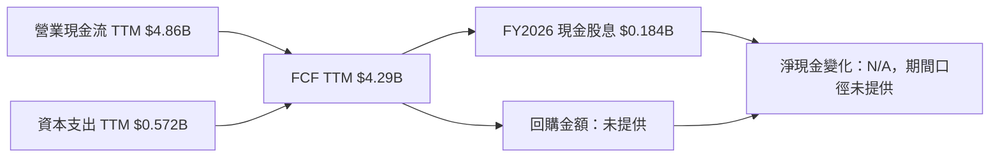

### 5.2 FCF 轉換率趨勢

| 財年 | 營業現金流 | 資本支出 | FCF | 淨利 | FCF／淨利 |
|------|-----------:|---------:|----:|-----:|----------:|
| FY2023 | -$408M | $821M | -$1.23B | -$1.68B | 約 73.2% |
| FY2024 | -$294M | $487M | -$781M | -$798M | 約 97.9% |
| FY2025 | $1.69B | $412M | $1.28B | $1.86B | 約 68.8% |
| FY2026 | $3.93B | $418M | $3.51B | $9.30B | 約 37.7% |

FY2023、FY2024 的 FCF 與淨利同為負值，比例解讀有限。FY2025、FY2026 FCF 轉正，但 FY2026 FCF/淨利下降，表示淨利增幅高於現金流增幅，與低稅率及非營業項目可能造成的淨利放大相符。

### 5.3 自由現金流趨勢

╔══════════════════════════════════════════════════════════════════╗  
║               自由現金流歷史趨勢（年度）                         ║  
╠══════════════════════════════════════════════════════════════════╣  
║ FY2023  -$1.23B  ░░░░░░░░░░░░░░░░░░░░  FCF 為負               ║  
║ FY2024  -$0.781B ░░░░░░░░░░░░░░░░░░░░  FCF 為負               ║  
║ FY2025  +$1.28B  ███████░░░░░░░░░░░░░  轉正                    ║  
║ FY2026  +$3.51B  █████████████████░░░  上升                    ║  
║ TTM      +$4.29B ████████████████████  FCF Yield：3.88%         ║  
╚══════════════════════════════════════════════════════════════════╝

TTM FCF 定義固定為營業現金流減資本支出：**$4.86B − $0.572B = $4.29B**（資料以兩位小數顯示時有尾差）。FY2026 至 TTM FCF 進一步增加，但年度與 TTM 時間區間不同，不應直接視為固定成長率。

### 5.4 資本配置評估

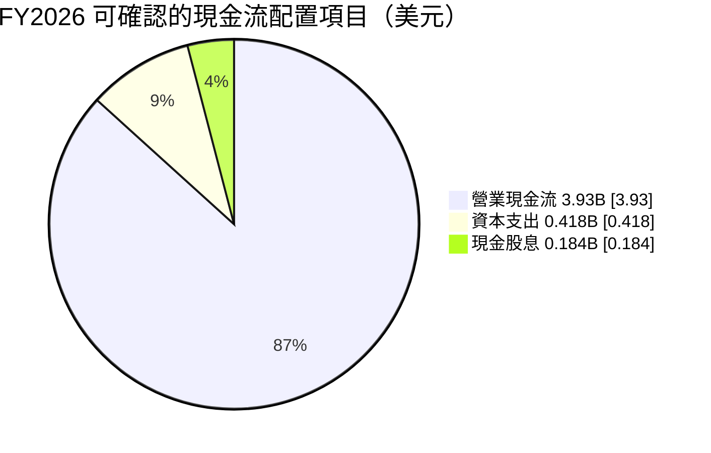

| 配置項目 | 數據 | 評估 |
|----------|------|------|
| 資本支出 | FY2026 $418M；TTM $572M | 🟢 相對 TTM 營收占比約 3.9%，目前 FCF 產出未被高額資本支出吞噬。 |
| 股息 | FY2026 支付 $184M | 🟡 占 FY2026 營業現金流約 4.7%；股息殖利率資料列為 24.0%，與其他資料口徑不易核對，不採用作投資依據。 |
| 回購 | N/A（回購金額未提供） | 無法評估回購是否抵銷 SBC 稀釋。 |
| 研發 | FY2026 $1.16B | 🟢 支持產品與技術投入；對應收入比約 9.0%。 |
| 留存／現金變動 | N/A（同一期間完整資金用途表未提供） | 不以未提供的項目反推配置比例。 |

---

## 6. 獲利能力與資本效率

### 6.1 ROE / ROA / ROIC 趨勢

| 指標 | FY2023／歷史 | FY2024／歷史 | FY2025／歷史 | 最新 TTM | 評估 |
|------|--------------:|--------------:|--------------:|---------:|------|
| ROE | N/A | N/A | N/A | **107.2%** | 高 ROE 受淨利率和權益基數影響，不能單獨視為可持續回報。 |
| ROA | N/A | N/A | N/A | **N/A**（QUALITY FIGURES 未列可照抄的 TTM ROA 數值） | 其他資料列示 25.9%，但品質區塊沒有該同口徑序列，本表不混用。 |
| ROIC | N/A | N/A | N/A | **61.1%** | 明顯高於 WACC；以最新 TTM 營運狀態看，正在創造價值。 |

公司歷史資料顯示週期波動：FY2023 營業虧損，FY2024 接近損益兩平，FY2025、FY2026 獲利大幅回升。未提供一致口徑的歷年 ROIC／ROA 序列或行業均值，故不填入不可核實的對比值。

### 6.2 ROIC vs WACC 分析（核心價值創造判斷）

╔══════════════════════════════════════════════════════════════════╗  
║                ROIC vs WACC 深度分析                            ║  
╠══════════════════════════════════════════════════════════════════╣  
║ WACC 採用值：14.00%（資本成本區塊的封頂值）                     ║  
║ ├── 無風險利率（10Y 美債）：5.15%                               ║  
║ ├── 股權風險溢酬 ERP：5.00%                                     ║  
║ ├── 原始 Beta：2.34；調整 Beta：1.90                            ║  
║ ├── 股權成本：5.15% + 1.90 × 5.00% = 14.65%（資料列 14.63%）  ║  
║ ├── 稅前債務成本：20.91%；有效稅率：4.9%                       ║  
║ ├── 股權／債務權重：99.3%／0.7%                                ║  
║ ├── 計算 WACC：14.67%，受 7%–14% 區間限制，採用 14.00%         ║  
║                                                                  ║  
║ ROIC（TTM）：61.1%                                               ║  
║ EVA 利差：61.1% − 14.00% = +47.1 個百分點                     ║  
║ ROIC / WACC：61.1% ÷ 14.00% ≈ 4.36 倍                         ║  
║                                                                  ║  
║ ROIC 61.1%  高於資本成本                                        ║  
║ WACC 14.00%  資本成本基準                                       ║  
║ 結論：依 TTM 指標，WDC 現階段創造股東價值；週期下行時需重估。 ║  
╚══════════════════════════════════════════════════════════════════╝

股權成本區塊提供值為 **14.63%**，依四捨五入後的 CAPM 輸入直接引用；重新用展示至兩位小數的 Rf、Beta、ERP 計算得到 14.65%，差異來自輸入精度。WACC 計算值 14.67% 被限制在 **7%–14%** 區間，因此折現採用 **14.00%**。ROIC 61.1% 仍遠高於採用 WACC，顯示目前價值創造明確，但這是週期高點或低谷的敏感指標，不宜視為永久狀態。

### 6.3 杜邦三因素分解

| 因素 | 數值（TTM） | 解讀 |
|------|-------------|------|
| 淨利率 | **69.2%** | 依 QUALITY FIGURES 原值；高淨利率可能受到低有效稅率或非營業項目影響。 |
| 資產週轉率 | **1.02** | 每單位資產對應約 1.02 倍收入；需結合週期與資產處分／重整判讀。 |
| 權益乘數 | **1.52** | 槓桿不是 ROE 的唯一主要來源，但會放大回報與波動。 |
| **ROE** | **107.2%** | 69.2% × 1.02 × 1.52 ≈ 107.2%；呈現高淨利率為主要驅動。 |

### 6.4 財務體質：Piotroski F-Score

Piotroski F-Score **6 / 8**。由於一項測試缺少輸入而不計分，分母依資料區塊原值列示為 8，不另補成九項總分。

| 測試 | 結果 | 解讀 |
|------|------|------|
| ROA > 0 | ✅ 通過 | 獲利為正。 |
| 營業現金流 > 0 | ✅ 通過 | TTM 營業現金流為正。 |
| ROA 高於一年前 | ✅ 通過 | 獲利較去年改善。 |
| 營業現金流 > 淨利（應計品質） | ❌ 未通過 | 現金流低於淨利，與較低的 FCF／淨利轉換率相呼應。 |
| 長期負債 ÷ 總資產低於一年前 | — 無法判定 | 缺少資料，不納入測試分母。 |
| 流動比率高於一年前 | ✅ 通過 | 短期償債比率較去年改善。 |
| 稀釋股數未增加 | ❌ 未通過 | 股數增加代表 SBC 或其他發股造成稀釋，須監察每股價值增長。 |
| 毛利率高於一年前 | ✅ 通過 | 產品毛利改善。 |
| 資產週轉率高於一年前 | ✅ 通過 | 資產使用效率改善。 |

整體 6/8 代表財務趨勢偏正面，但未通過的應計品質與股數稀釋測試值得持續追蹤；此處不以 F-Score 取代現金流及股東稀釋分析。

---

## 7. 相對估值分析

### 7.1 同業估值比較表格

公司同業倍數取自 Yahoo Finance 同業資料；WDC 自身數據依不同欄位採用估值資料與歷史估值資料。市場資料中存在倍數口徑差異，特別是 P/E 與 EV/EBITDA，應以方向性比較為主。

| 估值指標 | **WDC** | **STX** | **SNDK** | **MU** | WDC 評估 |
|----------|--------:|-------:|--------:|-------:|-----------|
| **Trailing P/E** | 11.5x | 27.7x | 7.1x | 10.5x | 🟡 接近 MU，高於 SNDK、低於 STX。 |
| **Forward P/E** | 7.3x | 8.1x | 3.1x | 3.7x | 🟡 WDC 高於三家同業中位數 3.7x；市場預期盈利成長可能較保守或同業盈利基期不同。 |
| **P/S Ratio** | 7.8x | 8.8x | 4.3x | 6.6x | 🟡 高於同業中位數 6.6x。 |
| **EV/EBITDA** | 19.8x | 20.9x | 5.7x | 7.7x | 🔴 高於同業中位數 7.7x；同業業務與週期結構不同，仍顯示 WDC 估值不便宜。 |
| **最新季度營收 YoY** | 55.5% | 61.0% | 377.9% | 379.3% | 🟡 WDC 增長低於同業中位數 377.9%，但同業數字受到不同業務與低基期影響。 |
| **TTM 毛利率** | 52.6% | 50.4% | 80.0% | 80.7% | 🟡 WDC 高於 STX，但低於 SNDK、MU。 |

同業中位數：Trailing P/E **10.5x**、Forward P/E **3.7x**、P/S **6.6x**、EV/EBITDA **7.7x**。同業同屬儲存相關產業，但產品組成並不完全一致；尤以 SNDK 與 MU 的成長率和毛利率不宜直接類比 WDC 的 HDD 業務。

### 7.2 歷史估值區間分析

╔══════════════════════════════════════════════════════════════════╗  
║                WDC 五年估值區間（TTM）                           ║  
╠══════════════════════════════════════════════════════════════════╣  
║ P/E：       6.3x ─── 中位數 13.5x ─── 現值 11.5x               ║  
║             當前歷史百分位：38%                                  ║  
║ P/S：       0.4x ─── 中位數 1.2x ─── 現值 7.8x                 ║  
║             當前歷史百分位：85%                                  ║  
║ EV/EBITDA： 4.5x ─── 中位數 14.9x ─── 現值 19.8x              ║  
║             當前歷史百分位：69%                                  ║  
╚══════════════════════════════════════════════════════════════════╝

P/E 11.5x 處於自身五年歷史第 38 百分位，看似不高；但 P/S 7.8x 位於第 85 百分位，EV/EBITDA 19.8x 位於第 69 百分位，顯示市場對復甦的定價已較充分。週期股在盈利高點可能呈現偏低 P/E，因此不能只據 P/E 判斷便宜。

### 7.3 情境價值（Bear / Base / Bull，依 DCF 模型）

| 情境 | 第 1 年營收成長 | 期末營業利潤率 | WACC | 每股價值 | 相對現價 | 機率 | 會發生的條件 |
|------|----------------:|----------------:|-----:|----------:|----------:|-----:|--------------|
| 🔴 悲觀 | 10.3% | 19.4% | 15.00% | $100.40 | -66.0% | 25% | 儲存需求增長降溫、定價轉弱，利潤率向歷史中低位回落。 |
| 🟡 基準 | 20.7% | 22.8% | 14.00% | $182.17 | -38.4% | 50% | TTM 成長作為首年起點，長期增速與利潤率逐步收斂。 |
| 🟢 樂觀 | 31.0% | 25.1% | 13.00% | $313.26 | +6.0% | 25% | 資料中心需求與供需定價強於基準，且資本成本下降。 |

基準與悲觀情境均顯示現價下檔風險；即使樂觀情境，價值也僅高於現價 6.0%，不足以提供充足估值緩衝。

### 7.4 相對估值隱含價格區間

╔══════════════════════════════════════════════════════════════════╗  
║          各估值方法回推價值與現價（2026-11-13：$295.65）         ║  
╠══════════════════════════════════════════════════════════════════╣  
║ 同業 EV/EBITDA：$127.48  ── 現價 $295.65 ── 分析師共識 $613.38 ║  
║ 同業 P/S：      $255.80  ── 現價 $295.65                       ║  
║ DCF 基準：      $182.17  ── 現價 $295.65                       ║  
╚══════════════════════════════════════════════════════════════════╝

| 方法 | 每股價值 | 依據 |
|------|---------:|------|
| 同業 EV/EBITDA | $127.48 | STX、SNDK、MU 的 EV/EBITDA 中位數 **7.7x** × WDC TTM EBITDA，再加淨現金。 |
| 同業 P/S | $255.80 | STX、SNDK、MU 的 P/S 中位數 **6.6x** × WDC TTM 營收。 |
| 分析師共識目標價 | $613.38 | 24 位分析師平均目標價；這是外部參考，與內在價值模型的差異很大。 |

---

## 8. DCF 內在價值評估（Discounted Cash Flow）

> DCF 數字依程式計算模型原值列示。金額以美元十億（$B）計，逐年數值採模型列示精度；因原始輸入與表內金額四捨五入，個別步驟可能出現 $0.01B 左右尾差。下文不改動模型價值，不另建 DCF。

### 8.0 估值推理鏈（Thinking Logic：在算之前先想清楚）

**Step 1 — 價值由哪些變數決定？**  
模型可由資料核實的營運底盤是 HDD 儲存設備業務：TTM 營收 **$14.48B**、TTM 營業利益率 **39.4%**、TTM FCF **$4.29B**。業務分部營收占比未提供，故不能將收入拆成具體市場或第二成長曲線比例。估值主要由未來營收增速、營業利潤率收斂幅度及 WACC 決定；敏感度矩陣顯示 WACC 變動對每股價值的影響顯著。

**Step 2 — 模型選擇**

| 決策點 | 本報告採用 | 理由（含數字） | 曾考慮但否決 | 否決理由 |
|--------|-----------|----------------|--------------|----------|
| 現金流定義 | FCFF | 與 WACC 折現後得企業價值一致；模型以 NOPAT + D&A − Capex 計算。 | FCFE | 資本結構用企業價值橋接處理，FCFF 較一致。 |
| 預測期 N | 10 年 | DCF 模型固定預測 10 年，營收增速由 20.7% 衰減至 3.0%。 | 5 年 | 五年可能不足以反映模型設定的週期與利潤率逐步正常化。 |
| 終值方法 | Gordon Growth | 終值成長率 3.0%，WACC 14.00%，滿足 WACC > g。 | 僅退出倍數 | DCF 模型未提供可用的終值退出倍數計算，不能自行補造。 |
| EBIT 基礎 | GAAP EBIT | DCF 模型明列 GAAP EBIT；SBC 已作為費用扣除。 | 非 GAAP EBIT | 若加回 SBC 又不扣回，會遺漏股東成本。 |

**Step 3 — 關鍵假設推導鏈**

- **營收增速**：錨點＝TTM 營收年增 20.7% → 調整＝首年沿用近期增長，後續逐年線性降至 3.0%，反映週期成長不宜永久維持高位 → **採用首年 20.7%、第十年 3.0%** → 曾考慮把 20.7% 固定十年，但將導致長期營收過度外推，故不採用。
- **期末營業利益率**：錨點＝TTM 39.4%、最近五個財年的中位數被模型採用為 22.8% → 調整＝由當前高利潤率逐步向歷史中位收斂 → **第十年 22.8%** → 曾考慮維持 39.4%，但週期行業的高點利潤率不宜假設永久化，故否決。
- **永續成長率 g**：錨點＝長期名目經濟成長需維持低於折現率；模型採 3.0% → 調整＝不假設 WDC 長期大幅高於成熟經濟成長 → **採用 3.0%** → 未採用更高 g，因終值會對 g 過度敏感，且 3.0% 已低於 14.00% WACC。
- **預測期 N**：錨點＝模型設定 10 年；歷史週期長度資料未提供 → 調整＝以十年逐步正常化增長率與利潤率 → **採用 10 年** → 曾考慮較短期，但會令終值更早主導估值；模型指定值不可另改。
- **Capex／營收**：錨點＝TTM Capex $572M ÷ 營收 $14.48B，約 3.9% → 調整＝逐步降至 3.0%，模型設定以 1.1 倍 D&A 作為參照 → **FY+1 約 3.9%、FY+10 3.0%** → 不採用永久維持當期比例，避免忽略成熟期投資需求收斂。
- **EBIT 基礎及 SBC**：錨點＝FY2026 SBC $204M，TTM 季度列示 SBC 約 $230M → 調整＝採 GAAP EBIT，SBC 已入費用，不再重複扣除，也不額外增加稀釋股數 → **採用組合 (A)** → 不採用非 GAAP 加回與額外扣 SBC，避免雙重計算。
- **年稀釋率**：錨點＝Piotroski 稀釋股數未增加測試未通過，但模型明列股數不再稀釋 → **採用 0% 額外稀釋**，SBC 已包含於 GAAP EBIT → 不另推估稀釋率，避免在 GAAP 費用之外重複反映。
- **終值方法**：錨點＝模型提供 10 年 FCFF 與 g=3.0% → **採 Gordon Growth** → 未另設退出倍數，因 DCF 模型未提供此方法的終值輸入。
- **WACC**：錨點＝程式計算 WACC 14.67%，受 7%–14% 區間限制 → **採用 14.00%** → 不採用未封頂的 14.67%，遵從資本成本區塊的採用規則。

**Step 4 — 最脆弱一環**  
最脆弱假設是 39.4% TTM 營業利潤率在十年內只回落至 22.8%，且有效稅率維持 4.9%；若利潤率回落更快或正常化稅率更高，DCF 價值會下修，悲觀情境已給出每股 **$100.40** 的參考。

**Step 5 — 計算路徑圖**

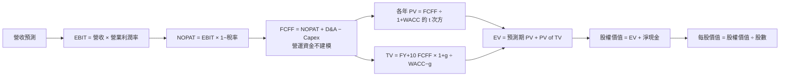

### 8.1 模型假設總表（Model Inputs）

| 假設項目 | 採用值 | 依據 / 來源 | 敏感度 |
|----------|--------|-------------|--------|
| 預測期長度 **N** | **10 年** | DCF 模型明列十年；增速與營業利潤率逐年淡出。 | 🟡 中 |
| 營收增長 | FY+1 **20.7%**，FY+10 **3.0%**，逐年線性下降 | FY+1 錨定 TTM 成長 20.7%；第十年採成熟期 3.0%。 | 🔴 高 |
| 營業利潤率 | FY+1 **39.4%** → FY+10 **22.8%** | 起點為 TTM 營業利益率；終點為模型採用的近五年中位數。 | 🔴 高 |
| 有效稅率 | **4.9%** | 最新年度有效稅率；偏低，可能增加估值。 | 🟢 低 |
| Capex / 營收 | FY+1 **3.9%** → FY+10 **3.0%** | TTM $572M / $14.48B 約 3.9%；逐步淡出。 | 🟡 中 |
| D&A / 營收 | **2.7%** | TTM 比率，模型固定。 | 🟢 低 |
| 營運資金變動 | **未建模** | DCF 模型明確排除 ΔWC；實際 CCC 從 34 天升至 52 天。 | 🟡 中 |
| EBIT 基礎 | **GAAP EBIT** | 模型假設明列 GAAP。 | 🟡 中 |
| SBC 處理 | **組合 (A)：GAAP EBIT + 固定股數** | GAAP EBIT 已含 SBC；不另扣 SBC、不再增加股數。 | 🟡 中 |
| 年稀釋率 | **0% 額外稀釋** | 與組合 (A) 相容；模型不再稀釋股數。 | 🟡 中 |
| 永續成長率 g | **3.0%** | DCF 模型輸入，低於 WACC 14.00%。 | 🔴 高 |
| 終值方法 | Gordon Growth | 模型終值以 FY+10 FCFF 計算。 | 🔴 高 |
| WACC | **14.00%** | 程式計算 14.67%，受 7%–14% 限制後採用 14.00%。 | 🔴 高 |

本模型使用 **FCFF = NOPAT + D&A − Capex**；營運資金變動不建模。**本模型採用 (A)，故 SBC 影響已計入一次**：GAAP EBIT 已包含 SBC 費用，不另扣 SBC，也不另作年股數稀釋。

### 8.2 折現率推導（WACC）

╔══════════════════════════════════════════════════════════════════╗  
║                    WACC 推導（折現率）                           ║  
╠══════════════════════════════════════════════════════════════════╣  
║ 股權成本 Ke（CAPM）：                                            ║  
║ ├── 無風險利率 Rf（10Y 美債）：5.15%                            ║  
║ ├── 市場風險溢酬 ERP：5.00%                                     ║  
║ ├── 原始 Beta（Yahoo）：2.34                                     ║  
║ ├── 調整 Beta：⅔×2.34 + ⅓×1 = 1.89，採用 1.90                 ║  
║ ├── Ke = 5.15% + 1.90×5.00% = 約 14.63%（引用資本成本值）       ║  
║                                                                  ║  
║ 債務成本 Kd：                                                    ║  
║ ├── 稅前債務成本：20.91%（來源直接提供）                        ║  
║ ├── 有效稅率：4.9%                                               ║  
║ └── 稅後 Kd = 20.91%×(1−4.9%) = 約 19.89%                      ║  
║                                                                  ║  
║ 資本結構：股權 99.3%；債務 0.7%                                  ║  
║ 原始計算 WACC：14.67%；採用 WACC：14.00%                        ║  
║ 原因：計算結果被限制在 7%–14% 的區間上限。                     ║  
╚══════════════════════════════════════════════════════════════════╝

**逐步演算（WACC）：**

1. **Ke（CAPM）**：Rf + β × ERP = 5.15% + 1.90 × 5.00% = **約 14.63%**（依資本成本資料原值；以展示位數重算會因 Beta 四捨五入略有差異）。
2. **稅前 Kd**：利息費用與平均計息負債金額未分別提供；按資本成本資料直接引用 **20.91%**，不反推缺漏金額。
3. **稅後 Kd**：20.91% × (1 − 4.9%) = 20.91% × 0.951 = **19.89%**。
4. **權重**：股權權重 **99.3%**、債務權重 **0.7%**；兩者相加 **99.3% + 0.7% = 100.0%**。資本成本資料已按市值／債務口徑計算權重；本報告不以帳面權益取代市場權重。
5. **WACC**：99.3% × 14.63% + 0.7% × 19.89% = 14.53% + 0.14% = **約 14.67%**；受 7%–14% 區間限制後，**採用 14.00%**。

未提供資本成本計算所用的利息費用金額、平均計息負債及同一時點市場市值細節，故依要求直接使用成本資本資料提供的 WACC 與權重，不反推缺值。第 6.2 與本章均使用採用值 **14.00%**。

### 8.3 逐年自由現金流預測（基準情境）

單位：$B；FCFF 依模型定義，不列 ΔWC（模型未建模）。

| 年度 | FY+1 | FY+2 | FY+3 | FY+4 | FY+5 | FY+6 | FY+7 | FY+8 | FY+9 | FY+10 |
|------|-----:|-----:|-----:|-----:|-----:|-----:|-----:|-----:|-----:|------:|
| 營收 | 17.47 | 20.74 | 24.21 | 27.79 | 31.35 | 34.75 | 37.84 | 40.46 | 42.47 | 43.75 |
| 營收 YoY | 20.7% | 18.7% | 16.7% | 14.8% | 12.8% | 10.9% | 8.9% | 6.9% | 5.0% | 3.0% |
| 營業利潤率 | 39.4% | 37.6% | 35.7% | 33.9% | 32.0% | 30.2% | 28.4% | 26.5% | 24.7% | 22.8% |
| EBIT（GAAP） | 6.89 | 7.79 | 8.65 | 9.42 | 10.05 | 10.50 | 10.74 | 10.73 | 10.49 | 10.00 |
| − 稅（4.9%） | (0.33) | (0.38) | (0.42) | (0.46) | (0.49) | (0.51) | (0.52) | (0.52) | (0.51) | (0.49) |
| = NOPAT | 6.55 | 7.41 | 8.23 | 8.96 | 9.56 | 9.99 | 10.21 | 10.21 | 9.98 | 9.51 |
| + D&A | 0.47 | 0.56 | 0.65 | 0.75 | 0.85 | 0.94 | 1.02 | 1.09 | 1.15 | 1.18 |
| − Capex | (0.69) | (0.80) | (0.90) | (1.01) | (1.10) | (1.18) | (1.25) | (1.29) | (1.31) | (1.30) |
| **= FCFF** | **6.33** | **7.18** | **7.98** | **8.70** | **9.30** | **9.74** | **9.99** | **10.02** | **9.82** | **9.39** |
| 折現因子 @14.00% | 0.877 | 0.769 | 0.675 | 0.592 | 0.519 | 0.456 | 0.400 | 0.351 | 0.308 | 0.270 |
| **FCFF 現值 PV** | **5.56** | **5.52** | **5.39** | **5.15** | **4.83** | **4.44** | **3.99** | **3.51** | **3.02** | **2.53** |

預測期 FCF 現值合計：

**$5.56 + $5.52 + $5.39 + $5.15 + $4.83 + $4.44 + $3.99 + $3.51 + $3.02 + $2.53 = $43.94B**（模型列示合計 **$43.95B**；差異 $0.01B，來自各年度 PV 四捨五入）。

**逐步演算（FY+1）：**

1. **營收**＝TTM 營收 $14.48B × (1 + 20.7%)；乘算未四捨五入值為 $17.47736B，模型列示 **$17.47B**。
2. **EBIT**＝$17.47B × 39.4% ≈ **$6.89B**（依模型列示）。
3. **稅**＝EBIT × 4.9%；依模型列示為 **$0.33B**。
4. **NOPAT**＝模型列示 **$6.55B**；以已四捨五入 EBIT 減稅會有約 $0.01B 尾差。
5. **D&A**＝$17.47B × 2.7% ≈ **$0.47B**。
6. **Capex**＝收入乘模型年一資本支出比率，約 **$0.69B**。
7. **ΔWC**＝模型未建模；不自行填入或反推。
8. **FCFF**＝NOPAT + D&A − Capex＝$6.55B + $0.47B − $0.69B＝**$6.33B**。
9. **折現因子**＝1 ÷ (1 + 14.00%)¹＝**0.877**；PV＝$6.33B × 0.877 ≈ **$5.56B**。

**合理性自檢：**

- 預測 FCFF：FY+1 $6.33B 至 FY+10 $9.39B，九個年度間隔 CAGR 約 \((9.39÷6.33)^{1/9}-1 \approx 4.5\%\)。歷史 FCF FY2025 $1.28B、FY2026 $3.51B，因前期由負轉正，長期歷史 CAGR 不具穩定可比性。
- FY+10 FCFF 利潤率＝$9.39B ÷ $43.75B ≈ **21.5%**；目前 TTM FCF 利潤率＝$4.29B ÷ $14.48B ≈ **29.6%**。模型預測利潤率低於目前水準，並未假設長期超越目前高點。
- 預測十年 FCFF 均為正；折現結果仍對利潤率、WACC 及終值假設敏感。

╔══════════════════════════════════════════════════════════════════╗  
║            自由現金流：歷史實際 vs 模型預測                      ║  
╠══════════════════════════════════════════════════════════════════╣  
║ FY2024（實） -$0.781B  ░░░░░░░░░░░░░░░░░░░░                    ║  
║ FY2025（實） +$1.28B   ████░░░░░░░░░░░░░░░░                    ║  
║ FY2026（實） +$3.51B   ███████████░░░░░░░░░                    ║  
║ FY+1（預）    $6.33B   █████████████████░░░                    ║  
║ FY+10（預）   $9.39B   ████████████████████                    ║  
╠══════════════════════════════════════════════════════════════════╣  
║ FY+1 至 FY+10 FCFF CAGR 約 4.5%；預測由高增長逐步轉向成熟。   ║  
╚══════════════════════════════════════════════════════════════════╝

### 8.4 終值計算（Terminal Value）

**適用性檢查：** `WACC 14.00% vs g 3.0% → WACC > g？✅`

| 方法 | 計算式 | 終值 TV | TV 現值 | 佔總 EV 比重 |
|------|--------|--------:|-------:|-------------:|
| Gordon Growth | FY+10 FCFF × (1+g) ÷ (WACC−g) | $87.94B | $23.72B | 35.1% |
| 退出倍數法 | N/A（DCF 模型未提供可直接採用的退出倍數終值） | N/A | N/A | N/A |

逐步演算：

1. **FY+N 的 FCFF**＝FY+10 FCFF **$9.39B**。
2. **分子**＝FCFF × (1 + g)＝$9.39B × (1 + 3.0%)＝模型列示約 **$9.67B**。
3. **分母**＝WACC − g＝14.00% − 3.0%＝**11.00%**；TV＝模型計算 **$87.94B**。以展示至兩位小數的輸入重算會有小額尾差。
4. **PV(TV)**＝模型列示 **$23.72B**；其折現使用第十年折現因子約 0.270。
5. **終值佔比**＝$23.72B ÷ $67.67B＝約 **35.1%**。

終值占 EV 約三分之一，DCF 並非幾乎完全由終值主導，但仍對長期折現率與 g 敏感。

### 8.5 企業價值 → 每股內在價值（Bridge）

╔══════════════════════════════════════════════════════════════════╗  
║              企業價值 → 每股內在價值 橋接表                      ║  
╠══════════════════════════════════════════════════════════════════╣  
║ 預測期 FCF 現值合計               +$43.95B                       ║  
║ 終值現值 PV(TV)                   +$23.72B                       ║  
║ = 企業價值 EV                      $67.67B                       ║  
║ + 淨現金                           +$0.53B                       ║  
║ = 股權價值                         $68.19B                       ║  
║ 每股內在價值（模型原值）           $182.17                       ║  
║ 當前股價（2026-11-13 收盤）         $295.65                       ║  
║ 折溢價（現價÷DCF價值−1）            +62.3%（溢價）               ║  
╚══════════════════════════════════════════════════════════════════╝

逐步演算：

1. **EV**＝預測期 PV 合計 $43.95B + PV(TV) $23.72B＝**$67.67B**。
2. **股權價值**＝EV $67.67B + 淨現金 $0.53B＝**$68.19B**。
3. **每股內在價值**＝模型以股權價值及市值／價格口徑換算，DCF 模型原值為 **$182.17**。流通股數市場資料為 374.32M 股；以展示精度直接相除會有約 $0.01 的尾差，因此保留模型原值。
4. **折溢價**＝現價 $295.65 ÷ DCF 價值 $182.17 − 1＝**+62.3% 溢價**。
5. **本節不計算 MOS**：安全邊際僅以 8.8 加權合理價值為分母，全報告只採用一個 MOS。

橋接中的淨現金、股權價值與 DCF 模型一致；財務數據的現金、債務採最新季度口徑。DCF 每股值依模型原值引用，不以不同來源的市場資本額或股數重新替換。

### 8.6 敏感性分析（WACC × 永續成長率）

格內為每股內在價值及相對現價 $295.65 的上行／下行。

| g（列）／WACC（欄） | 12.00% | 13.00% | **14.00%（基準）** | 15.00% | 16.00% |
|-----------|------:|------:|------------------:|------:|------:|
| **2.0%** | $211.85 (-28.3%) | $192.49 (-34.9%) | $176.33 (-40.4%) | $162.63 (-45.0%) | $150.88 (-49.0%) |
| **2.5%** | $216.61 (-26.7%) | $196.10 (-33.7%) | $179.12 (-39.4%) | $164.83 (-44.2%) | $152.63 (-48.4%) |
| **3.0%** | $221.90 (-24.9%) | $200.08 (-32.3%) | **$182.17 (-38.4%)** | $167.21 (-43.5%) | $154.51 (-47.7%) |
| **3.5%** | $227.82 (-22.9%) | $204.48 (-30.8%) | $185.51 (-37.3%) | $169.79 (-42.6%) | $156.54 (-47.1%) |
| **4.0%** | $234.47 (-20.7%) | $209.36 (-29.2%) | $189.19 (-36.0%) | $172.61 (-41.6%) | $158.74 (-46.3%) |

**逐步演算的代表格說明：**上述矩陣以 DCF 程式計算原值為準。重新計算任一格需使用模型的逐年未四捨五入現金流；完整未四捨五入數列未提供，不能以已四捨五入年度表重建另一個矩陣值。矩陣中非基準格均為模型既有數字，沒有更改。

**三情境 DCF（模型原值）**

| 情境 | 第 1 年營收增長 | 期末營業利潤率 | 永續成長率 | WACC | 每股內在價值 | 相對現價 | 機率 |
|------|----------------:|----------------:|-----------:|-----:|--------------:|----------:|-----:|
| 🔴 悲觀 | 10.3% | 19.4% | 3.0%（模型基準） | 15.00% | $100.40 | -66.0% | 25% |
| 🟡 基準 | 20.7% | 22.8% | 3.0%（模型基準） | 14.00% | $182.17 | -38.4% | 50% |
| 🟢 樂觀 | 31.0% | 25.1% | 3.0%（模型基準） | 13.00% | $313.26 | +6.0% | 25% |
| **機率加權** | — | — | — | — | **$194.50** | **-34.2%** | **100%** |

機率加權值僅作情境參考，8.8 的估值權重使用基準 DCF $182.17。情境模型未提供各情境逐年完整營收、FCFF 與終值拆解，因此不虛構每個情境的 FY+10 完整算式鏈。情境成立條件已於 7.3 說明。

**敏感度結論：**

- g 由 2.5% 升至 3.5%（WACC 固定 14.0%）：$179.12 → $185.51，增加 **$6.39／3.6%**。
- WACC 由 14.0% 升至 15.0%（g 固定 3.0%）：$182.17 → $167.21，減少 **$14.96／8.2%**。
- 期末營業利潤率每 +1 個百分點的單獨估值彈性：**未提供模型矩陣，N/A**；不以推算替代程式模型。
- 已提供矩陣中，WACC 每 +1 個百分點造成的估值變動大於 g 每 +0.5 個百分點的變動；與 8.0 所指折現率敏感相符。營業利潤率仍是模型的重要營運變數，但無獨立敏感度數字可核實。

### 8.7 反推 DCF（Reverse DCF：市場在預期什麼）

市場價格為 **$295.65**。模型只提供兩個可直接引用的反推解：

| 求解的變數（一次一個） | 其餘變數設定 | 市場隱含值 | 公司歷史／基準 | 判斷 |
|------------------------|--------------|------------:|---------------|------|
| 第一年營收成長率 | 其他假設固定基準 | **35.2%** | DCF 基準 20.7%；TTM 年增 20.7% | 🔴 現價要求首年增長明顯高於目前 TTM 增幅。 |
| 固定營業利潤率 | 其他假設固定基準 | **45.0%** | TTM 39.4%；FY+10 基準 22.8% | 🔴 要求利潤率高於目前 TTM，與十年均值回歸假設相反。 |
| 永續成長率 g | 未提供求解值 | 未計算 | 基準 3.0% | N/A（模型未提供反推結果）。 |
| 預測期長度 N | 未提供求解值 | 未計算 | 基準 10 年 | N/A（模型未提供反推結果）。 |

反推解的原始試算軌跡未提供，因此不虛構逐步試算表。可核實的結論是：若其他假設維持模型基準，現價要求首年營收成長提高至 35.2%，或固定營業利潤率達 45.0%。前者高於 TTM 成長率，後者高於目前 TTM 營業利益率，兩者至少需有一項持續超越基準，否則現價難由基準 DCF 支持。

### 8.8 估值三角驗證與安全邊際

| 估值方法 | 隱含每股價值 | 上行空間（÷現價） | 權重 | 說明 |
|----------|--------------:|-------------------:|-----:|------|
| DCF（基準） | $182.17 | -38.4% | 40% | 10 年 FCFF、WACC 14.00%、終值成長 3.0%。 |
| 同業 EV/EBITDA | $127.48 | -56.9% | 30% | 同業中位數 7.7x（STX、SNDK、MU）乘 TTM EBITDA，加淨現金。 |
| 同業 P/S | $255.80 | -13.5% | 20% | 同業中位數 6.6x（STX、SNDK、MU）乘 TTM 營收。 |
| 分析師共識目標價 | $613.38 | +107.5% | 10% | 24 位分析師平均目標價，作參考而非主要估值錨。 |
| **加權合理價值** | **$223.61** | **-24.4%** | **100%** | 按週期型公司固定方法及權重計算。 |

逐步演算：

**加權合理價值**  
= $182.17 × 40% + $127.48 × 30% + $255.80 × 20% + $613.38 × 10%  
= $72.868 + $38.244 + $51.160 + $61.338  
= **$223.610 ≈ $223.61**。

權重合計：40% + 30% + 20% + 10% = **100%**。公司類型為週期型；表中四種方法均依估值方法資料列示，沒有另增方法或調整權重。

**安全邊際計算：**

- MOS＝(加權合理價值 − 現價) ÷ 加權合理價值  
  ＝($223.61 − $295.65) ÷ $223.61  
  ＝-$72.04 ÷ $223.61  
  ＝**-32.2%**。
- 上行空間＝($223.61 − $295.65) ÷ $295.65  
  ＝-$72.04 ÷ $295.65  
  ＝**-24.4%**。

╔══════════════════════════════════════════════════════════════════╗  
║                  估值區間與安全邊際                              ║  
╠══════════════════════════════════════════════════════════════════╣  
║ $100.40 ── $182.17 ── $223.61 ── $295.65 ── $313.26           ║  
║ 悲觀DCF       基準DCF     加權合理值      現價       樂觀DCF    ║  
║                                                                  ║  
║ MOS = ($223.61 − $295.65) ÷ $223.61 = -32.2%                   ║  
║ 上行空間 = ($223.61 − $295.65) ÷ $295.65 = -24.4%              ║  
║ MOS 評估：🔴 無安全邊際                                         ║  
║ 建議買入區間：依賣出評級不設定現價附近的買入區間；              ║  
║ 重新評估參考價：低於約 $201.25，且基本面指標未惡化。            ║  
║ 持有／減碼參考：現價 $295.65 已高於加權合理價值 $223.61。        ║  
╚══════════════════════════════════════════════════════════════════╝

約 $201.25 是加權合理價值下方 10% 的參考價：$223.61 × (1 − 10%) ≈ $201.25，並非程式提供的投資評級或額外估值方法；是否買入仍需待評級條件改善。

> 🔎 **程式複算（Python，依本節各項自動重算）**
>
> 加權合理價值 = $182.17 × 40% + $127.48 × 30% + $255.80 × 20% + $613.38 × 10% = **$223.61**（權重合計 100%）
>
> 以價格 $295.65 計：MOS = **-32.2%**，上行空間 = **-24.4%**
>
> ✅ 與本節所寫數值一致。

### 8.9 DCF 模型的局限與失效條件

- **終值依賴度：**終值現值占 EV **35.1%**；仍有三分之一估值來自第十年之後假設。
- **最脆弱假設：**有效稅率維持 4.9%、營業利益率由 39.4% 淡出至 22.8%。若需求與定價快速轉弱，悲觀情境價值為 **$100.40**；若收入與利潤率按基準淡出，基準價值為 **$182.17**。
- **週期性局限：**FY2023–FY2026 營業獲利從虧損轉為高利潤，代表單一 TTM 可能落在週期特定區間。週期股應交叉使用 EV/EBITDA 中位數與 P/S，避免高峰盈利使 P/E 看似過低。
- **營運資金未建模：**CCC 從 34 天上升至 52 天，若營運資金占用持續增加，模型 FCFF 可能偏高。
- **SBC 與股數：**採 GAAP EBIT 且固定股數的組合 (A)，避免重複扣除，但未對未來 SBC 增長作額外預測；實際稀釋若加速會令每股價值低於模型。
- **與第 10 章風險連結：**需求放緩會降低營收增速；價格競爭會壓低營業利潤率；利率上升會增加 WACC；庫存累積及 DSO 上升會壓低現金轉換。

### 8.10 複算檢核表（Audit Trail）

| # | 檢核項目 | 檢查方式 | 結果 |
|---|----------|----------|------|
| 1 | 所有高／中敏感度輸入有四段式推導 | 8.0 Step 3 逐項列明錨點、理由、採用值及被否決替代值；個別模型缺乏的替代數值不虛構。 | ✅ |
| 2 | 每個假設都有來歷 | 8.1 依據欄逐項說明；缺少的歷史指標標明未提供。 | ✅ |
| 3 | WACC 算式與權重 | 權重 99.3% + 0.7% = 100%；原始計算 14.67%，採用上限 14.00%。 | ✅（採用值一致） |
| 4 | Kd 分母與債務權重範圍 | 利息費用、平均計息負債及期末計息負債細項未提供；未反推缺值，直接引用資本成本區塊。 | ⚠️ 原始明細不足，降低 WACC 可稽核度 |
| 5 | WACC 與第 6.2 節同值 | 兩處均採 14.00%。 | ✅ |
| 6 | 逐年預測表年度數 = N | FY+1 至 FY+10，共 10 年，無省略年度。 | ✅ |
| 7 | FY+1 FCFF 與 PV | FCFF = 6.55 + 0.47 − 0.69 = 6.33；PV 約 6.33 × 0.877 = 5.55，模型列示 5.56。 | ⚠️ 四捨五入尾差約 $0.01B |
| 8 | 預測期 PV 合計 | 展示年度 PV 加總 $43.94B，模型合計 $43.95B。 | ⚠️ 差額 $0.01B，源於逐年四捨五入 |
| 9 | WACC > g | 14.00% > 3.0%。 | ✅ |
| 10 | 終值以 FY+10 FCFF、折現 10 期 | 模型使用 FY+10 $9.39B、g 3.0%、折現因子約 0.270。 | ✅ |
| 11 | EV 至每股橋接 | $43.95B + $23.72B = $67.67B；加淨現金得 $68.19B；每股值保留模型原值。 | ✅（模型原值；展示股數精度有尾差） |
| 12 | SBC 組合相容 | GAAP EBIT；無額外 SBC 扣除；無額外股數稀釋，屬組合 (A)。 | ✅ |
| 13 | 矩陣基準格 = DCF 基準值 | 14.00%／3.0% 格為 $182.17。 | ✅ |
| 14 | 矩陣格有效性 | 全部矩陣 WACC 至少 12%，g 至多 4%，均為 WACC > g。 | ✅ |
| 15 | 情境機率相加 | 25% + 50% + 25% = 100%。 | ✅ |
| 16 | 反推變數逐次求解 | 僅引用模型提供的首年增長 35.2% 及固定利潤率 45.0%；未提供逐步迭代軌跡，未偽造試算。 | ⚠️ 迭代軌跡缺資料 |
| 17 | MOS 與折溢價基準 | MOS 以 $223.61 加權合理價值為分母；折溢價以 $182.17 DCF 價值為基準。 | ✅ |
| 18 | 報告完整至第 11 章 | 11 章均已列示。 | ✅ |
| 19 | 加權合理價值加總 | 四項權重加總 100%；各項乘權重後為 $223.610，列示 $223.61。 | ✅ |
| 20 | 評級符合 MOS 門檻 | MOS -32.2% < -25%，評級賣出；未作質化調整。 | ✅ |

**需注意的未修正資料限制：**逐年表格的 PV 加總與模型合計相差 $0.01B；反推 DCF 的迭代軌跡及 WACC 債務成本原始分子、分母未提供。因此採用模型原值，不自行重建或替換，並將估值信心度評為中。

---

## 9. 成長催化劑

### 9.1 催化劑時間軸

以下時間為研究追蹤區間，不代表公司已公布的特定財測日期。

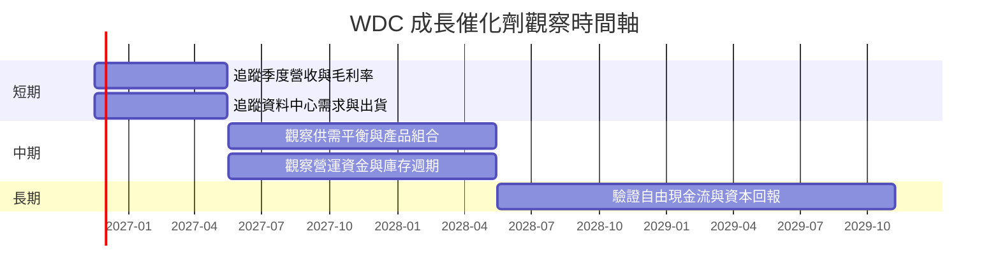

### 9.2 TAM 市場規模分析

**N/A（TAM 數據未提供）**。可量化的近期營運參考為 TTM 營收 $14.48B、TTM 成長 20.7%、最新季度年增 55.5%。這些數字支持需求回升判斷，但不能替代市場規模、滲透率或公司市占資料。

### 9.3 成長驅動力結構圖

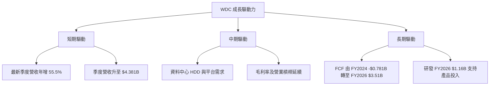

短期催化劑有已披露季度數據支持；中長期催化劑仍需由後續營收、利潤率與資本回報驗證，不能只依 AI 基建題材推定。

---

## 10. 風險矩陣

### 10.1 風險評分矩陣

以下座標是分析師對相對機率與衝擊的定性排序，不是公司公布的統計機率。

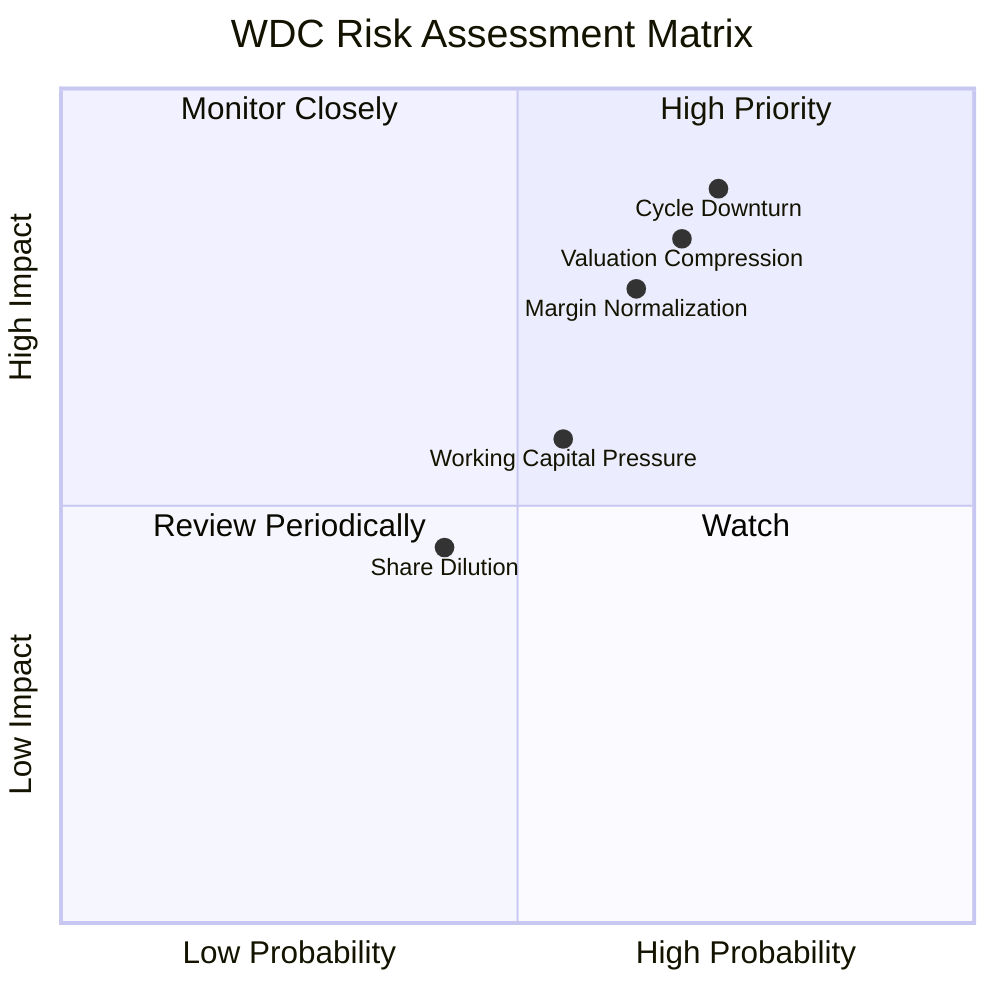

### 10.2 風險清單詳細分析

| # | 風險項目 | 發生機率 | 財務衝擊 | 風險評分 | 緩解措施 |
|---|----------|----------|----------|----------|----------|
| 1 | 🔴 **儲存週期反轉** | 中高（分析師估計約 60%） | 高；營收增長若由 20.7% 快速轉負，營業槓桿可能放大下滑 | 🔴 高 | 追蹤連續兩季營收、毛利率及庫存；避免用高峰盈利倍數外推。 |
| 2 | 🔴 **估值倍數收縮** | 高（分析師估計約 65%） | 高；DCF 基準 $182.17，比現價低 38.4%；加權合理價值低 24.4% | 🔴 高 | 採分批與估值紀律；每季更新 FCFF、WACC 與同業倍數。 |
| 3 | 🟡 **利潤率回歸正常** | 中高（分析師估計約 60%） | 高；最新季度營業利益率 46.7% 高於 TTM 39.4%，回落將直接壓低 EBIT | 🔴 高 | 追蹤毛利率、營業利益率、定價及產品組合。 |
| 4 | 🟡 **營運資金壓力** | 中（分析師估計約 50%） | 中；CCC 由 34 天升至 52 天，增加現金占用 | 🟡 中 | 監控 DSO、DIO、存貨跌價及 OCF/淨利轉換。 |
| 5 | 🟡 **股數稀釋與 SBC** | 中（分析師估計約 40%） | 中；Piotroski 稀釋股數測試未通過；FY2026 SBC $204M | 🟡 中 | 追蹤稀釋股數、SBC/營收、回購抵銷率。 |
| 6 | 🟡 **稅務利益不可持續** | 中（分析師估計約 45%） | 中高；有效稅率僅 4.9%，正常化稅率上升會壓低淨利與 DCF | 🟡 中高 | 核對年報稅務調節、遞延稅項與現金稅。 |

---

## 11. 投資建議

### 11.1 最終評級與評分

依加權合理價值 $223.61 與現價 $295.65 計算，MOS 為 **-32.2%**，未達 -25% 以下賣出門檻以外的任何較高評級條件，故評級為 **🔴 賣出**；沒有依質化因素調整。公司綜合評分為 **6.1/10**，由 1.1 六項分數構成：成長性 8.0、獲利能力 8.5、財務健康 6.0、估值 2.0、護城河 6.5、管理層與資本配置 5.5。

### 11.2 合理價值與隱含報酬率

| 方法／情境 | 每股價值 | 相對現價 | 機率 |
|------------|---------:|----------:|-----:|
| 加權合理價值（8.8） | **$223.61** | **-24.4%** | — |
| 🔴 悲觀 DCF | $100.40 | -66.0% | 25% |
| 🟡 基準 DCF | $182.17 | -38.4% | 50% |
| 🟢 樂觀 DCF | $313.26 | +6.0% | 25% |
| DCF 機率加權參考值 | $194.50 | -34.2% | 100% |

加權合理價值低於現價，且 DCF 悲觀與基準情境均顯示大幅下行；即使樂觀情境，預估價值也只高出現價 6.0%，不足以抵銷週期與估值風險。

### 11.3 買入時機與觸發因素

╔══════════════════════════════════════════════════════════════════╗  
║                  ✅ 投資觸發因素 Checklist                       ║  
╠══════════════════════════════════════════════════════════════════╣  
║  重新考慮建倉前，多數條件應符合：                               ║  
║  ☐ TTM 營收成長維持正值，且最新季度年增不連續大幅減速           ║  
║  ☐ TTM 營業利益率維持在 30% 以上，避免快速回歸週期低點          ║  
║  ☐ TTM FCF 持續為正，FCF／淨利轉換率由約 43% 改善               ║  
║  ☐ CCC 由 52 天回落，DSO 與 DIO 不再連續增加                    ║  
║  ☐ 股數稀釋速度受控，SBC 占營收不持續上升                       ║  
║                                                                  ║  
║  加碼／重估觸發條件：                                             ║  
║  ☐ 股價回到約 $201.25 以下，且營收、FCF 與 ROIC 未惡化           ║  
║  ☐ DCF 基準上修並可由實際季度數據驗證，而非僅靠倍數擴張          ║  
║                                                                  ║  
║  減碼／退出觸發條件：                                             ║  
║  ☐ 連續兩季營收年增轉負或營業利益率較 TTM 39.4% 收縮逾 10pp    ║  
║  ☐ TTM FCF 轉負，或 CCC 繼續惡化且現金流同步下降                 ║  
║  ☐ ROIC 跌至 WACC 14.00% 以下                                    ║  
╚══════════════════════════════════════════════════════════════════╝

### 11.4 投資人適配度分析

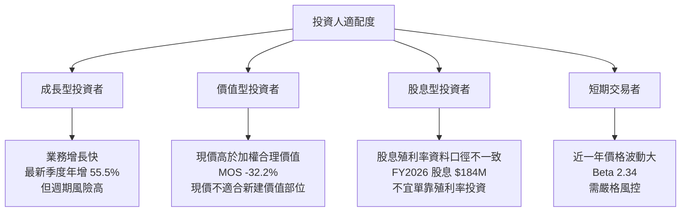

### 11.5 每季財報監控清單（Quarterly Watch List）

| 監控指標 | 當前基準 | 加碼／正面訊號 | 減碼／負面訊號 |
|----------|---------:|----------------|----------------|
| 營收成長 | TTM +20.7%；最新季度 YoY +55.5% | 最新季度年增維持正值，且 QoQ 不連續轉負 | 連續兩季 YoY 為負或急速放緩 |
| 營業利益率 | TTM 39.4%；最新季度 46.7% | 維持 30% 以上並由營收成長支持 | 兩季低於 30%，或較 TTM 基準收縮逾 10 個百分點 |
| 毛利率 | TTM 52.6% | 維持或改善，且非單靠一次性項目 | 連續兩季下降並伴隨庫存增長 |
| FCF | TTM $4.29B | 維持正值、OCF 能覆蓋 Capex | TTM FCF 轉負 |
| Capex | TTM $572M | Capex 投入伴隨收入及產能利用率改善 | Capex 上升但收入與 FCF 未同步增長 |
| DSO／DIO／DPO／CCC | 56／95／99／52 天 | CCC 由 52 天回落 | DSO 或 DIO 繼續升、CCC 超過 52 天並惡化 |
| SBC／稀釋股數 | 年度 SBC $204M；稀釋股數測試未通過 | SBC/營收穩定、稀釋受控 | 稀釋持續加速，且回購未能抵銷 |
| 有效稅率 | 4.9% | 稅務利益清楚且具持續性 | 稅率正常化造成淨利大幅下降 |
| ROIC | 61.1% | 高於 WACC 14.00% | ROIC 跌破 WACC |
| 管理層財測 | 未提供可引用數字 | 實際數據連續達到或超越財測 | 下修財測或預期落空 |

### 11.6 反面論證：什麼會證明論點錯誤（What Would Change My Mind）

╔══════════════════════════════════════════════════════════════════╗  
║              ⚠️ 論點失效條件（Disconfirming Evidence）           ║  
╠══════════════════════════════════════════════════════════════════╣  
║  即使目前基本面改善，若出現以下情況應重新檢視或退出：           ║  
║  ☐ 最新季度營收 YoY 連續兩季低於 0%                            ║  
║  ☐ TTM 營業利益率由 39.4% 下滑至 30% 以下                     ║  
║  ☐ TTM FCF 轉負，或 FCF／淨利轉換率持續低於約 40%              ║  
║  ☐ ROIC 跌至 WACC 14.00% 以下                                  ║  
║  ☐ CCC 高於 52 天且 DSO、DIO 同時持續上升                      ║  
║  ☐ 稀釋股數增加速度加快，SBC 占營收持續高於目前約 1.6%         ║  
║  ☐ 4.9% 有效稅率無法維持，且稅率正常化後盈利大幅下修           ║  
║  ☐ 實際營收增長與利潤率無法支持市場隱含的 35.2% 首年成長或 45.0% ║  
║     固定營業利潤率假設                                           ║  
╚══════════════════════════════════════════════════════════════════╝

---

> **免責聲明**：本報告為 AI 自動生成，僅供研究參考，不構成投資建議。投資有風險，入市需謹慎。

---

## 資料與來源

| 項目 | 內容 |
|------|------|
| 價格 | 295.65 USD，2026-11-13 收盤（Yahoo Finance 日線） |
| 財務報表 | SEC 10-Q filed 2026-10-23，最新季度 2026-10-02（FY2027 Q1） |
| 有回應的資料來源 | SEC 申報資料 (XBRL)、Yahoo Finance、Finviz、StockAnalysis、Roic.ai |
| 由程式計算 | TTM 數字、WACC、DCF 模型、估值方法與權重、加權合理價值、MOS、評級門檻、F-Score、杜邦分解、營運資金天數、綜合評分 |
| 撰寫模型 | openai / gpt-6-luna |

> 本區塊由產生報告的程式依實際取得的資料填寫，非模型撰寫。「由程式計算」的數字不是模型的估計；其餘判斷（評分、情境、策略）是模型的分析。
