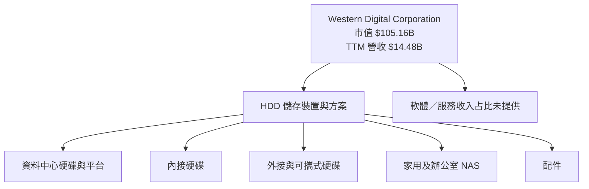
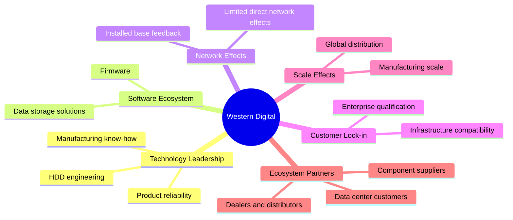
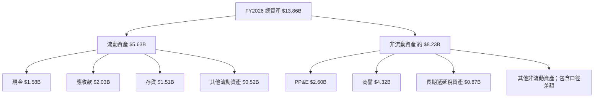
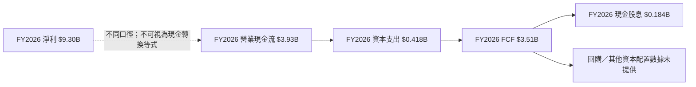
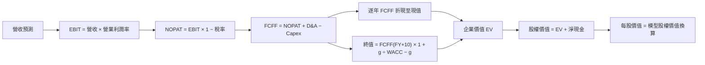
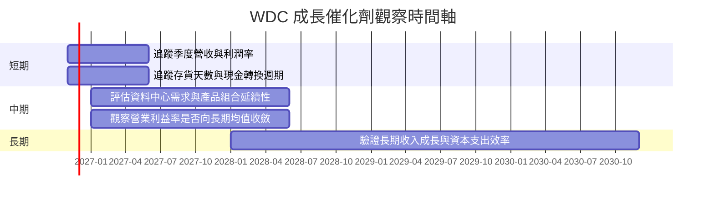
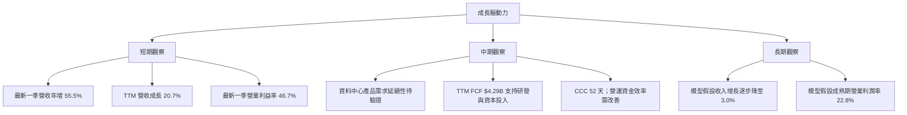
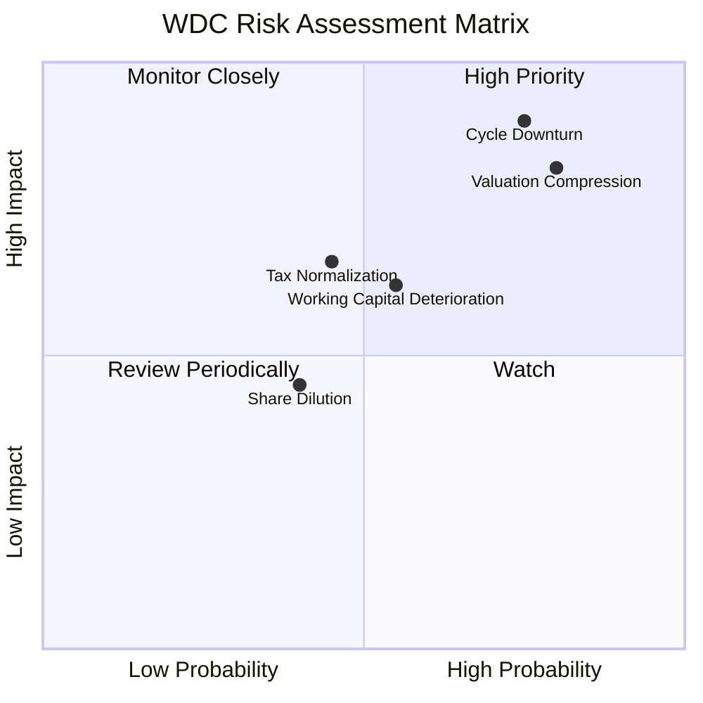
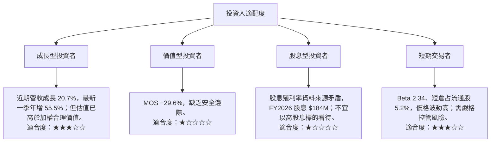

# WDC 基本面深度分析報告
> **報告日期**：2026-11-17 ｜ **語言**：繁體中文 ｜ **數據來源**：SEC 申報資料 (XBRL)、Yahoo Finance、Finviz、StockAnalysis、Roic.ai ｜ **分析師**：CFA 級機構研究

## 目錄

| # | 章節 | 核心結論 |
|---|------|----------|
| 1 | 執行摘要 | 賣出；加權合理價值 $216.70；MOS −29.6% |
| 2 | 公司概覽與商業模式 | HDD 需求、規模與客戶關係構成護城河；產品收入占比未提供 |
| 3 | 損益表深度分析 | TTM 營收 $14.48B、成長 20.7%；最新一季營收年增 55.5% |
| 4 | 資產負債表分析 | 淨現金 $525M；營運資金週期較一年前拉長 18 天 |
| 5 | 現金流量深度分析 | TTM FCF $4.29B、FCF Yield 4.08%；但 FCF/淨利轉換率偏低 |
| 6 | 獲利能力與資本效率 | ROIC 61.1% 高於 WACC 14.00%，目前創造經濟價值 |
| 7 | 相對估值分析 | 與同業及自身歷史相比，估值指標方向不一；DCF 與同業 EV/EBITDA 指向下行 |
| 8 | DCF 內在價值評估 | DCF 基準每股價值 $182.17；加權合理價值 $216.70 |
| 9 | 成長催化劑 | 最新一季營收年增 55.5%；TAM 與產品別收入數據未提供 |
| 10 | 風險矩陣 | 週期反轉、估值下修及營運資金惡化為主要風險 |
| 11 | 投資建議 | 依 MOS 評級為賣出；需等待估值與現金流指標改善 |

---

## 1. 執行摘要

WDC 的 TTM 營收為 **$14.48B、年增 20.7%**，最新一季營收年增 **55.5%**，TTM FCF 為 **$4.29B**；ROIC **61.1%** 高於 **14.00% WACC**，顯示當前營運仍創造價值。然而，DCF 基準價值為 **$182.17**、加權合理價值為 **$216.70**，相對 2026-11-16 收盤價 **$280.93** 的 MOS 為 **−29.6%**。因此，依規則 20 評級為 **🔴 賣出**；未因質化因素調整評級。需注意營收成長與利潤率處於強勁區間，但股價已高於加權合理價值，且分析師共識目標價顯著高於其他估值方法，拉高了加權結果。

### 1.0 一頁式投資儀表板（Portfolio Manager 30 秒速讀）

| 項目 | 內容 |
|------|------|
| **投資論點（3 句）** | ① TTM 營收 $14.48B、年增 20.7%，最新一季年增 55.5%，顯示需求仍在擴張。② TTM FCF $4.29B，ROIC 61.1% 高於 WACC 14.00%，現階段資本回報具吸引力。③ 加權合理價值 $216.70，相對現價 $280.93 的 MOS 為 −29.6%，估值缺乏安全邊際。 |
| **綜合評分** | **6.3/10**（引用 1.1 評分卡） |
| **財務健康** | 🟡 淨現金 $525M，但流動比率 1.434、速動比率 0.867，且 CCC 由 34 天增至 52 天。 |
| **ROIC vs WACC** | **61.1% vs 14.00%**：目前創造股東價值；此差距可能隨週期下行而收斂。 |
| **FCF 趨勢** | FY2023 至 FY2026 年度 FCF 由 −$1.23B 回升至 $3.51B；TTM FCF Yield **4.08%**。 |
| **估值** | Forward P/E **6.95x**（市場資料）；EV/EBITDA（歷史估值區間計算）**18.8x**；FCF Yield **4.08%**。各來源口徑有差異，詳見第 7 章。 |
| **DCF 內在價值（基準）** | **$182.17**；現價相對 DCF 溢價 **54.2%**（現價 ÷ DCF 價值 − 1）。 |
| **安全邊際（MOS）** | **−29.6%**＝($216.70 − $280.93) ÷ $216.70；🔴 不足。基準為 8.8 加權合理價值。 |
| **預期報酬（基準情境 12M）** | DCF 基準情境相對現價 **−35.2%**（情境模型原值；估值差額以情境價值 ÷ 現價衡量）。 |
| **關鍵風險（前二）** | HDD 週期需求及定價反轉；現金轉換、營運資金天數惡化。 |
| **評級 + 信心度** | 🔴 **賣出** ｜ 信心：中（週期與資料口徑不確定性高） |

### 1.1 綜合評分卡（全報告唯一）

| 維度 | 評分（1–10） | 主要依據（引用數字與其來源章節） |
|------|--------------|----------------------------------|
| 成長性 | 8.0 | TTM 營收成長 20.7%，最新一季年增 55.5%（第 3 章）；成長仍有周期性。 |
| 獲利能力 | 9.0 | TTM 營業利益率 39.4%、ROIC 61.1%，高於 WACC 14.00%；F-Score 6/8（第 3、6 章）。 |
| 財務健康 | 7.0 | 淨現金 $525M、流動比率 1.434；但 CCC 由 34 天增至 52 天（第 4 章）。 |
| 估值 | 2.0 | MOS −29.6%；DCF $182.17 低於現價 $280.93（第 7、8 章）。 |
| 護城河 | 7.0 | HDD 技術、量產規模與企業客戶驗證有助維持競爭位置；市場份額與產品別數據未提供（第 2 章）。 |
| 管理層與資本配置 | 5.0 | FY2026 SBC $204M、TTM 股數測試未通過；回購資料未提供，資本配置可驗證性有限（第 3、5 章）。 |
| **綜合評分** | **6.3** | 六項算術平均：$(8.0+9.0+7.0+2.0+7.0+5.0) ÷ 6 = 6.33，四捨五入至小數一位。 |

### 1.2 五大投資論點 + 三大核心風險

| 類型 | 項目 | 具體依據 | 信心度 |
|------|------|----------|--------|
| 🟢 **投資論點①** | 營收動能回升 | TTM 營收 $14.48B、年增 20.7%；最新一季年增 55.5%。增速反映近期需求與價格／產品組合改善，但不能直接外推至長期。 | 🟢 高 |
| 🟢 **投資論點②** | 營業槓桿顯著 | TTM 營業利益率 39.4%，最新一季 46.7%；產能利用與高毛利產品組合改善時，利潤對營收變化有放大效果。 | 🟢 高 |
| 🟢 **投資論點③** | 現金流已轉正且擴大 | TTM OCF $4.86B、資本支出 $572M、FCF $4.29B；可支撐研發與資產負債表修復。 | 🟢 高 |
| 🟢 **投資論點④** | 資本回報高於資金成本 | ROIC 61.1% 對 WACC 14.00%，差距 47.1 個百分點；若盈利維持，股東價值創造能力強。 | 🟡 中 |
| 🟢 **投資論點⑤** | 淨現金提供緩衝 | 淨現金 $525M、總債務 $789M；可降低景氣反轉時的再融資壓力。 | 🟡 中 |
| 🟡 **風險①** | 估值與市場預期過高 | 加權合理價值 $216.70，低於現價 $280.93；DCF 基準價值 $182.17。 | 🔴 高衝擊 |
| 🔴 **風險②** | HDD 需求與定價具周期性 | 最新一季年增 55.5%，但過去年度營收曾由 FY2022 $18.79B 下滑至 FY2023 $6.25B；週期高點可能造成基期與利潤率回落。 | 🔴 高 |
| 🟡 **風險③** | 營運資金效率變差 | CCC 一年增加 18 天至 52 天，DSO、DIO 均上升；若趨勢延續，會限制 FCF 轉換。 | 🟡 中 |

### 1.3 快速統計卡片

| 指標 | 公司實際值（期間） | 同業中位數 | 狀態 |
|------|--------------------|------------|------|
| 營收成長（TTM） | **20.7%** | — | 🟢 |
| 營收成長（最新一季年增） | **55.5%** | **61.0%** | 🟡 |
| 毛利率（TTM） | **52.6%** | **80.0%** | 🟡 |
| 營業利益率（TTM） | **39.4%** | — | 🟢 |
| ROIC（TTM） | **61.1%** | — | 🟢 |
| Forward P/E | **6.95x** | **3.5x** | 🟡 |
| FCF Yield（TTM） | **4.08%** | — | 🟡 |
| Piotroski F-Score | **6 / 8** | — | 🟡 |

> 同業中位數依 STX、SNDK、MU 的 Peer multiples 計算；「營收成長最新一季年增」中位數為 61.0%。Forward P/E 中位數為 3.5x。

### 1.4 投資結論

```text
╔══════════════════════════════════════════════════════════════════╗
║                    📊 投資結論摘要                               ║
╠══════════════════════════════════════════════════════════════════╣
║  評級：🔴 賣出（依 MOS 門檻；未作一級調整）                      ║
║  價格（2026-11-16 收盤）：$280.93                                ║
║  DCF 內在價值（基準）：$182.17（現價溢價 54.2%）                ║
║  安全邊際 MOS：−29.6%（以加權合理價值為分母）                   ║
║  加權合理價值（8.8）：$216.70                                    ║
║  DCF 情境價值：                                                   ║
║    悲觀情境：$100.40（−64.3%）                                   ║
║    基準情境：$182.17（−35.2%）                                   ║
║    樂觀情境：$313.26（+11.5%）                                   ║
║  綜合評分：6.3/10（引用 1.1）                                    ║
║  適合投資人：能承受高波動、熟悉半導體與儲存週期的投資人；         ║
║              不適合以現價追求安全邊際或穩定股息的投資人。       ║
╚══════════════════════════════════════════════════════════════════╝
```

---

## 2. 公司概覽與商業模式

### 2.1 業務結構與收入來源

公司資料描述 WDC 開發、製造及銷售以 HDD 技術為基礎的資料儲存裝置與方案，涵蓋資料中心硬碟、資料中心平台、內接與外接硬碟、可攜式硬碟、NAS 產品及配件。產品別營收與占比未提供，因此下圖只呈現已披露的公司總營收及業務類別，不推估各類別占比。



**商業模式與獲利來源：** WDC 主要透過硬體銷售取得收入，並需持續投入製造、研發與供應鏈管理。FY2026 研發費用為 $1.16B，反映維持產品技術與產品線更新所需的投入。由於沒有產品別毛利率及客戶集中度資料，無法判斷各板塊對整體利潤的實際貢獻。

### 2.2 市場份額

市場份額數據未提供，近期新聞亦無可引用的市場份額數字。可見的公司規模指標為 TTM 營收 $14.48B、TTM 成長 20.7%；同業比較中 STX 最新一季營收年增 61.0%，而 SNDK、MU 的最新一季成長率更高，但業務組合不完全相同，不能將營收成長直接等同市場份額變化。

### 2.3 競爭護城河分析



### 2.4 護城河強度

| 護城河項目 | 強度（強／中／弱） | 證據（引用數字或事實） | 會削弱它的情況 |
|------------|--------------------|------------------------|----------------|
| 技術與可靠度 | 中 | 長期供應 HDD 產品及資料中心平台，FY2026 研發費用 $1.16B。產品可靠性與驗證週期可形成門檻。 | 技術路線改變、產品良率落後，或競爭者提供更低總持有成本方案。 |
| 軟體生態系統 | 弱至中 | 公司提供儲存解決方案，但軟體／服務收入與留存指標未提供。 | 軟體無法提高客戶黏著或溢價，價值仍受硬體價格週期主導。 |
| 網路效應 | 弱 | HDD 的直接網路效應有限；規模和客戶部署可能帶來間接回饋。 | 客戶可多來源採購，產品標準化降低轉換摩擦。 |
| 客戶鎖定 | 中 | 企業級資料中心產品需經過採購、驗證與相容性評估；客戶集中度數據未提供。 | 客戶縮短驗證流程、增加多供應商策略或轉向其他儲存架構。 |
| 規模效應 | 中至強 | FY2026 營收 $12.92B，全球多區域銷售；較大規模可分攤研發與製造固定成本。 | 產能利用率下降、競爭價格下滑，或資產閒置侵蝕單位成本優勢。 |
| 生態夥伴 | 中 | 透過銷售人員、經銷商及分銷商銷售，並服務企業與通路需求。 | 通路庫存累積、供應鏈受限或大客戶議價能力進一步上升。 |

**1.1「護城河」7.0 分的理由：** 技術、規模及企業客戶驗證提供一定競爭壁壘，但市場份額、客戶留存與分部獲利數據缺失，且 HDD 業務仍受周期和定價影響。

---

## 3. 損益表深度分析

### 3.1 年度收入成長趨勢（近 4 年）

年度營收依公司年度損益表列示，金額四捨五入至 $0.01B；收入成長反映低基期後回升，不能直接視為長期趨勢。

```text
╔══════════════════════════════════════════════════════════════════╗
║              WDC 年度收入趨勢（FY2023–FY2026）                   ║
╠══════════════════════════════════════════════════════════════════╣
║  FY2023  $6.25B   ████████░░░░░░░░░░░░░░░░  YoY: −66.7%  🔴    ║
║  FY2024  $6.32B   ████████░░░░░░░░░░░░░░░░  YoY: +1.0%   🟡    ║
║  FY2025  $9.52B   █████████████░░░░░░░░░░░  YoY: +50.7%  🟢    ║
║  FY2026  $12.92B  █████████████████░░░░░░░  YoY: +35.7%  🟢    ║
╠══════════════════════════════════════════════════════════════════╣
║  FY2023–FY2026 營收 CAGR：(12.92 ÷ 6.25)^(1/3) − 1 = 27.3%      ║
╚══════════════════════════════════════════════════════════════════╝
```

FY2023 為週期低點；FY2024 僅小幅回升，FY2025–FY2026 加速成長。資料顯示收入復甦明顯，但周期底部至復甦的 CAGR 會高估常態成長能力。

### 3.2 季度收入趨勢分析

| 季度 | 營收 | QoQ 成長 | YoY 成長 | 備註 |
|------|------:|---------:|---------:|------|
| 2025-12-31 | $3.02B | — | 25.24% | YoY 依 StockAnalysis 季度序列。 |
| 2026-03-31 | $3.34B | 10.6% | 45.47% | 營收連續成長。 |
| 2026-06-30 | $3.75B | 12.3% | 43.84% | 季增動能延續。 |
| 2026-09-30 | $4.38B | 16.9% | 55.5% | 最新一季年增；注意季度收入表日期與 SEC 財報季度截止日有差異。 |

**QoQ 計算例：** 最新季度 QoQ = $4.38B ÷ $3.75B − 1 = **16.9%**。最新季度年增 **55.5%** 是單季年增率，不是 TTM 成長率；TTM 成長率為 **20.7%**。

### 3.3 利潤率演變分析

| 利潤率指標 | FY2023 | FY2024 | FY2025 | FY2026 | 趨勢 | 評估 |
|------------|--------|--------|--------|--------|------|------|
| **毛利率** | 22.2% | 28.1% | 38.8% | 48.8% | ↗️ 連續擴張 | 🟢 |
| **營業利益率** | −6.4% | 1.5% | 22.4% | 35.6% | ↗️ 從虧損轉為高利潤 | 🟢 |
| **淨利率** | −26.9% | −12.6% | 19.4% | 72.0% | 波動極大 | 🟡 |

> FY2026 淨利率按年度淨利 $9.30B ÷ 營收 $12.92B 計算，與 TTM 淨利率 69.2% 及 DuPont 數據口徑不同；需謹慎看待其稅務與非營業項目影響。

**利潤率演變深度解析：** FY2023 至 FY2026 毛利率由 22.2% 升至 48.8%，營業利益率由 −6.4% 升至 35.6%。這種幅度較可能反映產品定價、產品組合、產能利用率和周期回升共同作用，而非單純固定成本削減。TTM 營業利益率為 39.4%，最新一季則為 46.7%；前者是 TTM，後者是單季，兩者不可混為一談。若需求與售價回落，製造業固定成本將使利潤率快速下滑。

### 3.4 費用結構分析

完整年度費用明細未提供，故不以不完整資料製作費用占比圓餅圖。已知 FY2026 研發費用 **$1.16B**，約占 FY2026 營收 $12.92B 的 **9.0%**（$1.16B ÷ $12.92B）；其他費用明細與占比未提供。

```text
╔══════════════════════════════════════════════════════════════════╗
║               FY2026 研發費用與營收對照                         ║
╠══════════════════════════════════════════════════════════════════╣
║  研發費用  $1.16B   ███░░░░░░░░░░░░░░░░░░░░░░░░░░░░░░░░░░      ║
║  營收      $12.92B  ████████████████████████████████████████    ║
║  研發費用／營收 = 9.0%；其他費用分類資料未提供                  ║
╚══════════════════════════════════════════════════════════════════╝
```

### 3.5 季度 EPS 趨勢與盈餘品質（Quality of Earnings）

| 季度 | EPS 實際值 | EPS 年增 | 是否超預期／不及預期 |
|------|-----------:|--------:|----------------------|
| 2025-12-31 | $4.67 | 187.75% | N/A；EPS 預估值未提供。 |
| 2026-03-31 | $8.20 | 482.92% | N/A；EPS 預估值未提供。 |
| 2026-06-30 | $8.21 | 984.10% | N/A；EPS 預估值未提供。 |
| 2026-09-30 | $4.63 | 50.86% | N/A；EPS 預估值未提供。 |

資料庫的 EPS Est 欄位均為 NaN，因此無法判定過去四季實際 EPS 是超預期或不及預期。季度淨利在不同來源亦有差異，故以季度實際 EPS 序列作趨勢參考，不虛構市場預期數字。

| 盈餘品質項目 | 數值／佔比 | 評估 |
|--------------|-----------|------|
| 股權薪酬 SBC / 營收 | 約 **1.6%**（四季 SBC $230M ÷ TTM 營收 $14.48B） | 🟡 SBC 占比不高，但股權稀釋仍需監控；F-Score 的稀釋股數測試未通過。 |
| SBC / 營業現金流 | 約 **4.7%**（$230M ÷ $4.86B） | 🟡 SBC 不是現金支出，但代表股東稀釋成本。 |
| FCF / 淨利（現金轉換率） | 約 **43.3%**（$4.29B ÷ StockAnalysis TTM 淨利 $9.913B） | 🔴 TTM 淨利高於現金流，現金轉換偏低；利潤包含稅率與非現金因素影響的可能性需查核。 |
| 一次性／非經常性損益 | **未能量化**；年度淨利 FY2026 $9.30B，TTM 淨利來源間有差異 | 🟡 不宜把淨利率 69.2% 直接視為常態盈利能力。 |
| 有效稅率異常 | **4.9%**（DCF 模型採用的最新年度有效稅率） | 🟡 低稅率提高 NOPAT；若正常化稅率上升，DCF 價值將下降。 |
| 資本化支出 vs 費用化 | TTM Capex $572M；資本化政策細節未提供 | 🟡 未見足夠資料判斷費用資本化是否造成盈餘高估。 |

**盈餘品質結論：** FCF 由現金流量表定義為 OCF − Capex，TTM 為 $4.29B，具實際現金支持；但相較 TTM 淨利 $9.913B，現金轉換率約 43.3%。低有效稅率與淨利來源差異使 GAAP 淨利的可持續性較難判斷，估值上不應把當前淨利率機械外推。

---

## 4. 資產負債表分析

### 4.1 資產結構分解

以下採 FY2026 年度資產負債表，單位為 $B。流動資產 $5.63B，總資產 $13.86B，非流動資產以差額呈現。



### 4.2 流動性與營運資金分析

| 指標 | 最新 TTM | 一年前 TTM | 變化 | 解讀 |
|------|----------|------------|------|------|
| DSO 應收帳款天數 | 56 天 | 41 天 | +15 天 | 🟡 回款週期拉長，可能反映客戶付款條件或客戶／產品組合變化。 |
| DIO 存貨天數 | 95 天 | 70 天 | +25 天 | 🔴 庫存周轉變慢；應追蹤庫存是否為備貨或需求放緩。 |
| DPO 應付帳款天數 | 99 天 | 77 天 | +22 天 | 🟡 付款期限延長能部分抵銷 DSO、DIO 上升，但也可能反映供應鏈付款安排改變。 |
| CCC 現金轉換週期 | 52 天 | 34 天 | +18 天 | 🔴 資金被營運週期占用的時間增加。 |

**流動性指標：** FY2026 流動資產 $5.63B、流動負債 $4.24B，流動比率約 **1.33x**（年度數據）；市場資料列示流動比率 **1.434x**、速動比率 **0.867x**，反映日期或來源口徑不同。流動比率大於 1 提供短期緩衝，但速動比率低於 1，對存貨變現仍有依賴。

### 4.3 債務結構分析

> 債務數據來源間存在口徑差異：品質資料列示 TTM 總債務 $789M、淨現金 $525M；其他市場／年報資料列示總債務 $922M 或 FY2026 總債務 $1.05B。以下採 VERIFIED FIGURES 口徑進行核心分析，不用差異數字混算。

```text
╔══════════════════════════════════════════════════════════════════╗
║                   WDC 債務健康診斷                               ║
╠══════════════════════════════════════════════════════════════════╣
║  總債務（TTM）       $0.789B  ██░░░░░░░░░░░░░░░░░░  🟢         ║
║  現金及短期投資      $1.31B   ███████████████████░  🟢         ║
║  淨現金（TTM）       $0.525B  ████████░░░░░░░░░░░░  🟢         ║
║  Debt/EBITDA         N/A（同口徑 TTM EBITDA 未提供）             ║
║  Interest Coverage   N/A（利息費用及 EBIT 利息保障倍數未提供）   ║
╚══════════════════════════════════════════════════════════════════╝
```

淨現金為正、財務槓桿整體可控；但現金較 FY2026 年底 $1.58B 下降至 TTM 現金及短期投資 $1.31B。Debt/EBITDA 與利息保障倍數不以不同來源數字反推。

### 4.4 股東權益趨勢

| FY | 股東權益 |
|----|---------:|
| FY2023 | $11.84B |
| FY2024 | $11.05B |
| FY2025 | $5.54B |
| FY2026 | $8.86B |

```text
╔══════════════════════════════════════════════════════════════════╗
║                   WDC 股東權益變化                               ║
╠══════════════════════════════════════════════════════════════════╣
║  FY2023  $11.84B  ████████████████████                          ║
║  FY2024  $11.05B  ███████████████████                           ║
║  FY2025   $5.54B  █████████                                      ║
║  FY2026   $8.86B  ███████████████                                ║
╚══════════════════════════════════════════════════════════════════╝
```

FY2025 權益下降、FY2026 回升；資料不足以將變化精確拆解為淨利、股息、股權薪酬、回購或其他權益變動。需留意 ROE 可能受權益基數波動放大。

---

## 5. 現金流量深度分析

### 5.1 現金流量瀑布圖

季度淨利、TTM OCF 與 TTM FCF 的期間口徑不同，因此下圖不將不同期間金額混接為單一精確瀑布；以下顯示已知年度資本配置流向，回購及淨現金變化未提供。



### 5.2 FCF 轉換率趨勢

| 財年 | FCF | 淨利 | FCF / 淨利 | 解讀 |
|------|----:|----:|-----------:|------|
| FY2023 | −$1.23B | −$1.68B | 73.2% | 兩者均為負值，比率為正但不代表現金盈利健康。 |
| FY2024 | −$0.781B | −$0.798B | 97.9% | 現金流與淨損接近。 |
| FY2025 | $1.28B | $1.86B | 68.8% | 正向轉換，但仍低於淨利。 |
| FY2026 | $3.51B | $9.30B | 37.7% | 淨利大幅高於 FCF，需檢視稅務與非現金項目。 |

### 5.3 自由現金流趨勢

| 期間 | FCF | 變化 |
|------|----:|------|
| FY2023 | −$1.23B | 基期低迷 |
| FY2024 | −$0.781B | 虧損收窄 |
| FY2025 | $1.28B | 轉正 |
| FY2026 | $3.51B | 進一步提升 |
| TTM 至 2026-10-02 | **$4.29B** | TTM OCF $4.86B − Capex $572M |

```text
╔══════════════════════════════════════════════════════════════════╗
║                  WDC 自由現金流趨勢                              ║
╠══════════════════════════════════════════════════════════════════╣
║  FY2023  −$1.23B  ◀██████████░░░░░░░░░░░░░░░                    ║
║  FY2024  −$0.78B  ◀██████░░░░░░░░░░░░░░░░░░░                    ║
║  FY2025   $1.28B  ██████████░░░░░░░░░░░░░                        ║
║  FY2026   $3.51B  █████████████████████████                      ║
║  TTM      $4.29B  ██████████████████████████████                 ║
║  TTM FCF Yield：4.08%                                             ║
╚══════════════════════════════════════════════════════════════════╝
```

### 5.4 資本配置評估

完整的資本用途分配及回購數據未提供，不製作比例圓餅圖。可辨識項目如下：

| 資本配置項目 | 已披露數據 | 評估 |
|--------------|-----------:|------|
| 資本支出 | TTM $572M；FY2026 $418M | TTM Capex 約為 TTM 營收 3.95%，資本需求相對收入規模有限，但產能與技術維護仍須持續投資。 |
| 股息 | FY2026 現金股息 $184M | 相對 FY2026 FCF $3.51B 不高；市場資料股息殖利率 25.0% 與低 payout ratio 1.9% 相互矛盾，不採用該殖利率作投資判斷。 |
| 回購 | N/A | 數據未提供，無法評價回購價格與股數抵銷效果。 |
| 研發 | FY2026 $1.16B | 研發支出約占 FY2026 營收 9.0%，維持技術與產品更新的投入。 |
| 留存／其他 | N/A | 資料未提供完整分類。 |

---

## 6. 獲利能力與資本效率

### 6.1 ROE / ROA / ROIC 趨勢

| 指標 | FY2023 | FY2024 | FY2025 | 最新 TTM | 評估 |
|------|--------|--------|--------|---------:|------|
| ROE | N/A | N/A | N/A | **107.2%** | 高，但權益基數、淨利率及周期狀態可能放大比率。 |
| ROA | 歷史序列 N/A | N/A | N/A | **N/A** | QUALITY FIGURES 未列出最新 TTM ROA 數值；其他資料來源 25.9% 口徑不一致，故不混用。 |
| ROIC | N/A | N/A | N/A | **61.1%** | 顯著高於 WACC 14.00%，但單一周期高點未必可持續。 |

### 6.2 ROIC vs WACC 分析（核心價值創造判斷）

WACC 依資本成本資料採用 **14.00%**；計算值 14.64% 被模型限制在 7%–14% 區間，故使用上限 14.00%。ROIC 採 TTM **61.1%**，不另行重算。

```text
╔══════════════════════════════════════════════════════════════════╗
║                ROIC vs WACC 深度分析                            ║
╠══════════════════════════════════════════════════════════════════╣
║  WACC（程式採用值）：14.00%                                      ║
║  ├── 無風險利率（10Y 美債）：5.12%                               ║
║  ├── 市場風險溢酬 ERP：5.00%                                     ║
║  ├── 原始 Beta：2.34；調整後 Beta：1.90                          ║
║  ├── 股權成本：14.60%（資本成本資料原值）                       ║
║  ├── 稅前債務成本：20.91%；有效稅率：4.9%                       ║
║  ├── 股權／債務權重：99.3%／0.7%                                ║
║  └── WACC 計算值 14.64%，受 7%–14% 區間限制，採用 14.00%        ║
║                                                                  ║
║  ROIC（TTM）：61.1%                                              ║
║  ROIC − WACC = 61.1% − 14.00% = +47.1 個百分點                  ║
║  ROIC / WACC = 61.1% ÷ 14.00% = 4.36 倍                         ║
║                                                                  ║
║  ROIC  61.1%  ▓▓▓▓▓▓▓▓▓▓▓▓▓▓▓▓▓▓▓▓▓▓▓▓▓▓▓▓▓▓▓▓▓▓▓▓▓▓▓▓▓       ║
║  WACC  14.0%  ▓▓▓▓▓▓▓▓▓▓░░░░░░░░░░░░░░░░░░░░░░░░░░░░░░       ║
║                                                                  ║
║  結論：目前 ROIC 高於資本成本，創造股東價值；若利潤回落，差距   ║
║        可能迅速收窄，不能以單一高峰期回報率永久外推。             ║
╚══════════════════════════════════════════════════════════════════╝
```

**Beta 調整方式：** 原始 Beta 2.34，採用 Beta = ⅔ × 2.34 + ⅓ × 1 = **1.90**。資本成本資料未標註 10Y 殖利率觀測日；因此沿用其提供的 5.12%，不自行補日期或另算 WACC。

### 6.3 杜邦三因素分解

| 因素 | 數值（TTM） | 解讀 |
|------|-------------|------|
| 淨利率 | 69.2% | 淨利率是高 ROE 的主要數值因素，但需留意低稅率與一次性／非營業項目。 |
| 資產週轉率 | 1.02 | 顯示資產營收周轉效率；需與周期高點的營收一併看待。 |
| 權益乘數 | 1.52 | 財務槓桿不是 ROE 高企的主要來源。 |
| **ROE** | **107.2%** | **69.2% × 1.02 × 1.52 ≈ 107.2%**（依 QUALITY FIGURES 原值）。 |

### 6.4 財務體質：Piotroski F-Score

**Piotroski F-Score：6 / 8**。一項測試因缺少輸入值無法判定，因此可判定分母為 8，而非 9。

| 測試 | 結果 | 解讀 |
|------|------|------|
| ROA > 0 | ✅ 通過 | 資產回報為正。 |
| 營業現金流 > 0 | ✅ 通過 | TTM OCF 為 $4.86B。 |
| ROA 高於一年前 | ✅ 通過 | 盈利狀況相對改善。 |
| 營業現金流 > 淨利（應計品質） | ❌ 未通過 | 淨利高於現金流，與 43.3% FCF／淨利轉換率方向一致。 |
| 長期負債 ÷ 總資產低於一年前 | — 無法判定 | 缺少所需資料。 |
| 流動比率高於一年前 | ✅ 通過 | 流動比率相對改善。 |
| 稀釋股數未增加 | ❌ 未通過 | 股權薪酬與股數變動需持續監控。 |
| 毛利率高於一年前 | ✅ 通過 | 毛利率在復甦週期中改善。 |
| 資產週轉率高於一年前 | ✅ 通過 | 資產周轉改善。 |

總分顯示營運復甦廣泛，但應計品質與股數稀釋兩項未通過，降低了單看盈餘成長的可信度。

---

## 7. 相對估值分析

### 7.1 同業估值比較表格

同業數值使用 Yahoo Finance Peer multiples。WDC 公司自身估值採財務資料區塊的估值倍數；需注意公司自身不同資料源的 TTM P/E、EV/EBITDA 口徑並不完全一致。

| 估值指標 | **WDC** | **STX** | **SNDK** | **MU** | 本公司評估 |
|----------|--------:|------:|-------:|-----:|-----------|
| **Trailing P/E** | 10.9x | 26.2x | 6.5x | 9.7x | 🟡 約落在同業中間；週期盈利使單一 P/E 可比性有限。 |
| **Forward P/E** | 6.95x | 7.6x | 2.8x | 3.5x | 🟡 WDC 高於同業中位數 3.5x，前瞻盈利預期亦須接受周期風險檢驗。 |
| **P/S Ratio** | 7.4x | 8.3x | 4.0x | 6.1x | 🔴 高於同業中位數 6.1x，且自身歷史中位數僅 1.2x。 |
| **EV/EBITDA** | 18.8x | 19.8x | 5.2x | 7.1x | 🔴 WDC 高於同業中位數 7.1x，受市場對獲利持續性的定價影響。 |
| **最新一季營收年增** | 55.5% | 61.0% | 377.9% | 379.3% | 🟡 WDC 成長低於同業中位數 377.9%，但同業比較存在業務與基期差異。 |
| **TTM 毛利率** | 52.6% | 50.4% | 80.0% | 80.7% | 🟢 高於 STX，低於 SNDK、MU；產品組合差異明顯。 |

**資料口徑提醒：** 市場摘要列示 WDC TTM P/E 9.88x、P/S 7.26x、EV/EBITDA 16.60x；自身歷史資料列示 P/E 10.9x、P/S 7.4x、EV/EBITDA 18.8x。差異可能源於價格、股數、盈利或期間口徑，遵照指定歷史估值資料使用 10.9x、7.4x、18.8x 做歷史比較。

### 7.2 歷史估值區間分析

```text
╔══════════════════════════════════════════════════════════════════╗
║               WDC 5 年歷史估值區間與當前位置                     ║
╠══════════════════════════════════════════════════════════════════╣
║  P/E        6.3x ├────────● 10.9x───────┼────── 62.5x           ║
║                         中位數 13.5x；目前百分位 38%             ║
║                                                                  ║
║  P/S        0.4x ├───────────────┼────────● 7.4x── 16.0x        ║
║                         中位數 1.2x；目前百分位 85%              ║
║                                                                  ║
║  EV/EBITDA  4.5x ├──────────┼────────● 18.8x──── 96.5x          ║
║                         中位數 14.9x；目前百分位 69%             ║
╚══════════════════════════════════════════════════════════════════╝
```

當前 P/E 位於自身歷史第 38 百分位，低於 5 年中位數；但 P/S 位於第 85 百分位、EV/EBITDA 位於第 69 百分位，反映股價／收入與企業價值／獲利倍數並未呈現一致的低估訊號。周期盈利迅速回升亦可能使 P/E 低估常態估值。

### 7.3 情境價值（Bear / Base / Bull，依 DCF MODEL）

| 情境 | 第 1 年營收成長 | 期末營業利潤率 | WACC | 每股價值 | 相對現價 | 機率 | 會發生的條件 |
|------|----------------:|----------------:|-----:|----------:|----------:|-----:|--------------|
| 🔴 悲觀 | 10.3% | 19.4% | 15.00% | $100.40 | −64.3% | 25% | 需求回歸低增長、定價競爭及利潤率向較低長期水平回落。 |
| 🟡 基準 | 20.7% | 22.8% | 14.00% | $182.17 | −35.2% | 50% | 近期 TTM 增長延續一段時間，之後成長和營業利潤率逐步收斂。 |
| 🟢 樂觀 | 31.0% | 25.1% | 13.00% | $313.26 | +11.5% | 25% | 資料中心需求、供給紀律與產品組合使收入及成熟期利潤率高於基準。 |

### 7.4 相對估值隱含價格區間

```text
╔══════════════════════════════════════════════════════════════════╗
║               相對估值與當前股價比較                             ║
╠══════════════════════════════════════════════════════════════════╣
║  $117.44 ── $182.17 ── $236.31 ── $280.93 ── $613.38            ║
║  EV/EBITDA    DCF        P/S       現價      分析師共識           ║
╚══════════════════════════════════════════════════════════════════╝
```

| 方法 | 每股價值 | 依據 |
|------|---------:|------|
| 同業 EV/EBITDA | $117.44 | STX、SNDK、MU 同業中位數 **7.1x** × WDC TTM EBITDA，再加淨現金。 |
| 同業 P/S | $236.31 | STX、SNDK、MU 同業中位數 **6.1x** × WDC TTM 營收。 |
| DCF 基準 | $182.17 | 10 年 FCFF，WACC 14.00%，永續成長率 3.0%。 |
| 分析師共識目標價 | $613.38 | 24 位分析師平均目標價；與其他估值方法差距大，僅作參考。 |

上述方法的估值區間跨度很大，分析師共識目標價尤其偏離 DCF 與相對估值；不應將共識價單獨視為合理價值。

---

## 8. DCF 內在價值評估（Discounted Cash Flow）

> 本章只使用 SEC 10-Q 資料及程式計算提供的 DCF 模型數值。金額以美元十億為單位；每股金額以美元計。模型輸入缺少的營運資金變化、退出倍數與反推試算軌跡不自行補造。

### 8.0 估值推理鏈（Thinking Logic）

**Step 1 — 價值來源與主導變數**

WDC 價值主要由既有 HDD 業務現金流、營收周期所帶來的短期利潤率變化，以及資料中心需求等成長因素決定。公司總 TTM 營收為 $14.48B，但資料未提供分部收入及市場占比，不能把某個未披露產品另行視作具特定營收占比的第二成長曲線。模型中營收由 $14.48B 增至 FY+10 $43.75B，營業利潤率則由 39.4% 降至 22.8%；由於折現率高、終值仍占 EV 35.1%，利潤率正常化與 WACC 是重要估值變數。

**Step 2 — 模型選擇**

| 決策點 | 本報告採用 | 理由（含數字） | 曾考慮但否決 | 否決理由 |
|--------|-----------|----------------|--------------|----------|
| 現金流定義 | FCFF | 與 WACC 折現一致，從 EBIT 推導 NOPAT，再加折舊、扣資本支出。 | FCFE | 缺少完整借款與股東分配預測。 |
| 預測期 N | 10 年 | DCF 模型預先設定 10 年，期間內收入增長由 20.7% 逐步降至 3.0%。 | 更短預測期 | 無法反映模型設定的周期正常化路徑；不可自行改模型。 |
| 終值方法 | Gordon Growth | 模型使用 g = 3.0%，WACC = 14.00%，符合 WACC > g。 | 退出倍數 | DCF 模型未提供退出倍數及終值 EBITDA 倍數，不自行創建。 |
| EBIT 基礎 | GAAP EBIT | 模型說明採 GAAP EBIT，SBC 已列為費用。 | 非 GAAP EBIT | 會改變模型原有營業利益基礎。 |

**Step 3 — 關鍵假設的四段推導鏈**

- **營收成長路徑**：錨點＝TTM 營收成長率 20.7%、最新一季年增 55.5% → 調整＝不將單季高增長永久外推，年成長率線性降至第 10 年 3.0% → **採用第 1 年 20.7%、第 10 年 3.0%** → 曾考慮將最新一季 55.5% 當作起始成長率，因這是單季年增且受低基期與周期影響而否決。
- **預測期 N**：錨點＝模型提供 10 年預測期 → 調整＝需涵蓋收入與利潤率逐步正常化 → **採用 10 年** → 曾考慮 5 年，因模型已固定為 10 年且短期預測可能將終值起點放在尚未正常化的年份而否決。
- **營業利潤率**：錨點＝TTM 營業利益率 39.4%，模型所用五年歷史中位數（含 TTM）為 22.8% → 調整＝假設周期高點回歸中期平均 → **第 1 年 39.4% 線性降至第 10 年 22.8%** → 曾考慮長期維持 39.4%，因長期持續高於五年中位數的依據不足而否決。
- **Capex／營收**：錨點＝TTM 資本支出 $572M ÷ TTM 營收 $14.48B = 3.95%，模型採 3.9% → 調整＝假設營收規模增加後資本支出率回落 → **第 1 年 3.9%，第 10 年 3.0%** → 曾考慮維持 3.9%，因模型設定資本支出率逐步收斂至約 1.1 倍 D&A；不另行修改。
- **有效稅率**：錨點＝最新年度有效稅率 4.9% → **採用 4.9%**。不另行假設常態稅率，因程式模型已固定該輸入；但若實際稅率升高，估值下降。
- **D&A／營收**：錨點＝TTM 比率 2.7% → **採用 2.7% 固定**。不另提高比率，因模型採用固定假設。
- **營運資金變化**：模型明確不建模 Working Capital；**採用未納入** → 不可將 CCC 延長自行轉成 ΔWC 金額，因缺少逐年營運資金預測及相關模型輸入。
- **SBC 與股數**：錨點＝GAAP EBIT 已含 SBC，模型指定不再額外扣除 SBC、股數不再稀釋 → **採組合 (A)：GAAP EBIT + 固定股數 + 不另扣 SBC** → 否決非 GAAP EBIT 加回 SBC，因會偏離模型提供的 EBIT 基礎。
- **永續成長率 g**：錨點＝長期成熟企業成長需低於折現率；模型採 3.0% → **採用 3.0%**，低於 WACC 14.00% → 曾考慮更高長期成長率，但模型指定 3.0%，且高 g 會對終值敏感度造成不成比例影響。
- **WACC**：錨點＝程式提供計算值 14.64%、允許區間 7%–14% → **採用受限值 14.00%** → 曾考慮未受限 14.64%，但模型明確要求依上下限採用 14.00%。
- **終值與年稀釋率**：錨點＝模型採 Gordon Growth 並採組合 (A) 固定股數 → **終值用 FCFF(FY+10) 與 g 3.0%，年稀釋率 0%** → 不採退出倍數，因模型未提供該項輸出；不另外增加股數稀釋，避免與 GAAP EBIT 中已費用化 SBC 重複計算。

**Step 4 — 最脆弱環節**

最脆弱的是高盈利周期下的營業利潤率與 4.9% 稅率能否在預測期維持；若利潤率更快回落，價值下行，情境模型基準 $182.17、悲觀 $100.40，可作為方向性參考，但不代表單一假設變化的精確因果估值。

**Step 5 — 計算路徑**



### 8.1 模型假設總表（Model Inputs）

| 假設項目 | 採用值 | 依據／來源 | 敏感度 |
|----------|--------|-------------|--------|
| 預測期長度 N | **10 年** | DCF 模型固定設定；FY+1 至 FY+10 完整列示。 | 🟡 中 |
| 營收成長 | 第 1 年 20.7% → 第 10 年 3.0% | 第 1 年取 TTM 成長 20.7%；之後線性淡出至 3.0%。 | 🔴 高 |
| 營業利潤率 | 第 1 年 39.4% → 第 10 年 22.8% | 起點 TTM 營業利益率 39.4%；終點為近五財年中位數（含 TTM）。 | 🔴 高 |
| 有效稅率 | 4.9% | 最新年度有效稅率，依程式模型。 | 🟢 低 |
| Capex／營收 | 第 1 年 3.9% → 第 10 年 3.0% | TTM Capex $572M ÷ TTM 營收 $14.48B 約 3.95%；模型逐步淡出。 | 🟡 中 |
| D&A／營收 | 2.7% | TTM 比率，模型固定。 | 🟢 低 |
| 營運資金變動／營收增額 | 不建模 | 模型明確未納入 working capital；不能自行補值。 | 🟢 低 |
| EBIT 基礎 | GAAP | 模型說明為 GAAP EBIT。 | 🟡 中 |
| SBC 處理 | 組合 (A)：GAAP EBIT 已含 SBC，不另扣 SBC | 與模型定義相容。SBC 成本在 EBIT 費用中；股數固定。 | 🟡 中 |
| 年稀釋率 | 0%（固定股數） | 模型指定股數不再稀釋，對應組合 (A)。 | 🟡 中 |
| 永續成長率 g | 3.0% | DCF 模型輸入；低於 WACC 14.00%。 | 🔴 高 |
| 終值方法 | Gordon Growth | 模型提供 Gordon Growth 計算結果；退出倍數未提供。 | 🔴 高 |
| WACC | 14.00% | 程式採用值；原計算 14.64%，受 7%–14% 區間限制。 | 🔴 高 |

**FCFF 定義：** 使用 FCFF，對應 WACC 折現。模型公式為 `FCFF = NOPAT + D&A − Capex`，且未建模營運資金變動。**本模型採用 (A)，故 SBC 影響已計入一次**：GAAP EBIT 已含 SBC，不再另扣 SBC，固定股數、不加年稀釋率。

### 8.2 折現率推導（WACC）

```text
╔══════════════════════════════════════════════════════════════════╗
║                    WACC 推導（折現率）                           ║
╠══════════════════════════════════════════════════════════════════╣
║  股權成本 Ke（CAPM，採資本成本資料原值）：                       ║
║  ├── 無風險利率 Rf（10Y 美債）：      5.12%                      ║
║  ├── 市場風險溢酬 ERP：               5.00%                      ║
║  ├── 原始 Beta：                      2.34                       ║
║  ├── 調整後 Beta：                    1.90                       ║
║  ├── 規模／國別溢酬：                 未另加計                    ║
║  └── Ke（資本成本資料提供）：         14.60%                     ║
║                                                                  ║
║  債務成本 Kd：                                                    ║
║  ├── 稅前 Kd：                        20.91%                     ║
║  ├── 有效稅率：                       4.9%                       ║
║  └── 稅後 Kd 推導所需的完整底層口徑未提供；採 WACC 原值          ║
║                                                                  ║
║  資本結構（資本成本資料提供）：                                   ║
║  ├── 股權權重：                       99.3%                      ║
║  ├── 債務權重：                       0.7%                       ║
║  ├── WACC 計算值：                    14.64%                     ║
║  └── 區間限制：7%–14%；最終採用 WACC = 14.00%                    ║
╚══════════════════════════════════════════════════════════════════╝
```

**逐步演算與輸入限制：**

1. 原始 Beta 2.34，依調整方式計算：`⅔ × 2.34 + ⅓ × 1 = 1.8933… ≈ 1.90`。
2. CAPM 若只使用已提供的無風險利率、調整後 Beta、ERP，則 `5.12% + 1.90 × 5.00% = 14.62%`。資本成本資料提供 Ke **14.60%**；報告依要求採用原值，不用重算值取代。
3. 稅前 Kd 原值為 **20.91%**、有效稅率 **4.9%**；資本成本來源未提供該 Kd 的利息費用及計息負債分母，故不編造逐步底層金額。機械代入稅後 Kd 算式為 `20.91% × (1 − 4.9%) = 19.89%`，僅作數學核對，不取代已給 WACC。
4. 權重原值為股權 **99.3%**、債務 **0.7%**，相加為 **100.0%**。股權市值與債務餘額的具體計息負債分類與估值日未完整提供，故不另重建權重。
5. 程式提供 WACC 計算值 **14.64%**，並明確限制於 **7%–14%**，故採用 **14.00%**，與第 6.2 節一致。

### 8.3 逐年自由現金流預測（基準情境）

金額單位 $B；年度及所有模型列值均按 DCF MODEL 原值引用。模型沒有 ΔWC 列，因營運資金變動不建模。

| 年度 | FY+1 | FY+2 | FY+3 | FY+4 | FY+5 | FY+6 | FY+7 | FY+8 | FY+9 | FY+10 |
|------|-----:|-----:|-----:|-----:|-----:|-----:|-----:|-----:|-----:|------:|
| 營收 | 17.47 | 20.74 | 24.21 | 27.79 | 31.35 | 34.75 | 37.84 | 40.46 | 42.47 | 43.75 |
| 營收 YoY | 20.7% | 18.7% | 16.7% | 14.8% | 12.8% | 10.9% | 8.9% | 6.9% | 5.0% | 3.0% |
| 營業利潤率 | 39.4% | 37.6% | 35.7% | 33.9% | 32.0% | 30.2% | 28.4% | 26.5% | 24.7% | 22.8% |
| 營業利益 EBIT（GAAP） | 6.89 | 7.79 | 8.65 | 9.42 | 10.05 | 10.50 | 10.74 | 10.73 | 10.49 | 10.00 |
| − 稅（4.9%） | (0.33) | (0.38) | (0.42) | (0.46) | (0.49) | (0.51) | (0.52) | (0.52) | (0.51) | (0.49) |
| = NOPAT | 6.55 | 7.41 | 8.23 | 8.96 | 9.56 | 9.99 | 10.21 | 10.21 | 9.98 | 9.51 |
| + D&A | 0.47 | 0.56 | 0.65 | 0.75 | 0.85 | 0.94 | 1.02 | 1.09 | 1.15 | 1.18 |
| − Capex | (0.69) | (0.80) | (0.90) | (1.01) | (1.10) | (1.18) | (1.25) | (1.29) | (1.31) | (1.30) |
| − ΔWC | 不建模 | 不建模 | 不建模 | 不建模 | 不建模 | 不建模 | 不建模 | 不建模 | 不建模 | 不建模 |
| **= FCFF** | **6.33** | **7.18** | **7.98** | **8.70** | **9.30** | **9.74** | **9.99** | **10.02** | **9.82** | **9.39** |
| 折現因子 @14.00% | 0.877 | 0.769 | 0.675 | 0.592 | 0.519 | 0.456 | 0.400 | 0.351 | 0.308 | 0.270 |
| **FCFF 現值 PV** | **5.56** | **5.52** | **5.39** | **5.15** | **4.83** | **4.44** | **3.99** | **3.51** | **3.02** | **2.53** |

**預測期 FCF 現值合計：**

`$5.56 + $5.52 + $5.39 + $5.15 + $4.83 + $4.44 + $3.99 + $3.51 + $3.02 + $2.53 = $43.94B`。

DCF 模型列示的合計為 **$43.95B**；相差 $0.01B，係逐項顯示到小數點後兩位造成的四捨五入差異，差距低於 1%。

**逐步演算（FY+1，沿用模型原值）：**

1. **營收** = $14.48B × (1 + 20.7%) = **$17.47B**（模型列值）。
2. **EBIT** = $17.47B × 39.4% = **$6.89B**（按模型未四捨五入基礎計算）。
3. **稅** = $6.89B × 4.9% = **$0.33B**。
4. **NOPAT** = 模型原值 **$6.55B**。
5. **D&A** = 模型原值 **$0.47B**，對應營收比率 2.7%。
6. **Capex** = 模型原值 **$0.69B**，對應營收比率 3.9%。
7. **ΔWC** = 不建模；模型未提供逐年數值。
8. **FCFF** = $6.55B + $0.47B − $0.69B = **$6.33B**。
9. **折現因子** = $1 ÷ (1 + 14.00%)^1 = **0.877**；**PV** = $6.33B × 0.877 = **$5.56B**（依模型原值）。

> 模型表列值有四捨五入差異，例如展示的 EBIT、稅額與 NOPAT 不能逐格相減完全還原；本節按程式提供的 DCF MODEL 原值引用，不靜默改動模型欄位。以下成長率自模型現值流量自行計算時，皆受表格取整影響。

**合理性自檢：**

- 預測 FCFF 由 FY+1 $6.33B 增至 FY+10 $9.39B，九年間 CAGR 約 **4.5%**；FY2023 至 FY2026 年度 FCF 由 −$1.23B 升至 $3.51B，因經歷負值，無法以負值起點計算有意義的 CAGR。模型預測是盈利正常化，並非重複歷史反彈幅度。
- FY+10 FCF 利潤率 = $9.39B ÷ $43.75B = **21.5%**。TTM FCF 利潤率 = $4.29B ÷ $14.48B = **29.6%**；同業最佳 FCF 利潤率資料未提供，不能作數值比較。模型意味著利潤率從周期高點回落。
- 預測期各年 FCFF 均為正；模型未納入營運資金變化，若營運資金占用增加，實際 FCFF 可能低於預測。

```text
╔══════════════════════════════════════════════════════════════════╗
║            自由現金流：歷史實際 vs 模型預測                      ║
╠══════════════════════════════════════════════════════════════════╣
║  FY2024(實)  −$0.78B  ◀██████░░░░░░░░░░░░░░░                    ║
║  FY2025(實)   $1.28B  ███████░░░░░░░░░░░░░░░                     ║
║  FY2026(實)   $3.51B  █████████████░░░░░░░░                     ║
║  FY+1 (預)    $6.33B  ███████████████████████                    ║
║  FY+10(預)    $9.39B  ██████████████████████████████             ║
╠══════════════════════════════════════════════════════════════════╣
║  FY+1 至 FY+10 FCFF CAGR 約 4.5%；歷史低基期回升不宜外推。       ║
╚══════════════════════════════════════════════════════════════════╝
```

### 8.4 終值計算（Terminal Value）

**適用性檢查：** `WACC 14.00% vs g 3.0% → WACC > g？✅`

模型未提供退出倍數方法的終值與現值，因此不自建退出倍數。Gordon Growth 為模型唯一可引用的終值方法。

| 方法 | 計算式 | 終值 TV | TV 現值 | 佔總 EV 比重 |
|------|--------|---------:|--------:|-------------:|
| Gordon Growth | $9.39B × (1 + 3.0%) ÷ (14.00% − 3.0%) | $87.94B | $23.72B | 35.1% |
| 退出倍數法 | DCF 模型未提供退出倍數 | N/A | N/A | N/A |

**逐步演算：**

1. **FY+N FCFF** = FY+10 FCFF **$9.39B**。
2. **分子** = $9.39B × (1 + 3.0%) = **$9.67B**（依模型未四捨五入值計算；展示值約為 $9.67B）。
3. **分母** = 14.00% − 3.0% = **11.00%**；**TV** = $9.39B × 1.03 ÷ 0.11 = **$87.94B**（依模型原值）。
4. **PV(TV)** = $87.94B × 0.270 = **$23.72B**。
5. **終值佔比** = $23.72B ÷ $67.67B = **35.1%**。

終值佔 EV 35.1%，低於 75% 警示門檻；仍對 WACC 與永續成長假設敏感。

### 8.5 企業價值 → 每股內在價值（Bridge）

```text
╔══════════════════════════════════════════════════════════════════╗
║              企業價值 → 每股內在價值 橋接表                      ║
╠══════════════════════════════════════════════════════════════════╣
║  預測期 FCF 現值合計            +$43.95B                         ║
║  終值現值 PV(TV)                +$23.72B                         ║
║  = 企業價值 EV                   $67.67B                         ║
║  + 淨現金                       +$0.53B                          ║
║  = 股權價值（模型原值）          $68.19B                         ║
║  每股換算                       模型所列 $182.17                 ║
║  當前股價（2026-11-16 收盤）    $280.93                          ║
║  折溢價（現價÷DCF價值−1）       +54.2%（溢價）                   ║
║  本節不計算 MOS；MOS 只於 8.8 計算一次。                         ║
╚══════════════════════════════════════════════════════════════════╝
```

**逐步演算：**

1. **EV** = $43.95B + $23.72B = **$67.67B**。
2. **股權價值** = $67.67B + 淨現金 $0.53B = **$68.19B（模型原值）**。按展示值相加為 $68.20B，$0.01B 差異來自中間項目取整。
3. **每股內在價值**：模型指定換算式為股權價值 × 股價 ÷ 市值，計算結果 **$182.17**。因此原始換算中使用的股價與市值來源隱含股數口徑，不能用不同口徑股數重新替代。
4. **折溢價** = $280.93 ÷ $182.17 − 1 = **+54.2%**，表示現價較 DCF 基準價值溢價。
5. **本節不計算 MOS**：安全邊際以 8.8 加權合理價值為分母，全報告只計算一次。

股數來歷：DCF MODEL 指定固定股數且 SBC 以 GAAP EBIT 費用反映；但模型每股價值行以「股權價值 × 價格 ÷ 市值」換算，未直接列示稀釋股數。市場資料流通股數為 374.32M；不以其替換模型原有每股價值。現金及債務採用模型淨現金 $0.53B；其與其他財報來源總債務存在口徑差異。

### 8.6 敏感性分析（WACC × 永續成長率）

下表為 DCF MODEL 原始每股價值；括號內上行空間按 `(每股價值 ÷ $280.93) − 1` 計算，百分比取一位小數。

| g（列）／WACC（欄） | 12.00% | 13.00% | **14.00%（基準）** | 15.00% | 16.00% |
|-----------|-------:|-------:|-------------------:|-------:|-------:|
| 2.0% | $211.85（−24.6%） | $192.49（−31.5%） | $176.33（−37.2%） | $162.63（−42.1%） | $150.88（−46.3%） |
| 2.5% | $216.61（−22.9%） | $196.10（−30.2%） | $179.12（−36.2%） | $164.83（−41.3%） | $152.63（−45.7%） |
| 3.0% | $221.90（−21.0%） | $200.08（−28.8%） | **$182.17（−35.2%）** | $167.21（−40.5%） | $154.51（−45.0%） |
| 3.5% | $227.82（−18.9%） | $204.48（−27.2%） | $185.51（−34.0%） | $169.79（−39.6%） | $156.54（−44.3%） |
| 4.0% | $234.47（−16.5%） | $209.36（−25.5%） | $189.19（−32.7%） | $172.61（−38.6%） | $158.74（−43.5%） |

**逐步演算（選非基準格：WACC 13.00%、g 3.0%；WACC > g ✅）：**

1. 在 WACC 13.00% 下，DCF MODEL 未另列該格逐年現金流現值合計；該模型提供的矩陣格值為 **$200.08/股**。因未提供矩陣格的 EV 及股權價值拆解，不能自行聲稱逐年 PV 合計的確切重算數值。
2. 依矩陣格參數，終值應為 `FCFF(FY+10) × (1 + 3.0%) ÷ (13.0% − 3.0%)`；模型未提供該格中間值，故不補造 TV 或 PV(TV)。
3. 模型矩陣該格每股價值原值為 **$200.08**；相對現價計算為 `$200.08 ÷ $280.93 − 1 = −28.8%`。

**三情境 DCF：** 情境數值依模型原值列示，模型未提供三情境逐年 FCFF、終值拆解及每情境營收路徑的全部中間值，因此不編造完整情境算式鏈。

| 情境 | 第 1 年成長 | 期末營業利潤率 | 永續成長 g | WACC | 每股價值 | 相對現價 | 機率 |
|------|------------:|---------------:|------------:|-----:|---------:|---------:|-----:|
| 🔴 悲觀 | 10.3% | 19.4% | 模型未另列 | 15.00% | $100.40 | −64.3% | 25% |
| 🟡 基準 | 20.7% | 22.8% | 3.0% | 14.00% | $182.17 | −35.2% | 50% |
| 🟢 樂觀 | 31.0% | 25.1% | 模型未另列 | 13.00% | $313.26 | +11.5% | 25% |
| **機率加權** | — | — | — | — | **$194.50** | **−30.8%** | **100%** |

機率加權價值核對：`$100.40 × 25% + $182.17 × 50% + $313.26 × 25% = $194.50`（按模型原值與四捨五入）。**8.8 加權合理價值依規定採基準 DCF $182.17，不採機率加權值。**

**敏感度結論（依模型矩陣）：**

- g 由 2.5% 升至 3.5%，WACC 14.0% 固定：$179.12 → $185.51，增加 **$6.39**，約 **+3.6%**。
- WACC 由 13.0% 升至 15.0%，g 3.0% 固定：$200.08 → $167.21，減少 **$32.87**，約 **−16.4%**。
- 期末營業利潤率每 +1pp 的單獨估值彈性未提供，不能自行疊代；情境估值顯示利潤率與成長率變化會共同顯著影響價值。
- 在可量化的敏感度中，WACC 變動影響較大；與 8.0 Step 1 指出的營業利潤率正常化及折現率都是關鍵變數的判斷一致。

### 8.7 反推 DCF（Reverse DCF：市場在預期什麼）

程式提供兩項逐一放開變數的反推結果；其餘項目以基準模型為固定值。模型沒有提供逐級試算軌跡，故不自行捏造試算點。

| 求解的變數 | 固定其他變數 | 市場隱含值 | 基準值 | 判斷 |
|------------|--------------|------------:|-------:|------|
| 第 1 年營收成長率 | 其餘假設維持基準 | **33.7%** | 20.7% | 🔴 現價隱含高於基準的首年增長。 |
| 固定營業利潤率 | 其餘假設維持基準 | **42.8%** | 39.4% → 22.8% | 🔴 現價要求更高且持續的利潤率。 |
| 永續成長率 g | 未提供解 | 未計算 | 3.0% | N/A（模型未提供）。 |
| 預測期 N | 未提供解 | 未計算 | 10 年 | N/A（模型未提供）。 |

**反推結論：** 要使 $280.93 現價等於模型價值，在其他基準假設不變時，市場要求第 1 年營收成長約 **33.7%**，高於基準 20.7%；或假設固定營業利潤率 **42.8%**，高於當前 TTM 39.4%，並高於模型成熟期 22.8%。模型未提供逐年反推營收／FCFF 軌跡及試算誤差，不能把上述結果延伸成 FY+10 的具體營收里程碑。

### 8.8 估值三角驗證與安全邊際

| 估值方法 | 隱含每股價值 | 上行空間（÷現價） | 權重 | 說明 |
|----------|--------------:|-------------------:|------:|------|
| DCF（基準） | $182.17 | −35.2% | 40% | 10 年 FCFF、WACC 14.00%、g 3.0%。 |
| 同業 EV/EBITDA | $117.44 | −58.2% | 30% | 同業中位數 7.1x × TTM EBITDA，加回淨現金。 |
| 同業 P/S | $236.31 | −15.9% | 20% | 同業中位數 6.1x × TTM 營收。 |
| 分析師共識目標價 | $613.38 | +118.3% | 10% | 24 位分析師平均目標價，與其他方法偏離明顯。 |
| **加權合理價值** | **$216.70** | **−22.9%** | **100%** | 周期型公司固定估值權重。 |

**逐步演算（權重外顯）：**

`$182.17 × 40% + $117.44 × 30% + $236.31 × 20% + $613.38 × 10%`
`= $72.868 + $35.232 + $47.262 + $61.338`
`= $216.700`  
權重合計：`40% + 30% + 20% + 10% = 100%`。估值類型為**周期型公司**；方法依程式固定權重，未剔除已列方法。合計不作事後調整。

```text
╔══════════════════════════════════════════════════════════════════╗
║                  估值區間與安全邊際                              ║
╠══════════════════════════════════════════════════════════════════╣
║  $100.40 ── $182.17 ── $216.70 ── $280.93 ── $313.26             ║
║  悲觀DCF     基準DCF     加權合理值      現價       樂觀DCF        ║
║                                                                  ║
║  MOS = ($216.70 − $280.93) ÷ $216.70 = −29.6%                    ║
║  MOS 評估：🔴 無安全邊際                                          ║
║  上行空間 = ($216.70 − $280.93) ÷ $280.93 = −22.9%               ║
║  建議買入區間：目前不建議建立新倉；非規則 20 的買入評級。         ║
║  合理持有／重新評估：不設固定區間，需配合財報與估值重算。         ║
║  減碼考慮：現價高於加權合理價值，且高於 DCF 基準值。              ║
╚══════════════════════════════════════════════════════════════════╝
```

**MOS 複算：** `$216.70 − $280.93 = −$64.23`；`−$64.23 ÷ $216.70 = −29.6%`。  
**上行空間複算：** `−$64.23 ÷ $280.93 = −22.9%`。

> 🔎 **程式複算（Python，依本節各項自動重算）**
>
> 加權合理價值 = $182.17 × 40% + $117.44 × 30% + $236.31 × 20% + $613.38 × 10% = **$216.70**（權重合計 100%）
>
> 以價格 $280.93 計：MOS = **-29.6%**，上行空間 = **-22.9%**
>
> ✅ 與本節所寫數值一致。

### 8.9 DCF 模型的局限與失效條件

- **終值依賴度：** 終值 PV 占 EV **35.1%**，估值仍取決於 FY+10 之後 FCFF 的長期增長與折現率。
- **最脆弱的假設：** 其一，TTM 20.7% 營收成長作為第 1 年起點；其二，4.9% 有效稅率及 39.4% 起始營業利益率能否轉成長期現金流。若未實現，價值方向向下；已列模型悲觀情境為 $100.40，但該情境同時改變成長、利潤率與 WACC，不能視為單一因素敏感度。
- **不適用情境說明：** 目前 TTM FCF 為正，DCF 可作為估值框架，但公司盈利及 FCF 隨周期波動，對高峰盈利使用單一 DCF 可能低估下行風險。應與同業 EV/EBITDA、P/S 交叉驗證。
- **模型缺漏：** working capital 不建模；模型沒有退出倍數法、逐年股數變化、詳細稅率常態化假設、矩陣逐格橋接或反推試算軌跡。因此 DCF 可複製已列主要輸出，但不能完整重建所有中間計算。
- **與第 10 章風險矩陣連結：** 需求下滑會壓低營收增長與營業利潤率；庫存及回款惡化會增加營運資金占用；利率或風險溢酬上升會推升 WACC，三者均令估值下行。

### 8.10 複算檢核表（Audit Trail）

| # | 檢核項目 | 檢查方式 | 結果 |
|---|----------|----------|------|
| 1 | 所有高／中敏感度輸入均有推導 | 對照 8.0 Step 3 與 8.1 | ✅ 已逐項列示來源、調整與替代值否決理由。 |
| 2 | 每個假設都有來歷 | 檢查 8.1 依據欄 | ✅ 未提供項目明確標示未建模／N/A。 |
| 3 | WACC 五步算式齊全且可重算 | 比較程式原值及可重建輸入 | ⚠️ 底層利息費用、計息負債與完整權重重建資料不足；採用 WACC 14.00% 原值。 |
| 4 | Kd 分母與債務權重範圍一致 | 核對計息負債分類與平均值 | ⚠️ 原始資料未提供一致的計息負債明細，未自行重算 Kd 或權重。 |
| 5 | WACC 與第 6.2 節同值 | 兩處比對 | ✅ 均為 14.00%。 |
| 6 | 逐年表格年度數等於 N | 核對 FY+1 至 FY+10 | ✅ 10 個年度，無年度省略。 |
| 7 | FY+1 FCFF 與 PV 可複算 | 使用模型原值及三位折現因子 | ⚠️ 表內四捨五入後 NOPAT 與 EBIT−稅有細小差異；保留模型原值。 |
| 8 | 預測期 PV 加總 | 加總表列年度 PV | ⚠️ 展示值相加為 $43.94B，模型原值 $43.95B，$0.01B 取整差異，小於 1%。 |
| 9 | WACC > g | 14.00% 對 3.0% | ✅ |
| 10 | 終值基於 FY+N 並折現 N 期 | 核對 FY+10 與折現因子 0.270 | ✅ |
| 11 | EV → 每股橋接 | 檢查模型橋接及每股換算 | ⚠️ 展示金額有 $0.01B 取整差異；每股值照抄模型。 |
| 12 | SBC 組合相容 | GAAP、無 −SBC、固定股數 | ✅ 採組合 (A)，SBC 影響於 GAAP EBIT 計入一次。 |
| 13 | 敏感度基準格等於 DCF 基準 | 矩陣 14%／3% 對 8.5 | ✅ $182.17。 |
| 14 | 矩陣格有效且示範格 WACC > g | 檢查 WACC 13% 與 g 3% | ✅ |
| 15 | 情境機率及加權價值 | 25% + 50% + 25% | ✅ 合計 100%，模型加權值 $194.50。 |
| 16 | 反推每次只放開一個變數 | 查看模型提供的兩項結果 | ⚠️ 僅有兩項市場隱含解，模型未提供逐級疊代軌跡；不補造試算點。 |
| 17 | MOS 與折溢價分母一致 | MOS 用 8.8；折溢價用 8.5 | ✅ MOS −29.6%；DCF 溢價 +54.2%。 |
| 18 | 報告完整至第 11 章 | 檢查全部章節 | ✅ |
| 19 | 加權合理價值為方法值乘權重總和 | 重算 8.8 | ✅ $216.70，無事後調整。 |
| 20 | 評級符合 MOS 門檻 | MOS −29.6% | ✅ 🔴 賣出，未調整一級。 |

---

## 9. 成長催化劑

### 9.1 催化劑時間軸

公司資料未提供確定的產品發布、產能計畫或管理層日期指引；以下以財報可觀察週期呈現，避免虛構日程。



### 9.2 TAM 市場規模分析

**N/A（TAM 數據未提供）**。公司 TTM 營收 $14.48B、TTM 成長 20.7%，最新一季營收年增 55.5%，顯示近期需求擴張，但不能據此推估市場總規模或市場滲透率。若要驗證長期成長空間，仍需取得 HDD、資料中心儲存與替代技術的市場規模及產品別收入資料。

### 9.3 成長驅動力結構圖



---

## 10. 風險矩陣

### 10.1 風險評分矩陣

機率與衝擊座標為質化風險排序，並非財報中直接觀測的概率；不將圖上座標解讀為經統計估計的發生率。



### 10.2 風險清單詳細分析

| # | 風險項目 | 發生機率 | 財務衝擊 | 風險評分 | 緩解措施 |
|---|----------|----------|----------|----------|----------|
| 1 | 🔴 **HDD 週期反轉** | 中高；無量化歷史概率 | 高；FY2023 營收年減 66.7%，營業利益率曾為 −6.4% | 🔴 高 | 追蹤季度收入、毛利率、庫存及管理層需求指引；避免用高峰期利潤率估值。 |
| 2 | 🔴 **估值壓縮** | 高；現價高於加權價值 | 高；加權合理價值 $216.70，低於現價 $280.93；DCF 基準 $182.17 | 🔴 高 | 以每季盈利及估值更新為準；避免只依賴分析師平均目標價 $613.38。 |
| 3 | 🟡 **營運資金與庫存惡化** | 中 | 中高；CCC 一年增加 18 天至 52 天，DIO 增加 25 天至 95 天 | 🟡 中高 | 追蹤應收款與存貨周轉、營業現金流及 FCF；庫存上升須和銷售增長同步核對。 |
| 4 | 🟡 **低稅率正常化** | 中 | 中；DCF 有效稅率採 4.9%，稅率上升會降低 NOPAT | 🟡 中 | 對照年報稅務附註，分辨遞延稅項、一次性稅務利益與常態稅率。 |
| 5 | 🟡 **股權稀釋與 SBC** | 中 | 中；F-Score 股數測試未通過，FY2026 SBC $204M | 🟡 中 | 追蹤稀釋股數、SBC／營收與回購抵銷效果。 |

---

## 11. 投資建議

### 11.1 最終評級與評分

MOS 為 **−29.6%**，低於賣出門檻 −25%，故依規則 20 評級為 **🔴 賣出**；未依質化因素調整一級。1.1 綜合評分為 **6.3/10**，六項分數依序為成長性 **8.0**、獲利能力 **9.0**、財務健康 **7.0**、估值 **2.0**、護城河 **7.0**、管理層與資本配置 **5.0**。營運品質與近期成長尚可，但目前價格已高於加權合理價值，估值風險主導結論。

### 11.2 合理價值與隱含報酬率

| 估值項目 | 每股價值 | 機率 | 相對現價 |
|----------|---------:|-----:|---------:|
| 加權合理價值 | **$216.70** | — | **−22.9%**（按加權合理價值相對現價） |
| DCF 悲觀情境 | $100.40 | 25% | −64.3% |
| DCF 基準情境 | $182.17 | 50% | −35.2% |
| DCF 樂觀情境 | $313.26 | 25% | +11.5% |

### 11.3 買入時機與觸發因素

```text
╔══════════════════════════════════════════════════════════════════╗
║                  ✅ 買入觸發因素 Checklist                       ║
╠══════════════════════════════════════════════════════════════════╣
║  立即買入觸發條件：目前不符合規則 20 的買入評級。                ║
║                                                                  ║
║  重新評估／加碼觸發條件：                                        ║
║  ☐ 股價回落至加權合理價值附近或以下，並重新核對最新財報。        ║
║  ☐ 連續兩季 TTM FCF 維持正值，且營運現金流仍覆蓋資本支出。       ║
║  ☐ CCC 由 52 天回落，且 DIO 不再高於 95 天。                     ║
║  ☐ TTM 營業利益率穩定在足以支持盈利的區間，非單季高點驅動。      ║
║                                                                  ║
║  減碼／退出觸發條件：                                            ║
║  ☐ 營業利益率較最新 TTM 39.4% 下滑逾 5 個百分點。                ║
║  ☐ TTM FCF 轉負，或 OCF 連續兩季低於資本支出。                   ║
║  ☐ CCC 高於 60 天且 DIO 持續上升。                               ║
║  ☐ 股價上漲但營收、現金流及盈利預期未同步改善。                  ║
╚══════════════════════════════════════════════════════════════════╝
```

現價為 $280.93；本報告不把單一模型輸出轉成保證價格支撐。對目前非買入評級，較合理做法是等待股價與財報改善，而不是在現價設定未經驗證的目標買入區間。

### 11.4 投資人適配度分析



### 11.5 每季財報監控清單（Quarterly Watch List）

| 監控指標 | 最新基準 | 觸發加碼／轉正訊號 | 觸發減碼／下修訊號 |
|----------|----------|--------------------|--------------------|
| 營收成長 | TTM 20.7%；最新一季年增 55.5% | 營收年增保持正值，且 TTM 仍有中雙位數成長。 | 連續兩季年增低於 10%，或營收轉為年減。 |
| 營業利益率 | TTM 39.4%；最新一季 46.7% | TTM 利潤率穩定，季度高點不靠一次性項目支持。 | TTM 利潤率較 39.4% 下滑逾 5 個百分點。 |
| 毛利率 | TTM 52.6% | 毛利率穩定或改善，顯示組合與定價未明顯惡化。 | 連續兩季下滑且同時營收增速放緩。 |
| OCF／FCF | TTM OCF $4.86B；FCF $4.29B | OCF 覆蓋 Capex，TTM FCF 維持正值。 | FCF 轉負，或 OCF 連續兩季低於 Capex。 |
| 資本支出 | TTM $572M | Capex 與收入及產能利用率相稱，增支能帶來需求承接。 | Capex 增加但收入、毛利與 FCF 同時轉弱。 |
| 營運資金 | DSO 56 天、DIO 95 天、CCC 52 天 | CCC 下降且 DIO 回落。 | CCC >60 天或 DIO 高於 95 天並持續增加。 |
| 股權薪酬／股數 | FY2026 SBC $204M；稀釋股數測試未通過 | SBC／營收下降，稀釋股數趨穩。 | SBC 占營收上升或股數持續稀釋而無回購抵銷。 |
| ROIC 與 WACC | 61.1% vs 14.00% | ROIC 高於 WACC 且有多季延續證據。 | ROIC 下滑至 14.00% 或以下。 |
| 財測與估值 | DCF 基準 $182.17；加權價值 $216.70 | 財測上修有現金流及訂單支持，股價回到估值合理範圍。 | 目標價上修但現金流、利潤率或庫存表現未跟進。 |

### 11.6 反面論證：什麼會證明論點錯誤（What Would Change My Mind）

```text
╔══════════════════════════════════════════════════════════════════╗
║              ⚠️ 論點失效條件（Disconfirming Evidence）           ║
╠══════════════════════════════════════════════════════════════════╣
║  多頭論點在下列情況成立時應重新檢視：                            ║
║  ☐ TTM 營收成長連續兩季低於 10%，或最新一季轉為年減。            ║
║  ☐ TTM 營業利益率由 39.4% 下滑逾 5 個百分點且未能止跌。          ║
║  ☐ TTM FCF 轉負，或連續兩季 OCF 低於 Capex。                    ║
║  ☐ ROIC 跌至 WACC 14.00% 以下，顯示經濟利潤不再為正。            ║
║  ☐ CCC 超過 60 天，且存貨天數高於 95 天並持續惡化。              ║
║  ☐ 股權稀釋持續增加，SBC／營收高於目前約 1.6% 且無回購抵銷。     ║
║  ☐ 估值所依賴的營收與利潤率無法達到基準模型的正常化路徑。       ║
╚══════════════════════════════════════════════════════════════════╝
```

> **免責聲明**：本報告為 AI 自動生成，僅供研究參考，不構成投資建議。投資有風險，入市需謹慎。

---

## 資料與來源

| 項目 | 內容 |
|------|------|
| 價格 | 280.93 USD，2026-11-16 收盤（Yahoo Finance 日線） |
| 財務報表 | SEC 10-Q filed 2026-10-23，最新季度 2026-10-02（FY2027 Q1） |
| 有回應的資料來源 | SEC 申報資料 (XBRL)、Yahoo Finance、Finviz、StockAnalysis、Roic.ai |
| 由程式計算 | TTM 數字、WACC、DCF 模型、估值方法與權重、加權合理價值、MOS、評級門檻、F-Score、杜邦分解、營運資金天數、綜合評分 |
| 撰寫模型 | openai / gpt-6-luna |

> 本區塊由產生報告的程式依實際取得的資料填寫，非模型撰寫。「由程式計算」的數字不是模型的估計；其餘判斷（評分、情境、策略）是模型的分析。
