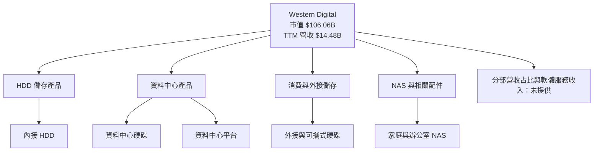
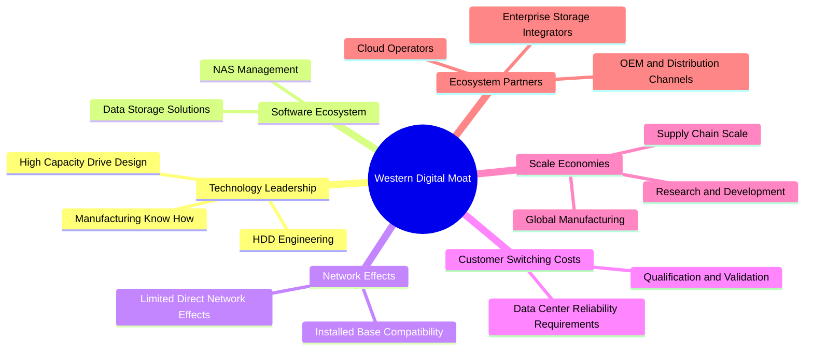
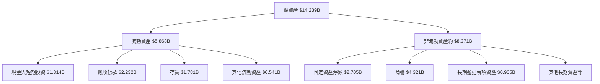
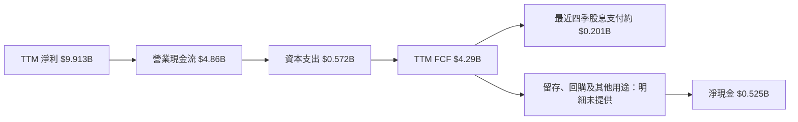
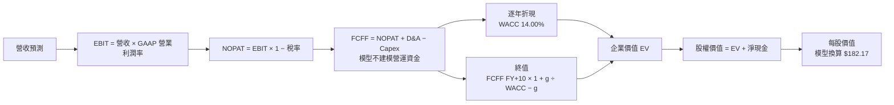
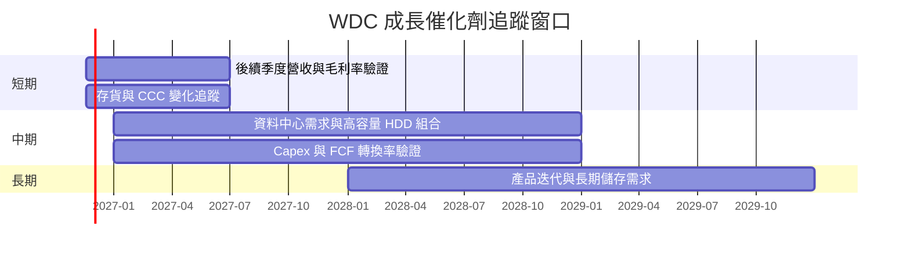
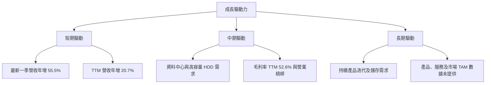
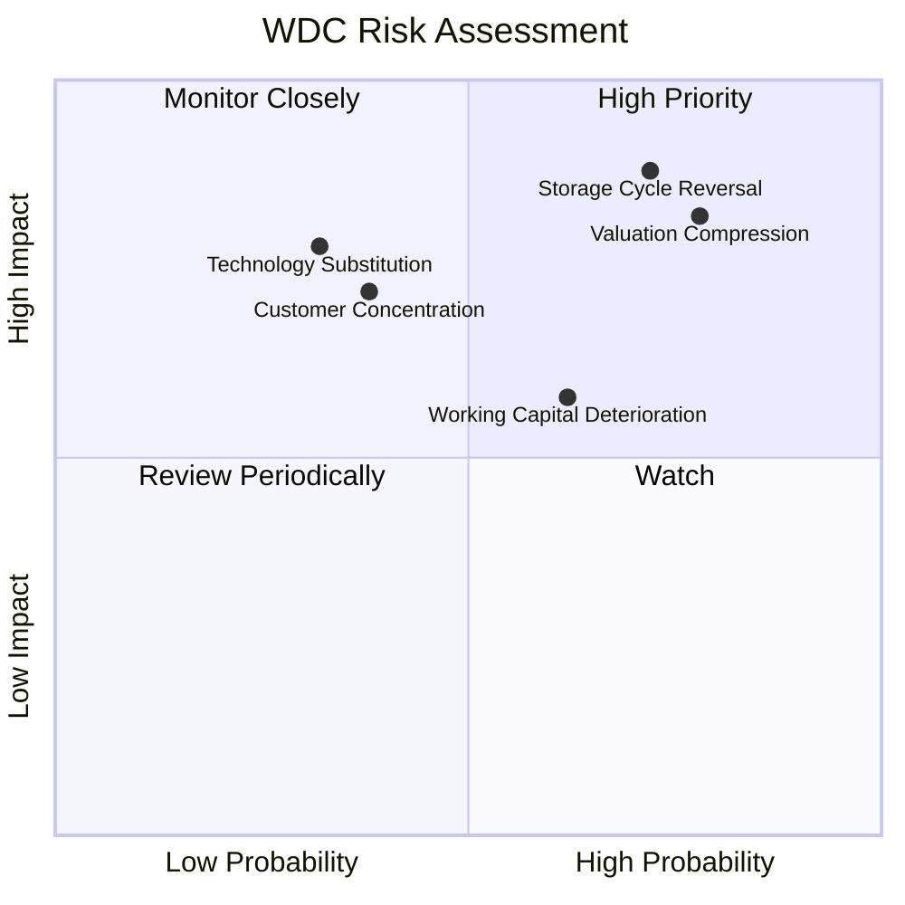
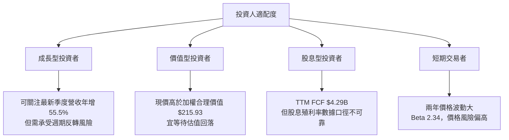

# WDC 基本面深度分析報告

> **報告日期**：2026-11-18 ｜ **語言**：繁體中文 ｜ **數據來源**：SEC 申報資料 (XBRL)、Yahoo Finance、Finviz、StockAnalysis、Roic.ai ｜ **分析師**：CFA 級機構研究  
> **價格基準**：2026-11-17 收盤價 **$283.33**。除另有說明，美元金額均為美元；估值模型與財務數據存在的期間、口徑差異會明確標示，不將不同口徑混為一談。

## 目錄

| # | 章節 | 核心結論 |
|---|------|----------|
| 1 | 執行摘要 | 賣出；加權合理價值 $215.93；MOS -31.2% |
| 2 | 公司概覽與商業模式 | HDD 儲存需求受惠於資料中心擴張，但市場份額與分部營收數據未提供 |
| 3 | 損益表深度分析 | TTM 營收 $14.48B、TTM 成長 20.7%；最新一季年增 55.5% |
| 4 | 資產負債表分析 | 淨現金 $525M；CCC 由 34 天延長至 52 天 |
| 5 | 現金流量深度分析 | TTM FCF $4.29B、FCF Yield 4.04%；盈餘現金轉換率偏低 |
| 6 | 獲利能力與資本效率 | ROIC 61.1% 高於 WACC 14.00%，但目前高回報具週期性 |
| 7 | 相對估值分析 | 相對同業倍數分化；自身 P/S 位於五年區間第 85 百分位 |
| 8 | DCF 內在價值評估 | DCF 基準價值 $182.17；加權合理價值 $215.93 |
| 9 | 成長催化劑 | 資料中心儲存需求與高容量 HDD 是主要質化催化劑；TAM 數據未提供 |
| 10 | 風險矩陣 | 週期反轉、估值回落與營運資金惡化為主要風險 |
| 11 | 投資建議 | 現價高於加權合理價值；等待估值回落與營運數據確認 |

## 1. 執行摘要

### 1.0 一頁式投資儀表板（Portfolio Manager 30 秒速讀）

| 項目 | 內容 |
|------|------|
| **投資論點（3 句）** | ① TTM 營收 $14.48B、年增 20.7%，最新一季年增 55.5%，反映儲存需求回升。② TTM ROIC 61.1% 對比 WACC 14.00%，目前資本回報高於資本成本。③ TTM FCF $4.29B、FCF Yield 4.04%，但加權合理價值 $215.93 低於現價 $283.33。 |
| **綜合評分** | **5.5/10**（引用 1.1 六項評分算術平均） |
| **財務健康** | 🟢 淨現金 $525M；但 CCC 由 34 天升至 52 天，短期資金轉換效率轉弱。 |
| **ROIC vs WACC** | **61.1% vs 14.00%**；TTM 數據顯示創造股東價值，惟須留意週期高點可能使 ROIC 回落。 |
| **FCF 趨勢** | 最近年度 FCF 復甦；TTM FCF **$4.29B**，FCF Yield **4.04%**。 |
| **估值** | Forward P/E **7.0x**（市場資料）；EV/EBITDA **19.0x**（同業估值資料區塊）；FCF Yield **4.04%**。來源口徑不同，倍數不可直接互換。 |
| **DCF 內在價值（基準）** | **$182.17**；現價相對 DCF 基準溢價 **55.5%**（現價 ÷ DCF 價值 − 1）。 |
| **安全邊際（MOS）** | **-31.2%**＝($215.93 − $283.33) ÷ $215.93；基準為 8.8 加權合理價值，🔴 無安全邊際。 |
| **預期報酬（基準情境 12M）** | DCF 基準情境 $182.17，相對現價 **-35.7%**；此為估值差距，不是保證的 12 個月報酬。 |
| **關鍵風險（前二）** | 儲存週期反轉及定價下行；現價估值對增長與利潤率假設敏感。 |
| **評級 + 信心度** | 🔴 **賣出** ｜ 信心：中低（模型輸入與來源口徑存在不一致，且公司具週期性）。 |

### 1.1 綜合評分卡（全報告唯一）

| 維度 | 評分（1–10） | 主要依據（引用數字與其來源章節） |
|------|--------------|----------------------------------|
| 成長性 | 7.0 | TTM 營收年增 20.7%、最新一季年增 55.5%；季度成長加速，但產業週期可能使高增速回落（第 3 章）。 |
| 獲利能力 | 8.0 | TTM 營業利益率 39.4%、ROIC 61.1%、Piotroski F-Score 6/8；高回報仍可能處於週期較佳階段（第 3、6 章）。 |
| 財務健康 | 7.0 | 淨現金 $525M、流動比率 1.434；CCC 從 34 天延長至 52 天，扣分反映應收與存貨週轉變慢（第 4 章）。 |
| 估值 | 2.0 | MOS -31.2%；現價 $283.33 高於加權合理價值 $215.93，且自身 P/S 五年百分位為 85%（第 7、8 章）。 |
| 護城河 | 6.0 | 高容量 HDD 的製造、工程與客戶導入門檻提供一定防禦，但缺乏市場份額與產品分部數據驗證（第 2 章）。 |
| 管理層與資本配置 | 3.0 | FY2026 SBC $204M、TTM 稀釋股數測試未通過；股息資料來源顯示 25.0% 殖利率，與股息現金流口徑不一致，故不視為可靠回報指標。 |
| **綜合評分** | **5.5** | 六項算術平均：(7.0 + 8.0 + 7.0 + 2.0 + 6.0 + 3.0) ÷ 6 = **5.5**。 |

### 1.2 五大投資論點 + 三大核心風險

| 類型 | 項目 | 具體依據 | 信心度 |
|------|------|----------|--------|
| 🟢 **投資論點①** | 收入回升 | TTM 營收 $14.48B、TTM 年增 20.7%；最新一季營收年增 55.5%，成長速度高於 TTM。若資料中心需求維持，產能利用率與價格組合可支持營業槓桿。 | 🟢 中高 |
| 🟢 **投資論點②** | 目前資本回報高於資本成本 | TTM ROIC 61.1%，WACC 14.00%，差距 47.1 個百分點。若回報率能維持，企業具備創造經濟價值的能力。 | 🟢 中 |
| 🟢 **投資論點③** | FCF 明顯轉正 | TTM 營業現金流 $4.86B、資本支出 $572M、FCF $4.29B；相較 FY2024 FCF -$781M，現金創造已復甦。 | 🟢 中 |
| 🟢 **投資論點④** | 淨現金降低融資風險 | 現金及短期投資 $1.31B、總債務 $789M、淨現金 $525M，短期償債壓力相對有限。 | 🟢 中高 |
| 🟢 **投資論點⑤** | 資產負債表整頓 | FY2025 總債務 $4.71B，FY2026 $1.05B；期間數據顯示大幅去槓桿，惟期末口徑與最新季度口徑略有差別。 | 🟡 中 |
| 🟡 **風險①** | HDD 週期與供需反轉 | 最新一季營業利益率 46.7% 高於 TTM 39.4%；若高毛利反映週期高點，定價下滑可使利潤率快速收縮。 | 🔴 高衝擊 |
| 🔴 **風險②** | 現價高於合理價值 | 加權合理價值 $215.93，現價 $283.33，MOS -31.2%；DCF 基準 $182.17，現價相對 DCF 溢價 55.5%。 | 🔴 高 |
| 🟡 **風險③** | 營運資金週轉惡化 | DSO 由 41 天升至 56 天、DIO 由 70 天升至 95 天，CCC 增加 18 天，可能消耗部分營業現金流。 | 🟡 中高 |

### 1.3 快速統計卡片

同業中位數依 STX、SNDK、MU 提供的倍數與成長率計算；未提供的同業指標不列。

| 指標 | 公司實際值（期間） | 同業中位數 | 狀態 |
|------|--------------------|------------|------|
| 營收成長（TTM） | **20.7%** | — | 🟢 正成長 |
| 營收成長（最新一季年增） | **55.5%** | **61.0%** | 🟡 略低於同業中位數 |
| 毛利率（TTM） | **52.6%** | **80.0%** | 🟡 低於同業中位數 |
| 營業利益率（TTM） | **39.4%** | — | 🟢 高，但具週期性 |
| ROIC（TTM） | **61.1%** | — | 🟢 高於 WACC |
| Forward P/E | **7.0x**（市場估值資料） | **3.4x** | 🟡 高於同業中位數 |
| FCF Yield（TTM） | **4.04%** | — | 🟡 對目前估值而言有限 |
| Piotroski F-Score | **6 / 8** | — | 🟢 中上；應計品質及稀釋測試未通過 |

### 1.4 投資結論

```text
╔══════════════════════════════════════════════════════════════════╗
║                    📊 投資結論摘要                               ║
╠══════════════════════════════════════════════════════════════════╣
║  評級：🔴 賣出（MOS 門檻直接決定，未作質化調整）                  ║
║  價格（2026-11-17 收盤）：$283.33                                ║
║  DCF 內在價值（基準）：$182.17（現價溢價 55.5%）                 ║
║  安全邊際 MOS：-31.2%（以加權合理價值 $215.93 為分母）           ║
║  加權合理價值（8.8）：$215.93                                    ║
║  DCF 情境價值：                                                  ║
║    悲觀情境：$100.40（相對現價 -64.6%）                          ║
║    基準情境：$182.17（相對現價 -35.7%）                          ║
║    樂觀情境：$313.26（相對現價 +10.6%）                          ║
║  綜合評分：5.5/10（引用 1.1）                                    ║
║  適合投資人：能承受週期波動、願意等待估值回落的長線投資人        ║
╚══════════════════════════════════════════════════════════════════╝
```

## 2. 公司概覽與商業模式

### 2.1 業務結構與收入來源

公司概況列示 WDC 市值 **$106.06B**、TTM 營收 **$14.48B**。公開摘要指出公司提供 HDD、資料中心硬碟與平台、外接硬碟、可攜式硬碟、NAS 與配件；但未提供各產品線營收、占比或服務收入金額，因此下圖只呈現已知產品類別，不臆造分部比例。



### 2.2 市場份額

市場份額數據未提供，故不以圖表或假設比例呈現。公司 TTM 營收 $14.48B、最新一季年增 55.5%，顯示業務規模與近期增長，但僅憑營收無法推算 HDD 市占率，也無法分辨市場成長與公司份額變化各自的貢獻。

### 2.3 競爭護城河分析

以下為質化分析，並非市場份額或技術市占率量化結論。



### 2.4 護城河強度

| 護城河項目 | 強度（強／中／弱） | 證據（引用數字或事實） | 會削弱它的情況 |
|------------|--------------------|------------------------|----------------|
| 技術與製造 | 中 | HDD 產品需工程、量產與品質管理；FY2026 研發費用 $1.16B。未提供專利、產品性能或市占率數據。 | 競品技術突破、良率與成本落後、替代技術改善。 |
| 軟體生態系統 | 弱至中 | 有 NAS 與資料儲存解決方案，但軟體收入及客戶留存數據未提供。 | 軟體功能不足、客戶改用整合式或雲端方案。 |
| 網路效應 | 弱 | 儲存硬體本身通常不具強直接網路效應；未提供平台用戶或網路規模數據。 | 競品能以相容產品快速替代。 |
| 客戶鎖定 | 中 | 資料中心硬碟導入涉及驗證、可靠性與系統相容性；客戶集中度資料未提供。 | 客戶雙供應商策略、採購轉向、規格標準化降低切換成本。 |
| 規模效應 | 中 | FY2026 營收 $12.92B，研發支出 $1.16B；但與競品製造成本差異未提供。 | 產能利用率下滑、低價競爭或資本效率下降。 |
| 生態夥伴 | 中 | 公司銷售渠道包括企業銷售、經銷商與分銷商；夥伴貢獻未量化。 | 主要客戶或渠道轉單、整合商改採競品。 |

護城河評分引用 1.1 的 **6.0/10**：產品工程、客戶驗證與製造規模提供一定門檻，但缺少市場份額、客戶留存與產品分部數據，無法證明其具強定價權。

## 3. 損益表深度分析

### 3.1 年度收入成長趨勢（近 4 年）

下列收入為所列年度損益表數值，與 TTM 口徑分開。FY2023 至 FY2026 收入年複合成長率為 \((12.92 ÷ 6.25)^{1/3}-1=27.4\%\)。

```text
╔══════════════════════════════════════════════════════════════════╗
║           Western Digital 年度收入趨勢（FY2023-FY2026）          ║
╠══════════════════════════════════════════════════════════════════╣
║  FY2023  $6.25B   ██████████░░░░░░░░░░░░░░░░  YoY：基期         ║
║  FY2024  $6.32B   ██████████░░░░░░░░░░░░░░░░  YoY：+1.1% 🟡    ║
║  FY2025  $9.52B   ████████████████░░░░░░░░░░  YoY：+50.6% 🟢   ║
║  FY2026  $12.92B  ██████████████████████████  YoY：+35.7% 🟢   ║
╠══════════════════════════════════════════════════════════════════╣
║  FY2023 至 FY2026 年複合成長率：+27.4%                          ║
╚══════════════════════════════════════════════════════════════════╝
```

FY2024 收入近乎持平，之後 FY2025 與 FY2026 明顯反彈，呈現儲存產業供需週期的特徵。FY2026 增速 35.7% 低於 FY2025 的 50.6%，表示增長基數已提高；未來若需求正常化，不能把兩位數高增長無限外推。

### 3.2 季度收入趨勢分析

下表季度營收以 StockAnalysis 季度列示為準；最新一季 YoY 另採統一財務指標 55.5%。QoQ 由列示季度營收計算。

| 季度 | 營收 | QoQ | YoY | 備註 |
|------|------|-----|-----|------|
| 2025-12-31 | $3.017B | — | +25.24% | 成長延續，但仍低於其後季度增速。 |
| 2026-03-31 | $3.337B | +10.6% | +45.47% | 同比與環比均擴張。 |
| 2026-06-30 | $3.747B | +12.3% | +43.84% | 營收持續上行。 |
| 2026-10-02／季度列示 2026-09-30 | $4.381B | +16.9% | +55.5% | 最新季度年增加速；財報期間標示依 SEC 10-Q 截至 2026-10-02。 |

季度數據顯示營收連續增加，但單季成長不能直接等同全年持續成長。最新一季同比增幅上升，可能來自需求改善、低基期及產品組合；需要後續財測與訂單趨勢驗證是否可延續。

### 3.3 利潤率演變分析

年度毛利率與營業利益率依年度損益表的毛利、營業利益除以營收計算；TTM 與最新季度則採一致財務指標數值。年度與 TTM 存在期間差異，不作為同一列的同期間比較。

| 利潤率指標 | FY2023 | FY2024 | FY2025 | FY2026 | 最新 TTM／季度 | 趨勢與評估 |
|------------|--------|--------|--------|--------|----------------|------------|
| **毛利率** | 22.3% | 28.1% | 38.8% | 48.8% | TTM 52.6% | 連續改善；較高產品組合、產能利用率與價格環境可能共同貢獻。🟢 |
| **營業利益率** | -6.4% | 1.8% | 22.4% | 35.6% | TTM 39.4%；最新季 46.7% | 固定成本吸收改善、景氣反彈帶來營業槓桿；最新季高於 TTM，週期回落風險增加。🟡 |
| **淨利率** | -27.3% | -13.5% | 19.4% | 72.0% | TTM 69.2% | FY2026 淨利率遠高於營業利益率，暗示非營業、稅務或一次性項目需核查，不能直接視為可持續經常性利潤。🟡 |

利潤率改善的量化證據是 FY2023 營業虧損 $402M，至 FY2026 營業利益 $4.60B；毛利率亦由 22.3% 升至 48.8%。可能的經濟機制包括產能利用率上升、產品組合改善與成本基礎的營業槓桿，但現有資料無法拆分各因素的精確貢獻。FY2026 淨利 $9.30B 大幅高於營業利益 $4.60B，故評估估值時以營業現金流與營業利益為主，不將淨利增長全數視為可持續。

### 3.4 費用結構分析

目前提供的 FY2026 研發支出為 **$1.16B**，營收為 **$12.92B**，研發／營收 = $1.16B ÷ $12.92B = **9.0%**。銷售、行政、重組、利息與其他費用完整明細未提供，故不畫費用占比圓餅圖，避免以不完整數據推算構成。

```text
╔══════════════════════════════════════════════════════════════════╗
║                  FY2026 費用資訊（已知項目）                     ║
╠══════════════════════════════════════════════════════════════════╣
║  研發支出：$1.16B                                                ║
║  研發／營收：$1.16B ÷ $12.92B = 9.0%                            ║
║  其他營業費用明細：未提供；不作費用占比推估                     ║
╚══════════════════════════════════════════════════════════════════╝
```

### 3.5 季度 EPS 趨勢與盈餘品質（Quality of Earnings）

最近四季 EPS 實際值依 StockAnalysis 列示；EPS 預估欄均為缺失，故不能判斷超預期或不及預期。另一資料區塊的 EPS 估計值為 nan，亦不代表實際公布的盈餘驚喜。

| 季度 | EPS 實際 | YoY EPS 成長 | EPS 預估／驚喜 | 判讀 |
|------|----------|--------------|----------------|------|
| 2025-12-31 | $4.67 | +187.75% | N/A | 實際 EPS 增長；無法判定 beat/miss。 |
| 2026-03-31 | $8.20 | +482.92% | N/A | 高同比增長受低基期影響；無法判定 beat/miss。 |
| 2026-06-30 | $8.21 | +984.10% | N/A | 淨利與 EPS 受週期反彈及可能的非經常性項目影響；估計值缺失。 |
| 2026-10-02／季度列示 2026-09-30 | $4.63 | +50.86% | N/A | EPS 年增，但低於前兩季列示值；單季淨利回落。 |

SBC TTM 以最近四季列示的 $79M、$45M、$53M、$53M 合計 **$230M** 計算；這是季度明細加總的估計性衍生值，FY2026 年度 SBC 為 $204M。

| 盈餘品質項目 | 數值／佔比 | 評估 |
|--------------|-----------|------|
| 股權薪酬 SBC / 營收 | 約 $230M ÷ $14.48B = **1.59%** | 🟡 比重不高，但 SBC 仍是股東經濟成本；Piotroski 稀釋股數測試未通過。 |
| SBC / 營業現金流 | 約 $230M ÷ $4.86B = **4.73%** | 🟡 需扣除稀釋影響理解股東回報；SBC 本身通常作為非現金費用加回 CFO。 |
| FCF / 淨利（現金轉換率） | 約 $4.29B ÷ $9.913B = **43.3%** | 🔴 現金流顯著低於 TTM 淨利；GAAP 淨利含金量弱於 FCF 所呈現的現金創造。 |
| 一次性／非經常性損益 | 明細 N/A | FY2026 淨利 $9.30B 高於營業利益 $4.60B，差額需由利息、稅項及非營業項目調節；未提供調節表，不能斷言具體一次性項目。 |
| 有效稅率異常 | **4.9%** | 🟡 稅率偏低會提高當期稅後利潤；未提供稅務調節表，無法判斷是否由一次性稅務利益帶動。 |
| 資本化支出 vs 費用化 | TTM Capex $572M；資本化明細 N/A | 🟡 Capex 已反映於 FCF，但軟體、研發或其他成本資本化政策明細不足，不能判斷是否遞延費用。 |

**盈餘品質結論**：TTM FCF $4.29B 是重要的現金流支撐，但現金轉換率約 43.3%，且低有效稅率與年度淨利高於營業利益的現象需進一步核查。以目前資訊，GAAP 淨利不宜直接當作穩態盈利基礎；估值應更重視營業利益與 FCF。

## 4. 資產負債表分析

### 4.1 資產結構分解

截至 2026-10-02 TTM 資產負債表總資產為 **$14.239B**；以下各項依 StockAnalysis 最近一期資產資料呈現。因部分列項合計可能受分類與四捨五入影響，未以圖表比例化。



### 4.2 流動性與營運資金分析

| 指標 | 最新值 | 歷史／比較值 | 評估 |
|------|--------|---------------|------|
| 流動比率 | 1.434 | 以市場財務摘要列示 | 🟢 流動資產高於流動負債，但需結合現金、存貨可變現性判斷。 |
| 速動比率 | 0.867 | 以市場財務摘要列示 | 🟡 低於 1，流動性仍部分依賴存貨與應收款回收。 |
| 現金及短期投資 | $1.31B | TTM | 🟢 高於總債務 $789M。 |

營運資金天數依 QUALITY FIGURES 原值引用：

| 指標 | 最新 TTM | 一年前 TTM | 變化 | 解讀 |
|------|----------|------------|------|------|
| DSO 應收帳款天數 | 56 天 | 41 天 | +15 天 | 收款週期延長，可能反映客戶付款條件、客戶組合或季度時點變化；若持續，現金回收會落後營收。 |
| DIO 存貨天數 | 95 天 | 70 天 | +25 天 | 存貨占用資金增加；若供需轉弱，需監控庫存跌價與減產風險。 |
| DPO 應付帳款天數 | 99 天 | 77 天 | +22 天 | 付款期限拉長，可部分抵銷應收與存貨增加；是否代表供應商議價力改善，資料不足以判定。 |
| CCC 現金轉換週期 | 52 天 | 34 天 | +18 天 | 現金被營運週期占用時間變長，與 TTM FCF 轉換率偏低相互呼應。 |

### 4.3 債務結構分析

不同資料來源列示的債務數字存在期間與口徑差異；本節優先採最新一致財務指標中的總債務 **$789M**、現金與短期投資 **$1.31B**、淨現金 **$525M**。年度報表 FY2026 總債務另列 $1.05B，兩者不是同一時點，避免混用。

```text
╔══════════════════════════════════════════════════════════════════╗
║                Western Digital 債務健康診斷                     ║
╠══════════════════════════════════════════════════════════════════╣
║  總債務：          $0.789B                                        ║
║  現金及短期投資：  $1.31B                                         ║
║  淨現金：          $0.525B  🟢                                    ║
║  Debt/EBITDA：     N/A（未以同一口徑提供計算所需 EBITDA）         ║
║  利息保障倍數：    N/A（利息費用明細未提供）                     ║
║  評估：淨現金降低償債風險；但不能據此推論周期性獲利不會下滑。     ║
╚══════════════════════════════════════════════════════════════════╝
```

### 4.4 股東權益趨勢

年度資產負債表列示的股東權益如下。FY2025 至 FY2026 增長，與 FY2026 盈利改善相符；但因不同資料源對同一期間的資產負債表日期存在差異，僅比較此表內年度數列。

```text
╔══════════════════════════════════════════════════════════════════╗
║              股東權益趨勢（年度報表列示）                       ║
╠══════════════════════════════════════════════════════════════════╣
║  FY2023  $11.84B  ████████████████████████                       ║
║  FY2024  $11.05B  ██████████████████████                         ║
║  FY2025   $5.54B  ███████████                                    ║
║  FY2026   $8.86B  ██████████████████                             ║
╚══════════════════════════════════════════════════════════════════╝
```

## 5. 現金流量深度分析

### 5.1 現金流量瀑布圖

季度現金流列示與 TTM 指標相符；股息支出為已知項目，回購與現金變化的完整調節資料未提供，因此不假定現金流全部流向某一用途。



### 5.2 FCF 轉換率趨勢

| 財年 | 營業現金流 | Capex | FCF | 淨利 | FCF／淨利 |
|------|------------|-------|-----|------|-----------|
| FY2023 | -$408M | $821M | -$1.23B | -$1.68B | 比率不具解讀性（分子分母皆負） |
| FY2024 | -$294M | $487M | -$781M | -$798M | 約 97.9% |
| FY2025 | $1.69B | $412M | $1.28B | $1.86B | 約 68.8% |
| FY2026 | $3.93B | $418M | $3.51B | $9.30B | 約 37.7% |
| 最新 TTM | $4.86B | $572M | $4.29B | $9.913B | 約 43.3% |

FY2024 至 FY2026 FCF 轉正並增加，但淨利增幅更大；FY2026 與 TTM 現金轉換率偏低，說明利潤改善未等比例轉化為可分配現金。FY2026 與 TTM 的期間截至日不同，不能將比率變化完全歸因於單一營運因素。

### 5.3 自由現金流趨勢

年度 FCF 由 FY2024 的 -$781M 回升至 FY2026 的 $3.51B；TTM FCF 為 $4.29B。僅提供最新 TTM FCF Yield 4.04%，年度各年的市值與 FCF Yield 序列未提供，故不自行補值。

```text
╔══════════════════════════════════════════════════════════════════╗
║                   自由現金流趨勢                                 ║
╠══════════════════════════════════════════════════════════════════╣
║  FY2023  -$1.23B  ◀ 負值                                         ║
║  FY2024  -$0.781B ◀ 負值                                         ║
║  FY2025   $1.28B  ███████                                        ║
║  FY2026   $3.51B  ███████████████████                            ║
║  TTM      $4.29B  ███████████████████████                        ║
╠══════════════════════════════════════════════════════════════════╣
║  TTM FCF Yield：4.04%（FCF $4.29B ÷ 市值）                      ║
╚══════════════════════════════════════════════════════════════════╝
```

### 5.4 資本配置評估

資本配置的完整資金用途表未提供：FY2026 現金股息支付 $184M，FY2026 Capex $418M；回購金額及留存現金用途未提供，故不繪製比例圓餅圖。

| 項目 | 已知數據 | 評估 |
|------|----------|------|
| 資本支出 | FY2026 $418M；TTM $572M | TTM Capex 約為 TTM 營收的 3.9%，支持產能與設備維護，但未提供維持性與成長性 Capex 拆分。 |
| 股息 | FY2026 支付 $184M | 相對 FY2026 FCF $3.51B 不高；但外部市場摘要所列殖利率 25.0% 與現金股息數據不相稱，不宜直接採用。 |
| 股票回購 | N/A | 未提供金額；Piotroski 稀釋股數測試未通過，應追蹤股數變化。 |
| 留存現金 | N/A | 現金與投資用途明細不足。 |

## 6. 獲利能力與資本效率

### 6.1 ROE / ROA / ROIC 趨勢

| 指標 | FY2023 | FY2024 | FY2025 | 最新 TTM | 評估 |
|------|--------|--------|--------|----------|------|
| ROE | N/A | N/A | N/A | 107.2%（Quality Figures） | 高 ROE；但受高淨利率及資產負債表基數影響。 |
| ROA | N/A | N/A | N/A | 25.9%（市場財務摘要） | 盈利回升帶動資產回報；來源口徑與 ROE 計算日期不完全一致。 |
| ROIC | N/A | N/A | N/A | 61.1% | 高於 WACC 14.00%；應以後續週期正常化數據確認持續性。 |

未提供一致口徑的多年 ROE、ROA、ROIC 序列及可引用的行業均值，因此不填補年度值或同業平均。

### 6.2 ROIC vs WACC 分析（核心價值創造判斷）

本節 WACC 與 8.2 採同一數值。以下資本成本輸入直接引用成本資本資料；債務成本稅後值及未封頂的 WACC 僅為展示給定輸入的算術結果，正式折現率採用程式提供的 **14.00%**。

```text
╔══════════════════════════════════════════════════════════════════╗
║                 ROIC vs WACC 深度分析                            ║
╠══════════════════════════════════════════════════════════════════╣
║  資本成本輸入：                                                   ║
║  ├── 無風險利率（10Y 美債）：5.10%                               ║
║  ├── ERP：5.00%                                                  ║
║  ├── 原始 Beta：2.34；調整後 Beta：1.90                         ║
║  ├── 股權成本：5.10% + 1.90 × 5.00% = 14.60%（給定值 14.58%）  ║
║  ├── 稅前債務成本：20.91%；稅率：4.9%                           ║
║  ├── 資本權重：股權 99.3%，債務 0.7%                            ║
║  └── WACC 計算值 14.62%，依 7%-14% 範圍限制採用 14.00%          ║
║                                                                  ║
║  TTM ROIC：61.1%                                                 ║
║  EVA 利差：61.1% − 14.00% = +47.1 個百分點                      ║
║  ROIC／WACC：61.1% ÷ 14.00% = 4.36 倍                           ║
║                                                                  ║
║  ROIC 61.1%  ▓▓▓▓▓▓▓▓▓▓▓▓▓▓▓▓▓▓▓▓▓▓▓▓▓▓▓▓▓▓▓▓▓▓▓▓▓▓▓▓▓▓▓▓▓▓▓▓ ║
║  WACC 14.0%  ▓▓▓▓▓▓▓▓▓▓▓▓▓▓                                      ║
║                                                                  ║
║  結論：以 TTM 點估計衡量，公司目前創造股東價值；週期回落會使     ║
║  ROIC 下行，需避免把當前利差視為永久水平。                      ║
╚══════════════════════════════════════════════════════════════════╝
```

ROIC 61.1% − WACC 14.00% = **47.1 個百分點**，表示以目前 TTM 利潤衡量，投入資本回報顯著超過資本成本。但 WACC 計算值為 14.62%，成本資本資料依 7%–14% 範圍上限限制，故採用 14.00%；ROIC 與 WACC 的對比須理解為週期時點的快照，而非永久經濟回報。

### 6.3 杜邦三因素分解

下表照抄 QUALITY FIGURES 的 DuPont 數值：

| 因素 | 數值（TTM） | 解讀 |
|------|-------------|------|
| 淨利率 | 69.2% | 淨利潤率很高，但須結合稅率 4.9%、年度淨利高於營業利益等現象檢驗可持續性。 |
| 資產週轉率 | 1.02 | 每單位資產產生約 1.02 倍營收。 |
| 權益乘數 | 1.52 | 槓桿不是 ROE 高企的唯一來源，權益乘數相對低於淨利率所帶來的影響。 |
| **ROE** | **107.2%** | QUALITY FIGURES：69.2% × 1.02 × 1.52 = 107.2%（四捨五入）。 |

杜邦分解顯示 ROE 主要由高淨利率驅動，而非單靠財務槓桿；但淨利率的高水平需受到稅務與非營業項目資料不足的限制性解讀。

### 6.4 財務體質：Piotroski F-Score

Piotroski F-Score 原值為 **6 / 8**；一項因缺少輸入未納入分母，不得視作完整九項均可判定的分數。

| 測試 | 結果 | 解讀 |
|------|------|------|
| ROA > 0 | ✅ 通過 | TTM 盈利為正。 |
| 營業現金流 > 0 | ✅ 通過 | TTM 營業現金流 $4.86B。 |
| ROA 高於一年前 | ✅ 通過 | 盈利改善方向為正。 |
| 營業現金流 > 淨利（應計品質） | ❌ 未通過 | CFO 低於淨利，與約 43.3% FCF／淨利現金轉換率一致，需留意應計與稅務因素。 |
| 長期負債 ÷ 總資產低於一年前 | — 無法判定 | 缺少輸入，依規則不補算。 |
| 流動比率高於一年前 | ✅ 通過 | 流動性指標改善。 |
| 稀釋股數未增加 | ❌ 未通過 | 顯示股數稀釋風險存在，應與 SBC 及回購一併追蹤。 |
| 毛利率高於一年前 | ✅ 通過 | 毛利率改善，符合週期反彈。 |
| 資產週轉率高於一年前 | ✅ 通過 | 資產使用效率改善。 |

## 7. 相對估值分析

### 7.1 同業估值比較表格

同業倍數直接引用 Yahoo Finance 同業數據區塊。WDC 公司自身估值欄使用同業比較區塊中的 P/E、P/S、EV/EBITDA；Forward P/E 使用市場估值摘要，因此可能與其他資料來源口徑不同。

| 估值指標 | **WDC** | **STX** | **SNDK** | **MU** | WDC 評估 |
|----------|---------|---------|---------|--------|----------|
| **Trailing P/E** | 11.0x | 26.4x | 6.4x | 9.6x | 🟡 位於同業高低之間；週期性盈餘令 P/E 易受基期影響。 |
| **Forward P/E** | 7.0x | 7.7x | 2.8x | 3.4x | 🟡 高於三家同業中位數 3.4x；預期盈利成長已反映在遠期盈利中。 |
| **P/S Ratio** | 7.5x | 8.4x | 3.9x | 6.1x | 🟡 高於同業中位數 6.1x。 |
| **EV/EBITDA** | 19.0x | 20.0x | 5.1x | 7.1x | 🔴 高於同業中位數 7.1x；不同產品結構與週期盈餘降低直接可比性。 |
| **最新一季營收 YoY** | 55.5% | 61.0% | 377.9% | 379.3% | 🟡 WDC 增長明顯，但低於同業中位數 377.9%，主要需考慮公司產品與基期差異。 |
| **毛利率 TTM** | 52.6% | 50.4% | 80.0% | 80.7% | 🟢 高於 STX，低於 SNDK、MU；同業產品結構差異大。 |

### 7.2 歷史估值區間分析

歷史倍數依公司自身五年估值資料；百分位只引用已提供百分位，不由區間位置另行估算。

```text
╔══════════════════════════════════════════════════════════════════╗
║               WDC 五年歷史估值位置（TTM 倍數）                  ║
╠══════════════════════════════════════════════════════════════════╣
║  P/E       6.3x ├────────●──────────────┤ 62.5x                ║
║                     現值 11.0x｜中位數 13.5x｜第 38 百分位       ║
║  P/S       0.4x ├──────────────────●────┤ 16.0x                ║
║                     現值 7.5x｜中位數 1.2x｜第 85 百分位        ║
║  EV/EBITDA 4.5x ├──────────────●────────┤ 96.5x                ║
║                     現值 19.0x｜中位數 14.9x｜第 69 百分位       ║
╚══════════════════════════════════════════════════════════════════╝
```

P/E 現值低於五年中位數，但 P/S 高於中位數且位於第 85 百分位，EV/EBITDA 亦高於歷史中位數。由於週期性公司分母（盈利與 EBITDA）會大幅變動，單看低 P/E 可能誤判便宜程度；P/S 與 DCF 對估值的警示較明確。

### 7.3 情境價值（Bear / Base / Bull）

下列數字及假設照抄 DCF MODEL Scenarios；「會發生的條件」是定性推演，不是管理層財測。

| 情境 | 第 1 年營收成長 | 期末營業利潤率 | WACC | 每股價值 | 相對現價 | 機率 | 會發生的條件 |
|------|----------------|----------------|------|----------|----------|------|--------------|
| 🔴 悲觀 | 10.3% | 19.4% | 15.00% | $100.40 | -64.6% | 25% | 儲存需求降溫、價格或組合轉弱、利潤率向歷史中位數以下回落，資本成本維持高位。 |
| 🟡 基準 | 20.7% | 22.8% | 14.00% | $182.17 | -35.7% | 50% | TTM 成長從 20.7% 起步並逐步降至模型長期增速，利潤率回落至 22.8%。 |
| 🟢 樂觀 | 31.0% | 25.1% | 13.00% | $313.26 | +10.6% | 25% | 需求與產品組合持續超預期，利潤率下滑較少且折現率較低。 |

### 7.4 相對估值隱含價格區間

以下每股價值與權重完全沿用估值方法區塊。相對方法使用 STX、SNDK、MU 同業中位數，不採用 WDC 自身目前倍數。

```text
╔══════════════════════════════════════════════════════════════════╗
║                   估值方法隱含每股價值                          ║
╠══════════════════════════════════════════════════════════════════╣
║  同業 EV/EBITDA：$116.32  ── 現價 $283.33 ── 同業 P/S：$234.14  ║
║  DCF 基準：$182.17                                      分析師：$613.38║
╚══════════════════════════════════════════════════════════════════╝
```

- **同業 EV/EBITDA $116.32**：STX、SNDK、MU 的 EV/EBITDA 中位數 7.1x × WDC TTM EBITDA，再加回淨現金；完整每股橋接由估值計算程序提供。
- **同業 P/S $234.14**：三家同業 P/S 中位數 6.1x × WDC TTM 營收，再換算每股價值。
- **DCF 基準 $182.17**：10 年 FCFF，WACC 14.00%、永續成長率 3.0%。
- **分析師共識 $613.38**：24 位分析師目標價均值，作參考而非基本面估值錨點。

## 8. DCF 內在價值評估（Discounted Cash Flow）

### 8.0 估值推理鏈（Thinking Logic）

**Step 1 — 價值來源與主導變數**

模型的價值來自現有 HDD 儲存主業的現金流，不含可獨立量化的軟體服務或新業務選擇權；因產品線營收占比未提供，不能將 $14.48B TTM 營收拆成產品業務比重。最敏感的價值變數是營業利潤率與折現率：基準模型把 TTM 營業利益率 39.4% 逐步降至 FY+10 的 22.8%，而 WACC 14.00% 明顯高於永續成長率 3.0%。

**Step 2 — 模型選擇**

| 決策點 | 本報告採用 | 理由（含數字） | 曾考慮但否決 | 否決理由 |
|--------|-----------|----------------|--------------|----------|
| 現金流定義 | FCFF | 以 NOPAT + D&A − Capex，並以 WACC 折現得到 EV；淨現金由估值模型橋接。 | FCFE | 債務及現金在股權價值橋接處處理，避免把融資成本與經營現金流混合。 |
| 預測期 N | 10 年 | DCF MODEL 固定為 10 年，增長率由 20.7% 線性降至 3.0%。 | 5 年 | 不符合既定模型；不得自行縮短模型。 |
| 終值方法 | Gordon Growth | 模型指定永續成長率 3.0%，WACC 14.00%。 | 退出倍數法 | DCF MODEL 未提供終值退出倍數與相應每股結果，不能自行另建模型。 |
| EBIT 基礎 | GAAP EBIT | DCF MODEL 明確使用 GAAP EBIT。 | 非 GAAP EBIT | 加回 SBC 後若不扣回，會漏算股東成本。 |

**Step 3 — 關鍵假設推導鏈**

- **預測期 N**：錨點＝DCF MODEL 預測期 10 年 → 調整＝不調整，遵循程式預設 → **採用 10 年** → 曾考慮 5 年，但否決，因為本報告不得改動已提供模型。
- **營收成長路徑**：錨點＝TTM 對前一 TTM 成長 20.7% → 調整＝模型線性降至第 10 年 3.0%，反映高基期與週期回歸 → **第 1 年 20.7%、第 10 年 3.0%** → 曾考慮全期維持 20.7%，否決，因十年高增長外推會忽略週期與成熟化。
- **期末營業利潤率**：錨點＝TTM 39.4% → 調整＝模型淡化至最近五個財年的中位數 → **第 10 年 22.8%** → 曾考慮維持 39.4%，否決，因近期高利潤率可能包含週期性高點。
- **Capex／營收**：錨點＝TTM 3.9% → 調整＝模型逐年降至第 10 年 3.0%，並以 1.1×D&A 作為下限比較規則 → **第 1 年 3.9%、第 10 年 3.0%** → 曾考慮全期維持 3.9%，否決，因模型假設成熟期投資率逐步下行；此假設仍可能偏樂觀。
- **有效稅率**：錨點＝最新年度有效稅率 4.9% → **採用 4.9%**；未另行調整。低稅率對估值有利，但持續性缺乏稅務調節表驗證。
- **D&A／營收**：錨點＝TTM 2.7% → **採用 2.7% 固定**；模型未提供進一步調整依據。
- **永續成長率 g**：錨點＝成熟期長期名目增長通常受宏觀增長約束（此處為假設性估值原則，並非公司財測）→ 模型採 3.0%，且低於 WACC 14.00% → **採用 3.0%** → 曾考慮 4.0%，否決為基準，因會提高終值且缺少公司長期市場增長數據支持。
- **WACC**：錨點＝成本資本資料計算值 14.62% → 按該資料標示的 7%–14% 區間上限限制 → **採用 14.00%** → 曾考慮直接使用 14.62%，否決，因預先計算模型明確指定封頂後採用值；此封頂降低折現率，對估值偏有利。
- **EBIT 基礎與 SBC**：錨點＝模型使用 GAAP EBIT，GAAP EBIT 已含 SBC 費用 → **採用組合 (A)**，FCFF 不再扣 SBC、股數不再額外稀釋 → 曾考慮非 GAAP EBIT，否決，因缺少可一致調節的非 GAAP EBIT 與 SBC 預測。
- **年稀釋率**：錨點＝模型設定固定股數 → **採用 0% 額外年稀釋率** → 曾考慮依歷史稀釋增加股數，否決，因與 GAAP EBIT 已含 SBC 的組合 (A) 不相容，且模型已固定該口徑。
- **營運資金**：錨點＝實際 CCC 52 天，但未提供營運資金現金流預測 → **模型不建模 ΔWC** → 曾考慮自行套用歷史 CCC，否決，因會改寫預先計算模型。

**Step 4 — 最脆弱一環**

最脆弱假設是高營收增長與高營業利潤率的持續性；若需求放緩並使利潤率朝悲觀情境 19.4% 收斂，模型情境價值為 $100.40，較基準 $182.17 低約 44.9%。

**Step 5 — 計算路徑圖**



### 8.1 模型假設總表（Model Inputs）

| 假設項目 | 採用值 | 依據／來源 | 敏感度 |
|----------|--------|-------------|--------|
| 預測期長度 N | 10 年 | DCF MODEL 固定預測期 | 🟡 中 |
| 營收成長 | FY+1 20.7% 線性降至 FY+10 3.0% | FY+1 錨定 TTM 成長 20.7%；第 10 年為模型假設 | 🔴 高 |
| 營業利潤率 | 39.4% 降至 22.8% | FY+1 取 TTM 營業利益率；FY+10 取最近五個財年中位數（含 TTM） | 🔴 高 |
| 有效稅率 | 4.9% | 最新年度有效稅率 | 🟢 低 |
| Capex／營收 | 3.9% 降至 3.0% | TTM 3.9%，模型逐步降至期末假設 | 🟡 中 |
| D&A／營收 | 2.7% | TTM D&A／營收 | 🟢 低 |
| 營運資金變動 | 不建模 | DCF MODEL 明示 Working capital is not modelled | 🟢 低 |
| EBIT 基礎 | GAAP EBIT | DCF MODEL 明示 GAAP EBIT | 🟡 中 |
| SBC 處理 | 不另扣 SBC | GAAP EBIT 已計入 SBC | 🟡 中 |
| 年稀釋率 | 0% 額外稀釋 | 模型固定股數，SBC 影響已反映在 GAAP 費用 | 🟡 中 |
| 永續成長率 g | 3.0% | DCF MODEL 固定值；低於 WACC | 🔴 高 |
| 終值方法 | Gordon Growth | DCF MODEL 提供 Gordon Growth 終值 | 🔴 高 |
| WACC | 14.00% | 計算值 14.62%，按 7%–14% 範圍限制採用 14.00% | 🔴 高 |
| FCF 定義 | FCFF = NOPAT + D&A − Capex | 使用 GAAP EBIT、對應 WACC 折現；不含 ΔWC 項 | — |

本模型採用 **(A) GAAP EBIT + 固定股數**，因此 SBC 影響已計入一次：FCFF 不再扣 SBC，股數不額外逐年擴大。

### 8.2 折現率推導（WACC）

Beta 原始值 2.34 來自 Yahoo Finance；調整 Beta 1.90 依資料中給定的 \(⅔×2.34+⅓\) 計算並直接引用。無風險利率 5.10%、ERP 5.00% 為資本成本資料所列輸入；其觀察日期未另列，故不補造日期。未提供規模或國別溢酬，採 0% 額外溢酬。

```text
╔══════════════════════════════════════════════════════════════════╗
║                    WACC 推導（折現率）                           ║
╠══════════════════════════════════════════════════════════════════╣
║  股權成本 Ke（給定成本資本數據）：                               ║
║  ├── 無風險利率 Rf：5.10%                                        ║
║  ├── ERP：5.00%                                                  ║
║  ├── 原始 Beta：2.34；調整後 Beta：1.90                         ║
║  ├── 額外規模／國別溢酬：0.00%（未提供額外溢酬輸入）             ║
║  └── Ke 給定值：14.58%                                           ║
║                                                                  ║
║  債務成本：                                                       ║
║  ├── 稅前 Kd（資本成本數據）：20.91%                             ║
║  ├── 有效稅率：4.9%                                              ║
║  └── 稅後 Kd = 20.91% × (1 − 4.9%) = 19.89%                    ║
║                                                                  ║
║  資本結構：                                                       ║
║  ├── 市值 $106.06B；債務 $0.789B（權重直接引用 99.3% / 0.7%）    ║
║  └── 原始 WACC 計算值 14.62%；封頂後採用 WACC = 14.00%           ║
╚══════════════════════════════════════════════════════════════════╝
```

**逐步演算與資料限制**

1. **Ke（CAPM）**：依給定成本資本輸入，Ke = **14.58%**。單以顯示到兩位小數的 Rf、Beta、ERP 計算為 \(5.10\%+1.90×5.00\%=14.60\%\)；與給定 14.58% 相差 0.02 個百分點，可能來自未顯示精度，報告沿用給定 Ke，不替換。
2. **稅前 Kd**：成本資本資料直接列為 **20.91%**；利息費用與平均計息負債明細未提供，故不能獨立重建該比率。
3. **稅後 Kd**：\(20.91\%×(1-4.9\%)=19.88541\%\)，四捨五入 **19.89%**。
4. **權重**：股權權重 **99.3%**、債務權重 **0.7%**，兩者合計 **100.0%**；權重依成本資本資料引用。市值 $106.06B、總債務 $0.789B 為參照值，但因權重資料可能使用不同股數／時點，不用兩者重新替換程式權重。
5. **WACC**：成本資本資料所列計算值為 **14.62%**，受 7%–14% 範圍限制後採用 **14.00%**；本報告第 6.2 與 DCF 均使用 14.00%。

### 8.3 逐年自由現金流預測（基準情境）

以下逐年數字照抄 DCF MODEL，單位 $B；折現因子保留三位小數。模型未建模營運資金，故不另加入 ΔWC 列；SBC 已包含在 GAAP EBIT 中，不再扣除。

| 年度 | FY+1 | FY+2 | FY+3 | FY+4 | FY+5 | FY+6 | FY+7 | FY+8 | FY+9 | FY+10 |
|------|------:|------:|------:|------:|------:|------:|------:|------:|------:|------:|
| 營收 | 17.47 | 20.74 | 24.21 | 27.79 | 31.35 | 34.75 | 37.84 | 40.46 | 42.47 | 43.75 |
| 營收 YoY | 20.7% | 18.7% | 16.7% | 14.8% | 12.8% | 10.9% | 8.9% | 6.9% | 5.0% | 3.0% |
| 營業利潤率 | 39.4% | 37.6% | 35.7% | 33.9% | 32.0% | 30.2% | 28.4% | 26.5% | 24.7% | 22.8% |
| 營業利益 EBIT（GAAP） | 6.89 | 7.79 | 8.65 | 9.42 | 10.05 | 10.50 | 10.74 | 10.73 | 10.49 | 10.00 |
| − 稅（4.9%） | (0.33) | (0.38) | (0.42) | (0.46) | (0.49) | (0.51) | (0.52) | (0.52) | (0.51) | (0.49) |
| = NOPAT | 6.55 | 7.41 | 8.23 | 8.96 | 9.56 | 9.99 | 10.21 | 10.21 | 9.98 | 9.51 |
| + D&A | 0.47 | 0.56 | 0.65 | 0.75 | 0.85 | 0.94 | 1.02 | 1.09 | 1.15 | 1.18 |
| − Capex | (0.69) | (0.80) | (0.90) | (1.01) | (1.10) | (1.18) | (1.25) | (1.29) | (1.31) | (1.30) |
| **= FCFF** | **6.33** | **7.18** | **7.98** | **8.70** | **9.30** | **9.74** | **9.99** | **10.02** | **9.82** | **9.39** |
| 折現因子 @14.00% | 0.877 | 0.769 | 0.675 | 0.592 | 0.519 | 0.456 | 0.400 | 0.351 | 0.308 | 0.270 |
| **FCFF 現值 PV** | **5.56** | **5.52** | **5.39** | **5.15** | **4.83** | **4.44** | **3.99** | **3.51** | **3.02** | **2.53** |

**預測期 FCF 現值加總**：  
$5.56 + $5.52 + $5.39 + $5.15 + $4.83 + $4.44 + $3.99 + $3.51 + $3.02 + $2.53 = **$43.94B**。  
DCF MODEL 列示總和 **$43.95B**；差異為逐年現值以兩位小數呈現造成的約 $0.01B 尾差，低於 1%，估值橋接沿用模型列示 $43.95B。

**逐步演算（FY+1，代表年度）**

1. 營收：\(14.48×(1+20.7\%)=17.47736B\)，模型表列 **$17.47B**（內部未四捨五入值與顯示值可能不同）。
2. EBIT：\(17.47×39.4\%=6.882?B\)，模型列示 **$6.89B**；此細微差異源自模型使用未顯示精度，不以顯示值重建替換。
3. 稅：模型列示 EBIT $6.89B、稅率 4.9%、稅額 **$0.33B**。
4. NOPAT：模型列示 **$6.55B**。
5. D&A：模型列示 **$0.47B**，約為營收的 2.7%。
6. Capex：模型列示 **$0.69B**。
7. ΔWC：**不建模**，模型 FCFF 定義不含營運資金變動。
8. FCFF：模型列示 **$6.33B**；依未四捨五入模型輸入計算，呈現值與表格一致。
9. 折現因子：\(1÷(1+14.00\%)^1=0.877\)；PV：\(6.33×0.877\approx5.55B\)，模型列示 **$5.56B**。差異為原始精度未公開所致，逐年估值採用程式列示值，不自行重建模型。

**合理性自檢**

- 預測 FCFF FY+1 $6.33B 至 FY+10 $9.39B，9 個年度間隔的 CAGR 約為 \((9.39÷6.33)^{1/9}-1=4.5\%\)。歷史 FY2023–FY2026 FCF 起點為負值，CAGR 無法作有意義比較。
- FY+10 FCF 利潤率 = $9.39B ÷ $43.75B = **21.5%**；TTM FCF 利潤率 = $4.29B ÷ $14.48B = **29.6%**。模型隱含成熟期 FCF 利潤率低於目前 TTM，沒有假定高於現況。
- 模型期間 FCFF 均為正；其估值仍高度依賴未來利潤率回落速度與終值折現。

```text
╔══════════════════════════════════════════════════════════════════╗
║            自由現金流：歷史實際 vs 模型預測                      ║
╠══════════════════════════════════════════════════════════════════╣
║  FY2024（實） -$0.781B  ◀ 負值                                   ║
║  FY2025（實）  $1.28B   ██████                                   ║
║  FY2026（實）  $3.51B   █████████████████                         ║
║  FY+1（預）    $6.33B   ███████████████████████████████           ║
║  FY+10（預）   $9.39B   ███████████████████████████████████████   ║
╠══════════════════════════════════════════════════════════════════╣
║  預測 FCFF CAGR 約 4.5%；歷史 CAGR 因負基期無法比較。            ║
╚══════════════════════════════════════════════════════════════════╝
```

### 8.4 終值計算（Terminal Value）

**適用性檢查**：WACC **14.00%** vs g **3.00%** → WACC > g？✅

| 方法 | 計算式 | 終值 TV | TV 現值 | 佔總 EV 比重 |
|------|--------|---------|---------|--------------|
| Gordon Growth | $9.39 × (1 + 3.0%) ÷ (14.0% − 3.0%) | $87.94B | $23.72B | 35.1% |
| 退出倍數法 | N/A（DCF MODEL 未提供 FY+10 EBITDA 退出倍數及預先計算值） | N/A | N/A | N/A |

**Gordon Growth 逐步演算**

1. FY+10 FCFF：**$9.39B**。
2. 分子：\(9.39×(1+3.0\%)=9.6717B\)，約 **$9.67B**。
3. 分母：\(14.00\%-3.00\%=11.00\%\)；\(9.6717÷0.11=87.9245B\)，模型列示 **$87.94B**。
4. PV(TV)：模型列示 **$87.94B × 終值折現因子 0.270 = $23.72B**；顯示值乘算與模型結果存在四捨五入尾差，DCF MODEL 原值優先。
5. 終值占比：**$23.72B ÷ $67.67B = 35.1%**（採模型列示占比）。

模型未提供退出倍數法終值，依照不得另建模型的規則不推算 EBITDA 倍數。Gordon Growth 終值現值占 EV 35.1%，估值仍受長期假設影響，但低於終值主導型估值常見的極高依賴度。

### 8.5 企業價值 → 每股內在價值（Bridge）

```text
╔══════════════════════════════════════════════════════════════════╗
║              企業價值 → 每股內在價值 橋接表                      ║
╠══════════════════════════════════════════════════════════════════╣
║  預測期 FCF 現值合計              +$43.95B                       ║
║  終值現值 PV(TV)                  +$23.72B                       ║
║  ─────────────────────────────────────────────                  ║
║  = 企業價值 EV                     $67.67B                       ║
║  + 淨現金                          +$0.53B                        ║
║  = 股權價值（模型列示）            $68.19B                       ║
║  每股價值換算：68.19 × 283.33 ÷ 106.06                          ║
║  ★ DCF 基準每股內在價值            $182.17                        ║
║    當前股價                        $283.33                        ║
║    折溢價（現價÷DCF價值−1）        +55.5% 溢價                    ║
╚══════════════════════════════════════════════════════════════════╝
```

**逐步演算（橋接）**

1. **EV**：$43.95B + $23.72B = **$67.67B**。
2. **股權價值**：模型列示 $67.67B + 淨現金 $0.53B = **$68.19B**（未四捨五入底層值與顯示值存在尾差；模型股權價值原值優先）。
3. **每股內在價值**：模型公式 \(68.19×283.33÷106.06=\)**$182.17**。模型以股權價值乘價格再除市場市值換算；不改用另一口徑重新計算。
4. **折溢價**：\($283.33÷$182.17)-1=\)**+55.5%**，表示現價相對 DCF 基準價值溢價。
5. **本節不計算 MOS**：安全邊際只在 8.8 以加權合理價值為分母計算。

**股數與資產負債表口徑**：市場數據列示流通股數 374.32M 股；DCF MODEL 指定每股換算公式為股權價值 × 價格 ÷ 市值，並未採用不同的股數稀釋路徑。模型橋接使用淨現金 $0.53B，對應 DCF MODEL；最新資產負債表現金、債務的單項數字與該淨現金存在四捨五入及時點口徑差異，故不重建橋接。

### 8.6 敏感性分析（WACC × 永續成長率）

以下每股價值照抄 DCF MODEL 敏感度矩陣；括號為相對 2026-11-17 收盤價 $283.33 的上行空間。所有矩陣 WACC 均大於 g。

| g（列）／WACC（欄） | 12.00% | 13.00% | **14.00%（基準）** | 15.00% | 16.00% |
|-----------|------:|------:|------------------:|------:|------:|
| 2.0% | $211.85 (-25.2%) | $192.49 (-32.0%) | $176.33 (-37.8%) | $162.63 (-42.6%) | $150.88 (-46.8%) |
| 2.5% | $216.61 (-23.5%) | $196.10 (-30.8%) | $179.12 (-36.8%) | $164.83 (-41.8%) | $152.63 (-46.1%) |
| **3.0%（基準）** | $221.90 (-21.7%) | $200.08 (-29.4%) | **$182.17 (-35.7%)** | $167.21 (-41.0%) | $154.51 (-45.5%) |
| 3.5% | $227.82 (-19.6%) | $204.48 (-27.8%) | $185.51 (-34.5%) | $169.79 (-40.1%) | $156.54 (-44.8%) |
| 4.0% | $234.47 (-17.2%) | $209.36 (-26.1%) | $189.19 (-33.2%) | $172.61 (-39.1%) | $158.74 (-44.0%) |

**有效非基準格示範**：所選格 **WACC 13.00% > g 3.00% ✅**。  
該格每股值 **$200.08** 為 DCF MODEL 已計算值。重新計算該格所需的逐年折現現值合計、終值現值及未四捨五入股權橋接輸入未在模型區塊列示；依規則不得自行重建或替換模型數字，因此此處不能提供一條可獨立複算的中間值算式。模型敏感度結果顯示，WACC 從基準 14% 降至 13%、g 維持 3%，每股價值由 $182.17 升至 $200.08，增加 **$17.91（9.8%）**。

**三情境 DCF（照抄模型情境）**

| 情境 | 年 1 營收成長 | 期末營業利潤率 | WACC | 每股價值 | 相對現價 | 機率 |
|------|--------------:|---------------:|-----:|---------:|---------:|-----:|
| 🔴 悲觀 | 10.3% | 19.4% | 15.00% | $100.40 | -64.6% | 25% |
| 🟡 基準 | 20.7% | 22.8% | 14.00% | $182.17 | -35.7% | 50% |
| 🟢 樂觀 | 31.0% | 25.1% | 13.00% | $313.26 | +10.6% | 25% |
| **機率加權** | — | — | — | **$194.50** | **-31.4%** | 100% |

情境模型只提供起始增長、期末利潤率、WACC 與每股結果，未列各情境 FY+10 營收、FCFF、終值的中間結果；依嚴格要求不自行重跑模型，故不捏造三情境推導鏈。機率加權：$100.40×25% + $182.17×50% + $313.26×25% = $25.10 + $91.085 + $78.315 = **$194.50**。

**敏感度結論**

- **g 每 +1pp**：在 WACC 14.00% 下，矩陣 g 2.5% 的 $179.12 至 g 3.5% 的 $185.51，增加 **$6.39**，約 **3.6%**（以 $179.12 為基準）。
- **WACC 每 +1pp**：在 g 3.0% 下，WACC 13% 的 $200.08 降至 15% 的 $167.21，兩個百分點共下降 **$32.87**；每 1pp 的局部平均約 **-$16.44**，約 **-8.2%**（以 $200.08 為基準）。
- **期末營業利潤率每 +1pp**：敏感度矩陣未提供單一利潤率變動的計算結果，**N/A（未提供）**。
- 已提供的敏感度顯示折現率變化可帶來顯著估值波動；利潤率仍是主要營運風險，但無法以未提供的單變數數值量化其每 1pp 影響。

### 8.7 反推 DCF（Reverse DCF：市場在預期什麼）

Reverse DCF 模型已提供兩項單變數反推結果；其餘變數固定於基準模型，但模型未提供完整逐次試算軌跡。為遵循不得自行重建模型要求，不填入沒有計算結果的反推項目。

| 求解的變數（一次一個） | 其餘變數設定 | 市場隱含值（令 DCF = 現價） | 公司歷史實際／基準 | 判斷 |
|------------------------|--------------|------------------------------|------------------|------|
| 年 1 營收成長 | 其餘輸入固定基準值 | **33.9%** | 基準年 1 增長 20.7%；TTM 成長 20.7% | 🔴 高於當前增速，要求需求進一步加速。 |
| 固定營業利潤率 | 其餘輸入固定基準值 | **43.1%** | 基準利潤率路徑 39.4% → 22.8% | 🔴 高於 TTM 39.4%，市場價格要求更高的持續利潤率。 |
| 永續成長率 g | 其他變數固定基準值 | N/A（未提供解） | 基準 g 3.0% | 不作推估。 |
| 預測期長度 N | 其他變數固定基準值 | N/A（未提供解） | 基準 N 10 年 | 未提供 3–15 年區間求解結果。 |

固定輸入原則上包括 WACC 14.00%、稅率 4.9%、Capex 路徑、模型不建模 ΔWC、N 10 年與固定股數；由於 Reverse DCF 輸出沒有完整逐次試算明細，無法逐項確認每次解題實際固定的完整輸入值。模型提供的結果指出，若只提高年 1 營收成長，需要 33.9%；若只採固定營業利潤率，需 43.1%。

| 試算的 CAGR | 對應 FY+N 營收 | FY+N FCFF | 每股價值 | vs 現價 $283.33 | 判斷 |
|-------------|----------------|-----------|----------|----------------|------|
| N/A | N/A | N/A | N/A | N/A | Reverse DCF 未提供試算軌跡；不補造迭代點。 |

**反推結論**：按模型反推，現價要求年 1 營收成長達 33.9%（基準 20.7%），或固定營業利潤率達 43.1%（TTM 39.4%）；這說明現價包含超出基準模型的成長或利潤率預期。由於缺少逐次試算及產品分部數據，無法驗證該門檻達成的概率。

### 8.8 估值三角驗證與安全邊際

| 估值方法 | 隱含每股價值 | 上行空間（÷現價） | 權重 | 說明 |
|----------|--------------|-------------------|------|------|
| DCF（基準） | $182.17 | -35.7% | 40% | 10 年 FCFF、WACC 14.00%、g 3.0%。 |
| 同業 EV/EBITDA | $116.32 | -58.9% | 30% | STX、SNDK、MU 同業中位數 7.1x × TTM EBITDA，加回淨現金。 |
| 同業 P/S | $234.14 | -17.4% | 20% | 同業中位數 6.1x × TTM 營收。 |
| 分析師共識目標價 | $613.38 | +116.5% | 10% | 24 位分析師目標均值，作為參考。 |
| **加權合理價值** | **$215.93** | **-23.8%** | **100%** | 公司類型為週期性公司；權重由估值方法區塊固定。 |

**逐步演算（權重外顯）**：

\[
182.17×40\%+116.32×30\%+234.14×20\%+613.38×10\%
=72.868+34.896+46.828+61.338
=215.930
=\mathbf{\$215.93}
\]

權重合計 \(40\%+30\%+20\%+10\%=100\%\)。此組權重對應週期性公司類型；估值方法區塊未提供其他方法，故沒有增列或剔除方法。

\[
MOS=(215.93-283.33)÷215.93=-67.40÷215.93=\mathbf{-31.2\%}
\]

\[
上行空間=(215.93-283.33)÷283.33=-67.40÷283.33=\mathbf{-23.8\%}
\]

| 指標 | 數值 | 定義與判讀 |
|------|------|------------|
| 加權合理價值 | $215.93 | 四種方法依固定權重加權。 |
| MOS | -31.2% | (加權合理價值 − 現價) ÷ 加權合理價值；低於 -25%。 |
| 上行空間 | -23.8% | (加權合理價值 − 現價) ÷ 現價。 |
| DCF 折溢價 | +55.5% 溢價 | 現價 ÷ DCF 基準價值 − 1；分母為 $182.17。 |
| 規則 20 評級 | 🔴 賣出 | MOS < -25%，與 ROIC 高於 WACC 不改變此門檻。 |

```text
╔══════════════════════════════════════════════════════════════════╗
║                  估值區間與安全邊際                              ║
╠══════════════════════════════════════════════════════════════════╣
║  $100.40 ───── $182.17 ───── [$215.93] ───── $283.33 ───── $313.26║
║  悲觀DCF        基準DCF          加權合理值        現價         樂觀DCF║
║                                                                  ║
║  安全邊際 MOS = (加權合理價值 − 現價) ÷ 加權合理價值 = -31.2%   ║
║  MOS 評估：🔴 <10% 無                                            ║
║  上行空間 = (合理價值 − 現價) ÷ 現價 = -23.8%                   ║
║  建議買入區間：N/A（規則 20 評級為賣出，不屬買入評級）           ║
║  合理持有區間：DCF 情境 $100.40–$313.26，情境差異極大            ║
║  減碼考慮：現價 $283.33 高於加權合理價值 $215.93                 ║
╚══════════════════════════════════════════════════════════════════╝
```

> 🔎 **程式複算（Python，依本節各項自動重算）**
>
> 加權合理價值 = $182.17 × 40% + $116.32 × 30% + $234.14 × 20% + $613.38 × 10% = **$215.93**（權重合計 100%）
>
> 以價格 $283.33 計：MOS = **-31.2%**，上行空間 = **-23.8%**
>
> ✅ 與本節所寫數值一致。

### 8.9 DCF 模型的局限與失效條件

- **終值依賴度**：終值現值占 EV **35.1%**，對應 FY+10 後的現金流；模型並非完全由終值決定，但長期假設仍具實質影響。
- **最脆弱假設**：① FY+1 營收成長由 20.7% 起步；② 營業利益率由 39.4% 逐步降至 22.8%。若需求明顯反轉，悲觀情境價值為 **$100.40**，相對基準 $182.17 低 44.9%。
- **營運資金未納入**：實際 CCC 從 34 天升至 52 天；若營運資金進一步占用現金，DCF 可能高估 FCFF。
- **週期性限制**：公司曾於 FY2023、FY2024 出現負 FCF，而 FY2026 FCF 回升至 $3.51B，單一 TTM 高點不宜視為長期穩態。若 FCF 重新轉負，應增加 EV/Sales、週期中段盈利及資產負債表情境分析權重。
- **與第 10 章風險連結**：供需反轉會下修營收增長與利潤率；應收及存貨增加會削弱模型未計入的營運資金；資本市場風險溢酬上升會推高 WACC，對 DCF 價值構成下行壓力。

### 8.10 複算檢核表（Audit Trail）

| # | 檢核項目 | 檢查方式 | 結果 |
|---|----------|----------|------|
| 1 | 所有 🔴高／🟡中敏感度輸入都有推導 | 對照 8.0 Step 3 | ✅ 已列出模型輸入；部分中間資料來源缺失已標示。 |
| 2 | 每個假設都有來歷 | 檢視 8.1 依據欄 | ✅ 缺漏項明示未建模或 N/A。 |
| 3 | WACC 五步算式齊全且相乘相加正確 | 核對成本資本原值、封頂值 | 🟡 稅前 Kd 的利息與平均負債分母未提供；沿用程式值，未自行重算。 |
| 4 | Kd 分母與權重 D 同範圍 | 核對平均計息負債與期末債務 | 🟡 原始 Kd 分母及精確債務範圍未提供；不得由總債務替代重建。 |
| 5 | WACC 與第 6.2 節同值 | 比較兩節 | ✅ 均採 14.00%。 |
| 6 | 逐年欄位數等於 N，無省略 | 核對 8.1 N=10 與表格 | ✅ FY+1 至 FY+10 共十年。 |
| 7 | FY+1 九步算式可複算 | 以表列顯示數字重算 | 🟡 模型使用未顯示精度，表列金額存在尾差，保留模型原值。 |
| 8 | PV 逐年相加等於合計 | 加總兩位小數 PV | ✅ 表列加總 $43.94B，模型合計 $43.95B，差異約 0.02%，屬尾差。 |
| 9 | WACC > g | 比較 14.00% 與 3.00% | ✅ 成立。 |
| 10 | 終值以 FY+N FCFF 為基礎、折現 N 期 | 檢查 FY+10 與模型終值 | ✅ 沿用 DCF MODEL。 |
| 11 | EV 至每股價值橋接 | 依模型橋接數字核對 | 🟡 顯示數字四捨五入造成尾差，DCF 每股原值 $182.17 優先。 |
| 12 | SBC 三要素一致 | GAAP EBIT、無 SBC 列、0% 額外稀釋 | ✅ 採組合 (A)。 |
| 13 | 矩陣基準格等於 DCF 基準價值 | 比較 14%／3% 矩陣格與 8.5 | ✅ 均為 $182.17。 |
| 14 | 矩陣有效格符合 WACC > g | 檢視全矩陣 | ✅ 所有格子均滿足 WACC > g。 |
| 15 | 情境機率合計 100%，加權正確 | 25% + 50% + 25% | ✅ 加權值 $194.50。 |
| 16 | Reverse DCF 有迭代軌跡 | 檢視來源輸出 | ❌ 未提供迭代點；已明示限制，未補造試算。 |
| 17 | MOS 基準與 1.0 一致；折溢價用 DCF | 比較 1.0、8.5、8.8 | ✅ MOS 均以 $215.93 為分母基準；DCF 溢價以 $182.17 為基準。 |
| 18 | 報告完整至第 11 章 | 檢視章節標題 | ✅ 已列出。 |
| 19 | 加權合理價值等於方法加權和 | 重算四項乘權重 | ✅ $215.93，無事後調整。 |
| 20 | 評級符合 MOS 門檻 | MOS -31.2% 對照規則 | ✅ MOS < -25%，採賣出，未調整一級。 |

未完成的反推迭代軌跡、完整債務成本分母與模型底層未四捨五入值均已標示資料限制；因此 DCF 的精確度與信心度低於單純展示兩位小數所暗示的程度。

## 9. 成長催化劑

### 9.1 催化劑時間軸

下列時間段為研究追蹤窗口，不代表公司已發布的財測或交付承諾。



### 9.2 TAM 市場規模分析

**N/A（TAM 數據未提供）**。公司 TTM 營收 $14.48B、TTM 年增 20.7%，最新一季年增 55.5%，顯示近期需求與公司收入規模有擴張，但缺乏可引用的市場總額、公司市占率與分部營收，不能推算滲透率或市場空間。

### 9.3 成長驅動力結構圖



上述長期驅動力屬產業質化判斷，缺少公司訂單、容量出貨量與市場總額數據；後續應以營收、毛利率、存貨和現金轉換指標驗證，而非單憑 AI 或資料中心敘事外推。

## 10. 風險矩陣

### 10.1 風險評分矩陣

下列座標為分析師質化估計，不是歷史統計概率；損益衝擊幅度於 10.2 明確標為情境估計。



### 10.2 風險清單詳細分析

發生機率與財務衝擊為分析師情境估計，並非公司公布的統計概率或管理層指引。

| # | 風險項目 | 發生機率 | 財務衝擊 | 風險評分 | 緩解措施 |
|---|----------|----------|----------|----------|----------|
| 1 | 🔴 **儲存週期反轉與價格下行** | 中高（估計 50%–70%） | 高；情境分析以營業利潤率降至 19.4%、每股價值 $100.40 表示下行情境，不代表收入跌幅估計。 | 🔴 8.5/10 | 逐季核對營收 YoY、毛利率、營業利益率、存貨天數與管理層展望；若連續下修，降低週期高峰盈利的估值權重。 |
| 2 | 🔴 **估值倍數收縮** | 高（估計 60%–80%） | 高；加權合理價值 $215.93 低於現價 $283.33，MOS -31.2%。 | 🔴 8.5/10 | 分批持倉、設定估值上限；以加權合理價值、FCF Yield 及同業中位數重新檢視。 |
| 3 | 🟡 **營運資金惡化** | 中高（估計 45%–65%） | 中；CCC 已由 34 天增至 52 天，進一步延長會占用現金流。 | 🟡 6.5/10 | 每季監控 DSO、DIO、DPO 及 CFO/淨利；存貨上升而營收放緩時提高風險折讓。 |
| 4 | 🟡 **客戶集中或採購轉移** | 中（估計 30%–50%） | 高；主要客戶占比未提供，單一客戶流失的衝擊無法量化。 | 🟡 6.5/10 | 追蹤客戶集中度披露、供應商資格與訂單能見度；未披露時避免高估需求穩定性。 |
| 5 | 🟡 **技術替代與資料儲存架構變化** | 中低（估計 20%–40%） | 長期高；替代方案可能改變 HDD 需求，但目前缺乏 TAM 與技術滲透率數據。 | 🟡 6.0/10 | 追蹤產品組合、研發支出、客戶採用與資本支出回報；以實際營收而非技術敘事作驗證。 |

## 11. 投資建議

### 11.1 最終評級與評分

依 8.8 加權合理價值 $215.93 與 2026-11-17 收盤價 $283.33 計算，MOS 為 **-31.2%**，依規則 20 評級為 **賣出**，未作質化調整。公司品質綜合評分引用 1.1 的 **5.5/10**，六項分數為成長性 7.0、獲利能力 8.0、財務健康 7.0、估值 2.0、護城河 6.0、管理層與資本配置 3.0。

### 11.2 合理價值與隱含報酬率

| 估值項目 | 每股價值 | 相對現價 | 機率／權重 | 解讀 |
|----------|---------:|---------:|-----------:|------|
| 加權合理價值 | $215.93 | -23.8% | 固定權重估值 | MOS -31.2%，是評級基準。 |
| 悲觀 DCF 情境 | $100.40 | -64.6% | 25% | 成長放緩、期末利潤率 19.4%、WACC 15.00%。 |
| 基準 DCF 情境 | $182.17 | -35.7% | 50% | 年 1 增長 20.7%、期末利潤率 22.8%、WACC 14.00%。 |
| 樂觀 DCF 情境 | $313.26 | +10.6% | 25% | 年 1 增長 31.0%、期末利潤率 25.1%、WACC 13.00%。 |
| 機率加權 DCF（參考） | $194.50 | -31.4% | 100% 情境機率加權 | 只作情境參考；規則 20 與 MOS 仍以 8.8 加權合理價值為準。 |

### 11.3 買入時機與觸發因素

由於評級為賣出，不提供與評級矛盾的「立即買入」指示。以下列出的是重新評估及風險管理條件，不構成自動交易指令。

```text
╔══════════════════════════════════════════════════════════════════╗
║                  ✅ 投資觸發因素 Checklist                       ║
╠══════════════════════════════════════════════════════════════════╣
║  重新評估買入的條件（多數符合）：                                ║
║  ☐ 股價回到或低於加權合理價值 $215.93，且基本面未惡化            ║
║  ☐ 最新季度營收增長維持正值，毛利率與營業利益率未連續下滑        ║
║  ☐ CCC 不再延長，DSO／DIO 停止上升                               ║
║                                                                  ║
║  加碼觸發條件（需估值與基本面同時改善）：                        ║
║  ☐ FCF Yield 較目前 4.04% 上升，且不是因營業現金流短期性波動     ║
║  ☐ TTM ROIC 維持高於 WACC 14.00%，並由現金流而非一次性利得支撐  ║
║                                                                  ║
║  減碼／退出觸發條件：                                            ║
║  ☐ 最新季度收入年增轉負，且連續兩季沒有改善                      ║
║  ☐ TTM 營業利益率較 39.4% 下滑超過 10 個百分點                   ║
║  ☐ FCF 轉負，或營運現金流持續低於淨利                            ║
║  ☐ ROIC 跌破 WACC 14.00%                                        ║
╚══════════════════════════════════════════════════════════════════╝
```

### 11.4 投資人適配度分析



### 11.5 每季財報監控清單（Quarterly Watch List）

| 監控指標 | 最新基準 | 加碼／改善訊號 | 減碼／警戒訊號 |
|----------|----------|----------------|----------------|
| 營收成長 | TTM +20.7%；最新季度 YoY +55.5% | 後續季度保持正成長且財測穩定 | 連續兩季 YoY 轉負或財測下修。 |
| 營業利益率 | TTM 39.4%；最新季度 46.7% | 需求改善同時利潤率維持，且非依靠一次性因素 | TTM 降至 29.4% 以下，即較目前下滑逾 10 個百分點。 |
| 毛利率 | TTM 52.6% | 維持或改善，並有產品組合支持 | 連續下降且伴隨收入放緩。 |
| 營業現金流 | TTM $4.86B | CFO 維持正值並接近淨利轉換改善 | CFO 下降且營運資金繼續增加。 |
| FCF | TTM $4.29B | 維持正值，Capex 與收入同步 | FCF 轉負或持續低於預期。 |
| Capex | TTM $572M | 投資帶動出貨、利潤與回報改善 | Capex 上升但收入或 ROIC 未同步改善。 |
| DSO／DIO／DPO／CCC | 56／95／99／52 天 | CCC 停止上升、應收與存貨回落 | CCC 再延長，尤其 DIO 高於 95 天且銷售放緩。 |
| 稅率與非營業項目 | 有效稅率 4.9%；調節明細 N/A | 公布清楚稅務調節，經常性利潤與現金流一致 | 淨利持續遠高於營業利潤而沒有可核實解釋。 |
| SBC 與股數 | FY2026 SBC $204M；稀釋股數測試未通過 | 稀釋趨緩且 SBC 占比下降 | 股數持續增加或回購未抵銷稀釋。 |
| 管理層財測 | 未提供可引用財測數字 | 營收、利潤率指引上修並由訂單支持 | 指引下修，或訂單與庫存方向背離。 |

### 11.6 反面論證：什麼會證明論點錯誤（What Would Change My Mind）

```text
╔══════════════════════════════════════════════════════════════════╗
║              ⚠️ 論點失效條件（Disconfirming Evidence）           ║
╠══════════════════════════════════════════════════════════════════╣
║  多頭論點若遇下列情況，應重新檢視或退出：                        ║
║  ☐ 最新季度營收年增連續兩季低於 0%                               ║
║  ☐ TTM 營業利益率由 39.4% 下滑超過 10 個百分點                  ║
║  ☐ TTM FCF 轉負，或營業現金流持續低於淨利                       ║
║  ☐ ROIC 跌破 WACC 14.00%，且下一期未能恢復                       ║
║  ☐ CCC 高於目前 52 天並持續延長，DSO 或 DIO 明顯上升             ║
║  ☐ 股數持續稀釋、SBC 占營收比率顯著高於目前約 1.59%              ║
║  ☐ 市場需求或產品組合無法支持基準情境所需的增長與利潤率          ║
╚══════════════════════════════════════════════════════════════════╝
```

> **免責聲明**：本報告為 AI 自動生成，僅供研究參考，不構成投資建議。投資有風險，入市需謹慎。

---

## 資料與來源

| 項目 | 內容 |
|------|------|
| 價格 | 283.33 USD，2026-11-17 收盤（Yahoo Finance 日線） |
| 財務報表 | SEC 10-Q filed 2026-10-23，最新季度 2026-10-02（FY2027 Q1） |
| 有回應的資料來源 | SEC 申報資料 (XBRL)、Yahoo Finance、Finviz、StockAnalysis、Roic.ai |
| 由程式計算 | TTM 數字、WACC、DCF 模型、估值方法與權重、加權合理價值、MOS、評級門檻、F-Score、杜邦分解、營運資金天數、綜合評分 |
| 撰寫模型 | openai / gpt-6-luna |

> 本區塊由產生報告的程式依實際取得的資料填寫，非模型撰寫。「由程式計算」的數字不是模型的估計；其餘判斷（評分、情境、策略）是模型的分析。
