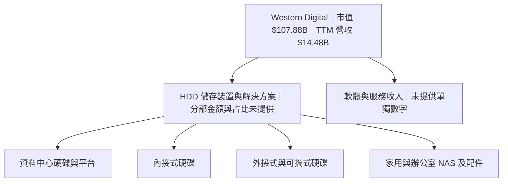
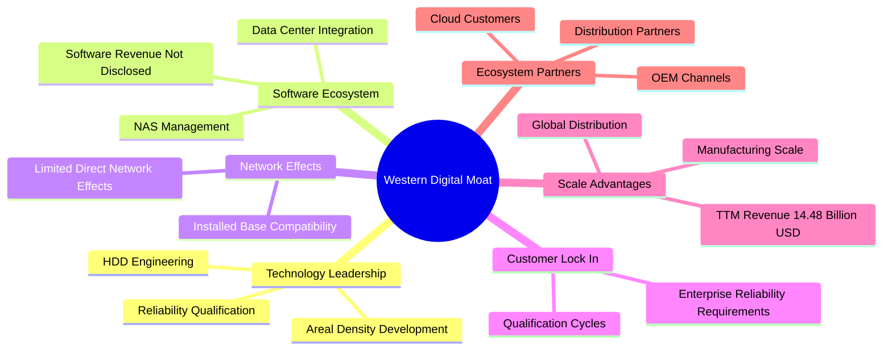
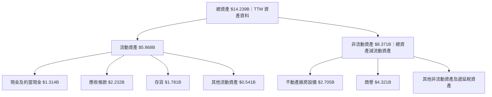
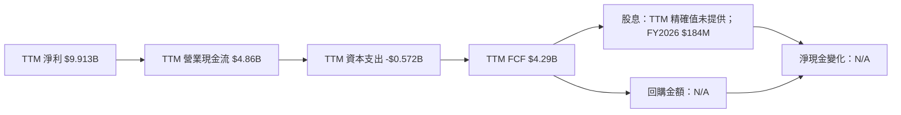
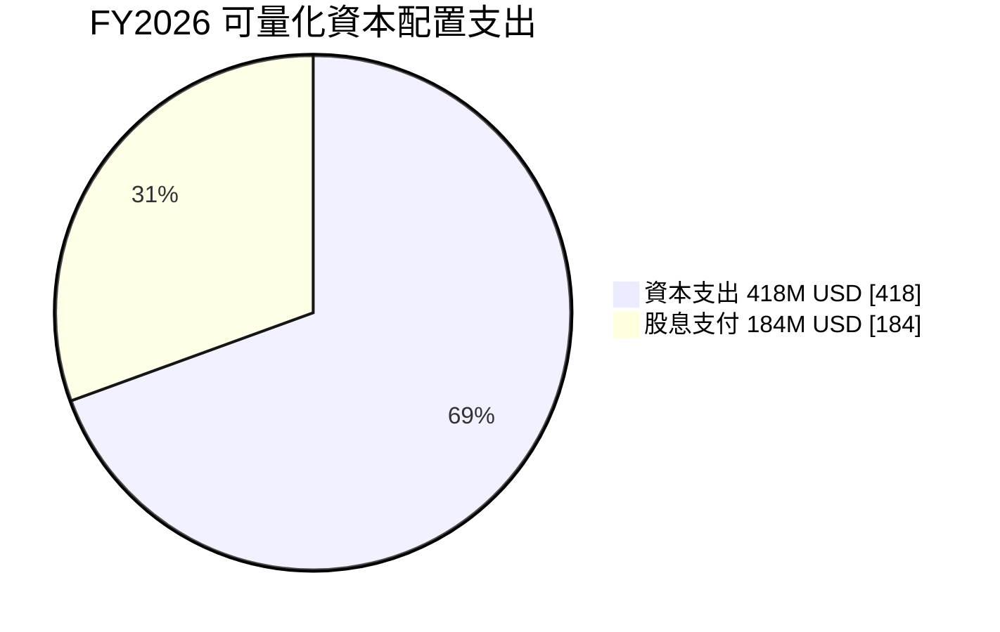
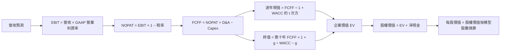
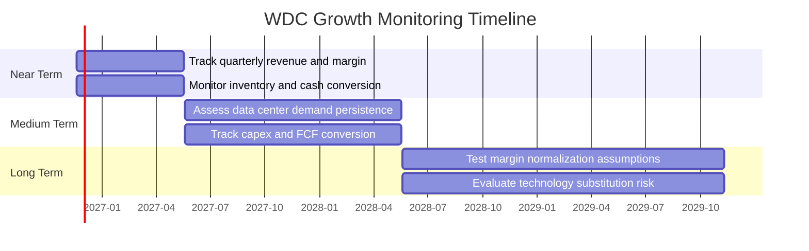
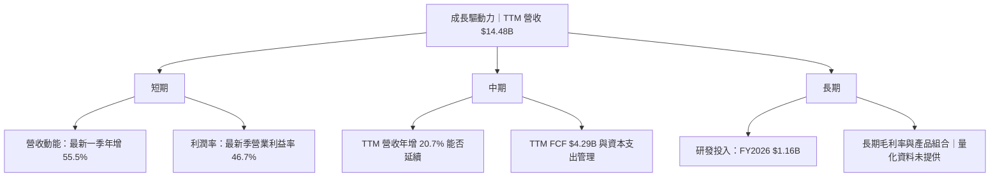
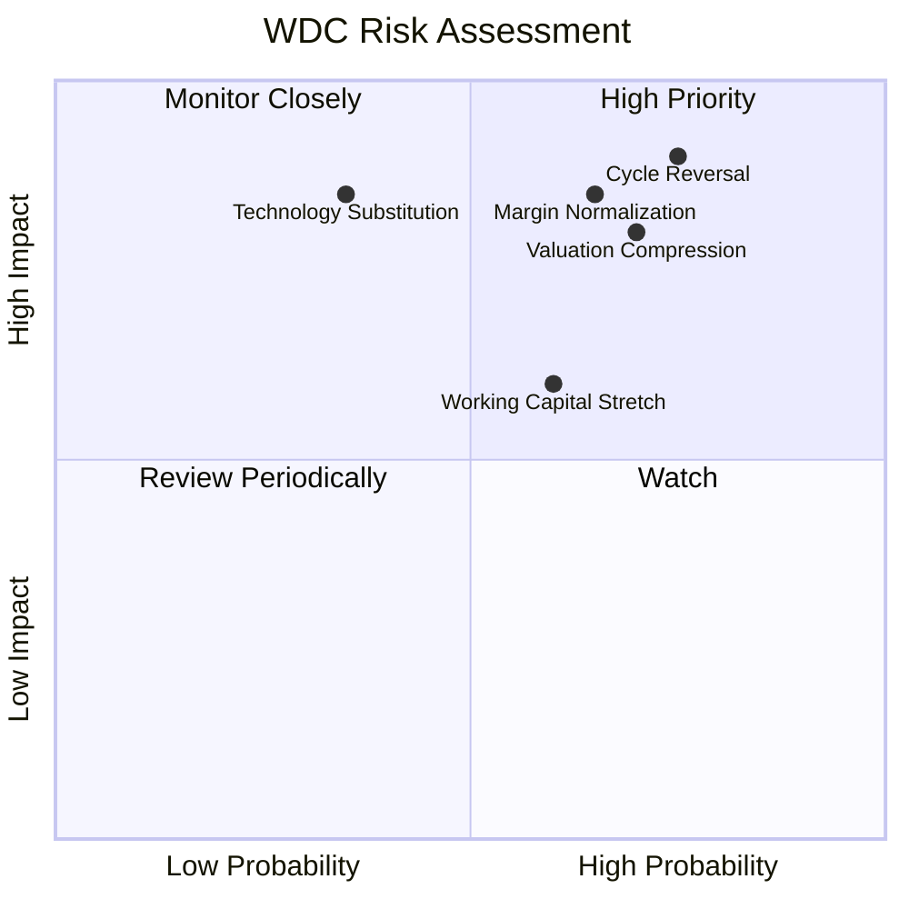
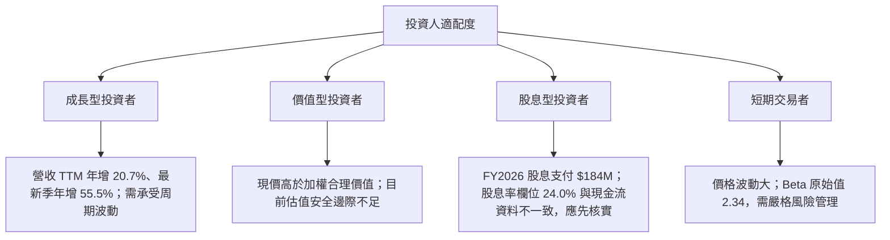

# WDC 基本面深度分析報告
> **報告日期**：2026-11-19 ｜ **語言**：繁體中文 ｜ **數據來源**：SEC 申報資料 (XBRL)、Yahoo Finance、Finviz、StockAnalysis、Roic.ai 

## 目錄

| # | 章節 | 核心結論 |
|---|------|----------|
| 1 | 執行摘要 | 賣出；加權合理價值 $215.10；MOS -34.0% |
| 2 | 公司概覽與商業模式 | HDD 儲存業務具規模與客戶關係，但周期性削弱護城河穩定性 |
| 3 | 損益表深度分析 | TTM 營收 $14.48B、TTM 成長 20.7%；最近單季年增 55.5% |
| 4 | 資產負債表分析 | 淨現金 $525M；營運資金週期較一年前拉長 |
| 5 | 現金流量深度分析 | TTM FCF $4.29B，FCF Yield 3.98%；現金流轉換低於淨利 |
| 6 | 獲利能力與資本效率 | ROIC 61.1% 高於 WACC 14.00%，但高度周期化 |
| 7 | 相對估值分析 | 相對同業估值不一；P/S 高於自身歷史中位數 |
| 8 | DCF 內在價值評估 | 基準 DCF $182.17；加權合理價值 $215.10 |
| 9 | 成長催化劑 | 單季營收年增 55.5%，但 TAM 與催化劑量化資料不足 |
| 10 | 風險矩陣 | 周期反轉、利潤率回落與高估值為主要風險 |
| 11 | 投資建議 | 依 MOS 門檻為賣出；現價高於加權合理價值 |

---

## 1. 執行摘要

### 1.0 一頁式投資儀表板

| 項目 | 內容 |
|------|------|
| **投資論點（3 句）** | ① TTM 營收 $14.48B、年增 20.7%，最近一季營收年增 55.5%，反映需求與定價環境改善。② TTM ROIC 為 61.1%，高於 14.00% WACC，現階段具價值創造能力。③ TTM FCF 為 $4.29B，但 2026-11-18 收盤價 $288.19 高於 DCF 基準價 $182.17，也高於加權合理價值 $215.10。 |
| **綜合評分** | **6.4/10**（引用 1.1 評分卡） |
| **財務健康** | 🟢 淨現金 $525M、流動比率 1.434；但 CCC 從 34 天增至 52 天，營運資金效率轉差。 |
| **ROIC vs WACC** | 61.1% vs 14.00%；現階段創造價值，差距 47.1 個百分點。 |
| **FCF 趨勢** | TTM FCF $4.29B；FCF Yield 3.98%。近年由負轉正，但獲利周期可能使其波動。 |
| **估值** | Forward P/E 7.13x（市場資料欄位）｜EV/EBITDA 19.3x（歷史估值區塊）｜FCF Yield 3.98%。來源倍數口徑有差異，詳見第 7 章。 |
| **DCF 內在價值（基準）** | $182.17；現價相對 DCF 溢價 **58.2%**（折溢價以 DCF 為基準）。 |
| **安全邊際（MOS）** | **-34.0%**＝($215.10 − $288.19) ÷ $215.10；🔴 無安全邊際。 |
| **預期報酬（基準情境 12M）** | DCF 基準情境相對現價 **-36.8%**；此為模型價值相對現價，不代表 12 個月預測保證。 |
| **關鍵風險（前二）** | 周期反轉造成價格與利潤率下滑；市場對高成長與高利潤率預期過高。 |
| **評級 + 信心度** | 🔴 **賣出**｜信心：中。估值結論明確，但周期性及來源資料口徑差異降低精確度。 |

### 1.1 綜合評分卡（全報告唯一）

| 維度 | 評分（1–10） | 主要依據（引用數字與其來源章節） |
|------|--------------|----------------------------------|
| 成長性 | 8.0 | TTM 營收年增 20.7%，最近單季年增 55.5%（第 3 章）；周期反彈成分使持續性仍待驗證。 |
| 獲利能力 | 8.0 | TTM 營業利益率 39.4%、ROIC 61.1%、F-Score 6/8（第 3、6 章）。 |
| 財務健康 | 7.0 | 淨現金 $525M；流動比率 1.434；CCC 年增 18 天至 52 天（第 4 章）。 |
| 估值 | 2.0 | MOS -34.0%；DCF 基準 $182.17，低於現價 $288.19；P/S 位於自身五年歷史第 85 百分位（第 7、8 章）。 |
| 護城河 | 6.0 | 儲存裝置研發、製造規模與客戶關係有利競爭，但缺乏市場份額及分部數據支持（第 2 章）。 |
| 管理層與資本配置 | 7.0 | FY2026 資本支出 $418M、SBC $204M、股息支付 $184M；稀釋股數測試未通過（第 3、5、6 章）。 |
| **綜合評分** | **6.3** | 六項算術平均：(8.0 + 8.0 + 7.0 + 2.0 + 6.0 + 7.0) ÷ 6 = **6.3**。 |

### 1.2 五大投資論點 + 三大核心風險

| 類型 | 項目 | 具體依據 | 信心度 |
|------|------|----------|--------|
| 🟢 **投資論點①** | 營收動能改善 | TTM 營收 $14.48B、TTM 年增 20.7%；最近單季年增 55.5%，顯示需求回升並帶動營收槓桿。 | 🟢 高 |
| 🟢 **投資論點②** | 利潤率大幅修復 | TTM 營業利益率 39.4%，最新季 46.7%；若產品組合與定價維持，營業槓桿可延續。 | 🟢 中 |
| 🟢 **投資論點③** | 現金流轉正且可觀 | TTM 營業現金流 $4.86B、資本支出 $572M、FCF $4.29B。 | 🟢 高 |
| 🟢 **投資論點④** | 資本效率高 | ROIC 61.1% 對比 WACC 14.00%，利差 47.1 個百分點。 | 🟢 中 |
| 🟢 **投資論點⑤** | 資產負債表淨現金 | 現金及短期投資 $1.31B、總債務 $789M、淨現金 $525M。 | 🟢 高 |
| 🟡 **風險①** | 儲存產業周期反轉 | 最近單季營收年增 55.5%，較高基期與供需變化可能使價格、出貨與利潤率同步回落。 | 🟡 中 |
| 🔴 **風險②** | 現價高於估值基準 | DCF $182.17、加權合理價值 $215.10，現價 $288.19；MOS -34.0%。 | 🔴 高 |
| 🟡 **風險③** | 現金轉換弱於帳面淨利 | TTM FCF 約為 TTM 淨利的 43.3%；F-Score 應計品質測試未通過。 | 🟡 中 |

### 1.3 快速統計卡片

| 指標 | 公司實際值（期間） | 同業中位數 | 狀態 |
|------|--------------------|------------|------|
| 營收成長（TTM） | **20.7%** | — | 🟢 |
| 營收成長（最新一季年增） | **55.5%** | 61.0%（STX、SNDK、MU 中位數） | 🟡 |
| 毛利率（TTM） | **52.6%** | 80.0% | 🟡 |
| 營業利益率（TTM） | **39.4%** | — | 🟢 |
| ROIC（TTM） | **61.1%** | — | 🟢 |
| Forward P/E | **7.13x**（市場估值欄位） | 3.4x | 🟡 |
| FCF Yield（TTM） | **3.98%** | — | 🟡 |
| Piotroski F-Score | **6 / 8**（可判定測試） | — | 🟢 |

### 1.4 投資結論

```text
╔══════════════════════════════════════════════════════════════════╗
║                    📊 投資結論摘要                               ║
╠══════════════════════════════════════════════════════════════════╣
║  評級：🔴 賣出（依 MOS 門檻，未作質化調整）                       ║
║  價格（2026-11-18 收盤）：$288.19                                ║
║  DCF 內在價值（基準）：$182.17（現價溢價 58.2%）                 ║
║  安全邊際 MOS：-34.0%（基準為加權合理價值）                      ║
║  加權合理價值（8.8）：$215.10                                    ║
║  DCF 情境價值：                                                   ║
║    悲觀情境：$100.40（-65.2%）                                   ║
║    基準情境：$182.17（-36.8%）                                   ║
║    樂觀情境：$313.26（+8.7%）                                    ║
║  綜合評分：6.3/10（引用 1.1）                                    ║
║  適合投資人：能承受周期波動、願意追蹤財報的投資人；不適合以現價  ║
║              尋求估值保護的價值型投資人。                        ║
╚══════════════════════════════════════════════════════════════════╝
```

---

## 2. 公司概覽與商業模式

### 2.1 業務結構與收入來源

公司資料描述 WDC 提供基於 HDD 技術的內接式硬碟、資料中心硬碟與平台、外接式硬碟、可攜式硬碟、NAS 裝置及配件。財務資料只提供合併營收，沒有各產品線營收或占比，因此不拆分金額及百分比。



### 2.2 市場份額

市場份額數據未提供，亦無可引用的年份及來源，因此不列市場占比。公司 TTM 營收為 $14.48B、TTM 成長 20.7%，最近單季年增 55.5%；比較同業，STX 最新季營收年增 61.0%，但同業營收口徑與產品組合不完全相同，僅能作為方向性參照。

### 2.3 競爭護城河分析



### 2.4 護城河強度

| 護城河項目 | 強度（強／中／弱） | 證據（引用數字或事實） | 會削弱它的情況 |
|------------|--------------------|------------------------|----------------|
| 技術與可靠性 | 中 | 公司提供資料中心及企業級硬碟產品；但沒有產品性能、專利或市占資料。 | 技術替代、產品可靠性落後、競品提升容量與成本效率。 |
| 客戶鎖定 | 中 | 資料中心與企業產品需符合客戶驗證及可靠性要求；量化轉換成本未提供。 | 大客戶多來源採購、驗證周期縮短、採購轉向替代技術。 |
| 規模效應 | 中 | TTM 營收 $14.48B；FY2026 研發支出 $1.16B。 | 產能利用率下降、價格競爭、固定成本無法被高出貨攤薄。 |
| 軟體生態系統 | 弱至中 | 有 NAS 與資料儲存解決方案，但軟體營收、續約與使用者數未提供。 | 軟體未形成可持續收入或客戶改用跨平台替代方案。 |
| 網路效應 | 弱 | 儲存硬體本身未呈現直接網路效應的量化證據。 | 競爭者以兼容性或平台整合降低轉換摩擦。 |
| 生態夥伴 | 中 | 公司透過銷售人員、經銷商及分銷商銷售；合作夥伴占比未提供。 | 通路轉向其他供應商、雲端客戶集中度上升。 |

1.1「護城河」評分為 **6.0/10**，理由是營收規模、研發投入及企業客戶驗證提供一定進入障礙，但缺乏市場份額、客戶集中度與分部經濟數據，且產品屬周期性硬體。

---

## 3. 損益表深度分析

### 3.1 年度收入成長趨勢（近 4 年）

以下採年度損益表數字；2026 年度與 TTM 口徑不同，不能直接等同。

```text
╔══════════════════════════════════════════════════════════════════╗
║             Western Digital 年度收入趨勢（FY2023-FY2026）        ║
╠══════════════════════════════════════════════════════════════════╣
║  FY2023  $6.25B   ████████░░░░░░░░░░░░░░░░  YoY: -1.1% 🟡       ║
║  FY2024  $6.32B   ████████░░░░░░░░░░░░░░░░  YoY: +1.1% 🟡       ║
║  FY2025  $9.52B   █████████████░░░░░░░░░░░  YoY: +50.7% 🟢      ║
║  FY2026  $12.92B  █████████████████░░░░░░░  YoY: +35.7% 🟢      ║
╠══════════════════════════════════════════════════════════════════╣
║  FY2023 至 FY2026 CAGR = (12.92 ÷ 6.25)^(1/3) − 1 = 27.3%       ║
║  FY2023 至 FY2026 年度營收約增長 2.07 倍，反映周期復甦。          ║
╚══════════════════════════════════════════════════════════════════╝
```

### 3.2 季度收入趨勢分析

| 季度 | 營收 | QoQ 成長 | YoY 成長 | 備註 |
|------|------:|---------:|---------:|------|
| 2025-12-31 | $3.02B | — | 25.24% | QoQ 基期缺少上一季營收資料。 |
| 2026-03-31 | $3.34B | 10.6% | 45.47% | QoQ = $3.34B ÷ $3.02B − 1。 |
| 2026-06-30 | $3.75B | 12.3% | 43.84% | QoQ = $3.75B ÷ $3.34B − 1。 |
| 2026-10-02／資料欄位 2026-09-30 | $4.38B | 16.8% | 55.5% | 最新一季年增 55.5% 是單季數字，不是 TTM；兩個來源的期間標示略有差異。 |

連續三季營收 QoQ 增幅提高，與最新一季年增 55.5% 同向，代表當前出貨與價格環境偏強；但周期產業的高增長不應直接外推為長期趨勢。

### 3.3 利潤率演變分析

| 利潤率指標 | FY2023 | FY2024 | FY2025 | FY2026 | 趨勢 | 評估 |
|------------|-------:|-------:|-------:|-------:|------|------|
| **毛利率** | 22.3% | 28.0% | 38.8% | 48.8% | ↗️ 由低谷持續回升 | 🟢 |
| **營業利益率** | -6.4% | 1.5% | 22.4% | 35.6% | ↗️ 營收復甦帶來營業槓桿 | 🟢 |
| **淨利率** | -26.9% | -12.6% | 19.4% | 72.0% | ↗️ 2026 淨利率受非營業／稅務等因素影響可能較大 | 🟡 |

年度毛利率由 FY2023 約 22.3% 升至 FY2026 約 48.8%，與收入回升、產品組合及價格改善相符；但可用資料沒有單位售價、出貨量或產品組合分部，無法將各驅動因素精確拆分。FY2026 淨利 $9.30B 相對營業利益 $4.60B 明顯偏高，故淨利率不宜視為可持續營運利潤率。TTM 官方口徑營業利益率為 39.4%，最新季為 46.7%；另有彙整資料出現 40.7% 與 40.9%，本報告依核實口徑採用 39.4% 與 46.7%。

### 3.4 費用結構分析

收入成本及費用明細不完整，無法可靠構建全公司費用結構圓餅圖。可用數字顯示 FY2026 研發費用 $1.16B，約占年度營收 $12.92B 的 **9.0%**；FY2026 資本支出為 $418M，屬現金流而非損益表費用，不與研發費用混為一談。

### 3.5 季度 EPS 趨勢與盈餘品質（Quality of Earnings）

| 季度 | EPS 實際值 | EPS 預估／超預期 | 備註 |
|------|-----------:|------------------|------|
| 2025-12-31 | $4.67 | N/A | EPS 估值資料為 NaN，無法判定超預期或不及預期。 |
| 2026-03-31 | $8.20 | N/A | 同上。 |
| 2026-06-30 | $8.21 | N/A | 同上。 |
| 2026-09-30 | $4.63 | N/A | 同上；EPS 季度下降不等於年減，需與同比季度及一次性項目核對。 |

| 盈餘品質項目 | 數值／佔比 | 評估 |
|--------------|-----------|------|
| 股權薪酬 SBC / 營收 | 約 1.59%（四季 SBC $230M ÷ TTM 營收 $14.48B） | 🟡 SBC 金額不算相對營收極高，但仍造成股東稀釋。季度 SBC 合計採用資料列示的 $79M、$45M、$53M、$53M。 |
| SBC / 營業現金流 | 約 4.73%（$230M ÷ $4.86B） | 🟡 SBC 為非現金費用，但需納入股東經濟成本。 |
| FCF / 淨利（現金轉換率） | 約 43.3%（TTM FCF $4.29B ÷ TTM 淨利 $9.913B） | 🔴 現金轉換低於 1 倍；淨利高於營業現金流，F-Score 應計品質測試未通過。 |
| 一次性／非經常性損益 | 無法完整判定 | FY2026 淨利 $9.30B 高於營業利益 $4.60B；詳細非營業項目與稅務調節表未提供，不能判定差額全屬經常性盈餘。 |
| 有效稅率異常 | 4.9%（最新年度有效稅率） | 🟡 低於常態企業稅率的可能性高；DCF 沿用此值，但若正常化稅率上升，估值將下降。 |
| 資本化支出 vs 費用化 | TTM Capex $572M；資本化政策及維護性／成長性拆分 N/A | 不能據此判定是否遞延成本；Capex 必須納入 FCFF。 |

**盈餘品質結論**：FCF $4.29B 具實質現金流支撐，但 TTM 淨利約 $9.913B、現金轉換率約 43.3%，且最新年度稅率僅 4.9%、FY2026 淨利顯著高於營業利益，顯示 GAAP 淨利可能受非營業或稅務因素影響。估值更應重視 FCF 與正常化營業利潤，而非直接以當期淨利外推。

---

## 4. 資產負債表分析

### 4.1 資產結構分解



其他非流動資產金額為總額減除已列項目後的彙總結果，來源資料未提供完整明細拆分，不進一步分配。

### 4.2 流動性與營運資金分析

| 指標 | 最新 TTM | 一年前 TTM | 變化 | 解讀 |
|------|----------|------------|------|------|
| 流動比率 | 1.434 | N/A | N/A | 高於 1，短期資產覆蓋流動負債；比較值未提供。 |
| 速動比率 | 0.867 | N/A | N/A | 扣除存貨後低於 1，流動性仍依賴存貨轉現及營運現金流。 |
| DSO 應收帳款天數 | 56 天 | 41 天 | +15 天 | 收款周期延長，可能反映客戶條款、季末銷售或客戶組合改變；需看後續應收及壞帳。 |
| DIO 存貨天數 | 95 天 | 70 天 | +25 天 | 庫存占用增加；可能是備貨以支持需求，也可能是需求預估過高。 |
| DPO 應付帳款天數 | 99 天 | 77 天 | +22 天 | 付款周期延長，提供營運資金緩衝，但不能單獨推論供應商議價力。 |
| CCC 現金轉換週期 | 52 天 | 34 天 | +18 天 | DSO + DIO − DPO = 56 + 95 − 99 = 52 天；相較一年前資金被占用時間增加。 |

### 4.3 債務結構分析

```text
╔══════════════════════════════════════════════════════════════════╗
║                  Western Digital 債務健康診斷                    ║
╠══════════════════════════════════════════════════════════════════╣
║  總債務：       $0.789B  ███████░░░░░░░░░░░░░  依核實口徑       ║
║  現金+短期投資： $1.31B   █████████████░░░░░░░  可覆蓋債務       ║
║  淨現金：       $0.525B  🟢 正淨現金                            ║
║  流動比率：     1.434x   🟢 流動資產大於流動負債                ║
║  Debt/EBITDA：  N/A（債務與 EBITDA 期間口徑未一致）              ║
║  利息保障倍數： N/A（利息費用與 EBIT 口徑資料不足）              ║
║  注意：年度資料另列總債務 $1.05B，與 TTM 核實數 $789M 不同；     ║
║        本報告估值及淨現金採用核實數。                             ║
╚══════════════════════════════════════════════════════════════════╝
```

### 4.4 股東權益趨勢

| 財年 | 股東權益 |
|------|---------:|
| FY2023 | $11.84B |
| FY2024 | $11.05B |
| FY2025 | $5.54B |
| FY2026 | $8.86B |

```text
╔══════════════════════════════════════════════════════════════════╗
║                  股東權益變化（年度資料）                         ║
╠══════════════════════════════════════════════════════════════════╣
║  FY2023  $11.84B  ████████████████████                         ║
║  FY2024  $11.05B  ███████████████████                          ║
║  FY2025   $5.54B  █████████                                     ║
║  FY2026   $8.86B  ███████████████                              ║
╚══════════════════════════════════════════════════════════════════╝
```

股東權益 FY2025 明顯下降、FY2026 回升。資料未提供完整權益變動表，無法將變動精確拆成分紅、重估、併購或其他項目。

---

## 5. 現金流量深度分析

### 5.1 現金流量瀑布圖

為保持口徑一致，以下營業現金流、Capex、FCF 引用 TTM；淨利與股東分配不一定與同一 TTM 區間完全匹配，圖中不以加總方式推導淨現金變化。



### 5.2 FCF 轉換率趨勢

| 財年 | FCF | 淨利 | FCF / 淨利 | 解讀 |
|------|----:|----:|-----------:|------|
| FY2023 | -$1.23B | -$1.68B | 約 73.2% | 分子與分母皆為負，比例僅作算術參考，經濟意義有限。 |
| FY2024 | -$0.781B | -$0.798B | 約 97.9% | 仍為負 FCF，尚非健康現金轉換。 |
| FY2025 | $1.28B | $1.86B | 約 68.8% | 復甦初期現金流低於淨利。 |
| FY2026 | $3.51B | $9.30B | 約 37.7% | 淨利大幅高於 FCF，須核對稅務、非營業項目與營運資金。 |

### 5.3 自由現金流趨勢

```text
╔══════════════════════════════════════════════════════════════════╗
║                  自由現金流：年度實際值                           ║
╠══════════════════════════════════════════════════════════════════╣
║  FY2023  -$1.23B  ◀██████████████░░░░░░  FCF 為負               ║
║  FY2024  -$0.78B  ◀█████████░░░░░░░░░░░  FCF 為負               ║
║  FY2025   $1.28B  █████████░░░░░░░░░░░   FCF 轉正               ║
║  FY2026   $3.51B  ████████████████████   FCF 增長               ║
║  TTM      $4.29B  FCF Yield 3.98%                                ║
╚══════════════════════════════════════════════════════════════════╝
```

年度數列顯示現金流從 FY2023、FY2024 負值回升至 FY2026 正值，但不能把周期底部至復甦的高增幅視為永久增長率。TTM FCF = $4.86B − $572M = $4.29B，依指定口徑引用。

### 5.4 資本配置評估

| 項目 | 可用數據 | 評估 |
|------|----------|------|
| 資本支出 | TTM $572M；FY2026 $418M | TTM Capex 約為 TTM 營收 3.95%，支持產能與技術投資。 |
| 股息 | FY2026 現金股息支付 $184M | 約為 FY2026 FCF $3.51B 的 5.2%；資料未提供回購金額。 |
| 研發 | FY2026 $1.16B | 約占 FY2026 營收 9.0%，為維持產品競爭力的重要費用。 |
| 股票回購 | N/A | 未提供金額，不能推測。 |
| 留存現金／淨現金變化 | N/A | 缺少同期間資金用途及資產負債表完整調節。 |



圓餅只呈現 FY2026 已提供的 Capex 與股息支出，未列示項目不代表全部資本配置。

---

## 6. 獲利能力與資本效率

### 6.1 ROE / ROA / ROIC 趨勢

| 指標 | 最新值 | 歷史可比值 | 評估 |
|------|-------:|------------|------|
| ROE | 107.2% TTM | N/A（不同資料來源另有 129.6%） | 高 ROE 顯示獲利強，但部分受低有效稅率、淨利波動與權益基數影響。 |
| ROA | 25.9%（市場彙整欄位） | QUALITY FIGURES 未提供年度序列 | 獲利恢復提高資產回報；與 107.2% ROE 的期間口徑並非同一核實欄位。 |
| ROIC | 61.1% TTM | Roic.ai 長期序列未提供同口徑近期值 | 現階段大幅高於資本成本，仍須留意周期高點不可持續。 |
| 行業均值 | N/A | 數據未提供 | 不列示無來源均值。 |

### 6.2 ROIC vs WACC 分析（核心價值創造判斷）

```text
╔══════════════════════════════════════════════════════════════════╗
║                ROIC vs WACC 深度分析                            ║
╠══════════════════════════════════════════════════════════════════╣
║  WACC（核實資本成本口徑）：14.00%                                ║
║  ├── 無風險利率（10Y 美債）：       5.07%                        ║
║  ├── 市場風險溢酬 ERP：             5.00%                        ║
║  ├── 原始 Beta：                    2.34                         ║
║  ├── 調整後 Beta：                  1.90                         ║
║  ├── 股權成本：                    14.55%                       ║
║  ├── 稅前債務成本：                20.91%                       ║
║  ├── 稅率：                        4.9%                         ║
║  ├── 資本權重 E/D：                99.3% / 0.7%                  ║
║  ├── 未限制計算 WACC：             14.58%                        ║
║  └── 採用 WACC：                  14.00%（受 7%–14% 區間限制）  ║
║                                                                  ║
║  ROIC（TTM）：                     61.1%                         ║
║  EVA Spread = ROIC − WACC：        61.1% − 14.00% = 47.1pp      ║
║                                                                  ║
║  ROIC  61.1%  ▓▓▓▓▓▓▓▓▓▓▓▓▓▓▓▓▓▓▓▓▓▓▓▓▓▓▓▓▓▓ 🟢               ║
║  WACC  14.0%  ▓▓▓▓▓▓▓░░░░░░░░░░░░░░░░░░░░░░░                   ║
║                                                                  ║
║  結論：以 TTM 核實值衡量，ROIC 約為 WACC 的 4.4 倍，當前創造    ║
║  股東價值；此差距若隨周期正常化而快速收斂，價值創造幅度亦下降。 ║
╚══════════════════════════════════════════════════════════════════╝
```

WACC 依核實資本成本資料採用 14.00%，而不是未限制計算值 14.58%；具體 WACC 推導與限制方式見 8.2。TTM ROIC 61.1% 減 WACC 14.00% 得 47.1 個百分點。不能將當前高 ROIC 簡單外推十年。

### 6.3 杜邦三因素分解

| 因素 | 數值（TTM） | 解讀 |
|------|-------------|------|
| 淨利率 | 69.2% | 對 ROE 貢獻大，但淨利可能受低有效稅率及非營業項目影響。 |
| 資產週轉率 | 1.02 | 每美元資產對應約 1.02 美元營收。 |
| 權益乘數 | 1.52 | 槓桿並非 ROE 的主要放大來源。 |
| **ROE** | **107.2%** | 69.2% × 1.02 × 1.52 = 約 107.2%；主要由淨利率驅動。 |

### 6.4 財務體質：Piotroski F-Score

**Piotroski F-Score：6 / 8**；資料列示九項測試，其中長期負債／總資產測試缺少輸入而未納入分母，因此可判定測試數為 8。

| 測試 | 結果 | 解讀 |
|------|------|------|
| ROA > 0 | ✅ 通過 | TTM 獲利為正。 |
| 營業現金流 > 0 | ✅ 通過 | TTM OCF $4.86B。 |
| ROA 高於一年前 | ✅ 通過 | 獲利相對低谷改善。 |
| 營業現金流 > 淨利（應計品質） | ❌ 未通過 | TTM OCF 低於 TTM 淨利，需關注盈餘現金含量。 |
| 長期負債 ÷ 總資產低於一年前 | — 無法判定 | 缺資料，不補算。 |
| 流動比率高於一年前 | ✅ 通過 | QUALITY FIGURES 判定通過。 |
| 稀釋股數未增加 | ❌ 未通過 | 顯示股數稀釋對既有股東報酬有負面影響。 |
| 毛利率高於一年前 | ✅ 通過 | 反映價格、組合或產能利用改善。 |
| 資產週轉率高於一年前 | ✅ 通過 | 資產使用效率上升。 |

---

## 7. 相對估值分析

### 7.1 同業估值比較表格

同業倍數使用 Yahoo Finance 的 Peer multiples。WDC 自身倍數使用同一市場資料中列示的 trailing、forward 等口徑；歷史估值資料另有不同計算口徑，故不混用。

| 估值指標 | **WDC** | **STX** | **SNDK** | **MU** | WDC 評估 |
|----------|--------:|-------:|--------:|------:|-----------|
| **Trailing P/E** | 10.14x（市場估值欄位） | 27.1x | 6.2x | 9.5x | 🟡 介於同業區間；周期盈餘使 P/E 易受基期影響。 |
| **Forward P/E** | 7.13x（市場估值欄位） | 7.9x | 2.7x | 3.4x | 🟡 高於同業中位數 3.4x；來源前瞻盈餘假設可能差異大。 |
| **P/S（TTM）** | 7.45x（市場估值欄位） | 8.6x | 3.8x | 6.0x | 🟡 高於 SNDK、MU，低於 STX。 |
| **EV/EBITDA（TTM）** | 17.03x（市場估值欄位） | 20.4x | 5.0x | 7.0x | 🔴 高於 SNDK、MU；與歷史估值區塊 19.3x 口徑不同。 |
| **最新季營收年增** | 55.5% | 61.0% | 377.9% | 379.3% | 🟡 WDC 為正成長，但低於同業中位數 377.9%；同業基期及產品組成有差異。 |
| **毛利率（TTM）** | 52.6% | 50.4% | 80.0% | 80.7% | 🟢 高於 STX，低於 SNDK、MU。 |

同業公司營運與產品組合不同，尤其同業季營收增長率差距極大，不宜只依倍數排名判定相對價值。相對估值模型依指定方法採同業 EV/EBITDA 中位數 7.0x 及 P/S 中位數 6.0x，而非 WDC 自身目前倍數。

### 7.2 歷史估值區間分析

```text
╔══════════════════════════════════════════════════════════════════╗
║                WDC 五年歷史估值位置（TTM）                       ║
╠══════════════════════════════════════════════════════════════════╣
║  P/E       範圍 6.3x ───── 中位數 13.5x ─ 現值 11.2x ─ 62.5x   ║
║             現值百分位：38%                                      ║
║  P/S       範圍 0.4x ─ 中位數 1.2x ───────── 現值 7.6x ─ 16.0x ║
║             現值百分位：85%                                      ║
║  EV/EBITDA 範圍 4.5x ─ 中位數 14.9x ─ 現值 19.3x ───── 96.5x  ║
║             現值百分位：69%                                      ║
╚══════════════════════════════════════════════════════════════════╝
```

P/E 現值低於五年中位數，但 P/S 與 EV/EBITDA 高於歷史中位數，說明周期高點附近的盈餘可能令 P/E 看起來偏低，而市場已對營收與 EBITDA 賦予較高估值。

### 7.3 情境價值（Bear / Base / Bull）

以下情境及機率照錄 DCF 模型，不另行設價。

| 情境 | 第 1 年營收成長 | 期末營業利潤率 | WACC | 每股價值 | 相對現價 | 機率 | 會發生的條件 |
|------|----------------|----------------|------|----------:|----------|-----:|--------------|
| 🔴 悲觀 | 10.3% | 19.4% | 15.00% | $100.40 | -65.2% | 25% | 儲存需求增長降速、價格競爭或產能利用率下降，使長期利潤率低於基準。 |
| 🟡 基準 | 20.7% | 22.8% | 14.00% | $182.17 | -36.8% | 50% | 首年延續 TTM 成長，之後逐步降至 3.0%，營業利潤率向五年中位數收斂。 |
| 🟢 樂觀 | 31.0% | 25.1% | 13.00% | $313.26 | +8.7% | 25% | 需求與產品組合持續改善、成長高於 TTM 錨點，長期利潤率維持較高水準。 |

### 7.4 相對估值隱含價格區間

```text
╔══════════════════════════════════════════════════════════════════╗
║            估值方法回推每股價值與現價位置                       ║
╠══════════════════════════════════════════════════════════════════╣
║  $115.11 ───── $182.17 ───── $215.10 ─── $231.79 ── $288.19     ║
║  EV/EBITDA      基準 DCF      加權合理值     P/S       現價       ║
║                                                                  ║
║  同業 EV/EBITDA：$115.11；同業中位數 7.0x × TTM EBITDA，加淨現金║
║  同業 P/S：      $231.79；同業中位數 6.0x × TTM 營收             ║
║  分析師共識：    $613.38；24 位分析師平均目標價                   ║
╚══════════════════════════════════════════════════════════════════╝
```

分析師共識目標 $613.38 是獨立參考值，不是相對估值下限；其相對現價上行幅度與 DCF 結果差異極大，應視為樂觀假設的外部對照，而非替代現金流分析。

---

## 8. DCF 內在價值評估（Discounted Cash Flow）

### 8.0 估值推理鏈（Thinking Logic）

#### Step 1 — 價值由哪些變數決定？

本模型將價值拆成兩個可核查部分：現有儲存業務的營收與 FCFF 底盤（TTM 營收 $14.48B；分部占比未提供），以及由成長、營業利潤率與終值形成的未來現金流價值。財務資料沒有可單獨量化的第二成長曲線或新業務選擇權，故不另加估值。模型中最主導估值的變數是營業利潤率與折現率；敏感度矩陣顯示 WACC 14% 下，g 從 2% 至 4% 的每股價值為 $176.33 至 $189.19，且模型整體價值仍受現金流及 WACC 影響。

#### Step 2 — 模型選擇

| 決策點 | 本報告採用 | 理由（含數字） | 曾考慮但否決 | 否決理由 |
|--------|-----------|----------------|--------------|----------|
| 現金流定義 | FCFF | 與 WACC 折現、先求 EV 的架構一致；TTM FCF $4.29B。 | FCFE | 資本結構權重及融資成本需額外建模。 |
| 預測期 N | 10 年 | DCF 模型固定 10 年，營收成長由 20.7% 緩降至 3.0%。 | 5 年 | 會縮短周期業務正常化的顯示期間；本報告不得替換模型年數。 |
| 終值方法 | Gordon Growth | DCF 模型以 g=3.0%、WACC=14.00% 計算終值。 | 退出倍數 | DCF 結果未提供終值 EBITDA 退出倍數，不能自行補建。 |
| EBIT 基礎 | GAAP EBIT | 模型指定採 GAAP，SBC 已反映為費用。 | 非 GAAP EBIT | 可能加回 SBC 後漏計股東成本。 |

#### Step 3 — 高／中敏感度輸入推導鏈

- **營收成長**：錨點＝TTM 營收年增 20.7% → 調整＝模型首年沿用此增速，之後線性降至第十年 3.0%，反映短期動能與長期成熟化 → **採用首年 20.7%、第十年 3.0%** → 曾考慮把 55.5% 最新單季年增直接作為首年成長，但那是單季基期數據，不代表全年可持續，故否決。
- **期末營業利潤率**：錨點＝TTM GAAP 營業利益率 39.4% → 調整＝逐步回落至最近五財年中位數 22.8%，降低以高景氣利潤率永久化的風險 → **採用第十年 22.8%** → 曾考慮維持 39.4%，因模型歷史中位數及周期性不支持永續維持，故否決。
- **永續成長率 g**：錨點＝長期名目經濟成長參考約 3%（假設值，依據：長期成熟經濟體通膨加實質成長概念；財務資料未提供長期 GDP 預測）→ 調整＝取 3.0%，低於 WACC 14.00% 且不依賴高終值成長 → **採用 3.0%** → 曾考慮 4.0%，因對高 WACC 下的終值提高敏感，故不採基準。
- **預測期 N**：錨點＝模型設定 10 年 → 調整＝不自行更改，以呈現營收及利潤率逐步正常化 → **採用 10 年** → 曾考慮 5 年，因會改變模型終值起算年且與指定模型不一致，故否決。
- **Capex／營收**：錨點＝TTM $572M ÷ TTM 營收 $14.48B = 3.95%，模型列示年 1 為 3.9% → 調整＝逐步降至 3.0%，並以 D&A 的 1.1 倍下限作模型規則 → **採用 3.9% 降至 3.0%** → 曾考慮固定 3.95%，因模型已按收入與折舊假設設定漸降路徑，故不替換。
- **EBIT 基礎及 SBC 處理**：錨點＝模型明定 GAAP EBIT；FY2026 SBC $204M → 調整＝不在 FCFF 再扣 SBC、股數不額外稀釋 → **採用組合 (A)** → 否決非 GAAP EBIT 不扣 SBC 且不稀釋，因會漏掉股東成本。
- **年稀釋率**：錨點＝模型採當期股數，且 GAAP EBIT 已含 SBC → 調整＝年稀釋率設 0% → **採用 0%** → 曾考慮額外股數稀釋，但會與 GAAP 費用中已計 SBC 的組合重複計算。
- **終值方法**：錨點＝模型提供 Gordon Growth 終值 $87.94B → 調整＝以第 10 年 FCFF 為基礎計算 → **採用 Gordon Growth** → 曾考慮退出倍數，但模型未提供指定倍數與核算結果，不能自建。
- **WACC**：錨點＝核實資料未限制計算值 14.58% → 調整＝資本成本資料說明 WACC 限制在 7%–14% → **採用 14.00%** → 否決直接採用 14.58%，因核實模型規則要求採用受限值。
- **ΔWC**：模型明示未建模；採用 **0（不另列 ΔWC）**。此為模型限制，不代表營運資金沒有經濟成本；CCC 已由 34 天升至 52 天，若其持續惡化，實際 FCFF 可能低於 DCF。
- **有效稅率**：錨點＝最新年度有效稅率 4.9%；模型沿用 4.9%。該值偏低，若正常化稅率上升，FCFF 及估值下降。
- **D&A／營收**：錨點＝TTM 2.7%；模型固定 2.7%，缺少資料支持再做周期調整。

#### Step 4 — 最脆弱假設

最脆弱的是 39.4% TTM 營業利益率如何在十年內降至 22.8% 的路徑，以及 4.9% 稅率是否能代表未來；若利潤率比模型更快回落或稅率正常化，價值會向悲觀情境 $100.40 靠近。

#### Step 5 — 計算路徑圖



### 8.1 模型假設總表（Model Inputs）

| 假設項目 | 採用值 | 依據／來源 | 敏感度 |
|----------|--------|-------------|--------|
| 預測期長度 **N** | 10 年 | DCF 模型固定設定；成長率從 20.7% 淡出到 3.0%。 | 🟡 中 |
| 營收成長 | FY+1 20.7% → FY+10 3.0% | TTM 成長 20.7%；期末 3.0% 為模型假設。 | 🔴 高 |
| 營業利益率 | 39.4% → 22.8% | TTM 營業利益率起點；期末採最近五財年中位數。 | 🔴 高 |
| 有效稅率 | 4.9% | 最新年度有效稅率。 | 🟢 低 |
| Capex／營收 | 3.9% → 3.0% | TTM 約 3.95%；依模型規則漸降。 | 🟡 中 |
| D&A／營收 | 2.7% | TTM 比率，模型固定。 | 🟢 低 |
| 營運資金變動／收入增額 | 未建模 | DCF 模型明示 Working capital is not modelled；不能假設實際無需資金。 | 🟢 低（模型限制） |
| EBIT 基礎 | GAAP EBIT | 模型明示採 GAAP EBIT。 | 🟡 中 |
| SBC 處理 | GAAP 已費用化，不再扣 SBC | 模型指定組合 (A)。 | 🟡 中 |
| 年稀釋率 | 0% | 組合 (A)：GAAP EBIT 加固定股數。 | 🟡 中 |
| 永續成長率 g | 3.0% | 模型假設；低於 WACC。 | 🔴 高 |
| 終值方法 | Gordon Growth | 模型只提供此終值計算。 | 🔴 高 |
| WACC | 14.00% | 資本成本資料受 7%–14% 區間限制後的採用值。 | 🔴 高 |
| FCFF 定義 | NOPAT + D&A − Capex | 模型公式；不含營運資金變動。 | — |

**SBC 組合聲明**：本模型採用 **(A) GAAP EBIT + 固定股數**，故 SBC 影響已透過費用計入一次；FCFF 不再另減 SBC，年稀釋率設為 0%。

### 8.2 折現率推導（WACC）

```text
╔══════════════════════════════════════════════════════════════════╗
║                    WACC 推導（折現率）                           ║
╠══════════════════════════════════════════════════════════════════╣
║  股權成本 Ke（CAPM）：                                           ║
║  ├── 無風險利率 Rf：             5.07%                           ║
║  ├── 市場風險溢酬 ERP：           5.00%                           ║
║  ├── 原始 Beta（Yahoo）：          2.34                           ║
║  ├── 調整後 Beta：                1.90                           ║
║  ├── 調整方式：                   ⅔ × 2.34 + ⅓ × 1.00 = 1.89    ║
║  │   資料採用調整值 1.90；末位差異屬輸入精度。                   ║
║  ├── 規模／國別溢酬：              0.00%（未提供另加溢酬依據）    ║
║  └── Ke = 5.07% + 1.90 × 5.00% = 14.55%（核實值）              ║
║                                                                  ║
║  債務成本：                                                      ║
║  ├── 稅前 Kd：                    20.91%                         ║
║  ├── 有效稅率：                   4.9%                           ║
║  └── 稅後 Kd = 20.91% × (1 − 4.9%) = 19.89%                     ║
║                                                                  ║
║  資本結構（核實權重）：                                          ║
║  ├── 股權權重 E：                 99.3%                          ║
║  ├── 債務權重 D：                  0.7%                          ║
║  ├── 未限制 WACC：                 14.58%                        ║
║  └── 採用 WACC：                  14.00%（受 7%–14% 上限限制）  ║
╚══════════════════════════════════════════════════════════════════╝
```

核實資料沒有提供 10 年期公債殖利率的精確觀察日期，故 5.07% 直接照錄，不自行補日期；ERP 5.00% 為資本成本資料的假設值。原始 Beta 2.34 高於 1.5，採用調整後 Beta 1.90。核實資料未提供利息費用及平均計息負債明細，因此不重新建算 Kd；直接引用稅前 Kd 20.91%、股債權重 99.3%／0.7%及 WACC 限制值。

**逐步演算：**

1. **Ke（CAPM）**＝Rf + β × ERP＝5.07% + 1.90 × 5.00%＝**14.55%**（依核實資本成本資料）。
2. **稅前 Kd**＝核實值 **20.91%**；利息費用與平均計息負債金額未提供，故不能展示原始除法或自行反推。
3. **稅後 Kd**＝20.91% × (1 − 4.9%)＝20.91% × 95.1%＝**19.89%**。
4. **權重**＝股權 99.3%、債務 0.7%；99.3% + 0.7% = **100.0%**。市值計算與期末計息負債明細未提供完整可核查拆分，採核實權重。
5. **未限制 WACC**＝99.3% × 14.55% + 0.7% × 19.89%＝14.45% + 0.14%＝**14.58%**（使用未四捨五入數值）；模型因 7%–14% 上限限制，採用 **14.00%**。

第 6.2 節及 DCF 一律採用 **14.00%**，差異來源是資本成本資料明確說明未限制計算值受區間上限限制。

### 8.3 逐年自由現金流預測（基準情境）

金額為十億美元；折現因子取三位小數。表格逐列照錄 DCF 模型，模型未列 ΔWC，故不另加一列；數字經四捨五入，允許末位尾差。

| 年度 | FY+1 | FY+2 | FY+3 | FY+4 | FY+5 | FY+6 | FY+7 | FY+8 | FY+9 | FY+10 |
|------|------:|------:|------:|------:|------:|------:|------:|------:|------:|-------:|
| 營收 | 17.47 | 20.74 | 24.21 | 27.79 | 31.35 | 34.75 | 37.84 | 40.46 | 42.47 | 43.75 |
| 營收 YoY | 20.7% | 18.7% | 16.7% | 14.8% | 12.8% | 10.9% | 8.9% | 6.9% | 5.0% | 3.0% |
| 營業利潤率 | 39.4% | 37.6% | 35.7% | 33.9% | 32.0% | 30.2% | 28.4% | 26.5% | 24.7% | 22.8% |
| 營業利益 EBIT | 6.89 | 7.79 | 8.65 | 9.42 | 10.05 | 10.50 | 10.74 | 10.73 | 10.49 | 10.00 |
| − 稅 | (0.33) | (0.38) | (0.42) | (0.46) | (0.49) | (0.51) | (0.52) | (0.52) | (0.51) | (0.49) |
| = NOPAT | 6.55 | 7.41 | 8.23 | 8.96 | 9.56 | 9.99 | 10.21 | 10.21 | 9.98 | 9.51 |
| + D&A | 0.47 | 0.56 | 0.65 | 0.75 | 0.85 | 0.94 | 1.02 | 1.09 | 1.15 | 1.18 |
| − Capex | (0.69) | (0.80) | (0.90) | (1.01) | (1.10) | (1.18) | (1.25) | (1.29) | (1.31) | (1.30) |
| **= FCFF** | **6.33** | **7.18** | **7.98** | **8.70** | **9.30** | **9.74** | **9.99** | **10.02** | **9.82** | **9.39** |
| 折現因子 @14.00% | 0.877 | 0.769 | 0.675 | 0.592 | 0.519 | 0.456 | 0.400 | 0.351 | 0.308 | 0.270 |
| **FCFF 現值 PV** | **5.56** | **5.52** | **5.39** | **5.15** | **4.83** | **4.44** | **3.99** | **3.51** | **3.02** | **2.53** |

**預測期 FCF 現值合計**：  
$5.56 + $5.52 + $5.39 + $5.15 + $4.83 + $4.44 + $3.99 + $3.51 + $3.02 + $2.53 = **$43.94B**；模型列示合計為 **$43.95B**，差異約 0.02%，屬顯示位數四捨五入。

**FY+1 逐步演算示範：**

1. **營收**＝TTM 營收 $14.48B × (1 + 20.7%)＝$14.48B × 1.207；模型列示 **$17.47B**（模型採用未顯示精度）。
2. **EBIT**＝$17.47B × 39.4%＝**約 $6.89B**（模型列示 $6.89B）。
3. **稅**＝$6.89B × 4.9%＝**約 $0.34B**；模型列示 $0.33B，差異來自輸入未四捨五入數據。
4. **NOPAT**＝模型列示 EBIT − 稅＝$6.89B − $0.33B＝**$6.56B**；模型列示 $6.55B，屬未顯示精度造成約 $0.01B 差異。
5. **D&A**＝模型列示 **$0.47B**（營收約按 2.7% 計）。
6. **Capex**＝模型列示 **$0.69B**（年 1 約按營收 3.9% 計）。
7. **ΔWC**＝模型未建模，**不納入計算**。
8. **FCFF**＝模型列示 FCFF 公式 NOPAT + D&A − Capex；$6.55B + $0.47B − $0.69B＝$6.33B（顯示數字直接相加為 $6.33B）。
9. **折現因子**＝1 ÷ (1 + 14.00%)¹＝0.877；PV＝模型列示 FCFF $6.33B × 0.877＝**$5.55B**，模型列示 $5.56B，差異為折現因子及 FCFF 的未顯示精度。

**合理性自檢：**

- 預測期 FCF 由 FY+1 $6.33B 增至 FY+10 $9.39B，10 年年化約 **4.0%**：\((9.39 ÷ 6.33)^{1/9} − 1\)。FY2023 至 FY2026 FCF 從負值轉正，無法計算具經濟意義的 CAGR；不能將復甦期百分比增速與成熟期預測直接比較。
- FY+10 FCFF 利潤率＝$9.39B ÷ $43.75B＝**21.5%**；目前 TTM FCF 利潤率＝$4.29B ÷ $14.48B＝**29.6%**。同業最佳 FCF 利潤率未提供，不能比較。
- 預測年度 FCFF 均為正值；不表示周期低谷時亦能保持正現金流。

```text
╔══════════════════════════════════════════════════════════════════╗
║            自由現金流：歷史實際 vs 模型預測                      ║
╠══════════════════════════════════════════════════════════════════╣
║  FY2024(實)  -$0.78B  ◀████░░░░░░░░░░░░░░░░░                   ║
║  FY2025(實)   $1.28B   █████░░░░░░░░░░░░░░░░                   ║
║  FY2026(實)   $3.51B   ███████████░░░░░░░░░                   ║
║  FY+1 (預)    $6.33B   ████████████████████                    ║
║  FY+10 (預)   $9.39B   預測終值前年度 FCFF                     ║
╠══════════════════════════════════════════════════════════════════╣
║  歷史由負轉正，不適合計算跨周期 FCF CAGR；模型假設需逐季驗證。   ║
╚══════════════════════════════════════════════════════════════════╝
```

### 8.4 終值計算（Terminal Value）

**適用性檢查**：WACC 14.00% vs g 3.0% → **WACC > g？✅**

| 方法 | 計算式 | 終值 TV | TV 現值 | 佔總 EV 比重 |
|------|--------|---------:|--------:|--------------:|
| Gordon Growth | $9.39 × (1 + 3.0%) ÷ (14.00% − 3.0%) | $87.94B | $23.72B | 35.1% |
| 退出倍數法 | N/A（模型未提供退出倍數及相應價值） | N/A | N/A | N/A |

**逐步演算：**

1. **FY+N 的 FCFF**＝FY+10 FCFF **$9.39B**。
2. **分子**＝$9.39B × (1 + 3.0%)＝$9.39B × 1.03＝**約 $9.67B**（模型按未顯示精度計算）。
3. **分母**＝14.00% − 3.0%＝**11.00%**；TV＝模型列示 **$87.94B**。
4. **PV(TV)**＝$87.94B × 0.270＝**約 $23.74B**；模型列示 $23.72B，差異來自未四捨五入折現因子與終值。
5. **終值佔比**＝$23.72B ÷ $67.67B＝**35.1%**。

終值占 EV 35.1%，非極端依賴終值；但仍有三分之一以上價值來自預測期以後，g 及長期利潤率假設依然重要。

### 8.5 企業價值 → 每股內在價值（Bridge）

```text
╔══════════════════════════════════════════════════════════════════╗
║              企業價值 → 每股內在價值 橋接表                      ║
╠══════════════════════════════════════════════════════════════════╣
║  預測期 FCF 現值合計            +$43.95B                         ║
║  終值現值 PV(TV)                +$23.72B                         ║
║  ─────────────────────────────────────────────                  ║
║  = 企業價值 EV                   $67.67B                         ║
║  + 淨現金                       +$0.525B                         ║
║  = 股權價值（模型列示）           $68.19B                         ║
║  每股換算：依模型市場股數換算，約 374.32M 股                     ║
║  ★ 每股內在價值                  $182.17                          ║
║    當前股價                      $288.19                          ║
║    折溢價（現價÷DCF價值−1）       +58.2%（溢價）                  ║
╚══════════════════════════════════════════════════════════════════╝
```

**逐步演算：**

1. **EV**＝$43.95B + $23.72B＝**$67.67B**。
2. **股權價值**＝EV $67.67B + 淨現金約 $0.525B＝約 $68.20B；DCF 模型列示 **$68.19B**，為未四捨五入數值的結果。
3. **每股內在價值**＝模型列示的股權價值按其價格／市值股數換算：$68.19B × $288.19 ÷ $107.88B＝**$182.17**（照錄模型公式；因顯示位數有限，代入顯示數可能有尾差）。
4. **折溢價**＝現價 $288.19 ÷ DCF 基準價 $182.17 − 1＝$106.02 ÷ $182.17＝**58.2% 溢價**。模型列示的 -36.8% 是價值相對現價的上行空間，並非折溢價。
5. **本節不計算 MOS**：安全邊際只以 8.8 加權合理價值為分母。

股數換算以最新市場資料的 374.32M 股作為對照；DCF 模型的明確每股換算列為股權價值 × 價格 ÷ 市值。現金、債務採 TTM 核實值的淨現金 $525M；DCF 橋接列示淨現金 $0.53B。

### 8.6 敏感性分析（WACC × 永續成長率）

下表每股價值照錄 DCF 模型；括號為相對現價 $288.19 的上行空間，計算式為每股值 ÷ $288.19 − 1。基準格以粗體表示。

| g（列）／WACC（欄） | 12.00% | 13.00% | **14.00%（基準）** | 15.00% | 16.00% |
|-----------|-------:|-------:|-------------------:|-------:|-------:|
| 2.0% | $211.85（-26.5%） | $192.49（-33.2%） | $176.33（-38.8%） | $162.63（-43.6%） | $150.88（-47.6%） |
| 2.5% | $216.61（-24.8%） | $196.10（-32.0%） | $179.12（-37.8%） | $164.83（-42.8%） | $152.63（-47.0%） |
| 3.0% | $221.90（-23.0%） | $200.08（-30.6%） | **$182.17（-36.8%）** | $167.21（-42.0%） | $154.51（-46.4%） |
| 3.5% | $227.82（-21.0%） | $204.48（-29.0%） | $185.51（-35.6%） | $169.79（-41.1%） | $156.54（-45.7%） |
| 4.0% | $234.47（-18.6%） | $209.36（-27.4%） | $189.19（-34.4%） | $172.61（-40.1%） | $158.74（-44.9%） |

**逐步演算示例**：所選格 WACC 15.00% > g 2.0% ✅。模型照錄該格結果 $162.63；因年度現金流未提供未四捨五入數據，且要求不得自行重建另一 DCF 模型，無法可靠地以顯示精度逐項重算該格的十年 PV；因此此處以模型矩陣為唯一來源，而非宣稱完成獨立重算。

**三情境 DCF（營運假設與 WACC 同時變動）**

| 情境 | 營收 CAGR／首年成長 | 期末營業利潤率 | 永續成長 g | WACC | 每股內在價值 | 相對現價 | 主觀機率 |
|------|---------------------:|----------------:|------------:|------:|--------------:|----------:|----------:|
| 🔴 悲觀 | 10.3% | 19.4% | 模型未另列 | 15.00% | $100.40 | -65.2% | 25% |
| 🟡 基準 | 20.7% | 22.8% | 3.0% | 14.00% | $182.17 | -36.8% | 50% |
| 🟢 樂觀 | 31.0% | 25.1% | 模型未另列 | 13.00% | $313.26 | +8.7% | 25% |
| **機率加權** | — | — | — | — | **$194.50** | **-32.5%** | **100%** |

**情境推導鏈可核查資訊**：模型已提供三情境的起始成長率、期末利潤率、WACC、價值及機率，但沒有提供悲觀／樂觀情境各自的 FY+10 營收、FCFF 及終值中間表；不得將基準情境年度表套用至其他情境冒充完整推導。情境的每股價值照錄模型輸出，不自行疊代。

機率加權算式：$100.40 × 25% + $182.17 × 50% + $313.26 × 25%＝$25.10 + $91.085 + $78.315＝**$194.50**。

**敏感度結論：**

- g 由 2.0% 升至 3.0%、WACC 固定 14.00%：$176.33 → $182.17，增加 **$5.84／3.3%**。
- WACC 由 13.00% 升至 14.00%、g 固定 3.0%：$200.08 → $182.17，下降 **$17.91／9.0%**。
- 期末營業利潤率每 +1pp 的單獨估值敏感度：模型未提供，故 **N/A**；情境同時變動營收、利潤率與 WACC，不能用情境差異單獨倒推利潤率彈性。
- 現有矩陣顯示 WACC 每變動 1pp 的影響大於 g 變動 1pp，與 8.0 Step 1 指出折現率及營業利潤率為主要估值驅動一致；營業利潤率單因子彈性因缺資料無法量化。

### 8.7 反推 DCF（Reverse DCF）

市場價格 $288.19 顯著高於基準 DCF $182.17。反推 DCF 模型解出：令模型價值等於現價，首年營收成長需 **34.4%**，高於基準 20.7%；或在其他基準輸入下，固定營業利潤率需 **43.8%**，高於基準起點 39.4%。

| 求解變數 | 其餘變數設定 | 市場隱含值 | 公司歷史實際／基準 | 判斷 |
|----------|--------------|------------:|-------------------|------|
| 第 1 年營收成長 | 其他維持基準 | 34.4% | TTM 年增 20.7%；最近單季 55.5% | 🔴 高於 TTM 基準，市場要求延續強增長。 |
| 固定營業利潤率 | 其他維持基準 | 43.8% | TTM 39.4%；模型路徑 39.4% 降至 22.8% | 🔴 要求利潤率高於 TTM 並長期固定。 |
| 永續成長率 g | 未提供模型反解值 | 未計算 | 基準 3.0% | N/A（核實模型未提供該變數解）。 |
| 預測期 N | 未提供模型反解值 | 未計算 | 基準 10 年 | N/A（核實模型未提供該變數解）。 |

資料未提供反推解的疊代試算軌跡及每一試算點，因此不能合理補造收斂過程。反推結論是：要支持現價，WDC 必須在基準以外達到更高首年成長或更高且持續的營業利潤率；單季 55.5% 年增證明短期動能存在，但不能證明十年維持。

### 8.8 估值三角驗證與安全邊際

| 估值方法 | 隱含每股價值 | 上行空間（÷現價） | 權重 | 說明 |
|----------|--------------:|------------------:|------:|------|
| DCF（基準） | $182.17 | -36.8% | 40% | 10 年 FCFF、WACC 14.00%、g 3.0%。 |
| 同業 EV/EBITDA | $115.11 | -60.1% | 30% | STX、SNDK、MU 同業中位數 7.0x × TTM EBITDA，加淨現金。 |
| 同業 P/S | $231.79 | -19.6% | 20% | 同業中位數 6.0x × TTM 營收。 |
| 分析師共識目標價 | $613.38 | +112.8% | 10% | 24 位分析師平均目標價；與 DCF 差距大，權重按模型固定。 |
| **加權合理價值** | **$215.10** | **-25.4%** | **100%** | 估值三角驗證加權值。 |

**逐步演算（權重外顯）**：  
$182.17 × 40% + $115.11 × 30% + $231.79 × 20% + $613.38 × 10%  
= $72.868 + $34.533 + $46.358 + $61.338  
= **$215.097，按兩位小數呈現為 $215.10**。權重合計 40% + 30% + 20% + 10% = 100%。公司類型為周期股；方法及權重依模型固定，未增刪方法。

```text
╔══════════════════════════════════════════════════════════════════╗
║                  估值區間與安全邊際                              ║
╠══════════════════════════════════════════════════════════════════╣
║  $100.40 ── $182.17 ── $215.10 ───────── $288.19 ── $313.26    ║
║  悲觀DCF      基準DCF      加權合理值      現價        樂觀DCF   ║
║                                                                  ║
║  安全邊際 MOS = ($215.10 − $288.19) ÷ $215.10 = -34.0%         ║
║  MOS 評估：🔴 <10%，無安全邊際                                   ║
║  上行空間 = ($215.10 − $288.19) ÷ $288.19 = -25.4%              ║
║  DCF 折溢價：$288.19 ÷ $182.17 − 1 = +58.2%                     ║
║                                                                  ║
║  MOS ≥ 10% 的價格門檻：$215.10 × (1 − 10%) = $193.59            ║
║  此為估值檢視門檻，不是依賣出評級提出的現價買入建議。            ║
╚══════════════════════════════════════════════════════════════════╝
```

> 🔎 **程式複算（Python，依本節各項自動重算）**
>
> 加權合理價值 = $182.17 × 40% + $115.11 × 30% + $231.79 × 20% + $613.38 × 10% = **$215.10**（權重合計 100%）
>
> 以價格 $288.19 計：MOS = **-34.0%**，上行空間 = **-25.4%**
>
> ✅ 與本節所寫數值一致。

### 8.9 DCF 模型的局限與失效條件

- **終值依賴度**：PV(TV) $23.72B ÷ EV $67.67B = 35.1%；約三分之一 EV 由第十年後的假設決定。
- **最脆弱假設**：① 4.9% 稅率能否持續；② TTM 39.4% 營業利益率向 22.8% 收斂的速度。若業務轉弱，模型悲觀情境為 $100.40，但不能把它解讀為所有下行情境的最低值。
- **營運資金未建模**：DSO、DIO、DPO 顯示 CCC 已由 34 天增至 52 天；若營收成長需要更多應收及庫存，實際 FCFF 低於模型。
- **周期性限制**：WDC 近年 FCF 從負值轉正，歷史基期跨越周期低谷；DCF 對正常化利潤率、Capex 與需求假設高度敏感。應搭配 EV/Sales、同業估值及周期中位獲利檢驗。
- **風險連結**：需求或價格下跌會直接打擊成長率和營業利潤率；庫存累積會增加未建模營運資金；更高利率或股權風險溢酬會提高 WACC，矩陣顯示 WACC 每上升 1pp 對價值影響明顯。

### 8.10 複算檢核表（Audit Trail）

| # | 檢核項目 | 檢查方式 | 結果 |
|---|----------|----------|------|
| 1 | 所有高／中敏感度輸入有推導 | 逐項核對 8.0 Step 3 與 8.1 | ✅ |
| 2 | 每項假設有來歷 | 核對 8.1 依據欄；明示資料不足項目 | ✅ |
| 3 | WACC 五步及權重核對 | 權重 99.3% + 0.7% = 100%；受限採用值 14.00% | ✅（Kd 原始除法資料未提供，採核實值） |
| 4 | Kd 分母與權重 D 同範圍 | 利息費用、平均計息負債明細未提供 | ⚠️ 無法獨立重算；未把無息負債當債務重算 |
| 5 | WACC 與第 6.2 節一致 | 兩節均為 14.00% | ✅ |
| 6 | 預測年度數為 N=10 | FY+1 至 FY+10 均列出 | ✅ |
| 7 | FY+1 算式可複算 | 模型未顯示未四捨五入輸入，部分列有尾差 | ⚠️ 依模型原值，說明尾差 |
| 8 | 預測 PV 加總 | 顯示列相加 $43.94B；模型 $43.95B，差約 0.02% | ✅ |
| 9 | WACC > g | 14.00% > 3.0% | ✅ |
| 10 | 終值基於 FY+N 並折現 N 期 | FY+10 FCFF、折現因子 0.270 | ✅ |
| 11 | 橋接及每股價值 | 模型 EV、股權價值、每股值照錄；顯示數有尾差 | ⚠️ 模型未提供未四捨五入中間值 |
| 12 | SBC 組合相容 | GAAP EBIT、無 −SBC 列、年稀釋率 0% | ✅ |
| 13 | 敏感性基準格與 DCF 基準一致 | 14.00%、g 3.0% 格為 $182.17 | ✅ |
| 14 | 矩陣有效性 | 最低 WACC 12.00% 仍大於最高 g 4.0% | ✅ |
| 15 | 情境機率及加權值 | 25% + 50% + 25% = 100%；加權 $194.50 | ✅ |
| 16 | Reverse DCF 每次只解一項 | 核實模型只提供營收成長與固定利潤率解，沒有疊代軌跡 | ⚠️ 未補造其他解或迭代表 |
| 17 | MOS 與折溢價口徑 | MOS 以 $215.10；折溢價以 DCF $182.17 | ✅ |
| 18 | 報告涵蓋至第 11 章 | 章節 1–11 均完整 | ✅ |
| 19 | 加權價值與各方法加總一致 | 精確顯示加總 $215.097，呈現 $215.10 | ✅ |
| 20 | 評級符合 MOS 門檻 | MOS -34.0% < -25%，對應賣出 | ✅ |

---

## 9. 成長催化劑

### 9.1 催化劑時間軸

以下為根據業務周期制定的監控區間，不代表公司已公布的產品時程或管理層財測。



### 9.2 TAM 市場規模分析

N/A（TAM 數據未提供）。WDC TTM 營收 $14.48B、年增 20.7%，最新一季年增 55.5%，顯示當前可服務市場需求有改善，但缺乏市場總規模、HDD 市占及分部營收，不能推算滲透率或 TAM。

### 9.3 成長驅動力結構圖



---

## 10. 風險矩陣

### 10.1 風險評分矩陣

機率與衝擊座標是分析師對風險相對順位的主觀估計，不是公司披露的發生機率或財務預測。



### 10.2 風險清單詳細分析

| # | 風險項目 | 發生機率 | 財務衝擊 | 風險評估 | 緩解措施 |
|---|----------|----------|----------|----------|----------|
| 1 | 🔴 **周期反轉與價格下滑** | 中高（主觀估計） | 高；收入與利潤率可能同步收縮，現有數據不足以量化收入跌幅 | 🔴 高 | 追蹤單季營收年增、毛利率、庫存天數及管理層財測；避免把 55.5% 單季年增外推。 |
| 2 | 🔴 **估值收縮** | 中高（主觀估計） | 高；基準 DCF $182.17，現價溢價 58.2% | 🔴 高 | 以加權合理價值 $215.10 及 MOS 門檻作為風險控制依據。 |
| 3 | 🟡 **利潤率向歷史中位數正常化** | 中（主觀估計） | 高；基準模型由 39.4% 降至 22.8% | 🟡 高 | 每季追蹤 GAAP 營業利益率及產品組合；若跌幅快於模型，重估價值。 |
| 4 | 🟡 **營運資金與存貨增加** | 中（主觀估計） | 中；CCC 從 34 天升至 52 天，可能拖累現金流 | 🟡 中 | 追蹤 DSO、DIO、應收帳款及 FCF，而非只看淨利。 |
| 5 | 🟡 **技術替代及競爭** | 中（主觀估計） | 高；長期產品替代影響量未提供 | 🟡 中 | 追蹤研發投入、資料中心產品需求與客戶採購變化。 |

---

## 11. 投資建議

### 11.1 最終評級與評分

MOS 為 **-34.0%**，低於規則 20 的 -25% 門檻，因此評級為 **賣出**，沒有質化調整。1.1 綜合評分為 **6.3/10**，六項分數依序為成長性 8.0、獲利能力 8.0、財務健康 7.0、估值 2.0、護城河 6.0、管理層與資本配置 7.0；公司營運與資本效率現階段良好，但現價估值缺乏安全邊際。

### 11.2 合理價值與隱含報酬率

| 估值基準 | 每股價值 | 相對現價 | 機率／權重 |
|----------|---------:|---------:|----------:|
| 加權合理價值 | $215.10 | -25.4% | 方法加權 100% |
| DCF 悲觀情境 | $100.40 | -65.2% | 25% |
| DCF 基準情境 | $182.17 | -36.8% | 50% |
| DCF 樂觀情境 | $313.26 | +8.7% | 25% |
| DCF 情境機率加權參考值 | $194.50 | -32.5% | 100% |

以上情境為 DCF 模型輸出，不代表 12 個月價格保證；估值差異主要來自成長、期末營業利潤率及 WACC 假設。

### 11.3 買入時機與觸發因素

```text
╔══════════════════════════════════════════════════════════════════╗
║                  ✅ 買入觸發因素 Checklist                      ║
╠══════════════════════════════════════════════════════════════════╣
║  重新評估買入條件（需多數符合）：                                ║
║  ☐ 價格回落至加權合理價值 MOS≥10% 對應門檻約 $193.59 或以下     ║
║  ☐ TTM 營收增長維持正值，且連續兩季營業利益率未明顯收縮         ║
║  ☐ FCF 維持正值，且現金轉換率由目前約 43.3% 改善                 ║
║  ☐ CCC 不再延長，尤其 DIO 由 95 天趨勢回穩                       ║
║                                                                  ║
║  加碼觀察條件（出現任一，仍須重新估值）：                        ║
║  ☐ 價格下降但 TTM ROIC 仍高於 WACC 14.00%                        ║
║  ☐ 單季營收保持增長，且毛利率與營業利益率穩定                    ║
║  ☐ 管理層財測與後續實際 FCF 持續相符                             ║
║                                                                  ║
║  減碼／風險控制條件：                                            ║
║  ☐ 營業利益率快速向 22.8% 以下收縮                               ║
║  ☐ FCF 轉負，或 CCC 持續延長並伴隨存貨增加                       ║
║  ☐ ROIC 跌至 WACC 14.00% 以下                                    ║
╚══════════════════════════════════════════════════════════════════╝
```

### 11.4 投資人適配度分析



股息資料的市場欄位列示殖利率 24.0%，但未提供可核對的股息金額與股價計算期間，與 FY2026 股息支付 $184M 的量級不易相互驗證；不宜將 24.0% 當作可靠收益率。

### 11.5 每季財報監控清單（Quarterly Watch List）

| 監控指標 | 最新基準 | 加碼／改善訊號 | 減碼／惡化訊號 |
|----------|---------|--------------|----------------|
| 營收成長 | TTM 20.7%；最新季年增 55.5% | 增長維持正值，且實際高於同期低基期以外的可比數據 | 連續兩季年增轉負，或明顯低於公司財測 |
| 營業利益率 | TTM 39.4%；最新季 46.7% | 高於模型長期收斂路徑且需求與價格支持 | 持續收縮並快速接近／跌破 22.8% |
| 毛利率 | TTM 52.6% | 持平或上升，伴隨正向產品組合 | 連續兩季下降且營收同步減速 |
| 營業現金流 | TTM $4.86B | 維持正值且接近或高於淨利轉換趨勢 | OCF 低於淨利且差距擴大 |
| FCF | TTM $4.29B | 維持正值，FCF Yield 不因股價上升而快速壓低 | FCF 轉負或資本支出增加而無營收回報 |
| Capex | TTM $572M | 支出與需求、出貨及後續現金流相符 | Capex 上升而產能利用、營收或 FCF 未改善 |
| DSO／DIO／DPO／CCC | 56／95／99／52 天 | DSO、DIO、CCC 回落或穩定 | DIO、CCC 持續上升，特別是庫存增長快於營收 |
| SBC 與稀釋股數 | FY2026 SBC $204M；稀釋股數測試未通過 | SBC 占營收下降、稀釋股數穩定 | SBC 持續上升或流通股數快速增加 |
| 財測與估值 | 基準 DCF $182.17；加權合理價值 $215.10 | 財測上修由實際 FCF、利潤率支撐 | 估值依賴更高成長，但營運數據未同步改善 |

### 11.6 反面論證：什麼會證明論點錯誤（What Would Change My Mind）

```text
╔══════════════════════════════════════════════════════════════════╗
║              ⚠️ 論點失效條件（Disconfirming Evidence）           ║
╠══════════════════════════════════════════════════════════════════╣
║  多頭論點需要在下列情況重新檢視：                                ║
║  ☐ 最新一季營收年增連續兩季低於 20.7% TTM 成長錨點               ║
║  ☐ GAAP 營業利益率由 TTM 39.4% 明顯收縮，並向 22.8% 靠近        ║
║  ☐ TTM FCF 由 $4.29B 轉負，或 OCF 持續低於淨利                  ║
║  ☐ ROIC 跌破 WACC 14.00%，表示現有資本回報不足以覆蓋資本成本    ║
║  ☐ CCC 高於目前 52 天且 DIO 持續高於 95 天，顯示資金占用惡化     ║
║  ☐ 現金流或稅務資料證明 4.9% 有效稅率不可持續，且正常化後估值    ║
║     進一步低於基準 DCF $182.17                                   ║
║  ☐ SBC 持續增加並伴隨稀釋股數上升，侵蝕每股價值                  ║
╚══════════════════════════════════════════════════════════════════╝
```

> **免責聲明**：本報告為 AI 自動生成，僅供研究參考，不構成投資建議。投資有風險，入市需謹慎。

---

## 資料與來源

| 項目 | 內容 |
|------|------|
| 價格 | 288.19 USD，2026-11-18 收盤（Yahoo Finance 日線） |
| 財務報表 | SEC 10-Q filed 2026-10-23，最新季度 2026-10-02（FY2027 Q1） |
| 有回應的資料來源 | SEC 申報資料 (XBRL)、Yahoo Finance、Finviz、StockAnalysis、Roic.ai |
| 由程式計算 | TTM 數字、WACC、DCF 模型、估值方法與權重、加權合理價值、MOS、評級門檻、F-Score、杜邦分解、營運資金天數、綜合評分 |
| 撰寫模型 | openai / gpt-6-luna |

> 本區塊由產生報告的程式依實際取得的資料填寫，非模型撰寫。「由程式計算」的數字不是模型的估計；其餘判斷（評分、情境、策略）是模型的分析。
