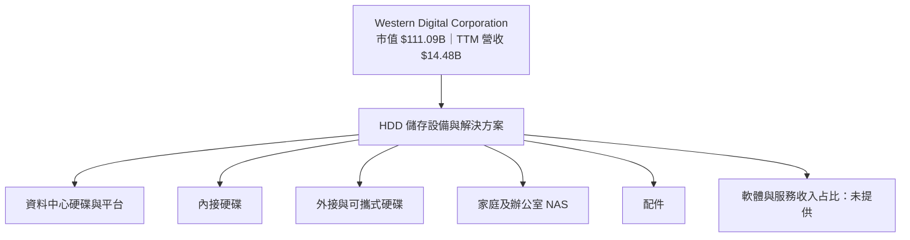
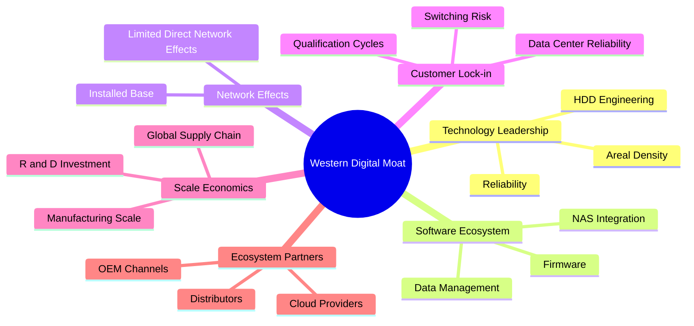
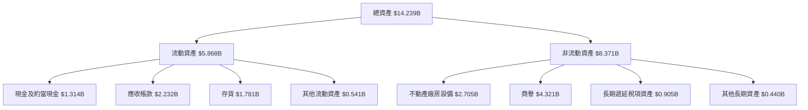
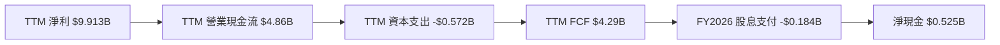
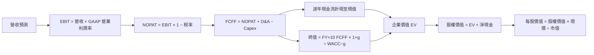
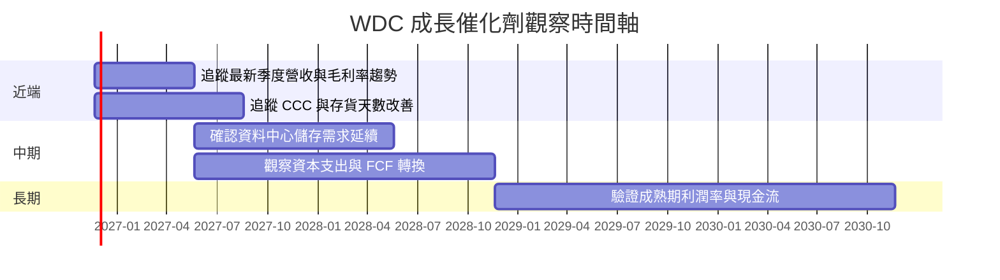
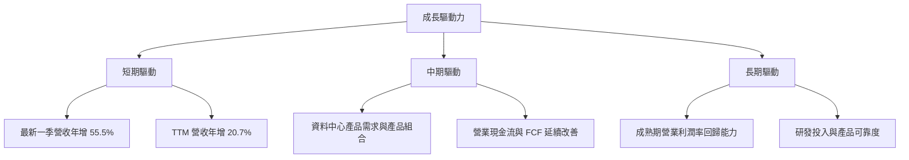
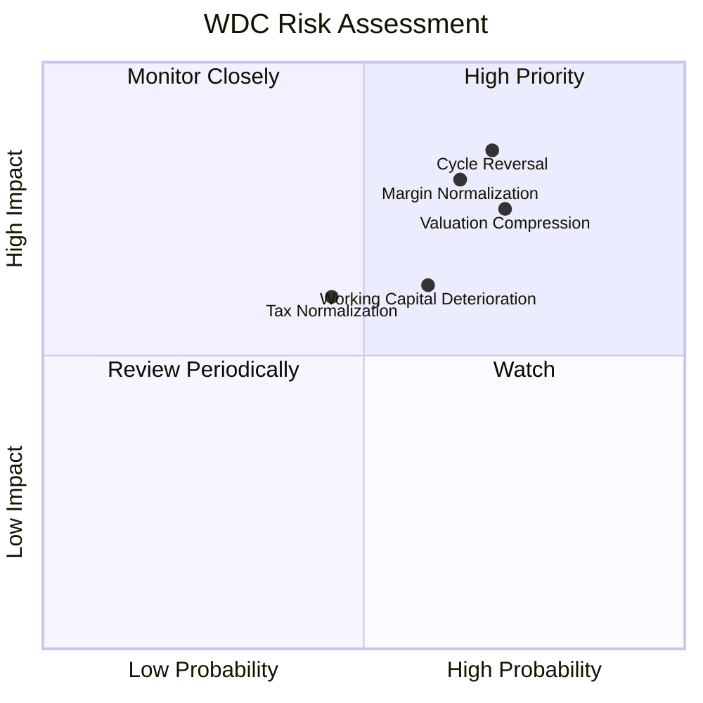
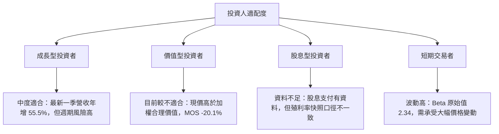

# WDC 基本面深度分析報告
> **報告日期**：2026-11-20 ｜ **語言**：繁體中文 ｜ **數據來源**：SEC 申報資料 (XBRL)、Yahoo Finance、Finviz、StockAnalysis、Roic.ai ｜ **分析師**：CFA 級機構研究

## 目錄

| # | 章節 | 核心結論 |
|---|------|----------|
| 1 | 執行摘要 | 減碼；加權合理價值 $247.13，MOS -20.1% |
| 2 | 公司概覽與商業模式 | HDD 儲存業務具規模與客戶關係優勢，但產業週期性削弱護城河持久度 |
| 3 | 損益表深度分析 | TTM 營收 $14.48B、年增 20.7%；獲利率處於高檔，須留意循環回落 |
| 4 | 資產負債表分析 | 最新口徑淨現金 $525M；營運資金週期較一年前拉長 |
| 5 | 現金流量深度分析 | TTM FCF $4.29B、FCF Yield 3.86%；現金流改善，但淨利轉換率偏低 |
| 6 | 獲利能力與資本效率 | ROIC 61.1% 高於採用 WACC 14.0%，目前創造價值 |
| 7 | 相對估值分析 | 相對同業部分倍數不昂貴，但高於自身歷史 P/S 中位數 |
| 8 | DCF 內在價值評估 | 基準 DCF $182.17；加權合理價值 $247.13，現價高於兩者 |
| 9 | 成長催化劑 | 儲存需求及高營收成長是近端催化劑；TAM 數據未提供 |
| 10 | 風險矩陣 | 週期反轉、估值回落與營運資金惡化為主要風險 |
| 11 | 投資建議 | 依 MOS 評級減碼；等待價格回落或現金流與利潤率進一步驗證 |

## 1. 執行摘要

### 1.0 一頁式投資儀表板

| 項目 | 內容 |
|------|------|
| **投資論點（3 句）** | ① TTM 營收年增 20.7%、最新一季年增 55.5%，顯示需求仍在擴張。② TTM ROIC 61.1% 高於 14.0% WACC，且 TTM FCF 達 $4.29B，現階段創造股東價值。③ 但 $296.78 現價高於加權合理價值 $247.13，MOS 為 -20.1%，估值不支持追價。 |
| **綜合評分** | **6.3/10**（引用 1.1） |
| **財務健康** | 🟡 最新口徑淨現金 $525M；但 CCC 從 34 天增至 52 天 |
| **ROIC vs WACC** | **61.1% vs 14.0%**；目前創造價值 |
| **FCF 趨勢** | 年度 FCF 由 FY2024 -$0.78B 回升至 FY2026 $3.51B；TTM FCF Yield **3.86%** |
| **估值** | Forward P/E 7.35x（市場數據快照）｜EV/EBITDA 17.54x（市場數據快照）｜FCF Yield 3.86% |
| **DCF 內在價值（基準）** | **$182.17**｜現價相對 DCF 溢價 **62.9%**（現價 ÷ DCF 價值 − 1） |
| **安全邊際（MOS）** | **-20.1%**＝($247.13 − $296.78) ÷ $247.13；🔴 <10% 無 |
| **預期報酬（基準情境 12M）** | **-38.6%**（基準 DCF 情境 $182.17 相對現價） |
| **關鍵風險（前二）** | HDD 產業供需反轉；高利潤率與估值隨循環下行 |
| **評級 + 信心度** | 🟠 **減碼**｜信心：中 |

### 1.1 綜合評分卡

| 維度 | 評分（1–10） | 主要依據（引用數字與其來源章節） |
|------|--------------|----------------------------------|
| 成長性 | 7.5 | TTM 營收年增 20.7%、最新一季年增 55.5%（第 3 章）；但後續增速能否維持有週期風險 |
| 獲利能力 | 8.0 | TTM 營業利益率 39.4%、ROIC 61.1%，F-Score 6/8（第 3、6 章） |
| 財務健康 | 6.5 | 淨現金 $525M；CCC 由 34 天擴至 52 天（第 4 章） |
| 估值 | 3.5 | MOS -20.1%，P/S 7.9x 高於自身五年中位數 1.2x（第 7、8 章） |
| 護城河 | 7.0 | HDD 規模、產品與客戶導入關係有利，但欠缺市場份額及分部收入資料（第 2 章） |
| 管理層與資本配置 | 5.5 | FY2026 SBC $204M、流通股數測試未通過；缺少完整回購與資本報酬目標資料 |
| **綜合評分** | **6.3** | 六項算術平均：$(7.5+8.0+6.5+3.5+7.0+5.5)÷6=6.33$，四捨五入至一位小數 |

### 1.2 五大投資論點 + 三大核心風險

| 類型 | 項目 | 具體依據 | 信心度 |
|------|------|----------|--------|
| 🟢 **投資論點①** | 儲存需求延續 | TTM 營收 $14.48B、年增 20.7%；最新一季年增 55.5%，營收動能仍高 | 🟢 高 |
| 🟢 **投資論點②** | 營運槓桿改善 | FY2023 營業損失 $402M，FY2026 營業利益 $4.60B；營收由 $6.25B 升至 $12.92B | 🟢 高 |
| 🟢 **投資論點③** | 現金流恢復 | TTM OCF $4.86B、資本支出 $572M，TTM FCF $4.29B | 🟢 高 |
| 🟢 **投資論點④** | 高於資本成本的報酬 | TTM ROIC 61.1%，高於 WACC 14.0% | 🟢 中高 |
| 🟡 **投資論點⑤** | 相對部分硬體同業估值不高 | WDC P/E 11.5x，低於 STX 27.3x、SNDK 48.3x；但同業盈利與產品組合不同 | 🟡 中 |
| 🟡 **風險①** | 週期與定價反轉 | 基準 DCF 假設營業利益率由 39.4% 逐步降至 22.8%；若降幅更快，價值將進一步下修 | 🟡 中 |
| 🔴 **風險②** | 現價高於內在價值 | DCF $182.17、加權價值 $247.13，現價 $296.78；MOS -20.1% | 🔴 高 |
| 🔴 **風險③** | 營運資金效率轉差 | CCC 一年增加 18 天至 52 天，DIO 增 25 天至 95 天，可能占用現金 | 🔴 中高 |

### 1.3 快速統計卡片

| 指標 | 公司實際值（期間） | 同業中位數 | 狀態 |
|------|--------------------|------------|------|
| 營收成長（TTM） | **20.7%** | — | 🟢 |
| 營收成長（最新一季年增） | **55.5%** | 377.9% | 🟡 |
| 毛利率（TTM） | **52.6%** | 80.0% | 🟡 |
| 營業利益率（TTM） | **39.4%** | — | 🟢 |
| ROIC（TTM） | **61.1%** | — | 🟢 |
| Forward P/E | **7.35x** | 8.0x | 🟢 |
| FCF Yield（TTM） | **3.86%** | — | 🟡 |
| Piotroski F-Score | **6 / 8** | — | 🟢 |

同業中位數分別以 STX、SNDK、MU 可用資料計算；未提供完整數據的指標不列同業中位數。

### 1.4 投資結論

╔══════════════════════════════════════════════════════════════════╗  
║                    📊 投資結論摘要                               ║  
╠══════════════════════════════════════════════════════════════════╣  
║  評級：減碼（MOS -20.1%，落在 -25% 至 -10% 區間）                 ║  
║  價格（2026-11-19 收盤）：$296.78                                 ║  
║  DCF 內在價值（基準）：$182.17（現價溢價 62.9%）                  ║  
║  安全邊際 MOS：-20.1%（以加權合理價值 $247.13 為分母）             ║  
║  加權合理價值（8.8）：$247.13                                     ║  
║  DCF 情境價值：                                                   ║  
║    悲觀情境：$100.40（-66.2%）                                    ║  
║    基準情境：$182.17（-38.6%）                                    ║  
║    樂觀情境：$313.26（+5.6%）                                     ║  
║  綜合評分：6.3/10（引用 1.1）                                     ║  
║  適合投資人：可承受週期波動、願意等待估值回落的長線投資人          ║  
╚══════════════════════════════════════════════════════════════════╝

## 2. 公司概覽與商業模式

### 2.1 業務結構與收入來源

公司資料描述 WDC 從事 HDD 儲存設備與解決方案的開發、製造及銷售，涵蓋資料中心硬碟、內接與外接硬碟、可攜式產品、NAS 與配件。財務資料沒有提供各產品線收入或占比，因此不以臆測比例繪製收入拆分圖。

### 2.2 市場份額

市場份額數據未提供，故不繪製市占圖或填入比例。WDC TTM 營收 $14.48B，最新一季營收年增 55.5%，與 STX 最新一季年增 61.0% 同屬高成長區間；但由於產品組合、價格與週期階段不同，營收增速並不能直接視為市占變化。

### 2.3 競爭護城河分析

### 2.4 護城河強度

| 護城河項目 | 強度（強／中／弱） | 證據（引用數字或事實） | 會削弱它的情況 |
|------------|--------------------|------------------------|----------------|
| 技術與產品可靠性 | 中 | HDD 資料中心、內接、外接及 NAS 產品跨多區域銷售；未提供各代技術市占或客戶留存數據 | 同業產品效能、容量或每 TB 成本改善更快 |
| 客戶導入與切換成本 | 中 | 資料中心設備通常需驗證可靠性與相容性；公司資料列出資料中心平台產品 | 大型客戶集中採購、雙供應商策略或固態儲存替代 |
| 規模效應 | 中 | TTM 營收 $14.48B，年度研發支出 FY2026 為 $1.16B | 產能利用率下降、價格競爭及資本密集成本上升 |
| 軟體生態系統 | 弱至中 | 提供 NAS 等產品，但軟體收入及使用者指標未提供 | 軟體功能難以差異化，產品以硬體規格競爭 |
| 網路效應 | 弱 | 未見直接網路效應的財務證據 | 客戶可跨品牌部署，資料本身並未形成 WDC 專屬網路 |
| 生態夥伴 | 中 | 經由銷售人員、經銷商及分銷商銷售；具跨區域銷售描述 | 通路去庫存、採購集中或夥伴轉向競品 |

1.1「護城河」評分為 **7.0/10**，依據是公司具全球產品與製造規模、資料中心導入關係及 $14.48B TTM 營收，但市場份額、客戶集中度與產品線獲利資料不足，且 HDD 業務具有週期性。

## 3. 損益表深度分析

### 3.1 年度收入成長趨勢（近 4 年）

年度收入與成長率據公司歷史財務資料；FY2023–FY2026 累計 CAGR 約 27.4%。

╔══════════════════════════════════════════════════════════════════╗  
║              Western Digital 年度收入趨勢（FY2023–FY2026）        ║  
╠══════════════════════════════════════════════════════════════════╣  
║  FY2023  $6.25B   ██████████░░░░░░░░░░░░░░  YoY：基期            ║  
║  FY2024  $6.32B   ██████████░░░░░░░░░░░░░░  YoY：+1.0% 🟡       ║  
║  FY2025  $9.52B   ████████████████░░░░░░░░  YoY：+50.7% 🟢      ║  
║  FY2026  $12.92B  ████████████████████████  YoY：+35.7% 🟢       ║  
║                                                                  ║  
║  FY2023–FY2026 營收 CAGR：約 +27.4%                              ║  
╚══════════════════════════════════════════════════════════════════╝

FY2024 營收僅增約 1.0%，之後 FY2025、FY2026 分別增 50.7%、35.7%。這種加速顯示需求與價格／產品組合改善帶動營收回升，但高基期下後續成長率自然更難維持，需以季度訂單、毛利率及庫存確認需求品質。

### 3.2 季度收入趨勢分析

| 季度 | 營收 | QoQ 成長 | YoY 成長 | 備註 |
|------|------|----------|----------|------|
| 2025-12-31 | $3.02B | — | 25.24% | YoY 採 StockAnalysis 季度資料 |
| 2026-03-31 | $3.34B | +10.6% | 45.47% | 以相鄰列示季度計算 QoQ |
| 2026-06-30 | $3.75B | +12.3% | 43.84% | 營收增長延續 |
| 2026-09-30 | $4.38B | +16.8% | **55.5%** | 最新一季年增率引用程式計算值；為單季 YoY，非 TTM |

最近四個列示季度營收逐季上升，且 QoQ 成長從 10.6% 提升至 16.8%，說明收入動能加速。不過，單季營收高速成長可能伴隨需求前置或價格循環，不能單憑一季推定長期趨勢。

### 3.3 利潤率演變分析

| 利潤率指標 | FY2023 | FY2024 | FY2025 | FY2026 | 趨勢 | 評估 |
|------------|--------|--------|--------|--------|------|------|
| **毛利率** | 22.3% | 28.1% | 38.8% | 48.8% | ↗️ 持續上升 | 🟢 |
| **營業利益率** | -6.4% | 1.8% | 22.4% | 35.6% | ↗️ 由虧轉盈並擴張 | 🟢 |
| **淨利率** | -27.3% | -13.5% | 19.4% | 71.9% | 大幅波動 | 🟡 |

年度毛利率為毛利除以營收；年度營業利益率為營業利益除以營收。FY2026 年度淨利率受淨利 $9.30B 顯著高於營業利益 $4.60B 影響，需留意非營業項目及稅項細節未提供，不能將該年度淨利率直接視為可持續營業獲利能力。程式計算 TTM 營業利益率為 39.4%，最新一季為 46.7%；兩者期間不同，不可混用。

**利潤率演變深度解析：**毛利率由 FY2023 的 22.3% 升至 FY2026 的 48.8%，反映需求、定價、產品組合與產能利用率合計改善，但資料未提供分部 ASP 或成本拆分，無法精確分解各因素貢獻。營業利益率改善幅度大於收入增長的單純效果，顯示固定成本吸收及營運槓桿可能是重要因素；若供需轉弱，這種營運槓桿亦會反向放大獲利下滑。

### 3.4 費用結構分析

FY2026 已提供收入、毛利及研發費用。以 FY2026 收入 $12.919B 為基礎，銷貨成本約為收入減毛利，即 $12.919B − $6.311B = $6.608B。SG&A 等其他營業費用明細未提供，故不製作完整費用圓餅圖，避免以不完整項目冒充全體費用結構。

| FY2026 項目 | 金額 | 佔營收 |
|------|------:|------:|
| 營收 | $12.919B | 100.0% |
| 毛利 | $6.311B | 48.8% |
| 銷貨成本（營收−毛利） | $6.608B | 51.2% |
| 研發費用 | $1.160B | 9.0% |
| 營業利益 | $4.600B | 35.6% |

╔══════════════════════════════════════════════════════════════════╗  
║ FY2026 收入與毛利概況                                            ║  
╠══════════════════════════════════════════════════════════════════╣  
║ 營收 $12.919B  ████████████████████ 100.0%                       ║  
║ 毛利  $6.311B  ██████████░░░░░░░░░░  48.8%                       ║  
║ 銷貨成本 $6.608B ██████████░░░░░░░░░░ 51.2%                       ║  
║ 研發費用 $1.160B（為營收 9.0%；與毛利／成本非互斥拆分）           ║  
╚══════════════════════════════════════════════════════════════════╝

### 3.5 季度 EPS 趨勢與盈餘品質（Quality of Earnings）

| 季度 | EPS 實際 | EPS 預估／驚喜 | 解讀 |
|------|---------:|----------------|------|
| 2025-12-31 | $4.67 | N/A | 預估值為缺漏資料，不能判定超預期或不及預期 |
| 2026-03-31 | $8.20 | N/A | 預估值為缺漏資料，不能判定超預期或不及預期 |
| 2026-06-30 | $8.21 | N/A | 預估值為缺漏資料，不能判定超預期或不及預期 |
| 2026-09-30 | $4.63 | N/A | EPS 最新一季年增 50.9%；實際值可用，但估值預測缺漏 |

| 盈餘品質項目 | 數值／佔比 | 評估 |
|--------------|-----------|------|
| 股權薪酬 SBC / 營收 | 約 $230M ÷ $14.48B = **1.6%**（四個列示季度 SBC 加總） | 🟡 金額不算營收主體，但仍會稀釋股東；稀釋股數測試未通過 |
| SBC / 營業現金流 | 約 $230M ÷ $4.86B = **4.7%** | 🟡 SBC 是非現金加回項，衡量經濟成本時不可忽略 |
| FCF / 淨利（現金轉換率） | $4.29B ÷ $9.913B = **43.3%** | 🔴 現金流低於會計淨利；淨利有較高非現金或非營業成分的可能 |
| 一次性／非經常性損益 | FY2026 淨利 $9.30B、營業利益 $4.60B；項目拆分 N/A | 🟡 淨利高於營業利益，須查閱 10-K 稅務及非營業項目附註 |
| 有效稅率異常 | **4.9%**（最新年度有效稅率） | 🟡 稅率偏低會抬高稅後獲利；DCF 亦沿用該低稅率，存在上行偏差風險 |
| 資本化支出 vs 費用化 | TTM Capex $572M；資本化利息／其他資本化成本明細 N/A | 🟡 無法確認是否存在重大成本遞延；支出本身已納入 FCF 計算 |

**盈餘品質結論：**TTM OCF $4.86B 和 FCF $4.29B 證明公司具實質現金創造能力，但以列示 TTM 淨利計算的現金轉換率約 43.3%，低於理想狀態。FY2026 淨利明顯高於營業利益且有效稅率僅 4.9%，因此估值不應只依賴 EPS 或 P/E；以營業現金流、FCF 與正常化稅率追蹤更審慎。最近四季 EPS 預估值缺漏，不能可靠標記為「超預期」或「不及預期」。

## 4. 資產負債表分析

### 4.1 資產結構分解

使用最新 TTM 資產負債表列示的總資產 $14.239B；其中流動資產 $5.868B，非流動資產按總額減流動資產計算為 $8.371B。

### 4.2 流動性與營運資金分析

| 指標 | 最新 TTM | 一年前 TTM | 變化 | 解讀 |
|------|----------|------------|------|------|
| DSO 應收帳款天數 | 56 天 | 41 天 | +15 天 | 收款週期延長，可能反映季度末出貨或客戶付款條件變化，需觀察應收帳齡 |
| DIO 存貨天數 | 95 天 | 70 天 | +25 天 | 存貨天數上升，可能是備貨增加或周轉放慢；若需求放緩，跌價風險提高 |
| DPO 應付帳款天數 | 99 天 | 77 天 | +22 天 | 付款期延長可部分抵銷存貨及應收占用，但也可能反映延後付款 |
| CCC 現金轉換週期 | 52 天 | 34 天 | +18 天 | 現金被營運資金占用時間增加，對 FCF 成長形成拖累 |

流動比率為 1.434、速動比率 0.867（市場資料快照）。流動資產略高於流動負債，但速動比率低於 1，代表短期流動性部分依賴存貨變現與營運現金流。營運資金天數依程式計算值引用，不另行重算。

### 4.3 債務結構分析

最新程式計算口徑的現金及短期投資為 $1.31B、總債務 $789M、淨現金 $525M。其他來源快照列示的債務數字不同；以下採用同一期程式計算值作為主口徑，不混合相異日期餘額。

╔══════════════════════════════════════════════════════════════════╗  
║                   WDC 債務健康診斷                               ║  
╠══════════════════════════════════════════════════════════════════╣  
║ 總債務：       $0.789B   ███████░░░░░░░░░░░░░░░░░░                ║  
║ 現金及短期投資：$1.310B   ████████████████████████                 ║  
║ 淨現金：       $0.525B   🟢 現金高於債務                         ║  
║                                                                  ║  
║ Debt/EBITDA：N/A（資料期間與 EBITDA 口徑未提供可比一致數值）      ║  
║ 利息保障倍數：N/A（未提供利息費用絕對金額）                       ║  
║ 短期流動性：流動比率 1.434；速動比率 0.867                       ║  
╚══════════════════════════════════════════════════════════════════╝

### 4.4 股東權益趨勢

| 財年 | 股東權益 | 年變動 |
|------|----------:|-------:|
| FY2023 | $11.84B | — |
| FY2024 | $11.05B | -6.7% |
| FY2025 | $5.54B | -49.9% |
| FY2026 | $8.86B | +59.9% |

╔══════════════════════════════════════════════════════════════════╗  
║ 股東權益變化（財年）                                             ║  
╠══════════════════════════════════════════════════════════════════╣  
║ FY2023  $11.84B  ████████████████████                             ║  
║ FY2024  $11.05B  ███████████████████                              ║  
║ FY2025   $5.54B  █████████                                         ║  
║ FY2026   $8.86B  ███████████████                                   ║  
╚══════════════════════════════════════════════════════════════════╝

FY2025 權益大幅下降、FY2026 回升。由於回購、其他綜合損益、公司結構與其他權益變動細項未完整提供，不將變化歸因於單一資本配置項目。

## 5. 現金流量深度分析

### 5.1 現金流量瀑布圖

FY2026 年度淨利與現金流並非完全同口徑期間，故圖中以 TTM 可用數字呈現 OCF、Capex 與 FCF；淨利節點採 TTM 淨利資料，股息採 FY2026 年度資料，僅作流程參照。

### 5.2 FCF 轉換率趨勢

| 財年 | OCF | Capex | FCF | 淨利 | FCF／淨利 |
|------|-----:|------:|----:|-----:|----------:|
| FY2023 | -$0.408B | $0.821B | -$1.23B | -$1.68B | 73.2%（兩者皆負，比例不代表品質良好） |
| FY2024 | -$0.294B | $0.487B | -$0.781B | -$0.798B | 97.9%（兩者皆負） |
| FY2025 | $1.69B | $0.412B | $1.28B | $1.86B | 68.8% |
| FY2026 | $3.93B | $0.418B | $3.51B | $9.30B | 37.7% |
| 最新 TTM | $4.86B | $0.572B | **$4.29B** | $9.913B | **43.3%** |

年度 FCF 與 OCF 由負轉正，說明營運復甦已轉化為現金。但 FY2026 淨利遠高於 FCF，反映會計盈餘與現金創造不同步；需繼續追蹤稅項、非現金損益與營運資金變化。

### 5.3 自由現金流趨勢

╔══════════════════════════════════════════════════════════════════╗  
║ 自由現金流：歷史實際與最新 TTM                                   ║  
╠══════════════════════════════════════════════════════════════════╣  
║ FY2023   -$1.23B  ◀ 負值                                          ║  
║ FY2024   -$0.78B  ◀ 負值                                          ║  
║ FY2025    $1.28B  ███████░░░░░░░░░░░░░░░░                         ║  
║ FY2026    $3.51B  ██████████████████░░░░░░                         ║  
║ TTM       $4.29B  ████████████████████████  FCF Yield 3.86%        ║  
╠══════════════════════════════════════════════════════════════════╣  
║ TTM FCF = OCF $4.86B − Capex $0.572B = $4.29B（採官方精確口徑）   ║  
╚══════════════════════════════════════════════════════════════════╝

FY2023 至 FY2026 的 FCF 轉正主要與營運獲利及現金流回升相符；但 TTM FCF Yield 3.86% 表示價格已反映不少復甦預期，若 FCF 正常化下降，股價承受的估值壓力會大於單純收入減速。

### 5.4 資本配置評估

缺少完整、同期間的回購、研發、股息及其他資本配置拆分，故不畫資本配置圓餅圖。已知 FY2026 Capex $418M、股息支付 $184M、SBC $204M；TTM Capex 為 $572M。資本配置評估重點是持續投資產能與研發的回報、股數稀釋是否收斂，以及恢復期現金是否用於降債或回饋股東。

| 項目 | 已知數據 | 評估 |
|------|----------|------|
| FY2026 資本支出 | $418M | 相對年度營收約 3.2%；需與產能與維護需求一併判斷 |
| FY2026 股息支付 | $184M | 有支付股息，但股息殖利率快照與其他欄位可能口徑不一致，不據此推定可持續殖利率 |
| FY2026 SBC | $204M | 佔 FY2026 營收約 1.6%；仍需監控股數稀釋 |
| 回購 | N/A | 未提供可核實的同期間金額 |

## 6. 獲利能力與資本效率

### 6.1 ROE / ROA / ROIC 趨勢

| 指標 | 可用期間數據 | 評估 |
|------|--------------|------|
| ROE | TTM **107.2%**（QUALITY FIGURES；另一市場快照為 129.6%，口徑不同） | 高，但淨利率與較低權益基數都可能放大比率 |
| ROA | TTM 25.9%（市場資料快照） | 資產報酬高；歷史同口徑序列未提供 |
| ROIC | TTM **61.1%** | 遠高於 WACC 14.0%，目前資本回報顯著高於資本成本 |
| 行業均值比較 | N/A | 未提供可核實且期間一致的行業均值，故不填 |

### 6.2 ROIC vs WACC 分析（核心價值創造判斷）

╔══════════════════════════════════════════════════════════════════╗  
║                ROIC vs WACC 深度分析                             ║  
╠══════════════════════════════════════════════════════════════════╣  
║ WACC 輸入（程式計算，採用值 14.00%）：                            ║  
║ ├── 無風險利率（10Y 美債）：5.05%                                 ║  
║ ├── ERP：5.00%                                                    ║  
║ ├── 原始 Beta：2.34；調整後 Beta：1.90                            ║  
║ ├── 已提供股權成本 Ke：14.53%                                     ║  
║ ├── 稅前債務成本：20.91%；有效稅率：4.9%                          ║  
║ ├── 權重 E/D：99.3% / 0.7%                                        ║  
║ ├── 加權計算值：14.57%，受 7%–14% 區間上限限制                    ║  
║ └── ✅ 採用 WACC：14.00%                                           ║  
║                                                                  ║  
║ TTM ROIC：61.1%                                                   ║  
║ EVA spread = ROIC − WACC = 61.1% − 14.0% = +47.1 個百分點         ║  
║ ROIC  61.1%  ▓▓▓▓▓▓▓▓▓▓▓▓▓▓▓▓▓▓▓▓▓▓▓▓▓▓▓▓▓▓  🟢                 ║  
║ WACC  14.0%  ▓▓▓▓▓▓▓░░░░░░░░░░░░░░░░░░░░░░░  ─                  ║  
║ 結論：ROIC 約為 WACC 的 4.4 倍，當前資本回報高於資本成本          ║  
╚══════════════════════════════════════════════════════════════════╝

本節 WACC 直接採用程式計算值 14.00%，與 DCF 一致。輸入資料列示「計算值 14.57%，受 7%–14% 區間限制」，故採用上限 14.00%。以 ROIC 61.1% 減去採用 WACC 14.0%，當前 spread 為 +47.1 個百分點，代表目前有價值創造；惟週期高峰獲利若不可持續，歷史高 ROIC 會快速均值回歸。

### 6.3 杜邦三因素分解

| 因素 | 數值（TTM） | 解讀 |
|------|-------------|------|
| 淨利率 | 69.2% | 對 ROE 貢獻最大；高比例與低有效稅率及非營業項目差異相關的可能性需核實 |
| 資產週轉率 | 1.02 | 每單位資產產生約 1.02 倍營收 |
| 權益乘數 | 1.52 | 財務槓桿並非 ROE 的主要放大來源 |
| **ROE** | **107.2%** | 69.2% × 1.02 × 1.52 約等於 107.2%（依程式列示） |

ROE 的主要來源是高淨利率，而非高槓桿；不過淨利率需要以現金流和正常化稅率交叉驗證。

### 6.4 財務體質：Piotroski F-Score

Piotroski F-Score 為 **6/8**。因一項測試缺乏輸入資料而不納入分母，不能改寫成 6/9。

| 測試 | 結果 | 解讀 |
|------|------|------|
| ROA > 0 | ✅ 通過 | 獲利為正 |
| 營業現金流 > 0 | ✅ 通過 | 經營活動提供正現金流 |
| ROA 高於一年前 | ✅ 通過 | 盈利能力改善 |
| 營業現金流 > 淨利 | ❌ 未通過 | 應計品質測試未過；現金流低於會計淨利 |
| 長期負債 ÷ 總資產低於一年前 | — 無法判定 | 缺少輸入資料 |
| 流動比率高於一年前 | ✅ 通過 | 流動性相對改善 |
| 稀釋股數未增加 | ❌ 未通過 | 股數增加，SBC 等因素對股東持股有稀釋 |
| 毛利率高於一年前 | ✅ 通過 | 毛利率改善 |
| 資產週轉率高於一年前 | ✅ 通過 | 資產運用效率改善 |

## 7. 相對估值分析

### 7.1 同業估值比較表格

本公司同業倍數採 Peer multiples 區塊；公司估值快照與區塊的 WDC 自身歷史倍數存在輕微口徑差異，為避免混淆，以下公司當前估值使用市場快照，同業採指定 Peer multiples。

| 估值指標 | **WDC** | **STX** | **SNDK** | **MU** | 本公司評估 |
|----------|--------:|-------:|--------:|------:|-----------|
| **Trailing P/E** | 10.44x | 27.3x | 48.3x | 9.3x | 🟡 高於 MU、低於 STX/SNDK |
| **Forward P/E** | 7.35x | 8.0x | 20.9x | 3.3x | 🟡 介於同業區間；低倍數依賴 EPS 預測實現 |
| **P/S Ratio** | 7.67x | 8.7x | 3.7x | 5.9x | 🔴 高於 SNDK、MU，低於 STX |
| **EV/EBITDA** | 17.54x | 20.6x | 0.4x | 6.8x | 🟡 高於 MU；SNDK 值可能受其 EBITDA 基數／口徑影響 |
| **最新一季營收 YoY** | 55.5% | 61.0% | 377.9% | 379.3% | 🟡 WDC 成長良好，但低於記憶體同業急升數字 |
| **毛利率（TTM）** | 52.6% | 50.4% | 80.0% | 80.7% | 🟢 高於 STX，低於 SNDK、MU |

WDC 的低 Forward P/E 可能反映景氣復甦後盈餘基數提高，不能直接解讀成低估；市場若預期 EPS 均值回歸，前瞻倍數會因預估下修而上升。

### 7.2 歷史估值區間分析

以下採程式計算的五年歷史估值：P/E 現值 11.5x、中位數 13.5x；P/S 現值 7.9x、中位數 1.2x；EV/EBITDA 現值 19.9x、中位數 14.9x。

╔══════════════════════════════════════════════════════════════════╗  
║ WDC 五年估值區間與現值                                            ║  
╠══════════════════════════════════════════════════════════════════╣  
║ P/E：       6.3x ───── [11.5x 現值] ── 13.5x 中位 ───── 62.5x    ║  
║ P/S：       0.4x ───── 1.2x 中位 ─────── [7.9x 現值] ── 16.0x   ║  
║ EV/EBITDA： 4.5x ───── 14.9x 中位 ───── [19.9x 現值] ── 96.5x   ║  
╚══════════════════════════════════════════════════════════════════╝

P/E 現值位於五年中位數下方，P/S 與 EV/EBITDA 則高於中位數；三種倍數訊號不一致，反映盈餘快速回升使 P/E 看起來偏低，而市場仍給予較高營收與 EBITDA 估值。歷史分位數分別為 P/E 38%、P/S 85%、EV/EBITDA 69%。

### 7.3 情境價值（Bear / Base / Bull）

| 情境 | 第 1 年營收成長 | 期末營業利潤率 | WACC | 每股價值 | 相對現價 | 機率 | 會發生的條件 |
|------|----------------|----------------|------|----------|----------|------|--------------|
| 🔴 悲觀 | 10.3% | 19.4% | 15.00% | $100.40 | -66.2% | 25% | 需求增速降至低雙位數，價格及營業槓桿回落，資本成本上升 |
| 🟡 基準 | 20.7% | 22.8% | 14.00% | $182.17 | -38.6% | 50% | 近 TTM 成長作起點，十年後利潤率回歸近五年中位數 |
| 🟢 樂觀 | 31.0% | 25.1% | 13.00% | $313.26 | +5.6% | 25% | 需求與定價超出基準、成熟期利潤率較高且折現率較低 |

這些價值及假設直接採用程式計算的 DCF 情境；條件描述是對應假設的業務解讀，不另行改動情境價值。

### 7.4 相對估值隱含價格區間

╔══════════════════════════════════════════════════════════════════╗  
║ 相對估值隱含每股價值（2026-11-19 現價 $296.78）                   ║  
╠══════════════════════════════════════════════════════════════════╣  
║ $182.17 DCF ─ $225.14 EV/EBITDA ─ $226.92 P/S ─ $296.78 現價     ║  
╚══════════════════════════════════════════════════════════════════╝

| 方法 | 每股價值 | 相對現價 | 依據 |
|------|---------:|---------:|------|
| DCF（基準） | $182.17 | -38.6% | 10 年 FCFF、WACC 14.00%、永續成長 3.0% |
| 同業 EV/EBITDA | $225.14 | -24.1% | STX、MU 同業中位數 13.7x × TTM EBITDA，再加淨現金 |
| 同業 P/S | $226.92 | -23.5% | STX、SNDK、MU 同業中位數 5.9x × TTM 營收 |

## 8. DCF 內在價值評估（Discounted Cash Flow）

### 8.0 估值推理鏈（Thinking Logic）

**Step 1 — 價值由哪些變數決定？**  
本模型將價值拆為現有 HDD 業務的營收與利潤率現金流，以及成熟期終值；財務資料沒有提供可單獨量化的其他業務收入占比，因此不另列第二成長曲線或選擇權價值。主導估值的變數是營業利潤率與 WACC：基準利潤率由 39.4% 下滑至 22.8%，且 WACC 14.0% 下每股基準價值僅 $182.17。

**Step 2 — 模型選擇**

| 決策點 | 本報告採用 | 理由（含數字） | 曾考慮但否決 | 否決理由 |
|--------|-----------|----------------|--------------|----------|
| 現金流定義 | FCFF | 對應 WACC 折現並先求企業價值；模型採用 FCFF = NOPAT + D&A − Capex | FCFE | 模型已提供 FCFF 路徑，另建 FCFE 會改變模型 |
| 預測期 N | 10 年 | DCF 模型固定 10 年，營收成長由 20.7% 線性降至 3.0% | 5 年 | 會改變指定 DCF 模型與終值起算年 |
| 終值方法 | Gordon Growth | 區塊提供 g=3.0%、WACC=14.0% 的終值 | 退出倍數 | 模型未提供可用退出倍數終值，不自行補建 |
| EBIT 基礎 | GAAP EBIT | 模型明確採 GAAP EBIT，SBC 已為費用 | 非 GAAP EBIT | 若加回 SBC 需另扣或稀釋，與原模型不一致 |

**Step 3 — 假設推導鏈**

- **營收成長**：錨點＝TTM 營收年增 20.7% → 調整＝模型將年增率線性淡化至第 10 年 3.0%，反映週期需求成熟 → **第 1 年採 20.7%** → 曾考慮直接延續最新一季 55.5%，但其為單季 YoY、非 TTM，且不適合外推十年，故否決。
- **期末營業利潤率**：錨點＝TTM 39.4% → 調整＝以五年歷史中位數作回歸目標，反映高利潤率循環回落 → **FY+10 採 22.8%** → 曾考慮維持 39.4%，但忽略硬碟週期與歷史中位數回歸，故否決。
- **永續成長率 g**：錨點＝長期成熟企業名目成長通常需低於折現率；資料未提供 GDP 假設 → 假設採長期名目成長代理值 **3.0%** → WACC 14.0% 高於 g，數學上成立 → 曾考慮高於 3.0%，但未有產業長期數據支持，故不採。
- **預測期 N**：錨點＝程式 DCF 固定 10 年 → 調整＝不改動模型，讓成長淡化與利潤率回歸完整呈現 → **採 10 年** → 曾考慮縮短至 5 年，但會改變模型終值時點，故否決。
- **Capex／營收**：錨點＝TTM 3.9% → 模型由第 1 年 3.9% 緩降至第 10 年 3.0%，最低值約為 1.1×D&A → **依模型逐年淡化** → 曾考慮固定於 3.9%，但模型假設成熟期資本支出強度下降，且不另造情境。
- **EBIT 基礎、SBC 與股數**：錨點＝GAAP EBIT 已含 SBC 費用；模型標示股數不再稀釋 → **採用組合 (A)：GAAP EBIT + 固定股數 + 不另扣 SBC** → 否決非 GAAP 加回方案，因模型未提供完整 SBC 預測路徑。
- **有效稅率**：錨點＝最新年度有效稅率 4.9%；採用 4.9%。此值偏低，若正常化稅率上升，價值下降。
- **D&A／營收**：錨點＝TTM 2.7%；採用 2.7% 固定，模型沒有理由支持自行調整。
- **ΔWC／營收增額**：模型未建模營運資金，故採 0（模型處理方式，不代表實際營運資金需求為零）。CCC 已由 34 天升至 52 天，若營運資金占用持續增加，模型可能高估 FCF。
- **WACC**：錨點＝程式計算加權值 14.57%；因指定區間上限為 14.00%，採用 14.00% → 不採用較低折現率，避免在高 Beta 與高債務成本背景下過度樂觀。

**Step 4 — 最脆弱環節**  
最脆弱假設是將 4.9% 有效稅率延伸至十年；若正常化稅率提高，NOPAT 與終值都會下降，且模型估值偏高。營運資金未建模亦可能低估再投資需求。

**Step 5 — 計算路徑圖**

### 8.1 模型假設總表（Model Inputs）

| 假設項目 | 採用值 | 依據／來源 | 敏感度 |
|----------|--------|-------------|--------|
| 預測期長度 N | 10 年 | DCF MODEL 設定；營收成長逐年淡化至第 10 年 | 🟡 中 |
| 營收成長 | FY+1 20.7%，FY+10 3.0%，線性淡化 | TTM vs prior TTM 營收成長 20.7%；終值成熟假設 3.0% | 🔴 高 |
| 營業利潤率 | 39.4% 降至 22.8% | TTM 起點；末年採近五年中位數含 TTM | 🔴 高 |
| 有效稅率 | 4.9% | 最新年度有效稅率 | 🟢 低 |
| Capex／營收 | 3.9% 降至 3.0% | TTM 比率；逐步降至約 1.1×D&A | 🟡 中 |
| D&A／營收 | 2.7% | TTM 比率，模型固定 | 🟢 低 |
| 營運資金變動 | 未建模 | DCF MODEL 明確未包含營運資金 | 🟢 低 |
| EBIT 基礎 | GAAP | DCF MODEL 使用 GAAP EBIT | 🟡 中 |
| SBC 處理 | EBIT 已含 SBC，不再扣 | DCF MODEL 組合 (A) | 🟡 中 |
| 年稀釋率 | 0%（模型固定股數） | 與 GAAP EBIT 已含 SBC 的組合 (A) 相容 | 🟡 中 |
| 永續成長率 g | 3.0% | DCF MODEL 假設；低於 WACC 14.0% | 🔴 高 |
| 終值方法 | Gordon Growth | DCF MODEL 提供終值；退出倍數模型未提供 | 🔴 高 |
| WACC | 14.00% | 程式計算值 14.57%，受 7%–14% 上限限制 | 🔴 高 |

本模型使用 **FCFF**，一致採用 `FCFF = NOPAT + D&A − Capex`；營運資金未建模，不在年度表格中加入虛構的 ΔWC 數字。**本模型採用 (A)，故 SBC 影響已計入一次**：GAAP EBIT 含 SBC、不另減 SBC、固定股數。

### 8.2 折現率推導（WACC）

╔══════════════════════════════════════════════════════════════════╗  
║                    WACC 推導（折現率）                           ║  
╠══════════════════════════════════════════════════════════════════╣  
║ 股權成本 Ke：                                                     ║  
║ ├── 無風險利率 Rf：5.05%                                         ║  
║ ├── ERP：5.00%                                                    ║  
║ ├── 原始 Beta：2.34；調整後 Beta：1.90                            ║  
║ ├── Beta 調整：⅔×2.34 + ⅓×1 = 1.893 ≈ 1.90                      ║  
║ ├── 已提供 Ke：14.53%                                             ║  
║ └── 無另加規模／國別溢酬（資料未提供支持）                        ║  
║                                                                  ║  
║ 債務成本 Kd：                                                     ║  
║ ├── 稅前 Kd：20.91%                                               ║  
║ ├── 有效稅率：4.9%                                                ║  
║ └── 稅後 Kd = 20.91%×(1−4.9%) = 19.885% ≈ 19.89%                ║  
║                                                                  ║  
║ 資本結構：股權 99.3%，債務 0.7%                                   ║  
║ 加權計算值 14.57%；限制區間上限後採用 WACC = 14.00%               ║  
╚══════════════════════════════════════════════════════════════════╝

**逐步演算（WACC）：**

1. **Ke（CAPM）**：財務資料提供 Ke = **14.53%**。以顯示精度的輸入直接算，`5.05% + 1.90×5.00% = 14.55%`；與程式提供值差 0.02 個百分點，屬輸入未四捨五入精度差。估值採程式提供 Ke 14.53%，不另替換。
2. **稅前 Kd**：採程式提供的稅前債務成本 **20.91%**；利息費用絕對值與計息負債平均餘額未提供，無法獨立重建其分子、分母。
3. **稅後 Kd**：`20.91%×(1−4.9%)=19.88541%≈19.89%`。
4. **權重**：採程式提供 E/D = **99.3%/0.7%**；E 以市場資本化為基礎，D 以計息債務代理。輸入區塊未提供可完全逐項複算的平均計息負債及權重原始未四捨五入值，故不反推缺漏金額。
5. **WACC**：`99.3%×14.53% + 0.7%×19.88541% = 14.42829% + 0.13920% = 14.56749% ≈ 14.57%`；區間限制為 7%–14%，故 **採用值 14.00%**。

### 8.3 逐年自由現金流預測（基準情境）

金額單位：$B。年度數值直接採用 DCF MODEL；以表內已四捨五入的單元格重算時，少數項目會出現約 $0.01B 的顯示差，因模型用未四捨五入輸入計算。

| 年度 | FY+1 | FY+2 | FY+3 | FY+4 | FY+5 | FY+6 | FY+7 | FY+8 | FY+9 | FY+10 |
|------|------:|------:|------:|------:|------:|------:|------:|------:|------:|-------:|
| 營收 | 17.47 | 20.74 | 24.21 | 27.79 | 31.35 | 34.75 | 37.84 | 40.46 | 42.47 | 43.75 |
| 營收 YoY | 20.7% | 18.7% | 16.7% | 14.8% | 12.8% | 10.9% | 8.9% | 6.9% | 5.0% | 3.0% |
| 營業利潤率 | 39.4% | 37.6% | 35.7% | 33.9% | 32.0% | 30.2% | 28.4% | 26.5% | 24.7% | 22.8% |
| EBIT（GAAP） | 6.89 | 7.79 | 8.65 | 9.42 | 10.05 | 10.50 | 10.74 | 10.73 | 10.49 | 10.00 |
| − 稅 | (0.33) | (0.38) | (0.42) | (0.46) | (0.49) | (0.51) | (0.52) | (0.52) | (0.51) | (0.49) |
| = NOPAT | 6.55 | 7.41 | 8.23 | 8.96 | 9.56 | 9.99 | 10.21 | 10.21 | 9.98 | 9.51 |
| + D&A | 0.47 | 0.56 | 0.65 | 0.75 | 0.85 | 0.94 | 1.02 | 1.09 | 1.15 | 1.18 |
| − Capex | (0.69) | (0.80) | (0.90) | (1.01) | (1.10) | (1.18) | (1.25) | (1.29) | (1.31) | (1.30) |
| **= FCFF** | **6.33** | **7.18** | **7.98** | **8.70** | **9.30** | **9.74** | **9.99** | **10.02** | **9.82** | **9.39** |
| 折現因子 @14.0% | 0.877 | 0.769 | 0.675 | 0.592 | 0.519 | 0.456 | 0.400 | 0.351 | 0.308 | 0.270 |
| **FCFF 現值 PV** | **5.56** | **5.52** | **5.39** | **5.15** | **4.83** | **4.44** | **3.99** | **3.51** | **3.02** | **2.53** |

逐年 PV 依表格顯示值相加為：  
`$5.56+$5.52+$5.39+$5.15+$4.83+$4.44+$3.99+$3.51+$3.02+$2.53=$43.94B`。  
模型使用未四捨五入數值，報告的預測期 PV 合計為 **$43.95B**，兩者差 $0.01B，低於 1%。

**逐步演算（FY+1 代表年度）：**

1. 營收：`$14.48B×(1+20.7%)=$17.47736B`；模型表列 $17.47B（未四捨五入輸入與顯示精度差）。
2. EBIT：`$17.47B×39.4%=$6.88318B≈$6.89B`（模型內部精確值列示 $6.89B）。
3. 稅：`$6.89B×4.9%=$0.33761B≈$0.33B`。
4. NOPAT：`$6.89B−$0.33B=$6.56B`；模型內部未四捨五入值列 $6.55B。
5. D&A：`$17.47B×2.7%=$0.47169B≈$0.47B`。
6. Capex：依模型 Capex／營收比率計算，列示 **$0.69B**；以顯示比率 3.9% 重算會受未四捨五入比率影響。
7. ΔWC：未建模，故不扣除。
8. FCFF：`NOPAT + D&A − Capex`；模型列示 `6.55+0.47−0.69=6.33B`（列示數相加為 $6.33B）。
9. 折現：`1÷(1+14.00%)^1=0.87719≈0.877`；`$6.33B×0.877=$5.55B`，模型未四捨五入現值列 **$5.56B**。

**合理性自檢：**

- 預測 FCF 由 FY+1 $6.33B 增至 FY+10 $9.39B，九年間 CAGR 約為 `(9.39÷6.33)^(1/9)−1=4.5%`；與 FY2023–FY2026 FCF 由負轉正的歷史增長不可直接作 CAGR 比較，因負值轉正令傳統 CAGR 無意義。
- FY+10 FCFF 利潤率：`$9.39B÷$43.75B=21.5%`；目前 TTM FCF 利潤率：`$4.29B÷$14.48B=29.6%`。同業最佳可比 FCF 利潤率數據未提供。
- 預測期各年 FCFF 均為正；若營運資金實際占用上升，因模型未扣 ΔWC，FCFF 及估值可能偏高。

╔══════════════════════════════════════════════════════════════════╗  
║            自由現金流：歷史實際 vs 模型預測                      ║  
╠══════════════════════════════════════════════════════════════════╣  
║ FY2024(實)  -$0.78B  ◀ 負值                                       ║  
║ FY2025(實)   $1.28B  █████░░░░░░░░░░░░░░░                         ║  
║ FY2026(實)   $3.51B  ███████████████░░░░░                         ║  
║ FY+1 (預)    $6.33B  ██████████████████████████                   ║  
║ FY+10 (預)   $9.39B  ████████████████████████████████████████     ║  
╠══════════════════════════════════════════════════════════════════╣  
║ 預測期 FCFF CAGR 約 4.5%；歷史由負轉正，CAGR 不具可比性           ║  
╚══════════════════════════════════════════════════════════════════╝

### 8.4 終值計算（Terminal Value）

適用性檢查：`WACC 14.0% vs g 3.0% → WACC > g？✅`

| 方法 | 計算式 | 終值 TV | TV 現值 | 佔總 EV 比重 |
|------|--------|---------|---------|--------------|
| Gordon Growth | $9.39×(1+3.0%)÷(14.0%−3.0%) | $87.94B | $23.72B | 35.1% |
| 退出倍數法 | N/A（DCF MODEL 未提供可用退出倍數終值） | N/A | N/A | N/A |

**逐步演算：**

1. FY+N FCFF：FY+10 **$9.39B**。
2. 分子：`$9.39B×(1+3.0%)=$9.6717B`，模型列示精確計算結果約 $9.67B。
3. 分母：`14.00%−3.00%=11.00%`；`$9.6717B÷11.00%=$87.9245B`，模型列示 **$87.94B**（未四捨五入輸入差異）。
4. PV(TV)：`$87.94B×0.270=$23.7438B`；模型報告 **$23.72B**，以未四捨五入折現因子計算。
5. 終值占比：`$23.72B÷$67.67B=35.1%`。

終值占 EV 35.1%，低於 75% 高度依賴警戒線，但仍占價值的重要部分。退出倍數未提供，為遵守不自建替代 DCF 的要求，不補造交叉估值倍數。

### 8.5 企業價值 → 每股內在價值（Bridge）

╔══════════════════════════════════════════════════════════════════╗  
║              企業價值 → 每股內在價值 橋接表                      ║  
╠══════════════════════════════════════════════════════════════════╣  
║ 預測期 FCF 現值合計             +$43.95B                          ║  
║ 終值現值 PV(TV)                 +$23.72B                          ║  
║ = 企業價值 EV                    $67.67B                           ║  
║ + 淨現金（程式口徑）             +$0.525B                          ║  
║ = 股權價值（模型列示）           $68.19B                           ║  
║ 每股內在價值（模型列示）         $182.17                           ║  
║ 當前股價（2026-11-19）           $296.78                           ║  
║ 折溢價（現價÷DCF價值−1）         +62.9%（溢價）                    ║  
╚══════════════════════════════════════════════════════════════════╝

逐步演算：

1. `EV = $43.95B+$23.72B=$67.67B`。
2. 股權橋接：`$67.67B+$0.525B=$68.195B`，按模型未四捨五入橋接列示 **$68.19B**；顯示值相差 $0.005B。
3. 每股內在價值：依模型指定公式 `股權價值×價格÷市值`，模型列示 **$182.17**。市場資本化與股數均以未四捨五入口徑進行換算，不能用列示的兩位小數數字重建到更高精度。
4. 折溢價：`$296.78÷$182.17−1=62.9%`。
5. 本節不計算 MOS；MOS 統一使用第 8.8 節加權合理價值為分母。

股數處理採 DCF MODEL 指定方式：使用現價與市值換算的股數口徑，固定股數且不另加稀釋。淨現金採程式計算值 $525M；該數值與現金減債的未四捨五入項目相匹配。

### 8.6 敏感性分析（WACC × 永續成長率）

表內每股價值與格內相對現價報酬直接使用模型敏感度矩陣；基準格為 WACC 14.0%、g 3.0%。

| g（列）／WACC（欄） | 12.00% | 13.00% | **14.00%（基準）** | 15.00% | 16.00% |
|-----------|------:|------:|------------------:|------:|------:|
| **2.0%** | $211.85 (-28.6%) | $192.49 (-35.1%) | $176.33 (-40.6%) | $162.63 (-45.2%) | $150.88 (-49.2%) |
| **2.5%** | $216.61 (-27.0%) | $196.10 (-33.9%) | $179.12 (-39.6%) | $164.83 (-44.5%) | $152.63 (-48.6%) |
| **3.0%（基準）** | $221.90 (-25.2%) | $200.08 (-32.6%) | **$182.17 (-38.6%)** | $167.21 (-43.7%) | $154.51 (-47.9%) |
| **3.5%** | $227.82 (-23.2%) | $204.48 (-31.1%) | $185.51 (-37.5%) | $169.79 (-42.8%) | $156.54 (-47.3%) |
| **4.0%** | $234.47 (-21.0%) | $209.36 (-29.5%) | $189.19 (-36.3%) | $172.61 (-41.8%) | $158.74 (-46.5%) |

所選非基準格：`WACC 13.00% > g 2.50% ✅`。由於程式只提供敏感度矩陣成品，未提供該格逐年折現中間值，無法在不另建模型的前提下逐步重算該格；此處直接引用矩陣，不補造中間值。

**三情境 DCF：**

| 情境 | 第 1 年成長 | 期末營業利潤率 | g | WACC | 每股價值 | 相對現價 | 機率 |
|------|------------:|---------------:|--:|-----:|---------:|---------:|-----:|
| 🔴 悲觀 | 10.3% | 19.4% | 3.0%（模型情境未另列，採 DCF 模型基準 g） | 15.00% | $100.40 | -66.2% | 25% |
| 🟡 基準 | 20.7% | 22.8% | 3.0% | 14.00% | $182.17 | -38.6% | 50% |
| 🟢 樂觀 | 31.0% | 25.1% | 3.0%（模型情境未另列，採 DCF 模型基準 g） | 13.00% | $313.26 | +5.6% | 25% |
| **機率加權** | — | — | — | — | **$194.50** | **-34.5%** | 100% |

DCF MODEL 未提供悲觀與樂觀情境的逐年營收、FCFF、終值與迭代計算細節，依數據優先規則不另行推算或改動情境結果。其提供的機率加權值為 `$100.40×25%+$182.17×50%+$313.26×25%=$194.50`（四捨五入）。

**敏感度結論：**

- g 由 3.0% 升至 4.0%（WACC 14.0%）：`$189.19−$182.17=+$7.02`，相當於 `+$7.02÷$182.17=+3.9%`。
- WACC 由 14.0% 升至 15.0%（g 3.0%）：`$167.21−$182.17=−$14.96`，相當於 `−$14.96÷$182.17=−8.2%`。
- 期末營業利潤率每 +1 個百分點：模型沒有提供單變數利潤率敏感度矩陣，故 **N/A（無法在不另建模型下量化）**。
- 在可量化的敏感度中，WACC 每升 1 個百分點影響大於 g 上升 1 個百分點；營業利潤率仍是重要營運假設，但缺乏單變數矩陣驗證。

### 8.7 反推 DCF（Reverse DCF）

固定基準輸入為 WACC 14.00%、稅率 4.9%、Capex／營收依模型逐年假設、ΔWC 未建模、預測期 10 年、股數固定。程式只提供兩個反推解；其餘變數及逐次試算軌跡未提供，故不自行疊代。

| 求解的變數（一次一個） | 其餘變數設定 | 市場隱含值（令 DCF = 現價） | 公司歷史實際 | 判斷 |
|------------------------|--------------|------------------------------|--------------|------|
| 第 1 年營收成長 | 利潤率與 g 固定基準值 | **35.3%** | TTM 營收成長 20.7%；最新一季單季 YoY 55.5% | 🔴 高於 TTM 基準，需維持高成長 |
| 固定營業利潤率 | 其他輸入固定為基準 | **45.1%** | TTM 39.4% | 🔴 高於目前 TTM 利潤率 |
| 永續成長率 g | 營收成長與利潤率固定基準 | 未計算 | — | N/A（未提供解） |
| 預測期 N | 其他輸入固定為基準 | 未計算 | — | N/A（未提供解） |

求解軌跡表未提供，不能宣稱特定試算點或誤差收斂值。反推結果表示，若維持其他基準假設，現價大致需要第 1 年營收成長升至 35.3%，或固定營業利潤率升至 45.1%；兩者均高於對應的基準假設，市場價格隱含的營運要求偏進取。

### 8.8 估值三角驗證與安全邊際

| 估值方法 | 隱含每股價值 | 上行空間（÷現價） | 權重 | 說明 |
|----------|--------------:|-------------------:|------|------|
| DCF（基準） | $182.17 | -38.6% | 40% | 10 年 FCFF、WACC 14.00%、g 3.0% |
| 同業 EV/EBITDA | $225.14 | -24.1% | 30% | STX、MU 同業中位數 13.7x × TTM EBITDA，加淨現金 |
| 同業 P/S | $226.92 | -23.5% | 20% | STX、SNDK、MU 同業中位數 5.9x × TTM 營收 |
| 分析師共識目標價 | $613.38 | +106.7% | 10% | 24 位分析師平均目標價，僅作參考 |
| **加權合理價值** | **$247.13** | **-16.7%** | **100%** | 週期性公司固定權重 |

逐步演算：  
`$182.17×40%+$225.14×30%+$226.92×20%+$613.38×10%`  
`=$72.868+$67.542+$45.384+$61.338=$247.132≈$247.13`。  
本公司類型為週期性公司，權重由方法規則固定；沒有額外方法被剔除。

╔══════════════════════════════════════════════════════════════════╗  
║                  估值區間與安全邊際                              ║  
╠══════════════════════════════════════════════════════════════════╣  
║ $100.40 悲觀DCF ─ $182.17 基準DCF ─ $247.13 加權值 ─ $296.78 現價 ║  
║                                                                  ║  
║ MOS = ($247.13−$296.78)÷$247.13 = -20.1%                         ║  
║ MOS 評估：🔴 <10% 無                                              ║  
║ 上行空間 = ($247.13−$296.78)÷$296.78 = -16.7%                     ║  
║                                                                  ║  
║ 建議買入區間：$222.42 以下（相對加權價值至少 10% 折價）           ║  
║ 合理持有區間：約 $222.42–$271.84（MOS 約 +10% 至 -10%）           ║  
║ 減碼考慮區間：$271.84 以上（MOS 低於 -10%）                       ║  
╚══════════════════════════════════════════════════════════════════╝

買入區間上限按加權合理價值的 90% 計：`$247.13×90%=$222.42`。持有區間對應現價約為加權價值的 90%–110%，即 `$247.13×90%=$222.42` 至 `$247.13×110%=$271.84`。現價 $296.78 位於減碼區間。

> 🔎 **程式複算（Python，依本節各項自動重算）**
>
> 加權合理價值 = $182.17 × 40% + $225.14 × 30% + $226.92 × 20% + $613.38 × 10% = **$247.13**（權重合計 100%）
>
> 以價格 $296.78 計：MOS = **-20.1%**，上行空間 = **-16.7%**
>
> ✅ 與本節所寫數值一致。

### 8.9 DCF 模型的局限與失效條件

- **終值依賴度：**PV(TV) 佔 EV **35.1%**，仍有逾三分之一價值取決於第 10 年後現金流。
- **最脆弱假設：**① 利潤率從 TTM 39.4% 回歸至 22.8%；② 有效稅率固定在 4.9%，且未建模營運資金。若高成長和利潤率無法維持，悲觀情境價值為 $100.40；若目前高利潤率維持較久，價值可能高於基準 DCF，但模型未提供單變數量化值。
- **適用性：**WDC 目前 FCF 為正，但歷史曾有負 FCF、獲利波動大，單一 DCF 對循環高點盈利可能過度外推。應同步參照同業 EV/EBITDA、P/S 與營運現金流。
- **模型缺口：**營運資金未建模，對 CCC 從 34 天升至 52 天的資金占用反映不足；退出倍數、分部收入及更細緻的稀釋股數資料缺漏。
- **與第 10 章風險連結：**需求反轉會下修營收成長及利潤率；成本與價格競爭會壓縮 EBIT；收款與庫存週期延長會增加營運資金需求；折現率上升會降低現值。

### 8.10 複算檢核表（Audit Trail）

| # | 檢核項目 | 檢查方式 | 結果 |
|---|----------|----------|------|
| 1 | 高／中敏感度輸入有推導鏈 | 對照 8.0 Step 3 與 8.1；對資料缺漏或模型未提供單變數敏感度者明確註明 | ✅ |
| 2 | 每個假設都有來歷 | 8.1 逐項列依據；未提供資料標為缺漏或沿用模型設定 | ✅ |
| 3 | WACC 五步算式及限制說明 | 採用程式 Ke、Kd、權重與 14.00% 上限；原始未四捨五入輸入有 0.02pp 精度差 | ✅ |
| 4 | Kd 分母與債務權重範圍一致 | 程式提供 Kd 與權重，但未提供可獨立重建的平均計息負債及逐項組成 | ⚠️ 原始分母未提供，已明示未反推 |
| 5 | WACC 與第 6.2 節相同 | 兩處均採 14.00% | ✅ |
| 6 | 年度數與 N 相同，無省略 | FY+1 至 FY+10 共 10 年 | ✅ |
| 7 | FY+1 算式可複算 | 顯示值受未四捨五入輸入影響，逐步列出精度差 | ⚠️ 原始內部精度不可見 |
| 8 | 預測期 PV 合計 | 列示 PV 相加 $43.94B；模型未四捨五入合計 $43.95B，差 $0.01B | ✅（差異低於 1%） |
| 9 | WACC > g | 14.0% > 3.0% | ✅ |
| 10 | 終值基期及折現期 | FY+10 FCFF，折現因子 0.270 | ✅ |
| 11 | 橋接到每股價值 | EV、淨現金、模型股權價值及每股價值依模型列示；未四捨五入股數不可完全回建 | ⚠️ 模型股數精度未提供 |
| 12 | SBC 三要素相容 | GAAP EBIT、無 SBC 額外扣除、股數固定 | ✅ |
| 13 | 敏感度矩陣基準格 | 14.0%、3.0% 格為 $182.17，與基準 DCF 一致 | ✅ |
| 14 | 矩陣有效性 | 所列 WACC 均高於 g | ✅ |
| 15 | 情境機率加權 | 25%+50%+25%=100%；加權值 $194.50 | ✅ |
| 16 | 反推 DCF 單次解一變數 | 僅引用已提供的營收成長 35.3% 與固定利潤率 45.1%；未捏造迭代軌跡 | ⚠️ 原始迭代表未提供 |
| 17 | MOS 與折溢價口徑 | MOS 以 $247.13 為分母；折溢價以 DCF $182.17 為基準 | ✅ |
| 18 | 報告完整至第 11 章 | 11 章均列出 | ✅ |
| 19 | 加權價值 | 四方法加權總和 $247.132≈$247.13，未事後調整 | ✅ |
| 20 | 評級與 MOS 門檻一致 | MOS -20.1% 對應減碼，未作質化調整 | ✅ |

限制與修正說明：WACC 子項、模型未四捨五入中間值、反推迭代軌跡及退出倍數資料未提供，因此沒有自行反推或另建模型；相關位置以程式輸出值或明確缺漏標示。

## 9. 成長催化劑

### 9.1 催化劑時間軸

下列為研究追蹤時間範圍，不是公司正式財測或已公告產品時程。

### 9.2 TAM 市場規模分析

N/A（TAM 數據未提供）。WDC TTM 營收 $14.48B、TTM 成長 20.7%，最新一季單季營收年增 55.5%，顯示市場需求動能有改善；但缺少可引用的市場總額與市占資料，無法量化滲透率或可服務市場空間。

### 9.3 成長驅動力結構圖

短期動能由營收增速支持；中長期要觀察高成長能否轉化為可持續 FCF，而不是僅靠週期性定價及短期產能利用率提升。

## 10. 風險矩陣

### 10.1 風險評分矩陣

### 10.2 風險清單詳細分析

下列機率為研究判斷情境，不是公司或程式資料所提供的統計機率；財務衝擊以可量化觸發條件描述，不虛構收入損失金額。

| # | 風險項目 | 發生機率 | 財務衝擊 | 風險評估 | 緩解措施 |
|---|----------|----------|----------|----------|----------|
| 1 | 🔴 **產業週期反轉** | 中高（約 40%–60%） | 高；營收增速與毛利率若下滑，DCF 由基準 $182.17 向悲觀 $100.40 移動 | 🔴 高 | 每季檢查營收 YoY、毛利率、存貨與管理層財測；分批持倉 |
| 2 | 🔴 **利潤率均值回歸快於預期** | 中高（約 40%–60%） | 高；基準已假設營業利益率由 39.4% 降至 22.8%，更快下滑將進一步壓低價值 | 🔴 高 | 監控單季營業利益率及價格／成本趨勢；設定連續兩季下滑觸發 |
| 3 | 🔴 **估值壓縮** | 中高（約 40%–60%） | 高；現價 $296.78 高於加權價值 $247.13，MOS -20.1% | 🔴 高 | 以加權合理價值及 DCF 交叉檢驗，不單看低 Forward P/E |
| 4 | 🟡 **營運資金惡化** | 中（約 30%–50%） | 中高；CCC 已增加 18 天至 52 天，DSO、DIO 同時拉長 | 🟡 中高 | 追蹤應收帳款、存貨週轉與 OCF；CCC 若持續高於 52 天須重新估值 |
| 5 | 🟡 **低稅率不可持續** | 中（約 30%–50%） | 中；DCF 假設稅率 4.9%，稅率正常化將降低 NOPAT | 🟡 中 | 查閱 10-K 稅務附註，建立正常化稅率後重估 |
| 6 | 🟡 **股權稀釋** | 中（約 30%–50%） | 中；F-Score 的稀釋股數測試未通過，FY2026 SBC $204M | 🟡 中 | 監控稀釋股數、SBC／營收及回購抵銷程度 |

## 11. 投資建議

### 11.1 最終評級與評分

依加權合理價值 $247.13、現價 $296.78 計算 MOS 為 -20.1%，依規則 20 評級為 **減碼**；未作質化升降級調整。1.1 綜合評分為 **6.3/10**，六項分數依序為成長性 7.5、獲利能力 8.0、財務健康 6.5、估值 3.5、護城河 7.0、管理層與資本配置 5.5。

### 11.2 合理價值與隱含報酬率

| 價值參考 | 每股價值 | 相對現價 | 機率／權重 |
|----------|---------:|---------:|------------|
| 加權合理價值 | $247.13 | -16.7% | 固定估值方法權重加總 100% |
| 悲觀 DCF 情境 | $100.40 | -66.2% | 25% |
| 基準 DCF 情境 | $182.17 | -38.6% | 50% |
| 樂觀 DCF 情境 | $313.26 | +5.6% | 25% |
| 機率加權 DCF（參考） | $194.50 | -34.5% | 100% |

### 11.3 買入時機與觸發因素

╔══════════════════════════════════════════════════════════════════╗  
║                  ✅ 買入觸發因素 Checklist                       ║  
╠══════════════════════════════════════════════════════════════════╣  
║  目前價格 $296.78，高於加權合理價值 $247.13；策略以等待為主         ║  
║                                                                  ║  
║  重新評估買入條件（多數符合）：                                   ║  
║  ☐ 股價回落至 $222.42 或以下，對加權價值至少約 10% 折價            ║  
║  ☐ TTM FCF 維持正值，且 FCF Yield 不因股價上漲進一步壓縮           ║  
║  ☐ 營業利益率穩定，未連續兩季從最新季度水準明顯回落                ║  
║                                                                  ║  
║  加碼觸發條件（出現以下任一後再確認估值）：                       ║  
║  ☐ CCC 由 52 天回落，且 DIO 不再高於 95 天                         ║  
║  ☐ 最新一季營收年增仍為正，並伴隨 FCF 同步改善                     ║  
║                                                                  ║  
║  減碼／退出觸發條件：                                             ║  
║  ☐ 營業利益率連續兩季下滑，或低於基準成熟期假設 22.8%              ║  
║  ☐ TTM FCF 轉負，或 OCF 持續低於淨利                               ║  
║  ☐ ROIC 跌破 WACC 14.0%                                           ║  
╚══════════════════════════════════════════════════════════════════╝

### 11.4 投資人適配度分析

### 11.5 每季財報監控清單（Quarterly Watch List）

| 指標 | 最新基準 | 觸發加碼／正向觀察 | 觸發減碼／負向觀察 |
|------|----------|-------------------|-------------------|
| 營收成長 | TTM +20.7%；最新一季 YoY +55.5% | 單季 YoY 維持正成長，且下一季收入不出現明顯轉弱 | 連續兩季 YoY 低於 10% |
| 營業利益率 | TTM 39.4%；最新季度 46.7% | 營業利益率穩定且營收成長伴隨現金流改善 | 連續兩季下滑，或長期降至 22.8% 以下 |
| 毛利率 | TTM 52.6% | 維持接近現有區間，確認定價及組合未轉差 | 較目前下滑 5 個百分點以上 |
| OCF／FCF | TTM OCF $4.86B；FCF $4.29B | FCF 保持正值且同比改善 | TTM FCF 轉負或 OCF 明顯低於淨利 |
| Capex | TTM $572M | 投資增加同時帶來收入與 FCF 成長 | Capex 上升而收入、FCF 同時走弱 |
| 應收與存貨週轉 | DSO 56 天、DIO 95 天 | CCC 從 52 天下降 | CCC 連續上升或 DIO 高於 95 天且持續惡化 |
| SBC／股數 | FY2026 SBC $204M；稀釋股數測試未通過 | SBC／營收下降、稀釋股數穩定 | SBC／營收上升或股數持續增加 |
| 財測 | 最新數值需依每季公告更新 | 公司維持或上調財測且現金流同步支持 | 下修營收或利潤率指引 |

### 11.6 反面論證：什麼會證明論點錯誤（What Would Change My Mind）

╔══════════════════════════════════════════════════════════════════╗  
║              ⚠️ 論點失效條件（Disconfirming Evidence）            ║  
╠══════════════════════════════════════════════════════════════════╣  
║ 本投資論點在下列情況成立時應重新檢視或退出：                      ║  
║ ☐ 最新一季營收 YoY 連續兩季低於 10%                               ║  
║ ☐ 營業利益率連續兩季收縮，且接近或低於 22.8%                      ║  
║ ☐ TTM FCF 轉負，或 FCF／淨利持續低於目前約 43.3%                  ║  
║ ☐ ROIC 跌破採用 WACC 14.0%，代表資本回報不再覆蓋資本成本          ║  
║ ☐ CCC 持續高於 52 天，且 DIO 高於 95 天，營運資金占用擴大          ║  
║ ☐ SBC／營收上升且稀釋股數持續增加，股東持有比例被稀釋              ║  
╚══════════════════════════════════════════════════════════════════╝

> **免責聲明**：本報告為 AI 自動生成，僅供研究參考，不構成投資建議。投資有風險，入市需謹慎。

---

## 資料與來源

| 項目 | 內容 |
|------|------|
| 價格 | 296.78 USD，2026-11-19 收盤（Yahoo Finance 日線） |
| 財務報表 | SEC 10-Q filed 2026-10-23，最新季度 2026-10-02（FY2027 Q1） |
| 有回應的資料來源 | SEC 申報資料 (XBRL)、Yahoo Finance、Finviz、StockAnalysis、Roic.ai |
| 由程式計算 | TTM 數字、WACC、DCF 模型、估值方法與權重、加權合理價值、MOS、評級門檻、F-Score、杜邦分解、營運資金天數、綜合評分 |
| 撰寫模型 | openai / gpt-6-luna |

> 本區塊由產生報告的程式依實際取得的資料填寫，非模型撰寫。「由程式計算」的數字不是模型的估計；其餘判斷（評分、情境、策略）是模型的分析。
