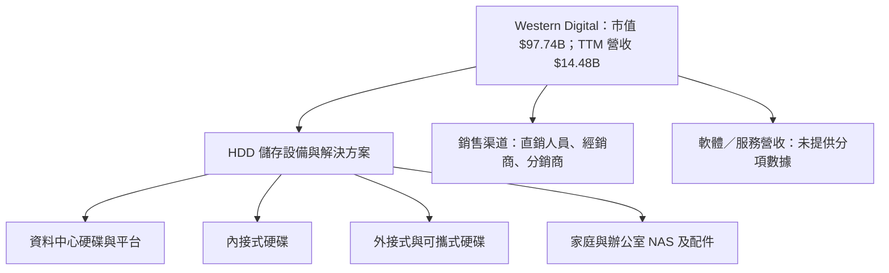
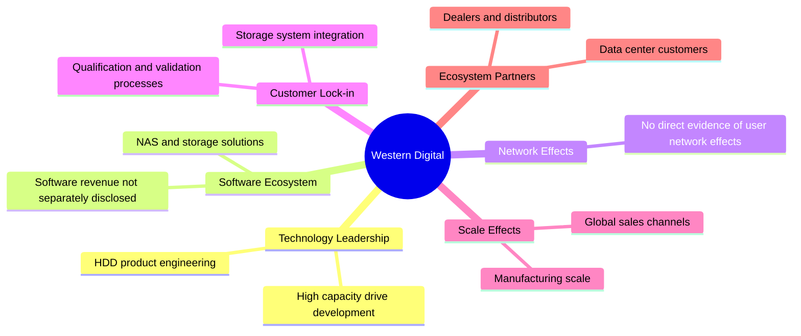
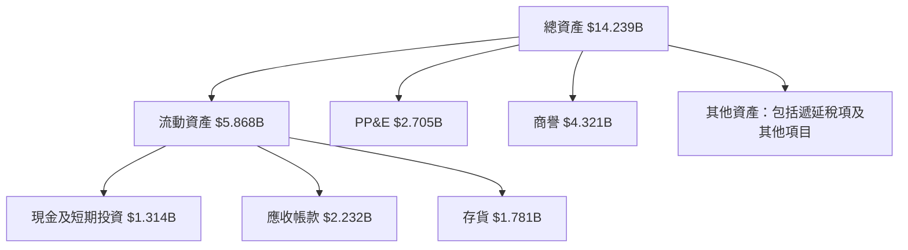
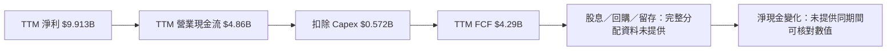
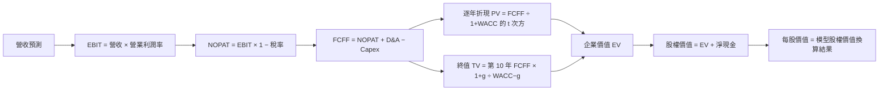
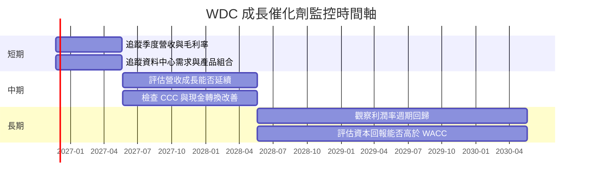
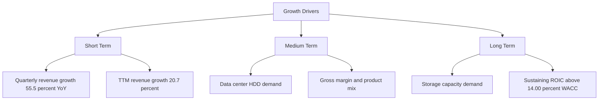
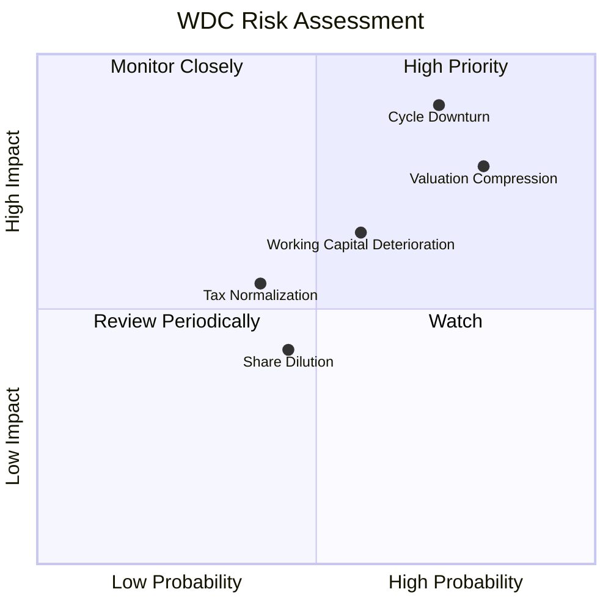
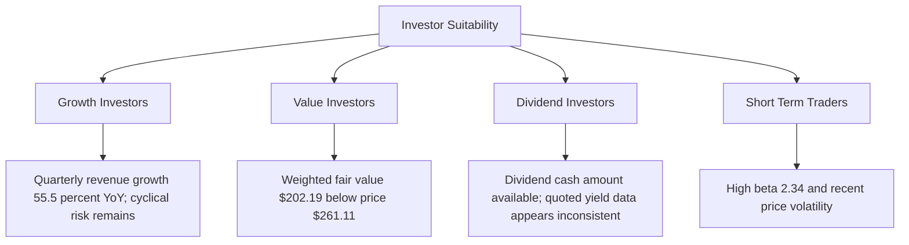

# WDC 基本面深度分析報告
> **報告日期**：2026-11-21 ｜ **語言**：繁體中文 ｜ **數據來源**：SEC 申報資料 (XBRL)、Yahoo Finance、Finviz、StockAnalysis、Roic.ai 

## 目錄

| # | 章節 | 核心結論 |
|---|------|----------|
| 1 | 執行摘要 | 賣出；加權合理價值 $202.19，MOS -29.1% |
| 2 | 公司概覽與商業模式 | HDD 資料儲存業務受益於需求成長，但可量化護城河證據有限 |
| 3 | 損益表深度分析 | TTM 營收 $14.48B、年增 20.7%；最新單季年增 55.5% |
| 4 | 資產負債表分析 | 淨現金 $525M；現金轉換週期較一年前延長 18 天 |
| 5 | 現金流量深度分析 | TTM FCF $4.29B、FCF Yield 4.39%；現金流與淨利轉換需留意 |
| 6 | 獲利能力與資本效率 | ROIC 61.1% 高於 WACC 14.00%，但週期高峰可持續性待驗證 |
| 7 | 相對估值分析 | 同業及 DCF 估值低於現價；歷史 P/S 位於 85 百分位 |
| 8 | DCF 內在價值評估 | 基準 DCF $182.17；加權合理價值 $202.19，MOS -29.1% |
| 9 | 成長催化劑 | TTM 成長與季度加速明確，TAM 數字未提供 |
| 10 | 風險矩陣 | 週期反轉、估值回落、營運資金惡化為主要風險 |
| 11 | 投資建議 | 依 MOS 評級為賣出；以營運趨勢與估值重新評估為主 |

## 1. 執行摘要

WDC 的 TTM 營收為 **$14.48B**、TTM 年增 **20.7%**，最新單季營收年增 **55.5%**；TTM FCF 為 **$4.29B**、ROIC **61.1%**，高於 **14.00% WACC**。但估值模型給出的基準 DCF 為 **$182.17**，低於 2026-11-20 收盤價 **$261.11**；四種估值方法加權後合理價值為 **$202.19**，安全邊際 MOS 為 **-29.1%**。依 MOS 門檻評級為**賣出**；本報告不因質化因素調整評級。

### 1.0 一頁式投資儀表板（Portfolio Manager 30 秒速讀）

| 項目 | 內容 |
|------|------|
| **投資論點（3 句）** | ① TTM 營收年增 20.7%，最新單季年增 55.5%，需求加速是營運成長的主要支撐。② TTM ROIC 61.1% 對比 WACC 14.00%，目前資本回報高於資本成本。③ DCF 基準價 $182.17、加權合理價值 $202.19，均低於 $261.11 現價，估值風險高於基本面動能所能補償的程度。 |
| **綜合評分** | **6.3/10**（引用 1.1 評分卡） |
| **財務健康** | 🟡 現金及短期投資 $1.31B、總債務 $789M、淨現金 $525M；但速動比率 0.867，CCC 由 34 天增至 52 天。 |
| **ROIC vs WACC** | **61.1% vs 14.00%**（目前創造股東價值；可持續性需觀察） |
| **FCF 趨勢** | TTM FCF $4.29B；FCF Yield **4.39%**。年度 FCF 由 FY2024 -$781M 轉為 FY2026 $3.51B。 |
| **估值** | Forward P/E 6.46x（市場資料）；EV/EBITDA 15.423x（市場資料）；FCF Yield 4.39%。Peer multiples 顯示 WDC 本身倍數與市場快照口徑存在差異，詳見第 7 章。 |
| **DCF 內在價值（基準）** | **$182.17**；現價相對 DCF 溢價 **43.3%**（現價 ÷ DCF 價值 − 1）。 |
| **安全邊際（MOS）** | **-29.1%**＝($202.19 − $261.11) ÷ $202.19；🔴 低於 10%，無安全邊際。 |
| **預期報酬（基準情境 12M）** | DCF 基準情境相對現價 **-30.2%**；這是模型情境價值與現價之比較，不是保證的 12 個月報酬。 |
| **關鍵風險（前二）** | HDD 產業週期反轉及利潤率回落；市場估值與分析師共識高度分歧。 |
| **評級 + 信心度** | 🔴 **賣出** ｜ 信心：中（估值訊號清楚，週期與資料口徑增加不確定性） |

### 1.1 綜合評分卡（全報告唯一）

| 維度 | 評分（1–10） | 主要依據（引用數字與其來源章節） |
|------|--------------|----------------------------------|
| 成長性 | 8.0 | TTM 營收成長 20.7%、最新單季年增 55.5%；成長仍具週期性，見第 3 章。 |
| 獲利能力 | 8.5 | ROIC 61.1%、TTM 營業利益率 39.4%、Piotroski F-Score 6/8；見第 3、6 章。 |
| 財務健康 | 6.5 | 淨現金 $525M；流動比率 1.434、速動比率 0.867；CCC 52 天，高於一年前 34 天，見第 4 章。 |
| 估值 | 2.0 | MOS -29.1%，且 DCF $182.17 低於 $261.11 現價；見第 7、8 章。 |
| 護城河 | 6.0 | 資料中心硬碟產品與客戶認證有一定切換成本，但未提供市場份額及分部營收，見第 2 章。 |
| 管理層與資本配置 | 5.0 | FY2026 SBC $204M、最新 Piotroski 測試顯示稀釋股數增加；回購及資本配置細節有限，見第 3、5 章。 |
| **綜合評分** | **6.0** | 六項算術平均： (8.0 + 8.5 + 6.5 + 2.0 + 6.0 + 5.0) ÷ 6 = **6.0**。 |

### 1.2 五大投資論點 + 三大核心風險

| 類型 | 項目 | 具體依據 | 信心度 |
|------|------|----------|--------|
| 🟢 **投資論點①** | 營收動能加速 | TTM 營收 $14.48B、TTM 年增 20.7%；最新單季營收年增 55.5%。若需求及產品組合延續，營運槓桿可支撐高盈利。 | 🟢 高 |
| 🟢 **投資論點②** | 當前資本回報遠高於資本成本 | ROIC 61.1%，WACC 14.00%；差距顯示目前回報顯著高於資金成本，但不可直接外推為永續水準。 | 🟢 高 |
| 🟢 **投資論點③** | FCF 已恢復正值 | TTM FCF $4.29B；FY2024 FCF -$781M、FY2025 $1.28B、FY2026 $3.51B。 | 🟢 中高 |
| 🟢 **投資論點④** | 淨現金部位 | 現金及短期投資 $1.31B、債務 $789M、淨現金 $525M，降低財務壓力。 | 🟢 中高 |
| 🟢 **投資論點⑤** | 營業利潤率處於高檔 | TTM 營業利益率 39.4%，最新一季 46.7%；若高容量資料中心產品佔比上升，營收增長可放大營業槓桿。 | 🟡 中 |
| 🟡 **風險①** | 獲利與估值具週期性 | 歷史 FY2023 營業損失 $402M；現價高於 DCF 基準價 $182.17 約 43.3%。 | 🔴 高衝擊 |
| 🔴 **風險②** | 應收與存貨週轉變慢 | DSO 由 41 天增至 56 天，DIO 由 70 天增至 95 天，CCC 增加 18 天。 | 🟡 中 |
| 🔴 **風險③** | 估值方法分歧顯著 | 加權合理價值 $202.19，但分析師共識目標價 $613.38；前者反映現金流與同業倍數，後者可能包含更高週期成長預期。 | 🔴 高衝擊 |

### 1.3 快速統計卡片

| 指標 | 公司實際值（期間） | 同業中位數 | 狀態 |
|------|--------------------|------------|------|
| 營收成長（TTM） | **20.7%** | — | 🟢 |
| 營收成長（最新一季年增） | **55.5%** | **61.0%** | 🟡 |
| 毛利率（TTM） | **52.6%** | **80.0%** | 🟡 |
| 營業利益率（TTM） | **39.4%** | — | 🟢 |
| ROIC（TTM） | **61.1%** | — | 🟢 |
| Forward P/E | **6.46x**（市場資料快照） | **2.8x** | 🟡 |
| FCF Yield（TTM） | **4.39%** | — | 🟡 |
| Piotroski F-Score | **6 / 8** | — | 🟢 |

> Peer 中位數依 STX、SNDK、MU 的 Peer multiples 欄位計算。WDC 市場快照倍數和指定歷史倍數來源並非完全一致；第 7 章比較一律採 Peer multiples 指定數值。

### 1.4 投資結論

```text
╔══════════════════════════════════════════════════════════════════╗
║                       📊 投資結論摘要                           ║
╠══════════════════════════════════════════════════════════════════╣
║  評級：🔴 賣出（依 MOS 門檻；未作質化調整）                     ║
║  價格（2026-11-20 收盤）：$261.11                               ║
║  DCF 內在價值（基準）：$182.17（現價溢價 43.3%）                ║
║  安全邊際 MOS：-29.1%（＝($202.19−$261.11)÷$202.19）           ║
║  加權合理價值（8.8）：$202.19                                   ║
║  DCF 情境價值：悲觀 $100.40（-61.6%）                           ║
║                基準 $182.17（-30.2%）                           ║
║                樂觀 $313.26（+20.0%）                           ║
║  綜合評分：6.0/10（引用 1.1）                                   ║
║  適合投資人：可承受週期波動、以估值與季度數據控管風險者         ║
╚══════════════════════════════════════════════════════════════════╝
```

## 2. 公司概覽與商業模式

### 2.1 業務結構與收入來源

公司資料描述 WDC 提供基於 HDD 技術的內接式硬碟、資料中心硬碟與平台、外接硬碟、NAS 及相關配件。所給資料未提供分部營收、各產品線營收或服務營收，因此不拆分佔比，也不以示意比例製作收入結構圖。



公司資料同時顯示其核心業務基於 HDD 技術；所提供內容沒有可核對的產品線占比。故上圖只呈現業務關係，不代表分部收入權重。

### 2.2 市場份額

市場份額數據未提供，故不列市佔比例。WDC TTM 營收為 $14.48B，最新單季營收年增 55.5%；同業 STX 最新單季營收年增 61.0%，顯示 WDC 正處於強勁需求環境，但僅靠營收成長無法推論市佔變化。

### 2.3 競爭護城河分析



### 2.4 護城河強度

| 護城河項目 | 強度（強／中／弱） | 證據（引用數字或事實） | 會削弱它的情況 |
|------------|--------------------|------------------------|----------------|
| 技術與產品工程 | 中 | 公司提供 HDD 與資料中心平台；TTM 毛利率 52.6%。 | 替代儲存技術進步、容量成本比落後或競品定價更積極。 |
| 軟體生態系統 | 弱至中 | 提供 NAS 與相關解決方案，但軟體／服務收入未單獨披露。 | 產品以硬體價格競爭為主，服務附加價值無法提高。 |
| 網路效應 | 弱 | 未提供平台使用者或網路效應相關數據。 | 無使用者規模帶來的直接正回饋。 |
| 客戶鎖定 | 中 | 資料中心產品部署及驗證可能增加轉換時間；資料未提供客戶留存率。 | 客戶多來源採購、產品規格標準化或價格競爭加劇。 |
| 規模效應 | 中 | 公司全球銷售並提供多類 HDD；員工數 40,000。 | 產能利用率下降、固定成本無法由出貨量吸收。 |
| 生態夥伴 | 中 | 透過直銷、經銷商、分銷商銷售。 | 通路集中、客戶直採，或競品建立更完整系統方案。 |

1.1 的護城河評分為 **6.0/10**，理由是 HDD 產品工程、規模與客戶驗證提供一定黏著度，但缺少可驗證市佔、留存率及軟體收入資料。

## 3. 損益表深度分析

### 3.1 年度收入成長趨勢（近 4 年）

| 財年 | 營收 | YoY |
|------|------|-----|
| FY2023 | $6.255B | — |
| FY2024 | $6.317B | +1.0% |
| FY2025 | $9.520B | +50.7% |
| FY2026 | $12.919B | +35.7% |

```text
╔══════════════════════════════════════════════════════════════════╗
║             WDC 年度收入趨勢（FY2023–FY2026）                   ║
╠══════════════════════════════════════════════════════════════════╣
║  FY2023  $6.255B  ██████████░░░░░░░░░░░░  基期                 ║
║  FY2024  $6.317B  ██████████░░░░░░░░░░░░  YoY: +1.0% 🟡       ║
║  FY2025  $9.520B  ████████████████░░░░░░  YoY: +50.7% 🟢      ║
║  FY2026 $12.919B  ██████████████████████  YoY: +35.7% 🟢      ║
╠══════════════════════════════════════════════════════════════════╣
║  FY2023–FY2026 CAGR：約 27.3%                                    ║
╚══════════════════════════════════════════════════════════════════╝
```

三年 CAGR 依 `(12.919 ÷ 6.255)^(1/3) − 1` 計算，約 27.3%。收入反彈與增長集中在 FY2025–FY2026，代表產業出貨、產品組合或定價環境改善的影響很大；不宜把兩年高成長直接外推為長期常態。

### 3.2 季度收入趨勢分析

單位：十億美元。QoQ 依所列季度順序計算；最新一季 YoY 採財務資料中明確標示的 55.5%。

| 季度 | 營收 | QoQ | YoY | 備註 |
|------|------:|----:|----:|------|
| 2025-12-31 | $3.02B | — | +25.2% | 對比 2025-01 季營收 $2.409B。 |
| 2026-03-31 | $3.34B | +10.6% | +45.5% | 對比 2025-03 季營收 $2.294B。 |
| 2026-06-30 | $3.75B | +12.3% | +43.8% | 對比 2025-06 季營收 $2.605B。 |
| 2026-10-02／最新季度 | $4.38B | +16.9% | +55.5% | 最新季度對應 SEC 10-Q 截至 2026-10-02；來源表格日期標籤存在口徑差異。 |

QoQ 與 YoY 的快速增長代表近幾季需求和營收動能改善；但若供需轉弱或定價下行，成長率與利潤率可能同步回落。

### 3.3 利潤率演變分析

以下年度比率由年度毛利／營收、營業利益／營收計算；TTM 與最新季度營業利益率則採 SEC 計算區塊數值。

| 利潤率指標 | FY2023 | FY2024 | FY2025 | FY2026 | 趨勢 | 評估 |
|------------|------:|------:|------:|------:|------|------|
| **毛利率** | 22.2% | 28.1% | 38.8% | 48.8% | 連續改善 | 🟢 |
| **營業利益率** | -6.4% | 1.5% | 22.4% | 35.6% | 由負轉正並大幅擴張 | 🟢 |
| **TTM 營業利益率** | — | — | — | **39.4%** | 延續高檔 | 🟢 |
| **最新季度營業利益率** | — | — | — | **46.7%** | 高於 TTM | 🟡 |

FY2023 至 FY2026 營業利益由 -$402M 升至 $4.60B，反映收入恢復後固定成本吸收改善，並可能伴隨產品組合及定價改善。資料未提供按產品線拆解的價格、成本與出貨量，因此無法把利潤率提升精確歸因於單一因素；最新季度 46.7% 亦處於偏高位置，回落風險不可忽視。

### 3.4 費用結構分析

完整銷貨成本、研發、銷售管理等費用結構的同期間明細不足，且各來源期間口徑不一，故不製作 pie chart 或推算缺失費用。FY2026 研發支出為 $1.16B，約為該年度營收 $12.92B 的 9.0%；研發支出支持產品開發，但不足以據此推導完整費用率結構。

### 3.5 季度 EPS 趨勢與盈餘品質（Quality of Earnings）

| 盈餘品質項目 | 數值／佔比 | 評估 |
|--------------|-----------|------|
| 股權薪酬 SBC / 營收 | 最新四季 SBC 合計約 $230M ÷ TTM 營收 $14.48B = 約 **1.6%** | 🟡 比例不高，但仍會稀釋股東；Piotroski 股數測試未通過。 |
| SBC / 營業現金流 | 約 $230M ÷ $4.86B = 約 **4.7%** | 🟡 現金流相對 SBC 覆蓋充分，但不能忽略股數增加。 |
| FCF / 淨利（現金轉換率） | $4.29B ÷ TTM 淨利 $9.913B = 約 **43.3%** | 🔴 淨利高於自由現金流，現金轉換需審慎看待。 |
| 一次性／非經常性損益 | N/A（未提供完整調節表） | FY2026 淨利 $9.30B 高於營業利益 $4.60B，顯示非營業、稅務或其他項目可能重要；缺少調節資料，不判定具體來源。 |
| 有效稅率異常 | 4.9%（最新年度有效稅率） | 🟡 稅率偏低會提高模型 NOPAT，若稅率正常化，DCF 價值會下降。 |
| 資本化支出 vs 費用化 | TTM Capex $572M；資本化明細 N/A | N/A（未提供資本化政策及費用化調節資料）。 |

近四季 EPS 實際值依序為 **$4.67、$8.20、$8.21、$4.63**（較早至較新）；EPS 預估值為 NaN，故無法可靠判定「超預期／不及預期」。單季 EPS 波動亦不能僅以營收成長解釋，應追蹤稅務、非營業項目與股數變化。整體而言，FCF 為正、SBC 佔營收有限，但淨利轉 FCF 比率約 43.3%、有效稅率 4.9% 且存在數據來源口徑差異，GAAP 淨利的可持續性低於表面獲利增速所呈現的程度。

## 4. 資產負債表分析

### 4.1 資產結構分解

最新可用 TTM 資產表總資產為 $14.239B，流動資產 $5.868B、PP&E $2.705B、商譽 $4.321B；下圖只列已披露項目，不代表完整資產負債表。



### 4.2 流動性與營運資金分析

| 指標 | 最新 TTM | 一年前 TTM | 變化 | 解讀 |
|------|----------|------------|------|------|
| 流動比率 | 1.434 | N/A | N/A | 高於 1，仍有短期流動資產緩衝。 |
| 速動比率 | 0.867 | N/A | N/A | 低於 1，對存貨變現及現金流依賴較高。 |
| DSO 應收帳款天數 | 56 天 | 41 天 | +15 天 | 收款週期延長；可能與客戶／銷售組合或付款條件有關，原因未能從資料確認。 |
| DIO 存貨天數 | 95 天 | 70 天 | +25 天 | 存貨佔用資金增加，若需求放緩可能伴隨減值或降價風險。 |
| DPO 應付帳款天數 | 99 天 | 77 天 | +22 天 | 供應商融資增加；可能是付款條件或採購節奏變動，不能單獨推論議價力。 |
| CCC 現金轉換週期 | 52 天 | 34 天 | +18 天 | 現金回收變慢，與 DSO、DIO 增幅大於 DPO 的變化一致。 |

營運資金天數依 QUALITY FIGURES 原值引用，未重新計算。CCC 延長意味營收增長帶來較多營運資金佔用；若未來 DSO、DIO 持續增加，實際 FCF 可能低於未建模營運資金變動的 DCF 結果。

### 4.3 債務結構分析

```text
╔══════════════════════════════════════════════════════════════════╗
║                       WDC 債務健康診斷                           ║
╠══════════════════════════════════════════════════════════════════╣
║  總債務：          $0.789B  ███████████░░░░░░░░░  🟢            ║
║  現金及短期投資：  $1.31B   ████████████████████  🟢            ║
║  淨現金：          $0.525B  ████████░░░░░░░░░░░░  🟢            ║
║  流動比率：        1.434x                        🟡            ║
║  速動比率：        0.867x                        🟡            ║
║  Debt/EBITDA：     N/A（所給資料缺少一致口徑的 EBITDA）         ║
║  Interest Coverage：N/A（未提供利息費用與一致期間 EBIT）        ║
╚══════════════════════════════════════════════════════════════════╝
```

市場資料另列總債務 $922M、淨現金 $392M；SEC 計算區塊採債務 $789M、淨現金 $525M。為與指定的估值及 DCF 模型一致，本報告採用 SEC 計算區塊數值；兩來源差異須在後續報表更新中核對。

### 4.4 股東權益趨勢

| 財年 | 股東權益 |
|------|---------:|
| FY2023 | $11.84B |
| FY2024 | $11.05B |
| FY2025 | $5.54B |
| FY2026 | $8.86B |

```text
╔══════════════════════════════════════════════════════════════════╗
║                  WDC 股東權益趨勢                                ║
╠══════════════════════════════════════════════════════════════════╣
║  FY2023  $11.84B  ████████████████████                          ║
║  FY2024  $11.05B  ███████████████████                           ║
║  FY2025   $5.54B  █████████                                      ║
║  FY2026   $8.86B  ███████████████                                ║
╚══════════════════════════════════════════════════════════════════╝
```

FY2025 權益下降、FY2026 回升；現有資料不足以把變化完全歸因於淨利、分拆或其他權益項目，不宜將單年變動解讀為經營狀況的單一指標。

## 5. 現金流量深度分析

### 5.1 現金流量瀑布圖

TTM 營業現金流 $4.86B 減資本支出 $572M，得 TTM FCF $4.29B（依程式計算值）。股息、回購與淨現金變化沒有同一期間的完整分配資料，因此不填入未提供的金額。



### 5.2 FCF 轉換率趨勢

| 財年 | 淨利 | FCF | FCF / 淨利 |
|------|------:|----:|-----------:|
| FY2023 | -$1.68B | -$1.23B | 不具經濟解讀性（兩者均為負） |
| FY2024 | -$798M | -$781M | 不具經濟解讀性（兩者均為負） |
| FY2025 | $1.86B | $1.28B | 約 68.8% |
| FY2026 | $9.30B | $3.51B | 約 37.7% |
| TTM | $9.913B | $4.29B | 約 43.3% |

FY2026 及 TTM 淨利增幅高於 FCF，現金轉換率下滑。這使現金流品質評估低於單看淨利所呈現的結果。

### 5.3 自由現金流趨勢

| 財年／期間 | FCF | 方向 |
|------------|----:|------|
| FY2023 | -$1.23B | 🔴 |
| FY2024 | -$781M | 🔴 改善 |
| FY2025 | $1.28B | 🟢 轉正 |
| FY2026 | $3.51B | 🟢 |
| TTM | $4.29B | 🟢 |

### 5.4 資本配置評估

資本配置完整比例未提供，故不製作缺乏數字依據的 pie chart。

| 項目 | 已知數據 | 評估 |
|------|----------|------|
| 資本支出 | TTM $572M；FY2026 $418M | Capex 已包含於 FCF 計算；資料不足以判斷未來產能投資是否達到最佳回報。 |
| 現金股利 | FY2026 $184M；最新四季合計約 $201M | 與 TTM FCF 相比規模有限。 |
| 股票回購 | 未提供可核對金額 | N/A。 |
| SBC | FY2026 $204M；最新四季約 $230M | SBC 是股東稀釋成本；Piotroski 股數測試未通過。 |
| 現金留存 | 最新現金及短期投資 $1.31B | 淨現金 $525M，提供一定財務彈性。 |

## 6. 獲利能力與資本效率

### 6.1 ROE / ROA / ROIC 趨勢

| 指標 | 歷史資料 | 評估 |
|------|----------|------|
| ROE | TTM 107.2%（QUALITY FIGURES）；市場資料另列 129.6% | 不同來源口徑不一致，採 QUALITY FIGURES 的 107.2%；見杜邦分解，淨利率而非高槓桿是主要來源。 |
| ROA | TTM 25.9%（市場資料） | 有較高資產回報；不同來源計算期間可能不同。 |
| ROIC | TTM 61.1%（SEC／程式計算） | 高於 WACC，但產業週期及低有效稅率可能抬高當期回報。 |
| 行業均值對比 | 未提供可核對行業均值 | 不列未有來源的均值。 |

### 6.2 ROIC vs WACC 分析（核心價值創造判斷）

```text
╔══════════════════════════════════════════════════════════════════╗
║                    ROIC vs WACC 深度分析                         ║
╠══════════════════════════════════════════════════════════════════╣
║  資本成本輸入（採用程式計算的 Cost of capital）：                ║
║  ├── 無風險利率（10Y 美債）：                 4.91%              ║
║  ├── 市場風險溢酬 ERP：                      5.00%              ║
║  ├── 原始 Beta：                             2.34               ║
║  ├── 調整後 Beta：                           1.90               ║
║  ├── 股權成本（指定值）：                    14.39%             ║
║  ├── 稅前債務成本：                          20.91%             ║
║  ├── 有效稅率：                              4.9%               ║
║  ├── 股權／債務權重：                        99.2%／0.8%        ║
║  └── 採用 WACC：                             14.00%             ║
║      程式計算值 14.44%，按 7%–14% 區間限制為 14.00%。            ║
║                                                                  ║
║  ROIC：                                       61.1%              ║
║  WACC：                                       14.00%             ║
║  ROIC − WACC：                                +47.1 個百分點     ║
║                                                                  ║
║  ROIC  61.1%  ▓▓▓▓▓▓▓▓▓▓▓▓▓▓▓▓▓▓▓▓▓▓▓▓▓▓▓▓▓▓▓▓▓▓▓▓  🟢        ║
║  WACC  14.0%  ▓▓▓▓▓▓▓▓▓░░░░░░░░░░░░░░░░░░░░░░░░░░  ──        ║
║                                                                  ║
║  結論：依 TTM 資料，公司目前創造股東價值；週期高峰回落時，     ║
║        ROIC 可能快速收斂，不能視為永久經濟租。                  ║
╚══════════════════════════════════════════════════════════════════╝
```

WACC 採用給定值，未另建模型。Beta 調整方式為 `⅔ × 2.34 + ⅓`，得 1.893，按來源提供值採 **1.90**。原始 Beta 2.34 反映股價波動較高，使用調整 Beta 降低極端歷史波動的影響。WACC 計算值 14.44% 受 7%–14% 區間限制，故本報告一致採用 **14.00%**。

### 6.3 杜邦三因素分解

| 因素 | 數值（TTM） | 解讀 |
|------|-------------|------|
| 淨利率 | 69.2% | 高於一般製造業可持續水準的直觀預期；需注意淨利與營業利益差距及低有效稅率。 |
| 資產週轉率 | 1.02 | 每單位資產產生約 1.02 單位營收。 |
| 權益乘數 | 1.52 | 槓桿不是 ROE 的主要放大來源。 |
| **ROE** | **107.2%** | 原值照抄；三因素乘積以來源提供值為準。 |

杜邦數值照 QUALITY FIGURES 引用。ROE 主要由極高淨利率驅動，而非高權益乘數；但淨利率與損益表其他來源口徑有差異，應避免將 107.2% ROE 外推為常態。

### 6.4 財務體質：Piotroski F-Score

**Piotroski F-Score：6 / 8**。一項測試因缺資料不納入分母，故照原值標示為 6/8。

| 測試 | 結果 | 解讀 |
|------|------|------|
| ROA > 0 | ✅ 通過 | 有正報酬。 |
| 營業現金流 > 0 | ✅ 通過 | TTM 營業現金流為 $4.86B。 |
| ROA 高於一年前 | ✅ 通過 | 資產獲利改善。 |
| 營業現金流 > 淨利（應計品質） | ❌ 未通過 | 淨利增長快於營業現金流，應關注獲利現金化。 |
| 長期負債 ÷ 總資產低於一年前 | — 無法判定 | 缺少輸入資料。 |
| 流動比率高於一年前 | ✅ 通過 | 流動性測試改善。 |
| 稀釋股數未增加 | ❌ 未通過 | 股數增加造成既有股東稀釋風險。 |
| 毛利率高於一年前 | ✅ 通過 | 毛利率改善。 |
| 資產週轉率高於一年前 | ✅ 通過 | 資產使用效率改善。 |

## 7. 相對估值分析

### 7.1 同業估值比較表格

Peer multiples 的 WDC 數值採財務數據中的估值方法來源；市場快照的 WDC 倍數另有口徑差異，不混用。SNDK 的極低 P/E 反映該資料口徑下盈餘分母異常，不能視為正常可比倍數。

| 估值指標 | **WDC** | **STX** | **SNDK** | **MU** | WDC 評估 |
|----------|--------:|-------:|--------:|------:|-----------|
| **Trailing P/E** | 10.1x | 24.0x | 0.1x | 8.0x | 🟡 低於 STX，高於 MU；SNDK 數值不宜直接解讀。 |
| **Forward P/E** | 6.46x（市場快照） | 7.0x | 2.2x | 2.8x | 🟡 低於 STX、高於 MU 與 SNDK；資料口徑並非完全同源。 |
| **P/S Ratio** | 6.9x | 7.6x | 3.1x | 5.1x | 🟡 高於 SNDK、MU，低於 STX。 |
| **EV/EBITDA** | 17.5x | 18.1x | 4.0x | 5.8x | 🔴 高於 SNDK、MU；略低於 STX。 |
| **最新季度營收 YoY** | 55.5% | 61.0% | 377.9% | 379.3% | 🟡 WDC 增長明顯，但低於同業資料中極高的增幅。 |
| **毛利率（TTM）** | 52.6% | 50.4% | 80.0% | 80.7% | 🟢 高於 STX，低於 SNDK、MU。 |

同業營收成長與毛利率中位數分別為 **61.0%**、**80.0%**；三家公司中位數直接取排序後的中間值。WDC 目前營業獲利能力高，但同業表中兩家公司毛利率顯著更高；倍數比較需考慮業務組合與盈利周期差異。

### 7.2 歷史估值區間分析

```text
╔══════════════════════════════════════════════════════════════════╗
║                  WDC 歷史估值位置（5 年）                       ║
╠══════════════════════════════════════════════════════════════════╣
║  P/E：       6.3x ───── 中位數 13.5x ───── 現值 10.1x            ║
║              區間上限 62.5x｜現值百分位 38%                      ║
║  P/S：       0.4x ───── 中位數 1.2x  ───── 現值 6.9x             ║
║              區間上限 16.0x｜現值百分位 85%                      ║
║  EV/EBITDA： 4.5x ───── 中位數 14.9x ───── 現值 17.5x            ║
║              區間上限 96.5x｜現值百分位 62%                      ║
╚══════════════════════════════════════════════════════════════════╝
```

P/E 位於自身五年區間第 38 百分位，但 P/S 位於第 85 百分位、EV/EBITDA 位於第 62 百分位。由此可見「便宜」結論取決於採用哪種倍數；P/E 受週期盈餘影響較大，不應單獨作為低估證據。

### 7.3 情境價值（照 DCF MODEL 的 Scenarios）

| 情境 | 第 1 年營收成長 | 期末營業利潤率 | WACC | 每股價值 | 相對現價 | 機率 | 會發生的條件 |
|------|----------------|----------------|------|----------|----------|------|--------------|
| 🔴 悲觀 | 10.3% | 19.4% | 15.00% | $100.40 | -61.6% | 25% | 需求回落、營收減速且利潤率回歸週期均值附近。 |
| 🟡 基準 | 20.7% | 22.8% | 14.00% | $182.17 | -30.2% | 高成長逐年減速，利潤率收斂至模型所採長期水準。 |
| 🟢 樂觀 | 31.0% | 25.1% | 13.00% | $313.26 | +20.0% | 短期高成長延續、長期利潤率優於基準且資本成本下降。 |

### 7.4 相對估值隱含價格區間

```text
╔══════════════════════════════════════════════════════════════════╗
║             估值方法隱含每股價值與現價位置                       ║
╠══════════════════════════════════════════════════════════════════╣
║  $96.34 ───── $182.17 ───── $195.39 ───── $261.11 ───── $613.38 ║
║   EV/EBITDA       DCF          P/S          現價       分析師共識 ║
╚══════════════════════════════════════════════════════════════════╝
```

| 方法 | 每股價值 | 方法依據 |
|------|---------:|----------|
| 同業 EV/EBITDA | $96.34 | STX、SNDK、MU 中位數倍數 5.8x × TTM EBITDA，加回淨現金。 |
| 同業 P/S | $195.39 | 同業中位數 P/S 5.1x × WDC TTM 營收。 |
| DCF 基準 | $182.17 | 10 年 FCFF，WACC 14.00%、終端成長率 3.0%。 |
| 分析師共識目標價 | $613.38 | 24 位分析師平均目標價，與基本面估值相差甚大。 |

## 8. DCF 內在價值評估（Discounted Cash Flow）

> DCF 逐年現金流及估值結果採程式模型原值。數字以 USD billions 表示；表內金額取兩位小數、折現因子三位小數。模型有四捨五入尾差時，以原模型提供的合計為準。

### 8.0 估值推理鏈（Thinking Logic）

**Step 1 — 價值來源與主導變數**

模型以 WDC 現有 HDD 業務產生的 FCFF 為核心，將 TTM 營收 $14.48B 作為起點。財務資料沒有分部營收，故不能將資料中心、外接式硬碟或 NAS 分別視為可量化的「第二曲線」；本模型不加入未披露業務的額外選擇權價值。對估值影響最大的變數是**營業利潤率與 WACC**：基準假設由 TTM 39.4% 漸降至第十年 22.8%，而 14.00% WACC 對終值折現影響顯著，與 8.6 敏感度矩陣一致。

**Step 2 — 模型選擇**

| 決策點 | 本報告採用 | 理由（含數字） | 曾考慮但否決 | 否決理由 |
|--------|-----------|----------------|--------------|----------|
| 現金流定義 | FCFF | 與 WACC 折現、先求 EV 再橋接股權價值一致。 | FCFE | 資本結構及現金橋接採公司價值流程。 |
| 預測期 N | 10 年 | DCF MODEL 固定設定 10 年；從 TTM 營收 $14.48B 逐步淡出至年增 3.0%。 | 5 年 | 不符合模型既定逐年預測期間。 |
| 終值方法 | Gordon Growth | 模型以 g=3.0%、WACC=14.00% 計算。 | 退出倍數 | DCF MODEL 未提供退出倍數終值計算值，不能自行增建模型。 |
| EBIT 基礎 | GAAP EBIT | TTM 營業利益率 39.4%，模型明示 GAAP EBIT。 | 非 GAAP EBIT | 避免加回 SBC 後再以股數稀釋重複處理。 |

**Step 3 — 關鍵假設推導鏈**

- **營收成長**：錨點＝TTM 年增 20.7% → 調整＝採用最新 TTM 增速作為第 1 年起點，之後線性降至第 10 年 3.0%，反映 55.5% 最新單季年增率不宜永久延續 → **採用第 1 年 20.7%、第 10 年 3.0%** → 曾考慮把 55.5% 單季增速直接外推，但單季成長不能代替長期 TTM 增長，故否決。
- **期末營業利潤率**：錨點＝TTM 39.4% → 調整＝模型逐步收斂至近五年財年中位數 → **採用第 10 年 22.8%** → 曾考慮維持 39.4%，但會把高景氣利潤率永久化，故否決。
- **永續成長率 g**：錨點＝終端長期名目經濟成長通常不宜長期高於整體經濟；模型採 3.0% → **採用 3.0%**，低於 14.00% WACC → 曾考慮更高成長率，但會提高終值依賴，故不採。
- **預測期 N**：錨點＝模型預設 10 年，且營收成長由 20.7% 逐步減速至 3.0% → **採用 10 年** → 曾考慮較短預測期，但模型沒有替代期限結果，不自行更改。
- **Capex／營收**：錨點＝TTM $572M ÷ $14.48B 約 3.9% → 調整＝模型由第 1 年 3.9% 緩降至第 10 年 3.0% → **採用模型逐年假設** → 曾考慮直接維持 3.9%，但模型假設成熟期資本支出逐步下降，且不可改動模型輸入。
- **D&A／營收**：錨點＝TTM 2.7% → **採用固定 2.7%**；資料未提供更可靠的長期替代值。
- **稅率**：錨點＝最新年度有效稅率 4.9% → **採用 4.9%**；此假設對估值有利，若稅率上升，NOPAT 與價值將下降。
- **EBIT 基礎、SBC 與股數**：採 GAAP EBIT，SBC 已含費用、不再扣除；模型不再增加股數稀釋。這是模型指定組合，並非對未來稀釋風險的否定。
- **ΔWC**：模型明示不建模營運資金變動；錨點是資料顯示 CCC 由 34 天升至 52 天。採模型設定為不列入 FCFF，這可能高估現金流；不能自行補造營運資金數字。
- **終值方法**：錨點＝模型採 Gordon Growth，g 3.0% < WACC 14.00%；採用指定方法。因未提供退出倍數終值計算結果，否決自行加入退出倍數交叉驗證。
- **WACC**：錨點＝程式計算 14.44%，受 7%–14% 邊界限制後採 **14.00%**。曾考慮使用未限制的 14.44%，但模型明示必須使用被限制後的數值。

**Step 4 — 最脆弱環節**

最脆弱假設是高 TTM 營業利潤率可在長期平順收斂、且營運資金不需額外投入；若週期逆轉令成長及利潤率更快下滑，悲觀情境價值為 **$100.40**，低於基準 $182.17。

**Step 5 — 計算路徑圖**



### 8.1 模型假設總表（Model Inputs）

| 假設項目 | 採用值 | 依據／來源 | 敏感度 |
|----------|--------|-------------|--------|
| 預測期長度 N | 10 年 | DCF MODEL 固定設定；營收成長逐年淡出。 | 🟡 中 |
| 營收成長 | 第 1 年 20.7%，第 10 年 3.0% | TTM 年增 20.7%；長期逐年淡出。 | 🔴 高 |
| 營業利潤率 | 第 1 年 39.4% → 第 10 年 22.8% | TTM 利潤率及近五年財年中位數。 | 🔴 高 |
| 有效稅率 | 4.9% | 最新年度有效稅率。 | 🟢 低 |
| Capex／營收 | 第 1 年 3.9% → 第 10 年 3.0% | TTM Capex $572M ÷ TTM 營收 $14.48B 約 3.9%；模型逐步淡出。 | 🟡 中 |
| D&A／營收 | 2.7% | TTM 比率。 | 🟢 低 |
| 營運資金變動／營收增額 | 不建模 | 模型明示 Working capital is not modelled；CCC 52 天為風險背景，不能代替模型輸入。 | 🟢 低 |
| EBIT 基礎 | GAAP | DCF MODEL 明示 GAAP EBIT。 | 🟡 中 |
| SBC 處理 | 不另扣 SBC；不再稀釋股數 | SBC 已包含在 GAAP EBIT 費用中；依指定組合 (A)。 | 🟡 中 |
| 年稀釋率 | 0%（模型固定股數處理） | 組合 (A)；SBC 已在 GAAP EBIT 扣除。 | 🟡 中 |
| 永續成長率 g | 3.0% | DCF MODEL 指定值，且低於 WACC。 | 🔴 高 |
| 終值方法 | Gordon Growth | DCF MODEL 指定。 | 🔴 高 |
| WACC | 14.00% | 程式計算 WACC 14.44%，受 7%–14% 限制後採用 14.00%。 | 🔴 高 |

**FCFF 定義**：模型採 FCFF，且因 working capital 未建模，使用 `FCFF = NOPAT + D&A − Capex`，不另外列 ΔWC。

**SBC 組合說明**：本模型採用 **(A) GAAP EBIT + 固定股數、不另扣 SBC**；SBC 影響在 EBIT 費用中計入一次，股數不再稀釋。

### 8.2 折現率推導（WACC）

```text
╔══════════════════════════════════════════════════════════════════╗
║                       WACC 推導（折現率）                        ║
╠══════════════════════════════════════════════════════════════════╣
║  股權成本 Ke（採用成本資本資料）：                               ║
║  ├── 無風險利率 Rf（10Y 美債）：                 4.91%          ║
║  ├── 市場風險溢酬 ERP：                          5.00%          ║
║  ├── 原始 Beta：                                 2.34           ║
║  ├── 調整方式：⅔×2.34 + ⅓ = 1.893 ≈ 1.90                       ║
║  ├── 調整後 Beta：                               1.90           ║
║  ├── 規模／國別溢酬：                            0.00%（未另加）║
║  └── 指定股權成本 Ke：                           14.39%         ║
║                                                                  ║
║  債務成本：                                                      ║
║  ├── 稅前債務成本：                              20.91%         ║
║  ├── 有效稅率：                                  4.9%           ║
║  └── 稅後債務成本：20.91%×(1−4.9%) = 約 19.89%                  ║
║                                                                  ║
║  資本結構權重（採程式計算）：                                    ║
║  ├── 股權權重 E：                                99.2%          ║
║  ├── 債務權重 D：                                0.8%           ║
║  ├── 未限制計算 WACC：                           14.44%         ║
║  └── 採用 WACC：14.44% 受 7%–14% 區間限制 =       14.00%         ║
╚══════════════════════════════════════════════════════════════════╝
```

逐步演算：

1. **Ke**：來源指定 `Rf + β × ERP = 4.91% + 1.90 × 5.00%`，程式提供股權成本為 **14.39%**。因四捨五入後乘加結果和來源列示股權成本可能有小幅差異，採用成本資本區塊指定的 14.39%，不另替換。
2. **稅前 Kd**：來源指定利息 ÷ 債務的稅前債務成本為 **20.91%**；利息及平均計息負債金額未分別提供，無法在此重建分子、分母。
3. **稅後 Kd**：`20.91% × (1 − 4.9%) = 19.8854% ≈ 19.89%`。
4. **權重**：採用指定股權／債務權重 **99.2%／0.8%**；市值及債務權重的底層精確未四捨五入數值未提供，故不反推替代數字。
5. **WACC**：程式未限制計算值為 **14.44%**，按 7%–14% 區間限制採用 **14.00%**；本值與第 6.2 節一致。

Rf 日期未單獨列出，僅採成本資本數據中的 10 年期美債 4.91%。原始 Beta 及調整後 Beta 均照列。利息費用、平均計息債務及市場價值計算明細未提供，故不宣稱已獨立重算 WACC。

### 8.3 逐年自由現金流預測（基準情境）

單位：$B。表中數字照 DCF MODEL；模型沒有營運資金變動列。

| 年度 | FY+1 | FY+2 | FY+3 | FY+4 | FY+5 | FY+6 | FY+7 | FY+8 | FY+9 | FY+10 |
|------|------:|------:|------:|------:|------:|------:|------:|------:|------:|-------:|
| 營收 | 17.47 | 20.74 | 24.21 | 27.79 | 31.35 | 34.75 | 37.84 | 40.46 | 42.47 | 43.75 |
| 營收 YoY | 20.7% | 18.7% | 16.7% | 14.8% | 12.8% | 10.9% | 8.9% | 6.9% | 5.0% | 3.0% |
| 營業利潤率 | 39.4% | 37.6% | 35.7% | 33.9% | 32.0% | 30.2% | 28.4% | 26.5% | 24.7% | 22.8% |
| EBIT（GAAP） | 6.89 | 7.79 | 8.65 | 9.42 | 10.05 | 10.50 | 10.74 | 10.73 | 10.49 | 10.00 |
| − 稅 | (0.33) | (0.38) | (0.42) | (0.46) | (0.49) | (0.51) | (0.52) | (0.52) | (0.51) | (0.49) |
| = NOPAT | 6.55 | 7.41 | 8.23 | 8.96 | 9.56 | 9.99 | 10.21 | 10.21 | 9.98 | 9.51 |
| + D&A | 0.47 | 0.56 | 0.65 | 0.75 | 0.85 | 0.94 | 1.02 | 1.09 | 1.15 | 1.18 |
| − Capex | (0.69) | (0.80) | (0.90) | (1.01) | (1.10) | (1.18) | (1.25) | (1.29) | (1.31) | (1.30) |
| **= FCFF** | **6.33** | **7.18** | **7.98** | **8.70** | **9.30** | **9.74** | **9.99** | **10.02** | **9.82** | **9.39** |
| 折現因子 @14.00% | 0.877 | 0.769 | 0.675 | 0.592 | 0.519 | 0.456 | 0.400 | 0.351 | 0.308 | 0.270 |
| **FCFF 現值 PV** | **5.56** | **5.52** | **5.39** | **5.15** | **4.83** | **4.44** | **3.99** | **3.51** | **3.02** | **2.53** |

**預測期 FCF 現值合計**：  
`$5.56 + $5.52 + $5.39 + $5.15 + $4.83 + $4.44 + $3.99 + $3.51 + $3.02 + $2.53 = $43.94B`（模型合計照列 **$43.95B**；逐項四捨五入造成約 $0.01B 尾差，低於 1%）

**FY+1 代表年度逐步演算**：

1. **營收** = $14.48B × (1 + 20.7%) = $17.47736B，模型列 $17.47B。
2. **EBIT** = $17.47B × 39.4% = $6.882B，模型列 $6.89B。
3. **稅** = $6.89B × 4.9% = $0.3376B，模型列 $0.33B。
4. **NOPAT** = $6.89B − $0.33B = $6.56B；模型列 $6.55B，差異來自未披露底層精確數與表內四捨五入。
5. **D&A** = $17.47B × 2.7% = $0.4717B，模型列 $0.47B。
6. **Capex** = $17.47B × 3.9% = $0.6813B；模型列 $0.69B，反映模型底層精確營收與比例。
7. **ΔWC** = 未建模，模型不列營運資金變動。
8. **FCFF** = 模型原值 $6.33B；以表內已四捨五入 NOPAT、D&A、Capex 相減會有尾差，採模型原值。
9. **折現因子及 PV** = `1 ÷ (1 + 14.00%)^1 = 0.877`；`$6.33B × 0.877 ≈ $5.55B`，模型 PV 為 $5.56B，採模型原值。

**合理性自檢**

- 預測 FCFF 由 FY+1 $6.33B 增至 FY+10 $9.39B；資料未提供可直接比較的歷史十年 FCF CAGR，故不補造歷史 CAGR。
- FY+10 FCFF 利潤率 = `$9.39B ÷ $43.75B` = 約 **21.5%**；現有 TTM FCF 利潤率 = `$4.29B ÷ $14.48B` = 約 **29.6%**。同業最佳 FCFF 利潤率未提供。
- 模型預測期各年 FCFF 均為正；但因未建模營運資金，在 CCC 52 天且同比增加的背景下，現金流有高估風險。

```text
╔══════════════════════════════════════════════════════════════════╗
║             自由現金流：歷史實際 vs 模型預測                      ║
╠══════════════════════════════════════════════════════════════════╣
║  FY2024 (實)  -$0.781B  ◀ 負值                                   ║
║  FY2025 (實)   $1.28B   █████                                    ║
║  FY2026 (實)   $3.51B   ██████████████                           ║
║  FY+1  (預)    $6.33B   █████████████████████████                ║
║  FY+10 (預)    $9.39B   █████████████████████████████████████    ║
╠══════════════════════════════════════════════════════════════════╣
║  模型假設長期營收增速減速至 3.0%，FCFF 利潤率則由周期高位回落。   ║
║  歷史 FCF 跨越負值與正值，單一歷史 CAGR 不具穩定比較意義。       ║
╚══════════════════════════════════════════════════════════════════╝
```

### 8.4 終值計算（Terminal Value）

適用性檢查：`WACC 14.00% vs g 3.0% → WACC > g？✅`

| 方法 | 計算式 | 終值 TV | TV 現值 | 佔總 EV 比重 |
|------|--------|---------|---------|--------------|
| Gordon Growth | 9.39 × (1 + 3.0%) ÷ (14.00% − 3.0%) | $87.94B | $23.72B | 35.1% |
| 退出倍數法 | N/A（DCF MODEL 未提供退出倍數終值） | N/A | N/A | N/A |

逐步演算：

1. **FY+N FCFF** = FY+10 FCFF **$9.39B**。
2. **分子** = `$9.39B × (1 + 3.0%)` = `$9.6717B`。
3. **分母** = `14.00% − 3.0% = 11.00%`；終值依模型原值 **$87.94B**。
4. **PV(TV)** = `$87.94B × 0.270 = $23.7438B`，模型列 **$23.72B**，採模型原值。
5. **終值佔比** = `$23.72B ÷ $67.67B` = 約 **35.1%**。

終值現值佔 EV 35.1%，低於 75% 警戒線。DCF MODEL 沒有提供退出倍數終值，故不自行填造。

### 8.5 企業價值 → 每股內在價值（Bridge）

```text
╔══════════════════════════════════════════════════════════════════╗
║               企業價值 → 每股內在價值 橋接表                     ║
╠══════════════════════════════════════════════════════════════════╣
║  預測期 FCF 現值合計            +$43.95B                         ║
║  終值現值 PV(TV)                +$23.72B                         ║
║  = 企業價值 EV                   $67.67B                         ║
║  + 淨現金                        +$0.53B                         ║
║  = 股權價值                      $68.19B                         ║
║  模型每股價值換算：$68.19B × $261.11 ÷ $97.74B                   ║
║  ★ 每股內在價值                  $182.17                         ║
║  當前股價                        $261.11                         ║
║  折溢價（現價÷DCF內在價值−1）     +43.3%（溢價）                 ║
╚══════════════════════════════════════════════════════════════════╝
```

逐步演算：

1. **EV** = `$43.95B + $23.72B = $67.67B`。
2. **股權價值** = `$67.67B + $0.525B = $68.195B`，模型列 `$68.19B`。
3. **每股內在價值** = DCF MODEL 指定換算式：`$68.19B × $261.11 ÷ $97.74B = $182.17`。
4. **折溢價** = `$261.11 ÷ $182.17 − 1 = 43.3%`，現價對 DCF 基準值為溢價。
5. **本節不計算 MOS**；安全邊際只採 8.8 加權合理價值作分母。

模型的每股換算採用指定的 equity value × price ÷ market cap 方法；稀釋股數未直接列出，不能自行替換模型換算方式。淨現金及債務採 DCF MODEL 橋接指定值，與資產負債表其他來源有口徑差異。

### 8.6 敏感性分析（WACC × 永續成長率）

矩陣直接照 DCF MODEL；括號內上行空間按 `(每股價值 ÷ 現價) − 1` 計算，現價 $261.11。基準格為 14.00%、g 3.0%。

| g（列）／WACC（欄） | 12.00% | 13.00% | **14.00%（基準）** | 15.00% | 16.00% |
|-----------|------:|------:|-------------------:|------:|------:|
| 2.0% | $211.85 (-18.9%) | $192.49 (-26.3%) | $176.33 (-32.5%) | $162.63 (-37.7%) | $150.88 (-42.2%) |
| 2.5% | $216.61 (-17.0%) | $196.10 (-24.9%) | $179.12 (-31.4%) | $164.83 (-36.9%) | $152.63 (-41.5%) |
| **3.0%（基準）** | $221.90 (-15.0%) | $200.08 (-23.4%) | **$182.17 (-30.2%)** | $167.21 (-36.0%) | $154.51 (-40.8%) |
| 3.5% | $227.82 (-12.8%) | $204.48 (-21.7%) | $185.51 (-29.0%) | $169.79 (-35.0%) | $156.54 (-40.0%) |
| 4.0% | $234.47 (-10.2%) | $209.36 (-19.8%) | $189.19 (-27.5%) | $172.61 (-33.9%) | $158.74 (-39.2%) |

逐步演算示範選格：`所選格 WACC 13.00% > g 3.0% ✅`。DCF MODEL 中該格每股價值 **$200.08**；底層逐年現值及終值折現重算明細未提供，依規則不得自建或改動模型，只能引用矩陣原值。基準格 **$182.17** 與 8.5 基準 DCF 一致。

**三情境 DCF**

| 情境 | 營收成長假設 | 期末營業利潤率 | 永續成長 g | WACC | 每股內在價值 | 相對現價 | 主觀機率 |
|------|-------------|----------------|------------|------|--------------|----------|----------|
| 🔴 悲觀 | 第 1 年 10.3% | 19.4% | 3.0%（模型未另列情境 g，照基準假設） | 15.00% | $100.40 | -61.6% | 25% |
| 🟡 基準 | 第 1 年 20.7% | 22.8% | 3.0% | 14.00% | $182.17 | -30.2% | 50% |
| 🟢 樂觀 | 第 1 年 31.0% | 25.1% | 3.0%（模型未另列情境 g，照基準假設） | 13.00% | $313.26 | +20.0% | 25% |

情境模型未提供各情境第十年營收、FCFF、終值逐項結果；為避免變更或虛構 DCF MODEL 數值，不補造情境推導鏈。情境價值照模型列示。機率加權值算式：`$100.40 × 25% + $182.17 × 50% + $313.26 × 25% = $194.50`（模型原值）。

**敏感度結論**

- **g 變動**：在 WACC 14.00% 下，g 由 2.0% 至 3.0%，價值由 $176.33 升至 $182.17，變動 **+$5.84／+3.3%**；每 1pp 的影響並非線性。
- **WACC 變動**：在 g 3.0% 下，WACC 由 13.00% 升至 14.00%，價值由 $200.08 降至 $182.17，變動 **-$17.91／-9.0%**。
- **期末營業利潤率每 +1pp**：DCF MODEL 未提供單變數利潤率敏感度，不能另算每股彈性。
- 可核對矩陣中 WACC 對價值的影響高於 g 的 1pp 變化；這與 8.0 指出資本成本及長期利潤率是主要估值敏感來源一致。

### 8.7 反推 DCF（Reverse DCF：市場在預期什麼）

DCF MODEL 提供一次變數反推結果；其他固定輸入依基準模型。資料未提供逐級試算軌跡及變動其他變數後的模型輸出，因此不虛構迭代表格。

| 求解的變數（一次一個） | 其餘變數設定 | 市場隱含值（令 DCF = 現價） | 公司歷史實際／基準 | 判斷 |
|------------------------|--------------|------------------------------|------------------|------|
| 第 1 年營收成長 | 其餘輸入固定基準 | **31.4%** | 基準 20.7%；最新季度 YoY 55.5% | 🔴 高於基準；需維持較快成長。 |
| 固定營業利潤率 | 成長與其他輸入固定基準 | **39.8%** | 基準第 1 年 39.4%，第 10 年降至 22.8% | 🟡 市場價格約要求長期利潤率維持在接近當前高位。 |
| 永續成長率 g | N/A | 未計算 | 基準 3.0% | N/A（未提供反推結果）。 |
| 預測期長度 N | N/A | 未計算 | 基準 10 年 | N/A（未提供反推結果）。 |

反推結論：依程式反推，若其他假設維持基準，價格要求第 1 年營收成長 **31.4%**，高於基準 20.7%；或要求固定營業利潤率 **39.8%**，略高於現行 TTM 39.4%。現價因此隱含高於基準模型的成長或利潤率持續性。

### 8.8 估值三角驗證與安全邊際

| 估值方法 | 隱含每股價值 | 上行空間（÷現價） | 權重 | 說明 |
|----------|--------------:|------------------:|------:|------|
| DCF（基準） | $182.17 | -30.2% | 40% | 10 年 FCFF、WACC 14.00%、g 3.0%。 |
| 同業 EV/EBITDA | $96.34 | -63.1% | 30% | 同業中位數 5.8x × TTM EBITDA，加回淨現金。 |
| 同業 P/S | $195.39 | -25.2% | 20% | 同業中位數 5.1x × TTM 營收。 |
| 分析師共識目標價 | $613.38 | +134.9% | 10% | 24 位分析師平均目標價；僅作交叉參考。 |
| **加權合理價值** | **$202.19** | **-22.6%** | **100%** | 週期型公司固定權重。 |

逐步演算：  
`$182.17 × 40% + $96.34 × 30% + $195.39 × 20% + $613.38 × 10%`  
`= $72.868 + $28.902 + $39.078 + $61.338`  
`= $202.186 ≈ $202.19`。

估值方法權重依公司類型「週期型」固定。四種方法均列入，沒有剔除方法。

```text
╔══════════════════════════════════════════════════════════════════╗
║                    估值區間與安全邊際                            ║
╠══════════════════════════════════════════════════════════════════╣
║  $100.40 ───── $202.19 ───── $261.11 ───── $313.26 ───── $613.38║
║  悲觀 DCF       加權合理值       現價         樂觀 DCF    共識價  ║
║                                                                  ║
║  安全邊際 MOS = ($202.19 − $261.11) ÷ $202.19 = -29.1%          ║
║  MOS 評估：🔴 <10%，無安全邊際                                   ║
║  上行空間 = ($202.19 − $261.11) ÷ $261.11 = -22.6%              ║
║                                                                  ║
║  建議買入區間：N/A（MOS 評級為賣出，不提供買入區間）            ║
║  合理持有區間：未提供價值區間模型，建議以 $182.17–$202.19 作估值 ║
║  減碼考慮區間：現價 $261.11 已高於加權合理值與基準 DCF            ║
╚══════════════════════════════════════════════════════════════════╝
```

MOS 門檻所需價格為：`加權合理價值 × (1 − 10%) = $202.19 × 90% = $181.97`；現價高於該水平，因此不具買入 MOS。此價格只作為 MOS 門檻換算，不是新增估值方法。

> 🔎 **程式複算（Python，依本節各項自動重算）**
>
> 加權合理價值 = $182.17 × 40% + $96.34 × 30% + $195.39 × 20% + $613.38 × 10% = **$202.19**（權重合計 100%）
>
> 以價格 $261.11 計：MOS = **-29.1%**，上行空間 = **-22.6%**
>
> ✅ 與本節所寫數值一致。

### 8.9 DCF 模型的局限與失效條件

- **終值依賴度**：PV(TV) 佔 EV **35.1%**，約三分之一企業價值來自第十年後現金流。
- **最脆弱假設**：基準假設營收由第 1 年成長 20.7% 線性減速至第 10 年 3.0%，利潤率由 39.4% 降至 22.8%；若成長及利潤率同時落入悲觀情境，模型價值為 **$100.40**。
- **營運資金未建模**：CCC 從 34 天增至 52 天；若 DSO、DIO 繼續上升，FCFF 可能低於模型。
- **稅率風險**：模型使用有效稅率 4.9%；若實際稅率提高，NOPAT 下降。
- **周期性與方法適用性**：WDC 曾於 FY2023 出現 -$402M 營業損失；本次 FCF 已轉正，DCF 可作一種情境工具，但周期高峰的利潤率不適合永久化。需與 EV/EBITDA、P/S 交叉比較。
- **與第 10 章風險連結**：HDD 需求反轉會衝擊營收成長；價格競爭會壓縮營業利潤率；資金回收變慢會加劇未建模營運資金風險。

### 8.10 複算檢核表（Audit Trail）

| # | 檢核項目 | 檢查方式 | 結果 |
|---|----------|----------|------|
| 1 | 所有高／中敏感度假設有推導 | 對照 8.0 Step 3、8.1 | ✅ |
| 2 | 每個假設都有來歷 | 8.1 依據欄 | ✅ |
| 3 | WACC 五步及算式完全可獨立重算 | 利息、平均計息負債、精確權重未提供；採指定 WACC | ❌ 資料不足，未另行重算 |
| 4 | Kd 分母與 D 權重負債範圍一致 | 負債明細未提供，使用來源指定權重及成本 | ❌ 無法獨立核驗 |
| 5 | WACC 與第 6.2 節一致 | 兩處均採 14.00% | ✅ |
| 6 | 逐年年度數等於 N 且無省略 | FY+1 至 FY+10 共 10 年 | ✅ |
| 7 | FY+1 九步可完全逐項重算 | 四捨五入後 NOPAT、Capex 與模型原值有尾差 | ❌ 採用模型原值，差異說明如 8.3 |
| 8 | 預測期 PV 逐項相加 | 表列四捨五入合計 $43.94B，模型合計 $43.95B | ✅ 尾差約 $0.01B，低於 1% |
| 9 | WACC > g | 14.00% > 3.0% | ✅ |
| 10 | 終值以 FY+N FCFF 為基礎、折現 N 期 | FY+10 FCFF $9.39B；因子 0.270 | ✅ |
| 11 | 橋接 EV 到每股價值 | 按模型換算式及模型值呈列 | ✅ 模型原值照抄 |
| 12 | SBC 組合相容 | GAAP EBIT、不另扣 SBC、不再稀釋股數 | ✅ 組合 (A) |
| 13 | 敏感性基準格等於 DCF 基準值 | 14.00%、g 3.0% = $182.17 | ✅ |
| 14 | 敏感性矩陣有效格 | 所有 WACC 均高於 g | ✅ |
| 15 | 情境機率及加權值 | 25% + 50% + 25% = 100%；加權值 $194.50 | ✅ |
| 16 | 反推變數一次放開 | 只引用有提供的兩個反推結果 | ✅；無迭代軌跡資料 |
| 17 | MOS 與折溢價基準正確 | MOS 用 $202.19；折溢價用 DCF $182.17 | ✅ |
| 18 | 報告完整至第 11 章 | 全章節列出 | ✅ |
| 19 | 加權合理價值等於加權總和 | $202.186 ≈ $202.19 | ✅ |
| 20 | 評級符合 MOS 門檻 | MOS -29.1%，評級賣出 | ✅ |

## 9. 成長催化劑

### 9.1 催化劑時間軸

資料未提供管理層量化財測或特定產品上市時點。以下按營運監控時間框架整理，不代表已確定的公司計畫。



### 9.2 TAM 市場規模分析

**N/A（TAM 數據未提供）**。WDC TTM 營收 $14.48B、TTM 年增 20.7%，最新一季年增 55.5%，可作公司成長動能參考，但不能從公司營收推估 TAM 或市場滲透率。

### 9.3 成長驅動力結構圖



中長期節點為定性分析，未披露 TAM 或管理層量化目標，不代表已確認的營收預測。

## 10. 風險矩陣

### 10.1 風險評分矩陣

風險機率及衝擊位置為分析師定性判斷，並非財務數據或統計預測。



### 10.2 風險清單詳細分析

| # | 風險項目 | 發生機率 | 財務衝擊 | 風險評分 | 緩解措施 |
|---|----------|----------|----------|----------|----------|
| 1 | 🔴 **HDD 週期反轉** | 中高（定性） | 高；營收成長及 39.4% TTM 營業利潤率可能同步回落。 | 🔴 高 | 追蹤季度收入、毛利率、訂單與庫存；以悲觀 DCF $100.40 作下行情境參考。 |
| 2 | 🔴 **估值壓縮** | 高（定性） | 高；現價 $261.11 高於加權價值 $202.19，MOS -29.1%。 | 🔴 高 | 分批控制部位，依同業倍數、FCF Yield 與更新後 DCF 檢視估值。 |
| 3 | 🟡 **營運資金惡化** | 中（定性） | 中高；DSO +15 天、DIO +25 天、CCC +18 天。 | 🟡 中高 | 追蹤應收、存貨和 CCC；若現金流轉換持續弱於淨利，降低對 FCF 預測的信任。 |
| 4 | 🟡 **稅率正常化** | 中（定性） | 中；DCF 採有效稅率 4.9%，稅率上升會壓低 NOPAT。 | 🟡 中 | 每季比較有效稅率與營業利益、稅後淨利的變化。 |
| 5 | 🟡 **股數稀釋與 SBC** | 中（定性） | 中；FY2026 SBC $204M，Piotroski 股數測試未通過。 | 🟡 中 | 追蹤稀釋股數、SBC／營收與回購是否抵銷稀釋。 |

## 11. 投資建議

### 11.1 最終評級與評分

加權合理價值 $202.19 對照 2026-11-20 收盤價 $261.11，MOS 為 **-29.1%**，依規則 20 評級為 **🔴 賣出**，未作一級調整。1.1 綜合評分為 **6.0/10**，六項分數依序為成長性 8.0、獲利能力 8.5、財務健康 6.5、估值 2.0、護城河 6.0、管理層與資本配置 5.0。

### 11.2 合理價值與隱含報酬率

| 估值參考 | 每股價值 | 相對現價 $261.11 | 機率 |
|----------|---------:|------------------:|-----:|
| 加權合理價值 | $202.19 | -22.6% | — |
| 悲觀 DCF | $100.40 | -61.6% | 25% |
| 基準 DCF | $182.17 | -30.2% | 50% |
| 樂觀 DCF | $313.26 | +20.0% | 25% |
| 機率加權 DCF（參考） | $194.50 | -25.5% | — |

### 11.3 買入時機與觸發因素

```text
╔══════════════════════════════════════════════════════════════════╗
║                  ✅ 買入觸發因素 Checklist                       ║
╠══════════════════════════════════════════════════════════════════╣
║  立即重新評估（多數符合）：                                      ║
║  ☐ 股價降至不高於約 $181.97，對加權合理價值至少有 10% MOS       ║
║  ☐ 營收仍成長，且營業利益率未快速偏離 TTM 基準                  ║
║  ☐ CCC 停止延長，應收與存貨天數趨穩                              ║
║                                                                  ║
║  加碼觸發條件（需基本面同步確認）：                              ║
║  ☐ 更新後估值仍有至少 10% MOS                                   ║
║  ☐ FCF 持續為正且淨利轉現金比率改善                             ║
║  ☐ 股數稀釋放緩，SBC 佔營收下降                                  ║
║                                                                  ║
║  減碼／退出觸發條件：                                            ║
║  ☐ 連續兩季營收年增轉負                                          ║
║  ☐ TTM 營業利益率較 39.4% 收縮超過 10 個百分點                  ║
║  ☐ FCF 轉負或 CCC 持續明顯高於 52 天                             ║
║  ☐ ROIC 跌破 14.00% WACC                                         ║
╚══════════════════════════════════════════════════════════════════╝
```

### 11.4 投資人適配度分析



成長型投資人可關注營收加速，但須接受周期波動；價值型投資人目前面臨 MOS 為負的估值條件。股息收益率資料需特別核對：市場快照列 27.0%，而股利現金支出與市值所暗示的比率明顯不一致，不應把 27.0% 當作可靠股息殖利率。高 Beta 2.34 代表股價波動風險較高。

### 11.5 每季財報監控清單（Quarterly Watch List）

| 監控指標 | 目前參考值 | 觸發加碼／改善訊號 | 觸發減碼／惡化訊號 |
|----------|-----------:|-------------------|------------------|
| 營收年增 | 最新季度 55.5% | 成長保持正值且未連續急速放緩 | 連續兩季低於 0% |
| 營業利益率 | TTM 39.4%；最新季度 46.7% | 仍接近高檔且未靠一次性項目支撐 | TTM 較 39.4% 收縮超過 10 個百分點 |
| 毛利率 | TTM 52.6% | 產品組合及定價維持毛利 | 同期明顯下滑並伴隨營收放緩 |
| 營業現金流／FCF | TTM OCF $4.86B；FCF $4.29B | FCF 持續正值、現金轉換改善 | FCF 轉負或 OCF 明顯低於淨利 |
| Capex | TTM $572M | 投資增加伴隨收入及回報改善 | Capex 增加但收入與 FCF 同時走弱 |
| DSO／DIO／CCC | 56／95／52 天 | CCC 停止上升或縮短 | CCC 高於 52 天且延續惡化 |
| SBC／股數稀釋 | 最新四季 SBC 約 $230M；稀釋股數測試未通過 | SBC 佔營收下降、股數穩定 | 稀釋加速且回購未抵銷 |
| 有效稅率 | 4.9% | 稅率正常化仍能維持營業獲利 | 稅率大幅上升且淨利下降 |
| 財測與管理層展望 | 未提供量化財測 | 管理層維持需求及毛利率展望 | 財測下修或訂單／價格趨弱 |

### 11.6 反面論證：什麼會證明論點錯誤（What Would Change My Mind）

```text
╔══════════════════════════════════════════════════════════════════╗
║              ⚠️ 論點失效條件（Disconfirming Evidence）           ║
╠══════════════════════════════════════════════════════════════════╣
║  本報告對基本面的正面觀察，在下列情況出現時應重新檢視：         ║
║  ☐ 最新一季營收年增連續兩季低於 0%                              ║
║  ☐ TTM 營業利益率由 39.4% 下滑超過 10 個百分點                  ║
║  ☐ TTM FCF 轉負，或現金轉換率持續低於目前約 43.3%               ║
║  ☐ ROIC 跌破 WACC 14.00%，表示資本回報不再覆蓋資金成本          ║
║  ☐ CCC 高於 52 天且應收或存貨天數繼續增加                       ║
║  ☐ 稀釋股數持續增加，且 SBC／營收高於目前約 1.6%                ║
╚══════════════════════════════════════════════════════════════════╝
```

> **免責聲明**：本報告為 AI 自動生成，僅供研究參考，不構成投資建議。投資有風險，入市需謹慎。

---

## 資料與來源

| 項目 | 內容 |
|------|------|
| 價格 | 261.11 USD，2026-11-20 收盤（Yahoo Finance 日線） |
| 財務報表 | SEC 10-Q filed 2026-10-23，最新季度 2026-10-02（FY2027 Q1） |
| 有回應的資料來源 | SEC 申報資料 (XBRL)、Yahoo Finance、Finviz、StockAnalysis、Roic.ai |
| 由程式計算 | TTM 數字、WACC、DCF 模型、估值方法與權重、加權合理價值、MOS、評級門檻、F-Score、杜邦分解、營運資金天數、綜合評分 |
| 撰寫模型 | openai / gpt-6-luna |

> 本區塊由產生報告的程式依實際取得的資料填寫，非模型撰寫。「由程式計算」的數字不是模型的估計；其餘判斷（評分、情境、策略）是模型的分析。
