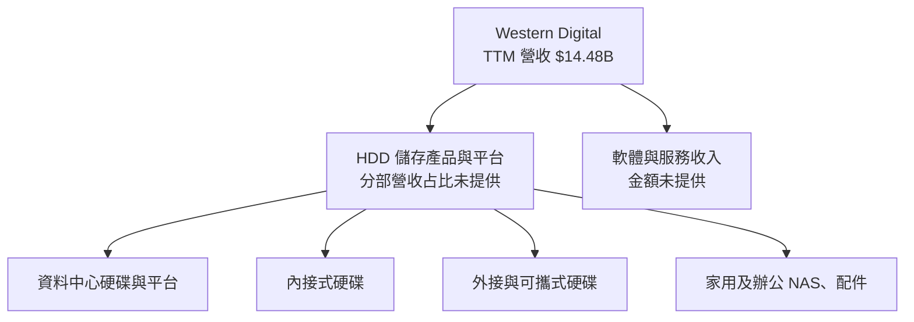
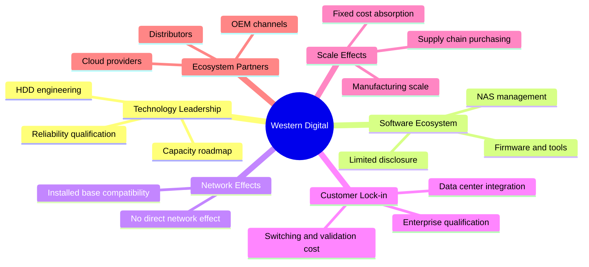
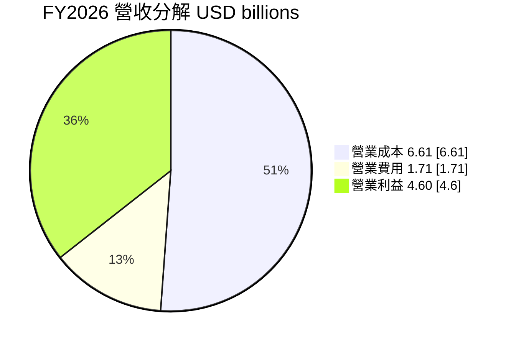
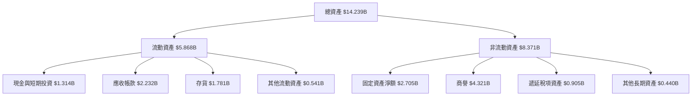
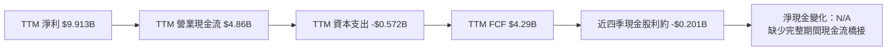
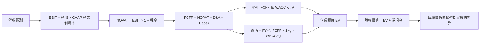
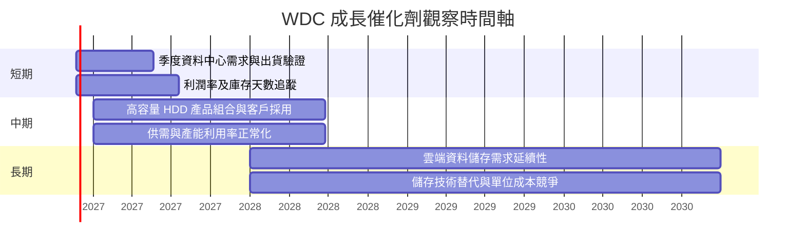
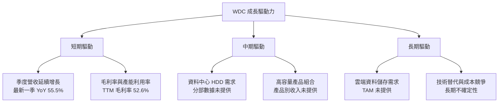
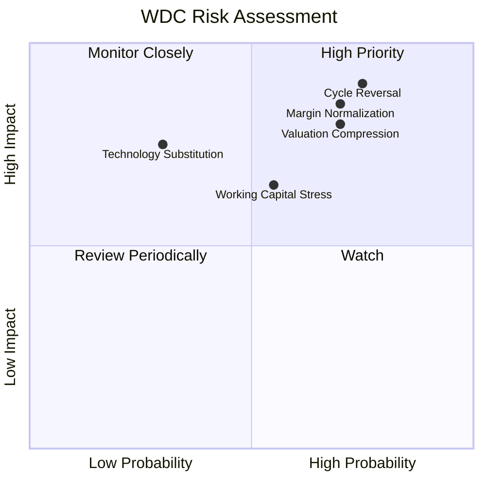
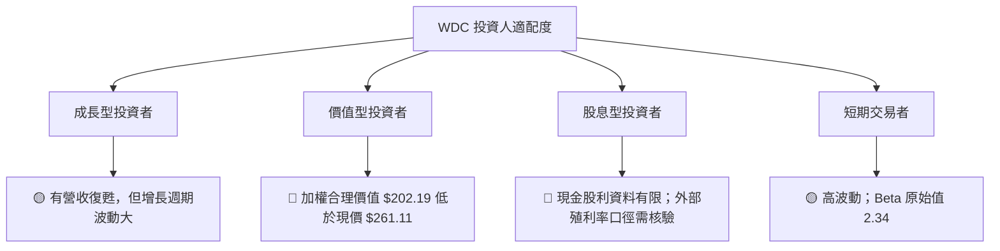

# WDC 基本面深度分析報告
> **報告日期**：2026-11-22 ｜ **語言**：繁體中文 ｜ **數據來源**：SEC 申報資料 (XBRL)、Yahoo Finance、Finviz、StockAnalysis、Roic.ai ｜ **分析師**：CFA 級機構研究

## 目錄

| # | 章節 | 核心結論 |
|---|------|----------|
| 1 | 執行摘要 | 賣出；加權合理價值 $202.19；MOS -29.1% |
| 2 | 公司概覽與商業模式 | HDD 業務具規模與客戶黏著度，但細分營收資料未提供 |
| 3 | 損益表深度分析 | TTM 營收 $14.48B、TTM 成長 20.7%；週期復甦帶來高利潤率 |
| 4 | 資產負債表分析 | 最新季報口徑淨現金 $525M；現金轉換週期較一年前延長 |
| 5 | 現金流量深度分析 | TTM FCF $4.29B、FCF Yield 4.39%；現金流仍須與淨利差異交叉檢查 |
| 6 | 獲利能力與資本效率 | ROIC 61.1% 高於 WACC 14.00%，但週期高峰可持續性是關鍵 |
| 7 | 相對估值分析 | 同業倍數分歧大；自身 P/S 位於五年區間第 85 百分位 |
| 8 | DCF 內在價值評估 | 基準 DCF $182.17；加權合理價值 $202.19，均低於現價 |
| 9 | 成長催化劑 | 高容量 HDD、資料中心需求為潛在驅動；TAM 數字未提供 |
| 10 | 風險矩陣 | 週期反轉、估值收縮與營運資金惡化為主要風險 |
| 11 | 投資建議 | 依 MOS 評級為賣出；等待估值回落或基本面再次驗證 |

---

## 1. 執行摘要

WDC 2026-11-20 收盤價為 **$261.11**。最新 TTM 營收 **$14.48B**、營收年增 **20.7%**，最新一季營收年增 **55.5%**，TTM FCF **$4.29B**、ROIC **61.1%**；但 DCF 基準價值僅 **$182.17**，相對現價折溢價為 **+43.3%**（現價 ÷ DCF 價值 − 1），加權合理價值為 **$202.19**，MOS 為 **-29.1%**。依 MOS 門檻評級為 **賣出**，理由是市場價格高於三角驗證後的合理價值，且高 ROIC 可能處於週期性高點。

### 1.0 一頁式投資儀表板

| 項目 | 內容 |
|------|------|
| **投資論點（3 句）** | ① TTM 營收成長 20.7%、最新一季年增 55.5%，反映 HDD 需求復甦；② ROIC 61.1% 高於 WACC 14.00%，當前營運回報高；③ 加權合理價值 $202.19 低於現價 $261.11，估值缺乏下檔保護。 |
| **綜合評分** | **6.3/10**（引用 1.1 評分卡） |
| **財務健康** | 🟡 最新季報口徑淨現金 $525M；流動比率 1.434，但速動比率 0.867，CCC 由 34 天升至 52 天。 |
| **ROIC vs WACC** | **61.1% vs 14.00%**；現階段創造價值，利差 47.1 個百分點。 |
| **FCF 趨勢** | 近年由負轉正；TTM FCF $4.29B，FCF Yield 4.39%。 |
| **估值** | Forward P/E（Yahoo Finance 合併資料）6.46x ｜ EV/EBITDA 15.423x ｜ FCF Yield 4.39%。 |
| **DCF 內在價值（基準）** | $182.17 ｜現價相對 DCF 溢價 **43.3%**。 |
| **安全邊際（MOS）** | **-29.1%**＝($202.19 − $261.11) ÷ $202.19；🔴 無安全邊際。 |
| **預期報酬（基準情境 12M）** | DCF 基準情境相對現價 **-30.2%**；這是模型情境輸出，不是保證報酬。 |
| **關鍵風險（前二）** | HDD 供需週期反轉；當前高利潤率與高 ROIC 回歸常態。 |
| **評級 + 信心度** | 🔴 **賣出** ｜信心：中（週期與資料來源間存在口徑差異）。 |

### 1.1 綜合評分卡（全報告唯一）

| 維度 | 評分（1–10） | 主要依據（引用數字與其來源章節） |
|------|--------------|----------------------------------|
| 成長性 | 8.0 | TTM 營收成長 20.7%、最新一季年增 55.5%（第 3 章）；但資料中心需求能否延續仍待驗證。 |
| 獲利能力 | 9.0 | TTM ROIC 61.1%、營業利益率 39.4%，F-Score 6/8（第 3、6 章）。 |
| 財務健康 | 7.0 | 淨現金 $525M、流動比率 1.434；CCC 同比增加 18 天（第 4 章）。 |
| 估值 | 2.0 | MOS -29.1%；P/S 5 年百分位 85%（第 7、8 章）。 |
| 護城河 | 7.0 | HDD 製造規模、產品驗證與企業客戶黏著度；市場份額和細分營收未提供（第 2 章）。 |
| 管理層與資本配置 | 5.0 | FY2026 SBC $204M、稀釋股數測試未通過；現金股利資料與外部殖利率欄位口徑不一致（第 3、5 章）。 |
| **綜合評分** | **6.3** | 六項算術平均：(8.0 + 9.0 + 7.0 + 2.0 + 7.0 + 5.0) ÷ 6 = 6.33，四捨五入至一位小數。 |

### 1.2 五大投資論點 + 三大核心風險

| 類型 | 項目 | 具體依據 | 信心度 |
|------|------|----------|--------|
| 🟢 **投資論點①** | 營收動能回升 | TTM 營收 $14.48B、TTM 年增 20.7%；最新一季年增 55.5%。 | 🟢 高 |
| 🟢 **投資論點②** | 目前資本回報高 | ROIC 61.1% 對比 WACC 14.00%，利差 47.1 個百分點。 | 🟢 高 |
| 🟢 **投資論點③** | FCF 已恢復正值 | TTM FCF $4.29B，FY2026 FCF $3.51B，FY2025 為 $1.28B。 | 🟡 中 |
| 🟢 **投資論點④** | 淨現金與流動性提供緩衝 | 最新季報現金與短期投資 $1.31B、總債務 $789M、淨現金 $525M。 | 🟢 高 |
| 🟢 **投資論點⑤** | 企業儲存需求可能支持容量與組合升級 | HDD 面向資料中心及企業儲存；產品組合與分部營收數據未提供，故不量化其貢獻。 | 🟡 中 |
| 🟡 **風險①** | 週期性供需反轉 | 2023 財年營業虧損 $402M，2026 財年營業利益 $4.60B，顯示獲利具有週期波動。 | 🔴 高衝擊 |
| 🔴 **風險②** | 現價高於模型合理價值 | 加權合理價值 $202.19，較現價低 22.6%；MOS -29.1%。 | 🔴 高 |
| 🟡 **風險③** | 營運資金效率走弱 | DSO 由 41 天升至 56 天、DIO 由 70 天升至 95 天，CCC 增加 18 天。 | 🟡 中 |

### 1.3 快速統計卡片

| 指標 | 公司實際值（期間） | 同業中位數 | 狀態 |
|------|--------------------|------------|------|
| 營收成長（TTM） | **20.7%** | — | 🟢 |
| 營收成長（最新一季年增） | **55.5%** | **61.0%**（STX、SNDK、MU 中位數） | 🟢 |
| 毛利率（TTM） | **52.6%** | **80.7%**（STX、SNDK、MU 中位數） | 🟡 |
| 營業利益率（TTM） | **39.4%** | — | 🟢 |
| ROIC（TTM） | **61.1%** | — | 🟢 |
| Forward P/E | **6.46x** | **2.8x**（Peer multiples 中位數） | 🟡 |
| FCF Yield（TTM） | **4.39%** | — | 🟡 |
| Piotroski F-Score | **6 / 8** | — | 🟢 |

### 1.4 投資結論

```
╔══════════════════════════════════════════════════════════════════╗
║                    📊 投資結論摘要                               ║
╠══════════════════════════════════════════════════════════════════╣
║  評級：賣出（依 MOS 門檻；未作質化調整）                          ║
║  價格（2026-11-20 收盤）：$261.11                                ║
║  DCF 內在價值（基準）：$182.17（現價溢價 43.3%）                 ║
║  安全邊際 MOS：-29.1%（以加權合理價值 $202.19 為分母）           ║
║  加權合理價值（8.8）：$202.19                                    ║
║  DCF 情境價值：                                                  ║
║    悲觀情境：$100.40（-61.6%）                                   ║
║    基準情境：$182.17（-30.2%）                                   ║
║    樂觀情境：$313.26（+20.0%）                                   ║
║  綜合評分：6.3/10（引用 1.1）                                    ║
║  適合投資人：能承受高波動、願意等待估值回落的週期型投資人        ║
╚══════════════════════════════════════════════════════════════════╝
```

---

## 2. 公司概覽與商業模式

### 2.1 業務結構與收入來源

公司資料將 WDC 描述為以 HDD 技術為基礎，開發、製造及銷售儲存裝置與解決方案。總營收採 TTM **$14.48B**。財務資料未提供各產品線營收及百分比，因此不虛構分部占比。



### 2.2 市場份額

市場份額數據未提供，故不繪製市占率圖。WDC TTM 營收為 $14.48B，最新一季營收年增 55.5%；Peer multiples 中 STX 最新一季營收年增 61.0%。SNDK 與 MU 的營收成長率分別為 377.9% 與 379.3%，但公司業務組合不同，不能直接視為 HDD 市場份額比較。

### 2.3 競爭護城河分析



### 2.4 護城河強度

| 護城河項目 | 強度（強／中／弱） | 證據（引用數字或事實） | 會削弱它的情況 |
|------------|--------------------|------------------------|----------------|
| 技術與可靠性驗證 | 中 | HDD 產品用於資料中心、內接、外接及 NAS 等情境；產品線具體收入與市占未提供。 | 新儲存技術替代、故障率或容量成本競爭力落後。 |
| 客戶鎖定 | 中 | 企業級儲存需驗證、整合與維持相容性，可能增加更換成本；客戶集中度未提供。 | 主要客戶轉向競品或內部化採購。 |
| 規模效應 | 中至強 | FY2026 營收 $12.92B，具製造與供應鏈規模；單位成本資料未提供。 | 產能利用率下降、價格下跌導致固定成本吸收惡化。 |
| 軟體生態系統 | 弱至中 | 有 NAS 等產品與相關配件，軟體收入及用戶數未提供。 | 軟體服務未形成持續性收入或差異化。 |
| 網路效應 | 弱 | 資料未顯示直接網路效應；相容性主要支援客戶黏著。 | 標準化產品使切換成本下降。 |
| 生態夥伴 | 中 | 通路包含銷售人員、經銷商及分銷商；合作夥伴營收貢獻未提供。 | 通路去中介化、夥伴改推競品。 |

護城河評分 **7.0/10**：有企業級驗證、製造規模及客戶整合等支撐，但市占、客戶留存、產品組合及軟體收入資料不足，故不給更高分。

---

## 3. 損益表深度分析

### 3.1 年度收入成長趨勢（近 4 年）

以下以年度損益表金額呈現；YoY 以相鄰財年營收計算，2023 財年之前的比較基期未納入本圖。

```
╔══════════════════════════════════════════════════════════════════╗
║              WDC 年度收入趨勢（FY2023-FY2026）                   ║
╠══════════════════════════════════════════════════════════════════╣
║  FY2023  $6.25B   ██████████░░░░░░░░░░░░░░░░  基期               ║
║  FY2024  $6.32B   ██████████░░░░░░░░░░░░░░░░  YoY +1.0%         ║
║  FY2025  $9.52B   ███████████████░░░░░░░░░░░  YoY +50.7%        ║
║  FY2026  $12.92B  █████████████████████░░░░░  YoY +35.7%        ║
╠══════════════════════════════════════════════════════════════════╣
║  FY2023-FY2026 營收 CAGR：約 27.4%                               ║
╚══════════════════════════════════════════════════════════════════╝
```

計算：FY2023 至 FY2026 三年營收 CAGR = \((12.92 ÷ 6.25)^{1/3} − 1\) = 約 **27.4%**。FY2025、FY2026 的高成長主要呈現從低谷復甦的特性，不宜直接外推為長期穩態增速。

### 3.2 季度收入趨勢分析

| 季度 | 營收 | QoQ 成長 | YoY 成長 | 備註 |
|------|------:|---------:|---------:|------|
| 2025-12-31 | $3.02B | 7.2% | 25.2% | QoQ 以 2025-09 季營收 $2.818B 為基期。 |
| 2026-03-31 | $3.34B | 10.6% | 45.5% | 營收延續復甦；年增率以 StockAnalysis 單季資料為準。 |
| 2026-06-30 | $3.75B | 12.3% | 43.8% | 季增幅擴大。 |
| 2026-10-02 | $4.38B | 16.9% | 55.5% | SEC 最新季報；YoY 是單季成長率，不是 TTM。 |

QoQ 計算按列示季序、使用未四捨五入收入近似值；2026-10-02 單季營收為 $4.381B。最新季度收入較前季增加約 $0.634B，顯示復甦仍在加速，但收入增速及利潤率可能受價格與產品組合週期左右。

### 3.3 利潤率演變分析

年度毛利率及營業利益率由年度毛利、營業利益除以年度營收計算，四捨五入至一位小數；最新 TTM 營業利益率另採 VERIFIED 數值。

| 利潤率指標 | FY2023 | FY2024 | FY2025 | FY2026 | 趨勢 | 評估 |
|------------|-------:|-------:|-------:|-------:|------|------|
| **毛利率** | 22.3% | 28.1% | 38.8% | 48.8% | ↗️ 持續改善 | 🟢 |
| **營業利益率** | -6.4% | 1.5% | 22.4% | 35.6% | ↗️ 從虧損轉為高獲利 | 🟢 |
| **TTM 營業利益率** | — | — | — | **39.4%** | 高於 FY2026 年度值 | 🟢 |

毛利率與營業利益率改善幅度大，與收入從低谷恢復、產能利用率及產品組合改善相符；但資料未提供價格、出貨量及單位成本拆分，不能將改善幅度精確歸因於單一因素。若供需轉弱，固定製造成本和價格競爭可能使利潤率快速回落。

### 3.4 費用結構分析

FY2026 收入 $12.92B、毛利 $6.31B、營業利益 $4.60B；成本及費用分解為營業成本約 $6.61B，毛利與營業利益之間的營業費用約 $1.71B。以下是收入分解，不代表完整費用科目披露。



```
╔══════════════════════════════════════════════════════════════════╗
║                FY2026 收入與營業利益分解                        ║
╠══════════════════════════════════════════════════════════════════╣
║  營業成本 $6.61B   ██████████████████████░░░░░░  51.2%           ║
║  營業費用 $1.71B   ██████░░░░░░░░░░░░░░░░░░░░░  13.2%           ║
║  營業利益 $4.60B   ███████████████░░░░░░░░░░░░░  35.6%           ║
╚══════════════════════════════════════════════════════════════════╝
```

### 3.5 季度 EPS 趨勢與盈餘品質（Quality of Earnings）

| 盈餘品質項目 | 數值／佔比 | 評估 |
|--------------|-----------:|------|
| 股權薪酬 SBC / 營收 | 約 **1.6%**；四季 SBC 合計 $230M ÷ TTM 營收 $14.48B | 🟡 SBC 有稀釋成本，但相對營收比率不高。 |
| SBC / 營業現金流 | 約 **4.7%**；$230M ÷ $4.86B | 🟡 現金流覆蓋尚可，但股份稀釋仍須追蹤。 |
| FCF / 淨利 | 約 **43.3%**；TTM FCF $4.29B ÷ TTM 淨利 $9.913B | 🔴 淨利轉現金比例偏低；淨利含非營業／稅務影響的可能性須查證。 |
| 一次性／非經常性損益 | **無法完整拆分**；FY2026 淨利 $9.30B 明顯高於營業利益 $4.60B | 🟡 兩者差額需由 SEC 申報附註核對，不能將差額直接判為一次性收益。 |
| 有效稅率異常 | **4.9%**（DCF 採用稅率） | 🟡 低於一般長期穩態稅率的可能性高；模型照採指定數字，估值可能因此偏高。 |
| 資本化支出 vs 費用化 | TTM Capex $572M；資本化與費用化明細未提供 | 🟡 無法判斷是否有成本遞延。 |

季度 EPS 實際值為 2026-10 季 $4.63、2026-06 季 $8.21、2026-03 季 $8.20、2025-12 季 $4.67。EPS 預估值均為缺失（nan），因此**無法判定過去四季是否超預期或不及預期**，不以方向性標記替代缺失的預期數據。

**盈餘品質結論**：TTM FCF 為正且達 $4.29B，顯示現金創造能力存在；然而 FCF/淨利約 43.3%、有效稅率 4.9%，加上年度淨利與營業利益差距明顯，GAAP 淨利的可持續性需審慎看待。估值宜更多參考 FCFF、週期中段利潤率及正常化稅率；本報告 DCF 仍依模型指定 4.9% 稅率，須視為重大敏感假設。

---

## 4. 資產負債表分析

### 4.1 資產結構分解

以下資產細項採 StockAnalysis 最新列示 TTM 資產負債表，總資產 $14.239B；現金與短期投資與最新季 SEC 核心數據約 $1.31B 一致。



### 4.2 流動性與營運資金分析

流動比率與速動比率依財務數據列示；營運資金天數照 SEC／Yahoo 季度資產負債表計算的 QUALITY FIGURES 原值引用。

| 指標 | 最新 TTM | 一年前 TTM | 變化 | 解讀 |
|------|---------:|-----------:|-----:|------|
| 流動比率 | 1.434 | N/A | N/A | 流動資產覆蓋流動負債，但未提供一年前同口徑比率。 |
| 速動比率 | 0.867 | N/A | N/A | 低於 1，短期流動性較依賴存貨變現。 |
| DSO 應收帳款天數 | 56 天 | 41 天 | +15 天 | 收款天數增加；可能反映客戶組合或付款條件變化，需觀察應收帳款增幅。 |
| DIO 存貨天數 | 95 天 | 70 天 | +25 天 | 庫存週轉放慢或備貨增加，若需求不如預期可能形成減值風險。 |
| DPO 應付帳款天數 | 99 天 | 77 天 | +22 天 | 付款天數增加，短期支持現金，但不能單獨解讀為議價力提升。 |
| CCC 現金轉換週期 | 52 天 | 34 天 | +18 天 | 收款與庫存天數上升幅度大於付款延期，整體營運資金佔用增加。 |

### 4.3 債務結構分析

最新 VERIFIED 季報口徑現金及短期投資 $1.31B、債務 $789M、淨現金 $525M。其他年末資料列示總債務與現金有不同金額，故本節採最新季度口徑，不混用財年末資料。

```
╔══════════════════════════════════════════════════════════════════╗
║                   WDC 債務健康診斷                               ║
╠══════════════════════════════════════════════════════════════════╣
║  總債務：        $0.789B  ███████████░░░░░░░░░  🟢             ║
║  現金+短期投資： $1.310B  ████████████████████  🟢             ║
║  淨現金：        $0.525B  ████████░░░░░░░░░░░░  🟢             ║
║  Debt / EBITDA：約 0.13x（以 TTM EBITDA 約 $6.31B 計）          ║
║  利息保障倍數：N/A（利息支出與一致期間 EBIT 未提供）            ║
╚══════════════════════════════════════════════════════════════════╝
```

### 4.4 股東權益趨勢

| 財年 | 股東權益 | 年變化 | 解讀 |
|------|---------:|------:|------|
| FY2023 | $11.84B | — | 年度財報列示。 |
| FY2024 | $11.05B | -6.7% | 權益下降。 |
| FY2025 | $5.54B | -49.9% | 顯著下降；單靠現有摘要無法拆解變化來源。 |
| FY2026 | $8.86B | +59.9% | 權益回升，與獲利恢復同期發生。 |

股東權益趨勢受淨利、分派、股權薪酬及會計調整共同影響；此處不把資產負債表期末股數變化直接等同回購或發股。

```
╔══════════════════════════════════════════════════════════════════╗
║                 股東權益變化（USD billions）                     ║
╠══════════════════════════════════════════════════════════════════╣
║  FY2023  $11.84B  ████████████████████                         ║
║  FY2024  $11.05B  ███████████████████                          ║
║  FY2025   $5.54B  █████████                                    ║
║  FY2026   $8.86B  ███████████████                              ║
╚══════════════════════════════════════════════════════════════════╝
```

---

## 5. 現金流量深度分析

### 5.1 現金流量瀑布圖



營業現金流低於淨利，代表應計項目、非現金收益、稅務及營運資金變動對兩者有影響；圖示不是從淨利直接推導營業現金流的會計調節表。

### 5.2 FCF 轉換率趨勢

| 財年 | FCF | 淨利 | FCF / 淨利 | 解讀 |
|------|----:|----:|-----------:|------|
| FY2023 | -$1.23B | -$1.68B | 74%（以負值相除） | 比率在負盈餘時解讀有限，重點是現金流為負。 |
| FY2024 | -$0.781B | -$0.798B | 98% | 淨利與現金流均為負。 |
| FY2025 | $1.28B | $1.86B | 68.8% | 現金流恢復正值但仍低於會計淨利。 |
| FY2026 | $3.51B | $9.30B | 37.7% | 淨利大幅高於 FCF，應核對非營業項目及稅務。 |
| TTM | $4.29B | $9.913B | 43.3% | 盈餘現金轉換有待改善。 |

### 5.3 自由現金流趨勢

| 財年／期間 | FCF | FCF YoY | FCF Yield |
|------------|----:|--------:|----------:|
| FY2023 | -$1.23B | N/A | N/A |
| FY2024 | -$0.781B | +36.5%（虧損收窄） | N/A |
| FY2025 | $1.28B | 轉正 | N/A |
| FY2026 | $3.51B | 約 +174.2% | N/A |
| TTM | $4.29B | N/A（TTM 前期 FCF 數據未列於 VERIFIED 指標） | **4.39%** |

FY2026 對 FY2025 的 FCF YoY = \((3.51 ÷ 1.28) − 1\) ≈ 174.2%；增幅受低基期影響，不宜當作穩態增長率。

```
╔══════════════════════════════════════════════════════════════════╗
║                 WDC 自由現金流趨勢（USD billions）               ║
╠══════════════════════════════════════════════════════════════════╣
║  FY2023  -$1.23B  ◀██████░░░░░░░░░░░░░░                         ║
║  FY2024  -$0.78B  ◀████░░░░░░░░░░░░░░░                          ║
║  FY2025   $1.28B  ██████░░░░░░░░░░░░░░                          ║
║  FY2026   $3.51B  █████████████████░░░                          ║
║  TTM      $4.29B  ████████████████████  Yield 4.39%              ║
╚══════════════════════════════════════════════════════════════════╝
```

### 5.4 資本配置評估

已知 FY2026 Capex $418M、現金股利 $184M、SBC $204M；資料未提供同年度回購金額、收購與其他投資完整明細，故不繪製會暗示資金用途完整分配的圓餅圖。

| 項目 | 金額／資訊 | 評估 |
|------|------------|------|
| Capex | FY2026 $418M；TTM $572M | TTM Capex 約為營收 4.0%，模型假設由 3.9% 緩降至 3.0%。 |
| 現金股利 | FY2026 $184M | FY2025 為 $44M；股息支出資料不支持「高殖利率」敘述。 |
| 股票回購 | N/A | 未提供可靠回購金額。 |
| SBC | FY2026 $204M | 需與股數稀釋一同評估；F-Score 稀釋股數測試未通過。 |
| 留存現金／其他投資 | N/A | 缺少完整資金配置明細。 |

---

## 6. 獲利能力與資本效率

### 6.1 ROE / ROA / ROIC 趨勢

| 指標 | 可用期間 | 數值 | 評估 |
|------|----------|-----:|------|
| ROE | TTM，QUALITY FIGURES | **107.2%** | 高回報，但淨利率及非營業項目可能造成波動。 |
| ROA | TTM | **25.9%** | 資產回報為正；歷史可比序列未提供。 |
| ROIC | TTM | **61.1%** | 顯著高於 WACC；應以週期中段觀點檢查持續性。 |
| 同業／行業均值 | — | N/A | 沒有可引用的同口徑 ROE、ROA、ROIC 行業均值，故不列。 |

### 6.2 ROIC vs WACC 分析（核心價值創造判斷）

WACC 採 VERIFIED FIGURES **14.00%**；計算值為 14.44%，因模型指定限制在 7%–14% 區間，採用上限 14.00%。

```
╔══════════════════════════════════════════════════════════════════╗
║                ROIC vs WACC 深度分析                            ║
╠══════════════════════════════════════════════════════════════════╣
║  WACC（引用資本成本資料）：                                     ║
║  ├── 無風險利率（10Y 美債）：       4.91%                       ║
║  ├── 市場風險溢酬 ERP：             5.00%                       ║
║  ├── Beta（調整後）：               1.90                        ║
║  ├── 股權成本：                     14.39%                      ║
║  ├── 稅前債務成本：                 20.91%                      ║
║  ├── 股權／債務權重：               99.2%／0.8%                 ║
║  └── 計算 WACC 14.44%；採用 WACC： 14.00%                      ║
║                                                                  ║
║  ROIC（TTM）：                   61.1%                           ║
║  ROIC − WACC：                   61.1% − 14.0% = 47.1 個百分點  ║
║  ROIC / WACC：                   61.1% ÷ 14.0% = 4.36 倍        ║
║                                                                  ║
║  ROIC 61.1%  ▓▓▓▓▓▓▓▓▓▓▓▓▓▓▓▓▓▓▓▓▓▓▓▓▓▓▓▓▓▓▓▓▓▓▓▓▓▓▓▓▓░░░░   ║
║  WACC 14.0%  ▓▓▓▓▓▓▓▓▓▓▓░░░░░░░░░░░░░░░░░░░░░░░░░░░░░░░░░   ║
╚══════════════════════════════════════════════════════════════════╝
```

資本成本來源：CAPM 股權成本 = 4.91% + 1.90 × 5.00% = 14.41%，官方列示 14.39%（採原值）；差異可能來自未四捨五入輸入。以提供的權重與成本計算 WACC 約 14.44%，模型採用上限 14.00%。因此現有 ROIC 高於折現率，代表當期經濟利潤為正；若 ROIC 隨 HDD 週期正常化下降，價值創造幅度可能大幅縮小。

### 6.3 杜邦三因素分解

| 因素 | 數值（TTM） | 解讀 |
|------|-------------|------|
| 淨利率 | 69.2% | 偏高，且與營業利益率有顯著差距，需留意非營業或稅務因素。 |
| 資產週轉率 | 1.02 | 每單位資產產生約 1.02 倍營收。 |
| 權益乘數 | 1.52 | 槓桿不是 ROE 的主要放大來源。 |
| **ROE** | **107.2%** | QUALITY FIGURES 原值：69.2% × 1.02 × 1.52 = 107.2%。 |

ROE 的主要推動因素是高淨利率，而非高財務槓桿；但淨利率可能受非營業損益和低稅率影響，不能簡單外推。

### 6.4 財務體質：Piotroski F-Score

**Piotroski F-Score：6 / 8**。一項缺少輸入而未列入分母；以下依 QUALITY FIGURES 逐項照列。

| 測試 | 結果 | 解讀 |
|------|------|------|
| ROA > 0 | ✅ 通過 | TTM 資產報酬為正。 |
| 營業現金流 > 0 | ✅ 通過 | TTM OCF $4.86B。 |
| ROA 高於一年前 | ✅ 通過 | 盈利復甦改善資產回報。 |
| 營業現金流 > 淨利 | ❌ 未通過 | 淨利高於營業現金流，盈餘現金轉換偏弱。 |
| 長期負債 ÷ 總資產低於一年前 | — 無法判定 | 缺少輸入，不補推。 |
| 流動比率高於一年前 | ✅ 通過 | QUALITY FIGURES 判定通過。 |
| 稀釋股數未增加 | ❌ 未通過 | 代表股東可能承受股份稀釋。 |
| 毛利率高於一年前 | ✅ 通過 | 與產品組合、週期復甦一致。 |
| 資產週轉率高於一年前 | ✅ 通過 | 資產利用效率改善。 |

---

## 7. 相對估值分析

### 7.1 同業估值比較表格

公司倍數按 VERIFIED Peer multiples 優先列示；資料另列 Yahoo Finance 合併口徑的現價倍數，兩來源差異顯示倍數口徑及更新時間可能不同。本表的 WDC 對比優先使用歷史估值區塊同口徑倍數：P/E 10.1x、P/S 6.9x、EV/EBITDA 17.5x；Forward P/E 無對應 VERIFIED Peer 區塊數值，採財務資料表列的 Yahoo Finance 6.46x。

| 估值指標 | **WDC** | **STX** | **SNDK** | **MU** | WDC 評估 |
|----------|---------:|-------:|--------:|------:|-----------|
| **Trailing P/E** | 10.1x | 24.0x | 0.1x | 8.0x | 🟡 SNDK TTM P/E 幾乎無可比性；WDC 低於 STX、高於 MU。 |
| **Forward P/E** | 6.46x | 7.0x | 2.2x | 2.8x | 🟡 接近 STX，但高於 SNDK、MU；預期盈餘基期可能差異很大。 |
| **P/S Ratio** | 6.9x | 7.6x | 3.1x | 5.1x | 🔴 高於 peer 中位數 5.1x。 |
| **EV/EBITDA** | 17.5x | 18.1x | 4.0x | 5.8x | 🔴 高於 peer 中位數 5.8x；不同業務組合與週期使比較有局限。 |
| **最新一季營收年增** | 55.5% | 61.0% | 377.9% | 379.3% | 🟡 WDC 成長快，但低於 STX；SNDK、MU 的增速不可直接類比。 |
| **TTM 毛利率** | 52.6% | 50.4% | 80.0% | 80.7% | 🟢 高於 STX、低於 SNDK/MU。 |

Peer P/E 中位數：(24.0 + 0.1 + 8.0) ÷ 3 = 8.0x；Forward P/E 中位數為 2.8x；P/S 中位數為 5.1x；EV/EBITDA 中位數為 5.8x。估值差異反映週期位置、盈利分母與業務結構差別，不能僅以單一倍數斷定便宜或昂貴。

### 7.2 歷史估值區間分析

```
╔══════════════════════════════════════════════════════════════════╗
║                 WDC 五年估值區間（TTM）                          ║
╠══════════════════════════════════════════════════════════════════╣
║  P/E        6.3x ─────────────●10.1x────── 13.5x ─────── 62.5x  ║
║                                中位數 13.5x；現值百分位 38%      ║
║  P/S        0.4x ───────────────────────●6.9x──── 16.0x          ║
║                                中位數 1.2x；現值百分位 85%       ║
║  EV/EBITDA  4.5x ─────────────── 14.9x ──●17.5x───── 96.5x       ║
║                                中位數 14.9x；現值百分位 62%      ║
╚══════════════════════════════════════════════════════════════════╝
```

P/E 現值低於五年中位數，但 P/S 位於 85 百分位、EV/EBITDA 位於 62 百分位。當前收入及利潤處於復甦階段，以低 P/E 直接判斷便宜，可能忽略週期高峰的分母效應。

### 7.3 情境價值（照抄 DCF MODEL Scenarios）

| 情境 | 第 1 年營收成長 | 期末營業利潤率 | WACC | 每股價值 | 相對現價 | 機率 | 會發生的條件 |
|------|----------------:|----------------:|-----:|---------:|---------:|-----:|--------------|
| 🔴 悲觀 | 10.3% | 19.4% | 15.00% | $100.40 | -61.6% | 25% | HDD 需求增速回落、價格或利用率下滑，利潤率向較低水準收斂。 |
| 🟡 基準 | 20.7% | 22.8% | 14.00% | $182.17 | -30.2% | 50% | 初期延續 TTM 成長，之後逐步減速，營業利潤率回歸五年中位數。 |
| 🟢 樂觀 | 31.0% | 25.1% | 13.00% | $313.26 | +20.0% | 25% | 高成長延長、產品組合與規模效益支持較高期末利潤率。 |

以上機率與估值為模型情境設定，不是經營結果保證。機率加權值 $194.50 為情境參考值，不取代 8.8 固定方法權重的加權合理價值。

### 7.4 相對估值隱含價格區間

```
╔══════════════════════════════════════════════════════════════════╗
║            估值方法回推每股價值與現價位置                        ║
╠══════════════════════════════════════════════════════════════════╣
║  $96.34      $182.17      $195.39    $261.11       $613.38       ║
║  EV/EBITDA    DCF基準       P/S       現價          分析師共識    ║
╚══════════════════════════════════════════════════════════════════╝
```

| 方法 | 每股價值 | 方法依據 |
|------|---------:|----------|
| 同業 EV/EBITDA | $96.34 | STX、SNDK、MU 中位數 5.8x × WDC TTM EBITDA，加回淨現金。 |
| 同業 P/S | $195.39 | 同業 P/S 中位數 5.1x × WDC TTM 營收。 |
| 分析師共識 | $613.38 | 24 位分析師平均目標價；共識與本報告現價／DCF 差距很大，僅作參考。 |

---

## 8. DCF 內在價值評估（Discounted Cash Flow）

### 8.0 估值推理鏈（Thinking Logic）

**Step 1 — 價值來源與主導變數**

模型以 HDD 主業產生的 FCFF 為核心；資料沒有可拆分的業務收入占比，因此不能另行估算第二成長曲線或軟體選擇權價值。估值主要由營收路徑、營業利潤率及 WACC 決定，其中 WACC 對折現現值具有直接作用，期末利潤率則決定後段現金流底盤。

**Step 2 — 模型選擇**

| 決策點 | 本報告採用 | 理由 | 曾考慮但否決 | 否決理由 |
|--------|-----------|------|--------------|----------|
| 現金流定義 | FCFF | 與 WACC 折現，先得到 EV 再橋接股權價值。 | FCFE | 債務成本與資本結構已納入 WACC。 |
| 預測期 N | 10 年 | DCF MODEL 指定十年，能呈現成長與利潤率逐步收斂。 | 5 年 | 與既定模型不一致，且會更依賴短期週期假設。 |
| 終值方法 | Gordon Growth | 模型提供永續成長率 3.0% 與終值。 | 退出倍數 | DCF MODEL 未提供可直接照抄的退出倍數終值。 |
| EBIT 基礎 | GAAP EBIT | 模型明確採 GAAP EBIT，已含 SBC 費用。 | 非 GAAP EBIT | 會改變模型指定盈利基礎。 |

**Step 3 — 關鍵假設推導**

- **營收成長路徑**：錨點為 TTM 營收年增 20.7% → 近期單季年增 55.5% 顯示復甦，但單季增速不宜線性外推 → 採用 FY+1 20.7%，逐年線性下降至 FY+10 3.0% → 曾考慮持續採用 55.5%，但否決，因單季高增長與低基期／週期反彈有關，長期延續缺乏證據。
- **期末營業利潤率**：錨點為 TTM GAAP 營業利益率 39.4% → 模型向最近五個財年的中位數回歸 → 採用 FY+1 39.4%、FY+10 22.8% → 曾考慮長期維持 39.4%，但否決，因 2023 財年營業利益率為負，歷史週期波動大。
- **永續成長率 g**：長期宏觀增長合理值沒有在財務數據中提供；模型採 3.0% → 取模型原值且低於 WACC 14.00% → 不採更高 g，以免終值分母過度縮小。
- **預測期 N**：模型指定 10 年 → 採用 10 年 → 不改為 5 年或更長，避免改動程式模型輸出。
- **Capex／營收**：錨點為 TTM $572M ÷ $14.48B 約 3.9% → 模型讓其逐步下降至 D&A 的 1.1 倍、FY+10 為 3.0% → 採用模型逐年值 → 不採用永久維持 FY+1 3.9%，因模型假設成熟期資本強度下降。
- **EBIT 與 SBC**：採 GAAP EBIT，SBC 已包含在營業費用中 → 不另扣 SBC；採固定股數，不再增加稀釋 → 否決非 GAAP 加回 SBC，避免改變模型基礎。
- **年稀釋率**：採 0%（模型組合 A）→ 股數使用模型所隱含的固定股數處理 → 不另加入稀釋率，否則與 GAAP EBIT 已扣 SBC 的設定不一致。
- **終值方法**：採 Gordon Growth，g 3.0% → 模型輸出 TV $87.94B → 未提供退出倍數及對應終值，故不編造第二個數值作比較。
- **WACC**：資本成本區塊計算 14.44%，並註明受 7%–14% 區間限制 → 採用 14.00% → 不採未限制的 14.44%，因模型指定採用受限值。

**Step 4 — 最脆弱一環**

最脆弱假設是目前利潤率能否長期高於週期常態：若收入與利潤率同時回落，基準價值 $182.17 可能向悲觀情境 $100.40 靠攏。

**Step 5 — 計算路徑**



### 8.1 模型假設總表（Model Inputs）

| 假設項目 | 採用值 | 依據／來源 | 敏感度 |
|----------|--------|-------------|--------|
| 預測期長度 N | 10 年 | DCF MODEL 指定；此處不改動。 | 🟡 中 |
| 營收成長 | FY+1 20.7% 緩降至 FY+10 3.0% | 起點採 TTM 成長 20.7%；成熟期收斂至 3.0%。 | 🔴 高 |
| 營業利益率 | FY+1 39.4% 緩降至 FY+10 22.8% | TTM 營業利益率及最近五個財年中位數設定。 | 🔴 高 |
| 有效稅率 | 4.9% | 最新年有效稅率原值；非長期正常化稅率。 | 🟢 低 |
| Capex／營收 | FY+1 3.9% 緩降至 FY+10 3.0% | TTM Capex／Revenue 約 3.9%；模型以 1.1×D&A 為長期下限。 | 🟡 中 |
| D&A／營收 | 2.7% | TTM 比率，模型固定。 | 🟢 低 |
| 營運資金變動 | 未建模 | DCF MODEL 明確排除 ΔWC；不是假設為零。 | 🟡 中 |
| EBIT 基礎 | GAAP EBIT | DCF MODEL 指定 GAAP。 | 🟡 中 |
| SBC 處理 | GAAP 費用已扣，不再另扣 | 模型組合 **(A)**：GAAP EBIT、無 −SBC 列、固定股數。 | 🟡 中 |
| 年稀釋率 | 0% | 與組合 (A) 相容；股數不再放大。 | 🟡 中 |
| 永續成長率 g | 3.0% | DCF MODEL 指定，且低於 WACC。 | 🔴 高 |
| 終值方法 | Gordon Growth | 模型給定公式及終值；退出倍數沒有模型輸入。 | 🔴 高 |
| WACC | 14.00% | 資本成本區塊採用值；計算值 14.44% 受上限限制。 | 🔴 高 |
| FCFF | NOPAT + D&A − Capex | 營運資金不建模。 | — |

本模型採用 **(A) GAAP EBIT + 固定股數**，故 SBC 影響已計入一次；不再從 FCFF 扣 SBC，也不額外放大股數。

### 8.2 折現率推導（WACC）

Rf 資料為 10 年期美債 4.91%；資料未標示該殖利率的精確觀測日，故不補寫日期。ERP 為資本成本資料採用的假設值 5.00%。原始 Beta 為 2.34，調整後 Beta 採 ⅔×原始 Beta + ⅓ = 1.90。未另加規模或國別溢酬。

```
╔══════════════════════════════════════════════════════════════════╗
║                    WACC 推導（折現率）                           ║
╠══════════════════════════════════════════════════════════════════╣
║  股權成本 Ke（CAPM）：                                           ║
║  ├── 無風險利率 Rf：                 4.91%                       ║
║  ├── ERP（假設值）：                  5.00%                       ║
║  ├── 原始 Beta：                      2.34                        ║
║  ├── 調整後 Beta：                    ⅔×2.34 + ⅓ = 1.90          ║
║  ├── 規模／國別溢酬：                  0.00%（未另加）            ║
║  └── Ke：官方列示 14.39%（CAPM 精確輸入四捨五入差異）            ║
║                                                                  ║
║  債務成本：                                                       ║
║  ├── 稅前 Kd：                         20.91%                      ║
║  ├── 有效稅率：                       4.9%                        ║
║  └── 稅後 Kd：20.91% × (1−4.9%) =     19.89%                      ║
║                                                                  ║
║  資本結構權重：股權 99.2%／債務 0.8%                              ║
║  ├── 計算 WACC：約 14.44%                                       ║
║  └── 採用 WACC：14.00%（受限於 7%–14% 區間，上限採用）           ║
╚══════════════════════════════════════════════════════════════════╝
```

逐步演算：

1. **Ke（CAPM）** = 4.91% + 1.90 × 5.00% = 14.41%；官方列示 **14.39%**，差異來自未四捨五入輸入。
2. **稅前 Kd** = 依資本成本資料原值 **20.91%**；利息費用與平均計息負債的原始金額未提供，不能另行重建。
3. **稅後 Kd** = 20.91% × (1 − 4.9%) = **19.89%**。
4. **權重** = 股權 **99.2%**；債務 **0.8%**；兩者相加 = **100.0%**。市值與計息負債權重照資本成本區塊原值採用，未以帳面股東權益替代市值。
5. **計算 WACC** = 99.2% × 14.39% + 0.8% × 19.89% = 14.27% + 0.16% = **14.43%**，與模型列示的計算值 14.44% 存在約 0.01 個百分點的輸入精度差；**採用值 14.00%**，因官方明確將 WACC 限制在 7%–14% 區間。

第 6.2 節與 DCF 均使用採用值 **14.00%**。資本成本原始資料沒有利息支出及平均計息負債金額，故不以總負債反推 Kd。

### 8.3 逐年自由現金流預測（基準情境）

單位：USD billions。逐年表格照 DCF MODEL 輸出；FCFF 不含營運資金變動列，亦不另扣 SBC。

| 年度 | FY+1 | FY+2 | FY+3 | FY+4 | FY+5 | FY+6 | FY+7 | FY+8 | FY+9 | FY+10 |
|------|-----:|-----:|-----:|-----:|-----:|-----:|-----:|-----:|-----:|------:|
| 營收 | 17.47 | 20.74 | 24.21 | 27.79 | 31.35 | 34.75 | 37.84 | 40.46 | 42.47 | 43.75 |
| 營收 YoY | 20.7% | 18.7% | 16.7% | 14.8% | 12.8% | 10.9% | 8.9% | 6.9% | 5.0% | 3.0% |
| 營業利潤率 | 39.4% | 37.6% | 35.7% | 33.9% | 32.0% | 30.2% | 28.4% | 26.5% | 24.7% | 22.8% |
| EBIT | 6.89 | 7.79 | 8.65 | 9.42 | 10.05 | 10.50 | 10.74 | 10.73 | 10.49 | 10.00 |
| − 稅 | (0.33) | (0.38) | (0.42) | (0.46) | (0.49) | (0.51) | (0.52) | (0.52) | (0.51) | (0.49) |
| NOPAT | 6.55 | 7.41 | 8.23 | 8.96 | 9.56 | 9.99 | 10.21 | 10.21 | 9.98 | 9.51 |
| + D&A | 0.47 | 0.56 | 0.65 | 0.75 | 0.85 | 0.94 | 1.02 | 1.09 | 1.15 | 1.18 |
| − Capex | (0.69) | (0.80) | (0.90) | (1.01) | (1.10) | (1.18) | (1.25) | (1.29) | (1.31) | (1.30) |
| = FCFF | **6.33** | **7.18** | **7.98** | **8.70** | **9.30** | **9.74** | **9.99** | **10.02** | **9.82** | **9.39** |
| 折現因子 @14.00% | 0.877 | 0.769 | 0.675 | 0.592 | 0.519 | 0.456 | 0.400 | 0.351 | 0.308 | 0.270 |
| FCFF 現值 PV | **5.56** | **5.52** | **5.39** | **5.15** | **4.83** | **4.44** | **3.99** | **3.51** | **3.02** | **2.53** |

**預測期 FCF 現值合計**：$5.56 + $5.52 + $5.39 + $5.15 + $4.83 + $4.44 + $3.99 + $3.51 + $3.02 + $2.53 = **$43.94B**；DCF MODEL 原始合計為 **$43.95B**，相差約 0.02%，屬表格四捨五入尾差，估值橋接照模型原值 $43.95B。

**逐步演算（FY+1）**：各行按模型顯示值，因輸入與輸出均四捨五入至兩位小數，中間值可能出現 0.01B 尾差。

1. **營收** = $14.48B × (1 + 20.7%) = **$17.47B**。
2. **EBIT** = $17.47B × 39.4% = **$6.89B**。
3. **稅** = $6.89B × 4.9% = **$0.33B**。
4. **NOPAT** = 模型列示 **$6.55B**。
5. **D&A** = $17.47B × 2.7% = **$0.47B**。
6. **Capex** = 模型逐年資本強度假設對應 **$0.69B**。
7. **ΔWC** = 未建模，不視為明確零值；FCFF 定義依模型為 NOPAT + D&A − Capex。
8. **FCFF** = 模型列示 **$6.33B**；依顯示至兩位小數的 NOPAT、D&A、Capex 相減會有 0.01B 尾差，模型計算使用未四捨五入輸入。
9. **折現因子** = 1 ÷ (1 + 14.00%)¹ = **0.877**；PV = $6.33B × 0.877 = **$5.56B**。

**合理性自檢**

- 預測 FCFF CAGR：FY+1 $6.33B 至 FY+10 $9.39B，十年期間 CAGR 約 **4.5%**；歷史 FCF 因 FY2023、FY2024 為負，無法計算有意義的正值 CAGR。
- FY+10 FCFF 利潤率 = $9.39B ÷ $43.75B = **21.5%**；TTM FCF 利潤率 = $4.29B ÷ $14.48B = **29.6%**。同業最佳 FCF 利潤率未提供，無法比較。
- 模型年度 FCFF 均為正，最低為 FY+1 $6.33B；但其對低稅率及高起始營業利潤率敏感。

```
╔══════════════════════════════════════════════════════════════════╗
║            自由現金流：歷史實際 vs 模型預測                      ║
╠══════════════════════════════════════════════════════════════════╣
║  FY2024(實)  -$0.78B  ◀████░░░░░░░░░░░░░░░░░░                  ║
║  FY2025(實)   $1.28B  ██████░░░░░░░░░░░░░░░░░░                  ║
║  FY2026(實)   $3.51B  ███████████████░░░░░░░░░                  ║
║  FY+1 (預)    $6.33B  █████████████████████░░░                  ║
║  FY+10(預)    $9.39B  ██████████████████████████████             ║
╠══════════════════════════════════════════════════════════════════╣
║  預測 FCF 起點高於歷史財年值；負值歷史使歷史 CAGR 不適用。       ║
╚══════════════════════════════════════════════════════════════════╝
```

### 8.4 終值計算（Terminal Value）

**適用性檢查**：WACC 14.00% vs g 3.0% → **WACC > g ✅**

| 方法 | 計算式 | 終值 TV | TV 現值 | 佔總 EV 比重 |
|------|--------|--------:|--------:|-------------:|
| Gordon Growth | $9.39 × (1 + 3.0%) ÷ (14.00% − 3.0%) | $87.94B | $23.72B | 35.1% |
| 退出倍數法 | N/A | N/A | N/A | N/A |

逐步演算：

1. FY+N FCFF = FY+10 **$9.39B**。
2. 分子 = $9.39B × 1.03 = **$9.67B**。
3. 分母 = 14.00% − 3.00% = **11.00%**；$9.39 × 1.03 ÷ 11.00% = **$87.94B**（按模型未四捨五入輸入）。
4. PV(TV) = $87.94B × 0.270 = **$23.72B**。
5. TV 比重 = $23.72B ÷ $67.67B = **35.1%**。

退出倍數法因 DCF MODEL 未提供 FY+10 EBITDA 退出倍數及對應終值，故不自行補值。

### 8.5 企業價值 → 每股內在價值（Bridge）

```
╔══════════════════════════════════════════════════════════════════╗
║              企業價值 → 每股內在價值 橋接表                      ║
╠══════════════════════════════════════════════════════════════════╣
║  預測期 FCF 現值合計            +$43.95B                         ║
║  終值現值 PV(TV)                +$23.72B                         ║
║  = 企業價值 EV                   $67.67B                         ║
║  + 淨現金                       +$0.53B                          ║
║  = 股權價值                      $68.19B                         ║
║  ★ DCF MODEL 每股內在價值        $182.17                         ║
║  2026-11-20 收盤價               $261.11                         ║
║  折溢價：現價÷DCF價值−1           +43.3%（溢價）                 ║
╚══════════════════════════════════════════════════════════════════╝
```

逐步演算：

1. **EV** = $43.95B + $23.72B = **$67.67B**。
2. **股權價值** = EV $67.67B + 淨現金約 $0.53B = **模型列示 $68.19B**；兩項以兩位小數直接相加會有約 $0.01B 尾差，來自模型底層未四捨五入數值。
3. **每股價值**：DCF MODEL 指定換算式為股權價值 × 價格 ÷ 市值；依模型原值 **$182.17**。市值約 $97.74B、收盤價 $261.11，顯示數值四捨五入後直接回推會有小幅尾差，故採模型的每股原值。
4. **折溢價** = $261.11 ÷ $182.17 − 1 = **+43.3%**。此處是現價相對 DCF 的溢價，不是安全邊際。
5. **本節不計算 MOS**；全報告 MOS 只用第 8.8 節加權合理價值作分母。

股數換算及財報幣別均依 DCF MODEL 指定方法；模型處理 SBC 為組合 (A)，股數不再稀釋。現金與債務橋接採模型淨現金原值，不自行重建不同日期的資產負債表。

### 8.6 敏感性分析（WACC × 永續成長率）

以下每股價值照 DCF MODEL 矩陣原值；括號為相對 $261.11 現價的上行空間，按格內價值計算並四捨五入至一位小數。基準格加粗。

| g（列）／WACC（欄） | 12.00% | 13.00% | **14.00%（基準）** | 15.00% | 16.00% |
|-----------|--------:|--------:|------------------:|--------:|--------:|
| 2.0% | $211.85 (-18.9%) | $192.49 (-26.3%) | $176.33 (-32.5%) | $162.63 (-37.7%) | $150.88 (-42.2%) |
| 2.5% | $216.61 (-17.0%) | $196.10 (-24.9%) | $179.12 (-31.4%) | $164.83 (-36.9%) | $152.63 (-41.5%) |
| **3.0%（基準）** | $221.90 (-15.0%) | $200.08 (-23.4%) | **$182.17 (-30.2%)** | $167.21 (-36.0%) | $154.51 (-40.8%) |
| 3.5% | $227.82 (-12.8%) | $204.48 (-21.7%) | $185.51 (-29.0%) | $169.79 (-35.0%) | $156.54 (-40.0%) |
| 4.0% | $234.47 (-10.2%) | $209.36 (-19.8%) | $189.19 (-27.5%) | $172.61 (-33.9%) | $158.74 (-39.2%) |

代表有效非基準格：**WACC = 15.00% > g = 3.0% ✅**。該格模型價值為 **$167.21**。按矩陣定義，WACC 上升使折現價值下降；因矩陣底層各年未四捨五入現金流未在摘要資料完整提供，本節直接引用模型矩陣，不另造一組重算數字。

**三情境 DCF**（情境價值及假設照 DCF MODEL；其他情境中間現金流未提供，不自行重建）：

| 情境 | 年 1 成長／期末利潤率／WACC | 每股價值 | 相對現價 | 機率 |
|------|----------------------------|---------:|---------:|-----:|
| 🔴 悲觀 | 10.3%／19.4%／15.00% | $100.40 | -61.6% | 25% |
| 🟡 基準 | 20.7%／22.8%／14.00% | $182.17 | -30.2% | 50% |
| 🟢 樂觀 | 31.0%／25.1%／13.00% | $313.26 | +20.0% | 25% |
| **機率加權** | — | **$194.50** | **-25.5%** | **100%** |

機率加權算式 = $100.40 × 25% + $182.17 × 50% + $313.26 × 25% = **$194.50**（按模型原值）。

**敏感度結論**

- g 由 2.0% 升至 3.0%（WACC 14%）：$176.33 → $182.17，增加 **$5.84／3.3%**。
- WACC 由 13.0% 升至 14.0%（g 3%）：$200.08 → $182.17，減少 **$17.91／9.0%**。
- 期末營業利潤率每 +1pp 的估值彈性：**N/A（DCF MODEL 未提供此一變數敏感度）**。
- 在已提供的敏感度矩陣中，WACC 對估值的影響大於 g 的上述一個百分點變化；期末利潤率對全模型可能重要，但缺少單變數敏感度結果，不能量化比較。

### 8.7 反推 DCF（Reverse DCF）

市場價格為 $261.11。模型提供兩個單變數反解結果；其他變數保持基準情境時的完整固定輸入未逐項列於輸出摘要，故不自行增加求解項目或反推迭代路徑。

| 求解的變數（一次一個） | 其餘變數設定 | 市場隱含值 | 基準值／歷史對照 | 判斷 |
|------------------------|--------------|-----------:|------------------|------|
| 年 1 營收成長率 | 其他輸入固定於基準模型 | **31.4%** | 基準年 1 成長 20.7%；TTM 成長 20.7% | 🔴 現價要求高於基準的首年成長。 |
| 固定營業利潤率 | 其他輸入固定於基準模型 | **39.8%** | 基準由 39.4% 降至 22.8% | 🟡 需長期維持接近當前高利潤率。 |
| 永續成長率 g | 未計算 | 未計算 | — | 僅有現價一條方程，且模型未提供此反解。 |
| 預測期 N | 未計算 | 未計算 | 基準 N=10 年 | 模型未提供可引用的反解。 |

逐步迭代試算軌跡未包含於 DCF MODEL 摘要，故不虛構試算級距與收斂步驟。市場隱含條件的重點是：若沿用模型其餘假設，年 1 成長須達 31.4%，或固定營業利潤率需達 39.8%，才能支持現價；兩項均較模型基準更樂觀。

### 8.8 估值三角驗證與安全邊際

| 估值方法 | 隱含每股價值 | 上行空間（÷現價） | 權重 | 說明 |
|----------|--------------:|------------------:|-----:|------|
| DCF（基準） | $182.17 | -30.2% | 40% | 10 年 FCFF、WACC 14.00%、g 3.0%。 |
| 同業 EV/EBITDA | $96.34 | -63.1% | 30% | STX、SNDK、MU 同業中位數 5.8x × TTM EBITDA，加回淨現金。 |
| 同業 P/S | $195.39 | -25.2% | 20% | 同業中位數 5.1x × TTM 營收。 |
| 分析師共識目標價 | $613.38 | +134.9% | 10% | 24 位分析師平均目標價；與其他方法差距極大。 |
| **加權合理價值** | **$202.19** | **-22.6%** | **100%** | 週期型公司固定權重。 |

逐步演算：  
$182.17 × 40% + $96.34 × 30% + $195.39 × 20% + $613.38 × 10%  
= $72.868 + $28.902 + $39.078 + $61.338  
= **$202.186 ≈ $202.19**。權重合計 100%；該方法組合為週期型公司固定權重，模型未列出可計算的相對 Forward P/E 估值方法，因此不增列。

```
╔══════════════════════════════════════════════════════════════════╗
║                  估值區間與安全邊際                              ║
╠══════════════════════════════════════════════════════════════════╣
║  $100.40 ─── $182.17 ─── [$202.19] ─── $261.11 ─── $313.26      ║
║  悲觀DCF       基準DCF    加權合理值       現價       樂觀DCF     ║
║                                                                  ║
║  安全邊際 MOS = ($202.19 − $261.11) ÷ $202.19 = -29.1%          ║
║  MOS 評估：🔴 無安全邊際                                         ║
║  上行空間 = ($202.19 − $261.11) ÷ $261.11 = -22.6%              ║
║                                                                  ║
║  建議買入區間：$132.18 – $181.97（對應 MOS 至少 10%）            ║
║  合理持有區間：$181.98 – $202.19                                 ║
║  減碼考慮區間：高於 $202.19；現價 $261.11 已高於此值             ║
╚══════════════════════════════════════════════════════════════════╝
```

買入區間上限按加權合理價值的 90% 計算：$202.19 × (1 − 10%) = **$181.97**；下限參照提供的 52 週低點 $132.18，不代表估值底部。評級依 MOS -29.1% 為賣出，與現價高於買入區間一致。

> 🔎 **程式複算（Python，依本節各項自動重算）**
>
> 加權合理價值 = $182.17 × 40% + $96.34 × 30% + $195.39 × 20% + $613.38 × 10% = **$202.19**（權重合計 100%）
>
> 以價格 $261.11 計：MOS = **-29.1%**，上行空間 = **-22.6%**
>
> ✅ 與本節所寫數值一致。

### 8.9 DCF 模型的局限與失效條件

- **終值依賴度**：PV(TV) 佔 EV **35.1%**，因此估值有相當部分取決於 FY+10 後假設，但不是主要價值來源。
- **最脆弱假設**：① 4.9% 稅率若無法長期維持，FCFF 會下降；② 營業利潤率從 39.4% 緩降至 22.8% 的路徑若過於樂觀，價值可能落向悲觀情境 $100.40。
- **模型限制**：營運資金未建模，與 CCC 同比增加 18 天的現況不完全匹配；若應收與存貨佔用現金持續擴大，DCF 可能高估現金流。
- **週期性**：FY2023 營業虧損 $402M，FY2026 營業利益 $4.60B，週期跨幅大，DCF 基準 TTM 起點可能偏向景氣較好的一端。相對估值、週期中段利潤與資產負債表應共同參考。
- **風險連結**：需求減弱會壓低營收成長與利潤率；庫存天數再升會增加營運資金需求；利率上升則直接提高 WACC，矩陣顯示 14% 升至 15%（g=3%）每股價值由 $182.17 降至 $167.21。

### 8.10 複算檢核表（Audit Trail）

| # | 檢核項目 | 結果 |
|---|----------|------|
| 1 | 高／中敏感度輸入均在 8.0 Step 3 說明推導鏈 | ✅ |
| 2 | 8.1 假設均列出數據錨點或缺漏說明 | ✅ |
| 3 | WACC 成本、權重及採用值列示；底層未四捨五入輸入無法完全重建 | 🟡 |
| 4 | Kd 利息及平均計息負債金額缺失；採資本成本區塊原值，未混用無息負債 | 🟡 |
| 5 | 第 6.2 與第 8 章採同一 WACC 14.00% | ✅ |
| 6 | 逐年表格列出 N=10 全部年度，無省略年度 | ✅ |
| 7 | FY+1 算式可由顯示值近似複算，輸入四捨五入造成尾差 | 🟡 |
| 8 | 顯示 PV 逐年加總 $43.94B，模型原合計 $43.95B，誤差小於 1% | ✅ |
| 9 | WACC 14.00% > g 3.0% | ✅ |
| 10 | 終值採 FY+10 FCFF，折現十期 | ✅ |
| 11 | EV 與股權價值橋接採模型值；顯示值存在約 $0.01B 尾差 | 🟡 |
| 12 | SBC 採 (A)：GAAP、無 −SBC 列、年稀釋率 0% | ✅ |
| 13 | 敏感性矩陣基準格 $182.17 等於 DCF 基準價值 | ✅ |
| 14 | 敏感性矩陣所有格均為 WACC > g 的有效格 | ✅ |
| 15 | 情境機率 25% + 50% + 25% = 100%；加權值 $194.50 | ✅ |
| 16 | Reverse DCF 僅列模型提供的兩個單變數解；試算軌跡未提供 | 🟡 |
| 17 | MOS 以 $202.19 為分母；DCF 折溢價以 $182.17 為基準 | ✅ |
| 18 | 報告完整至第 11 章 | ✅ |
| 19 | 加權價值等於各方法價值乘權重加總，未再調整 | ✅ |
| 20 | MOS -29.1% 對應賣出，未作一級調整 | ✅ |

🟡 項目的原因：公開摘要中沒有未四捨五入模型輸入、完整利息及負債平均餘額、Reverse DCF 迭代軌跡；報告已保留原模型值並明確揭露限制，未用假設數字填補。

---

## 9. 成長催化劑

### 9.1 催化劑時間軸

以下時間區間是研究觀察框架，不代表公司財測日期；數值型催化劑未提供。



### 9.2 TAM 市場規模分析

**N/A（TAM 數據未提供）**。公司 TTM 營收 $14.48B、TTM 成長 20.7%，最新一季年增 55.5%，顯示業務復甦但不能據此反推出市場規模。市場滲透率、資料中心 HDD TAM 與企業儲存份額均未提供。

### 9.3 成長驅動力結構圖



---

## 10. 風險矩陣

### 10.1 風險評分矩陣

機率與衝擊位置為分析師主觀風險排序，不是公司歷史統計概率；量化門檻見 10.2。



### 10.2 風險清單詳細分析

| # | 風險項目 | 發生機率 | 財務衝擊 | 風險評分 | 緩解措施 |
|---|----------|----------|----------|----------|----------|
| 1 | 🔴 HDD 供需週期反轉 | 高（分析師估計 40%–60%） | 高；最新一季 55.5% 成長若轉負，營收及固定成本吸收可能同時受壓 | 🔴 9/10（分析師風險評分） | 每季檢視營收年增、毛利率、庫存與產能利用率；避免以高峰盈餘外推。 |
| 2 | 🔴 利潤率回歸常態 | 中高（分析師估計 35%–55%） | 高；TTM 營業利益率 39.4%，DCF 期末假設降至 22.8% | 🔴 8/10 | 追蹤單季營業利益率，若連續兩季下降且產品組合無改善，調降估值。 |
| 3 | 🟡 估值收縮 | 中高（分析師估計 40%–60%） | 高；P/S 五年百分位 85%，加權合理價值低於現價 22.6% | 🔴 8/10 | 以加權價值和 MOS 管理買入價格，不單以低 P/E 作為便宜依據。 |
| 4 | 🟡 營運資金惡化 | 中（分析師估計 25%–45%） | 中高；CCC 同比增加 18 天，DSO +15 天、DIO +25 天 | 🟡 7/10 | 追蹤應收帳款、存貨及 CCC；要求 FCF 與營收同步成長。 |
| 5 | 🟡 技術替代與競爭 | 低至中（分析師估計 15%–35%） | 長期影響可能高；市場份額、技術替代率未提供 | 🟡 6/10 | 觀察企業客戶需求、產品組合、單位成本和客戶轉換訊號。 |

---

## 11. 投資建議

### 11.1 最終評級與評分

依加權合理價值 $202.19、現價 $261.11 計算，MOS 為 -29.1%，規則 20 對應 **賣出**；未作質化上調或下調。綜合評分為 **6.3/10**，六項分數為成長性 8.0、獲利能力 9.0、財務健康 7.0、估值 2.0、護城河 7.0、管理層與資本配置 5.0。

### 11.2 合理價值與隱含報酬率

| 價值參考 | 每股價值 | 相對 2026-11-20 現價 | 機率／權重 |
|----------|---------:|---------------------:|-----------:|
| 加權合理價值（第 8.8 節） | **$202.19** | **-22.6%** | 固定估值方法權重 |
| DCF 悲觀情境 | $100.40 | -61.6% | 25% |
| DCF 基準情境 | $182.17 | -30.2% | 50% |
| DCF 樂觀情境 | $313.26 | +20.0% | 25% |
| DCF 情境機率加權參考 | $194.50 | -25.5% | 100% |

### 11.3 買入時機與觸發因素

```text
╔══════════════════════════════════════════════════════════════════╗
║                  ✅ 買入觸發因素 Checklist                      ║
╠══════════════════════════════════════════════════════════════════╣
║  立即重新評估（多數符合）：                                      ║
║  ☐ 股價回落至 $181.97 以下，MOS 至少達 10%                      ║
║  ☐ TTM FCF 維持正值，且 FCF Yield 不低於目前 4.39%              ║
║  ☐ CCC 由 52 天改善，DSO、DIO 不再連續上升                      ║
║                                                                  ║
║  加碼觸發條件（須同時檢視估值）：                                ║
║  ☐ 營收年增維持正值且營業利益率沒有連續兩季大幅下滑             ║
║  ☐ ROIC 高於採用 WACC 14.00%，且 FCF 持續為正                   ║
║                                                                  ║
║  減碼／退出觸發條件：                                            ║
║  ☐ 價格仍高於 $202.19 加權合理價值且估值倍數未回落               ║
║  ☐ FCF 轉負，或 CCC 延長至 60 天以上                             ║
║  ☐ 單季營業利益率較 TTM 39.4% 下滑超過 10 個百分點               ║
╚══════════════════════════════════════════════════════════════════╝
```

### 11.4 投資人適配度分析



### 11.5 每季財報監控清單（Quarterly Watch List）

| 追蹤指標 | 最新基準 | 觸發加碼／正面訊號 | 觸發減碼／負面訊號 |
|----------|---------:|---------------------|---------------------|
| 單季營收年增 | 55.5% | 維持正成長，且增長有出貨或產品組合支持 | 連續兩季低於 0% |
| TTM 營業利益率 | 39.4% | 維持接近當前水準，且毛利率穩定 | 連續兩季下降，或較 39.4% 收縮超過 10pp |
| 毛利率 | TTM 52.6% | 穩定或上升 | 連續兩季下降並伴隨營收轉弱 |
| 營業現金流 | TTM $4.86B | 與淨利差距縮小 | OCF 轉負或持續大幅低於淨利 |
| FCF | TTM $4.29B | 持續正值；FCF Yield 不低於 4.39% | FCF 轉負 |
| Capex | TTM $572M | 投資伴隨收入和產能效率改善 | Capex 上升但營收、毛利沒有相應回報 |
| DSO／DIO／CCC | 56／95／52 天 | CCC 回落至 52 天以下 | CCC 超過 60 天或存貨天數進一步上升 |
| SBC／稀釋股數 | FY2026 SBC $204M；稀釋測試未通過 | SBC 佔營收下降、股數穩定 | 稀釋持續增加且 FCF／股未同步成長 |
| ROIC 與 WACC | 61.1% vs 14.00% | ROIC 維持高於 14.00% | ROIC 低於 14.00% |
| 財測與 EPS | EPS beat/miss 歷史預估值缺失 | 取得一致預估與管理層財測後再比較 | 財測下修或實際值連續低於市場預期 |

### 11.6 反面論證：什麼會證明論點錯誤（What Would Change My Mind）

```
╔══════════════════════════════════════════════════════════════════╗
║              ⚠️ 論點失效條件（Disconfirming Evidence）           ║
╠══════════════════════════════════════════════════════════════════╣
║  本投資判斷應在下列情況發生時重新檢視：                          ║
║  ☐ 最新一季營收年增連續兩季低於 0%                               ║
║  ☐ TTM 營業利益率低於 22.8%（基準 DCF 期末利潤率）               ║
║  ☐ TTM FCF 轉負，或 FCF / 淨利低於目前約 43.3% 並持續惡化       ║
║  ☐ ROIC 跌破採用 WACC 14.00%，代表經濟利潤不再為正              ║
║  ☐ CCC 升至 60 天以上且存貨天數持續攀升                          ║
║  ☐ 現金與短期投資低於總債務，淨現金轉為淨負債                    ║
╚══════════════════════════════════════════════════════════════════╝
```

> **免責聲明**：本報告為 AI 自動生成，僅供研究參考，不構成投資建議。投資有風險，入市需謹慎。

---

## 資料與來源

| 項目 | 內容 |
|------|------|
| 價格 | 261.11 USD，2026-11-20 收盤（Yahoo Finance 日線） |
| 財務報表 | SEC 10-Q filed 2026-10-23，最新季度 2026-10-02（FY2027 Q1） |
| 有回應的資料來源 | SEC 申報資料 (XBRL)、Yahoo Finance、Finviz、StockAnalysis、Roic.ai |
| 由程式計算 | TTM 數字、WACC、DCF 模型、估值方法與權重、加權合理價值、MOS、評級門檻、F-Score、杜邦分解、營運資金天數、綜合評分 |
| 撰寫模型 | openai / gpt-6-luna |

> 本區塊由產生報告的程式依實際取得的資料填寫，非模型撰寫。「由程式計算」的數字不是模型的估計；其餘判斷（評分、情境、策略）是模型的分析。
