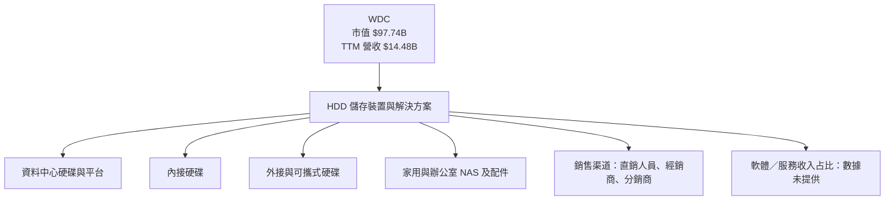
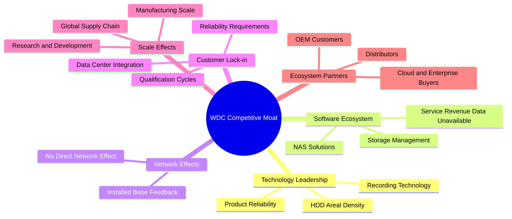
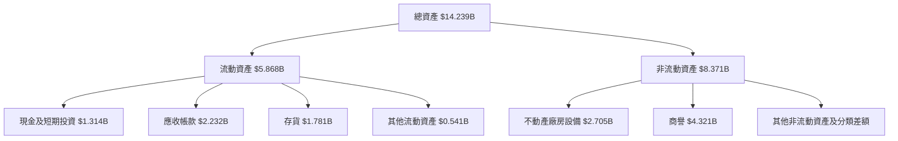
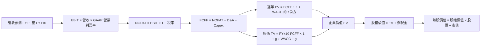
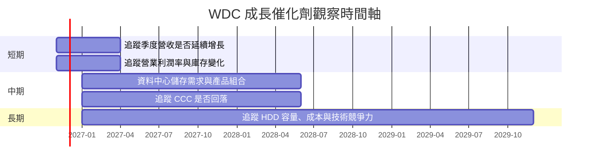
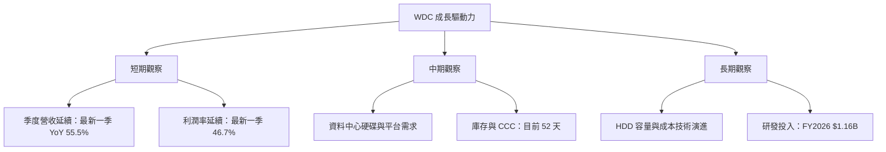
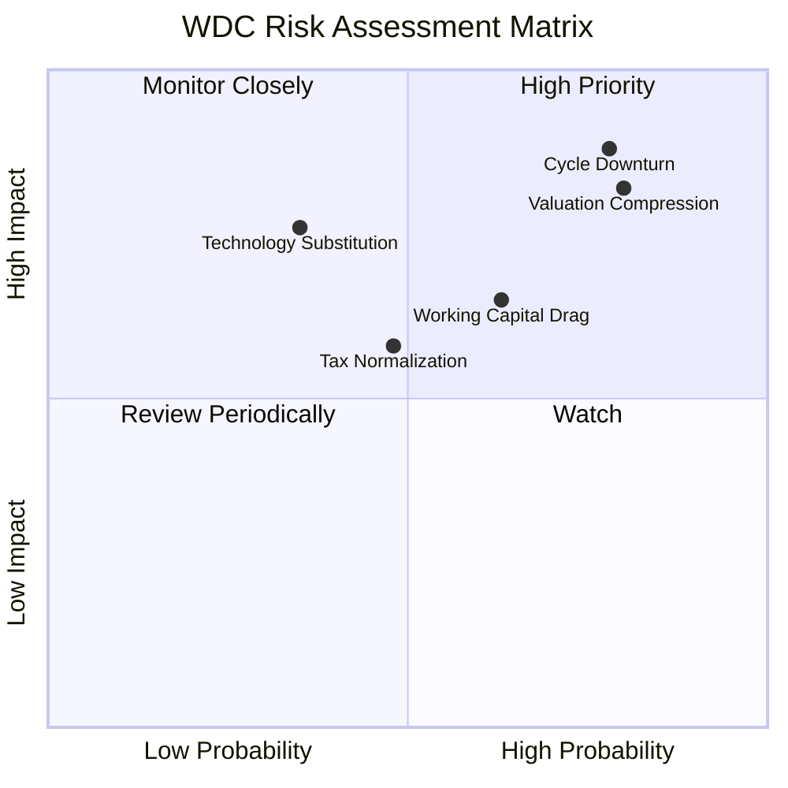
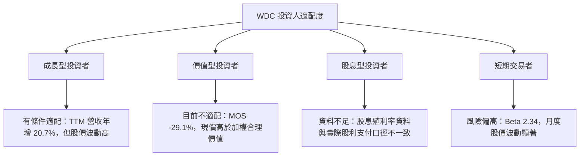

# WDC 基本面深度分析報告
> **報告日期**：2026-11-23 ｜ **語言**：繁體中文 ｜ **數據來源**：SEC 申報資料 (XBRL)、Yahoo Finance、Finviz、StockAnalysis、Roic.ai ｜ **分析師**：CFA 級機構研究

## 目錄

| # | 章節 | 核心結論 |
|---|------|----------|
| 1 | 執行摘要 | 賣出；加權合理價值 $202.19，MOS -29.1% |
| 2 | 公司概覽與商業模式 | HDD 儲存業務受規模、技術與客戶認證支撐；市場份額數據未提供 |
| 3 | 損益表深度分析 | TTM 營收 $14.48B、年增 20.7%；利潤率處於週期高位，須留意可持續性 |
| 4 | 資產負債表分析 | 最新 TTM 淨現金 $525M；營運資金週期較一年前拉長 |
| 5 | 現金流量深度分析 | TTM FCF $4.29B；現金轉換低於淨利，營運資金與一次性稅務因素值得追蹤 |
| 6 | 獲利能力與資本效率 | ROIC 61.1% 對 WACC 14.00%，目前創造經濟價值 |
| 7 | 相對估值分析 | 相對自身歷史 P/S 偏高；相對同業的 EBITDA 倍數也有溢價 |
| 8 | DCF 內在價值評估 | 基準 DCF $182.17；模型敏感且與現價相比呈溢價 |
| 9 | 成長催化劑 | 最新一季營收年增 55.5%，但市場規模與分部營收資料未提供 |
| 10 | 風險矩陣 | 週期反轉、估值回落與現金轉換惡化為主要風險 |
| 11 | 投資建議 | 依 MOS 評級為賣出；等待估值回落及財務指標驗證 |

---

## 1. 執行摘要

### 1.0 一頁式投資儀表板（Portfolio Manager 30 秒速讀）

| 項目 | 內容 |
|------|------|
| **投資論點（3 句）** | ① FY2027 Q1 營收年增 **55.5%**，TTM 營收年增 **20.7%**，反映儲存需求及價格／產品組合改善。② TTM FCF 為 **$4.29B**、ROIC 為 **61.1%**，高於 **14.00% WACC**，目前經濟價值創造明確。③ 但 2026-11-20 收盤價 **$261.11** 高於加權合理價值 **$202.19**，MOS **-29.1%**，估值未提供足夠下檔保護。 |
| **綜合評分** | **6.3/10**（引用 1.1 評分卡） |
| **財務健康** | 🟢 TTM 淨現金 **$525M**，營業現金流 **$4.86B**；但 CCC 由 34 天升至 52 天。 |
| **ROIC vs WACC** | **61.1% vs 14.00%**；差距 **47.1 個百分點**，目前創造股東價值。 |
| **FCF 趨勢** | 改善；TTM FCF **$4.29B**，FCF Yield **4.39%**。 |
| **估值** | Forward P/E **6.46x**（市場估值資料）；EV/EBITDA **17.5x**（自身歷史估值資料）；FCF Yield **4.39%**。來源口徑不同，倍數比較見第 7 章。 |
| **DCF 內在價值（基準）** | **$182.17**；現價相對 DCF 折溢價 **+43.3%**，即現價高於 DCF 基準價值。 |
| **安全邊際（MOS）** | **-29.1%＝($202.19 − $261.11) ÷ $202.19**；基準為 8.8 加權合理價值，🔴 無安全邊際。 |
| **預期報酬（基準情境 12M）** | DCF 基準情境相對現價 **-30.2%**；此為估值情境差額，不是經驗證的分析師 12 個月預測。 |
| **關鍵風險（前二）** | ① HDD 週期與價格回落使利潤率從高位收縮；② CCC 拉長及現金轉換偏弱，令會計盈餘不能同步轉成自由現金流。 |
| **評級 + 信心度** | 🔴 **賣出** ｜ 信心：中。DCF、相對估值與加權價值均低於現價，但資料來源存在若干口徑差異。 |

### 1.1 綜合評分卡（全報告唯一）

| 維度 | 評分（1–10） | 主要依據（引用數字與其來源章節） |
|------|--------------|----------------------------------|
| 成長性 | 8.0 | TTM 營收年增 20.7%、最新一季年增 55.5%；見 3.1、3.2。 |
| 獲利能力 | 9.0 | TTM ROIC 61.1% 對 WACC 14.00%；Piotroski 6/8；見第 6 章。 |
| 財務健康 | 7.0 | 淨現金 $525M、TTM FCF $4.29B；但 CCC 由 34 天延長至 52 天；見第 4、5 章。 |
| 估值 | 2.0 | MOS -29.1%；P/S 現值 6.9x、高於自身五年中位數 1.2x；見第 7、8 章。 |
| 護城河 | 7.0 | HDD 技術、製造規模與客戶認證帶來進入門檻，但市場份額、客戶集中度及分部資料未提供；見 2.3–2.4。 |
| 管理層與資本配置 | 5.0 | FY2026 SBC $204M；Piotroski 稀釋股數測試未通過；回購資料未提供，資本配置成效難全面判定。 |
| **綜合評分** | **6.3** | 六項算術平均：`(8.0 + 9.0 + 7.0 + 2.0 + 7.0 + 5.0) ÷ 6 = 6.33… ≈ 6.3`。 |

### 1.2 五大投資論點 + 三大核心風險

| 類型 | 項目 | 具體依據 | 信心度 |
|------|------|----------|--------|
| 🟢 **投資論點①** | 營收動能擴大 | TTM 營收 $14.48B、TTM 年增 20.7%；最新一季營收年增 55.5%，季度營收由 $3.017B 升至 $4.381B。 | 🟢 高 |
| 🟢 **投資論點②** | 營業槓桿顯著 | TTM 營業利益率 39.4%，最新一季 46.7%；營收成長伴隨毛利改善，固定成本吸收能力提高。 | 🟢 高 |
| 🟢 **投資論點③** | 資本回報高於資本成本 | ROIC 61.1% 對 WACC 14.00%，利差 47.1 個百分點；若利潤率回落，超額回報仍可能收斂。 | 🟢 中高 |
| 🟢 **投資論點④** | 現金流改善 | TTM 營業現金流 $4.86B、資本支出 $572M、FCF $4.29B；FY2026 FCF $3.51B，高於 FY2025 $1.28B。 | 🟢 中高 |
| 🟢 **投資論點⑤** | 淨現金降低財務風險 | 最新 TTM 現金及短期投資 $1.31B、總債務 $789M、淨現金 $525M。 | 🟢 中 |
| 🟡 **風險①** | 週期性與估值回撤 | DCF 基準 $182.17，較收盤價 $261.11 低 30.2%；股價月度序列由 2026-06 的 $638.52 降至 2026-11 的 $261.11。 | 🔴 高衝擊 |
| 🔴 **風險②** | 盈餘品質及營運資金吸收現金 | TTM FCF / TTM 淨利約 43.3%；CCC 由 34 天升至 52 天，應收、存貨天數均增加。 | 🟡 中 |
| 🟡 **風險③** | 數據口徑與稅務因素 | 多來源呈現的營業利益率、淨現金及 ROE 不一致；有效稅率 4.9% 偏低，可能使當期淨利不具代表性。 | 🟡 中 |

### 1.3 快速統計卡片

| 指標 | 公司實際值（期間） | 同業中位數 | 狀態 |
|------|--------------------|------------|------|
| 營收成長（TTM） | **20.7%** | — | 🟢 |
| 營收成長（最新一季年增） | **55.5%** | **377.9%** | 🟡 |
| 毛利率（TTM） | **52.6%** | **80.0%** | 🟡 |
| 營業利益率（TTM） | **39.4%** | — | 🟢 |
| ROIC（TTM） | **61.1%** | — | 🟢 |
| Forward P/E | **6.46x** | **2.8x** | 🟡 |
| FCF Yield（TTM） | **4.39%** | — | 🟢 |
| Piotroski F-Score | **6 / 8** | — | 🟢 |

> 同業中位數以 STX、SNDK、MU 三家公司所列數值計算；SNDK 與 MU 的業務並非完全可比，解讀需謹慎。

### 1.4 投資結論

```
╔══════════════════════════════════════════════════════════════════╗
║                    📊 投資結論摘要                               ║
╠══════════════════════════════════════════════════════════════════╣
║  評級：🔴 賣出（依規則 20；未作質化調整）                        ║
║  價格（2026-11-20 收盤）：$261.11                                ║
║  DCF 內在價值（基準）：$182.17（現價溢價 +43.3%）                ║
║  安全邊際 MOS：-29.1%（以加權合理價值 $202.19 為分母）           ║
║  加權合理價值（8.8）：$202.19                                    ║
║  DCF 情境價值：                                                   ║
║    悲觀情境：$100.40（-61.6%）                                   ║
║    基準情境：$182.17（-30.2%）                                   ║
║    樂觀情境：$313.26（+20.0%）                                   ║
║  綜合評分：6.3/10（引用 1.1）                                    ║
║  適合投資人：能承受高波動、理解儲存週期的長線投資人；不適合以     ║
║  現金殖利率或低波動為主要目標的投資人。                           ║
╚══════════════════════════════════════════════════════════════════╝
```

---

## 2. 公司概覽與商業模式

### 2.1 業務結構與收入來源

Western Digital（WDC）從事 HDD 儲存裝置與解決方案的開發、製造及銷售。提供的業務概覽列出內接 HDD、資料中心硬碟與平台、外接及可攜式硬碟、NAS 產品及配件。所列財務資料沒有各產品線營收或占比，因此不拆分收入比重、不以未提供的比例繪製收入結構。



### 2.2 市場份額

市場份額數據未提供，因此不繪製市場占比圖，也不推估 WDC 的全球份額。可觀察到 WDC TTM 營收為 $14.48B，最新一季營收年增 55.5%；同業資料中 STX 最新一季年增 61.0%，顯示兩家 HDD 廠商均處於明顯增長階段，但不能僅憑成長率推定市場份額變化。

### 2.3 競爭護城河分析



### 2.4 護城河強度

| 護城河項目 | 強度（強／中／弱） | 證據（引用數字或事實） | 會削弱它的情況 |
|------------|--------------------|------------------------|----------------|
| 技術與可靠性 | 中 | WDC 專注 HDD 技術，產品涵蓋資料中心、內接與外接儲存；FY2026 研發費用 $1.16B。 | 新型儲存技術改變成本效益，或競爭者在容量、效能和可靠性上追上。 |
| 客戶認證與轉換成本 | 中 | 資料中心硬碟需符合客戶驗證、可靠性及平台整合需求；客戶集中度及轉換成本數據未提供。 | 大型客戶重新設計平台、削減供應商數量或提高替代供應商採購。 |
| 規模效應 | 中至強 | FY2026 營收 $12.92B、TTM 營收 $14.48B，具全球製造與銷售布局。 | 產能利用率下滑、低價競爭及固定成本吸收惡化。 |
| 軟體生態與網路效應 | 弱至中 | 有 NAS、資料儲存解決方案等產品；訂閱、服務收入及活躍用戶數據未提供，難認定存在強網路效應。 | 軟體差異化不足，客戶依價格選擇硬體。 |
| 生態夥伴 | 中 | 透過直銷、經銷商及分銷商銷售；具體合作規模未提供。 | 渠道庫存過高或客戶採購轉向競爭者。 |

護城河評分引用 1.1 的 **7.0/10**：產品技術、規模及客戶認證形成一定進入障礙，但缺少市場份額、客戶留存及服務收入數據，故不將其視為已證實的強網路效應型護城河。

---

## 3. 損益表深度分析

### 3.1 年度收入成長趨勢（近 4 年）

年度收入數據為 FY2023 $6.255B、FY2024 $6.317B、FY2025 $9.520B、FY2026 $12.919B。FY2023–FY2026 三年收入 CAGR 約 27.4%；此增長反映 FY2025 起收入快速恢復，但不能直接外推為長期增長率。

```
╔══════════════════════════════════════════════════════════════════╗
║            Western Digital 年度收入趨勢（FY2023-FY2026）         ║
╠══════════════════════════════════════════════════════════════════╣
║ FY2023  $6.255B  ████████████░░░░░░░░░░░░  YoY：基期             ║
║ FY2024  $6.317B  ████████████░░░░░░░░░░░░  YoY：+1.0% 🟡         ║
║ FY2025  $9.520B  ██████████████████░░░░░░  YoY：+50.7% 🟢        ║
║ FY2026 $12.919B  ████████████████████████  YoY：+35.7% 🟢        ║
║                                                                  ║
║  FY2023-FY2026 三年收入 CAGR：約 +27.4%                          ║
╚══════════════════════════════════════════════════════════════════╝
```

### 3.2 季度收入趨勢分析

| 季度 | 營收 | QoQ 成長 | YoY 成長 | 備註 |
|------|------:|---------:|---------:|------|
| 2025-12-31 | $3.017B | — | 25.24% | YoY 依 StockAnalysis 季度資料。 |
| 2026-03-31 | $3.337B | 10.6% | 45.47% | `3.337 ÷ 3.017 − 1 = 10.6%`。 |
| 2026-06-30 | $3.747B | 12.3% | 43.84% | `3.747 ÷ 3.337 − 1 = 12.3%`。 |
| FY2027 Q1，2026-10-02 | $4.381B | 16.9% | 55.5% | 最新一季；YoY 採 SEC／核實財務數據所列單季年增率。 |

連續三季 QoQ 成長加速，最新季度單季營收年增 55.5%。這可能與資料中心需求、產品組合及週期性供需改善有關；但業務分部銷售、出貨量與平均售價沒有提供，無法區分成長來自出貨量或價格。

### 3.3 利潤率演變分析

下表年度比率依所列年度損益表的毛利與營業利益除以營收計算；TTM 使用 SEC 申報與程式計算區塊的數值。來源間的年度標示與 TTM 口徑不完全相同，應優先用 SEC TTM 數字觀察當期狀況。

| 利潤率指標 | FY2023 | FY2024 | FY2025 | FY2026 | 趨勢 | 評估 |
|------------|-------:|-------:|-------:|-------:|------|------|
| **毛利率** | 22.2% | 28.1% | 38.8% | 48.8% | 連續改善，FY2026 高於 FY2023 約 26.6 個百分點 | 🟢 |
| **營業利益率** | -6.4% | 1.5% | 22.4% | 35.6% | 從虧損回升，顯示營收與毛利恢復後的營業槓桿 | 🟢 |
| **TTM 營業利益率** | — | — | — | **39.4%** | 最新一季 **46.7%**；與年度報表及其他資料來源口徑有差異 | 🟡 |
| **淨利率（TTM）** | — | — | — | **69.2%** | 高於營業利益率，顯示低稅率或非營業項目可能影響淨利 | 🟡 |

FY2026 毛利率改善幅度大，與產品組合、價格與產能利用率改善相符，但來源沒有分部售價、成本或出貨量資料，不能把改善歸因於單一因素。營業利益率從 FY2025 的 22.4% 升至 FY2026 的 35.6%，營收增加有助固定製造及營運成本攤薄；若供需轉弱，該營業槓桿亦可能反向放大盈利下滑。

### 3.4 費用結構分析

費用明細未完整提供，故不以未知項目繪製費用結構圓餅圖。可確認 FY2026 研發費用為 $1.16B，約為 FY2026 營收 $12.919B 的 **9.0%**；該比率是以所列年度數字計算，反映研發投入對技術與產品更新的重要性。銷售、管理及其他費用的完整分項未提供。

### 3.5 季度 EPS 趨勢與盈餘品質（Quality of Earnings）

| 季度 | EPS 實際值 | YoY EPS 成長 | 超預期／不及預期 |
|------|-----------:|-------------:|------------------|
| 2025-12-31 | $4.67 | 187.75% | N/A；EPS 預期值缺失 |
| 2026-03-31 | $8.20 | 482.92% | N/A；EPS 預期值缺失 |
| 2026-06-30 | $8.21 | 984.10% | N/A；EPS 預期值缺失 |
| FY2027 Q1，2026-10-02 | $4.63 | 50.86% | N/A；EPS 預期值缺失 |

所列季度 EPS 數字來自 StockAnalysis，EPS 預期值欄為空，因此不能判定近四季是否超預期。季度淨利在 2026 年 3 月及 6 月分別為 $3.168B、$3.180B，FY2027 Q1 降至 $1.779B；然而營收和營業利益仍上升，顯示淨利受稅務或其他非營業項目波動的可能性較高，不能只以 EPS 環比下降判斷營運轉弱。

| 盈餘品質項目 | 數值／佔比 | 評估 |
|--------------|------------|------|
| 股權薪酬 SBC / 營收 | FY2026：$204M ÷ $12.919B = **1.58%**；近四季 SBC 合計 $230M ÷ TTM 營收 $14.48B = **1.59%** | 🟡 有一定稀釋成本；並非極高，但 F-Score 的稀釋股數測試未通過。 |
| SBC / 營業現金流 | 近四季 SBC $230M ÷ TTM OCF $4.86B = **4.73%** | 🟡 SBC 不是現金支出，仍代表股東承擔的經濟成本。 |
| FCF / 淨利（現金轉換率） | `$4.29B ÷ $9.913B = 43.3%`；淨利採 StockAnalysis TTM $9.913B | 🔴 低於 100%；需留意營運資金與非現金／稅務項目。 |
| 一次性／非經常性損益 | 具體明細未提供；FY2026 年度淨利 $9.286B，FY2026 Q4 單季淨利 $3.180B | 🟡 不能確認單次項目，但淨利相對營業利益偏高，應避免直接資本化淨利高點。 |
| 有效稅率異常 | **4.9%**（核實數據，採最新年度有效稅率） | 🟡 偏低，可能使淨利高於正常稅率下的盈利；DCF 仍照採模型指定的 4.9%。 |
| 資本化支出 vs 費用化 | TTM Capex $572M；研發費用 FY2026 $1.16B。詳細資本化政策與資本化開發成本未提供 | 🟡 無法確認是否有重大成本遞延；應追蹤 SEC 申報附註。 |

**盈餘品質結論**：營業現金流與 FCF 均為正，表示獲利並非完全由非現金會計項目支持；但 FCF / 淨利約 43.3%、有效稅率 4.9%、季度淨利波動均降低 GAAP 淨利的可持續性。估值時更應參考營業利益及 FCF，而非將近期淨利高點直接外推。

---

## 4. 資產負債表分析

### 4.1 資產結構分解

以下資產明細採 StockAnalysis TTM 截點，總資產 $14.239B；各項加總存在四捨五入或分類差額，未提供的項目不反推。



### 4.2 流動性與營運資金分析

| 指標 | 最新 TTM | 一年前 TTM | 變化 | 解讀 |
|------|---------:|-----------:|------:|------|
| 流動比率 | 1.434 | N/A | N/A | 高於 1，流動資產在帳面上高於流動負債；但速動比率僅 0.867，仍依賴存貨變現。 |
| 速動比率 | 0.867 | N/A | N/A | 低於 1，應追蹤現金、應收帳款與短期義務的匹配。 |
| DSO 應收帳款天數 | 56 天 | 41 天 | +15 天 | 收款週期拉長；可能與銷售組合、期末應收或客戶付款條件有關，原因需由附註確認。 |
| DIO 存貨天數 | 95 天 | 70 天 | +25 天 | 庫存持有時間增加，若需求轉弱會提高跌價或去庫存風險。 |
| DPO 應付帳款天數 | 99 天 | 77 天 | +22 天 | 付款天數延長，短期可支撐現金，但不能據此直接認定供應商議價力改善。 |
| CCC 現金轉換週期 | 52 天 | 34 天 | +18 天 | `DSO + DIO − DPO`；較一年前拉長，表示資金被營運週期占用增加。 |

### 4.3 債務結構分析

核實財務數據列示 TTM 現金及短期投資 $1.31B、總債務 $789M、淨現金 $525M。其他財務資料在不同截點列出總債務 $922M 或 FY2026 年末 $1.05B；本節以 TTM 核實數值為主，避免混用日期。

```
╔══════════════════════════════════════════════════════════════════╗
║                   WDC 債務健康診斷                               ║
╠══════════════════════════════════════════════════════════════════╣
║  總債務：       $0.789B   ██░░░░░░░░░░░░░░░░░░░  🟢             ║
║  現金及短期投資：$1.310B   ████████████████████░  🟢             ║
║  淨現金：       $0.525B   ████████░░░░░░░░░░░░░  🟢             ║
║                                                                  ║
║  Debt/EBITDA：N/A；同一期間、同一口徑 EBITDA 未在核實區塊列出。   ║
║  Interest Coverage：N/A；利息費用及同口徑 EBIT 未提供。          ║
║  結論：現金高於債務，短期償債風險相對受控；仍須監控週期回落。     ║
╚══════════════════════════════════════════════════════════════════╝
```

### 4.4 股東權益趨勢

| 財年 | 股東權益 | 年度變化 | 說明 |
|------|---------:|---------:|------|
| FY2023 | $11.84B | — | 資產負債表所列。 |
| FY2024 | $11.05B | -6.7% | `11.05 ÷ 11.84 − 1`。 |
| FY2025 | $5.54B | -49.9% | 股東權益顯著下降；完整變動原因需參考 SEC 權益變動表。 |
| FY2026 | $8.86B | +59.9% | 股東權益回升，與 FY2026 盈利改善相符；股利、其他綜合損益及資本交易影響未逐項提供。 |

```
╔══════════════════════════════════════════════════════════════════╗
║                   WDC 股東權益趨勢                               ║
╠══════════════════════════════════════════════════════════════════╣
║ FY2023  $11.84B  ████████████████████████                       ║
║ FY2024  $11.05B  ██████████████████████░░                       ║
║ FY2025   $5.54B  ███████████░░░░░░░░░░░░░                       ║
║ FY2026   $8.86B  ██████████████████░░░░░                       ║
╚══════════════════════════════════════════════════════════════════╝
```

---

## 5. 現金流量深度分析

### 5.1 現金流量瀑布圖

現金流瀑布中，最新 TTM 淨利沒有可與下列 TTM OCF 完全匹配的核實數字，故不以其計算現金流轉換；股息使用 FY2026 全年數據作資本配置參考。


### 5.2 FCF 轉換率趨勢

| 財年 | FCF | 淨利 | FCF / 淨利 | 解讀 |
|------|----:|-----:|-----------:|------|
| FY2023 | -$1.23B | -$1.68B | 不具代表性 | 虧損時比率不適合比較；現金流及淨利皆為負。 |
| FY2024 | -$0.781B | -$0.798B | 97.9% | 負數除以負數得到正值不代表現金轉換良好，需看絕對金額。 |
| FY2025 | $1.28B | $1.86B | 68.8% | 盈利回升但仍未完全轉為 FCF。 |
| FY2026 | $3.51B | $9.30B（年度表） | 37.7% | FCF 增加，但淨利高於現金流，稅務、營運資金與其他非現金項目值得核查。 |
| 最新 TTM | $4.29B | $9.913B（StockAnalysis TTM） | 43.3% | 按同一報表來源計算；口徑與年度表可能不同。 |

### 5.3 自由現金流趨勢

| 期間 | FCF | FCF YoY | FCF Yield |
|------|----:|--------:|---------:|
| FY2023 | -$1.23B | — | — |
| FY2024 | -$0.781B | 改善但仍為負 | — |
| FY2025 | $1.28B | 由負轉正 | — |
| FY2026 | $3.51B | 年度表計算約 +174.2% | — |
| 最新 TTM | $4.29B | — | **4.39%** |

FY2026 與 FY2025 FCF 成長率按所列四捨五入金額為 `3.51 ÷ 1.28 − 1 = 174.2%`；Roic.ai 歷史頁面另列 174.51%，兩者差異來自底層精確值或取整。TTM FCF 嚴格採 OCF 減 Capex，即 `$4.86B − $0.572B = $4.288B`，核實值為 **$4.29B**。

```
╔══════════════════════════════════════════════════════════════════╗
║              WDC 自由現金流：年度趨勢                            ║
╠══════════════════════════════════════════════════════════════════╣
║ FY2023  -$1.23B  ← 負現金流                                    ║
║ FY2024  -$0.781B ← 仍為負，但缺口收窄                           ║
║ FY2025   $1.28B  ███████░░░░░░░░░░░░░                           ║
║ FY2026   $3.51B  ████████████████████                           ║
║ TTM      $4.29B  ████████████████████████  FCF Yield 4.39%       ║
╚══════════════════════════════════════════════════════════════════╝
```

### 5.4 資本配置評估

精確的回購、維持性投資及成長性投資拆分未提供，因此不以圓餅圖呈現未核實的比例。

| 項目 | 已知金額 | 評估 |
|------|---------:|------|
| 資本支出 | TTM $572M；FY2026 $418M | TTM Capex 約為 TTM 營收的 3.95%，支持製造與設備投資。 |
| 股息 | FY2026 支付 $184M | 金額低於 FY2026 FCF $3.51B；股息政策及未來派息率資料未提供。 |
| 股票回購 | N/A | 未提供可核對的回購金額。 |
| SBC | FY2026 $204M | 對股東有稀釋成本，Piotroski 稀釋股數測試未通過。 |
| 留存／其他投資 | N/A | 未提供完整資本配置明細。 |

---

## 6. 獲利能力與資本效率

### 6.1 ROE / ROA / ROIC 趨勢

| 指標 | FY2023／歷史 | 最新 TTM | 評估 |
|------|--------------|---------:|------|
| ROE | 年度序列未提供可一致比較的完整歷史數據；QUALITY FIGURES TTM **107.2%** | **107.2%** | 高 ROE 不全由財務槓桿驅動，詳見杜邦拆解；其他來源另列 129.6%，本報告採品質指標區塊。 |
| ROA | 歷史一致口徑 N/A | QUALITY FIGURES 測試顯示 ROA > 0；具體 TTM ROA 未列在該區塊 | 其他資料來源列 25.9%，但與品質指標口徑可能不同，未作為同口徑趨勢。 |
| ROIC | ROIC.ai 歷史顯示歷史回報曾低於目前，完整 TTM 序列 N/A | **61.1%** | 顯著高於 WACC 14.00%；若週期正常化，回報可能下降。 |

沒有可核對的「行業均值」數字，故不提供行業均值比較。

### 6.2 ROIC vs WACC 分析（核心價值創造判斷）

資本成本採核實資料的 **WACC 14.00%**，ROIC 採 TTM **61.1%**。由此得到 ROIC 高於 WACC **47.1 個百分點**；按同一組數值，ROIC 約為 WACC 的 **4.36 倍**。ROIC 使用程式計算的稅後營業利益除以投入資本，不另以年度財報數字重算。

```
╔══════════════════════════════════════════════════════════════════╗
║                ROIC vs WACC 深度分析                            ║
╠══════════════════════════════════════════════════════════════════╣
║  WACC（採用值）：14.00%                                          ║
║  ├── 無風險利率（10Y 美債）：4.91%                               ║
║  ├── ERP：5.00%                                                  ║
║  ├── Beta：原始 2.34；調整後採用 1.90                            ║
║  ├── 股權成本（資料列值）：14.39%                                ║
║  ├── 稅前債務成本：20.91%；有效稅率：4.9%                        ║
║  ├── 股權／債務權重：99.2%／0.8%                                 ║
║  └── 未限制計算值 14.44%，受 7%–14% 區間限制後採用 14.00%         ║
║                                                                  ║
║  ROIC（TTM）：61.1%                                               ║
║  EVA 利差 = 61.1% − 14.00% = +47.1 個百分點                     ║
║  ROIC / WACC = 61.1% ÷ 14.00% = 4.36 倍                         ║
║                                                                  ║
║  結論：按目前 TTM 指標，WDC 的投入資本回報高於資本成本；           ║
║  但高 ROIC 可能處於週期高位，不能直接假設長期維持 61.1%。          ║
╚══════════════════════════════════════════════════════════════════╝
```

CAPM 核實欄位列示股權成本 14.39%，而用顯示後的 Rf、Beta、ERP 直接代入會得到 `4.91% + 1.90 × 5.00% = 14.41%`。WACC 程式以未四捨五入輸入計算 14.44%，再按 7%–14% 範圍上限採用 14.00%；本節及第 8 章均採 **14.00%**，不另行修改。

### 6.3 杜邦三因素分解

| 因素 | 數值（TTM） | 解讀 |
|------|-------------|------|
| 淨利率 | 69.2% | 偏高；低有效稅率及可能的非營業項目需留意。 |
| 資產週轉率 | 1.02 | 每 $1 資產對應約 $1.02 營收，屬營運效率因素。 |
| 權益乘數 | 1.52 | 財務槓桿並非 ROE 的唯一或主要放大來源。 |
| **ROE** | **107.2%** | `69.2% × 1.02 × 1.52 = 107.2%`（採原品質指標列值；因中間因子已四捨五入，乘積可能有尾差）。 |

### 6.4 財務體質：Piotroski F-Score

| 測試 | 結果 | 解讀 |
|------|------|------|
| ROA > 0 | ✅ 通過 | 當期 ROA 為正。 |
| 營業現金流 > 0 | ✅ 通過 | TTM OCF 為 $4.86B。 |
| ROA 高於一年前 | ✅ 通過 | 獲利能力改善。 |
| 營業現金流 > 淨利 | ❌ 未通過 | 現金流未超過淨利，與 FCF / 淨利約 43.3% 的品質疑慮一致。 |
| 長期負債 ÷ 總資產低於一年前 | — 無法判定 | 缺少測試所需輸入，不能推定。 |
| 流動比率高於一年前 | ✅ 通過 | 品質指標判定流動比率改善。 |
| 稀釋股數未增加 | ❌ 未通過 | 代表股數稀釋仍需監控。 |
| 毛利率高於一年前 | ✅ 通過 | 毛利率改善。 |
| 資產週轉率高於一年前 | ✅ 通過 | 資產周轉效率改善。 |

**Piotroski F-Score：6 / 8**。缺少資料的測試不列入分母；未通過項目為應計品質及稀釋股數，反映獲利現金轉換與股東稀釋仍是核心檢查項目。

---

## 7. 相對估值分析

### 7.1 同業估值比較表格

同業倍數採 STX、SNDK、MU 所列倍數原值。WDC 自身倍數採其歷史估值區塊；Forward P/E 採估值資料區塊的 6.4623446x。因資料口徑不同，倍數比較只作方向性參考。

| 估值指標 | **WDC** | **STX** | **SNDK** | **MU** | 本公司評估 |
|----------|--------:|--------:|---------:|-------:|-----------|
| **Trailing P/E** | 10.1x | 24.0x | 0.1x | 8.0x | 🟡 高於 MU，低於 STX；SNDK 的 0.1x 不具一般可比性。 |
| **Forward P/E** | 6.46x | 7.0x | 2.2x | 2.8x | 🟡 高於三家同業中位數 2.8x；市場預期的盈利增長差異很大。 |
| **P/S Ratio** | 6.9x | 7.6x | 3.1x | 5.1x | 🟡 高於同業中位數 5.1x。 |
| **EV / EBITDA** | 17.5x | 18.1x | 4.0x | 5.8x | 🔴 高於同業中位數 5.8x；估值包含較高的持續盈利預期。 |
| **最新一季營收 YoY** | 55.5% | 61.0% | 377.9% | 379.3% | 🟡 WDC 正增長，但低於同業中位數 377.9%；產品週期和業務類型不同。 |
| **毛利率（TTM）** | 52.6% | 50.4% | 80.0% | 80.7% | 🟢 高於 STX，低於 SNDK、MU；反映業務組合差異。 |

### 7.2 歷史估值區間分析

核實歷史估值為 P/E 現值 10.1x、五年中位數 13.5x、區間 6.3x–62.5x、百分位 38%；P/S 現值 6.9x、五年中位數 1.2x、百分位 85%；EV/EBITDA 現值 17.5x、五年中位數 14.9x、百分位 62%。

```
╔══════════════════════════════════════════════════════════════════╗
║                 WDC 自身五年估值位置                            ║
╠══════════════════════════════════════════════════════════════════╣
║ P/E        區間 6.3x ───── ●10.1x ─── 中位數13.5x ───── 62.5x  ║
║            現值百分位：38%                                       ║
║ P/S        中位數1.2x ─────────────────── ●6.9x                 ║
║            區間0.4x–16.0x；現值百分位：85%                       ║
║ EV/EBITDA  區間4.5x ───────── 中位數14.9x ─ ●17.5x ── 96.5x    ║
║            現值百分位：62%                                       ║
╚══════════════════════════════════════════════════════════════════╝
```

P/E 現值低於五年中位數，但歷史區間受到週期性盈虧及 EPS 基期波動影響；P/S 現值處於自身歷史偏高區域，EV/EBITDA 亦高於五年中位數。單看 P/E 會低估目前股價對收入和 EBITDA 所付出的估值。

### 7.3 情境價值（Bear / Base / Bull，照抄 DCF MODEL 的 Scenarios）

| 情境 | 第 1 年營收成長 | 期末營業利潤率 | WACC | 每股價值 | 相對現價 | 機率 | 會發生的條件 |
|------|----------------:|---------------:|-----:|---------:|---------:|-----:|--------------|
| 🔴 悲觀 | 10.3% | 19.4% | 15.00% | $100.40 | -61.6% | 25% | 儲存需求降溫、供需轉弱，利潤率向較低成熟水準收斂，資本成本上升。 |
| 🟡 基準 | 20.7% | 22.8% | 14.00% | $182.17 | -30.2% | 50% | 首年延續 TTM 成長率，之後逐步減速，長期利潤率回落至五年中位數。 |
| 🟢 樂觀 | 31.0% | 25.1% | 13.00% | $313.26 | +20.0% | 25% | 需求和產品組合持續強於基準，長期利潤率高於基準、資本成本下行。 |

### 7.4 相對估值隱含價格區間

以下估值方法及每股價值均採程式計算的估值方法區塊，不另行替換同業倍數或權重。

```
╔══════════════════════════════════════════════════════════════════╗
║                估值方法隱含每股價值                              ║
╠══════════════════════════════════════════════════════════════════╣
║ $96.34 ───────── $182.17 ───── $195.39 ── $261.11 ───── $613.38 ║
║ 同業EV/EBITDA      DCF基準       同業P/S      現價       分析師共識║
╚══════════════════════════════════════════════════════════════════╝
```

| 方法 | 每股價值 | 相對現價 | 依據 |
|------|---------:|---------:|------|
| DCF（基準） | $182.17 | -30.2% | 10 年 FCFF、WACC 14.00%、終值成長率 3.0%。 |
| 同業 EV/EBITDA | $96.34 | -63.1% | STX、SNDK、MU 同業中位數 EV/EBITDA 5.8x × WDC TTM EBITDA，再加淨現金。 |
| 同業 P/S | $195.39 | -25.2% | 同業 P/S 中位數 5.1x × WDC TTM 營收。 |
| 分析師共識目標價 | $613.38 | +134.9% | 24 位分析師平均目標價；此值與其他估值方法差距很大，需視作預測分歧而非內在價值錨點。 |

---

## 8. DCF 內在價值評估（Discounted Cash Flow）

### 8.0 估值推理鏈（Thinking Logic：在算之前先想清楚）

**Step 1 — 價值來源與主導變數**

WDC 的估值核心是現有 HDD 業務帶來的現金流底盤；提供的資料未按業務分部拆分，故第二成長曲線與新業務選擇權都無法單獨量化。模型以 TTM 營收 $14.48B 為起點，採用 10 年預測期，主要價值變數是營收增長與營業利潤率能否延續，以及終值中的 WACC 與永續成長率之差。敏感度矩陣顯示，WACC 變動對每股價值的影響大於同幅度的永續成長率變動。

**Step 2 — 模型選擇**

| 決策點 | 本報告採用 | 理由（含數字） | 曾考慮但否決 | 否決理由 |
|--------|-----------|----------------|--------------|----------|
| 現金流定義 | FCFF | 採用 WACC 折現，先算企業價值，再加淨現金；TTM OCF $4.86B、Capex $572M。 | FCFE | DCF 模型已固定為 FCFF，且需對應 WACC。 |
| 預測期 N | 10 年 | 模型提供 FY+1 至 FY+10 逐年現金流，營收增長由 20.7% 線性降至 3.0%。 | 5 年 | 無法與已計算的模型輸出一致。 |
| 終值方法 | Gordon Growth | 模型列出終值 $87.94B，g 3.0%、WACC 14.00%。 | 退出倍數 | DCF MODEL 未提供退出倍數終值，不能自行建立第二套模型。 |
| EBIT 基礎 | GAAP EBIT | 模型明確採 GAAP EBIT，SBC 已含在費用內。 | 非 GAAP EBIT | 避免模型中加回 SBC 後漏掉股東成本。 |

**Step 3 — 關鍵假設的推導鏈**

- **營收增長**：錨點＝TTM 營收年增 20.7%、最新一季年增 55.5% → 調整＝不把單季 55.5% 當成可持續 TTM 增長，採 TTM 20.7% 作首年，再逐步降至 3.0% → **採用年 1 20.7%、年 10 3.0%** → 曾考慮將 55.5% 延續，因只有一季且資料沒有明確分部需求證據而否決。
- **期末營業利潤率**：錨點＝TTM GAAP 營業利益率 39.4% → 調整＝模型令利潤率漸降至最近五個財年中位數 22.8%，反映週期高點正常化 → **採用 FY+1 39.4% 線性降至 FY+10 22.8%** → 曾考慮維持 39.4%，因歷史週期性及目前高利潤率可能難以長期維持而否決。
- **永續成長率 g**：錨點＝模型採用 3.0% → 調整＝成熟企業終值假設需低於 WACC，3.0% 也低於 WACC 14.00% → **採用 3.0%** → 不採用等於或高於 WACC 的值，否則 Gordon Growth 分母失效。
- **預測期 N**：錨點＝模型固定輸出 10 年逐年 FCFF → 調整＝10 年可呈現增長與利潤率回歸過程，但超過五年的預測可信度下降 → **採用 10 年** → 不改用較短年期，以免與程式模型輸出不一致。
- **Capex／營收**：錨點＝TTM Capex $572M ÷ TTM 營收 $14.48B，約 3.9% → 調整＝模型由 FY+1 3.9% 緩降至 FY+10 3.0%，長期仍保留資本維護支出 → **採用 3.9% 至 3.0%** → 不採用零 Capex，因硬體製造需持續投入資產。
- **EBIT 基礎與 SBC**：錨點＝GAAP EBIT 已將 SBC 作為費用；FY2026 SBC $204M → 調整＝不在 FCFF 重複扣 SBC，也不另加年稀釋率 → **採用組合 (A)：GAAP EBIT、無 −SBC 列、年稀釋率 0%** → 不採用非 GAAP 加回，避免漏算或重算 SBC 成本。
- **WACC**：錨點＝核實資本成本計算值 14.44% → 調整＝模型將其限制在 7%–14% 區間 → **採用 14.00%** → 不採用未限制 14.44%，因程式明確按區間上限處理。
- **ΔWC／營收增額**：錨點＝DCF MODEL 明確表示未建模營運資金 → **採用不另計 ΔWC** → 不自行估一個營運資金比率，因缺少模型輸入且不得另建 DCF。
- **終值方法**：錨點＝模型採 Gordon Growth，FY+10 FCFF $9.39B → **採用 Gordon Growth** → 不加退出倍數交叉驗證，因模型沒有提供該方法計算值。
- **股數處理**：錨點＝市場資料列示流通股 374.32M；模型使用市值與價格換算每股價值 → **採用固定股數組合 A** → 不自行加入稀釋率，因模型已規定 SBC 由 GAAP 費用反映。

**Step 4 — 最脆弱環節**

最脆弱之處是目前 39.4% TTM 營業利益率在模型中逐步降至 22.8% 仍能支撐較高的前期 FCFF；若供需週期逆轉更快，估值可能低於 $100.40 的悲觀情境值。

**Step 5 — 計算路徑圖**



### 8.1 模型假設總表（Model Inputs）

| 假設項目 | 採用值 | 依據／來源 | 敏感度 |
|----------|--------|-------------|--------|
| 預測期長度 **N** | **10 年** | DCF MODEL 逐年預測 FY+1 至 FY+10；預測期為模型固定輸出。 | 🟡 中 |
| 營收增長 | FY+1 **20.7%**，FY+10 **3.0%**，逐年線性下降 | TTM 營收年增 20.7%；長期成長終點為模型採用的 3.0%。 | 🔴 高 |
| 營業利潤率 | FY+1 **39.4%**，FY+10 **22.8%** | 起點為核實 TTM 營業利益率；終點為模型最近五個財年中位數。 | 🔴 高 |
| 有效稅率 | **4.9%** | 核實的最新年度有效稅率；偏低，照模型採用，不另作正常化。 | 🟢 低 |
| Capex / 營收 | FY+1 **3.9%**，FY+10 **3.0%** | TTM Capex / 營收約 3.9%；模型逐步降至長期設定值。 | 🟡 中 |
| D&A / 營收 | **2.7%** | DCF MODEL 採 TTM 比率並固定。 | 🟢 低 |
| 營運資金變動 | **未建模** | DCF MODEL 明確註明工作資金未建模；缺少逐年 ΔWC 輸入。 | 🟢 低 |
| EBIT 基礎 | **GAAP EBIT** | DCF MODEL 明確採 GAAP EBIT。 | 🟡 中 |
| SBC 處理 | **組合 (A)**：GAAP EBIT，FCFF 不再扣 SBC，股數不再逐年稀釋 | SBC 已包含在 GAAP 費用；避免重複扣除。 | 🟡 中 |
| 年稀釋率 | **0%** | 配合組合 (A)；不再另計稀釋。 | 🟡 中 |
| 永續成長率 g | **3.0%** | DCF MODEL 指定；低於 WACC 14.00%。 | 🔴 高 |
| 終值方法 | **Gordon Growth** | DCF MODEL 提供終值；退出倍數終值未提供。 | 🔴 高 |
| WACC | **14.00%** | 核實計算 14.44%，按 7%–14% 區間上限採用 14.00%；見 8.2。 | 🔴 高 |

本模型使用 **FCFF = NOPAT + D&A − Capex**；營運資金未建模，故表格不虛構 ΔWC 數值。**本模型採用組合 (A)，故 SBC 影響已透過 GAAP EBIT 計入一次。**

### 8.2 折現率推導（WACC）

```
╔══════════════════════════════════════════════════════════════════╗
║                    WACC 推導（折現率）                           ║
╠══════════════════════════════════════════════════════════════════╣
║  股權成本 Ke（CAPM，採核實列值）：14.39%                         ║
║  ├── 無風險利率 Rf（10Y 美債）：4.91%                            ║
║  ├── 市場風險溢酬 ERP：5.00%                                    ║
║  ├── 原始 Beta：2.34；調整後 Beta：1.90                          ║
║  ├── 調整方式：2/3 × 2.34 + 1/3 × 1 = 1.90                      ║
║  └── 資料列示 Ke：14.39%                                         ║
║                                                                  ║
║  債務成本：                                                       ║
║  ├── 稅前 Kd（核實列值）：20.91%                                 ║
║  ├── 有效稅率：4.9%                                              ║
║  └── 稅後 Kd = 20.91% × (1 − 4.9%) = 19.89%                     ║
║                                                                  ║
║  資本結構（市場價值權重）：股權 99.2%，債務 0.8%                 ║
║  未限制 WACC 計算值：14.44%                                      ║
║  WACC 限制區間：7%–14% → 採用 WACC：14.00%                       ║
╚══════════════════════════════════════════════════════════════════╝
```

**逐步演算（WACC）**

1. **Ke（CAPM）**：核實資料列值為 **14.39%**。以顯示後的 Rf、調整後 Beta、ERP 直接計算為 `4.91% + 1.90 × 5.00% = 14.41%`；與核實 Ke 差 0.02 個百分點，應是底層未四捨五入輸入差異。不得用顯示後輸入取代核實 Ke。
2. **稅前 Kd**：核實值 **20.91%**；利息費用及平均計息負債的分子、分母明細未提供，故不可重新計算。
3. **稅後 Kd**：`20.91% × (1 − 4.9%) = 19.88541% ≈ 19.89%`。
4. **權重**：核實市值權重列為股權 **99.2%**、債務 **0.8%**；`99.2% + 0.8% = 100.0%`。市值 $97.74B、總債務 $789M 來自不同資料欄位，未用它們重算程式權重。
5. **WACC**：核實未限制值 **14.44%**，受 7%–14% 區間限制，採用 **14.00%**。完整底層精度和權重計算明細未提供，故此處不以四捨五入數字重建未限制值。

本報告第 6.2 與第 8 章使用相同 WACC **14.00%**。資本成本資料沒有列出 10 年期美債殖利率的精確觀察日期，也沒有提供利息費用與平均計息負債細項，故不補造日期或分項。

### 8.3 逐年自由現金流預測（基準情境）

以下金額為美元十億，逐年數字照 DCF MODEL 原值列示。模型 FCFF 不含營運資金變動；金額取至兩位小數、折現因子取至三位小數。模型內部使用未四捨五入數字，故部分公開小數乘算與列示值可能有尾差。

| 年度 | FY+1 | FY+2 | FY+3 | FY+4 | FY+5 | FY+6 | FY+7 | FY+8 | FY+9 | FY+10 |
|------|-----:|-----:|-----:|-----:|-----:|-----:|-----:|-----:|-----:|------:|
| 營收 | 17.47 | 20.74 | 24.21 | 27.79 | 31.35 | 34.75 | 37.84 | 40.46 | 42.47 | 43.75 |
| 營收 YoY | 20.7% | 18.7% | 16.7% | 14.8% | 12.8% | 10.9% | 8.9% | 6.9% | 5.0% | 3.0% |
| 營業利潤率 | 39.4% | 37.6% | 35.7% | 33.9% | 32.0% | 30.2% | 28.4% | 26.5% | 24.7% | 22.8% |
| 營業利益 EBIT（GAAP） | 6.89 | 7.79 | 8.65 | 9.42 | 10.05 | 10.50 | 10.74 | 10.73 | 10.49 | 10.00 |
| − 稅（4.9%） | (0.33) | (0.38) | (0.42) | (0.46) | (0.49) | (0.51) | (0.52) | (0.52) | (0.51) | (0.49) |
| = NOPAT | 6.55 | 7.41 | 8.23 | 8.96 | 9.56 | 9.99 | 10.21 | 10.21 | 9.98 | 9.51 |
| + D&A | 0.47 | 0.56 | 0.65 | 0.75 | 0.85 | 0.94 | 1.02 | 1.09 | 1.15 | 1.18 |
| − Capex | (0.69) | (0.80) | (0.90) | (1.01) | (1.10) | (1.18) | (1.25) | (1.29) | (1.31) | (1.30) |
| − ΔWC | 未建模 | 未建模 | 未建模 | 未建模 | 未建模 | 未建模 | 未建模 | 未建模 | 未建模 | 未建模 |
| = FCFF | 6.33 | 7.18 | 7.98 | 8.70 | 9.30 | 9.74 | 9.99 | 10.02 | 9.82 | 9.39 |
| 折現因子 @14.00% | 0.877 | 0.769 | 0.675 | 0.592 | 0.519 | 0.456 | 0.400 | 0.351 | 0.308 | 0.270 |
| FCFF 現值 PV | 5.56 | 5.52 | 5.39 | 5.15 | 4.83 | 4.44 | 3.99 | 3.51 | 3.02 | 2.53 |

預測期現值合計照模型列示 **$43.95B**。以上列示 PV 加總為：

`$5.56 + $5.52 + $5.39 + $5.15 + $4.83 + $4.44 + $3.99 + $3.51 + $3.02 + $2.53 = $43.94B`

模型合計 $43.95B 與兩位小數逐年加總差 $0.01B，低於 1% 尾差範圍；差異來自內部未四捨五入數值。

**逐步演算（FY+1 代表年度）**

1. **營收**：公式＝上年營收 × `(1 + 成長率)`；代入＝`$14.48B × (1 + 20.7%)`；結果按模型未四捨五入輸入列為 **$17.47B**。
2. **EBIT**：公式＝營收 × 營業利潤率；代入＝`$17.47B × 39.4%`；結果按模型內部精度列為 **$6.89B**。
3. **稅**：公式＝EBIT × 稅率；代入＝`$6.89B × 4.9%`；結果按模型內部精度列為 **$0.33B**。
4. **NOPAT**：公式＝EBIT − 稅；代入＝`$6.89B − $0.33B`；模型列值為 **$6.55B**，因中間數字四捨五入可能有 $0.01B 尾差。
5. **D&A**：公式＝營收 × D&A／營收；代入＝`$17.47B × 2.7%`；模型列值 **$0.47B**。
6. **Capex**：公式＝營收 × Capex／營收；代入＝`$17.47B × 3.9%`；模型列值 **$0.69B**。
7. **ΔWC**：模型未建模，故不扣除、不填入推估數值。
8. **FCFF**：公式＝NOPAT + D&A − Capex；代入模型列值＝`$6.55B + $0.47B − $0.69B`；模型列值 **$6.33B**，差額為內部未四捨五入數值所致。
9. **折現因子與 PV**：公式＝`1 ÷ (1 + WACC)^1`；代入＝`1 ÷ (1 + 14.00%)^1 = 0.877`；`$6.33B × 0.877 = $5.55141B`，模型列值 **$5.56B**，差異來自未四捨五入的折現因子及 FCFF。

**合理性自檢**

- 模型 FCFF 由 FY+1 $6.33B 增至 FY+10 $9.39B；由於預測期為十年，無法用兩個端點準確計算逐年 FCF CAGR，歷史三年 FCF CAGR 亦因 FY2023、FY2024 為負而不具代表性。
- FY+10 FCFF 利潤率：`$9.39B ÷ $43.75B = 21.5%`；目前 TTM FCF 利潤率：`$4.29B ÷ $14.48B = 29.6%`。同業最佳 FCF 利潤率數據未提供，不能作量化比較。
- 模型各預測年度 FCFF 均為正；但未建模 ΔWC，若應收或庫存上升，實際現金流將低於模型。

```
╔══════════════════════════════════════════════════════════════════╗
║            自由現金流：歷史實際 vs 模型預測                      ║
╠══════════════════════════════════════════════════════════════════╣
║ FY2024(實)  -$0.781B  負值                                       ║
║ FY2025(實)   $1.28B   ███████░░░░░░░░░░░░                        ║
║ FY2026(實)   $3.51B   ████████████████████                       ║
║ TTM(實)      $4.29B   ████████████████████████                   ║
║ FY+1 (預)    $6.33B   ███████████████████████████████████         ║
║ FY+10(預)    $9.39B   ███████████████████████████████████████████ ║
╠══════════════════════════════════════════════════════════════════╣
║ ⚠️ 預測現金流由 $4.29B 上升至 $9.39B；十年預測且未建模 ΔWC，     ║
║    成果高度依賴增長與利潤率假設。                                 ║
╚══════════════════════════════════════════════════════════════════╝
```

### 8.4 終值計算（Terminal Value）

**適用性檢查**：`WACC 14.00% vs g 3.0% → WACC > g？✅`

DCF MODEL 只提供 Gordon Growth 終值。退出倍數所需的 FY+10 EBITDA 及指定退出倍數計算值未提供，依資料規則不另建模型。

| 方法 | 計算式 | 終值 TV | TV 現值 | 佔總 EV 比重 |
|------|--------|---------:|-------:|-------------:|
| Gordon Growth | `$9.39B × (1 + 3.0%) ÷ (14.00% − 3.0%)` | $87.94B | $23.72B | 35.1% |
| 退出倍數法 | N/A；DCF MODEL 未提供退出倍數估值 | N/A | N/A | N/A |

**逐步演算**

1. **FY+10 FCFF**：取 8.3 最後一年，**$9.39B**。
2. **分子**：`$9.39B × (1 + 3.0%) = $9.6717B`；模型終值使用未四捨五入輸入。
3. **分母**：`14.00% − 3.0% = 11.00%`；按模型列示，`$9.39B × 1.03 ÷ 11.00% = $87.94B`。
4. **PV(TV)**：模型列示 `$87.94B × 0.270 = $23.72B`；以已顯示的四捨五入數字直接相乘會有尾差，模型使用未四捨五入因子。
5. **終值佔比**：`$23.72B ÷ $67.67B = 35.1%`，未超過 75% 終值依賴警戒線。

### 8.5 企業價值 → 每股內在價值（Bridge）

```
╔══════════════════════════════════════════════════════════════════╗
║              企業價值 → 每股內在價值 橋接表                      ║
╠══════════════════════════════════════════════════════════════════╣
║  預測期 FCF 現值合計              +$43.95B                       ║
║  終值現值 PV(TV)                  +$23.72B                       ║
║  ─────────────────────────────────────────────                  ║
║  = 企業價值 EV                     $67.67B                       ║
║  + 淨現金                          +$0.53B                       ║
║  = 股權價值                         $68.19B                       ║
║  ÷ 股數：模型按股權價值 × 股價 ÷ 市值轉換                        ║
║  ★ 每股內在價值                    $182.17                       ║
║    2026-11-20 收盤價                $261.11                       ║
║    折溢價（現價÷DCF內在價值−1）     +43.3% 溢價                   ║
╚══════════════════════════════════════════════════════════════════╝
```

**逐步演算（橋接）**

1. **EV**：`$43.95B + $23.72B = $67.67B`。
2. **股權價值**：模型按未四捨五入數值以企業價值加淨現金，列示 `$67.67B + $0.53B = $68.19B`；已顯示數值直接相加為 $68.20B，$0.01B 差異源自底層未四捨五入數值。
3. **每股內在價值**：模型算式為 `$68.19B × $261.11 ÷ $97.74B = $182.17`。此為模型指定的市值／價格換算方式；不以該式反推或替換股數。
4. **折溢價**：`$261.11 ÷ $182.17 − 1 = 43.3%`，即現價相對 DCF 基準價值溢價 43.3%。
5. **本節不計算 MOS**：安全邊際只在 8.8 以加權合理價值為分母計算。

股數資料方面，市場資料列示流通股 **374.32M**；但 DCF MODEL 明確提供的每股換算式採「股權價值 × 股價 ÷ 市值」，本節照抄模型，不擅自改用另一股數口徑。現金、債務橋接使用 DCF MODEL 列示淨現金 $0.53B；其與不同資料表中的現金、債務組合存在小幅口徑差異。

### 8.6 敏感性分析（WACC × 永續成長率）

下表每股價值照 DCF MODEL 矩陣抄錄；相對現價幅度按 `每股價值 ÷ $261.11 − 1` 計算，百分比四捨五入至一位。

| g（列）／WACC（欄） | 12.00% | 13.00% | **14.00%（基準）** | 15.00% | 16.00% |
|-----------|------:|------:|-------------------:|------:|------:|
| **2.0%** | $211.85 (-18.9%) | $192.49 (-26.3%) | $176.33 (-32.5%) | $162.63 (-37.7%) | $150.88 (-42.2%) |
| **2.5%** | $216.61 (-17.0%) | $196.10 (-24.9%) | $179.12 (-31.4%) | $164.83 (-36.9%) | $152.63 (-41.5%) |
| **3.0%** | $221.90 (-15.0%) | $200.08 (-23.4%) | **$182.17 (-30.2%)** | $167.21 (-36.0%) | $154.51 (-40.8%) |
| **3.5%** | $227.82 (-12.7%) | $204.48 (-21.7%) | $185.51 (-29.0%) | $169.79 (-35.0%) | $156.54 (-40.0%) |
| **4.0%** | $234.47 (-10.2%) | $209.36 (-19.8%) | $189.19 (-27.5%) | $172.61 (-33.9%) | $158.74 (-39.2%) |

**逐步演算（矩陣格）**

所選格 **WACC = 13.00% > g = 3.0% ✅**。DCF MODEL 提供該格每股價值 **$200.08**，但未提供在新 WACC 下十年逐年折現後的 PV 明細及未四捨五入現金流，因此無法在不另建模型的情況下，完整反推出精確的新預測期 PV、TV 現值與 EV。依規則不補造中間值，該格最終值照抄模型矩陣。

**三情境 DCF**

| 情境 | 營收增長假設 | 期末營業利潤率 | g | WACC | 每股內在價值 | 相對現價 | 機率 |
|------|-------------:|---------------:|--:|-----:|-------------:|---------:|-----:|
| 🔴 悲觀 | 年 1 10.3% | 19.4% | 3.0%（情境模型其餘基準假設） | 15.00% | $100.40 | -61.6% | 25% |
| 🟡 基準 | 年 1 20.7% | 22.8% | 3.0% | 14.00% | $182.17 | -30.2% | 50% |
| 🟢 樂觀 | 年 1 31.0% | 25.1% | 3.0%（情境模型其餘基準假設） | 13.00% | $313.26 | +20.0% | 25% |
| **機率加權** | — | — | — | — | **$194.50** | **-25.5%** | **100%** |

情境目標價及機率加權值按模型列示。由於模型沒有提供三種情境的逐年營收、FCFF、終值完整逐項展開，依規則不自行補出逐情境計算鏈。機率加權計算為：

`$100.40 × 25% + $182.17 × 50% + $313.26 × 25% = $194.50`  
使用顯示數字計算為 $194.50；權重 `25% + 50% + 25% = 100%`。

**敏感度結論**

- **g 每 +1 個百分點**：以基準 WACC 14% 比較 g 3.0% 的 $182.17 與 g 4.0% 的 $189.19，`$189.19 − $182.17 = +$7.02`，相對基準價值約 `+$7.02 ÷ $182.17 = +3.9%`。
- **WACC 每 +1 個百分點**：以 g 3.0% 比較 WACC 14% 的 $182.17 與 15% 的 $167.21，`$167.21 − $182.17 = -$14.96`，相對基準價值約 `-$14.96 ÷ $182.17 = -8.2%`。
- **期末營業利潤率每 +1 個百分點**：單變數利潤率敏感度未列於 DCF MODEL，**N/A**，不自行推導。
- 按矩陣可量化項目，WACC 變動的每股估值影響大於同範圍 g 變動；與 8.0 所指出的 WACC、增長與利潤率共同決定價值相符，但本矩陣無法單獨量化利潤率彈性。

### 8.7 反推 DCF（Reverse DCF：市場在預期什麼）

DCF MODEL 已提供「一次只解一個變數」的反推結果；其餘模型假設固定為基準值。詳細試算迭代軌跡未提供，故不虛構收斂步驟。

| 求解的變數（一次一個） | 其餘變數設定 | 市場隱含值（令 DCF = 現價） | 公司歷史實際 | 判斷 |
|------------------------|--------------|------------------------------:|--------------|------|
| 年 1 營收成長 | 利潤率、g 等固定於基準值 | **31.4%** | TTM 年增 20.7%；最新季度年增 55.5% | 🔴 高於 TTM 起點，需持續強勁增長。 |
| 固定營業利潤率 | 營收增長及 g 固定於基準值 | **39.8%** | TTM 營業利益率 39.4% | 🟡 略高於目前 TTM，且模型基準會逐步降至 22.8%。 |
| 永續成長率 g | 營收增長、利潤率固定於基準值 | 未提供 | — | 未計算。 |
| 預測期長度 N | 其他假設固定於基準值 | 未提供 | — | 未計算。 |

固定的基準輸入包括 WACC 14.00%、稅率 4.9%、D&A／營收 2.7%、Capex 由 3.9% 降至 3.0%、預測期 10 年；ΔWC 未建模，股數採模型指定換算方式。

反推結果表示，要讓現價符合基準 DCF，市場需要接受首年增長 **31.4%**，或固定營業利潤率 **39.8%**；前者高於 TTM 增長 20.7%，後者高於目前 39.4% 且不符合基準模型的利潤率逐年回歸路徑。因此，現價要求偏樂觀的增長／利潤率持續性。

### 8.8 估值三角驗證與安全邊際

| 估值方法 | 隱含每股價值 | 上行空間（÷現價） | 權重 | 說明 |
|----------|--------------:|-------------------:|-----:|------|
| DCF（基準） | $182.17 | -30.2% | 40% | 10 年 FCFF、WACC 14.00%、g 3.0%。 |
| 同業 EV/EBITDA | $96.34 | -63.1% | 30% | STX、SNDK、MU 同業中位數 5.8x × TTM EBITDA，加回淨現金。 |
| 同業 P/S | $195.39 | -25.2% | 20% | 三家同業 P/S 中位數 5.1x × WDC TTM 營收。 |
| 分析師共識目標價 | $613.38 | +134.9% | 10% | 24 位分析師平均目標價；與其他估值方法差異顯著。 |
| **加權合理價值** | **$202.19** | **-22.6%** | **100%** | 循環型公司固定估值權重；未增刪方法。 |

**逐步演算（權重外顯）**

`$182.17 × 40% + $96.34 × 30% + $195.39 × 20% + $613.38 × 10%`  
`= $72.868 + $28.902 + $39.078 + $61.338`  
`= $202.186 ≈ $202.19`，權重合計 `40% + 30% + 20% + 10% = 100%`。

此權重對應程式標示的**循環型公司**估值方法；四種方法均已計算，沒有剔除方法。共識目標價佔 10%，但其與其他估值差距大，對加權值有顯著推升作用。

```
╔══════════════════════════════════════════════════════════════════╗
║                  估值區間與安全邊際                              ║
╠══════════════════════════════════════════════════════════════════╣
║ $100.40 ─── $182.17 ─── [$202.19] ─── $261.11 ─── $313.26       ║
║ 悲觀DCF       基準DCF      加權合理值       現價       樂觀DCF    ║
║                                                                  ║
║ 安全邊際 MOS = ($202.19 − $261.11) ÷ $202.19 = -29.1%           ║
║ 上行空間 = ($202.19 − $261.11) ÷ $261.11 = -22.6%               ║
║ 折溢價相對 DCF = $261.11 ÷ $182.17 − 1 = +43.3%                 ║
║                                                                  ║
║ 建議買入觀察上限：$181.97（對應 MOS 至少 10%）                  ║
║ 合理持有參考：$181.97–$202.19（以加權價值及 MOS 門檻推算）       ║
║ 減碼考慮：現價已高於加權合理價值；樂觀 DCF 為 $313.26           ║
╚══════════════════════════════════════════════════════════════════╝
```

MOS 檢算：`($202.19 − $261.11) ÷ $202.19 = -29.1%`。評級依核實規則 20 為 **賣出**；未作一級質化調整。

> 🔎 **程式複算（Python，依本節各項自動重算）**
>
> 加權合理價值 = $182.17 × 40% + $96.34 × 30% + $195.39 × 20% + $613.38 × 10% = **$202.19**（權重合計 100%）
>
> 以價格 $261.11 計：MOS = **-29.1%**，上行空間 = **-22.6%**
>
> ✅ 與本節所寫數值一致。

### 8.9 DCF 模型的局限與失效條件

- **終值依賴度**：終值現值佔 EV **35.1%**，仍有約三分之一 EV 來自第 10 年以後的假設。
- **最脆弱假設**：若業務增長及利潤率進入悲觀情境，模型每股價值為 **$100.40**；若僅按基準模型，價值為 $182.17，仍低於 $261.11 現價。
- **ΔWC 未建模**：CCC 已由 34 天延至 52 天。若應收與存貨持續占用現金，實際 FCFF 低於模型，DCF 價值可能進一步下調。
- **稅率偏低**：模型沿用有效稅率 4.9%；若正常化稅率升高，NOPAT、FCFF 與終值均會下降。
- **週期性限制**：WDC 的營業利潤率曾由 FY2023 -6.4% 回升至 FY2026 35.6%，盈利波動明顯。若 FCF 再轉負，DCF 可靠度將降低，應更多參考中週期 EV/EBITDA、P/S 及分部經濟性。
- **風險矩陣連結**：需求逆轉影響營收成長與利潤率；庫存增加影響 ΔWC；利率或風險溢酬上升推高 WACC；稅務正常化則提高現金稅負。

### 8.10 複算檢核表（Audit Trail：輸出前自我驗算）

| # | 檢核項目 | 檢查方式 | 結果 |
|---|----------|----------|------|
| 1 | 所有 🔴高／🟡中敏感度輸入都有推導 | 逐項列出錨點、調整理由、採用值及否決值；模型本身未提供的替代值明確說明未提供。 | ⚠️ 部分模型替代值未提供，未自行補造。 |
| 2 | 每個假設都有來歷 | 8.1 每列均附數據錨點或模型規則。 | ✅ |
| 3 | WACC 五步算式與相乘相加 | 核實 Ke、Kd、稅率、權重、限制後 WACC 均列示；底層精度缺失。 | ⚠️ 採用核實值 14.00%，未重建未限制值。 |
| 4 | Kd 分母與權重的 D 為同一範圍 | 利息費用、平均計息負債與具體 D 範圍未完整提供；未用總負債自行替代。 | ⚠️ 底層明細不足，引用核實資本成本輸出。 |
| 5 | WACC 與第 6.2 節同值 | 兩處均為 14.00%。 | ✅ |
| 6 | 年度欄位數等於 N，且無省略 | FY+1 至 FY+10 共 10 年。 | ✅ |
| 7 | FY+1 FCFF 與 PV 可複算 | 以模型列示兩位小數會有 $0.01B 左右尾差；模型底層精度未提供。 | ⚠️ 尾差已揭露，未改動核實數字。 |
| 8 | 預測期 PV 加總 | 顯示列值合計 $43.94B，模型合計 $43.95B，差額 $0.01B。 | ✅ 差異低於 1%。 |
| 9 | WACC > g | 14.00% > 3.0%。 | ✅ |
| 10 | 終值以 FY+N 現金流為基礎並折現 N 期 | 使用 FY+10 FCFF $9.39B、折現因子 0.270。 | ✅ |
| 11 | 橋接 EV 至每股價值 | 使用模型 EV $67.67B、淨現金 $0.53B、股權價值 $68.19B；兩位小數橋接有 $0.01B 尾差。 | ⚠️ 已揭露底層精度差異。 |
| 12 | SBC 組合相容 | GAAP EBIT、無 −SBC 列、年稀釋率 0%，屬合法組合 (A)。 | ✅ |
| 13 | 敏感性基準格等於 8.5 DCF 值 | g 3.0%、WACC 14.00% 為 $182.17。 | ✅ |
| 14 | 矩陣格有效性 | 全部 WACC 高於 g；無失效格。 | ✅ |
| 15 | 三情境機率合計 | 25% + 50% + 25% = 100%；按模型列值機率加權為 $194.50。 | ✅ |
| 16 | 反推每列只放開一個變數 | 模型提供年 1 成長率與固定營業利潤率反推；未提供疊代軌跡及其他變數解。 | ⚠️ 未補造未提供的疊代結果。 |
| 17 | MOS 基準及折溢價基準一致 | MOS 使用 $202.19；DCF 折溢價使用 $182.17。 | ✅ |
| 18 | 報告完整輸出至第 11 章 | 全部 11 章均列出。 | ✅ |
| 19 | 加權合理價值與方法加權和一致 | 加權總和 $202.186，四捨五入 $202.19；沒有事後調整。 | ✅ |
| 20 | 評級符合 MOS 門檻 | MOS -29.1% < -25%，採賣出，未調整。 | ✅ |

---

## 9. 成長催化劑

### 9.1 催化劑時間軸

財務資料沒有提供具體產品量產日期或管理層指引日期；以下時間軸按觀察窗口列出可追蹤的營運催化劑，而非保證發生的事件。



### 9.2 TAM 市場規模分析

**N/A（TAM 數據未提供）**。公司 TTM 營收 $14.48B、TTM 年增 20.7%，最新一季年增 55.5%，顯示目前收入規模與近期增長均具可觀察的擴張趨勢。因資料未提供 HDD、資料中心儲存或 NAS 市場的 TAM 金額與年份，不推估市場規模或滲透率。

### 9.3 成長驅動力結構圖



---

## 10. 風險矩陣

### 10.1 風險評分矩陣

以下位置為分析師定性風險排序，不是公司提供的統計發生機率；圖中座標僅用來視覺呈現相對高低。



### 10.2 風險清單詳細分析

發生機率及財務衝擊沒有公司量化資料，下表的「風險評分」是研究判斷，不代表精確統計預測。

| # | 風險項目 | 發生機率 | 財務衝擊 | 風險評分 | 緩解措施 |
|---|----------|----------|----------|----------|----------|
| 1 | 🔴 **儲存週期反轉** | 中高；定性判斷 | 高；基準 DCF $182.17，悲觀情境 $100.40 | 🔴 高 | 追蹤各季營收、毛利率、存貨天數和管理層指引；若成長及毛利同時下滑，降低估值假設。 |
| 2 | 🔴 **估值倍數收縮** | 中高；現價 $261.11 已高於加權合理價值 $202.19 | 高；MOS -29.1%，同業 EV/EBITDA 中位數估值回推 $96.34 | 🔴 高 | 以加權合理值而非單一低 P/E 作估值錨；避免在高波動時段以短期 EPS 外推。 |
| 3 | 🟡 **營運資金占用上升** | 中；CCC 已由 34 天升至 52 天 | 中至高；TTM FCF / 淨利約 43.3% | 🟡 中高 | 監控 DSO 56 天、DIO 95 天；若再延長且 FCF 下降，調低現金流預期。 |
| 4 | 🟡 **有效稅率回升** | 中；目前有效稅率 4.9% | 中；正常化會壓低淨利與 NOPAT | 🟡 中 | 檢視 10-Q／10-K 稅務附註與未確認稅務利益；不要把低稅率期淨利直接外推。 |
| 5 | 🟡 **替代儲存技術競爭** | 中；定性判斷 | 高；可能影響長期 HDD 需求及價格 | 🟡 中 | 追蹤每 TB 成本、容量進展、企業客戶採購組合和研發成果。 |
| 6 | 🟡 **財務資料口徑差異** | 高；多資料源有不同 ROE、利潤率及債務值 | 中；錯誤的基期可能扭曲估值 | 🟡 中 | 以 SEC 10-Q／10-K 作財務主來源，將價格與市場估值分開，按期間核對。 |

---

## 11. 投資建議

### 11.1 最終評級與評分

WDC 的加權合理價值為 **$202.19**，相較 2026-11-20 收盤價 $261.11，MOS 為 **-29.1%**；因此依規則 20 評級為 **賣出**，沒有作一級質化調整。綜合評分為 **6.3/10**，六項分數依序為成長性 8.0、獲利能力 9.0、財務健康 7.0、估值 2.0、護城河 7.0、管理層與資本配置 5.0。

### 11.2 合理價值與隱含報酬率

| 估值依據 | 每股價值 | 相對 2026-11-20 收盤價 | 機率 |
|----------|---------:|-----------------------:|-----:|
| 加權合理價值（8.8） | **$202.19** | **-22.6% 上行空間** | — |
| DCF 悲觀情境 | $100.40 | -61.6% | 25% |
| DCF 基準情境 | $182.17 | -30.2% | 50% |
| DCF 樂觀情境 | $313.26 | +20.0% | 25% |
| DCF 機率加權值（參考） | $194.50 | -25.5% | 100% |

### 11.3 買入時機與觸發因素

```
╔══════════════════════════════════════════════════════════════════╗
║                  ✅ 買入觸發因素 Checklist                       ║
╠══════════════════════════════════════════════════════════════════╣
║  現階段：評級為賣出，不建議僅因股價回落而立即加倉。               ║
║                                                                  ║
║  重新評估買入條件（需多數符合）：                                ║
║  ☐ 股價回落至 $181.97 或以下，對 $202.19 加權價值有至少 10% MOS   ║
║  ☐ 營收仍保持正成長，且營業利益率沒有快速偏離基準路徑            ║
║  ☐ CCC 由 52 天回落，應收或庫存天數不再連續惡化                  ║
║  ☐ TTM FCF 維持正值，並改善 FCF / 淨利轉換率                     ║
║                                                                  ║
║  加碼觸發條件（出現以下任一，並重新估值）：                      ║
║  ☐ 加權合理價值因可核對的盈利與現金流改善而上修                  ║
║  ☐ 季度營收與營業利益率持續達到或高於基準模型路徑                ║
║                                                                  ║
║  減碼／退出觸發條件（出現以下任一）：                            ║
║  ☐ 連續兩季營收年增轉負                                          ║
║  ☐ 營業利益率快速跌破正常化假設，且無法由產品組合解釋            ║
║  ☐ TTM FCF 轉負，或 CCC 持續上升並伴隨存貨增加                   ║
║  ☐ ROIC 低於 WACC 14.00%                                         ║
╚══════════════════════════════════════════════════════════════════╝
```

$181.97 為依 8.8 加權合理價值計算 10% MOS 的價格上限：`$202.19 × (1 − 10%) = $181.971 ≈ $181.97`。該價位是估值觀察門檻，不是保證能達成的短期目標。

### 11.4 投資人適配度分析



### 11.5 每季財報監控清單（Quarterly Watch List）

| 追蹤指標 | 目前基準 | 觸發加碼／轉正評估 | 觸發減碼／論點惡化 |
|----------|----------|--------------------|--------------------|
| 營收成長 | TTM +20.7%；最新一季 YoY +55.5% | 未來季度仍維持正成長，且具延續性 | 連續兩季 YoY < 0% |
| 營業利益率 | TTM 39.4%；最新一季 46.7% | 利潤率維持並能由收入、產品組合支撐 | 相對 TTM 基準下滑超過 10 個百分點且持續兩季 |
| 毛利率 | TTM 52.6% | 穩定或改善，且營收成長未靠非持續性因素 | 連續兩季下降並伴隨營收放緩 |
| Capex | TTM $572M | Capex 維持可支持產能且 FCF 同步改善 | Capex 增加但營收及 FCF 不改善 |
| FCF | TTM $4.29B；FCF Yield 4.39% | TTM FCF 持續為正、現金轉換改善 | TTM FCF 轉負 |
| SBC | 近四季約 $230M；約為 TTM OCF 的 4.73% | SBC 占營收或 OCF 比重下降、稀釋放緩 | 稀釋股數持續增加且 SBC 占比上升 |
| 應收與庫存 | DSO 56 天、DIO 95 天 | DSO／DIO 回落，CCC 向 34 天的一年前水平靠近 | DSO 或 DIO 持續上升並壓低 FCF |
| CCC | 52 天，一年前 34 天 | 連續改善 | 延長至 60 天以上且營收增長放緩 |
| ROIC / WACC | 61.1% / 14.00% | ROIC 顯著高於 WACC 並維持 | ROIC 跌破 14.00% |
| 財測與指引 | 管理層財測未提供 | 指引與基準模型路徑一致或更佳 | 指引連續下修或低於模型假設 |

### 11.6 反面論證：什麼會證明論點錯誤（What Would Change My Mind）

```
╔══════════════════════════════════════════════════════════════════╗
║              ⚠️ 論點失效條件（Disconfirming Evidence）            ║
╠══════════════════════════════════════════════════════════════════╣
║ 本報告的週期復甦與現金流改善論點，出現以下情況時應重新檢視：     ║
║                                                                  ║
║ ☐ 營收連續兩季 YoY < 0%，或 TTM 營收成長降至 0% 以下             ║
║ ☐ TTM 營業利益率較 39.4% 下跌超過 10 個百分點且持續兩季          ║
║ ☐ TTM FCF 轉負，或 FCF / 淨利連續兩期低於 30%                    ║
║ ☐ CCC 超過 60 天且 DIO 高於目前 95 天，顯示存貨吸收加劇           ║
║ ☐ ROIC 跌破 WACC 14.00%，表示目前經濟利差消失                    ║
║ ☐ SBC 持續上升且稀釋股數測試仍未改善                             ║
║ ☐ 稅率正常化造成淨利與現金流大幅低於市場預期                     ║
╚══════════════════════════════════════════════════════════════════╝
```

> **免責聲明**：本報告為 AI 自動生成，僅供研究參考，不構成投資建議。投資有風險，入市需謹慎。

---

## 資料與來源

| 項目 | 內容 |
|------|------|
| 價格 | 261.11 USD，2026-11-20 收盤（Yahoo Finance 日線） |
| 財務報表 | SEC 10-Q filed 2026-10-23，最新季度 2026-10-02（FY2027 Q1） |
| 有回應的資料來源 | SEC 申報資料 (XBRL)、Yahoo Finance、Finviz、StockAnalysis、Roic.ai |
| 由程式計算 | TTM 數字、WACC、DCF 模型、估值方法與權重、加權合理價值、MOS、評級門檻、F-Score、杜邦分解、營運資金天數、綜合評分 |
| 撰寫模型 | openai / gpt-6-luna |

> 本區塊由產生報告的程式依實際取得的資料填寫，非模型撰寫。「由程式計算」的數字不是模型的估計；其餘判斷（評分、情境、策略）是模型的分析。
