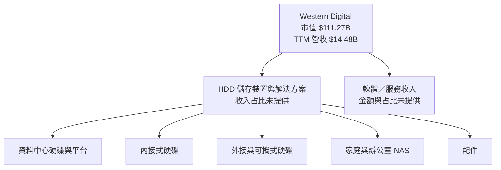
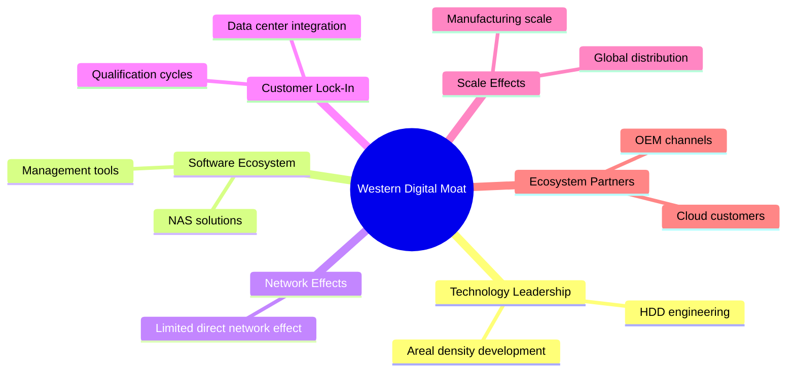
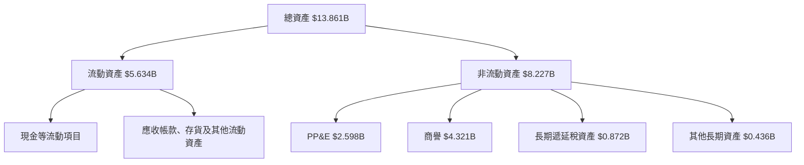
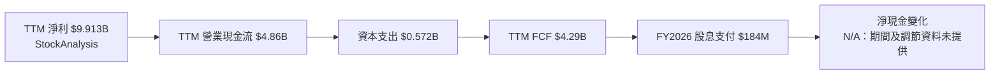
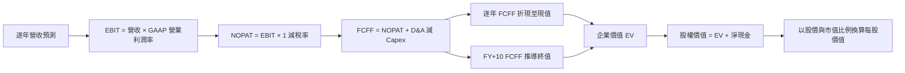
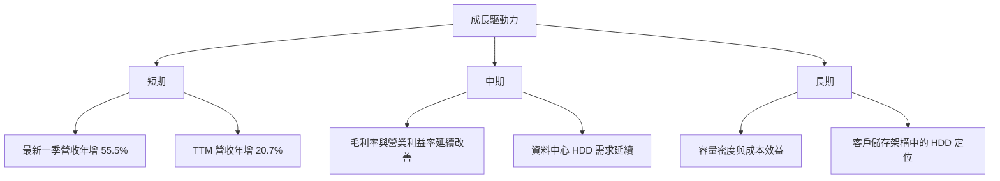
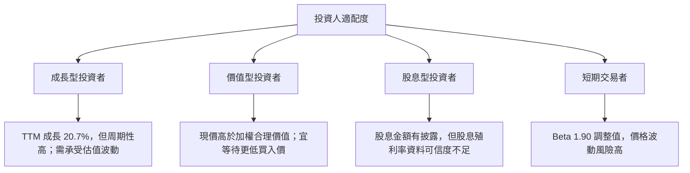

# WDC 基本面深度分析報告

> **報告日期**：2026-11-24 ｜ **語言**：繁體中文 ｜ **數據來源**：SEC 申報資料 (XBRL)、Yahoo Finance、Finviz、StockAnalysis、Roic.ai ｜ **分析師**：CFA 級機構研究  
> **價格基準**：2026-11-23 收盤價 **$297.25**。財務數據截至 2026-10-02 的最新 TTM；不同資料源的部分財務指標存在差異，本報告對指定核心指標優先採用 SEC／程式計算口徑，並於相關章節揭露差異。

## 目錄

| # | 章節 | 核心結論 |
|---|------|----------|
| 1 | 執行摘要 | 賣出；加權合理價值 $214.82，MOS -38.4% |
| 2 | 公司概覽與商業模式 | HDD 技術與企業客戶黏著度提供中等護城河，市場份額數字未提供 |
| 3 | 損益表深度分析 | TTM 營收 $14.48B、TTM 成長 20.7%；周期復甦帶動利潤率上升 |
| 4 | 資產負債表分析 | 淨現金 $525M；營運資金週期較一年前拉長 |
| 5 | 現金流量深度分析 | TTM FCF $4.29B，FCF Yield 3.85%，現金轉換低於淨利 |
| 6 | 獲利能力與資本效率 | ROIC 61.1% 高於 WACC 14.00%，目前創造價值，但高峰利潤率未必持久 |
| 7 | 相對估值分析 | 同業倍數分歧大；部分自身估值指標已高於歷史中位數 |
| 8 | DCF 內在價值評估 | 基準 DCF $182.17；加權合理價值 $214.82 |
| 9 | 成長催化劑 | 最新一季營收年增 55.5%，但 TAM 與細分業務收入未提供 |
| 10 | 風險矩陣 | 主要風險為周期反轉、估值回落及營運資金惡化 |
| 11 | 投資建議 | 現價高於加權合理價值；設定價格與營運指標觸發條件 |

## 1. 執行摘要

WDC 的 TTM 營收為 **$14.48B**，較前一個 TTM 成長 **20.7%**，最新一季營收年增 **55.5%**；TTM FCF 為 **$4.29B**，但 FCF Yield 僅 **3.85%**。ROIC **61.1%** 遠高於 **14.00% WACC**，反映當前營運具有高資本報酬；另一方面，DCF 基準價值 **$182.17**、加權合理價值 **$214.82**，均低於 $297.25 現價。依 MOS **-38.4%**，規則 20 的評級為 **賣出**；不作質化升降級。

### 1.0 一頁式投資儀表板

| 項目 | 內容 |
|------|------|
| **投資論點（3 句）** | ① TTM 營收成長 **20.7%**、最新一季年增 **55.5%**，顯示硬碟需求處於復甦階段。② TTM FCF **$4.29B**，但僅為 TTM 淨利約 **43.3%**，盈餘的現金轉換不及會計獲利。③ ROIC **61.1%** 高於 WACC **14.00%**，但現價 $297.25 高於加權合理價值 $214.82。 |
| **綜合評分** | **6.3/10**（引用 1.1） |
| **財務健康** | 🟡 淨現金 **$525M**，但 DSO、DIO 上升，現金轉換週期由 34 天增至 52 天。 |
| **ROIC vs WACC** | **61.1% vs 14.00%**；目前創造股東價值。 |
| **FCF 趨勢** | FY2024–FY2026 由負轉正；TTM FCF Yield **3.85%**。 |
| **估值** | Forward P/E **7.44x**（市場資料）；EV/EBITDA **17.566x**（市場資料）；FCF Yield **3.85%**。不同來源估值口徑有差異，詳見第 7 章。 |
| **DCF 內在價值（基準）** | **$182.17**；現價相對 DCF 溢價 **63.2%**。 |
| **安全邊際（MOS）** | **-38.4%**＝($214.82 − $297.25) ÷ $214.82；🔴 小於 10%，無安全邊際。 |
| **預期報酬（基準情境）** | DCF 基準情境相對現價 **-38.7%**。 |
| **關鍵風險（前二）** | HDD 價格／需求周期反轉；現價已隱含高於基準 DCF 的預期。 |
| **評級 + 信心度** | 🔴 **賣出** ｜信心：中（營運數據可觀，但周期與跨來源數據差異增加估值不確定性）。 |

### 1.1 綜合評分卡（全報告唯一）

| 維度 | 評分（1–10） | 主要依據（引用數字與其來源章節） |
|------|--------------|----------------------------------|
| 成長性 | 7.5 | TTM 營收年增 **20.7%**、最新一季年增 **55.5%**，但周期性使延續性不確定（第 3 章）。 |
| 獲利能力 | 8.5 | ROIC **61.1%**、WACC **14.00%**，TTM 營業利益率 **39.4%**（第 6 章）。 |
| 財務健康 | 7.5 | 淨現金 **$525M**、流動比率 **1.434**；CCC 增至 **52 天**（第 4 章）。 |
| 估值 | 2.0 | 加權合理價值 $214.82 對比現價 $297.25，MOS **-38.4%**（第 8 章）。 |
| 護城河 | 6.5 | HDD 技術、客戶驗證與規模有助維繫企業客戶，但市場份額及分部數據未提供（第 2 章）。 |
| 管理層與資本配置 | 6.0 | FY2026 SBC **$204M**、稀釋股數測試未通過；回購資料未提供（第 3、5 章）。 |
| **綜合評分** | **6.3** | 六項算術平均：**(7.5 + 8.5 + 7.5 + 2.0 + 6.5 + 6.0) ÷ 6 = 6.3**。 |

### 1.2 五大投資論點 + 三大核心風險

| 類型 | 項目 | 具體依據 | 信心度 |
|------|------|----------|--------|
| 🟢 **投資論點①** | 營收復甦 | TTM 營收 **$14.48B**，TTM 年增 **20.7%**；最新一季年增 **55.5%**，代表需求與出貨復甦已反映在收入。 | 🟢 高 |
| 🟢 **投資論點②** | 利潤率回升 | TTM 營業利益率 **39.4%**，最新一季 **46.7%**；固定成本吸收改善可能放大利潤。 | 🟡 中 |
| 🟢 **投資論點③** | 強資本報酬 | ROIC **61.1%**，比 WACC 高 **47.1 個百分點**，當前資本使用創造價值。 | 🟢 高 |
| 🟢 **投資論點④** | 正向現金流 | TTM OCF **$4.86B**、資本支出 **$572M**、FCF **$4.29B**。 | 🟢 高 |
| 🟢 **投資論點⑤** | 淨現金狀態 | 淨現金 **$525M**，降低財務壓力及周期低谷的再融資風險。 | 🟡 中 |
| 🟡 **風險①** | 周期性高峰 | FY2023–FY2026 營收從 **$6.255B** 升至 **$12.919B**；大幅回升不等同長期線性成長。 | 🟡 中 |
| 🔴 **風險②** | 估值高於基準 | DCF **$182.17**、加權合理價值 **$214.82**，均低於 $297.25 現價。 | 🔴 高 |
| 🟡 **風險③** | 盈餘現金轉換偏低 | FCF / TTM 淨利約 **43.3%**；Piotroski 應計品質測試未通過。 | 🟡 中 |

### 1.3 快速統計卡片

| 指標 | 公司實際值（期間） | 同業中位數 | 狀態 |
|------|--------------------|------------|------|
| 營收成長（TTM） | **20.7%** | — | 🟢 |
| 營收成長（最新一季年增） | **55.5%** | **61.0%** | 🟡 |
| 毛利率（TTM） | **52.6%** | **80.0%** | 🟡 |
| 營業利益率（TTM） | **39.4%** | — | 🟢 |
| ROIC（TTM） | **61.1%** | — | 🟢 |
| Forward P/E | **7.4447x** | **3.4x** | 🟡 |
| FCF Yield（TTM） | **3.85%** | — | 🟡 |
| Piotroski F-Score | **6 / 8** | — | 🟡 |

> 同業中位數依 Peer multiples 區塊計算：最新一季營收成長中位數為 **61.0%**；TTM 毛利率中位數為 **80.0%**；Forward P/E 中位數為 **3.4x**。

### 1.4 投資結論

```text
╔══════════════════════════════════════════════════════════════════╗
║                    📊 投資結論摘要                               ║
╠══════════════════════════════════════════════════════════════════╣
║  評級：賣出（MOS -38.4%，符合規則 20）                            ║
║  價格（2026-11-23 收盤）：$297.25                                ║
║  DCF 內在價值（基準）：$182.17（現價溢價 63.2%）                  ║
║  安全邊際 MOS：-38.4%（以加權合理價值 $214.82 為分母）            ║
║  加權合理價值（8.8）：$214.82                                    ║
║  DCF 情境價值：悲觀 $100.40（-66.2%）                            ║
║    基準 $182.17（-38.7%）；樂觀 $313.26（+5.4%）                 ║
║  綜合評分：6.3/10（引用 1.1）                                    ║
║  適合投資人：可承受周期波動、願意等待估值回落的長線投資人         ║
╚══════════════════════════════════════════════════════════════════╝
```

## 2. 公司概覽與商業模式

### 2.1 業務結構與收入來源

公司資料描述 WDC 經營以 HDD 技術為基礎的儲存裝置與解決方案，包括資料中心硬碟、內接／外接硬碟、NAS 與相關配件。分部營收及各產品收入占比未提供，因此不將總營收任意拆分。



### 2.2 市場份額

市場份額數據及年份未提供，因此不以圖表推估。WDC TTM 營收 **$14.48B**、最新一季年增 **55.5%**，顯示其處於儲存需求復甦之中；但同業 STX、SNDK、MU 的業務組合與毛利率差異大，不能單以營收增速推斷市場份額變化。

### 2.3 競爭護城河分析



### 2.4 護城河強度

| 護城河項目 | 強度 | 證據 | 會削弱它的情況 |
|------------|------|------|----------------|
| 技術與產品驗證 | 中 | 公司產品覆蓋資料中心 HDD、內外接硬碟與 NAS；最新一季營收年增 **55.5%**，但分部收入與研發成果數據未提供。 | 新一代儲存技術改變成本／容量優勢，或產品可靠性下降。 |
| 客戶鎖定 | 中 | 企業儲存需經產品驗證並與系統整合，可能形成轉換成本；客戶集中度與續約數未提供。 | 大型客戶降低 HDD 配置、轉向其他儲存方案或重新議價。 |
| 規模效應 | 中 | TTM 營收 **$14.48B**，有全球製造與銷售規模；單位成本與產能利用率數據未提供。 | 周期下行造成產能閒置、固定成本吸收惡化。 |
| 軟體生態系統 | 弱至中 | NAS 與配件產品存在，但軟體收入與訂閱指標未提供。 | 軟體差異化有限，硬體價格競爭主導採購。 |
| 網路效應 | 弱 | HDD 儲存產品未顯示直接網路效應。 | 客戶採購轉向標準化、可替代產品。 |
| 生態夥伴 | 中 | 產品透過銷售人員、經銷商與分銷商銷售；合作夥伴貢獻資料未提供。 | 通路庫存升高或合作夥伴轉推競品。 |

**護城河評分理由**：1.1 的護城河評分 **6.5/10**，反映產品驗證、規模與客戶整合具一定防禦性，但缺少市場份額、客戶黏著度和軟體收入數據。

## 3. 損益表深度分析

### 3.1 年度收入成長趨勢（近 4 年）

年度收入及年度增速採公司年度損益表；2023 年相對 2022 年的收入增速亦列出作為基期參考。

```text
╔══════════════════════════════════════════════════════════════════╗
║          Western Digital 年度收入趨勢（FY2023-FY2026）           ║
╠══════════════════════════════════════════════════════════════════╣
║  FY2023  $6.255B   ████████████░░░░░░░░░░  YoY: -66.7% 🔴       ║
║  FY2024  $6.317B   ████████████░░░░░░░░░░  YoY:  +1.0% 🟡       ║
║  FY2025  $9.520B   ██████████████████░░░░  YoY: +50.7% 🟢       ║
║  FY2026  $12.919B  ██████████████████████  YoY: +35.7% 🟢       ║
║                                                                  ║
║  FY2023-FY2026 收入 CAGR：($12.919B ÷ $6.255B)^(1/3)-1 = 27.3% ║
╚══════════════════════════════════════════════════════════════════╝
```

FY2023 收入相較 FY2022 的大幅下滑反映周期性基期衝擊；FY2025–FY2026 的回升則與儲存需求及產能利用復甦相符，但 27.3% 三年 CAGR 不宜直接外推為長期成長率。

### 3.2 季度收入趨勢分析

| 季度 | 營收 | QoQ 成長 | YoY 成長 | 備註 |
|------|------|----------|----------|------|
| 2025-12-31 | $3.02B | N/A（前一季未列） | 25.24% | YoY 依季度營收成長資料。 |
| 2026-03-31 | $3.34B | **10.6%** | 45.47% | QoQ＝$3.34B ÷ $3.02B − 1。 |
| 2026-06-30 | $3.75B | **12.3%** | 43.84% | QoQ＝$3.75B ÷ $3.34B − 1。 |
| 2026-09-30 | $4.38B | **16.9%** | **55.5%** | QoQ＝$4.38B ÷ $3.75B − 1；最新一季年增引用單季口徑。 |

QoQ 成長逐季加速，代表近期出貨／定價或產品組合改善；能否持續需檢視後續季度的營收與毛利率，而非僅依最新季度外推。

### 3.3 利潤率演變分析

| 利潤率指標 | FY2023 | FY2024 | FY2025 | FY2026 | 趨勢 | 評估 |
|------------|--------|--------|--------|--------|------|------|
| **毛利率** | 22.2% | 28.1% | 38.8% | 48.8% | 連續回升，FY2026 約增加 10.0 個百分點 | 🟢 |
| **營業利益率** | -6.4% | 1.5% | 22.4% | 35.6% | 低谷後大幅復甦 | 🟢 |
| **淨利率** | -27.3% | -13.5% | 19.4% | 72.0% | FY2026 明顯受非營業或稅務項目影響 | 🟡 |

年度比率由年度損益表簡單相除，與 TTM 指標並非同一期間口徑。指定 TTM 營業利益率為 **39.4%**、最新一季為 **46.7%**；另一合併市場資料列 TTM **40.7%**、最新一季 **40.9%**，存在來源差異，本報告估值與評分採用指定的 SEC／程式計算數值。

**利潤率演變深度解析**：FY2024–FY2026 毛利率和營業利益率回升，與收入由低谷復甦、固定製造成本吸收改善相一致。FY2026 淨利率達 **72.0%**，顯著高於營業利益率 **35.6%**；因此不宜將淨利增長全部視為營運改善，需留意稅務與非營業項目。有效稅率 **4.9%** 亦低於常態化預期，詳見 3.5。

### 3.4 費用結構分析

各項營業費用明細及完整費用結構比例未提供，故不畫 pie chart 或將不同口徑的年度數字拼成費用占比。FY2026 研發費用為 **$1.16B**，約占 FY2026 營收 **9.0%**（$1.16B ÷ $12.919B）；FY2025 為 **$994M**，研發投入增加與產品開發需求相符，但研發資本化與費用化細節未提供。

### 3.5 季度 EPS 趨勢與盈餘品質（Quality of Earnings）

| 季度 | EPS 實際 | EPS 年增 | 預估／實際差額 |
|------|----------|---------|----------------|
| 2025-12-31 | $4.67 | 187.75% | N/A（EPS 預估值缺漏） |
| 2026-03-31 | $8.20 | 482.92% | N/A（EPS 預估值缺漏） |
| 2026-06-30 | $8.21 | 984.10% | N/A（EPS 預估值缺漏） |
| 2026-09-30 | $4.63 | 50.86% | N/A（EPS 預估值缺漏） |

EPS 歷史表所列四季估值均為 `nan`，因此不能判定超預期或不及預期。另季度淨利資料源間不一致，例如 2026-06-30 分別列 **$3.07B** 與 **$3.18B**；不據此推測盈餘驚喜。

| 盈餘品質項目 | 數值／佔比 | 評估 |
|--------------|-----------|------|
| 股權薪酬 SBC / 營收 | 近四個已列季度 SBC 合計 **$230M**；$230M ÷ $14.48B＝**1.59%** | 🟡 SBC 對收入占比不高，但代表股權稀釋成本仍存在。 |
| SBC / 營業現金流 | 近四季 SBC 合計 $230M ÷ TTM OCF $4.86B＝**4.73%** | 🟡 中度稀釋；該比率以所列四季資料加總作代理，非 SEC 確認的 TTM SBC 指標。 |
| FCF / 淨利（現金轉換率） | $4.29B ÷ StockAnalysis TTM 淨利 $9.913B＝**43.3%** | 🔴 淨利現金轉換偏低；應計品質測試亦未通過。 |
| 一次性／非經常性損益 | 明細 N/A；FY2026 淨利 $9.30B 高於營業利益 $4.60B，FY2026 有效稅率為 **4.9%** | 🟡 營業利益以下項目及低稅率可能放大淨利，缺少明細無法拆分。 |
| 有效稅率異常 | **4.9%**（最新年度有效稅率） | 🟡 低稅率提高當期淨利；DCF 直接採用此稅率，若未來回升，估值偏高。 |
| 資本化支出 vs 費用化 | 資本化及研發費用化明細 N/A | N/A（數據未提供，不能判斷是否遞延成本）。 |

**盈餘品質結論**：FCF 仍達 **$4.29B**，現金生成能力具實質支撐；但 FCF／淨利約 **43.3%**、4.9% 有效稅率與應計測試未通過，表示 TTM 會計淨利不宜完全按現金盈餘看待。若採用較正常化稅率，獲利與估值可能低於目前模型。

## 4. 資產負債表分析

### 4.1 資產結構分解

下列項目採 FY2026 年度資產負債表，金額加總至總資產 **$13.861B**。



### 4.2 流動性與營運資金分析

| 指標 | 最新值 | 歷史比較 | 評估 |
|------|--------|----------|------|
| 流動比率 | **1.434** | 歷史季度序列未完整提供 | 🟡 短期流動資產高於流動負債，但速動比率 **0.867** 顯示對存貨等項目仍有依賴。 |
| 現金與短期投資 | **$1.31B** | FY2026 年度現金 $1.579B | 🟡 TTM 資料低於 FY2026 年末餘額，期末時點不同。 |
| 淨現金 | **$525M** | N/A | 🟢 現金高於指定口徑總債務。 |

| 指標 | 最新 TTM | 一年前 TTM | 變化 | 解讀 |
|------|----------|------------|------|------|
| DSO 應收帳款天數 | **56 天** | **41 天** | **+15 天** | 回款速度變慢，可能與收入快速擴張、客戶付款條件或季末應收上升有關；需追蹤逾期與信用損失。 |
| DIO 存貨天數 | **95 天** | **70 天** | **+25 天** | 庫存占用增加，可能是備貨與需求增長並行，也可能反映庫存週轉放慢。 |
| DPO 應付帳款天數 | **99 天** | **77 天** | **+22 天** | 公司延長供應商付款期，對現金有支撐；若供應商條件收緊則可能反轉。 |
| CCC 現金轉換週期 | **52 天** | **34 天** | **+18 天** | DSO、DIO 上升幅度大於 DPO 的抵銷效果，營運資金效率轉弱。 |

### 4.3 債務結構分析

```text
╔══════════════════════════════════════════════════════════════════╗
║                   WDC 債務健康診斷                              ║
╠══════════════════════════════════════════════════════════════════╣
║  總債務：             $789M      🟢 低於現金及短期投資           ║
║  現金+短期投資：      $1.31B     🟢 高於指定總債務               ║
║  淨現金：             $525M      🟢 資產負債表具緩衝              ║
║  Debt/EBITDA：        N/A（未採用口徑不一致的 EBITDA）           ║
║  利息保障倍數：        N/A（利息費用與一致期間資料未完整提供）    ║
╚══════════════════════════════════════════════════════════════════╝
```

年度財報列 FY2026 總債務 **$1.05B**，市場資料列 **$922M**，指定核心數據列 **$789M**；本報告在淨現金及 DCF 中採用指定數據 **$789M**，不將不同時點數字混用。

### 4.4 股東權益趨勢

| 財年 | 股東權益 |
|------|----------|
| FY2023 | $11.84B |
| FY2024 | $11.05B |
| FY2025 | $5.54B |
| FY2026 | $8.86B |

```text
╔══════════════════════════════════════════════════════════════════╗
║               股東權益變化（年度）                              ║
╠══════════════════════════════════════════════════════════════════╣
║  FY2023  $11.84B  ████████████████████                          ║
║  FY2024  $11.05B  ███████████████████                           ║
║  FY2025   $5.54B  █████████                                     ║
║  FY2026   $8.86B  ███████████████                               ║
╚══════════════════════════════════════════════════════════════════╝
```

FY2025 權益下降後於 FY2026 回升，權益波動與周期損益、資本結構變化相關；未提供足夠權益變動明細，不能將變動全歸因於回購、股息或其他單一項目。

## 5. 現金流量深度分析

### 5.1 現金流量瀑布圖

完整 TTM「淨利到營運現金流」調節表及回購金額未提供；可確認的現金流項目如下，不以缺漏資料推算淨現金變化。



### 5.2 FCF 轉換率趨勢

| 財年 | OCF | 資本支出 | FCF | FCF / 淨利 |
|------|-----|----------|-----|------------|
| FY2023 | -$408M | $821M | -$1.23B | 72.0%（兩者均為負值，比例不具正向含義） |
| FY2024 | -$294M | $487M | -$781M | 91.7%（兩者均為負值，比例不具正向含義） |
| FY2025 | $1.69B | $412M | $1.28B | 69.4% |
| FY2026 | $3.93B | $418M | $3.51B | 37.8% |
| 最新 TTM | $4.86B | $572M | $4.29B | 約 **43.3%**（以 TTM 淨利 $9.913B 作分母） |

FY2025 至 FY2026 FCF 上升與營運現金流改善一致，但淨利增長快於 FCF，且最新 TTM 現金轉換率低於 50%，需觀察應收與存貨變化。

### 5.3 自由現金流趨勢

```text
╔══════════════════════════════════════════════════════════════════╗
║                     FCF 歷史趨勢                                ║
╠══════════════════════════════════════════════════════════════════╣
║  FY2023  -$1.23B  ◀────── 負值                                   ║
║  FY2024  -$0.781B ◀──── 負值                                     ║
║  FY2025   $1.28B  ██████                                         ║
║  FY2026   $3.51B  █████████████████                              ║
║  TTM      $4.29B  █████████████████████                          ║
║  TTM FCF Yield：3.85%                                            ║
╚══════════════════════════════════════════════════════════════════╝
```

TTM FCF 定義為 **營業現金流減資本支出**，即 **$4.86B − $572M = $4.29B**（按原始精度取整）。TTM FCF Yield 為 **3.85%**，以市場市值計算，現金產出有改善但對 $297.25 股價的估值保護有限。

### 5.4 資本配置評估

資本配置完整占比與回購金額未提供，不畫比例圖。已列 FY2026 資本支出 **$418M**、現金股息 **$184M**、SBC **$204M**；回購數據未提供。FY2023–FY2025 股息支付分別為 **$0、$0、$44M**，FY2026 增至 $184M，仍不足以單獨判斷長期股東回報政策。

## 6. 獲利能力與資本效率

### 6.1 ROE / ROA / ROIC 趨勢

| 指標 | 最新 TTM | 歷史值／參考 | 評估 |
|------|----------|---------------|------|
| ROE | **107.2%**（品質指標口徑） | 另一市場資料列 **129.6%** | 🟡 高回報但數源口徑差異明顯，且淨利受低稅率影響。 |
| ROA | **25.9%**（市場資料） | Piotroski 測試顯示 ROA 高於一年前 | 🟢 資產獲利回升；精確歷年同口徑序列未提供。 |
| ROIC | **61.1%** | TTM 程式計算 | 🟢 高於 WACC，現階段創造價值。 |

### 6.2 ROIC vs WACC 分析（核心價值創造判斷）

```text
╔══════════════════════════════════════════════════════════════════╗
║                ROIC vs WACC 深度分析                            ║
╠══════════════════════════════════════════════════════════════════╣
║  WACC 輸入（依資本成本資料）：                                   ║
║  ├── 無風險利率（10Y 美債）： 4.92%                              ║
║  ├── 市場風險溢酬 ERP：       5.00%                              ║
║  ├── 原始 Beta：               2.34                               ║
║  ├── 調整後 Beta：             1.90                               ║
║  ├── 股權成本：                14.40%                             ║
║  ├── 稅前債務成本：            20.91%                             ║
║  ├── 資本結構 E/D：            99.3% / 0.7%                      ║
║  ├── 計算 WACC：               14.44%                             ║
║  └── 採用 WACC：               14.00%（受 7%-14% 區間上限限制）  ║
║                                                                  ║
║  ROIC（TTM）：61.1%                                               ║
║  EVA 利差：61.1% − 14.00% = +47.1 個百分點                       ║
║                                                                  ║
║  ROIC  61.1%  ▓▓▓▓▓▓▓▓▓▓▓▓▓▓▓▓▓▓▓▓▓▓▓▓▓▓▓▓▓▓▓▓▓▓▓▓▓▓▓▓▓▓       ║
║  WACC  14.0%  ▓▓▓▓▓▓▓▓▓▓▓▓                                     ║
║  結論：當前 ROIC 顯著高於資本成本，創造股東價值。               ║
╚══════════════════════════════════════════════════════════════════╝
```

WACC 的組成與計算詳見第 8.2 節。ROIC 公式為稅後營業利益 ÷（股東權益＋債務−現金）；在 **61.1%** 下，WDC 目前資本回報高於資金成本。惟儲存產業具周期性，若營業利潤率回落，ROIC 可能快速收縮，不能把現時高利差視為永久狀態。

### 6.3 杜邦三因素分解

| 因素 | 數值（TTM） | 解讀 |
|------|-------------|------|
| 淨利率 | **69.2%** | 高淨利率對 ROE 貢獻最大，但低有效稅率可能抬高當期數值。 |
| 資產週轉率 | **1.02** | TTM 營收相對資產的週轉速度。 |
| 權益乘數 | **1.52** | 財務槓桿不是 ROE 的主要來源。 |
| **ROE** | **107.2%** | 69.2% × 1.02 × 1.52＝約 **107.2%**（依指定品質指標口徑）。 |

### 6.4 財務體質：Piotroski F-Score

**Piotroski F-Score：6 / 8**。資料說明缺少一項測試輸入，故分母低於標準 9 項；以下逐項照錄測試結果。

| 測試 | 結果 | 解讀 |
|------|------|------|
| ROA > 0 | ✅ 通過 | TTM 資產獲利為正。 |
| 營業現金流 > 0 | ✅ 通過 | TTM OCF 為 **$4.86B**。 |
| ROA 高於一年前 | ✅ 通過 | 獲利復甦改善資產報酬。 |
| 營業現金流 > 淨利 | ❌ 未通過 | 現金流低於淨利，與現金轉換率偏低一致。 |
| 長期負債 ÷ 總資產低於一年前 | — 無法判定 | 缺少比較所需資料。 |
| 流動比率高於一年前 | ✅ 通過 | 流動性測試通過。 |
| 稀釋股數未增加 | ❌ 未通過 | 股數稀釋可能侵蝕每股價值。 |
| 毛利率高於一年前 | ✅ 通過 | 反映周期回升與毛利改善。 |
| 資產週轉率高於一年前 | ✅ 通過 | 資產利用效率改善。 |

## 7. 相對估值分析

### 7.1 同業估值比較表格

本表同業數值一律採 Peer multiples；WDC 自身倍數引用市場估值資料。由於同業 P/E 與估值口徑受周期獲利影響，倍數比較應與收入及毛利趨勢合併判斷。

| 估值指標 | **WDC** | **STX** | **SNDK** | **MU** | WDC 評估 |
|----------|--------|---------|----------|--------|----------|
| **Trailing P/E** | 10.4555x（市場資料）；歷史估值資料為 11.5x | 27.3x | 5.6x | 9.5x | 🟡 WDC 低於 STX、高於 SNDK/MU；來源口徑有差異。 |
| **Forward P/E** | 7.4447x | 8.0x | 2.4x | 3.4x | 🟡 高於同業中位數 **3.4x**。 |
| **P/S Ratio** | 7.6832x（市場資料）；歷史估值資料為 7.9x | 8.7x | 3.4x | 6.0x | 🟡 高於同業中位數 **6.0x**。 |
| **EV/EBITDA** | 17.566x（市場資料）；歷史估值資料為 19.9x | 20.6x | 4.5x | 7.0x | 🔴 高於同業中位數 **7.0x**。 |
| **最新一季營收年增** | 55.5% | 61.0% | 377.9% | 379.3% | 🟡 低於三家同業中位數 **61.0%**。 |
| **TTM 毛利率** | 52.6% | 50.4% | 80.0% | 80.7% | 🟡 高於 STX、低於 SNDK/MU；同業中位數 **80.0%**。 |

### 7.2 歷史估值區間分析

```text
╔══════════════════════════════════════════════════════════════════╗
║                  WDC 自身 5 年估值位置                           ║
╠══════════════════════════════════════════════════════════════════╣
║  P/E：       範圍 6.3x ───────── 中位數 13.5x ───── 現值 11.5x  ║
║              現值百分位：38%                                     ║
║  P/S：       範圍 0.4x ───── 中位數 1.2x ────────── 現值 7.9x  ║
║              現值百分位：85%                                     ║
║  EV/EBITDA： 範圍 4.5x ───── 中位數 14.9x ───────── 現值 19.9x ║
║              現值百分位：69%                                     ║
╚══════════════════════════════════════════════════════════════════╝
```

P/E 低於歷史中位數 **13.5x**，但 P/S 達 **7.9x**、遠高於中位數 **1.2x**；EV/EBITDA **19.9x** 亦高於中位數 **14.9x**。這種分歧可能來自周期復甦中利潤與市值的變化速度不同，估值不能只依單一倍數判斷。

### 7.3 情境價值（DCF MODEL Scenarios）

| 情境 | 第 1 年營收成長 | 期末營業利潤率 | WACC | 每股價值 | 相對現價 | 機率 | 會發生的條件 |
|------|----------------|----------------|------|----------|----------|------|--------------|
| 🔴 悲觀 | 10.3% | 19.4% | 15.00% | **$100.40** | -66.2% | 25% | 需求復甦放緩、定價及產能利用下降，利潤率逐步回歸較低水準。 |
| 🟡 基準 | 20.7% | 22.8% | 14.00% | **$182.17** | -38.7% | 50% | 先延續 TTM 成長，再逐步降至成熟期成長；利潤率向五年中位數收斂。 |
| 🟢 樂觀 | 31.0% | 25.1% | 13.00% | **$313.26** | +5.4% | 25% | 需求維持高增長、產品組合與定價使利潤率高於基準，資本成本下降。 |

### 7.4 相對估值隱含價格區間

```text
╔══════════════════════════════════════════════════════════════════╗
║                 估值方法隱含每股價值                             ║
╠══════════════════════════════════════════════════════════════════╣
║  $115.52 ───────── $182.17 ───── $214.82 ─── $232.59 ── $297.25 ║
║ EV/EBITDA          DCF 基準      加權合理值     同業 P/S    現價  ║
╚══════════════════════════════════════════════════════════════════╝
```

- **同業 EV/EBITDA：$115.52**，以 STX、SNDK、MU 的中位數 **7.0x** 乘 WDC TTM EBITDA，再加淨現金。
- **同業 P/S：$232.59**，以三家同業中位數 **6.0x** 乘 WDC TTM 營收。
- DCF 基準 **$182.17**；分析師共識目標價 **$607.75**。分析師共識與基本面估值差異極大，僅依指定方法以 **10% 權重**納入。

## 8. DCF 內在價值評估（Discounted Cash Flow）

> 本章採用已計算的 FCFF 模型數字。模型採用 GAAP EBIT、固定股數，不另扣 SBC、不建模營運資金；所有金額取至 $0.01B，折現因子取三位小數。原模型四捨五入後的逐年欄位可能存在小幅尾差。

### 8.0 估值推理鏈（Thinking Logic）

**Step 1 — 價值來源與主導變數**  
模型的價值來源是現有 HDD 業務收入及利潤的延續，未提供可分拆的第二成長曲線或新業務收入占比，故不額外給選擇權估值。估值對 **WACC、永續成長率及營業利潤率**敏感，因終值現值占 EV **35.1%**，但營收與利潤率也決定各年 FCFF。

**Step 2 — 模型選擇**

| 決策點 | 本報告採用 | 理由 | 曾考慮但否決 | 否決理由 |
|--------|-----------|------|--------------|----------|
| 現金流定義 | FCFF | 與 WACC 折現並先求 EV 一致；模型定義為 NOPAT + D&A − Capex。 | FCFE | 與既定模型口徑不符。 |
| 預測期 N | 10 年 | 依既定模型，讓營收成長及利潤率逐步衰減。 | 5 年 | 不符合指定模型，且周期成熟化可能需較長時間。 |
| 終值方法 | Gordon Growth | 模型採永續成長 **3.0%**。 | 退出倍數終值 | DCF 模型未提供退出倍數終值計算，不能另造。 |
| EBIT 基礎 | GAAP EBIT | GAAP EBIT 已含 SBC 費用。 | 非 GAAP EBIT | 會與既定 DCF 假設不同。 |

**Step 3 — 關鍵假設推導鏈**

- **營收成長路徑**：錨點為 TTM 營收年增 **20.7%**；模型將其用作 FY+1 成長，再線性降至 FY+10 **3.0%**，反映周期高增長不永久延續；採用模型逐年路徑；否決十年維持 20.7%，因其會將當前周期增速外推。
- **期末營業利潤率**：錨點為 TTM 營業利益率 **39.4%**；模型逐年降至最近五個財年含 TTM 的中位數 **22.8%**；採用 FY+10 **22.8%**；否決長期維持 39.4%，因歷史周期與當前高利潤不支持永久固定。
- **永續成長率 g**：採用 **3.0%**，低於長期名目經濟成長的常見上限假設，且低於 WACC；否決高於 3.0%，因會提高終值依賴並接近折現率。
- **預測期 N**：採用 **10 年**（模型設定）；未以較短期間替代，因既定模型用十年逐步淡化成長與利潤率。
- **Capex / 營收**：採用 FY+1 **3.9%**，逐步降至 FY+10 **3.0%**；起點錨為 TTM Capex／營收約 **3.9%**（$572M ÷ $14.48B），並按模型向長期水平收斂；否決資本支出持續低於折舊的設定。
- **EBIT 基礎及 SBC**：錨點為 GAAP 營業利益率；採用 GAAP EBIT，SBC 已作費用；否決再從 FCFF 扣 SBC，避免重複扣除。
- **股數稀釋率**：模型採固定股數，稀釋率 **0%**；配合 GAAP EBIT 的組合 A；否決另加年稀釋，因既定模型未做此調整。
- **WACC**：採用限制後 **14.00%**；計算值 **14.44%**，因模型規則設 7%–14% 上限而採用 14%；不採更低折現率，以免弱化高 Beta 股票的風險反映。

**Step 4 — 最脆弱一環**  
最脆弱假設是當前 TTM **39.4%** 營業利益率以十年線性方式降至 **22.8%** 的路徑；若需求與定價更快反轉，悲觀情境價值為 **$100.40**，估值將進一步下修。

**Step 5 — 計算路徑**



### 8.1 模型假設總表（Model Inputs）

| 假設項目 | 採用值 | 依據／來源 | 敏感度 |
|----------|--------|-------------|--------|
| 預測期 N | **10 年** | DCF 模型設定；FY+1 至 FY+10 逐年預測。 | 🟡 中 |
| 營收成長 | FY+1 **20.7%**，逐年線性降至 FY+10 **3.0%** | 起點為 TTM vs prior TTM 成長 **20.7%**；終點為模型設定。 | 🔴 高 |
| 營業利潤率 | FY+1 **39.4%** → FY+10 **22.8%** | 起點為 TTM 營業利益率；終點為最近五個財年含 TTM 的中位數。 | 🔴 高 |
| 有效稅率 | **4.9%** | 最新年度有效稅率。低稅率可能偏樂觀。 | 🟢 低 |
| Capex / 營收 | FY+1 **3.9%** → FY+10 **3.0%** | 起點對應 TTM Capex／營收，模型逐步淡化。 | 🟡 中 |
| D&A / 營收 | **2.7%** | TTM 比率，模型維持不變。 | 🟢 低 |
| 營運資金變動 | 未建模 | DCF 明定 working capital is not modelled；不自行補數。 | 🟢 低 |
| EBIT 基礎 | **GAAP** | 模型以 GAAP EBIT 建模。 | 🟡 中 |
| SBC 處理 | EBIT 已扣除 SBC；FCFF 不再扣 SBC | GAAP EBIT 與組合 A 相容。 | 🟡 中 |
| 年稀釋率 | **0%**，固定股數 | 模型固定股數，SBC 成本已包含在 GAAP EBIT。 | 🟡 中 |
| 永續成長率 g | **3.0%** | 模型設定，且低於 14.00% WACC。 | 🔴 高 |
| 終值方法 | Gordon Growth | 模型採此方法；退出倍數終值未提供。 | 🔴 高 |
| WACC | **14.00%** | 取限制後資本成本，推導見 8.2。 | 🔴 高 |

本模型採 **(A) GAAP EBIT + 固定股數**，故 SBC 影響已計入一次，不再扣減 FCFF，也不再以股數稀釋率重複計價。FCFF 定義為 **NOPAT + D&A − Capex**，不含 ΔWC。

### 8.2 折現率推導（WACC）

```text
╔══════════════════════════════════════════════════════════════════╗
║                    WACC 推導（折現率）                           ║
╠══════════════════════════════════════════════════════════════════╣
║  股權成本 Ke（CAPM）：                                           ║
║  ├── 無風險利率 Rf：          4.92%                              ║
║  ├── 市場風險溢酬 ERP：       5.00%                              ║
║  ├── 原始 Beta：               2.34                               ║
║  ├── 調整後 Beta：             1.90 = ⅔×2.34 + ⅓×1.00            ║
║  ├── 規模／國別溢酬：          0.00%（未提供，未另加）            ║
║  └── Ke：                     4.92% + 1.90×5.00% = 14.40%       ║
║                                                                  ║
║  債務成本 Kd：                                                   ║
║  ├── 稅前 Kd：                 20.91%                             ║
║  ├── 有效稅率：                4.9%                               ║
║  └── 稅後 Kd：                 20.91%×(1−4.9%) = 19.89%          ║
║                                                                  ║
║  資本結構（市場基礎）：                                          ║
║  ├── 股權權重 E：              99.3%                              ║
║  ├── 債務權重 D：              0.7%                               ║
║  ├── 計算 WACC：               14.44%                             ║
║  └── 採用 WACC：               14.00%（受 7%-14% 區間上限限制）  ║
╚══════════════════════════════════════════════════════════════════╝
```

逐步演算：

1. **Ke** = Rf + β × ERP = **4.92% + 1.90 × 5.00% = 14.42%**；資本成本資料列示 Ke **14.40%**，為輸入來源的四捨五入口徑，模型採用資料列值。
2. **稅前 Kd** = 利息費用／計息負債；資料直接列示 **20.91%**。平均計息負債與利息費用原始金額未提供，故不另反推。
3. **稅後 Kd** = 20.91% × (1 − 4.9%) = **19.89%**。
4. **權重**：股權 **99.3%**、債務 **0.7%**，合計 **100.0%**；市值按 2026-11-23 收盤價口徑，計息負債按資本成本資料權重。
5. **計算 WACC** = 99.3% × 14.40% + 0.7% × 19.89% = **14.44%**（按輸入未四捨五入值），受 **7%–14%** 區間限制後採用 **14.00%**。

資料未提供用來獨立重建債務成本的利息費用與平均計息債務明細；本節依指定資本成本輸入，不將應付帳款等無息負債當作計息債務。第 6.2 與 DCF 一律採用 **14.00%**。

### 8.3 逐年自由現金流預測（基準情境）

單位：$B；此表照錄模型輸出。模型未列 ΔWC，亦未另列 SBC。

| 年度 | FY+1 | FY+2 | FY+3 | FY+4 | FY+5 | FY+6 | FY+7 | FY+8 | FY+9 | FY+10 |
|------|------|------|------|------|------|------|------|------|------|-------|
| 營收 | 17.47 | 20.74 | 24.21 | 27.79 | 31.35 | 34.75 | 37.84 | 40.46 | 42.47 | 43.75 |
| 營收 YoY | 20.7% | 18.7% | 16.7% | 14.8% | 12.8% | 10.9% | 8.9% | 6.9% | 5.0% | 3.0% |
| 營業利潤率 | 39.4% | 37.6% | 35.7% | 33.9% | 32.0% | 30.2% | 28.4% | 26.5% | 24.7% | 22.8% |
| EBIT（GAAP） | 6.89 | 7.79 | 8.65 | 9.42 | 10.05 | 10.50 | 10.74 | 10.73 | 10.49 | 10.00 |
| − 稅 | (0.33) | (0.38) | (0.42) | (0.46) | (0.49) | (0.51) | (0.52) | (0.52) | (0.51) | (0.49) |
| = NOPAT | 6.55 | 7.41 | 8.23 | 8.96 | 9.56 | 9.99 | 10.21 | 10.21 | 9.98 | 9.51 |
| + D&A | 0.47 | 0.56 | 0.65 | 0.75 | 0.85 | 0.94 | 1.02 | 1.09 | 1.15 | 1.18 |
| − Capex | (0.69) | (0.80) | (0.90) | (1.01) | (1.10) | (1.18) | (1.25) | (1.29) | (1.31) | (1.30) |
| = FCFF | **6.33** | **7.18** | **7.98** | **8.70** | **9.30** | **9.74** | **9.99** | **10.02** | **9.82** | **9.39** |
| 折現因子 @14.00% | 0.877 | 0.769 | 0.675 | 0.592 | 0.519 | 0.456 | 0.400 | 0.351 | 0.308 | 0.270 |
| FCFF 現值 PV | **5.56** | **5.52** | **5.39** | **5.15** | **4.83** | **4.44** | **3.99** | **3.51** | **3.02** | **2.53** |

預測期現值合計，按模型原始未四捨五入現金流計算為 **$43.95B**；表格中逐年 PV 四捨五入後逐項相加為 $43.94B，差異為顯示精度尾差。

**逐步演算（FY+1，按模型列示精度）**

1. 營收＝$14.48B × (1 + 20.7%)＝**$17.47B**（模型以未四捨五入基數計算）。
2. EBIT＝$17.47B × 39.4%＝**$6.89B**（以模型未四捨五入數值）。
3. 稅＝$6.89B × 4.9%＝**$0.33B**。
4. NOPAT＝$6.89B − $0.33B＝**$6.55B**（四捨五入尾差）。
5. D&A＝$17.47B × 2.7%＝**$0.47B**。
6. Capex＝$17.47B × 3.9%＝**$0.69B**。
7. ΔWC＝**未建模**。
8. FCFF＝$6.55B + $0.47B − $0.69B＝**$6.33B**（採未四捨五入模型數值）。
9. 折現因子＝1 ÷ (1 + 14.00%)¹＝**0.877**；PV＝$6.33B × 0.877＝**$5.56B**（以未四捨五入現金流計算）。

**合理性自檢**

- FY+1 至 FY+10 FCFF 由 **$6.33B** 增至 **$9.39B**，按十年端點計算 CAGR 約 **4.0%**；FY2023 至 FY2026 FCF 從負轉正，無法用負值計算有意義的傳統歷史 CAGR。
- FY+10 FCF 利潤率＝$9.39B ÷ $43.75B＝**21.5%**；FY+1 為約 **36.2%**；同業最佳 FCF 利潤率未提供。
- 模型年度 FCFF 均為正值；但不納入營運資金變動，使快速增長時的應收與存貨資金需求未被捕捉。

```text
╔══════════════════════════════════════════════════════════════════╗
║            自由現金流：歷史實際 vs 模型預測                      ║
╠══════════════════════════════════════════════════════════════════╣
║  FY2024(實)  -$0.781B  ◀── 負值                                  ║
║  FY2025(實)   $1.28B   █████                                     ║
║  FY2026(實)   $3.51B   █████████████                             ║
║  TTM(實)      $4.29B   █████████████████                         ║
║  FY+1 (預)    $6.33B   █████████████████████                     ║
║  FY+10(預)    $9.39B   ███████████████████████████████           ║
║  ⚠️ 預測依賴高起點盈利；歷史數據包含周期低谷，CAGR 不宜直接比。 ║
╚══════════════════════════════════════════════════════════════════╝
```

### 8.4 終值計算（Terminal Value）

**適用性檢查**：**WACC 14.00% vs g 3.0% → WACC > g？✅**

| 方法 | 計算式 | 終值 TV | TV 現值 | 佔總 EV 比重 |
|------|--------|---------|---------|--------------|
| Gordon Growth | $9.39B × (1 + 3.0%) ÷ (14.00% − 3.0%) | **$87.94B** | **$23.72B** | **35.1%** |
| 退出倍數法 | N/A（DCF 模型未提供退出倍數終值） | N/A | N/A | N/A |

逐步演算：

1. FY+N FCFF＝FY+10 FCFF **$9.39B**。
2. 分子＝$9.39B × (1 + 3.0%)＝**$9.67B**（模型原始精度結果）。
3. 分母＝14.00% − 3.0%＝**11.00%**；TV＝模型輸出 **$87.94B**。
4. PV(TV)＝$87.94B × FY+10 折現因子 **0.270**＝模型輸出 **$23.72B**（按未四捨五入精度計算）。
5. 終值占比＝$23.72B ÷ $67.67B＝**35.1%**。

### 8.5 企業價值 → 每股內在價值（Bridge）

```text
╔══════════════════════════════════════════════════════════════════╗
║              企業價值 → 每股內在價值 橋接表                      ║
╠══════════════════════════════════════════════════════════════════╣
║  預測期 FCF 現值合計             +$43.95B                        ║
║  終值現值 PV(TV)                 +$23.72B                        ║
║  = 企業價值 EV                    $67.67B                         ║
║  + 淨現金                         +$0.53B                         ║
║  = 股權價值                       $68.19B                         ║
║  每股價值換算：股權價值×股價÷市值                              ║
║  ★ DCF 基準每股內在價值          $182.17                         ║
║  當前股價                         $297.25                         ║
║  折溢價：現價÷DCF價值−1           +63.2%（溢價）                  ║
║  相對現價上行空間：DCF價值÷現價−1 -38.7%                         ║
╚══════════════════════════════════════════════════════════════════╝
```

逐步演算：

1. EV＝$43.95B + $23.72B＝**$67.67B**。
2. 股權價值＝EV $67.67B + 淨現金 $0.53B＝模型輸出 **$68.19B**（未四捨五入輸入造成 $0.01B 尾差）。
3. 每股內在價值＝股權價值 × 價格 ÷ 市值＝**$68.19B × $297.25 ÷ $111.27B = $182.17**。
4. 折溢價＝$297.25 ÷ $182.17 − 1＝**+63.2%**；DCF 相對現價變動＝$182.17 ÷ $297.25 − 1＝**-38.7%**。
5. **本節不計算 MOS**；MOS 一律以第 8.8 節加權合理價值為分母。

股數及股權價值換算依模型指定的 **股權價值 × 股價 ÷ 市值**。淨現金引用模型輸入 **$0.53B**，不把其他時點的現金與債務混合重算。

### 8.6 敏感性分析（WACC × 永續成長率）

下表數字照錄 DCF 模型。括號中的相對現價報酬按「每股價值 ÷ $297.25 − 1」計算，百分比四捨五入至一位小數。

| g（列）／WACC（欄） | 12.00% | 13.00% | **14.00%（基準）** | 15.00% | 16.00% |
|-----------|-------:|-------:|------------------:|-------:|-------:|
| **2.0%** | $211.85 (-28.7%) | $192.49 (-35.2%) | $176.33 (-40.7%) | $162.63 (-45.3%) | $150.88 (-49.2%) |
| **2.5%** | $216.61 (-27.1%) | $196.10 (-34.0%) | $179.12 (-39.7%) | $164.83 (-44.5%) | $152.63 (-48.7%) |
| **3.0%（基準）** | $221.90 (-25.4%) | $200.08 (-32.7%) | **$182.17 (-38.7%)** | $167.21 (-43.8%) | $154.51 (-48.0%) |
| **3.5%** | $227.82 (-23.4%) | $204.48 (-31.2%) | $185.51 (-37.6%) | $169.79 (-42.9%) | $156.54 (-47.3%) |
| **4.0%** | $234.47 (-21.1%) | $209.36 (-29.6%) | $189.19 (-36.4%) | $172.61 (-41.9%) | $158.74 (-46.6%) |

矩陣值為程式計算結果；模型未提供各測試點完整折現因子中間表，因此不另造中間值取代矩陣。基準格 **$182.17** 與第 8.5 節一致。方向上，提高 g 或降低 WACC 均推高價值，但整個矩陣仍低於現價，代表單靠溫和折現率調整不足以支撐現價。

**三情境 DCF**

| 情境 | 第 1 年營收成長 | 期末營業利潤率 | g | WACC | 每股內在價值 | 相對現價 | 主觀機率 |
|------|----------------|----------------|---|------|--------------|----------|----------|
| 🔴 悲觀 | 10.3% | 19.4% | 3.0%（基準模型值） | 15.00% | $100.40 | -66.2% | 25% |
| 🟡 基準 | 20.7% | 22.8% | 3.0% | 14.00% | $182.17 | -38.7% | 50% |
| 🟢 樂觀 | 31.0% | 25.1% | 3.0%（基準模型值） | 13.00% | $313.26 | +5.4% | 25% |
| **機率加權** | — | — | — | — | **$194.50** | **-34.6%** | **100%** |

情境模型提供每股價值、成長、期末利潤率、WACC 與機率，未提供各情境逐年收入、FY+N FCFF、終值中間表，故不臆造其完整演算鏈。機率加權：**$100.40 × 25% + $182.17 × 50% + $313.26 × 25% = $194.50**（四捨五入）。

**敏感度結論**：矩陣顯示 g 由 2.0% 升至 3.0%，14% WACC 下價值由 **$176.33** 升至 **$182.17**，增加 **$5.84**；WACC 由 13% 升至 14%，g 為 3.0% 時價值由 **$200.08** 降至 **$182.17**，減少 **$17.91**。矩陣未提供獨立的「期末營業利潤率每變動 1pp」測試結果，無法可靠量化該彈性；模型假設中營收與利潤率仍是關鍵營運變數。

### 8.7 反推 DCF（Reverse DCF）

市場價格為 **$297.25**。模型只提供兩個反推結果，其他未解出的變數不自行補值。

| 求解的變數（一次一個） | 其餘變數設定 | 市場隱含值 | 公司歷史實際 | 判斷 |
|------------------------|--------------|--------------|--------------|------|
| FY+1 營收成長率 | 其餘基準輸入固定 | **35.4%** | TTM 成長 **20.7%** | 🔴 高於當前增長，價格要求較強成長。 |
| 固定營業利潤率 | 其餘基準輸入固定 | **45.2%** | TTM **39.4%**；最新一季 **46.7%** | 🔴 高於 TTM、接近最新一季高點，持續性要求高。 |
| 永續成長率 g | 未計算 | 未計算 | — | DCF 模型未提供解。 |
| 高成長持續年數 N | 未計算 | 未計算 | — | DCF 模型未提供解。 |

指定模型僅提供收斂值，未附逐步試算軌跡或各試算點價值，不虛構迭代數字。反推結果表示，若其他輸入不變，現價大致要求 FY+1 成長 **35.4%**，或固定營業利潤率 **45.2%**；前者高於 TTM 成長，後者接近最新季度利潤率，市場對周期高點延續的要求偏高。

### 8.8 估值三角驗證與安全邊際

| 估值方法 | 隱含每股價值 | 上行空間（÷現價） | 權重 | 說明 |
|----------|--------------|-------------------|------|------|
| DCF（基準） | $182.17 | -38.7% | 40% | 10 年 FCFF、WACC 14.00%、g 3.0%。 |
| 同業 EV/EBITDA | $115.52 | -61.1% | 30% | 同業中位數 7.0x × TTM EBITDA，加回淨現金。 |
| 同業 P/S | $232.59 | -21.8% | 20% | 同業中位數 6.0x × TTM 營收。 |
| 分析師共識目標價 | $607.75 | +104.5% | 10% | 24 位分析師平均目標價；作參考而非主要估值依據。 |
| **加權合理價值** | **$214.82** | **-27.7%** | **100%** | 周期型公司固定權重。 |

加權合理價值演算：

**$182.17 × 40% + $115.52 × 30% + $232.59 × 20% + $607.75 × 10%  
= $72.868 + $34.656 + $46.518 + $60.775  
= $214.817 ≈ $214.82**

權重合計 **40% + 30% + 20% + 10% = 100%**。加權後不作事後調整。依規則 20，MOS 為 -38.4%，評級為賣出；高 ROIC 不改變估值門檻。

```text
╔══════════════════════════════════════════════════════════════════╗
║                  估值區間與安全邊際                              ║
╠══════════════════════════════════════════════════════════════════╣
║  $100.40 ───── $182.17 ───── [$214.82] ───── $232.59 ── $297.25║
║  悲觀DCF       基準DCF       加權合理值       同業P/S       現價 ║
║                                                                  ║
║  MOS = ($214.82 − $297.25) ÷ $214.82 = -38.4%                   ║
║  上行空間 = ($214.82 − $297.25) ÷ $297.25 = -27.7%              ║
║  建議買入觀察上限：$193.34（MOS 至少 10% 時的價格上限）          ║
║  合理價值參考區：$193.34–$214.82                                 ║
║  高於 $214.82：相對加權合理價值溢價，考慮減碼／避免追買。         ║
╚══════════════════════════════════════════════════════════════════╝
```

> 🔎 **程式複算（Python，依本節各項自動重算）**
>
> 加權合理價值 = $182.17 × 40% + $115.52 × 30% + $232.59 × 20% + $607.75 × 10% = **$214.82**（權重合計 100%）
>
> 以價格 $297.25 計：MOS = **-38.4%**，上行空間 = **-27.7%**
>
> ✅ 與本節所寫數值一致。

### 8.9 DCF 模型的局限與失效條件

- **終值依賴度**：終值現值占 EV **35.1%**，估值有約三分之一依賴 FY+10 之後假設，並非完全由短期現金流決定。
- **最脆弱假設**：營業利益率由 TTM **39.4%** 逐步降至 **22.8%**；成長由 FY+1 **20.7%** 降至 FY+10 **3.0%**。若周期回落快於模型，悲觀情境價值為 **$100.40**。
- **營運資金未建模**：DSO **56 天**、DIO **95 天**、CCC **52 天**，均高於一年前；模型忽略新增收入對應收與存貨的資金占用，可能高估 FCFF。
- **有效稅率**：採 **4.9%**，若未來稅率上升，NOPAT 下降，DCF 亦下修。
- **模型適用性**：公司正處於周期復甦，年度 FCF 從 FY2023 **-$1.23B** 到 FY2026 **$3.51B**，顯示周期波動大；應與 EV/EBITDA、P/S 及情境估值交叉使用。
- **第 10 章連結**：硬碟需求反轉影響營收成長與利潤率；庫存增加影響營運資金；利率上升推高 WACC。

### 8.10 複算檢核表（Audit Trail）

| # | 檢核項目 | 檢查方式 | 結果 |
|---|----------|----------|------|
| 1 | 高／中敏感度輸入有推導理由 | 逐項對照 8.0 與 8.1；股數稀釋與退出倍數等輸入按模型未採用處明示 | ✅ |
| 2 | 每個假設有來歷 | 8.1 列出模型、TTM 或歷史錨點；未提供項目標明未建模 | ✅ |
| 3 | WACC 計算值與採用值區分 | 資料列計算值 14.44%，受上限限制採 14.00% | ✅ |
| 4 | Kd 分母與債務權重範圍 | 依指定資本成本輸入採用；原始利息與平均計息負債未提供，無法獨立重建 | ⚠️ |
| 5 | WACC 與第 6.2 節一致 | 兩節均採 **14.00%** | ✅ |
| 6 | 預測期年度數等於 N | FY+1 至 FY+10，共 10 年 | ✅ |
| 7 | FY+1 計算示範 | 按模型未四捨五入輸入與顯示值核對；表格有小幅尾差 | ✅ |
| 8 | 預測期 PV 加總 | 模型原始精度合計 **$43.95B**；四捨五入逐欄和有 $0.01B 尾差 | ✅ |
| 9 | WACC > g | 14.00% > 3.0% | ✅ |
| 10 | 終值基於 FY+10 並折現 10 期 | 使用 FY+10 FCFF、折現因子 0.270 | ✅ |
| 11 | EV 至每股價值橋接 | 採模型 EV、淨現金及每股換算式；有 $0.01B 精度尾差 | ✅ |
| 12 | SBC 三要素一致 | GAAP EBIT、無 SBC 另扣、固定股數／0% 稀釋，組合 A | ✅ |
| 13 | 敏感性基準格等於 DCF 基準 | 14.00%、3.0% 格為 **$182.17** | ✅ |
| 14 | 敏感性矩陣有效性 | 所列 WACC 均大於各列 g | ✅ |
| 15 | 情境權重合計 | 25% + 50% + 25% = **100%** | ✅ |
| 16 | 反推 DCF 一次解一個變數 | 只引用模型提供的兩項解；無迭代軌跡，未補造 | ⚠️ |
| 17 | MOS、折溢價基準一致 | MOS 以 $214.82 為分母；DCF 溢價以 $182.17 為基準 | ✅ |
| 18 | 完整輸出至第 11 章 | 章節完整 | ✅ |
| 19 | 加權合理價值等於加權總和 | 加總 $214.817，四捨五入 $214.82 | ✅ |
| 20 | 評級符合 MOS 門檻 | MOS -38.4% 對應賣出；未作質化調整 | ✅ |

⚠️ 第 4 項原始債務成本構成資料不足，依指定資本成本輸入而非另造 Kd；第 16 項模型未提供迭代軌跡，故只列模型已解出的變數與結果，估值可稽核性相應下降。

## 9. 成長催化劑

### 9.1 催化劑時間軸

公司未提供具體產品上市日、管理層財測或催化劑日期，避免編造日期，因此不畫時間軸圖。短期需觀察下一季營收、毛利率及庫存；中期觀察雲端／資料中心 HDD 需求是否延續；長期則需追蹤 HDD 的容量成本競爭力及新技術迭代。

### 9.2 TAM 市場規模分析

**N/A（TAM 數據未提供）**。WDC TTM 營收 **$14.48B**、TTM 成長 **20.7%**，最新一季年增 **55.5%**，可說明公司近期成長加速，但沒有可引用的市場規模與滲透率數字，不能估算 TAM。

### 9.3 成長驅動力結構圖



其中短期成長率為已報告數據；中長期驅動為業務分析方向，尚無相應 TAM 或分部收入數字可驗證。

## 10. 風險矩陣

### 10.1 風險評分矩陣

未提供經驗證的風險發生機率及量化衝擊數據，因此不將主觀機率／衝擊分數製成數值象限圖。優先監控次序如下：**周期需求與定價**、**估值回落**、**營運資金惡化**。

### 10.2 風險清單詳細分析

| # | 風險項目 | 發生機率 | 財務衝擊 | 風險評估 | 緩解措施 |
|---|----------|----------|----------|----------|----------|
| 1 | 🔴 **需求與定價周期反轉** | 中高；HDD 需求具周期性 | 高；營收及 39.4% TTM 營業利益率可能同步回落 | 🔴 高 | 每季觀察營收 YoY、毛利率、營業利益率及管理層財測；避免按峰值季度年化。 |
| 2 | 🔴 **估值均值回歸** | 中高；現價高於多數內在估值參考 | 高；現價 $297.25，DCF $182.17、加權價值 $214.82 | 🔴 高 | 分批部署，將加權價值與 MOS 作為買入約束；不以分析師目標價取代基本面。 |
| 3 | 🟡 **營運資金占用擴大** | 中；DSO、DIO 已上升 | 中高；CCC 從 34 天增至 52 天，可能壓低 FCF | 🟡 中高 | 追蹤應收回款、庫存周轉與 DPO；如 CCC 持續上升且 FCF 下滑，重估模型。 |
| 4 | 🟡 **有效稅率回升** | 中；目前有效稅率僅 4.9% | 中；淨利與 DCF NOPAT 可能降低 | 🟡 中 | 關注 SEC 申報中的稅務調節與遞延稅項，不把當期低稅率永久化。 |
| 5 | 🟡 **股數稀釋與 SBC** | 中；Piotroski 稀釋股數測試未通過 | 中；每股價值可能低於固定股數模型 | 🟡 中 | 追蹤稀釋股數、SBC 及回購；若稀釋加速，調整每股估值。 |

## 11. 投資建議

### 11.1 最終評級與評分

MOS **-38.4%** 低於 -25%，依規則 20 評級為 **賣出**，未作質化調整。1.1 綜合評分為 **6.3/10**；其六項分數為成長性 **7.5**、獲利能力 **8.5**、財務健康 **7.5**、估值 **2.0**、護城河 **6.5**、管理層與資本配置 **6.0**。

### 11.2 合理價值與隱含報酬率

| 估值參考 | 每股價值 | 相對 $297.25 現價 | 權重／機率 |
|----------|----------|-------------------|-----------|
| 加權合理價值 | **$214.82** | **-27.7%** | 固定估值方法權重 |
| 悲觀 DCF 情境 | $100.40 | -66.2% | 25% |
| 基準 DCF 情境 | $182.17 | -38.7% | 50% |
| 樂觀 DCF 情境 | $313.26 | +5.4% | 25% |
| 機率加權 DCF 參考值 | $194.50 | -34.6% | 100% |

DCF 樂觀情境 $313.26 只比現價高 **5.4%**；在此情境機率僅 25%、且基準與悲觀情境折價較大時，現價風險報酬不具吸引力。

### 11.3 買入時機與觸發因素

```text
╔══════════════════════════════════════════════════════════════════╗
║                  ✅ 買入觸發因素 Checklist                      ║
╠══════════════════════════════════════════════════════════════════╣
║  目前評級為賣出；不建議以現價追買。                              ║
║                                                                  ║
║  重新評估買入條件（應多數符合）：                                ║
║  ☐ 股價回落至約 $193.34 或以下，對 $214.82 合理價值有至少 10% MOS║
║  ☐ TTM FCF 維持正值，且營業現金流不低於資本支出                  ║
║  ☐ TTM 營業利益率維持在 30% 以上，且非僅單季高點                 ║
║  ☐ CCC 停止延長，DSO／DIO 出現回落                               ║
║                                                                  ║
║  加碼觸發條件（需重新估值確認）：                                ║
║  ☐ FCF Yield 高於目前 3.85%，且營收增長未明顯減速                 ║
║  ☐ ROIC 仍高於 14.00% WACC，稀釋股數不再增加                     ║
║                                                                  ║
║  減碼／退出觸發條件：                                             ║
║  ☐ 營收連續兩季年增轉負，或營業利益率顯著低於 30%               ║
║  ☐ TTM FCF 轉負，或 DSO、DIO、CCC 持續惡化                       ║
║  ☐ 稅率正常化、ROIC 下滑使其接近或低於 WACC                      ║
╚══════════════════════════════════════════════════════════════════╝
```

$193.34 為按 MOS 至少 10% 推得的觀察上限：**$214.82 × (1 − 10%) = $193.34**。此為基於加權合理價值的價格門檻，並非保證成交或絕對支撐位。

### 11.4 投資人適配度分析



### 11.5 每季財報監控清單（Quarterly Watch List）

| 監控指標 | 最新基準 | 觸發加碼／正面訊號 | 觸發減碼／負面訊號 |
|----------|----------|--------------------|--------------------|
| 營收年增率 | 最新一季 **55.5%** | 維持正成長且高於 TTM **20.7%**，並有出貨／需求佐證 | 連續兩季年增低於 0% |
| 營業利益率 | TTM **39.4%**；最新一季 **46.7%** | 多季維持 30% 以上且現金流同步改善 | 跌破 30% 並伴隨毛利率下滑 |
| 毛利率 | TTM **52.6%** | 續升且不是單季 mix 效應 | 持續低於 TTM 基準 |
| OCF、Capex、FCF | TTM OCF **$4.86B**、Capex **$572M**、FCF **$4.29B** | FCF 持續正值，並保持 FCF Yield 高於現值 3.85% | TTM FCF 轉負或 OCF 大幅低於淨利 |
| DSO／DIO／DPO／CCC | **56／95／99／52 天** | DSO、DIO、CCC 回落 | CCC 持續高於 52 天且存貨累積 |
| SBC／稀釋股數 | FY2026 SBC **$204M**；稀釋股數測試未通過 | SBC 占營收下降、稀釋股數穩定 | SBC 或稀釋股數加速增加 |
| 稅率與淨利 | 有效稅率 **4.9%** | 營運淨利提升且稅務項目可持續 | 稅率回升後淨利明顯低於市場預期 |
| 財測與訂單 | 管理層財測未提供 | 下一季營收與毛利指引支持持續復甦 | 下修需求、價格或產能利用率預期 |

### 11.6 反面論證：什麼會證明論點錯誤（What Would Change My Mind）

```text
╔══════════════════════════════════════════════════════════════════╗
║              ⚠️ 論點失效條件（Disconfirming Evidence）           ║
╠══════════════════════════════════════════════════════════════════╣
║  以下條件若成立，需重新檢視投資論點與估值：                     ║
║  ☐ 最新一季營收年增連續兩季低於 0%                               ║
║  ☐ TTM 營業利益率由 39.4% 降至 30% 以下且持續惡化                ║
║  ☐ TTM FCF 轉負，或 FCF／淨利持續低於目前約 43.3%                ║
║  ☐ ROIC 跌破 14.00% WACC，代表資本回報不再覆蓋資金成本           ║
║  ☐ CCC 持續高於 52 天，並由應收或存貨增加而非業務擴張造成         ║
║  ☐ 稀釋股數繼續增加，使每股 FCF 無法隨公司總 FCF 同步成長         ║
║  ☐ 有效稅率正常化後，淨利與現金流表現顯著低於現行估值假設         ║
╚══════════════════════════════════════════════════════════════════╝
```

> **免責聲明**：本報告為 AI 自動生成，僅供研究參考，不構成投資建議。投資有風險，入市需謹慎。

---

## 資料與來源

| 項目 | 內容 |
|------|------|
| 價格 | 297.25 USD，2026-11-23 收盤（Yahoo Finance 日線） |
| 財務報表 | SEC 10-Q filed 2026-10-23，最新季度 2026-10-02（FY2027 Q1） |
| 有回應的資料來源 | SEC 申報資料 (XBRL)、Yahoo Finance、Finviz、StockAnalysis、Roic.ai |
| 由程式計算 | TTM 數字、WACC、DCF 模型、估值方法與權重、加權合理價值、MOS、評級門檻、F-Score、杜邦分解、營運資金天數、綜合評分 |
| 撰寫模型 | openai / gpt-6-luna |

> 本區塊由產生報告的程式依實際取得的資料填寫，非模型撰寫。「由程式計算」的數字不是模型的估計；其餘判斷（評分、情境、策略）是模型的分析。
