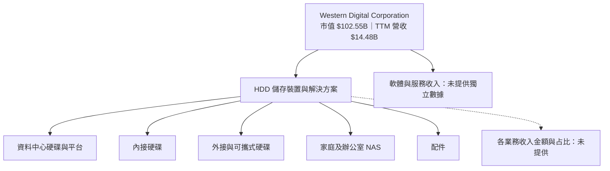
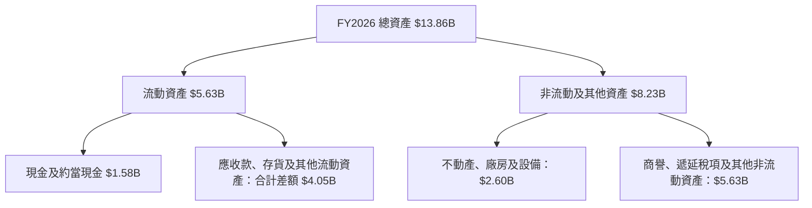
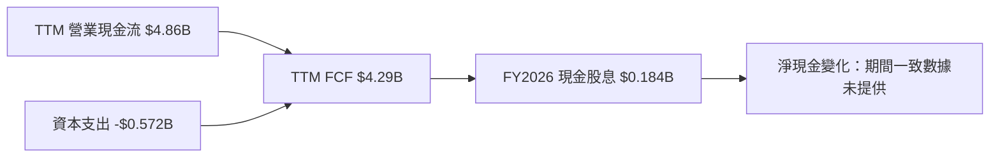
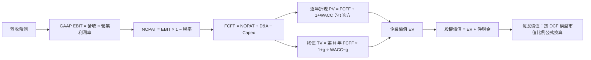
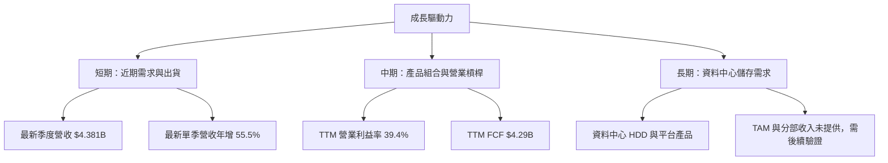
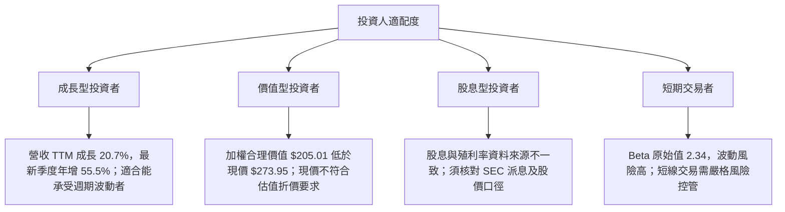

# WDC 基本面深度分析報告
> **報告日期**：2026-11-25 ｜ **語言**：繁體中文 ｜ **數據來源**：SEC 申報資料 (XBRL)、Yahoo Finance、Finviz、StockAnalysis、Roic.ai ｜ **分析師**：CFA 級機構研究

## 目錄

| # | 章節 | 核心結論 |
|---|------|----------|
| 1 | 執行摘要 | 賣出；加權合理價值 $205.01；MOS -33.6% |
| 2 | 公司概覽與商業模式 | HDD 技術、客戶與規模具一定門檻；市場份額及部門占比未提供 |
| 3 | 損益表深度分析 | TTM 營收 $14.48B、TTM 成長 20.7%；季度營收及營業利益率改善 |
| 4 | 資產負債表分析 | 淨現金 $525M；營運資金週期較一年前拉長 |
| 5 | 現金流量深度分析 | TTM FCF $4.29B；但 Piotroski 應計品質測試未通過 |
| 6 | 獲利能力與資本效率 | ROIC 61.1% 高於 WACC 14.0%，目前創造股東價值 |
| 7 | 相對估值分析 | 同業估值分化大；WDC 相對歷史 P/S 偏高 |
| 8 | DCF 內在價值評估 | 基準 DCF $182.17；加權合理價值 $205.01，皆低於現價 |
| 9 | 成長催化劑 | 最新單季營收年增 55.5%；長期 TAM 數據未提供 |
| 10 | 風險矩陣 | 週期逆轉、估值回落與現金盈餘品質為主要風險 |
| 11 | 投資建議 | 現價評級賣出；重新評估買入需等待價格及營運條件改善 |

---

## 1. 執行摘要

WDC 的 TTM 營收為 **$14.48B**、TTM 年增 **20.7%**，最新季度營收年增 **55.5%**；TTM FCF 為 **$4.29B**，ROIC **61.1%**，高於 **14.00% WACC**，顯示目前營運回升能轉化為正的資本報酬。然而，依固定估值方法及權重計算的加權合理價值為 **$205.01**，低於 2026-11-24 收盤價 **$273.95**，MOS 為 **-33.6%**；規則 20 對應評級為 **賣出**。營運動能與資本效率強，但市場價格已高於本報告的基準 DCF 與加權估值。

### 1.0 一頁式投資儀表板（Portfolio Manager 30 秒速讀）

| 項目 | 內容 |
|------|------|
| **投資論點（3 句）** | ① TTM 營收年增 **20.7%**，最新單季年增 **55.5%**，需求回升提供營收動能。② TTM FCF **$4.29B**、ROIC **61.1%**，高於 14.00% WACC。③ 加權合理價值 **$205.01**，低於 2026-11-24 收盤 **$273.95**，估值風險主導投資結論。 |
| **綜合評分** | **5.8/10**（引用 1.1；六項算術平均） |
| **財務健康** | 🟡 淨現金 **$525M**，但最新 CCC **52 天**，較一年前增加 **18 天**。 |
| **ROIC vs WACC** | **61.1% vs 14.00%**；現階段創造股東價值。 |
| **FCF 趨勢** | TTM FCF **$4.29B**；FCF Yield **4.18%**。 |
| **估值** | Forward P/E **6.88x**（Yahoo Finance 合併估值資料）｜ EV/EBITDA **16.18x**｜ FCF Yield **4.18%**。 |
| **DCF 內在價值（基準）** | **$182.17**；現價相對 DCF 溢價 **50.4%**（計算：$273.95 ÷ $182.17 − 1）。 |
| **安全邊際（MOS）** | **-33.6%**＝（加權合理價值 **$205.01** − 現價 **$273.95**）÷ 加權合理價值；🔴低於 10%。 |
| **預期報酬（基準情境 12M）** | DCF 情境模型未提供 12 個月期間預測；以基準情境價值對現價衡量為 **-33.5%**，不等同正式 12M 報酬預測。 |
| **關鍵風險（前二）** | HDD 需求與定價週期反轉；現價高於 DCF 與加權合理價值。 |
| **評級 + 信心度** | 🔴 **賣出** ｜ 信心：中（DCF 模型對營運假設及營運資金處理敏感） |

### 1.1 綜合評分卡（全報告唯一）

| 維度 | 評分（1–10） | 主要依據（引用數字與其來源章節） |
|------|--------------|----------------------------------|
| 成長性 | 8.0 | TTM 營收成長 **20.7%**、最新季度年增 **55.5%**（第 3 章）；高成長基期可能使短期增幅不能線性外推。 |
| 獲利能力 | 8.5 | TTM 營業利益率 **39.4%**、ROIC **61.1%**；Piotroski **6/8**，應計品質及稀釋股數兩項未通過（第 6 章）。 |
| 財務健康 | 6.5 | 淨現金 **$525M**，但 CCC 從 **34 天**增至 **52 天**（第 4 章）。 |
| 估值 | 2.0 | MOS **-33.6%**；現價高於 DCF 基準 **$182.17**及加權價值 **$205.01**（第 8 章）。 |
| 護城河 | 6.0 | HDD 製造、可靠度驗證及企業客戶導入形成門檻；未提供市場份額或各產品線收入拆分（第 2 章）。 |
| 管理層與資本配置 | 5.5 | FY2026 SBC **$204M**、TTM 稀釋股數測試未通過；現有資料不足以完整評估資本配置回報（第 3、5 章）。 |
| **綜合評分** | **6.1** | 六項算術平均：（8.0 + 8.5 + 6.5 + 2.0 + 6.0 + 5.5）÷ 6 = **6.1**。 |

### 1.2 五大投資論點 + 三大核心風險

| 類型 | 項目 | 具體依據 | 信心度 |
|------|------|----------|--------|
| 🟢 **投資論點①** | 營收動能回升 | TTM 營收 **$14.48B**、年增 **20.7%**；最新季度年增 **55.5%**。若不是短期補庫存，較高產能利用率可支撐利潤。 | 🟢 高 |
| 🟢 **投資論點②** | 利潤率與資本報酬改善 | TTM 營業利益率 **39.4%**、ROIC **61.1%**；ROIC 減 WACC 為 **47.1 個百分點**。 | 🟢 高 |
| 🟢 **投資論點③** | FCF 能力回復 | TTM 營業現金流 **$4.86B**減資本支出 **$572M**，形成 FCF **$4.29B**。 | 🟢 高 |
| 🟢 **投資論點④** | 淨現金提供緩衝 | 現金及短期投資 **$1.31B**、總債務 **$789M**，淨現金 **$525M**。 | 🟡 中 |
| 🟢 **投資論點⑤** | 客戶導入與產品可靠性具有摩擦成本 | HDD 在資料中心應用需經過相容性、可靠度及供應商認證；現有資料未提供轉換成本或客戶留存量化指標。 | 🟡 中 |
| 🟡 **風險①** | 週期性需求及價格反轉 | 最新季度營收年增 **55.5%**的高成長可能受低基期與需求週期放大；若訂單放緩，固定成本會造成營業槓桿反向作用。 | 🟡 中 |
| 🔴 **風險②** | 估值回撤 | 現價 **$273.95**較加權合理價值 **$205.01**高 **33.6%**（以合理價值為分母）；DCF 基準價值僅 **$182.17**。 | 🔴 高 |
| 🟡 **風險③** | 營運資金與盈餘品質 | CCC 年增 **18 天**；Piotroski 應計品質測試未通過，現金流尚未跟上淨利。 | 🟡 中 |

### 1.3 快速統計卡片

| 指標 | 公司實際值（期間） | 同業中位數 | 狀態 |
|------|--------------------|------------|------|
| 營收成長（TTM） | **20.7%** | — | 🟢 |
| 營收成長（最新一季年增） | **55.5%** | **377.9%** | 🟡（同業中位數受 SNDK、MU 的極高基期反彈影響） |
| 毛利率（TTM） | **52.6%** | **80.0%** | 🟡 |
| 營業利益率（TTM） | **39.4%** | — | 🟢 |
| ROIC（TTM） | **61.1%** | — | 🟢 |
| Forward P/E | **6.88x** | **3.1x** | 🟡 |
| FCF Yield（TTM） | **4.18%** | — | 🟢 |
| Piotroski F-Score | **6 / 8** | — | 🟡 |

> 同業成長率中位數按 STX、SNDK、MU 的最新單季年增率排序取中間值，為 **377.9%**；其與 WDC 的產品組合及基期不同，不能直接視為可持續成長差距。

### 1.4 投資結論

```text
╔══════════════════════════════════════════════════════════════════╗
║                    📊 投資結論摘要                               ║
╠══════════════════════════════════════════════════════════════════╣
║  評級：賣出（MOS -33.6%，依規則 20）                              ║
║  價格（2026-11-24 收盤）：$273.95                                ║
║  DCF 內在價值（基準）：$182.17（現價溢價 50.4%）                 ║
║  安全邊際 MOS：-33.6%（加權合理價值為分母）                      ║
║  加權合理價值（8.8）：$205.01                                    ║
║  DCF 情境價值：                                                   ║
║    悲觀情境：$100.40（相對現價 -63.4%）                          ║
║    基準情境：$182.17（相對現價 -33.5%）                          ║
║    樂觀情境：$313.26（相對現價 +14.4%）                          ║
║  綜合評分：6.1/10（引用 1.1）                                    ║
║  適合投資人：可承受週期波動、並能追蹤季度供需與估值的投資人      ║
╚══════════════════════════════════════════════════════════════════╝
```

---

## 2. 公司概覽與商業模式

### 2.1 業務結構與收入來源

公司資料描述 WDC 從事以 HDD 技術為基礎的資料儲存裝置與解決方案，產品包括資料中心硬碟、資料中心平台、內接與外接硬碟、可攜式硬碟及 NAS。財務資料沒有提供各產品線收入及占比，故不虛構分部拆分或畫比例圖。



### 2.2 市場份額

市場份額數據未提供，因此不繪製份額圖或填入推估比例。WDC 的 TTM 營收為 **$14.48B**，最新季度營收年增 **55.5%**；同業資料顯示 STX 最新季度營收年增 **61.0%**，而 SNDK、MU 的數字遠高於此，反映產品組合與比較基期不同，不能直接推出 HDD 市占變化。

### 2.3 競爭護城河分析

```mermaid
mindmap
  root((Western Digital Moat))
    Technology Leadership
      HDD engineering
      Capacity and reliability development
      Product qualification
    Software Ecosystem
      NAS and storage management
      Software revenue not separately disclosed
    Network Effects
      Limited direct network effects
      Installed base compatibility
    Customer Switching Costs
      Data center qualification
      Reliability and supply validation
    Scale Effects
      Manufacturing scale
      Global customer and channel reach
    Ecosystem Partners
      Data center customers
      OEM and distribution channels
      Component and manufacturing supply chain
```



### 2.4 護城河強度

| 護城河項目 | 強度（強／中／弱） | 證據（引用數字或事實） | 會削弱它的情況 |
|------------|--------------------|------------------------|----------------|
| 技術及可靠度 | 中 | 公司持續開發 HDD 裝置與資料中心平台；產品須滿足容量、可靠度及相容性要求。未提供專利或產品性能量化資料。 | 替代儲存技術成本下降、產品可靠度落後。 |
| 軟體生態系統 | 弱至中 | 公司銷售 NAS 及儲存解決方案；軟體及服務收入未單獨揭露。 | 軟體差異不足，客戶只按硬體價格採購。 |
| 網路效應 | 弱 | 未提供用戶、開發者或平台網路規模數據；儲存硬體通常不是典型雙邊網路。 | 客戶標準化採購、跨品牌相容性提高。 |
| 客戶鎖定 | 中 | 資料中心客戶導入及驗證增加切換成本；未提供留存率或切換成本金額。 | 客戶集中採購、替代供應商認證成功。 |
| 規模效應 | 中 | TTM 營收 **$14.48B**，有全球製造與銷售規模；單位成本數據未提供。 | 需求下滑導致產能利用率下降、固定成本吸收惡化。 |
| 生態夥伴 | 中 | 公司透過直銷、經銷商、分銷商銷售，並服務資料中心及 OEM 客戶。 | 渠道轉移、主要客戶改變供應商策略。 |

1.1「護城河」評分 **6.0/10**，理由是產品驗證、供應規模及企業客戶導入可形成一定摩擦，但市場份額、客戶留存、產品線收入與軟體收入均未提供量化證據。

---

## 3. 損益表深度分析

### 3.1 年度收入成長趨勢（近 4 年）

以下採年度損益表提供的 FY2023–FY2026 營收。FY2026 相對 FY2023 的三年 CAGR 為 \((12.92 ÷ 6.25)^{1/3}-1\)，約 **27.3%**。

```text
╔══════════════════════════════════════════════════════════════════╗
║              Western Digital 年度收入趨勢（FY2023-FY2026）      ║
╠══════════════════════════════════════════════════════════════════╣
║  FY2023  $6.25B   ██████████░░░░░░░░░░░░░░░░  基期             ║
║  FY2024  $6.32B   ██████████░░░░░░░░░░░░░░░░  YoY +1.1%        ║
║  FY2025  $9.52B   ███████████████░░░░░░░░░░░  YoY +50.6%       ║
║  FY2026  $12.92B  ████████████████████░░░░░░  YoY +35.7%       ║
╠══════════════════════════════════════════════════════════════════╣
║  FY2023–FY2026 三年營收 CAGR：約 +27.3%                         ║
╚══════════════════════════════════════════════════════════════════╝
```

FY2025、FY2026 的增長從低迷年份反彈，對應儲存需求與產品組合改善；這種低基期後的增長不宜直接線性延伸至長期，DCF 因而將營收成長由首年 **20.7%**逐步降至第十年 **3.0%**。

### 3.2 季度收入趨勢分析

以下季度按財報資料由舊至新排列；QoQ 以相鄰季度營收計算，YoY 使用同一財務資料列示的同期年增率。季度財報季度標籤與日曆日期在來源呈現方式不完全一致，故以結束日期識別。

| 季度 | 營收（$B） | QoQ | YoY | 備註 |
|------|------------:|----:|----:|------|
| 2025-12-31 | 3.017 | — | 25.24% | 同比成長已擴大。 |
| 2026-03-31 | 3.337 | 10.6% | 45.47% | 營收持續增加。 |
| 2026-06-30 | 3.747 | 12.3% | 43.84% | QoQ 增速加快。 |
| 2026-09-30 | 4.381 | 16.9% | 55.5% | 最新單季年增率；不是 TTM 成長率。 |

QoQ 計算例：最新季度 \((4.381 ÷ 3.747)-1=16.9\%\)。TTM 年增率仍應使用另行計算並核實的 **20.7%**，不可將單季 **55.5%**誤稱為 TTM。

### 3.3 利潤率演變分析

| 利潤率指標 | FY2023 | FY2024 | FY2025 | FY2026 | 趨勢 | 評估 |
|------------|-------:|-------:|-------:|-------:|------|------|
| **毛利率** | 22.3% | 28.1% | 38.8% | 48.8% | ↗️ 逐年改善 | 🟢 |
| **營業利益率** | -6.4% | 1.5% | 22.4% | 35.6% | ↗️ 由虧轉盈 | 🟢 |
| **淨利率（以年度表列淨利計）** | -26.9% | -12.6% | 19.5% | 72.0% | 大幅波動 | 🟡 |

年度毛利率＝毛利÷營收；營業利益率＝營業利益÷營收。FY2026 年度表列淨利 **$9.30B**高於營業利益 **$4.60B**，淨利率因此含有營業利益以外項目影響，不能當作可持續經營利潤率。另一資料來源列示 TTM 淨利率 **69.2%**，同樣需審慎辨識非營業與稅項的影響。

**利潤率演變深度解析：**FY2023–FY2026 毛利率由 **22.3%**升至 **48.8%**，與營收由 **$6.25B**升至 **$12.92B**同時發生，反映復甦期間產能利用率、產品組合及定價環境改善所帶來的營業槓桿。財務資料沒有各產品售價、單位成本及產能利用率數據，不能把改善完全歸因於其中某一項。TTM 營業利益率依經核實數值為 **39.4%**，最新季度營業利益率為 **46.7%**；季度水平高於 TTM，若供需或定價回落，該差距可能收窄。

### 3.4 費用結構分析

財務資料提供 FY2026 研發費用 **$1.16B**，但未提供完整的同期銷售、管理費用及各項費用拆分，且年度、TTM 營收口徑不同。依「有資料才畫」原則，不製作不完整的費用結構圓餅圖。研發費用顯示公司持續投入產品技術，但單憑研發金額不能判定研發回報率。

### 3.5 季度 EPS 趨勢與盈餘品質（Quality of Earnings）

| 季度 | EPS 實際值 | EPS 預估 | 超預期／不及預期 |
|------|-----------:|---------:|------------------|
| 2025-12-31 | $4.67 | N/A | N/A；來源未提供有效預估值。 |
| 2026-03-31 | $8.20 | N/A | N/A；來源未提供有效預估值。 |
| 2026-06-30 | $8.21 | N/A | N/A；來源未提供有效預估值。 |
| 2026-09-30 | $4.63 | N/A | N/A；來源未提供有效預估值。 |

**過去四季超預期／不及預期判斷：**EPS Est 欄均為缺失值，不能嚴謹判定是否超預期。淨利季度資料在 2026 年第二、三季高於第一季，但最新季較前季下降；可能反映非營業項目、稅項或季度認列差異，需核對 SEC 10-Q 才能辨識原因。

| 盈餘品質項目 | 數值／佔比 | 評估 |
|--------------|-----------|------|
| 股權薪酬 SBC / 營收 | 約 **1.59%**（近四季 SBC $230M ÷ TTM 營收 $14.48B） | 🟡 絕對占比不高，但仍稀釋普通股股東；Piotroski 稀釋股數測試未通過。 |
| SBC / 營業現金流 | 約 **4.73%**（$230M ÷ $4.86B） | 🟡 SBC 對現金流不是直接現金支出，但可作為股東經濟成本觀察。 |
| FCF / 淨利（現金轉換率） | 約 **43.3%**（FCF $4.29B ÷ StockAnalysis TTM 淨利 $9.913B） | 🔴 FCF 低於淨利，淨利含有非現金、非營業或稅務因素的可能性較高。 |
| 一次性／非經常性損益 | 資料未提供可完整拆分項目 | 🟡 FY2026 淨利 $9.30B 明顯高於營業利益 $4.60B，須查閱 SEC 附註確認構成。 |
| 有效稅率異常 | **4.9%**（最新年度有效稅率） | 🟡 偏低稅率抬高稅後盈餘；DCF 依指定模型仍採 4.9%，稅率正常化將降低估值。 |
| 資本化支出 vs 費用化 | TTM Capex **$572M**；資本化政策細節 N/A | 🟡 無法只憑現有數據判斷是否存在成本遞延或資本化政策變更。 |

**盈餘品質結論：**FCF 轉換率約 **43.3%**、應計品質測試未通過、有效稅率僅 **4.9%**，均提示 GAAP 淨利不宜直接等同持續經濟盈餘。TTM FCF 仍為正且達 **$4.29B**，現金流本身有實質支撐；但估值判斷應更重視現金流，而非將近期淨利高點直接年化。

---

## 4. 資產負債表分析

### 4.1 資產結構分解

最新年度資產負債表列示總資產 **$13.86B**。以下細項只列有數字的項目；不同日期口徑的 TTM 資產負債表另列總資產 **$14.239B**，本圖採 FY2026 年度數據，避免混用期間。



### 4.2 流動性與營運資金分析

| 流動性指標 | 數值／歷史 | 評估 |
|------------|------------|------|
| 流動比率 | 最新市場資料 **1.434x**；FY2026 流動資產 $5.63B ÷ 流動負債 $4.24B 約 **1.33x** | 🟡 可覆蓋流動負債，但需留意庫存及應收款流動性。 |
| 速動比率 | **0.867x** | 🟡 低於 1，短期償付依賴營運回款與存貨變現。 |
| 現金及短期投資 | TTM **$1.31B** | 🟢 提供短期財務緩衝。 |

**營運資金天數（QUALITY FIGURES 原值）：**

| 指標 | 最新 TTM | 一年前 TTM | 變化 | 解讀 |
|------|----------|------------|------|------|
| DSO 應收帳款天數 | **56 天** | **41 天** | **+15 天** | 收款週期拉長，可能反映客戶組合、付款條件或季度時點變化；須觀察後續回款。 |
| DIO 存貨天數 | **95 天** | **70 天** | **+25 天** | 庫存占用增加；若需求轉弱會提升跌價與去庫存風險。 |
| DPO 應付帳款天數 | **99 天** | **77 天** | **+22 天** | 延長供應商付款期限部分抵銷應收與庫存上升。 |
| CCC 現金轉換週期 | **52 天** | **34 天** | **+18 天** | CCC = 56 + 95 − 99；雖有較長 DPO 緩衝，整體現金回收仍變慢。 |

### 4.3 債務結構分析

```text
╔══════════════════════════════════════════════════════════════════╗
║                   Western Digital 債務健康診斷                  ║
╠══════════════════════════════════════════════════════════════════╣
║  總債務：        $0.789B   ███████████░░░░░░░░░  （核實數值）     ║
║  現金及短期投資：$1.31B    ████████████████████  （核實數值）     ║
║  淨現金：        $0.525B   🟢 正淨現金                           ║
║  Debt / EBITDA：N/A（財務數據口徑不一致，不自行拼接）             ║
║  利息保障倍數：  N/A（利息費用與一致口徑 EBIT 未完整提供）        ║
╚══════════════════════════════════════════════════════════════════╝
```

年度資產負債表 FY2025 總債務 **$4.71B**，FY2026 **$1.05B**，顯示去槓桿；但最新 TTM 核實的債務為 **$789M**，與其他市場資料所列 **$922M**不同。本報告以財務核實數值計算淨現金，避免混用來源與日期。

### 4.4 股東權益趨勢

| 財政年度 | 股東權益（$B） | 年變化 | 觀察 |
|----------|---------------:|-------:|------|
| FY2023 | 11.84 | — | 資產及權益基數較大。 |
| FY2024 | 11.05 | -6.7% | 權益回落。 |
| FY2025 | 5.54 | -49.9% | 大幅縮減；需結合公司交易、商譽與其他權益變動理解。 |
| FY2026 | 8.86 | +59.9% | 隨獲利回升而增加。 |

```text
╔══════════════════════════════════════════════════════════════════╗
║                    股東權益趨勢（年度）                          ║
╠══════════════════════════════════════════════════════════════════╣
║  FY2023  $11.84B  ████████████████████                          ║
║  FY2024  $11.05B  ███████████████████                            ║
║  FY2025   $5.54B  █████████                                      ║
║  FY2026   $8.86B  ███████████████                                ║
╚══════════════════════════════════════════════════════════════════╝
```

---

## 5. 現金流量深度分析

### 5.1 現金流量瀑布圖

TTM 淨利未在核實財務數據中以同一口徑提供，故從營業現金流開始，不以其他期間數字拼接。



### 5.2 FCF 轉換率趨勢

| 財政年度 | 營業現金流（$B） | 資本支出（$B） | FCF（$B） | FCF / 淨利 |
|----------|-----------------:|---------------:|----------:|-----------:|
| FY2023 | -0.408 | 0.821 | -1.23 | N/A（淨利為負） |
| FY2024 | -0.294 | 0.487 | -0.781 | N/A（淨利為負） |
| FY2025 | 1.69 | 0.412 | 1.28 | 約 69.4%（$1.28B ÷ $1.844B） |
| FY2026 | 3.93 | 0.418 | 3.51 | 約 37.7%（$3.51B ÷ $9.30B） |

年度表列 FCF 與單項 OCF、Capex 可能有四捨五入尾差。FY2026 FCF 對淨利比率下降，主因淨利增幅高於現金流，與低有效稅率及非營業項目需進一步核對的觀察一致。

### 5.3 自由現金流趨勢

| 期間 | FCF（$B） | 年變化 | FCF Yield |
|------|----------:|-------:|----------:|
| FY2023 | -1.23 | — | N/A |
| FY2024 | -0.781 | 改善 | N/A |
| FY2025 | 1.28 | 轉正 | N/A |
| FY2026 | 3.51 | +174.2% | N/A |
| TTM | **4.29** | — | **4.18%** |

```text
╔══════════════════════════════════════════════════════════════════╗
║                 自由現金流趨勢（歷史及 TTM）                     ║
╠══════════════════════════════════════════════════════════════════╣
║  FY2023  -$1.23B  負值                                           ║
║  FY2024  -$0.781B 負值                                           ║
║  FY2025   $1.28B  ███████░░░░░░░░░░░░░░                          ║
║  FY2026   $3.51B  █████████████████░░░░                          ║
║  TTM      $4.29B  █████████████████████                          ║
║  TTM FCF Yield：4.18%                                             ║
╚══════════════════════════════════════════════════════════════════╝
```

### 5.4 資本配置評估

各年度資本配置完整比例資料未提供，故不繪製資金用途圓餅圖。

| 資本配置項目 | 可得數據 | 評估 |
|--------------|----------|------|
| 資本支出 | TTM **$572M**；FY2026 **$418M** | 維持及擴充產能必要投入；TTM Capex 約占 TTM 營收 **3.95%**。 |
| 股息 | FY2026 現金股息 **$184M** | 相對 FY2026 FCF $3.51B 約 **5.2%**，但不能據此推論未來派息政策。 |
| 回購 | 可比回購金額未提供 | 不作數值推估。 |
| 研發 | FY2026 **$1.16B** | 有持續產品研發支出；回報率未提供。 |
| 留存現金／淨現金變化 | TTM 現金 $1.31B、債務 $789M | 核實口徑淨現金 $525M；完整現金流用途明細 N/A。 |

---

## 6. 獲利能力與資本效率

### 6.1 ROE / ROA / ROIC 趨勢

| 指標 | 最新值 | 歷史比較 | 評估 |
|------|-------:|----------|------|
| ROE | TTM **107.2%**（QUALITY FIGURES） | 市場資料另列 129.6%，與核實口徑不同 | 🟡 ROE 受較高淨利率及權益基數影響，不宜單獨解讀。 |
| ROA | TTM **25.9%**（市場資料） | 品質指標確認 ROA 高於一年前；歷史完整序列 N/A | 🟢 資產獲利能力改善。 |
| ROIC | TTM **61.1%** | 歷史復甦前的 ROIC 顯著較低，具體同期口徑 N/A | 🟢 高於資本成本。 |

### 6.2 ROIC vs WACC 分析（核心價值創造判斷）

```text
╔══════════════════════════════════════════════════════════════════╗
║                ROIC vs WACC 深度分析                            ║
╠══════════════════════════════════════════════════════════════════╣
║  資本成本（依核實 Cost of capital）：                            ║
║  ├── 無風險利率（10Y 美債）： 4.90%                              ║
║  ├── 市場風險溢酬 ERP：       5.00%                              ║
║  ├── Beta 原始值：            2.34                               ║
║  ├── Beta 採用值（調整後）：  1.90                               ║
║  ├── Ke = 4.90% + 1.90×5.00% = 14.38%                           ║
║  ├── 稅前債務成本：           20.91%                             ║
║  ├── 稅率：                   4.9%                               ║
║  ├── E/D 權重：               99.2% / 0.8%                       ║
║  └── ✅ WACC（限制後採用）： 14.00%                              ║
║                                                                  ║
║  ROIC（TTM）：61.1%                                               ║
║  EVA spread = ROIC − WACC = 61.1% − 14.00% = +47.1 個百分點      ║
║                                                                  ║
║  ROIC 61.1%  ▓▓▓▓▓▓▓▓▓▓▓▓▓▓▓▓▓▓▓▓▓▓▓▓▓▓▓▓▓▓▓▓  高於 WACC      ║
║  WACC 14.0%  ▓▓▓▓▓▓▓▓                                            ║
╠══════════════════════════════════════════════════════════════════╣
║  結論：ROIC 約為 WACC 的 4.36 倍；依 TTM 數值，公司正在創造價值。║
╚══════════════════════════════════════════════════════════════════╝
```

WACC 原始計算值 **14.43%**，因資本成本資料規定限制在 **7%–14%**區間，採用上限 **14.00%**。ROIC 與 WACC 的時間口徑皆採核實數據。需注意，ROIC 反映當前週期高峰附近的 TTM 表現，若獲利正常化，價差會收窄。

### 6.3 杜邦三因素分解

| 因素 | 數值（TTM） | 解讀 |
|------|-------------|------|
| 淨利率 | **69.2%** | 淨利率高，且可能包含低稅率及營業外因素。 |
| 資產週轉率 | **1.02x** | 營收相對資產規模的轉換效率。 |
| 權益乘數 | **1.52x** | 槓桿程度不高，ROE 並非主要靠高財務槓桿撐起。 |
| **ROE** | **107.2%** | 69.2% × 1.02 × 1.52 = **107.2%**（品質指標原值）。 |

ROE 高值主要由淨利率驅動，不是權益乘數造成；因此，對淨利中非經常性項目及有效稅率的檢驗尤其重要。

### 6.4 財務體質：Piotroski F-Score

**F-Score：6 / 8**。一項測試因資料不足未納入計分，故分母為 8，不是九項全數可判定。

| 測試 | 結果 | 解讀 |
|------|------|------|
| ROA > 0 | ✅ 通過 | TTM 獲利為正。 |
| 營業現金流 > 0 | ✅ 通過 | TTM OCF **$4.86B**。 |
| ROA 高於一年前 | ✅ 通過 | 獲利能力改善。 |
| 營業現金流 > 淨利（應計品質） | ❌ 未通過 | 淨利高於營業現金流，需留意非現金或非營業項目。 |
| 長期負債 ÷ 總資產低於一年前 | — 無法判定 | 缺少可比輸入。 |
| 流動比率高於一年前 | ✅ 通過 | 流動性測試改善。 |
| 稀釋股數未增加 | ❌ 未通過 | 有稀釋跡象，SBC 及股數變化需追蹤。 |
| 毛利率高於一年前 | ✅ 通過 | 毛利率改善。 |
| 資產週轉率高於一年前 | ✅ 通過 | 資產使用效率提升。 |

---

## 7. 相對估值分析

### 7.1 同業估值比較表格

WDC 的估值倍數採市場估值資料；同業數字逐項採 Yahoo Finance Peer multiples。WDC 倍數與核實的五年歷史序列在部分口徑上不同，解讀時以本節橫向比較及 7.2 歷史區間各自標明來源。

| 估值指標 | **WDC** | **STX** | **SNDK** | **MU** | 本公司評估 |
|----------|--------:|--------:|---------:|-------:|-----------|
| **Trailing P/E** | 9.64x | 25.3x | 5.0x | 8.5x | 🟡 介於同業之間；週期高峰 EPS 可能壓低倍數。 |
| **Forward P/E** | 6.88x | 7.4x | 2.2x | 3.1x | 🟡 略低於 STX，但高於 SNDK、MU。 |
| **P/S** | 7.08x | 8.0x | 3.1x | 5.4x | 🟡 高於兩家同業，低於 STX。 |
| **EV/EBITDA** | 16.18x | 19.1x | 3.9x | 6.2x | 🔴 高於另外兩家，與 STX 接近。 |
| **最新季度營收年增** | 55.5% | 61.0% | 377.9% | 379.3% | 🟡 WDC 成長低於所列同業，但同業增幅受不同基期與產品組合影響。 |
| **毛利率（TTM）** | 52.6% | 50.4% | 80.0% | 80.7% | 🟡 高於 STX，低於 SNDK、MU。 |

同業中位數：Trailing P/E **8.5x**、Forward P/E **3.1x**、P/S **5.4x**、EV/EBITDA **6.2x**。相對估值結果受 SNDK、MU 的產品類型和週期位置影響，不能把同業中位數視為完全可比的基本面。

### 7.2 歷史估值區間分析

| 倍數 | 現值 | 五年中位數 | 五年區間 | 現值百分位 |
|------|------:|-----------:|---------:|-----------:|
| P/E | **10.6x** | 13.5x | 6.3x–62.5x | 38% |
| P/S | **7.3x** | 1.2x | 0.4x–16.0x | 85% |
| EV/EBITDA | **18.3x** | 14.9x | 4.5x–96.5x | 69% |

```text
╔══════════════════════════════════════════════════════════════════╗
║                  五年歷史估值位置（核實數據）                    ║
╠══════════════════════════════════════════════════════════════════╣
║  P/E        6.3x ├────────● 10.6x ────────┤ 62.5x  百分位 38% ║
║  中位數 13.5x；目前低於中位數，但歷史區間受周期盈餘影響。         ║
║                                                                  ║
║  P/S        0.4x ├────────────────● 7.3x ──┤ 16.0x 百分位 85%  ║
║  中位數 1.2x；目前處於自身歷史偏高區。                           ║
║                                                                  ║
║  EV/EBITDA  4.5x ├────────────● 18.3x ────┤ 96.5x 百分位 69%   ║
║  中位數 14.9x；目前高於歷史中位數。                               ║
╚══════════════════════════════════════════════════════════════════╝
```

### 7.3 情境價值（Bear / Base / Bull，照抄 DCF MODEL）

| 情境 | 第 1 年營收成長 | 期末營業利潤率 | WACC | 每股價值 | 相對現價 | 機率 | 會發生的條件 |
|------|----------------|----------------|------|----------|----------|------|--------------|
| 🔴 悲觀 | 10.3% | 19.4% | 15.00% | **$100.40** | **-63.4%** | 25% | 需求及定價回落，營收成長降至基準假設以下，成熟期利潤率收斂。 |
| 🟡 基準 | 20.7% | 22.8% | 14.00% | **$182.17** | **-33.5%** | 50% | 起始成長等於 TTM 成長，長期利潤率回歸歷史五年中位附近。 |
| 🟢 樂觀 | 31.0% | 25.1% | 13.00% | **$313.26** | **+14.4%** | 25% | 高需求延續、收入成長高於目前 TTM，並維持較高長期利潤率。 |

### 7.4 相對估值隱含價格區間

```text
╔══════════════════════════════════════════════════════════════════╗
║                各估值方法隱含每股價值（USD）                     ║
╠══════════════════════════════════════════════════════════════════╣
║  同業 EV/EBITDA       $102.32 ────────────────                   ║
║  DCF 基準             $182.17 ─────────────────────────          ║
║  同業 P/S             $206.98 ───────────────────────────        ║
║  現價                  $273.95 ────────────────────────────────  ║
║  分析師共識目標價      $600.46（參考值，非相對估值倍數）          ║
╚══════════════════════════════════════════════════════════════════╝
```

- **同業 EV/EBITDA：$102.32**，依 STX、SNDK、MU 同業中位數 **6.2x**乘以 WDC TTM EBITDA，再加回淨現金。
- **同業 P/S：$206.98**，依同業中位數 **5.4x**乘以 WDC TTM 營收。
- 以上價值照抄估值方法資料；未提供反推計算所需的完整中間數字，不另行重建。

---

## 8. DCF 內在價值評估（Discounted Cash Flow）

### 8.0 估值推理鏈（Thinking Logic：在算之前先想清楚）

**Step 1 — 價值由哪些變數決定？**  
WDC 的 DCF 價值主要由 HDD 主業的營收成長、GAAP 營業利潤率及長期折現率決定。業務營收拆分未提供，不能將 $14.48B TTM 營收分配至資料中心、外接硬碟或 NAS；模型以全公司營收作為整體現金流底盤。DCF 敏感性表顯示 WACC 與終值成長率都會改變每股價值，其中折現率是重要估值驅動因素。

**Step 2 — 模型選擇**

| 決策點 | 本報告採用 | 理由（含數字） | 曾考慮但否決 | 否決理由 |
|--------|-----------|----------------|--------------|----------|
| 現金流定義 | FCFF | 模型以 EBIT、NOPAT 及 WACC 折現，先得 EV，再加淨現金。 | FCFE | 負債及融資成本變動會影響股東現金流；指定模型使用 FCFF。 |
| 預測期 N | 10 年 | DCF 模型固定 10 年；HDD 為週期產業，需較長期間讓營收與利潤率逐步正常化。 | 5 年 | 不能替換指定模型預測期。 |
| 終值方法 | Gordon Growth | 模型採永續成長 **3.0%**、WACC **14.00%**。 | 退出倍數 | DCF 區塊未提供退出倍數所需的估值輸入；不自行創造交叉估值。 |
| EBIT 基礎 | GAAP EBIT | TTM GAAP 營業利益率採 **39.4%**。 | 非 GAAP EBIT | 指定模型明確使用 GAAP EBIT。 |

**Step 3 — 關鍵假設推導鏈**

- **營收成長：**錨點＝TTM 年增 **20.7%** → 調整＝由 20.7% 線性降至第十年 **3.0%**，反映當前復甦不宜永久延續 → **採用第 1 年 20.7%、第 10 年 3.0%** → 曾考慮維持 20.7% 十年，但會把週期性高增長當成永續趨勢，故不採用。
- **期末營業利潤率：**錨點＝TTM **39.4%** → 調整＝隨時間回落至含 TTM 在內的近五年中位數 → **採用第 10 年 22.8%** → 曾考慮將 39.4% 長期維持，但模型未見足夠證據支持週期高利潤率永久化。
- **永續成長率 g：**錨點＝模型採 **3.0%**；公司長期名目成長的具體外部輸入未提供 → 調整＝採用低於 WACC **14.00%**的永續增長假設 → **採用 3.0%** → 否決高於 3.0% 的數值，因為會提高終值依賴並削弱保守性。
- **預測期 N：**錨點＝DCF 模型固定 **10 年** → 調整＝不額外延長週期假設 → **採用 10 年** → 否決其他年限，因資料提供的 DCF 已固定 N，不能另建模型。
- **Capex／營收：**錨點＝TTM **3.9%** → 調整＝逐步下降至第十年 **3.0%**，模型以 D&A 的 1.1 倍作長期下限參考 → **採用第 1 年 3.9%、第 10 年 3.0%** → 否決長期高於 3.9% 的情境，因模型未提供需額外投入的具體擴產計畫。
- **EBIT 基礎及 SBC：**錨點＝模型明列 GAAP EBIT，且 SBC 已包含於費用 → **採用 GAAP EBIT** → 不再從 FCFF 扣 SBC，也不另加稀釋率，避免重複計入或漏計。
- **年稀釋率：**錨點＝模型假設使用固定股數，且組合 A 將 SBC 已視為費用 → **採用 0% 額外稀釋** → 不採歷史稀釋測試所暗示的額外年度稀釋，以遵守模型既定設定。
- **終值方法：**錨點＝模型已提供 Gordon Growth 終值及 PV → **採用 Gordon Growth** → 退出倍數所需假設未提供，故不自行估定。
- **WACC：**錨點＝成本資本資料的採用 WACC **14.00%** → 原始加權結果 **14.43%**受 7%–14%區間上限約束 → **採用 14.00%** → 不採原始 14.43%，因核實資本成本欄明確要求套用上限。

**Step 4 — 最脆弱的一環**  
最脆弱的是高 TTM 利潤率能否在需求回落時持續；若利潤率或營收低於基準，價值會下降，悲觀 DCF 情境為 **$100.40**，相較基準 **$182.17**再低 **$81.77**。

**Step 5 — 計算路徑圖**



### 8.1 模型假設總表（Model Inputs）

金額單位為美元十億；表格數值採 DCF 模型原值。該模型明列「Working capital is not modelled」，因此不加入 ΔWC 項。

| 假設項目 | 採用值 | 依據／來源 | 敏感度 |
|----------|--------|-------------|--------|
| 預測期長度 **N** | **10 年** | DCF MODEL 固定預測期。 | 🟡 中 |
| 營收成長 | FY+1 **20.7%**線性降至 FY+10 **3.0%** | TTM vs prior TTM 成長 **20.7%**；模型逐年淡化。 | 🔴 高 |
| 營業利潤率（GAAP EBIT） | FY+1 **39.4%**降至 FY+10 **22.8%** | 起點為 TTM 營業利益率；終點為含 TTM 的近五年中位數。 | 🔴 高 |
| 有效稅率 | **4.9%** | 最新年度有效稅率。 | 🟢 低 |
| Capex／營收 | FY+1 **3.9%**降至 FY+10 **3.0%** | TTM 3.9%，模型淡化至 D&A 約 1.1 倍參考值。 | 🟡 中 |
| D&A／營收 | **2.7%** | TTM D&A／營收，模型固定。 | 🟢 低 |
| 營運資金變動 | **未建模** | DCF MODEL 明示 working capital is not modelled；不能自行補數。 | 🟡 中 |
| EBIT 基礎 | **GAAP** | DCF MODEL 明示 GAAP EBIT。 | 🟡 中 |
| SBC 處理 | **組合 A：GAAP EBIT + 固定股數** | EBIT 已含 SBC 費用；FCFF 不另扣 SBC。 | 🟡 中 |
| 年稀釋率 | **0% 額外稀釋** | 模型使用固定股數，稀釋成本透過 GAAP 費用反映。 | 🟡 中 |
| 永續成長率 g | **3.0%** | DCF MODEL 指定值，且低於 WACC。 | 🔴 高 |
| 終值方法 | **Gordon Growth** | DCF MODEL 提供 TV 計算；未提供退出倍數計算。 | 🔴 高 |
| WACC | **14.00%** | 成本資本資料指定採用值；原始計算 14.43%，受 7%–14%區間限制。 | 🔴 高 |

**FCF 定義：**本模型採 FCFF，公式為 **NOPAT + D&A − Capex**；營運資金未建模，沒有 SBC 額外扣除列。本模型採用 **(A)**，故 SBC 影響已計入一次。

### 8.2 折現率推導（WACC）

```text
╔══════════════════════════════════════════════════════════════════╗
║                    WACC 推導（折現率）                           ║
╠══════════════════════════════════════════════════════════════════╣
║  股權成本 Ke（CAPM）：                                           ║
║  ├── 無風險利率 Rf：               4.90%                         ║
║  ├── ERP：                         5.00%                         ║
║  ├── Beta 原始值：                 2.34（Yahoo Finance）          ║
║  ├── Beta 調整：                   ⅔×2.34 + ⅓×1 = 1.90          ║
║  ├── 規模／國別溢酬：              未另加                         ║
║  └── Ke = 4.90% + 1.90×5.00% = 14.40%（資料列示 14.38%）       ║
║                                                                  ║
║  債務成本：                                                       ║
║  ├── 稅前 Kd：                     20.91%                        ║
║  ├── 有效稅率：                    4.9%                          ║
║  └── 稅後 Kd = 20.91%×(1−4.9%) = 19.89%                         ║
║                                                                  ║
║  資本結構（市場權重）：                                          ║
║  ├── 股權權重 E：                  99.2%                         ║
║  ├── 債務權重 D：                  0.8%                          ║
║  ├── 原始加權值：                  14.43%                        ║
║  └── ✅ 採用 WACC：                14.00%（受 7%–14% 範圍限制）  ║
╚══════════════════════════════════════════════════════════════════╝
```

**逐步演算與資料限制：**

1. **Ke（CAPM）**＝核實資料直接列示 **14.38%**；依原始 Beta 調整公式，調整後 Beta 為 **1.90**。以顯示精度重算為 4.90% + 1.90 × 5.00% = 14.40%，與資料列示 14.38%有 0.02 個百分點的精度差，本報告沿用原值。
2. **稅前 Kd**＝核實資料直接列示 **20.91%**；利息費用及平均計息負債個別數額未提供，故不自行重建分子、分母。
3. **稅後 Kd**＝20.91% × (1 − 4.9%)＝**19.89%**。
4. **權重**＝核實資料列示 E **99.2%**、D **0.8%**；兩者合計 **100.0%**。成本資本輸入未提供構成市值權重的逐項市值與債務期末帳面明細，故照抄權重。
5. **原始 WACC**＝程式計算 **14.43%**；採用值受 7%–14%區間限制，故 **WACC = 14.00%**。

WACC 與第 6.2 節一致採 **14.00%**。原始值被封頂，不能把未封頂數字代入 DCF。

### 8.3 逐年自由現金流預測（基準情境）

下表完整照錄 DCF MODEL，金額單位 $B；折現因子保留三位小數。欄內小數已四捨五入，因此個別年度用顯示數值複算可能有小幅尾差。

| 年度 | FY+1 | FY+2 | FY+3 | FY+4 | FY+5 | FY+6 | FY+7 | FY+8 | FY+9 | FY+10 |
|------|-----:|-----:|-----:|-----:|-----:|-----:|-----:|-----:|-----:|------:|
| 營收 | 17.47 | 20.74 | 24.21 | 27.79 | 31.35 | 34.75 | 37.84 | 40.46 | 42.47 | 43.75 |
| 營收 YoY | 20.7% | 18.7% | 16.7% | 14.8% | 12.8% | 10.9% | 8.9% | 6.9% | 5.0% | 3.0% |
| 營業利潤率 | 39.4% | 37.6% | 35.7% | 33.9% | 32.0% | 30.2% | 28.4% | 26.5% | 24.7% | 22.8% |
| EBIT（GAAP） | 6.89 | 7.79 | 8.65 | 9.42 | 10.05 | 10.50 | 10.74 | 10.73 | 10.49 | 10.00 |
| − 稅 | (0.33) | (0.38) | (0.42) | (0.46) | (0.49) | (0.51) | (0.52) | (0.52) | (0.51) | (0.49) |
| = NOPAT | 6.55 | 7.41 | 8.23 | 8.96 | 9.56 | 9.99 | 10.21 | 10.21 | 9.98 | 9.51 |
| + D&A | 0.47 | 0.56 | 0.65 | 0.75 | 0.85 | 0.94 | 1.02 | 1.09 | 1.15 | 1.18 |
| − Capex | (0.69) | (0.80) | (0.90) | (1.01) | (1.10) | (1.18) | (1.25) | (1.29) | (1.31) | (1.30) |
| − ΔWC | 未建模 | 未建模 | 未建模 | 未建模 | 未建模 | 未建模 | 未建模 | 未建模 | 未建模 | 未建模 |
| **= FCFF** | **6.33** | **7.18** | **7.98** | **8.70** | **9.30** | **9.74** | **9.99** | **10.02** | **9.82** | **9.39** |
| 折現因子 @14.00% | 0.877 | 0.769 | 0.675 | 0.592 | 0.519 | 0.456 | 0.400 | 0.351 | 0.308 | 0.270 |
| **FCFF 現值 PV** | **5.56** | **5.52** | **5.39** | **5.15** | **4.83** | **4.44** | **3.99** | **3.51** | **3.02** | **2.53** |

**預測期 FCF 現值合計：**

$5.56 + $5.52 + $5.39 + $5.15 + $4.83 + $4.44 + $3.99 + $3.51 + $3.02 + $2.53 = **$43.94B**（DCF MODEL 列示合計 **$43.95B**；差額 $0.01B，低於 1% 的四捨五入容許尾差，橋接採模型原列 $43.95B。）

**FY+1 逐步演算：**

1. **營收**＝$14.48B × (1 + 20.7%)＝$17.47736B，模型表列 **$17.47B**（未四捨五入的模型輸入精度造成尾差）。
2. **EBIT**＝$17.47B × 39.4%＝$6.88318B，模型表列 **$6.89B**。
3. **稅**＝$6.89B × 4.9%＝$0.33761B，模型表列 **$0.33B**。
4. **NOPAT**＝$6.89B − $0.33B＝$6.56B，模型表列 **$6.55B**。
5. **D&A**＝$17.47B × 2.7%＝$0.47169B，模型表列 **$0.47B**。
6. **Capex**＝$17.47B × 3.9%＝$0.68133B；模型表列 **$0.69B**。
7. **ΔWC**＝模型未建模，故不扣除。
8. **FCFF**＝$6.55B + $0.47B − $0.69B＝**$6.33B**（沿用模型列示值）。
9. **折現因子及 PV**＝1 ÷ (1 + 14.00%)¹＝0.877；$6.33B × 0.877＝$5.55B，模型列示 **$5.56B**。差異來自表內金額四捨五入，DCF 原始模型使用未四捨五入數據。

**合理性自檢：**

- 預測 FCFF 由 FY+1 **$6.33B**增至 FY+10 **$9.39B**；九年間 CAGR 約 **4.5%**。歷史 FCF 從 FY2023 負值轉正，負起點不適合直接計算 CAGR，故無法以穩定歷史 CAGR 作可比。
- FY+10 FCF 利潤率＝$9.39B ÷ $43.75B＝**21.5%**；目前 TTM FCF 利潤率＝$4.29B ÷ $14.48B＝**29.6%**；同業最佳水準缺乏可比 FCF 利潤率數據。模型假設長期收斂而非超越目前水準。
- 模型預測各年 FCFF 均為正，故沒有負 FCF 年度需要特別處理。

```text
╔══════════════════════════════════════════════════════════════════╗
║            自由現金流：歷史實際 vs 模型預測                      ║
╠══════════════════════════════════════════════════════════════════╣
║  FY2024(實)  -$0.781B  負值                                      ║
║  FY2025(實)   $1.28B   ███████                                   ║
║  FY2026(實)   $3.51B   ████████████████                          ║
║  TTM(實)      $4.29B   ███████████████████                       ║
║  FY+1 (預)    $6.33B   █████████████████████████                 ║
║  FY+10(預)    $9.39B   █████████████████████████████████████     ║
╠══════════════════════════════════════════════════════════════════╣
║  模型預測由首年高成長逐年淡化；負值歷史起點不作 CAGR 比較。      ║
╚══════════════════════════════════════════════════════════════════╝
```

### 8.4 終值計算（Terminal Value）

**適用性檢查：**WACC **14.00%** vs g **3.0%** → WACC > g？✅

| 方法 | 計算式 | 終值 TV | TV 現值 | 佔總 EV 比重 |
|------|--------|---------|---------|--------------|
| Gordon Growth | $9.39 × (1 + 3.0%) ÷ (14.00% − 3.0%) | **$87.94B** | **$23.72B** | **35.1%** |
| 退出倍數法 | N/A（DCF 模型未提供 FY+10 EBITDA 退出倍數） | N/A | N/A | N/A |

**Gordon Growth 逐步演算：**

1. **FY+N FCFF**＝FY+10 **$9.39B**。
2. **分子**＝$9.39B × (1 + 3.0%)＝$9.6717B。
3. **分母**＝14.00% − 3.0%＝11.00%；TV＝$9.6717B ÷ 11.00%＝$87.9245B，模型列示 **$87.94B**。
4. **PV(TV)**＝$87.94B × 0.270＝$23.7438B，模型列示 **$23.72B**；兩者差異來自折現因子及 FCFF 未四捨五入值。
5. **終值占比**＝$23.72B ÷ $67.67B＝**35.1%**。

終值現值占 EV **35.1%**，低於 75% 警示線；但因預測期長達十年，估值仍對營收、利潤率及折現率敏感。

### 8.5 企業價值 → 每股內在價值（Bridge）

```text
╔══════════════════════════════════════════════════════════════════╗
║              企業價值 → 每股內在價值 橋接表                      ║
╠══════════════════════════════════════════════════════════════════╣
║  預測期 FCF 現值合計             +$43.95B                        ║
║  終值現值 PV(TV)                 +$23.72B                        ║
║  ─────────────────────────────────────────────                  ║
║  = 企業價值 EV                    $67.67B                        ║
║  + 淨現金                         +$0.53B                        ║
║  = 股權價值                       $68.19B                        ║
║  每股價值依模型公式換算           $182.17                         ║
║  當前股價                         $273.95                         ║
║  折溢價（現價÷DCF價值−1）         +50.4%（溢價）                 ║
╚══════════════════════════════════════════════════════════════════╝
```

**逐步演算：**

1. **EV**＝$43.95B + $23.72B＝**$67.67B**（模型原值；未四捨五入 PV 的尾差不改模型結果）。
2. **股權價值**＝EV $67.67B + 淨現金 $0.53B＝**$68.19B**（採模型未四捨五入精度）。
3. **每股內在價值**＝依 DCF MODEL 指定公式「股權價值 × 價格 ÷ 市值」＝**$182.17**。市值及價格為不同乘數，模型沒有提供可替代的稀釋股數橋接輸入，故照抄該行，不改寫成股權價值除以股數。
4. **折溢價**＝$273.95 ÷ $182.17 − 1＝**+50.4%**。
5. **本節不計算 MOS**；MOS 只在 8.8 以加權合理價值作分母。

股權價值橋接採 DCF MODEL 的淨現金 **$0.53B**，與核實的 **$525M**一致至一位小數。模型未提供少數股東權益調整，亦沒有另外加減。

### 8.6 敏感性分析（WACC × 永續成長率）

以下逐格照錄 DCF MODEL，金額為每股美元；括號為以現價 $273.95 計算的上行空間，取一位小數。

| g（列）／WACC（欄） | 12.00% | 13.00% | **14.00%（基準）** | 15.00% | 16.00% |
|-----------|-------:|-------:|--------------------:|-------:|-------:|
| 2.0% | $211.85 (-22.7%) | $192.49 (-29.7%) | $176.33 (-35.6%) | $162.63 (-40.6%) | $150.88 (-44.9%) |
| 2.5% | $216.61 (-20.9%) | $196.10 (-28.4%) | $179.12 (-34.6%) | $164.83 (-39.8%) | $152.63 (-44.3%) |
| **3.0%（基準）** | $221.90 (-19.0%) | $200.08 (-27.0%) | **$182.17 (-33.5%)** | $167.21 (-39.0%) | $154.51 (-43.6%) |
| 3.5% | $227.82 (-16.8%) | $204.48 (-25.4%) | $185.51 (-32.3%) | $169.79 (-38.0%) | $156.54 (-42.9%) |
| 4.0% | $234.47 (-14.4%) | $209.36 (-23.6%) | $189.19 (-30.9%) | $172.61 (-37.0%) | $158.74 (-42.1%) |

**矩陣示範格重算限制：**矩陣中任一格的逐年預測 PV、終值與橋接數字未另行提供，且要求不得重建 DCF；因此不重算非基準格，避免另造模型輸入。基準格原值為 **$182.17**，與 8.5 一致。

**三情境 DCF（照錄模型）：**

| 情境 | 營收假設 | 期末營業利潤率 | WACC | 每股內在價值 | 相對現價 | 機率 |
|------|---------|----------------|------|--------------:|----------:|------:|
| 🔴 悲觀 | 第 1 年成長 **10.3%** | **19.4%** | **15.00%** | **$100.40** | **-63.4%** | 25% |
| 🟡 基準 | 第 1 年成長 **20.7%** | **22.8%** | **14.00%** | **$182.17** | **-33.5%** | 50% |
| 🟢 樂觀 | 第 1 年成長 **31.0%** | **25.1%** | **13.00%** | **$313.26** | **+14.4%** | 25% |
| **機率加權** | — | — | — | **$194.50** | **-29.0%** | **100%** |

**三情境運算軌跡限制：**模型只提供各情境的起始成長、終期利潤率、WACC、每股價值與機率，未提供每個情境的逐年營收、FCFF 與 TV 中間表；依不得另建模型要求，不臆造中間數值。模型列示機率加權值 **$194.50**；但第 8.8 節依固定估值權重使用基準 DCF **$182.17**，不使用機率加權值。

**敏感度結論（直接對照矩陣）：**

- g 由 **2.0%**升至 **3.0%**、WACC 固定 14.00%：價值由 **$176.33**升至 **$182.17**，增加 **$5.84**，約 **3.3%**。
- WACC 由 **13.00%**升至 **14.00%**、g 固定 3.0%：價值由 **$200.08**降至 **$182.17**，減少 **$17.91**，約 **9.0%**。
- 期末營業利潤率每增加 1 個百分點的矩陣敏感度未提供；不能自行建立額外 DCF 數字。
- 在可量化矩陣中，WACC 的 1 個百分點影響大於 g 的 1 個百分點變化，與 8.0 將折現率列為主要估值因素一致。

### 8.7 反推 DCF（Reverse DCF：市場在預期什麼）

| 求解的變數（一次一個） | 其餘變數設定 | 市場隱含值（令 DCF = 現價） | 公司歷史實際 | 判斷 |
|------------------------|--------------|------------------------------|--------------|------|
| 第 1 年營收成長 | 其他輸入固定基準值 | **32.9%** | TTM 成長 **20.7%** | 🔴 市場價格隱含首年成長高於目前 TTM。 |
| 固定營業利潤率 | 其他輸入固定基準值 | **41.7%** | TTM **39.4%**，基準模型終期 **22.8%** | 🔴 隱含利潤率高於 TTM。 |
| 永續成長率 g | 未提供解 | N/A（模型未提供） | — | N/A |
| 預測期長度 N | 未提供解 | N/A（模型未提供） | — | N/A |

模型已解出的兩項結果為 **32.9%**及 **41.7%**，照錄反推 DCF。程式未提供迭代路徑、逐次試算值或每次求解的完整固定輸入清單，故不虛構收斂表。這表示市場價格相較基準模型需要更高的營收成長或長期利潤率才能合理化；若未來營運達不到，估值可能受壓。

### 8.8 估值三角驗證與安全邊際

| 估值方法 | 隱含每股價值 | 上行空間（÷現價） | 權重 | 說明 |
|----------|--------------:|-------------------:|------:|------|
| DCF（基準） | **$182.17** | **-33.5%** | 40% | 10 年 FCFF、WACC 14.00%、g 3.0%。 |
| 同業 EV/EBITDA | **$102.32** | **-62.7%** | 30% | STX、SNDK、MU 同業中位數 **6.2x**乘 TTM EBITDA並加淨現金。 |
| 同業 P/S | **$206.98** | **-24.4%** | 20% | STX、SNDK、MU 同業中位數 **5.4x**乘 TTM 營收。 |
| 分析師共識目標價 | **$600.46** | **+119.2%** | 10% | 24 位分析師平均目標價；僅作參考。 |
| **加權合理價值** | **$205.01** | **-25.2%** | **100%** | 固定權重的周期型公司估值組合。 |

**加權演算：**

$182.17 × 40% + $102.32 × 30% + $206.98 × 20% + $600.46 × 10%  
= $72.868 + $30.696 + $41.396 + $60.046  
= **$205.006 ≈ $205.01**。

權重合計＝40% + 30% + 20% + 10%＝**100%**。公司類型為 **cyclical**。四種方法均已納入，沒有缺項。分析師共識目標價與其他方法差距很大，故按固定權重僅占 10%。

```text
╔══════════════════════════════════════════════════════════════════╗
║                  估值區間與安全邊際                              ║
╠══════════════════════════════════════════════════════════════════╣
║  $100.40 ───── $182.17 ───── $205.01 ───── $273.95 ───── $313.26║
║  悲觀DCF       基準DCF       加權合理值       現價         樂觀DCF║
║                                                                  ║
║  安全邊際 MOS = ($205.01−$273.95) ÷ $205.01 = -33.6%             ║
║  MOS 評估：🔴 小於 10%，無安全邊際                               ║
║  上行空間 = ($205.01−$273.95) ÷ $273.95 = -25.2%                 ║
║  DCF 折溢價另以 $182.17 為基準，現價溢價 50.4%。                ║
║                                                                  ║
║  估值參考買入上限（MOS ≥ 10%）：$184.51                           ║
║  （$205.01 × 90% = $184.509，四捨五入至美分）                    ║
╚══════════════════════════════════════════════════════════════════╝
```

> 🔎 **程式複算（Python，依本節各項自動重算）**
>
> 加權合理價值 = $182.17 × 40% + $102.32 × 30% + $206.98 × 20% + $600.46 × 10% = **$205.01**（權重合計 100%）
>
> 以價格 $273.95 計：MOS = **-33.6%**，上行空間 = **-25.2%**
>
> ✅ 與本節所寫數值一致。

### 8.9 DCF 模型的局限與失效條件

- **終值依賴度：**PV(TV) 占 EV **35.1%**，代表約三分之一企業價值由第十年後假設決定。
- **最脆弱的假設：**第一，TTM 營業利益率 **39.4%**及最新季度 **46.7%**是否可在需求正常化後維持；第二，WACC **14.00%**及終值 g **3.0%**。悲觀情境每股價值 **$100.40**，相較基準 **$182.17**降低 **$81.77**。
- **營運資金限制：**DCF 未建模 ΔWC，但 DSO、DIO、DPO 顯示 CCC 年增 **18 天**。若營運資金持續占用現金，實際 FCFF 低於模型。
- **盈餘週期性：**FY2023、FY2024 FCF 為負，之後快速轉正，顯示單一 TTM 年化可能放大周期高點；應以同業倍數、P/S 及現金流正常化交叉檢驗。
- **風險連結：**需求下滑會同時衝擊營收成長與利潤率；庫存上升影響營運資金；利率上升提高折現率，以上都會直接降低 DCF 價值。

### 8.10 複算檢核表（Audit Trail）

| # | 檢核項目 | 檢查方式 | 結果 |
|---|----------|----------|------|
| 1 | 高／中敏感度輸入有推導 | 對照 8.0 Step 3；逐項說明營收、利潤率、g、N、Capex、SBC、稀釋、終值、WACC。 | ✅ |
| 2 | 每個假設都有來歷 | 8.1 列出來源錨點；未提供項目明示未建模或 N/A。 | ✅ |
| 3 | WACC 算式及權重 | 權重 99.2% + 0.8% = 100%；原始 14.43%，採用 14.00%。 | ✅（沿用核實值及上限） |
| 4 | Kd 分母與 D 權重同範圍 | 利息、平均計息負債及債務權重所需分項未提供，不能獨立重算。 | ❌（資料不足；按核實 WACC 照錄，未自行替換） |
| 5 | WACC 與第 6.2 節一致 | 均採 **14.00%**。 | ✅ |
| 6 | 逐年欄數等於 N | FY+1 至 FY+10，共 10 年。 | ✅ |
| 7 | FY+1 代表年度演算 | 以模型圓整數複算，個別行有小幅尾差。 | ❌（僅因提供數字已四捨五入；模型原始未圓整值未提供） |
| 8 | 預測期 PV 加總 | 顯示值加總 $43.94B，模型列 $43.95B，差 $0.01B。 | ✅（尾差低於 1%） |
| 9 | WACC > g | 14.00% > 3.0%。 | ✅ |
| 10 | 終值基於 FY+N 並折現 10 期 | FY+10 FCFF $9.39B，終值折現因子 0.270。 | ✅ |
| 11 | 橋接可追溯 | EV $67.67B、淨現金 $0.53B、股權價值 $68.19B；每股依模型指定換算式。 | ✅（採用模型原列；其股數橋接明細未提供） |
| 12 | SBC 組合合法 | GAAP EBIT、無額外 SBC 扣除、固定股數設定。 | ✅ |
| 13 | 敏感性基準格一致 | 14.00%／3.0%格為 $182.17，等於 8.5。 | ✅ |
| 14 | 矩陣有效格 | 所列 WACC 均大於 g。 | ✅ |
| 15 | 三情境機率合計 | 25% + 50% + 25% = 100%。 | ✅ |
| 16 | 反推每列只解一變數且有迭代軌跡 | 模型只提供兩個解，未提供逐次試算軌跡。 | ❌（不虛構；降低模型可稽核信心） |
| 17 | MOS 分母及折溢價基準 | MOS 用 $205.01；DCF 折溢價用 $182.17。 | ✅ |
| 18 | 報告完整至第 11 章 | 章節 1–11 均列示。 | ✅ |
| 19 | 加權合理價值無事後調整 | 加權總和 $205.006，顯示 $205.01。 | ✅ |
| 20 | 評級符合 MOS 門檻 | MOS -33.6% 對應賣出；未作質化調整。 | ✅ |

未能獨立驗證的項目，是利息費用與計息負債明細、DCF 未圓整中間值及反推迭代路徑；本報告均依核實資料原值照錄，未另造數字。

---

## 9. 成長催化劑

### 9.1 催化劑時間軸

財務資料提供季度與年度數據，但沒有具體產品推出或管理層指引日期，因此不以虛構日期製作甘特圖。

| 時間範圍 | 催化劑 | 可觀察數據 |
|----------|--------|------------|
| 短期：未來數季 | 最新營收增長能否延續 | 最新季度營收 **$4.381B**、年增 **55.5%**；追蹤後續季度同比增長是否保持。 |
| 中期：未來 1–3 年 | 利潤率正常化與產能利用 | TTM 營業利益率 **39.4%**；DCF 假設第十年收斂至 **22.8%**，需檢驗實際路徑。 |
| 長期：3 年以上 | 資料中心儲存需求與產品組合 | 公司有資料中心 HDD 及平台產品；市場 TAM、資料中心分部營收未提供。 |

### 9.2 TAM 市場規模分析

**N/A（TAM 數據未提供）。** WDC TTM 營收為 **$14.48B**，TTM 成長 **20.7%**，最新季度年增 **55.5%**；營收規模與增長顯示業務景氣回升，但在沒有可引用 TAM 數字及來源年份時，不推估市場規模或滲透率。

### 9.3 成長驅動力結構圖



---

## 10. 風險矩陣

### 10.1 風險評分矩陣

沒有資料庫提供具統計基礎的事件發生機率與衝擊百分比，因此不以未有來源的座標繪製 quadrantChart。以下風險排序為定性分析，不代表統計機率。

| 風險 | 發生可能性 | 潛在衝擊 | 為何重要 |
|------|------------|----------|----------|
| HDD 週期與定價反轉 | 中至高 | 高 | TTM 營業利益率 **39.4%**、最新季度 **46.7%**；利潤率若回落會放大盈餘下行。 |
| 估值倍數收縮 | 高 | 高 | MOS **-33.6%**；P/S 位於五年歷史第 **85 百分位**。 |
| 營運資金與庫存 | 中 | 中至高 | DIO **95 天**、CCC **52 天**，分別較一年前增加 **25 天**、**18 天**。 |
| 盈餘品質與稅率 | 中 | 中至高 | FCF／淨利約 **43.3%**；有效稅率 **4.9%**。 |
| 槓桿與流動性 | 低至中 | 中 | 淨現金 **$525M**為緩衝，但速動比率 **0.867x**。 |

### 10.2 風險清單詳細分析

| # | 風險項目 | 發生機率 | 財務衝擊 | 風險評估 | 緩解措施 |
|---|----------|----------|----------|----------|----------|
| 1 | 🔴 HDD 需求及價格週期反轉 | 中至高（定性） | 高；營收與營業利潤率可能同步下降，具體幅度 N/A | 🔴 高衝擊 | 追蹤季度營收、毛利率、營業利益率及管理層財測；避免以單季年增外推長期。 |
| 2 | 🔴 估值修正 | 高（現價高於估值） | 高；加權合理價值比現價低 **$68.94** | 🔴 高衝擊 | 採分段投資；將 $205.01 加權價值及 $182.17 DCF 基準作估值參考。 |
| 3 | 🟡 庫存與回款變慢 | 中（趨勢已出現） | 中至高；CCC 增加 **18 天** | 🟡 中高 | 追蹤 DSO、DIO 是否連續季度改善，觀察 OCF 是否跟上淨利。 |
| 4 | 🟡 盈餘含金量偏低 | 中 | 中；FCF／淨利約 **43.3%**、Piotroski 應計測試未通過 | 🟡 中 | 以 FCF 與現金轉換率作為主要獲利驗證，不只看 EPS。 |
| 5 | 🟢 流動性與短期償債 | 低至中 | 中；速動比率 **0.867x**，但淨現金 **$525M** | 🟡 中 | 維持現金緩衝，監控現金、短期投資及債務變化。 |

---

## 11. 投資建議

### 11.1 最終評級與評分

MOS **-33.6%**低於 -25%，依規則 20 評級為 **賣出**，未作一級質化調整。1.1 綜合評分為 **6.1/10**，六項分數為成長性 8.0、獲利能力 8.5、財務健康 6.5、估值 2.0、護城河 6.0、管理層與資本配置 5.5；營運質量優於估值吸引力。

### 11.2 合理價值與隱含報酬率

| 估值項目 | 每股價值 | 相對現價 $273.95 | 機率／權重 |
|----------|---------:|-----------------:|-----------:|
| 加權合理價值（8.8） | **$205.01** | **-25.2% 上行空間** | 固定權重合計 100% |
| DCF 悲觀情境 | **$100.40** | **-63.4%** | 25% |
| DCF 基準情境 | **$182.17** | **-33.5%** | 50% |
| DCF 樂觀情境 | **$313.26** | **+14.4%** | 25% |
| DCF 機率加權（參考） | **$194.50** | **-29.0%** | 情境機率加權 |

### 11.3 買入時機與觸發因素

```text
╔══════════════════════════════════════════════════════════════════╗
║                  ✅ 投資觸發因素 Checklist                       ║
╠══════════════════════════════════════════════════════════════════╣
║  重新評估買入前的必要觀察：                                      ║
║  ☐ 股價回到加權合理價值 $205.01 以下，且營運假設未惡化           ║
║  ☐ 股價低於約 $184.51，對應加權合理價值至少 10% MOS              ║
║  ☐ TTM FCF 維持正值，且 OCF 能持續覆蓋淨利中的現金需求           ║
║  ☐ CCC 停止惡化，DIO 或 DSO 出現連續改善                          ║
║                                                                  ║
║  可考慮加碼的營運條件：                                          ║
║  ☐ 最新季度營收年增保持正值，且不是單靠庫存累積                  ║
║  ☐ TTM 營業利益率在需求正常化後仍高於模型期末 22.8%               ║
║  ☐ ROIC 持續高於採用 WACC 14.00%                                 ║
║                                                                  ║
║  減碼／退出觸發條件：                                            ║
║  ☐ FCF 轉負或營業現金流連續落後淨利                              ║
║  ☐ CCC 持續上升且庫存無法隨出貨消化                              ║
║  ☐ ROIC 跌破 WACC 14.00%                                         ║
║  ☐ 估值再升而營收、利潤率未同步改善                              ║
╚══════════════════════════════════════════════════════════════════╝
```

### 11.4 投資人適配度分析



### 11.5 每季財報監控清單（Quarterly Watch List）

| 監控指標 | 最新參考值 | 觸發加碼的觀察條件 | 觸發減碼／重新評估條件 |
|----------|-----------:|--------------------|------------------------|
| 營收及年增率 | 最新季度 **$4.381B**；年增 **55.5%** | 成長持續且公司指引未下修。 | 年增轉負，或連續季度低於公司指引。 |
| 營業利益率 | TTM **39.4%**；最新季度核實值 **46.7%** | 正常化後仍保持盈利能力，並有出貨與定價支撐。 | 利潤率快速回落，且營收同步減速。 |
| OCF、Capex、FCF | TTM OCF **$4.86B**、Capex **$572M**、FCF **$4.29B** | FCF 維持為正，且現金轉換改善。 | FCF 轉負或 OCF 持續低於淨利。 |
| 存貨與 CCC | DIO **95 天**；CCC **52 天** | DIO、CCC 停止上升並回落。 | 庫存天數增加且營收減速。 |
| SBC 與稀釋股數 | FY2026 SBC **$204M**；F-Score 股數測試未通過 | SBC 占營收保持受控，稀釋趨勢改善。 | 股數持續增加且回購不足以抵銷。 |
| 資本支出 | TTM **$572M** | 投資帶來產能、產品或現金流回報。 | Capex 增加但營收及 FCF 無相應改善。 |
| 資本效率 | ROIC **61.1%**；WACC **14.00%** | ROIC 保持高於 WACC。 | ROIC 跌破 14.00%。 |
| EPS／管理層財測 | EPS 預估資料未提供 | 後續追蹤公司正式指引及實際差異。 | 財測下修或 EPS 成長與現金流背離。 |

### 11.6 反面論證：什麼會證明論點錯誤（What Would Change My Mind）

```text
╔══════════════════════════════════════════════════════════════════╗
║              ⚠️ 論點失效條件（Disconfirming Evidence）           ║
╠══════════════════════════════════════════════════════════════════╣
║  本報告的營運與估值判斷，在下列情況成立時應重新檢視：            ║
║  ☐ 最新單季營收年增率連續兩季轉負，且公司指引同步下修             ║
║  ☐ TTM 營業利益率由 39.4%明顯收縮，並伴隨毛利率下降               ║
║  ☐ TTM FCF 轉負，或營業現金流持續低於淨利                         ║
║  ☐ CCC 高於目前 52 天且 DIO 高於目前 95 天，未見出貨消化           ║
║  ☐ ROIC 跌破 WACC 14.00%，意味經濟利潤轉負                       ║
║  ☐ 股權稀釋持續增加，且 SBC 占營收高於目前約 1.59%                 ║
║  ☐ 若營收、利潤率與 FCF 長期維持高於悲觀情境，則須重估偏空估值    ║
╚══════════════════════════════════════════════════════════════════╝
```

> **免責聲明：**本報告為 AI 自動生成，僅供研究參考，不構成投資建議。投資有風險，入市需謹慎。

---

## 資料與來源

| 項目 | 內容 |
|------|------|
| 價格 | 273.95 USD，2026-11-24 收盤（Yahoo Finance 日線） |
| 財務報表 | SEC 10-Q filed 2026-10-23，最新季度 2026-10-02（FY2027 Q1） |
| 有回應的資料來源 | SEC 申報資料 (XBRL)、Yahoo Finance、Finviz、StockAnalysis、Roic.ai |
| 由程式計算 | TTM 數字、WACC、DCF 模型、估值方法與權重、加權合理價值、MOS、評級門檻、F-Score、杜邦分解、營運資金天數、綜合評分 |
| 撰寫模型 | openai / gpt-6-luna |

> 本區塊由產生報告的程式依實際取得的資料填寫，非模型撰寫。「由程式計算」的數字不是模型的估計；其餘判斷（評分、情境、策略）是模型的分析。
