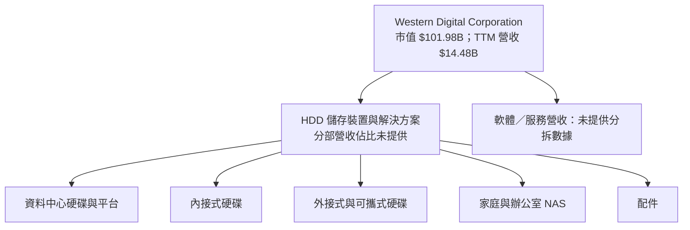
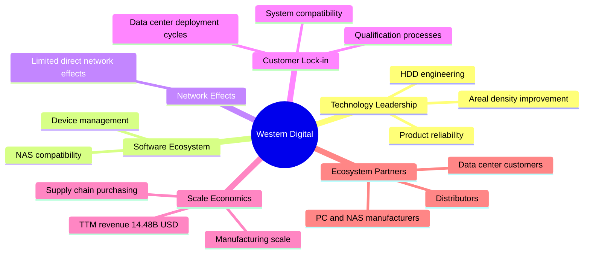
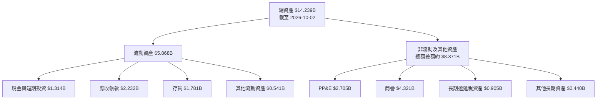
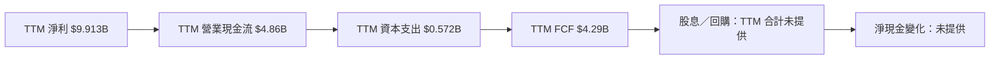
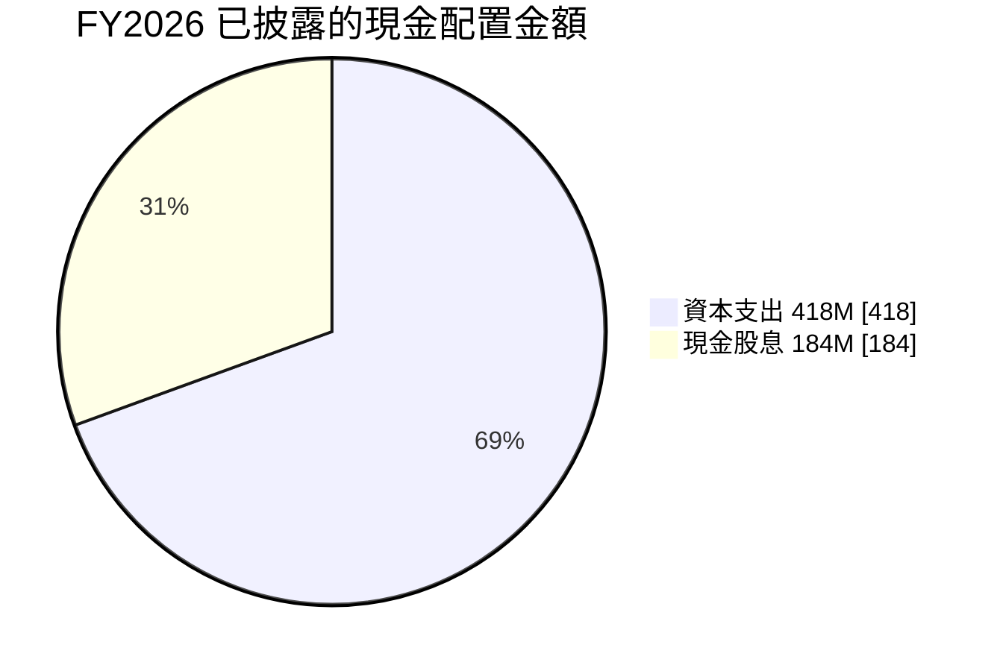
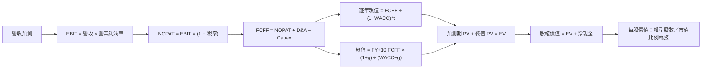
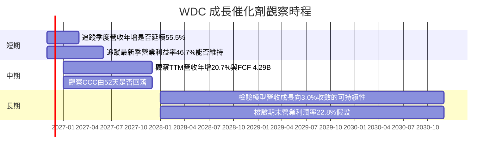
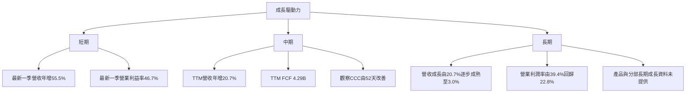
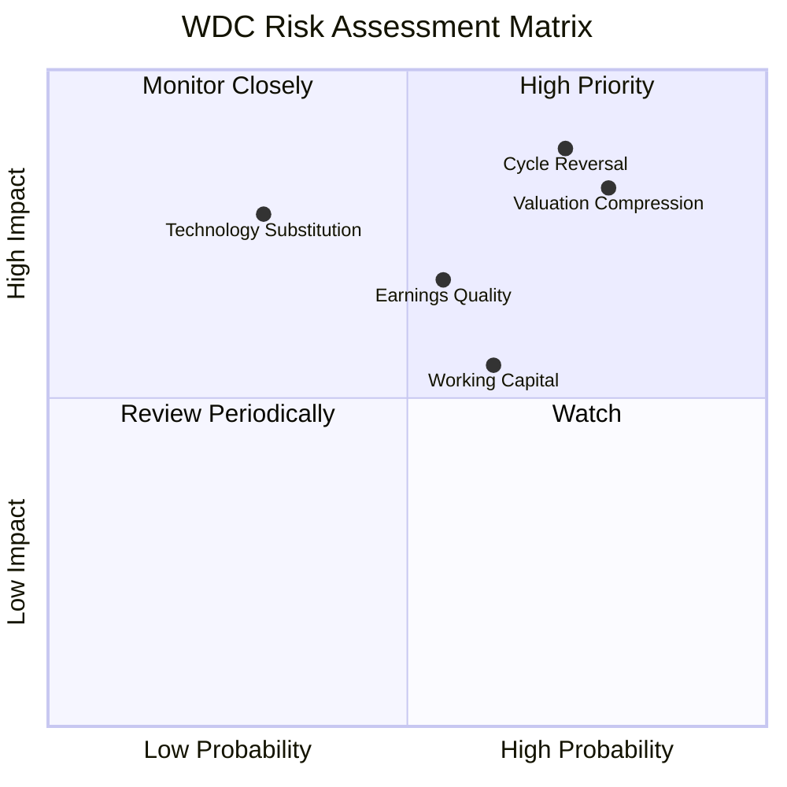
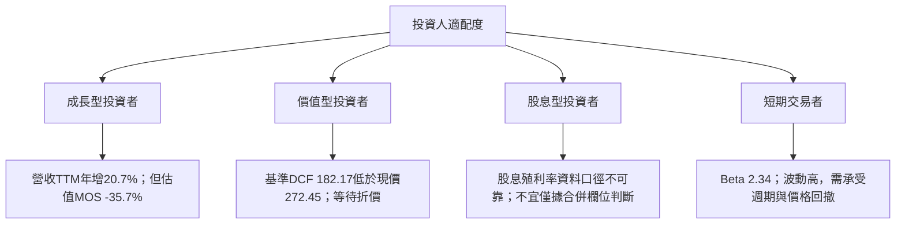

# WDC 基本面深度分析報告
> **報告日期**：2026-11-26 ｜ **語言**：繁體中文 ｜ **數據來源**：SEC 申報資料 (XBRL)、Yahoo Finance、Finviz、StockAnalysis、Roic.ai ｜ **分析師**：CFA 級機構研究

> **數據口徑說明**：本文優先採用 SEC 申報資料與程式計算的 VERIFIED FIGURES。部分合併資料中的營業利益率、ROE、淨現金及市盈率與該口徑不同；本文不混用：例如 TTM 營業利益率採 **39.4%**、最新一季營業利益率採 **46.7%**、ROIC 採 **61.1%**、淨現金採 **$525M**。最新股價統一採 **2026-11-25 收盤 $272.45**。

---

## 目錄

| # | 章節 | 核心結論 |
|---|------|----------|
| 1 | 執行摘要 | 賣出；加權合理價值 $200.75；MOS -35.7% |
| 2 | 公司概覽與商業模式 | HDD 主業具規模與客戶黏著，但產品組合數據不足以量化護城河 |
| 3 | 損益表深度分析 | TTM 營收 $14.48B、成長 20.7%；利潤率處景氣高檔 |
| 4 | 資產負債表分析 | 淨現金 $525M，流動性可用但 CCC 延長 |
| 5 | 現金流量深度分析 | TTM FCF $4.29B、FCF Yield 4.21%；現金轉換低於會計淨利 |
| 6 | 獲利能力與資本效率 | ROIC 61.1% 高於 WACC 14.0%，目前創造價值 |
| 7 | 相對估值分析 | 同業倍數參差，WDC 自身 P/S 高於五年中位數 |
| 8 | DCF 內在價值評估 | 基準 DCF $182.17；加權合理價值 $200.75 |
| 9 | 成長催化劑 | 最新一季營收年增 55.5%；TAM 與分部營收未提供 |
| 10 | 風險矩陣 | 週期反轉、估值回落、獲利品質為主要風險 |
| 11 | 投資建議 | 現價高於加權合理價值；等待價格或基本面改善 |

---

## 1. 執行摘要

WDC 的 TTM 營收為 **$14.48B**，TTM 年增 **20.7%**，最新一季單季年增 **55.5%**；TTM FCF 為 **$4.29B**、ROIC 為 **61.1%**，均顯示當前景氣與獲利狀況良好。然而，基準 DCF 每股價值為 **$182.17**，低於 2026-11-25 收盤價 **$272.45**；四種估值方法加權後合理價值為 **$200.75**，據此 MOS 為 **-35.7%**。依 MOS 評級門檻應為 **賣出**，本報告未作質化調整；主要原因是市場價格已高於加權合理價值，而 DCF 基準估值亦顯示現價溢價。

### 1.0 一頁式投資儀表板（Portfolio Manager 30 秒速讀）

| 項目 | 內容 |
|------|------|
| **投資論點（3 句）** | ① TTM 營收年增 **20.7%**，最新一季單季年增 **55.5%**，需求動能加快。② TTM ROIC **61.1%** 對比 WACC **14.0%**，目前經營回報明顯高於資本成本。③ 加權合理價值 **$200.75** 對比現價 **$272.45**，MOS **-35.7%**，估值風險高於基本面改善所帶來的安全邊際。 |
| **綜合評分** | **6.0/10**（引用 1.1 評分卡） |
| **財務健康** | 🟡 淨現金 **$525M**；但速動比率 **0.867**，CCC 從 **34 天** 延長至 **52 天**。 |
| **ROIC vs WACC** | **61.1% vs 14.0%**，目前創造股東價值。 |
| **FCF 趨勢** | TTM FCF **$4.29B**；FCF Yield **4.21%**。年度 FCF 從 FY2025 **$1.28B** 增至 FY2026 **$3.51B**。 |
| **估值** | Forward P/E **6.84x**（Yahoo Finance 合併估值）；EV/EBITDA **16.095x**（合併估值）；FCF Yield **4.21%**。 |
| **DCF 內在價值（基準）** | **$182.17**；現價相對 DCF 折溢價 **+49.6%**（DCF 基準價值為分母）。 |
| **安全邊際（MOS）** | **-35.7%＝($200.75 − $272.45) ÷ $200.75**；基準為 8.8 加權合理價值。🔴 |
| **預期報酬（基準情境 12M）** | 以加權合理價值相對現價作估值參考：**-26.3%**；非保證 12 個月報酬預測。 |
| **關鍵風險（前二）** | HDD 產業價格／需求週期反轉；市場估值由高成長預期回落。 |
| **評級 + 信心度** | 🔴 **賣出** ｜ 信心：中（現價與估值差距明確，週期與 DCF 假設仍有不確定性）。 |

### 1.1 綜合評分卡（全報告唯一）

| 維度 | 評分（1–10） | 主要依據（引用數字與其來源章節） |
|------|--------------|----------------------------------|
| 成長性 | 8.0 | TTM 營收成長 **20.7%**、最新一季單季年增 **55.5%**（第 3 章）；但增速是否延續受週期影響。 |
| 獲利能力 | 8.0 | TTM 營業利益率 **39.4%**、ROIC **61.1%** 對比 WACC **14.0%**；Piotroski **6/8**（第 6 章）。 |
| 財務健康 | 7.0 | 淨現金 **$525M**；流動比率 **1.434**，但速動比率 **0.867**、CCC **52 天**（第 4 章）。 |
| 估值 | 2.0 | MOS **-35.7%**；P/S **7.2x** 高於自身五年中位數 **1.2x**（第 7、8 章）。 |
| 護城河 | 6.0 | HDD 製造規模與客戶相容性提供一定壁壘，但缺少市場份額、產品分部及客戶留存量化資料（第 2 章）。 |
| 管理層與資本配置 | 5.0 | FY2026 SBC **$204M**、最新四季稀釋股數測試未通過；資本配置與回購資料不足以支持更高評價（第 3、5 章）。 |
| **綜合評分** | **6.0** | 六項算術平均：**(8.0 + 8.0 + 7.0 + 2.0 + 6.0 + 5.0) ÷ 6 = 6.0**。 |

### 1.2 五大投資論點 + 三大核心風險

| 類型 | 項目 | 具體依據 | 信心度 |
|------|------|----------|--------|
| 🟢 **投資論點①** | 營收加速 | TTM 營收 **$14.48B**、年增 **20.7%**；最新一季單季年增 **55.5%**。營收增速反映需求與出貨改善，但季度高增速可能受低基期影響。 | 🟢 高 |
| 🟢 **投資論點②** | 當前資本回報高 | ROIC **61.1%** 對比 WACC **14.0%**，差 **47.1 個百分點**；目前營運回報明顯超過資本成本。 | 🟢 高 |
| 🟢 **投資論點③** | FCF 回升 | TTM FCF **$4.29B**；FY2026 FCF **$3.51B**，高於 FY2025 **$1.28B**。現金流改善增加財務彈性。 | 🟢 高 |
| 🟢 **投資論點④** | 資產負債表淨現金 | 現金與短期投資 **$1.31B**、總債務 **$789M**、淨現金 **$525M**。 | 🟢 高 |
| 🟡 **投資論點⑤** | 同業需求擴張 | STX 最新一季營收年增 **61.0%**，與 WDC **55.5%** 同向；但同業成長環境也可能提高產業供給和價格波動。 | 🟡 中 |
| 🟡 **風險①** | 高成長不可持續 | FY2026 營收年增 **35.7%**，TTM 年增 **20.7%**；模型將成長由第 1 年 **20.7%** 線性降至第 10 年 **3.0%**，若需求提前反轉，估值下行。 | 🟡 中 |
| 🔴 **風險②** | 估值與基本面不匹配 | 加權合理價值 **$200.75**，現價 **$272.45**，MOS **-35.7%**；基準 DCF **$182.17**。 | 🔴 高 |
| 🔴 **風險③** | 獲利品質及營運資金 | Piotroski 應計品質測試未通過；CCC 年增 **18 天**，且淨利顯著高於營業現金流。 | 🔴 中高 |

### 1.3 快速統計卡片

| 指標 | 公司實際值（期間） | 同業中位數 | 狀態 |
|------|--------------------|------------|------|
| 營收成長（TTM） | **20.7%** | — | 🟢 |
| 營收成長（最新一季年增） | **55.5%** | **377.9%** | 🟡 |
| 毛利率（TTM） | **52.6%** | **80.0%** | 🟡 |
| 營業利益率（TTM） | **39.4%** | — | 🟢 |
| ROIC（TTM） | **61.1%** | — | 🟢 |
| Forward P/E | **6.84x** | **2.9x** | 🟡 |
| FCF Yield（TTM） | **4.21%** | — | 🟡 |
| Piotroski F-Score | **6 / 8** | — | 🟡 |

> 同業中位數依 STX、SNDK、MU 三家公司提供的 Peer multiples 計算；成長與毛利率中位數受 SNDK、MU 數值影響，業務組合與 WDC 並非完全可比。

### 1.4 投資結論

```text
╔══════════════════════════════════════════════════════════════════╗
║                    📊 投資結論摘要                               ║
╠══════════════════════════════════════════════════════════════════╣
║  評級：🔴 賣出（依 MOS 規則 20；未作質化調整）                   ║
║  價格（2026-11-25 收盤）：$272.45                                ║
║  DCF 內在價值（基準）：$182.17（現價溢價 +49.6%）                ║
║  安全邊際 MOS：-35.7%（($200.75−$272.45)÷$200.75）               ║
║  加權合理價值（8.8）：$200.75                                    ║
║  DCF 情境價值：                                                   ║
║    悲觀情境：$100.40（-63.2%）                                   ║
║    基準情境：$182.17（-33.1%）                                   ║
║    樂觀情境：$313.26（+15.0%）                                   ║
║  綜合評分：6.0/10（引用 1.1）                                    ║
║  適合投資人：可承受週期波動、願意追蹤 HDD 需求與估值的投資人；   ║
║              不適合以安全邊際或穩定股息為主要目標者。           ║
╚══════════════════════════════════════════════════════════════════╝
```

---

## 2. 公司概覽與商業模式

### 2.1 業務結構與收入來源

公司資料描述 WDC 主要開發、製造及銷售 HDD 儲存裝置與解決方案，包括資料中心 HDD、內接式硬碟、外接與可攜式硬碟、NAS 產品及配件。未提供各產品線營收或佔比，因此不以推估比例製作分部圖。



### 2.2 市場份額

市場份額數據未提供，無法可靠量化 WDC 在 HDD 或資料儲存市場的市佔率。WDC TTM 營收為 **$14.48B**，最新一季單季營收年增 **55.5%**；同業 STX 同期年增 **61.0%**，反映市場需求回升，但不足以推導市佔變化。

### 2.3 競爭護城河分析



### 2.4 護城河強度

| 護城河項目 | 強度（強／中／弱） | 證據（引用數字或事實） | 會削弱它的情況 |
|------------|--------------------|------------------------|----------------|
| 技術與製造能力 | 中 | HDD 產品涉及工程、製程與可靠度要求；公司 TTM 營收 **$14.48B**，顯示有一定營運規模。未提供產品性能或成本領先量化資料。 | 替代儲存技術成本快速下降，或競爭者在容量、能耗與可靠度上領先。 |
| 客戶鎖定與認證 | 中 | 資料中心平台部署通常涉及客戶驗證與系統相容性；但客戶留存率、合約年限及轉換成本數據未提供。 | 客戶集中採購、重新認證成本下降，或大型客戶轉向其他儲存方案。 |
| 規模效應 | 中 | TTM 營收 **$14.48B**，毛利率 **52.6%**；規模有助固定成本攤提，但高毛利是否可跨週期維持仍待驗證。 | 產業供過於求、價格競爭或產能利用率下降。 |
| 軟體生態系統 | 弱至中 | 有 NAS 與資料中心產品，但軟體及服務收入、續約率與客戶使用數據未提供。 | 軟體功能商品化，或硬體採購與管理平台解耦。 |
| 網路效應 | 弱 | 硬體儲存不具明顯直接網路效應；無可量化網路效應資料。 | 競爭者形成更完整的硬體／軟體生態。 |
| 生態夥伴 | 中 | 公司透過銷售人員、經銷商、分銷商及產業客戶銷售；夥伴營收貢獻未提供。 | 通路改變、客戶直接採購或主要系統整合商更換供應商。 |

護城河評分 **6.0/10** 的理由：營收規模、產品工程與客戶驗證提供實際進入壁壘，但缺少市佔、客戶留存與軟體收入證據，尚不足以判定為持久且高強度的定價護城河。

---

## 3. 損益表深度分析

### 3.1 年度收入成長趨勢（近 4 年）

以下年度數據依年度損益表：FY2023 **$6.255B**、FY2024 **$6.317B**、FY2025 **$9.520B**、FY2026 **$12.919B**。

```text
╔══════════════════════════════════════════════════════════════════╗
║          Western Digital 年度營收趨勢（FY2023-FY2026）           ║
╠══════════════════════════════════════════════════════════════════╣
║  FY2023  $6.255B   ██████████░░░░░░░░░░░░░░  YoY：基期          ║
║  FY2024  $6.317B   ██████████░░░░░░░░░░░░░░  YoY：+1.0% 🟡     ║
║  FY2025  $9.520B   ███████████████░░░░░░░░░  YoY：+50.7% 🟢    ║
║  FY2026  $12.919B  █████████████████████░░░  YoY：+35.7% 🟢    ║
║                                                                  ║
║  FY2023-FY2026 三年營收 CAGR：+27.3%                             ║
╚══════════════════════════════════════════════════════════════════╝
```

營收由 FY2024 的低成長轉為 FY2025、FY2026 大幅回升，與儲存需求及產品組合改善一致。FY2026 年增 **35.7%** 高於 TTM 年增 **20.7%**，表示最新年度動能強，但高基期會使未來增速回落的機率增加。

### 3.2 季度收入趨勢分析

| 季度 | 營收 | QoQ 成長 | YoY 成長 | 備註 |
|------|------:|---------:|---------:|------|
| 2025-12-31 | $3.02B | — | — | 作為最近四季比較起點；該季同比數據未提供。 |
| 2026-03-31 | $3.34B | **+10.6%** | — | QoQ 以季度營收直接計算；單季 YoY 值未在相同序列提供。 |
| 2026-06-30 | $3.75B | **+12.3%** | — | 營收續增，與年度營收回升方向一致。 |
| 2026-09-30 | $4.38B | **+16.8%** | **+55.5%** | 最新季度單季同比採程式計算數據；不可標為 TTM 成長率。 |

> QoQ 公式例：($3.34B ÷ $3.02B) − 1 = **10.6%**。最新季收入加速，但單季成長容易受到出貨時點與基期影響，應同時觀察毛利、庫存及後續指引。

### 3.3 利潤率演變分析

| 利潤率指標 | FY2023 | FY2024 | FY2025 | FY2026 | 趨勢 | 評估 |
|------------|-------:|-------:|-------:|-------:|------|------|
| **毛利率** | 22.2% | 28.1% | 38.8% | 48.8% | 連續改善，FY2026 大幅提升 | 🟢 |
| **營業利益率** | -6.1% | 1.8% | 22.4% | 35.7% | 從虧損轉為高獲利 | 🟢 |
| **淨利率** | -27.3% | -13.5% | 19.4% | 71.9% | FY2026 淨利率遠高於營業利益率 | 🟡 |

年度毛利率、營業利益率依年度損益表逐年計算；FY2026 年度營業利益率為 $4.60B ÷ $12.92B ≈ **35.7%**。與之不同，程式計算的 TTM 營業利益率為 **39.4%**、最新一季為 **46.7%**，採用不同期間，不能互換。

**利潤率演變深度解析：** FY2024 至 FY2026 毛利率提升，與營收復甦、產品組合及產能利用率改善相符；資料未提供單位出貨價格、產能利用率與分產品毛利，不能將改善完全歸因於定價。FY2026 淨利 **$9.30B** 顯著高於營業利益 **$4.60B**，顯示非營業項目或稅項對淨利有重大影響；完整調節表未提供，因此不宜把淨利率 **71.9%** 視為可持續營運利潤率。

### 3.4 費用結構分析

財務資料提供 FY2026 營收 **$12.92B**、毛利 **$6.31B**、營業利益 **$4.60B** 及研發費用 **$1.16B**。缺少完整銷管、重組、利息與其他費用拆分，故不繪製會暗示完整費用比例的圓餅圖。

```text
╔══════════════════════════════════════════════════════════════════╗
║                    FY2026 已披露損益項目                         ║
╠══════════════════════════════════════════════════════════════════╣
║  營收             $12.92B  ██████████████████████████           ║
║  毛利              $6.31B  █████████████                        ║
║  研發費用          $1.16B  ██                                   ║
║  營業利益          $4.60B  █████████                            ║
║  註：研發費用屬營業費用之一，不與其他項目加總為費用結構。       ║
╚══════════════════════════════════════════════════════════════════╝
```

### 3.5 季度 EPS 趨勢與盈餘品質（Quality of Earnings）

最近四季 EPS 實際值依 StockAnalysis 季度表為 **$3.07、$4.67、$8.20、$8.21**，季度 EPS 預估值則均為 N/A，因此無法判斷是否超預期或不及預期。

| 季度 | EPS 實際 | EPS 預估／超預期判斷 | 說明 |
|------|---------:|----------------------|------|
| 2025-12-31 | $3.07 | N/A | 預估值缺漏，無法判斷 beat/miss。 |
| 2026-03-31 | $4.67 | N/A | 預估值缺漏，無法判斷 beat/miss。 |
| 2026-06-30 | $8.20 | N/A | 預估值缺漏；當季淨利受到非營業項目影響的可能性需查閱申報調節表。 |
| 2026-09-30 | $8.21 | N/A | 預估值缺漏；最新季度淨利 **$1.78B**。 |

| 盈餘品質項目 | 數值／佔比 | 評估 |
|--------------|------------|------|
| 股權薪酬 SBC / 營收 | 最近四季 SBC 合計 **$230M** ÷ TTM 營收 **$14.48B** = **1.6%** | 🟡 SBC 不是主要營收成本，但會稀釋股東；F-Score 的稀釋股數測試未通過。 |
| SBC / 營業現金流 | **$230M ÷ $4.86B = 4.7%** | 🟡 有一定非現金費用，衡量股東成本時不宜忽略。 |
| FCF / 淨利（現金轉換率） | **$4.29B ÷ $9.913B = 43.3%** | 🔴 TTM FCF 低於 TTM 淨利，會計淨利的現金支持度偏弱。 |
| 一次性／非經常性損益 | 有效稅率僅 **4.9%**；FY2026 淨利 **$9.30B** 高於營業利益 **$4.60B** | 🟡 稅項與非營業項目明細未提供，淨利含金量需折價看待。 |
| 有效稅率異常 | **4.9%** | 🟡 低稅率抬高稅後獲利；不宜直接假設長期均維持此水平。 |
| 資本化支出 vs 費用化 | TTM Capex **$572M**；資本化研發等明細 N/A | 🟡 無法從現有資料判斷是否有重要成本資本化或費用化時點差異。 |

**盈餘品質結論：** TTM FCF **$4.29B** 是正向證據，但以 TTM 淨利 **$9.913B** 計，現金轉換率約 **43.3%**；同時有效稅率低、淨利高於營業利益所反映的異常需進一步拆解。故估值應較重視 FCF 與營業獲利，而非直接以當期淨利年化。

---

## 4. 資產負債表分析

### 4.1 資產結構分解

截至 2026-10-02，資產負債表摘要列示總資產 **$14.239B**、流動資產 **$5.868B**、PP&E **$2.705B**、商譽 **$4.321B**。細項合計可能因其他資產及資料口徑而與總額有差異，圖中只列明確披露項目。



### 4.2 流動性與營運資金分析

| 指標 | 最新值 | 歷史趨勢 | 評估 |
|------|-------:|----------|------|
| 流動比率 | **1.434** | 相較一年前流動比率上升，Piotroski 流動比率測試通過 | 🟡 短期流動資產高於流動負債，但須考慮庫存變現速度。 |
| 速動比率 | **0.867** | 歷史比較序列未完整提供 | 🟡 不含存貨時流動資產不足以覆蓋流動負債。 |
| 淨現金 | **$525M** | 最新 TTM 口徑 | 🟢 有淨現金緩衝。 |
| DSO 應收帳款天數 | **56 天** | **41 天** | +15 天；收款週期延長，需關注客戶付款條件與季末出貨。 |
| DIO 存貨天數 | **95 天** | **70 天** | +25 天；存貨佔用資金增加，可能反映備貨或需求／供給錯配。 |
| DPO 應付帳款天數 | **99 天** | **77 天** | +22 天；付款週期延長，可緩解現金佔用，但需觀察供應商條件。 |
| CCC 現金轉換週期 | **52 天** | **34 天** | +18 天；存貨及應收延長大於應付改善，營運資金效率轉弱。 |

DSO、DIO、DPO、CCC 均照程式計算品質指標引用。CCC 由 **34 天** 增至 **52 天**，表示更多現金停留在營運週期；若營收擴張伴隨存貨繼續累積，FCF 可能低於收入成長所暗示的水準。

### 4.3 債務結構分析

```text
╔══════════════════════════════════════════════════════════════════╗
║                   Western Digital 債務健康診斷                   ║
╠══════════════════════════════════════════════════════════════════╣
║  總債務：        $0.789B  ███████████░░░░░░░░░  🟡              ║
║  現金及短期投資：$1.314B  ████████████████████  🟢              ║
║  淨現金：        $0.525B  ████████░░░░░░░░░░░░  🟢              ║
║                                                                  ║
║  Debt / EBITDA：N/A（同期間且同口徑 EBITDA 未由 VERIFIED 給出） ║
║  利息保障倍數： N/A（利息費用明細未提供）                        ║
║  債務成本：      稅前 20.91%（資本成本資料）                     ║
║  備註：其他合併財務資料列總債務 $922M、淨現金 $392M；本報告      ║
║        依 VERIFIED FIGURES 統一採 $789M 與 $525M。               ║
╚══════════════════════════════════════════════════════════════════╝
```

### 4.4 股東權益趨勢

| 年度 | 股東權益 | 年度變化 | 觀察 |
|------|---------:|---------:|------|
| FY2023 | $11.84B | — | 資產負債表規模較大。 |
| FY2024 | $11.05B | -6.7% | 權益下降。 |
| FY2025 | $5.54B | -49.9% | 明顯下降，可能涉及資本結構或會計項目變化；需以申報資料附註核實。 |
| FY2026 | $8.86B | +59.9% | 權益回升，與獲利回升方向一致。 |

```text
╔══════════════════════════════════════════════════════════════════╗
║                    股東權益趨勢（年度）                          ║
╠══════════════════════════════════════════════════════════════════╣
║  FY2023  $11.84B  ████████████████████                         ║
║  FY2024  $11.05B  ███████████████████                          ║
║  FY2025   $5.54B  █████████                                    ║
║  FY2026   $8.86B  ███████████████                              ║
╚══════════════════════════════════════════════════════════════════╝
```

---

## 5. 現金流量深度分析

### 5.1 現金流量瀑布圖

因「股息／回購」的 TTM 完整合計、回購金額及淨現金變化未提供，不把未知資本配置金額畫成數值節點。



### 5.2 FCF 轉換率趨勢

| 年度 | 營業現金流 | 資本支出 | FCF | 淨利 | FCF／淨利 |
|------|-----------:|---------:|----:|-----:|----------:|
| FY2023 | -$0.408B | $0.821B | -$1.23B | -$1.68B | 不具可比性；虧損且分母為負 |
| FY2024 | -$0.294B | $0.487B | -$0.781B | -$0.798B | 約 97.9%（負值對負值，經濟意義有限） |
| FY2025 | $1.69B | $0.412B | $1.28B | $1.86B | 約 68.8% |
| FY2026 | $3.93B | $0.418B | $3.51B | $9.30B | 約 37.7% |
| TTM 至 2026-10-02 | $4.86B | $0.572B | $4.29B | $9.913B | 約 43.3% |

FCF 由負轉正並大幅增加，顯示營運現金流恢復；但 FY2026 與 TTM 的淨利高於 FCF，且現金轉換率偏低，淨利包含的非現金、稅項及其他項目需進一步調節。

### 5.3 自由現金流趨勢

```text
╔══════════════════════════════════════════════════════════════════╗
║                 自由現金流：年度實際與 TTM                       ║
╠══════════════════════════════════════════════════════════════════╣
║  FY2023  -$1.23B  ◀████████░░░░░░░░░░░░░░░░  🟡                ║
║  FY2024  -$0.781B ◀█████░░░░░░░░░░░░░░░░░░░  🟡                ║
║  FY2025   $1.28B   ████████░░░░░░░░░░░░░░░░░  🟢                ║
║  FY2026   $3.51B   ███████████████████░░░░░░  🟢                ║
║  TTM      $4.29B   ███████████████████████░░  FCF Yield 4.21%   ║
╚══════════════════════════════════════════════════════════════════╝
```

### 5.4 資本配置評估

| 項目 | 已披露金額 | 評估 |
|------|-----------:|------|
| 資本支出 | TTM **$572M**；FY2026 **$418M** | 維持及擴充製造能力所需；TTM Capex 約為 TTM 營收的 **3.9%**（DCF 假設）。 |
| 股息 | FY2026 現金股息支付 **$184M** | 相對 FY2026 FCF **$3.51B** 規模有限；TTM 完整股息資料未提供。 |
| 回購 | N/A | 回購支出未提供，不推估。 |
| 研發 | FY2026 **$1.16B** | 支持產品研發；研發報酬與新品貢獻未提供。 |
| 留存現金 | TTM 淨現金 **$525M** | 提供景氣下行緩衝，但低於 TTM FCF，可能另有資本配置與資產負債表變動。 |



> 圓餅僅呈現已披露的 FY2026 Capex 與股息金額，不代表完整資本配置占比；回購與其他投資未提供。

---

## 6. 獲利能力與資本效率

### 6.1 ROE / ROA / ROIC 趨勢

| 指標 | 歷史／最新數值 | 評估 |
|------|----------------|------|
| ROE（TTM，品質指標） | **107.2%** | 高，但同時受高淨利與權益基數影響，不能單獨視為穩態回報。 |
| ROA（TTM） | **25.9%** | 顯示當前資產獲利能力高；週期高點能否維持需觀察。 |
| ROIC（TTM） | **61.1%** | 顯著高於 WACC **14.0%**，目前創造經濟價值。 |
| ROIC 長期歷史 | 多年度值不完整 | 不列無法統一口徑的歷史序列。 |

> ROE 另有合併資料列 **129.6%**；本章採 QUALITY FIGURES 的 TTM ROE **107.2%**，並使用同一區塊提供的杜邦分解。

### 6.2 ROIC vs WACC 分析（核心價值創造判斷）

```text
╔══════════════════════════════════════════════════════════════════╗
║                   ROIC vs WACC 深度分析                          ║
╠══════════════════════════════════════════════════════════════════╣
║  WACC（資本成本輸入）：                                           ║
║  ├── 無風險利率（10Y 美債）：             4.85%                  ║
║  ├── 市場風險溢酬 ERP：                   5.00%                  ║
║  ├── 原始 Beta：                          2.34                   ║
║  ├── 採用調整後 Beta：                    1.90                   ║
║  ├── 股權成本 Ke：                       14.33%                  ║
║  ├── 稅前債務成本：                      20.91%                  ║
║  ├── 有效稅率：                           4.9%                   ║
║  ├── 股權／債務權重：                     99.2% / 0.8%           ║
║  └── 採用 WACC：                         14.00%                  ║
║     原計算 14.37%，受 7%-14% 區間上限限制。                      ║
║                                                                  ║
║  ROIC（TTM）：                         61.1%                    ║
║  EVA 利差 = ROIC − WACC：              47.1 個百分點             ║
║                                                                  ║
║  ROIC  61.1%  ▓▓▓▓▓▓▓▓▓▓▓▓▓▓▓▓▓▓▓▓▓▓▓▓▓▓▓▓▓▓▓▓▓▓▓▓▓▓░░ 🟢   ║
║  WACC  14.0%  ▓▓▓▓▓▓▓▓▓░░░░░░░░░░░░░░░░░░░░░░░░░░░░░░ ──      ║
║                                                                  ║
║  結論：ROIC 約為 WACC 的 4.36 倍；當前創造價值，但具週期性，   ║
║        若獲利回到正常化水準，ROIC 可能大幅收斂。                 ║
╚══════════════════════════════════════════════════════════════════╝
```

ROIC/WACC 算式：**61.1% ÷ 14.0% = 4.36 倍**；利差：**61.1% − 14.0% = 47.1 個百分點**。ROIC 使用程式計算的 TTM 稅後營業利益／投入資本；WACC 直接採成本資本資料提供值。不可把高峰期 ROIC 無條件外推至整個估值期間。

### 6.3 杜邦三因素分解

| 因素 | 數值（TTM） | 解讀 |
|------|-------------|------|
| 淨利率 | **69.2%** | 高度受淨利相對營收的表現影響，須注意稅率及非營業項目。 |
| 資產週轉率 | **1.02x** | 每單位資產產生約 1.02 倍營收。 |
| 權益乘數 | **1.52x** | 槓桿程度不是 ROE 高企的唯一來源。 |
| **ROE** | **107.2%** | QUALITY FIGURES 原值：**69.2% × 1.02 × 1.52 = 107.2%**（使用原始呈現精度）。 |

ROE 主要由高淨利率驅動，而非極高權益乘數；但若淨利率包含不可持續的稅務或非營業效果，ROE 會高估常態股東回報。

### 6.4 財務體質：Piotroski F-Score

**Piotroski F-Score：6 / 8**。一項缺少輸入而未納入分母，因此不是以九項全部判定。

| 測試 | 結果 | 解讀 |
|------|------|------|
| ROA > 0 | ✅ 通過 | TTM 獲利為正。 |
| 營業現金流 > 0 | ✅ 通過 | TTM 營業現金流 **$4.86B**。 |
| ROA 高於一年前 | ✅ 通過 | 獲利能力改善。 |
| 營業現金流 > 淨利（應計品質） | ❌ 未通過 | 現金流低於淨利，與較低現金轉換率一致。 |
| 長期負債 ÷ 總資產低於一年前 | — 無法判定 | 缺少判定所需資料。 |
| 流動比率高於一年前 | ✅ 通過 | 短期流動性較一年前改善。 |
| 稀釋股數未增加 | ❌ 未通過 | 股數稀釋可能削弱每股價值增長。 |
| 毛利率高於一年前 | ✅ 通過 | 毛利率改善。 |
| 資產週轉率高於一年前 | ✅ 通過 | 資產使用效率改善。 |

---

## 7. 相對估值分析

### 7.1 同業估值比較表格

| 估值指標 | **WDC** | **STX** | **SNDK** | **MU** | WDC 評估 |
|----------|--------:|--------:|---------:|-------:|-----------|
| **Trailing P/E** | **10.6x** | 24.8x | 4.7x | 8.1x | 🟡 位於同業區間中段；同業中位數 8.1x。 |
| **Forward P/E** | **6.84x** | 7.3x | 2.1x | 2.9x | 🟡 高於同業中位數 2.9x。 |
| **P/S Ratio** | **7.2x** | 7.9x | 2.9x | 5.1x | 🔴 高於同業中位數 5.1x。 |
| **EV/EBITDA** | **18.2x** | 18.7x | 3.7x | 5.9x | 🔴 高於同業中位數 5.9x。 |
| 最新一季營收年增 | **55.5%** | 61.0% | 377.9% | 379.3% | 🟡 WDC 成長良好，但低於所列同業。 |
| 毛利率（TTM） | **52.6%** | 50.4% | 80.0% | 80.7% | 🟡 高於 STX，低於 SNDK 與 MU。 |

WDC 的 EV/EBITDA 使用 VERIFIED FIGURES 自身歷史估值區間中的 **18.2x**；合併估值資料另列 **16.095x**。表內同業倍數全部採 Peer multiples。三家公司的產品與業務組合不同，特別是 SNDK、MU 與 HDD 業務並非完全同質，倍數差異不可直接視為單一估值結論。

### 7.2 歷史估值區間分析

```text
╔══════════════════════════════════════════════════════════════════╗
║                 WDC 歷史 P/E 區間（五年）                        ║
╠══════════════════════════════════════════════════════════════════╣
║  歷史低點  6.3x  ├──────●──────────────●─────────────────┤ 62.5x║
║  五年中位數 13.5x        ▲ 現值 10.6x                         ║
║  現值百分位：38%                                                ║
║                                                                  ║
║  P/S：現值 7.2x；中位數 1.2x；區間 0.4x–16.0x；百分位 85%       ║
║  EV/EBITDA：現值 18.2x；中位數 14.9x；區間 4.5x–96.5x；69%位   ║
╚══════════════════════════════════════════════════════════════════╝
```

P/E **10.6x** 低於五年中位數 **13.5x**，但 P/S **7.2x** 遠高於中位數 **1.2x**，且處於歷史 **85 百分位**；EV/EBITDA **18.2x** 亦高於中位數 **14.9x**。指標方向不一致，反映當前獲利快速復甦使 P/E 看似偏低，但營收倍數與企業價值倍數已反映較高預期。

### 7.3 情境價值（Bear / Base / Bull）

| 情境 | 第 1 年營收成長 | 期末營業利潤率 | WACC | 每股價值 | 相對現價 | 機率 | 會發生的條件 |
|------|----------------:|----------------:|-----:|---------:|---------:|-----:|--------------|
| 🔴 悲觀 | 10.3% | 19.4% | 15.00% | **$100.40** | **-63.2%** | 25% | HDD 需求回落、價格或產品組合惡化，且折現率上升。 |
| 🟡 基準 | 20.7% | 22.8% | 14.00% | **$182.17** | **-33.1%** | 50% | 起始成長與 TTM 年增一致，利潤率逐步回到五年中位數。 |
| 🟢 樂觀 | 31.0% | 25.1% | 13.00% | **$313.26** | **+15.0%** | 25% | 高成長延續、長期利潤率高於基準並伴隨較低資本成本。 |

情境每股價值與假設照 DCF MODEL 引用；中間逐年營收及 FCFF 未在情境輸出中提供，故不另行建模。

### 7.4 相對估值隱含價格區間

```text
╔══════════════════════════════════════════════════════════════════╗
║                   相對估值每股價值比較                           ║
╠══════════════════════════════════════════════════════════════════╣
║  $97.50          $182.17          $197.60       $272.45          ║
║  EV/EBITDA       基準 DCF         同業 P/S       現價             ║
║  同業中位數       同業中位數 P/S = 5.1x；同業 EV/EBITDA = 5.9x   ║
║  注：估值方法金額與權重依 VERIFIED FIGURES；各法非同等可靠。     ║
╚══════════════════════════════════════════════════════════════════╝
```

| 方法 | 每股價值 | 對應依據 |
|------|---------:|----------|
| 同業 EV/EBITDA | **$97.50** | STX、SNDK、MU 的 EV/EBITDA 中位數 **5.9x** × WDC TTM EBITDA，再加淨現金。 |
| 同業 P/S | **$197.60** | STX、SNDK、MU 的 P/S 中位數 **5.1x** × WDC TTM 營收。 |

---

## 8. DCF 內在價值評估（Discounted Cash Flow）

> 本章只引用程式計算的 DCF MODEL，不另建模型或修改輸入。模型幣別為美元、金額單位為十億美元；逐年表格與敏感度矩陣均照原值引用。報告中的四捨五入：金額多取兩位小數、百分比一位小數、折現因子三位小數。由於模型輸出已四捨五入，個別加總可能有約 $0.01B 尾差。

### 8.0 估值推理鏈（Thinking Logic）

**Step 1 — 價值由哪些變數決定？**  
模型價值主要由 HDD 主業的營收、營業利潤率與終值決定。WDC 目前資料未提供分部營收，故無法可靠拆出雲端、企業或消費性儲存各自佔比；可確認的起點只有 TTM 總營收 **$14.48B**。在此模型中，主導估值的是 **營收成長、長期營業利潤率及 WACC／永續成長率差距**，而非未披露的新業務選擇權。

**Step 2 — 模型選擇**

| 決策點 | 本報告採用 | 理由（含數字） | 曾考慮但否決 | 否決理由 |
|--------|-----------|----------------|--------------|----------|
| 現金流定義 | FCFF | 以 WACC 折現，估值結果先得到 EV；TTM OCF **$4.86B**、Capex **$0.572B**。 | FCFE | 淨現金及融資結構仍可能改變，企業現金流較適合統一折現。 |
| 預測期 N | **10 年** | DCF MODEL 指定；營收成長由 **20.7%** 線性降至 **3.0%**。 | 5 年 | 不符合既定模型，且不另行重建。 |
| 終值方法 | Gordon Growth | 模型使用第 10 年 FCFF 與 **g=3.0%**。 | 退出倍數 | DCF MODEL 未提供退出倍數及相應終值，不能自行補值。 |
| EBIT 基礎 | GAAP EBIT | 模型採 TTM 營業利益率 **39.4%**，並明確採 GAAP。 | 非 GAAP EBIT | 非 GAAP 調節資料未提供，且避免把 SBC 加回後漏計股東成本。 |

**Step 3 — 高／中敏感度假設推導鏈**

- **營收成長路徑**：錨點＝TTM 營收成長 **20.7%** → 調整＝模型假設增速由近期水準逐年遞減至成熟期 **3.0%** → **採用第 1 年 20.7%、第 10 年 3.0%，中間線性遞減** → 曾考慮將高成長固定十年，但拒絕，因模型本身採逐步成熟的週期性路徑。
- **期末營業利潤率**：錨點＝TTM **39.4%** → 調整＝由目前高景氣利潤率回歸近五個財年中位數 → **第 1 年 39.4%，第 10 年 22.8%** → 曾考慮維持 TTM 水準至期末，但拒絕，因週期性產業不宜把高峰利潤率永續化。
- **永續成長率 g**：錨點＝模型設定成熟期 **3.0%**；外部長期 GDP／通膨資料未提供 → 調整＝不將高於成熟期的短期成長延伸至永續期 → **採用 3.0%** → 曾考慮更高數值，但未採用，因永續增長須低於 WACC **14.0%**，且高 g 會明顯抬高終值。
- **預測期 N**：錨點＝模型固定 **10 年** → 調整＝不自行調整程式模型期間 → **採用 10 年** → 曾考慮縮短至 5 年，但與提供模型不一致，故否決。
- **Capex／營收**：錨點＝TTM **3.9%** → 調整＝模型讓資本支出強度逐步下降，成熟期為營收 **3.0%** → **第 1 年 3.9% 至第 10 年 3.0%** → 曾考慮維持 3.9% 全期，但拒絕，因模型按成熟期資本需求收斂。
- **EBIT 基礎與 SBC**：錨點＝採用 GAAP EBIT，模型已將 SBC 作為費用；**採用組合 (A)：GAAP EBIT + 固定股數，FCFF 不再扣 SBC，年稀釋率 0%**。非 GAAP EBIT 或額外扣 SBC 會改變原模型，故不採。
- **年稀釋率**：錨點＝模型固定股數、年稀釋率 **0%** → 調整＝SBC 已包含於 GAAP EBIT 費用 → **採用 0%** → 不採用非零稀釋，以避免在原模型中重複計入 SBC 成本。
- **終值方法**：錨點＝模型採 Gordon Growth → **採用 Gordon Growth**，以 FY+10 FCFF 計算 → 退出倍數法未提供倍數與終值，故否決獨立計算。
- **WACC**：錨點＝成本資本資料採用 **14.00%** → 原始計算值 **14.37%** 超過設定的 **7%–14%** 上限 → **採用 14.00%** → 不採用 14.37% 作模型折現率，因程式規則已限制於區間內。

**Step 4 — 最脆弱的一環**  
最脆弱的是高景氣營業利潤率能否在十年中有序回落而不急跌；若需求與價格在預測期前段急轉弱，DCF 價值會向悲觀情境 **$100.40** 靠攏，而非基準 **$182.17**。

**Step 5 — 計算路徑圖**



### 8.1 模型假設總表（Model Inputs）

| 假設項目 | 採用值 | 依據／來源 | 敏感度 |
|----------|--------|-------------|--------|
| 預測期長度 **N** | **10 年** | DCF MODEL；模型預測至 FY+10。 | 🟡 中 |
| 營收成長路徑 | 第 1 年 **20.7%**，第 10 年 **3.0%** | TTM 成長 **20.7%** 為起點，線性降至模型設定成熟期成長率。 | 🔴 高 |
| 營業利潤率 | 第 1 年 **39.4%** → 第 10 年 **22.8%** | 起點為 TTM 營業利益率；期末值為近五個財年中位數（含 TTM）。 | 🔴 高 |
| 有效稅率 | **4.9%** | Cost of capital／DCF 模型提供的最新年度有效稅率。 | 🟢 低 |
| Capex／營收 | 第 1 年 **3.9%** → 第 10 年 **3.0%** | 起點為 TTM Capex 強度；模型逐步降至 D&A 的 1.1 倍以上限制所決定值。 | 🟡 中 |
| D&A／營收 | **2.7%** | TTM 比例，模型固定。 | 🟢 低 |
| ΔWC／營收增額 | **未建模** | DCF MODEL 明確註明 working capital is not modelled；不得自行補列。 | 🟢 低 |
| EBIT 基礎 | **GAAP** | DCF MODEL 註明 GAAP EBIT。 | 🟡 中 |
| SBC 處理 | 組合 **(A)**：不另扣 SBC | GAAP EBIT 已將 SBC 作為費用；模型固定股數、不另加年稀釋。 | 🟡 中 |
| 年稀釋率 | **0%（模型固定股數）** | DCF MODEL 明確採固定股數。 | 🟡 中 |
| 永續成長率 g | **3.0%** | DCF MODEL 假設；低於 WACC **14.0%**。 | 🔴 高 |
| 終值方法 | Gordon Growth | DCF MODEL 提供終值公式；退出倍數未提供。 | 🔴 高 |
| WACC | **14.00%** | Cost of capital 原值；計算值 14.37%，受 7%–14% 範圍限制。 | 🔴 高 |

**FCFF 定義：**本模型採 **FCFF = NOPAT + D&A − Capex**；ΔWC 不建模。模型沒有 SBC 扣除列，且股數固定，符合 **(A) GAAP EBIT + 固定股數**，故 SBC 影響已計入一次。

### 8.2 折現率推導（WACC）

```text
╔══════════════════════════════════════════════════════════════════╗
║                    WACC 推導（折現率）                           ║
╠══════════════════════════════════════════════════════════════════╣
║  股權成本 Ke（CAPM）：                                           ║
║  ├── 無風險利率 Rf：                    4.85%                   ║
║  ├── 市場風險溢酬 ERP：                 5.00%                   ║
║  ├── 原始 Beta：                        2.34                    ║
║  ├── 調整後 Beta：                      1.90                    ║
║  ├── Beta 調整：2/3×2.34 + 1/3×1 = 1.893 ≈ 1.90                ║
║  ├── 規模／國別額外溢酬：未提供，未另加                         ║
║  └── Ke = 4.85% + 1.90×5.00% = 14.35%；採用資料值 14.33%       ║
║      （CAPM 資料原值 14.33%，差異來自 Beta 四捨五入）            ║
║                                                                  ║
║  債務成本 Kd：                                                   ║
║  ├── 稅前 Kd：                           20.91%                  ║
║  ├── 有效稅率：                          4.9%                    ║
║  └── 稅後 Kd = 20.91%×(1−4.9%) = 19.8854% ≈ 19.89%              ║
║                                                                  ║
║  資本結構權重（市場價值口徑，由成本資本資料提供）：               ║
║  ├── 股權權重 E：                        99.2%                   ║
║  ├── 債務權重 D：                        0.8%                    ║
║  ├── 原計算 WACC：                       14.37%                  ║
║  └── 採用 WACC：                         14.00%                  ║
║      原計算高於 7%-14% 區間上限，按資料規則限制在 14.00%。       ║
╚══════════════════════════════════════════════════════════════════╝
```

WACC 五步覆核：

1. **Ke（CAPM）**：資料原值 **14.33%**；使用調整後 Beta **1.90** 的四捨五入 CAPM 算式為 **4.85% + 1.90 × 5.00% = 14.35%**。以原始未四捨五入 Beta 計算的程式值為 **14.33%**，採用原值。
2. **稅前 Kd**：資料提供 **20.91%**；利息費用及平均計息負債明細未另提供，不能獨立重算該比率。
3. **稅後 Kd**：**20.91% × (1 − 4.9%) = 19.88541% ≈ 19.89%**。
4. **權重**：股權 **99.2%**、債務 **0.8%**；**99.2% + 0.8% = 100.0%**。市值及計息負債的底層權重計算金額未提供，依成本資本資料引用權重。
5. **未限制 WACC 的算式**：**99.2% × 14.33% + 0.8% × 19.88541% = 14.3744% ≈ 14.37%**；按 7%–14% 區間限制，模型採用 **14.00%**。

Rf 的觀察日期未另列，規模／國別溢酬未提供，故未自行增加。第 6.2 節與 DCF 均採用同一 **14.00% WACC**。

### 8.3 逐年自由現金流預測（基準情境）

| 年度 | FY+1 | FY+2 | FY+3 | FY+4 | FY+5 | FY+6 | FY+7 | FY+8 | FY+9 | FY+10 |
|------|-----:|-----:|-----:|-----:|-----:|-----:|-----:|-----:|-----:|------:|
| 營收 | 17.47 | 20.74 | 24.21 | 27.79 | 31.35 | 34.75 | 37.84 | 40.46 | 42.47 | 43.75 |
| 營收 YoY | 20.7% | 18.7% | 16.7% | 14.8% | 12.8% | 10.9% | 8.9% | 6.9% | 5.0% | 3.0% |
| 營業利潤率 | 39.4% | 37.6% | 35.7% | 33.9% | 32.0% | 30.2% | 28.4% | 26.5% | 24.7% | 22.8% |
| EBIT（GAAP） | 6.89 | 7.79 | 8.65 | 9.42 | 10.05 | 10.50 | 10.74 | 10.73 | 10.49 | 10.00 |
| − 稅（4.9%） | (0.33) | (0.38) | (0.42) | (0.46) | (0.49) | (0.51) | (0.52) | (0.52) | (0.51) | (0.49) |
| = NOPAT | 6.55 | 7.41 | 8.23 | 8.96 | 9.56 | 9.99 | 10.21 | 10.21 | 9.98 | 9.51 |
| + D&A | 0.47 | 0.56 | 0.65 | 0.75 | 0.85 | 0.94 | 1.02 | 1.09 | 1.15 | 1.18 |
| − Capex | (0.69) | (0.80) | (0.90) | (1.01) | (1.10) | (1.18) | (1.25) | (1.29) | (1.31) | (1.30) |
| **= FCFF** | **6.33** | **7.18** | **7.98** | **8.70** | **9.30** | **9.74** | **9.99** | **10.02** | **9.82** | **9.39** |
| 折現因子 @14.00% | 0.877 | 0.769 | 0.675 | 0.592 | 0.519 | 0.456 | 0.400 | 0.351 | 0.308 | 0.270 |
| **FCFF 現值 PV** | **5.56** | **5.52** | **5.39** | **5.15** | **4.83** | **4.44** | **3.99** | **3.51** | **3.02** | **2.53** |

**預測期 FCF 現值合計：**  
**$5.56 + $5.52 + $5.39 + $5.15 + $4.83 + $4.44 + $3.99 + $3.51 + $3.02 + $2.53 = $43.94B**；DCF MODEL 原值為 **$43.95B**，差異約 **$0.01B**，來自逐年數值四捨五入，模型合計照抄 **$43.95B**。

**FY+1 逐步演算：**

1. 營收：**$14.48B × (1 + 20.7%) = $17.47736B ≈ $17.47B**（模型列示值）。
2. EBIT：**$17.47B × 39.4% = $6.882B ≈ $6.89B**（模型列示值；差異為底層未四捨五入輸入）。
3. 稅：**$6.89B × 4.9% = $0.33761B ≈ $0.33B**（模型列示值）。
4. NOPAT：模型列示 **$6.55B**；依表內已四捨五入 EBIT 減稅為 **$6.89B − $0.33B = $6.56B**，約 $0.01B 差異來自底層精度。
5. D&A：**$17.47B × 2.7% = $0.47169B ≈ $0.47B**。
6. Capex：**$17.47B × 3.9% = $0.68133B ≈ $0.69B**（模型列示值，底層比率／營收未四捨五入）。
7. ΔWC：**模型未建模，沒有 ΔWC 列**。
8. FCFF：按模型定義取模型列示 **$6.33B**；以已四捨五入表格顯示值相加為 **$6.55B + $0.47B − $0.69B = $6.33B**。
9. 折現因子與現值：**1 ÷ (1 + 14.00%)¹ = 0.877**；**$6.33B × 0.877 = $5.55B**，模型用未四捨五入數計得 PV **$5.56B**。

> 年度表各列為模型原值，模型的底層精度未完整輸出，故用表面四捨五入數重算時，個別格可能有約 $0.01B 誤差；不以重算值取代程式提供值。

**合理性自檢：**

- 預測期 FCF CAGR：FY+1 **$6.33B** 至 FY+10 **$9.39B**，約 **4.5%**（(9.39 ÷ 6.33)^(1/9) − 1）；歷史可比 FCF CAGR 不具代表性，因 FY2023、FY2024 FCF 為負，FY2025 才轉正。
- FY+10 FCFF 利潤率：**$9.39B ÷ $43.75B = 21.5%**；目前 TTM FCF 利潤率：**$4.29B ÷ $14.48B = 29.6%**。同業最佳的可比 FCF 利潤率未提供，不能判斷是否超越同業最佳。
- 模型各年 FCFF 均為正；但營運資金未建模，CCC 已由 **34 天** 延長至 **52 天**，若營運資金持續吸收現金，模型 FCFF 可能偏高。

```text
╔══════════════════════════════════════════════════════════════════╗
║            自由現金流：歷史實際 vs 模型預測                      ║
╠══════════════════════════════════════════════════════════════════╣
║  FY2024(實)  -$0.781B  ◀████░░░░░░░░░░░░░░░░░░                  ║
║  FY2025(實)   $1.28B    █████░░░░░░░░░░░░░░░░                    ║
║  FY2026(實)   $3.51B    ██████████████░░░░░░                    ║
║  FY+1 (預)    $6.33B    █████████████████████                   ║
║  FY+10(預)    $9.39B    ██████████████████████████████          ║
╠══════════════════════════════════════════════════════════════════╣
║  模型預測由近期高 FCF 起步；歷史現金流週期波動使長期推估不確定。║
╚══════════════════════════════════════════════════════════════════╝
```

### 8.4 終值計算（Terminal Value）

**適用性檢查：** **WACC 14.00% vs g 3.0% → WACC > g？✅**

DCF MODEL 的 Gordon Growth 終值與退出倍數法資料如下：

| 方法 | 計算式 | 終值 TV | TV 現值 | 佔總 EV 比重 |
|------|--------|---------:|--------:|-------------:|
| Gordon Growth | **$9.39B × (1 + 3.0%) ÷ (14.00% − 3.0%)** | **$87.94B** | **$23.72B** | **35.1%** |
| 退出倍數法 | N/A（模型未提供退出倍數與終值） | N/A | N/A | N/A |

逐步演算：

1. FY+10 FCFF：**$9.39B**。
2. 分子：**$9.39B × (1 + 3.0%) = $9.6717B**。
3. 分母：**14.00% − 3.0% = 11.00%**；終值依模型為 **$87.94B**。以顯示後的四捨五入數重算會有尾差，模型原值照抄。
4. PV(TV)：**$87.94B × 0.270 = $23.74B**（以三位折現因子顯示值計算）；模型使用未四捨五入折現因子，PV(TV) 原值為 **$23.72B**。
5. 終值佔 EV：**$23.72B ÷ $67.67B = 35.1%**。

終值現值佔 EV **35.1%**，低於 75% 警戒線；但對長期 g 與 WACC 的假設仍具敏感性。

### 8.5 企業價值 → 每股內在價值（Bridge）

```text
╔══════════════════════════════════════════════════════════════════╗
║              企業價值 → 每股內在價值 橋接表                      ║
╠══════════════════════════════════════════════════════════════════╣
║  預測期 FCF 現值合計             +$43.95B                        ║
║  終值現值 PV(TV)                 +$23.72B                        ║
║  ─────────────────────────────────────────────                  ║
║  = 企業價值 EV                    $67.67B                        ║
║  + 淨現金                        +$0.525B                        ║
║  = 股權價值                       $68.19B                        ║
║                                                                  ║
║  每股內在價值（模型橋接）         $182.17                         ║
║  2026-11-25 收盤價                $272.45                         ║
║  折溢價（現價÷DCF價值−1）         +49.6% 溢價                    ║
╚══════════════════════════════════════════════════════════════════╝
```

逐步演算：

1. **EV**：**$43.95B + $23.72B = $67.67B**。
2. **股權價值**：DCF MODEL 列示 **EV $67.67B + 淨現金 $0.53B = $68.19B**；此處尾差來自模型金額四捨五入。淨現金來自現金 **$1.31B** 減總債務 **$789M**。
3. **每股價值**：照模型橋接公式 **股權價值 × 價格 ÷ 市值 = $182.17**；此估值採模型提供的股權價值、市價與市值比例橋接，不另以未提供的稀釋股數重建。
4. **折溢價**：**$272.45 ÷ $182.17 − 1 = +49.6%**。
5. **本節不計算 MOS**：MOS 只在 8.8 以加權合理價值作分母計算。

股數口徑：模型聲明採固定股數、年稀釋率 **0%**；市值資料列流通股 **374.32M 股**，但 DCF 每股值採模型所列「股權價值 × 價格 ÷ 市值」公式。現金與債務採截至 2026-10-02 的 TTM／資產負債表 VERIFIED FIGURES 口徑。

### 8.6 敏感性分析（WACC × 永續成長率）

下表每股價值照 DCF MODEL 原值；括號為相對現價 **$272.45** 的上行空間，按 `(每股價值 ÷ 272.45) − 1` 計算，僅作四捨五入顯示。

| g（列）／WACC（欄） | 12.00% | 13.00% | **14.00%（基準）** | 15.00% | 16.00% |
|-----------|------:|------:|-------------------:|------:|------:|
| **2.0%** | $211.85 (-22.2%) | $192.49 (-29.3%) | $176.33 (-35.3%) | $162.63 (-40.3%) | $150.88 (-44.6%) |
| **2.5%** | $216.61 (-20.5%) | $196.10 (-28.0%) | $179.12 (-34.3%) | $164.83 (-39.5%) | $152.63 (-44.0%) |
| **3.0%（基準）** | $221.90 (-18.6%) | $200.08 (-26.6%) | **$182.17 (-33.1%)** | $167.21 (-38.6%) | $154.51 (-43.3%) |
| **3.5%** | $227.82 (-16.4%) | $204.48 (-24.9%) | $185.51 (-31.9%) | $169.79 (-37.7%) | $156.54 (-42.5%) |
| **4.0%** | $234.47 (-13.9%) | $209.36 (-23.2%) | $189.19 (-30.6%) | $172.61 (-36.7%) | $158.74 (-41.7%) |

**矩陣複算限制：**模型只提供最終矩陣格值，未提供各 WACC 情況下十年逐年折現因子合計及終值 PV 分項；依要求不得另建模型。基準格 **$182.17** 與 DCF 基準每股值一致。對應非基準格可引用矩陣原值，例如 **WACC 15.00% > g 3.0% ✅，每股價值 $167.21**；但無足夠底層逐年 PV 資料作完整獨立重算。

**三情境 DCF：**模型提供情境假設、每股值、相對現價與機率，但未提供各情境 FY+10 營收、FCFF、終值的中間表格，因此不虛構中間數字。

| 情境 | 第 1 年成長 | 第 10 年營業利潤率 | WACC | 每股價值 | 相對現價 | 機率 |
|------|------------:|-------------------:|-----:|---------:|---------:|-----:|
| 🔴 悲觀 | 10.3% | 19.4% | 15.00% | $100.40 | -63.2% | 25% |
| 🟡 基準 | 20.7% | 22.8% | 14.00% | $182.17 | -33.1% | 50% |
| 🟢 樂觀 | 31.0% | 25.1% | 13.00% | $313.26 | +15.0% | 25% |
| **機率加權** | — | — | — | **$194.50** | **-28.6%** | **100%** |

加權：**$100.40 × 25% + $182.17 × 50% + $313.26 × 25% = $194.50**（按模型原值及四捨五入）。

**敏感度結論：**

- g 由 **2.0%** 升至 **3.0%**（WACC 固定 14.0%）：**$182.17 − $176.33 = +$5.84**，相對基準約 **+3.2%**。
- WACC 由 **14.0%** 升至 **15.0%**（g 固定 3.0%）：**$167.21 − $182.17 = -$14.96**，約 **-8.2%**。
- 期末營業利潤率每 +1 個百分點的單獨敏感度未在矩陣中提供，故 **N/A（未提供該敏感度結果）**。
- 在已提供的敏感度矩陣範圍內，WACC 每 +1 個百分點的估值影響大於 g 每 +1 個百分點；這與 8.0 指出折現率及長期營運假設共同主導估值一致。

### 8.7 反推 DCF（Reverse DCF：市場在預期什麼）

DCF MODEL 僅提供兩個反推結果，不提供 N、g 的反推解或迭代軌跡。其餘變數固定值未完整列出，因此不自行擴充求解。

| 求解變數（一次一個） | 固定設定 | 市場隱含值（令 DCF = 現價） | 基準比較 | 判斷 |
|----------------------|----------|------------------------------|----------|------|
| 第 1 年營收成長率 | 其他變數維持基準模型值 | **32.7%** | 基準 **20.7%** | 🔴 現價要求明顯高於基準起始成長。 |
| 固定營業利潤率 | 其他變數維持基準模型值 | **41.5%** | TTM **39.4%**，基準由 **39.4%** 降至 **22.8%** | 🔴 現價隱含持續高利潤率。 |
| 永續成長率 g | N/A | N/A | 模型未提供 | 未計算。 |
| 預測期 N | N/A | N/A | 模型未提供 | 未計算。 |

反推結論：若以基準 DCF 結構解釋 **$272.45** 現價，模型指出需要第 1 年營收成長 **32.7%**，或固定營業利潤率 **41.5%**；兩者均高於基準模型的長期假設。這代表市場價格對持續強勁需求與利潤率的依賴偏高。

### 8.8 估值三角驗證與安全邊際

| 估值方法 | 隱含每股價值 | 上行空間（÷現價） | 權重 | 說明 |
|----------|--------------:|------------------:|-----:|------|
| DCF（基準） | $182.17 | -33.1% | 40% | 10 年 FCFF、WACC **14.00%**、終值成長 **3.0%**。 |
| 同業 EV/EBITDA | $97.50 | -64.2% | 30% | 同業中位數 **5.9x**（STX、SNDK、MU）× TTM EBITDA，再加淨現金。 |
| 同業 P/S | $197.60 | -27.5% | 20% | 同業中位數 **5.1x** × TTM 營收。 |
| 分析師共識目標價 | $591.08 | +116.9% | 10% | 24 位分析師平均目標價；參考性高，不作主要估值依據。 |
| **加權合理價值** | **$200.75** | **-26.3%** | **100%** | 公司類型為週期性公司；權重依估值方法資料固定。 |

加權計算：  
**$182.17 × 40% + $97.50 × 30% + $197.60 × 20% + $591.08 × 10%  
= $72.868 + $29.250 + $39.520 + $59.108  
= $200.746 ≈ $200.75**。  
權重合計：**40% + 30% + 20% + 10% = 100%**。四種方法均有資料，沒有方法被剔除。

```text
╔══════════════════════════════════════════════════════════════════╗
║                  估值區間與安全邊際                              ║
╠══════════════════════════════════════════════════════════════════╣
║  $100.40 ───── $200.75 ───── $272.45 ───── $313.26 ───── $591.08║
║  悲觀 DCF      加權合理值       現價          樂觀 DCF     共識目標║
║                                                                  ║
║  MOS = ($200.75−$272.45) ÷ $200.75 = -35.7%                     ║
║  MOS 評估：🔴 <10% 無安全邊際                                    ║
║  上行空間 = ($200.75−$272.45) ÷ $272.45 = -26.3%                 ║
║                                                                  ║
║  MOS≥10% 對應價格上限：$200.75×(1−10%) = $180.68                ║
║  建議買入觀察區：低於或等於 $180.68；非現價買入建議。            ║
║  合理持有區（MOS -10% 至 +10%）：$180.68–$220.83                 ║
║  減碼考慮區：高於 $220.83；現價 $272.45 已在此區間。             ║
╚══════════════════════════════════════════════════════════════════╝
```

> 🔎 **程式複算（Python，依本節各項自動重算）**
>
> 加權合理價值 = $182.17 × 40% + $97.50 × 30% + $197.60 × 20% + $591.08 × 10% = **$200.75**（權重合計 100%）
>
> 以價格 $272.45 計：MOS = **-35.7%**，上行空間 = **-26.3%**
>
> ✅ 與本節所寫數值一致。

### 8.9 DCF 模型的局限與失效條件

- **終值依賴度**：終值現值佔 EV **35.1%**，估值仍取決於 FY+10 以後的持續經營假設。
- **最脆弱假設**：第 1 年營收成長能否達 **20.7%**、長期營業利潤率能否維持在逐步收斂路徑。悲觀情境值 **$100.40**，較基準 **$182.17** 低 **$81.77**。
- **營運資金限制**：模型未建模 ΔWC；而 CCC 已由 **34 天** 延長至 **52 天**。若存貨與應收帳款繼續增加，模型 FCF 會偏高。
- **周期性限制**：FY2023、FY2024 FCF 分別為 **-$1.23B**、**-$0.781B**，現金流歷史波動高，單一平滑 DCF 可靠度有限；相對估值與週期中段獲利應同時參照。
- **模型失效條件**：若營收連續兩季下滑、營業利益率快速收縮、FCF 轉負，或 ROIC 跌至 WACC 以下，應下修營收與利潤率路徑。
- **替代觀察方法**：週期性企業可輔以中週期 EV/EBITDA、EV/Sales、產能利用率及每單位容量成本；但目前沒有足夠分部或單位經濟性資料建立 SOTP。

### 8.10 複算檢核表（Audit Trail）

| # | 檢核項目 | 檢查方式 | 結果 |
|---|----------|----------|------|
| 1 | 高／中敏感度輸入都有推導 | 8.0 Step 3 逐項列錨點、調整、採用值與否決值；部分模型底層歷史資料未提供 | ✅（缺漏明確揭露） |
| 2 | 每個假設都有來歷 | 8.1 逐項列來源；ΔWC 明確標示未建模 | ✅ |
| 3 | WACC 算式與限制 | 原計算 **14.37%**；受 7%–14% 限制後採 **14.00%** | ✅ |
| 4 | Kd 分母與權重債務範圍可核對 | Kd **20.91%**、債務權重 **0.8%** 為資本成本來源原值；底層負債明細未提供 | ⚠️ 底層無法獨立重算 |
| 5 | WACC 與第 6.2 節一致 | 均採 **14.00%** | ✅ |
| 6 | 預測年度數與 N 一致 | FY+1 至 FY+10 共十年 | ✅ |
| 7 | 代表年度算式可複算 | 表面數值有約 $0.01B 的底層精度尾差，已揭露 | ⚠️ 不以四捨五入數取代模型值 |
| 8 | 預測期 PV 加總 | 顯示值加總 **$43.94B**；模型原值 **$43.95B**，約 $0.01B 尾差 | ✅（在 1% 範圍內） |
| 9 | WACC > g | **14.00% > 3.0%** | ✅ |
| 10 | 終值以 FY+10 FCFF 折現十期 | 模型採 FY+10 FCFF 與折現因子 **0.270** | ✅ |
| 11 | EV 至每股價值橋接 | EV **$67.67B**、股權價值 **$68.19B**、每股 **$182.17** 均引用模型 | ✅（顯示精度尾差已說明） |
| 12 | SBC 組合合法 | GAAP EBIT、不另扣 SBC、固定股數、年稀釋率 0% | ✅ |
| 13 | 敏感度矩陣基準格一致 | 14.0%、g 3.0% 格為 **$182.17** | ✅ |
| 14 | 矩陣 WACC > g | 最低 WACC 12.0% 高於最高 g 4.0% | ✅ |
| 15 | 情境機率相加 | 25% + 50% + 25% = **100%**；機率加權原值 **$194.50** | ✅ |
| 16 | 反推每列只放開一個變數 | 只列模型已提供的營收成長與固定利潤率解；其他 N/A | ✅ |
| 17 | MOS 與折溢價定義 | MOS 用 **$200.75**；DCF 折溢價用 **$182.17** | ✅ |
| 18 | 報告完整至第 11 章 | 下列章節與小節完整輸出 | ✅ |
| 19 | 加權合理價值核對 | 四種方法逐項乘權重，加總 **$200.746 ≈ $200.75** | ✅ |
| 20 | 評級門檻 | MOS **-35.7% < -25%**，對應賣出 | ✅ |

---

## 9. 成長催化劑

### 9.1 催化劑時間軸

公司未提供正式新品上市時間表或管理層財測，以下依可量化的營運指標列觀察期，不把未證實事件當成確定催化劑。



### 9.2 TAM 市場規模分析

**N/A（TAM 數據未提供）**。WDC TTM 營收 **$14.48B**、TTM 年增 **20.7%**，最新一季單季年增 **55.5%**，足以顯示當前營運擴張，但無 TAM、滲透率或市場規模數據，不能由營收自行推算可服務市場。

### 9.3 成長驅動力結構圖



---

## 10. 風險矩陣

### 10.1 風險評分矩陣

機率與衝擊座標為研究判斷，不是財務數據或公司指引；量化依據均在下方風險清單說明。



### 10.2 風險清單詳細分析

| # | 風險項目 | 發生機率 | 財務衝擊 | 風險評分 | 緩解措施 |
|---|----------|----------|----------|----------|----------|
| 1 | 🔴 **產業週期與需求反轉** | 中高（約 55%，研究判斷） | 高；最新單季年增 **55.5%** 若反轉，營收與高利潤率可能同步回落 | 🔴 8.5/10 | 季季追蹤營收、毛利率、出貨及管理層展望；以中週期而非高峰獲利估值。 |
| 2 | 🔴 **估值收縮** | 高（約 65%，研究判斷） | 高；現價 **$272.45** 對比加權合理價值 **$200.75**，差距約 **26.3%**（相對現價） | 🔴 8.5/10 | 以 MOS 與估值帶控制買入；避免只用低 P/E 推論便宜。 |
| 3 | 🟠 **盈餘品質及稅務／非營業項目** | 中（約 45%，研究判斷） | 中高；TTM FCF／淨利約 **43.3%**，有效稅率 **4.9%** | 🟠 7.0/10 | 分析 GAAP 淨利調節表、稅率、應計項目與營業現金流。 |
| 4 | 🟡 **營運資金吸收現金** | 中（約 50%，研究判斷） | 中；CCC **52 天**，較一年前增加 **18 天** | 🟡 6.0/10 | 追蹤 DSO、DIO、DPO；若 DIO、CCC 繼續上升，降低 FCF 預估。 |
| 5 | 🟡 **替代技術與產品替代** | 低至中（約 30%，研究判斷） | 高；若客戶儲存架構改變，長期 HDD 成長與定價可能承壓 | 🟡 6.0/10 | 追蹤 HDD 容量、成本與能耗競爭力，以及公司產品路線圖；量化 TAM 資料目前缺漏。 |

---

## 11. 投資建議

### 11.1 最終評級與評分

**賣出**，因加權合理價值 **$200.75**、現價 **$272.45**，MOS **-35.7%**，低於賣出門檻 **-25%**；本報告未依質化因素調整評級。公司綜合評分為 **6.0/10**，六項分數依序為成長性 **8.0**、獲利能力 **8.0**、財務健康 **7.0**、估值 **2.0**、護城河 **6.0**、管理層與資本配置 **5.0**，引用第 1.1 節，不另行評分。

### 11.2 合理價值與隱含報酬率

| 估值參考 | 每股價值 | 相對現價 $272.45 | 機率／權重 |
|----------|---------:|----------------:|-----------:|
| 加權合理價值 | **$200.75** | **-26.3%** | 估值方法加權 100% |
| 🔴 悲觀 DCF | **$100.40** | **-63.2%** | 25% |
| 🟡 基準 DCF | **$182.17** | **-33.1%** | 50% |
| 🟢 樂觀 DCF | **$313.26** | **+15.0%** | 25% |
| 機率加權 DCF（參考） | **$194.50** | **-28.6%** | 100% |

### 11.3 買入時機與觸發因素

```text
╔══════════════════════════════════════════════════════════════════╗
║                  ✅ 買入觸發因素 Checklist                       ║
╠══════════════════════════════════════════════════════════════════╣
║  目前狀態：現價 $272.45，高於加權合理價值 $200.75。              ║
║                                                                  ║
║  買入觀察條件（多數符合再考慮）：                                ║
║  ☐ 股價回落至 $180.68 以下，達到 MOS 至少 10% 的價格門檻。      ║
║  ☐ TTM 營收成長仍為正，且營業利益率未出現急速下滑。             ║
║  ☐ FCF 維持正值，並看到 CCC 從 52 天回落。                       ║
║                                                                  ║
║  加碼觸發條件（出現以下任一，且估值仍合理）：                    ║
║  ☐ 後續季度營收年增維持正成長，並確認非單季基期效應。           ║
║  ☐ ROIC 持續高於 WACC 14.00%，而非只靠單一高峰季。              ║
║  ☐ DSO、DIO 或 CCC 改善，FCF 對淨利轉換率回升。                 ║
║                                                                  ║
║  減碼／退出觸發條件（出現以下任一）：                            ║
║  ☐ 連續兩季營收同比轉負，或營業利益率快速收縮。                 ║
║  ☐ TTM FCF 轉負，或 ROIC 跌破 WACC 14.00%。                     ║
║  ☐ 現價仍高於 $220.83 且基本面不再支持高成長預期。              ║
╚══════════════════════════════════════════════════════════════════╝
```

### 11.4 投資人適配度分析



### 11.5 每季財報監控清單（Quarterly Watch List）

| 追蹤指標 | 最新基準 | 加碼觀察門檻 | 減碼／重新估值門檻 |
|----------|---------:|--------------|--------------------|
| 營收年增 | 最新一季 **55.5%**；TTM **20.7%** | 成長維持正值且由多季營收確認 | 連續兩季同比轉負，或 TTM 成長明顯低於 0% |
| 營業利益率 | 最新一季 **46.7%**；TTM **39.4%** | 保持高於 **30%** 且營收未下滑（研究監控門檻） | 由高點收縮超過 **10 個百分點**，或跌破 **20%** |
| 毛利率 | TTM **52.6%** | 穩定或提高，並與營收成長同步 | 連續兩季收縮且伴隨存貨增加 |
| 營業現金流 | TTM **$4.86B** | 維持正值、與獲利同步 | 轉負或大幅落後淨利 |
| FCF | TTM **$4.29B** | 持續為正；FCF Yield 不因股價上升過度壓縮 | FCF 轉負或 FCF／淨利持續低於 **40%** |
| Capex | TTM **$572M** | 追蹤投資回報與產能需求 | Capex 增加但營收、FCF 無相應改善 |
| DSO／DIO／DPO／CCC | **56／95／99／52 天** | CCC 逐季回落 | CCC 高於 **52 天** 且 DIO 持續上升 |
| 淨現金 | **$525M** | 維持淨現金 | 淨現金轉為淨負債且現金流轉弱 |
| ROIC vs WACC | **61.1% vs 14.0%** | ROIC 高於 WACC | ROIC 跌至或低於 **14.0%** |
| 財測／訂單趨勢 | 管理層財測未提供 | 財測維持或上修，並有季度營收驗證 | 下修指引、訂單或出貨連續轉弱 |

### 11.6 反面論證：什麼會證明論點錯誤（What Would Change My Mind）

```text
╔══════════════════════════════════════════════════════════════════╗
║              ⚠️ 論點失效條件（Disconfirming Evidence）            ║
╠══════════════════════════════════════════════════════════════════╣
║  ☐ 最新一季營收年增由 55.5% 下滑，並連續兩季同比為負。           ║
║  ☐ TTM 營業利益率由 39.4% 下滑超過 10 個百分點，且無產品組合   ║
║     改善或成本回落作為抵銷。                                     ║
║  ☐ TTM FCF 轉負，或 FCF／淨利連續兩季低於 40%。                ║
║  ☐ ROIC 跌至 WACC 14.00% 以下，表示經濟利潤不再為正。           ║
║  ☐ CCC 高於目前 52 天並持續上升，且存貨天數高於 95 天。         ║
║  ☐ 同業估值回落且公司營收、毛利同步下滑，證明高估值無獲利支撐。 ║
╚══════════════════════════════════════════════════════════════════╝
```

> **免責聲明**：本報告為 AI 自動生成，僅供研究參考，不構成投資建議。投資有風險，入市需謹慎。

---

## 資料與來源

| 項目 | 內容 |
|------|------|
| 價格 | 272.45 USD，2026-11-25 收盤（Yahoo Finance 日線） |
| 財務報表 | SEC 10-Q filed 2026-10-23，最新季度 2026-10-02（FY2027 Q1） |
| 有回應的資料來源 | SEC 申報資料 (XBRL)、Yahoo Finance、Finviz、StockAnalysis、Roic.ai |
| 由程式計算 | TTM 數字、WACC、DCF 模型、估值方法與權重、加權合理價值、MOS、評級門檻、F-Score、杜邦分解、營運資金天數、綜合評分 |
| 撰寫模型 | openai / gpt-6-luna |

> 本區塊由產生報告的程式依實際取得的資料填寫，非模型撰寫。「由程式計算」的數字不是模型的估計；其餘判斷（評分、情境、策略）是模型的分析。
