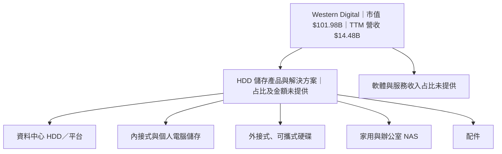
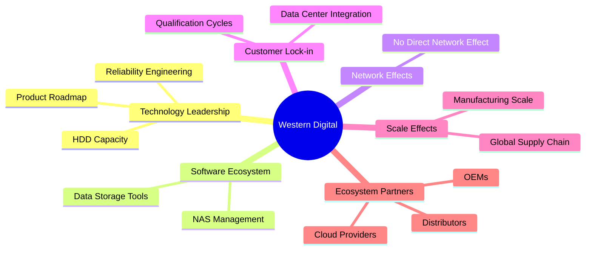
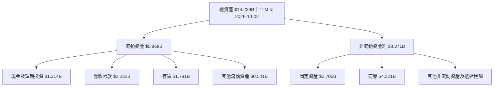
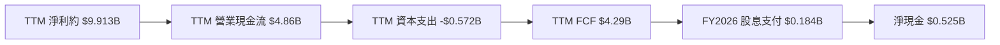
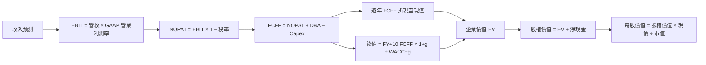
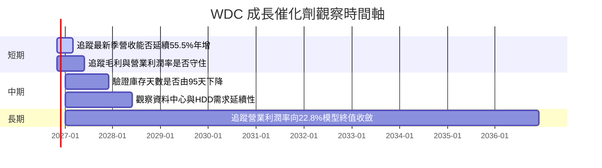
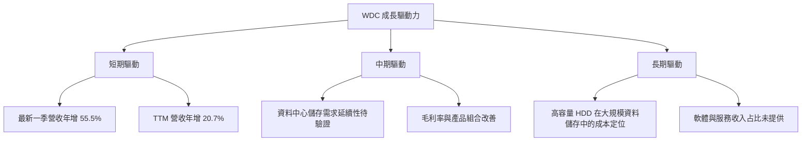
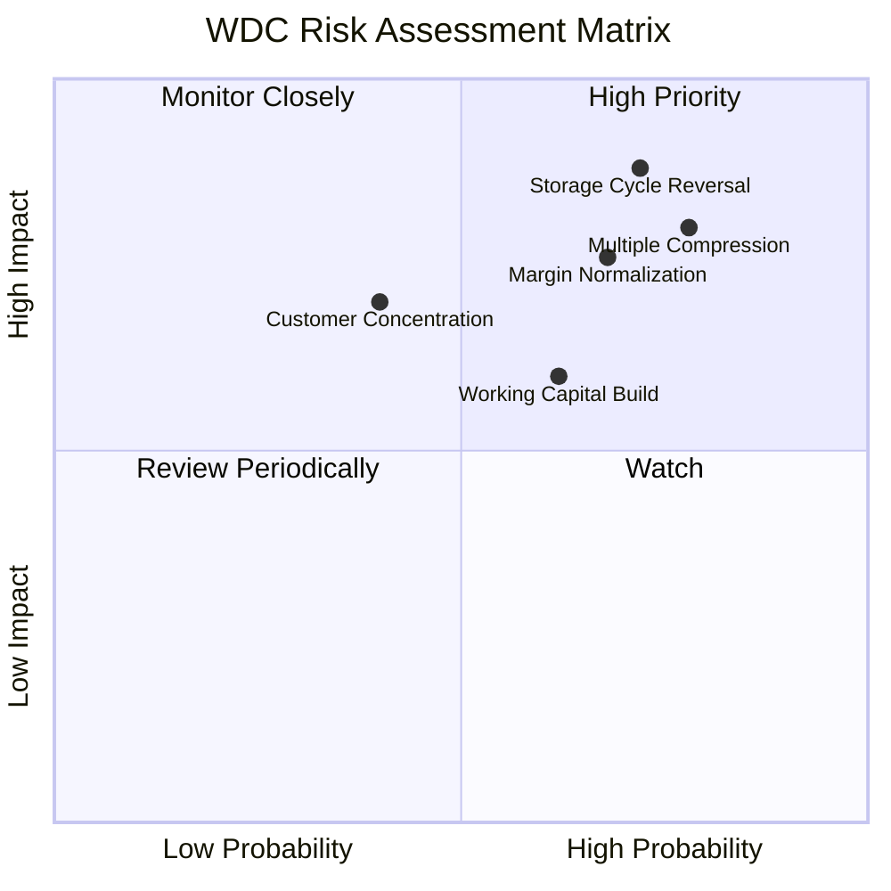
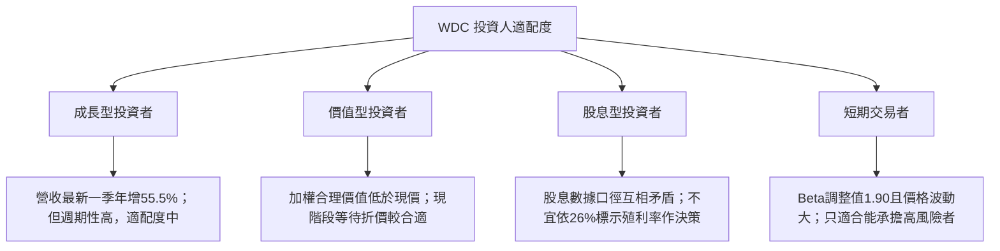

# WDC 基本面深度分析報告
> **報告日期**：2026-11-27 ｜ **語言**：繁體中文 ｜ **數據來源**：SEC 申報資料 (XBRL)、Yahoo Finance、Finviz、StockAnalysis、Roic.ai ｜ **分析師**：CFA 級機構研究

## 目錄

| # | 章節 | 核心結論 |
|---|------|----------|
| 1 | 執行摘要 | 賣出；加權合理價值 $200.87；MOS -35.6% |
| 2 | 公司概覽與商業模式 | 儲存硬體需求復甦，但產品組合與護城河量化資料不足 |
| 3 | 損益表深度分析 | TTM 營收 $14.48B、年增 20.7%；最新一季年增 55.5%，獲利處於高峰週期 |
| 4 | 資產負債表分析 | 淨現金 $525M；流動比率 1.434，營運資金週期拉長 |
| 5 | 現金流量深度分析 | TTM FCF $4.29B，FCF Yield 4.21%，但低於 TTM 淨利 |
| 6 | 獲利能力與資本效率 | ROIC 61.1% 高於 WACC 14.00%，現階段創造股東價值 |
| 7 | 相對估值分析 | DCF 與同業估值低於現價；分析師共識目標價是明顯異常高值 |
| 8 | DCF 內在價值評估 | 基準 DCF $182.17；加權合理價值 $200.87，現價高於兩者 |
| 9 | 成長催化劑 | 近期營收動能可觀，但 TAM 與各產品線營收占比未提供 |
| 10 | 風險矩陣 | 週期反轉、估值倍數收縮及高波動為主要風險 |
| 11 | 投資建議 | 依 MOS 評級為賣出；等待估值回落或基本面再驗證 |

---

## 1. 執行摘要

截至 **2026-11-25 收盤價 $272.45**，WDC TTM 營收為 $14.48B、TTM 年增 20.7%，最新一季營收年增 55.5%；TTM FCF 為 $4.29B、FCF Yield 4.21%，ROIC 61.1% 高於 WACC 14.00%。但估值交叉驗證的加權合理價值為 $200.87，MOS 為 -35.6%；因此依規則 20 評級為 **🔴 賣出**。這個結論反映現價與估值的落差，並不否定當前獲利改善。

### 1.0 一頁式投資儀表板

| 項目 | 內容 |
|------|------|
| **投資論點（3 句）** | ① TTM 營收年增 20.7%、最新一季年增 55.5%，營運需求和定價環境均改善。② TTM FCF $4.29B、ROIC 61.1% 高於 WACC 14.00%，現階段現金創造與資本回報強。③ 加權合理價值 $200.87，較 $272.45 現價低 26.3%，估值折讓尚未出現。 |
| **綜合評分** | **6.3/10**（引用 1.1 評分卡） |
| **財務健康** | 🟡 淨現金 $525M、流動比率 1.434；但 CCC 由 34 天增至 52 天。 |
| **ROIC vs WACC** | **61.1% vs 14.00%**；當前創造價值，利差 +47.1 個百分點。 |
| **FCF 趨勢** | FY2023–FY2026 由 -$1.23B 回升至 $3.51B；TTM FCF $4.29B，FCF Yield 4.21%。 |
| **估值** | Forward P/E 6.84x ｜ EV/EBITDA 16.095x（市場資料）｜ FCF Yield 4.21%。 |
| **DCF 內在價值（基準）** | **$182.17** ｜ 現價相對 DCF 折溢價 **+49.6%**（現價溢價）。 |
| **安全邊際（MOS）** | **-35.6%＝($200.87 − $272.45) ÷ $200.87**（加權合理價值為分母）｜ 🔴 無安全邊際。 |
| **預期報酬（基準情境 12M）** | **-33.1%**，依 DCF 基準情境 $182.17 相對現價計。 |
| **關鍵風險（前二）** | HDD／儲存產業週期反轉；股價與獲利預期同步下修造成倍數收縮。 |
| **評級 + 信心度** | 🔴 **賣出** ｜ 信心：中（營運數據清楚，但模型受週期和高估值分歧影響）。 |

### 1.1 綜合評分卡

| 維度 | 評分（1–10） | 主要依據（引用數字與其來源章節） |
|------|--------------|----------------------------------|
| 成長性 | 8.5 | TTM 營收年增 20.7%、最新一季年增 55.5%（第 3 章）；成長呈加速，但週期性強。 |
| 獲利能力 | 9.0 | TTM 營業利益率 39.4%、ROIC 61.1%，F-Score 6/8（第 3、6 章）。 |
| 財務健康 | 7.0 | 淨現金 $525M、流動比率 1.434；CCC 年增 18 天，應收及庫存天數增加（第 4 章）。 |
| 估值 | 2.0 | MOS -35.6%；DCF $182.17、同業 EV/EBITDA 法 $97.50，均低於現價（第 7、8 章）。 |
| 護城河 | 6.0 | 規模、產品可靠性和資料中心客戶認證具一定支持，但市場份額與各產品收入占比未提供（第 2 章）。 |
| 管理層與資本配置 | 5.5 | SBC/營收約 1.6%，稀釋股數測試未通過；資本配置歷史及回購金額未完整提供（第 3、6 章）。 |
| **綜合評分** | **6.3** | 六項算術平均：(8.5 + 9.0 + 7.0 + 2.0 + 6.0 + 5.5) ÷ 6 = 6.3。 |

### 1.2 五大投資論點 + 三大核心風險

| 類型 | 項目 | 具體依據 | 信心度 |
|------|------|----------|--------|
| 🟢 **投資論點①** | 營收動能提升 | TTM 營收 $14.48B，TTM 年增 20.7%；最新一季年增 55.5%，代表近期需求強於全年平均。 | 🟢 高 |
| 🟢 **投資論點②** | 利潤率與資本回報改善 | TTM 營業利益率 39.4%、ROIC 61.1%；若產品組合與價格不逆轉，具營運槓桿效應。 | 🟢 高 |
| 🟢 **投資論點③** | 現金流恢復 | TTM OCF $4.86B、Capex $572M，按規定口徑 FCF $4.29B。 | 🟢 高 |
| 🟢 **投資論點④** | 資產負債表有淨現金 | 現金及短期投資 $1.31B、總債務 $789M，淨現金 $525M。 | 🟢 高 |
| 🟡 **投資論點⑤** | 需求回升可延續，但仍待驗證 | FY2026 年營收 $12.92B，較 FY2025 $9.52B 增加；不過產業與產品營收拆分缺漏，不能把周期反彈直接視為長期成長。 | 🟡 中 |
| 🟡 **風險①** | 週期反轉 | 最新一季營收年增 55.5% 是高基期前的加速階段；若下游採購轉弱，利潤率可能迅速回落。 | 🟡 中 |
| 🔴 **風險②** | 估值與股價波動 | 加權合理價值 $200.87，現價高 35.6%（相對合理價值）；Beta adjusted 1.90。 | 🔴 高衝擊 |
| 🔴 **風險③** | 營運資金效率惡化 | CCC 由 34 天升至 52 天，DIO 由 70 天升至 95 天，資金占用增加。 | 🟡 中 |

### 1.3 快速統計卡片

| 指標 | 公司實際值（期間） | 同業中位數 | 狀態 |
|------|--------------------|------------|------|
| 營收成長（TTM） | **20.7%** | — | 🟢 |
| 營收成長（最新一季年增） | **55.5%** | 377.9%* | 🟡 |
| 毛利率（TTM） | **52.6%** | 80.0%* | 🟡 |
| 營業利益率（TTM） | **39.4%** | — | 🟢 |
| ROIC（TTM） | **61.1%** | — | 🟢 |
| Forward P/E | **6.84x** | 2.9x* | 🟡 |
| FCF Yield（TTM） | **4.21%** | — | 🟡 |
| Piotroski F-Score | **6 / 8** | — | 🟢 |

\* Peer 中位數按 STX、SNDK、MU 的區塊數值計算。SNDK、MU 主要屬記憶體公司，與 WDC 的 HDD 業務結構並不完全可比，數字僅作估值背景。

### 1.4 投資結論

```text
╔══════════════════════════════════════════════════════════════════╗
║                    📊 投資結論摘要                               ║
╠══════════════════════════════════════════════════════════════════╣
║  評級：🔴 賣出（依規則 20；無上調或下調）                       ║
║  價格（2026-11-25 收盤）：$272.45                                ║
║  DCF 內在價值（基準）：$182.17（現價溢價 +49.6%）               ║
║  安全邊際 MOS：-35.6%（＝($200.87−$272.45)÷$200.87）            ║
║  加權合理價值（8.8）：$200.87                                    ║
║  DCF 情境價值：                                                   ║
║    悲觀情境：$100.40（-63.2%）                                   ║
║    基準情境：$182.17（-33.1%）                                   ║
║    樂觀情境：$313.26（+15.0%）                                   ║
║  綜合評分：6.3/10（引用 1.1）                                    ║
║  適合投資人：能承受高週期波動、以基本面觸發條件管理部位者       ║
╚══════════════════════════════════════════════════════════════════╝
```

---

## 2. 公司概覽與商業模式

Western Digital Corporation（WDC）從事 HDD 儲存裝置及解決方案的開發、製造與銷售，產品包括資料中心硬碟、內接式／外接式硬碟、可攜式產品、NAS 及相關配件。公司約有 40,000 名員工。數據包內未提供按產品線的營收拆分，以下不推估業務占比。

### 2.1 業務結構與收入來源



### 2.2 市場份額

市場份額數據及其年份未提供，因此不呈現市占率圖表或推估比例。WDC TTM 營收 $14.48B，最新一季年增 55.5%；同業數據中 STX 最新一季營收年增 61.0%。SNDK、MU 最新一季成長率更高，但業務組合不同，不宜直接解讀為 HDD 市場份額優劣。

### 2.3 競爭護城河分析



### 2.4 護城河強度

| 護城河項目 | 強度（強／中／弱） | 證據（引用數字或事實） | 會削弱它的情況 |
|------------|--------------------|------------------------|----------------|
| 技術與可靠性 | 中 | HDD 儲存產品覆蓋資料中心、NAS 及消費產品；量化市占及技術代差數據未提供。 | 替代儲存技術進步、故障率或容量成本優勢轉弱。 |
| 軟體生態系統 | 弱至中 | 提供 NAS 及資料儲存解決方案，但軟體收入和用戶數未提供。 | 軟體差異化不足、客戶改用標準化硬體。 |
| 網路效應 | 弱 | 硬體儲存業務通常不具強直接網路效應，且未提供相關用戶網絡數據。 | 產品互通性及生態合作未形成黏著性。 |
| 客戶鎖定 | 中 | 資料中心產品需驗證與導入；客戶集中度、續約或轉換成本數據未提供。 | 大客戶轉向替代供應商或自研方案。 |
| 規模效應 | 中 | 全球製造和銷售網絡、約 40,000 名員工；製造成本曲線與市場份額未提供。 | 產能利用率下降或競爭者規模更具成本優勢。 |
| 生態夥伴 | 中 | 透過銷售人員、經銷商及分銷商銷售，並服務資料中心與 OEM 客戶。 | 通路去中介化、客戶議價能力上升。 |

**1.1 護城河評分 6.0/10**：產品驗證、製造規模及客戶整合提供一定防禦，但缺少市占、客戶黏著度與軟體收入等可量化證據。

---

## 3. 損益表深度分析

### 3.1 年度收入成長趨勢（近 4 年）

年度數據取自公司財務資料；YoY 由相鄰年度營收計算。

```text
╔══════════════════════════════════════════════════════════════════╗
║             Western Digital 年度收入趨勢 FY2023–FY2026          ║
╠══════════════════════════════════════════════════════════════════╣
║ FY2023  $6.25B   ██████████░░░░░░░░░░░░░░░░  YoY: -1.0%  🔴     ║
║ FY2024  $6.32B   ██████████░░░░░░░░░░░░░░░░  YoY: +1.1%  🟡     ║
║ FY2025  $9.52B   ███████████████░░░░░░░░░░░  YoY: +50.7% 🟢     ║
║ FY2026  $12.92B  ████████████████████░░░░░░  YoY: +35.7% 🟢     ║
║                                                                  ║
║  FY2023–FY2026 CAGR = (12.92 ÷ 6.25)^(1/3) − 1 = 約 27.4%       ║
╚══════════════════════════════════════════════════════════════════╝
```

FY2024–FY2026 的成長反映儲存需求及產品組合改善；FY2025、FY2026 的高成長不應直接外推，因為產業供需及價格具週期性。

### 3.2 季度收入趨勢分析

最近四季收入及季增率取自季度財務表；YoY 使用同季度比較。

| 季度 | 營收 | QoQ 成長 | YoY 成長 | 備註 |
|------|------:|---------:|---------:|------|
| FY2026 Q2（2026-01-02） | $3.017B | +10.5% | +25.2% | 相較前季 $3.017B ÷ $2.737B − 1；前季營收由季度序列推算的來源口徑有差異，成長率採 StockAnalysis 公布值。 |
| FY2026 Q3（2026-04-03） | $3.337B | +10.6% | +45.5% | 同比資料顯示成長明顯加速。 |
| FY2026 Q4（2026-07-03） | $3.747B | +12.3% | +43.8% | 連續季增，反映需求及價格改善。 |
| FY2027 Q1（2026-10-02） | $4.381B | +16.9% | +55.5% | 最新季增速最高，需觀察下一季是否延續。 |

季度資料有多個來源，個別歷史季度標記日期存在差異；最新季度 YoY 55.5% 以 SEC 10-Q／程式計算口徑為準。

### 3.3 利潤率演變分析

年度利潤率按年度營收與毛利／營業利益計算；TTM 與最新季採 VERIFIED FIGURES 數值。

| 利潤率指標 | FY2023 | FY2024 | FY2025 | FY2026 | TTM／最新季 | 趨勢與評估 |
|------------|-------:|-------:|-------:|-------:|------------:|------------|
| **毛利率** | 22.3% | 28.1% | 38.8% | 48.8% | TTM 52.6% | 產品組合與供需改善推高毛利；🟢 |
| **營業利益率** | -6.1% | 1.5% | 22.4% | 35.6% | TTM 39.4%；最新季 46.7% | 成本吸收與價格改善帶動營運槓桿；🟢 |
| **淨利率** | -27.3% | -13.5% | 19.4% | 71.9% | TTM 69.2% | FY2026 淨利受稅務／非營業因素影響可能很大，不能只看表面淨利；🟡 |

毛利率從 FY2023 的 22.3% 上升至 FY2026 的 48.8%，與收入反彈同時發生，反映固定成本吸收、產品組合與價格改善。TTM 營業利益率 39.4% 已很高，模型預測將逐步回落至歷史中位數附近，這比假設利潤率永久維持峰值更審慎。

### 3.4 費用結構分析

公司按職能拆分的完整費用數字未提供，不能製作各費用比例圓餅圖。可確認 FY2026 研發費用 $1.16B，約占 FY2026 營收 $12.92B 的 9.0%；資本支出與研發費用屬不同項目，不應混為營業費用。

```text
╔══════════════════════════════════════════════════════════════════╗
║                   FY2026 費用可見項目                            ║
╠══════════════════════════════════════════════════════════════════╣
║  研發費用 $1.16B  ≈ 營收的 9.0%                                 ║
║  其他營業費用拆分：未提供                                        ║
║  Capex $0.418B（年度現金流資料）屬資本支出，不列作當期費用     ║
╚══════════════════════════════════════════════════════════════════╝
```

### 3.5 季度 EPS 趨勢與盈餘品質（Quality of Earnings）

最近四季 EPS 實際值可從季度資料取得；一致的分析師預估值缺失，因此無法判定 beat／miss。

| 季度 | EPS 實際 | EPS 預估 | 超預期／不及預期 | 備註 |
|------|---------:|---------:|------------------|------|
| 2026-09-30 | $4.63 | N/A | 無法判定 | 預估值為缺漏資料。 |
| 2026-06-30 | $8.21 | N/A | 無法判定 | 淨利受季度間波動影響。 |
| 2026-03-31 | $8.20 | N/A | 無法判定 | EPS 實際值不代表穩定趨勢。 |
| 2025-12-31 | $4.67 | N/A | 無法判定 | 預估值為缺漏資料。 |

| 盈餘品質項目 | 數值／佔比 | 評估 |
|--------------|------------|------|
| 股權薪酬 SBC / 營收 | 最近四季 SBC 約 $230M ÷ TTM 營收 $14.48B = **約 1.6%** | 🟡 SBC 不是主要現金流負擔，但仍稀釋股東；F-Score 的稀釋股數測試未通過。 |
| SBC / 營業現金流 | $230M ÷ $4.86B = **約 4.7%** | 🟢 規模尚可控，但不應忽略股數稀釋。 |
| FCF / 淨利（現金轉換率） | $4.29B ÷ TTM 淨利約 $9.913B = **約 43.3%** | 🔴 現金轉換低於會計淨利，可能反映營運資金、非現金／一次性收益或稅務影響。 |
| 一次性／非經常性損益 | FY2026 淨利 $9.30B、營業利益 $4.60B；具體調節項目 N/A | 🟡 淨利遠高於營業利益，需查閱 10-K 稅務與非營業項目；不能假設全部可持續。 |
| 有效稅率 | **4.9%**（模型及成本資本資料） | 🟡 低於常態稅率的可能性高，DCF 照模型使用，不應把它視為永久穩態稅率。 |
| 資本化支出 vs 費用化 | TTM Capex $572M；資本化政策細節 N/A | 🟡 Capex 已列現金流，但未提供資本化與費用化調節資料。 |

**盈餘品質結論**：營業現金流與 FCF 均為正，但 FCF 僅為 TTM 淨利約 43.3%，而有效稅率只有 4.9%，使會計淨利可持續性低於營業現金流所呈現的品質。估值應優先依現金流與正常化營業利潤，而非直接套用高峰期淨利。

---

## 4. 資產負債表分析

### 4.1 資產結構分解

最新季度資產負債表總資產約 $14.239B。資產細項依財務資料呈現；部分口徑在年度表與季度表之間有差異。



### 4.2 流動性與營運資金分析

| 指標 | 最新值 | 歷史／比較值 | 評估 |
|------|-------:|--------------:|------|
| 流動比率 | 1.434 | FY2026 年度流動資產 $5.63B ÷ 流動負債 $4.24B | 🟡 能覆蓋短期負債，但緩衝不是非常寬裕。 |
| Quick Ratio | 0.867 | 最新市場資料 | 🟡 若排除存貨，速動資產低於流動負債。 |
| 淨現金 | $525M | 現金及短期投資 $1.31B − 總債務 $789M | 🟢 資產負債表維持淨現金。 |

| 指標 | 最新 TTM | 一年前 TTM | 變化 | 解讀 |
|------|----------:|----------:|-----:|------|
| DSO 應收帳款天數 | 56 天 | 41 天 | +15 天 | 收款週期延長，可能與銷售組合或客戶付款條件變化有關，需追蹤應收帳款增速。 |
| DIO 存貨天數 | 95 天 | 70 天 | +25 天 | 庫存占用增加；若非為需求備貨，可能提高降價或存貨減值風險。 |
| DPO 應付帳款天數 | 99 天 | 77 天 | +22 天 | 付款期拉長，對現金有支撐，但未必代表供應商議價能力變強。 |
| CCC 現金轉換週期 | 52 天 | 34 天 | +18 天 | CCC＝56+95−99；整體營運資金週期變長，抵銷部分獲利改善的現金效益。 |

### 4.3 債務結構分析

```text
╔══════════════════════════════════════════════════════════════════╗
║                  WDC 債務健康診斷                                ║
╠══════════════════════════════════════════════════════════════════╣
║  總債務：       $0.789B  ███████░░░░░░░░░░░░░  🟢               ║
║  現金及短期投資：$1.31B   █████████████░░░░░░░  🟢               ║
║  淨現金：       $0.525B  █████░░░░░░░░░░░░░░░  🟢               ║
║  Debt/EBITDA：  N/A（口徑及期間資料不一致，不反推）               ║
║  利息保障倍數： N/A（利息費用絕對值未提供）                       ║
║  資料提醒：年度總債務與 VERIFIED FIGURES 最新債務口徑不同；       ║
║  本報告按指定的最新口徑 $789M 與淨現金 $525M 評估。              ║
╚══════════════════════════════════════════════════════════════════╝
```

### 4.4 股東權益趨勢

年度股東權益從 FY2023 $11.84B 降至 FY2025 $5.54B，再於 FY2026 升至 $8.86B，變化幅度大，可能與虧損、資本交易及資產負債表重整有關；詳細權益變動表未提供。

```text
╔══════════════════════════════════════════════════════════════════╗
║                  股東權益趨勢（年度）                            ║
╠══════════════════════════════════════════════════════════════════╣
║ FY2023  $11.84B  ████████████████████                           ║
║ FY2024  $11.05B  ███████████████████                            ║
║ FY2025   $5.54B  █████████                                       ║
║ FY2026   $8.86B  ███████████████                                 ║
╚══════════════════════════════════════════════════════════════════╝
```

---

## 5. 現金流量深度分析

### 5.1 現金流量瀑布圖



淨利到 OCF 的轉換不是一對一，受非現金項目及營運資金變動影響；本期 CCC 上升 18 天，表示部分現金被應收帳款與存貨占用。Mermaid 路徑表示財務關係，不代表股息是唯一現金用途。

### 5.2 FCF 轉換率趨勢

| 財年 | FCF | 淨利 | FCF / 淨利 |
|------|----:|----:|-----------:|
| FY2023 | -$1.23B | -$1.68B | 73.2% |
| FY2024 | -$0.781B | -$0.798B | 97.9% |
| FY2025 | $1.28B | $1.86B | 69.4% |
| FY2026 | $3.51B | $9.30B | 37.8% |
| TTM | $4.29B | 約 $9.913B | 約 43.3% |

轉換率在 FY2026 與 TTM 下降，主因是淨利增幅超過現金流增幅；這使當前高淨利更需要透過稅務、營運資金與一次性項目核實。

### 5.3 自由現金流趨勢

```text
╔══════════════════════════════════════════════════════════════════╗
║             自由現金流：歷史年度實際與 TTM                       ║
╠══════════════════════════════════════════════════════════════════╣
║ FY2023  -$1.23B  ◀ 負值                                          ║
║ FY2024  -$0.78B  ◀ 負值                                          ║
║ FY2025  +$1.28B  ███████                                         ║
║ FY2026  +$3.51B  █████████████████                               ║
║ TTM     +$4.29B  ████████████████████                            ║
║                                                                  ║
║ TTM FCF Yield = 4.21%（採用程式計算數值）                        ║
╚══════════════════════════════════════════════════════════════════╝
```

TTM FCF 定義固定為營業現金流減資本支出，即 $4.86B − $572M，採用程式計算的 TTM FCF $4.29B。數字尾差來自報表金額四捨五入，不另行改寫已核實數值。

### 5.4 資本配置評估

資本配置圓餅圖所需的完整投資、回購、股息、留存現金等同口徑資料未提供，因此不畫比例圖。可確認 FY2026 股息支付 $184M、Capex $418M、SBC $204M；回購金額未提供。年度股息支付由 FY2025 $44M 增至 FY2026 $184M，但不能由此推算未來派息率。

---

## 6. 獲利能力與資本效率

### 6.1 ROE / ROA / ROIC 趨勢

| 指標 | 最新值 | 歷史參考 | 評估 |
|------|-------:|----------|------|
| ROE | 107.2% | VERIFIED QUALITY FIGURES，TTM | 高 ROE 受高淨利及較低權益基數共同影響，不能單獨視為可持續回報。 |
| ROA | N/A（品質區塊未提供完整歷史序列） | 其他資料來源報告 TTM 25.9%，口徑不同 | 不以衝突來源替換指定品質數據。 |
| ROIC | 61.1% | TTM、稅後營業利益／投入資本 | 高於 WACC 14.00%，但高峰期獲利可能使 ROIC 向週期中值回落。 |

### 6.2 ROIC vs WACC 分析（核心價值創造判斷）

```text
╔══════════════════════════════════════════════════════════════════╗
║                ROIC vs WACC 深度分析                             ║
╠══════════════════════════════════════════════════════════════════╣
║  WACC 資料來源：程式計算的 Cost of capital                       ║
║  ├── 無風險利率（10Y 美債）：4.85%                               ║
║  ├── ERP：5.00%                                                  ║
║  ├── 原始 Beta：2.34；調整後 Beta：1.90                         ║
║  ├── Ke = 4.85% + 1.90 × 5.00% = 14.35%；區塊 Ke = 14.33%      ║
║  ├── 稅前 Kd：20.91%；稅後稅率：4.9%                            ║
║  ├── 股權／債務權重：99.2%／0.8%                                ║
║  └── 原始計算 WACC 14.37%，受 7%–14% 區間限制後採用 14.00%      ║
║                                                                  ║
║  ROIC（TTM）：61.1%                                              ║
║  ├── ROIC 定義：稅後營業利益 ÷（權益 + 債務 − 現金）            ║
║  └── EVA 利差 = 61.1% − 14.00% = +47.1 個百分點                 ║
║                                                                  ║
║  ROIC 61.1%  ▓▓▓▓▓▓▓▓▓▓▓▓▓▓▓▓▓▓▓▓▓▓▓▓▓▓▓▓▓▓▓▓▓▓▓▓▓▓▓▓▓▓▓▓▓▓▓▓ ║
║  WACC 14.0%  ▓▓▓▓▓▓▓▓▓▓▓▓▓▓▓▓                                      ║
║                                                                  ║
║  結論：當前 ROIC 約為 WACC 的 4.36 倍，創造股東價值；           ║
║  但 WACC 原始計算值與公開組成數字存在不可完全複算的差異，見8.10。║
╚══════════════════════════════════════════════════════════════════╝
```

Ke 使用程式公布的 14.33% 作為原值；直接以 4.85% + 1.90×5.00% 得 14.35%，與原值相差 0.02 個百分點，屬輸入精度／原始計算口徑差異。ROIC 使用唯一指定的 61.1%，不以其他來源的 ROE 或 ROA 替代。

### 6.3 杜邦三因素分解

| 因素 | 數值（TTM） | 解讀 |
|------|-------------|------|
| 淨利率 | 69.2% | 異常高的淨利率可能含稅務或非營業因素，應審慎正常化。 |
| 資產週轉率 | 1.02 | 資產每年產生約 1.02 倍營收。 |
| 權益乘數 | 1.52 | 槓桿不是 ROE 高企的唯一來源。 |
| **ROE** | **107.2%** | 69.2% × 1.02 × 1.52 ≈ 107.2%；主要由淨利率推動。 |

以上數字照抄品質指標。乘積顯示因四捨五入會有細微尾差。

### 6.4 財務體質：Piotroski F-Score

**Piotroski F-Score：6 / 8**。因一項測試缺資料而排除，故分母為 8；下列原始測試列表仍包含該缺資料項。

| 測試 | 結果 | 解讀 |
|------|------|------|
| ROA > 0 | ✅ 通過 | TTM 獲利為正。 |
| 營業現金流 > 0 | ✅ 通過 | TTM OCF $4.86B。 |
| ROA 高於一年前 | ✅ 通過 | 獲利復甦改善資產報酬。 |
| 營業現金流 > 淨利（應計品質） | ❌ 未通過 | OCF $4.86B 低於 TTM 淨利約 $9.913B，現金轉換需觀察。 |
| 長期負債 ÷ 總資產低於一年前 | — 無法判定 | 缺少所需輸入，不補推。 |
| 流動比率高於一年前 | ✅ 通過 | 品質指標測試通過。 |
| 稀釋股數未增加 | ❌ 未通過 | 顯示股數稀釋仍需監控。 |
| 毛利率高於一年前 | ✅ 通過 | 毛利改善。 |
| 資產週轉率高於一年前 | ✅ 通過 | 資產使用效率改善。 |

---

## 7. 相對估值分析

### 7.1 同業估值比較表格

WDC 市場倍數取自市場資料欄；同行數值只採 Peer multiples 區塊。各來源口徑可能不同，尤其 WDC P/E 與估值歷史資料存在差異。

| 估值指標 | **WDC** | **STX** | **SNDK** | **MU** | WDC 評估 |
|----------|--------:|-------:|--------:|------:|----------|
| **Trailing P/E** | 9.58x | 24.8x | 4.7x | 8.1x | 🟡 介於同業高低值；週期高峰 EPS 會壓低 P/E。 |
| **Forward P/E** | 6.84x | 7.2x | 2.1x | 2.9x | 🟡 高於 SNDK、MU，略低於 STX。 |
| **P/S Ratio** | 7.04x | 7.9x | 2.9x | 5.1x | 🔴 高於 SNDK、MU；以營收倍數看不便宜。 |
| **EV/EBITDA** | 16.095x | 18.7x | 3.7x | 5.9x | 🔴 相對 SNDK、MU 溢價明顯；公司週期與 EBITDA 口徑差異需注意。 |
| **最新一季營收 YoY** | 55.5% | 61.0% | 377.9% | 379.3% | 🟡 WDC 成長良好，但低於同組記憶體公司。 |
| **毛利率（TTM）** | 52.6% | 50.4% | 80.0% | 80.7% | 🟡 高於 STX，低於 SNDK、MU。 |

### 7.2 歷史估值區間分析

```text
╔══════════════════════════════════════════════════════════════════╗
║              WDC P/E 五年歷史區間（TTM）                         ║
╠══════════════════════════════════════════════════════════════════╣
║ 區間：6.3x ──────────────────────────────── 62.5x               ║
║ 中位數：13.5x                                                    ║
║ 當前：10.6x（歷史百分位 38%）                                    ║
║                                                                  ║
║ P/E：當前低於五年中位數，可能反映股價折價，也可能反映週期高峰 EPS ║
║ P/S：當前 7.2x；中位數 1.2x；百分位 85% → 偏高                  ║
║ EV/EBITDA：當前 18.2x；中位數 14.9x；百分位 69% → 偏高           ║
╚══════════════════════════════════════════════════════════════════╝
```

同一份資料中的市場 P/E 為 9.58x，而歷史估值序列為 10.6x；此處依要求用「自身歷史」區塊原值，並將差異視為期間或來源口徑不同，不混用重算。

### 7.3 情境價值（Bear / Base / Bull）

以下直接採 DCF 情境。情境數值為模型輸出，成長條件是判斷性解讀，不另建模型。

| 情境 | 第 1 年營收成長 | 期末營業利潤率 | WACC | 每股價值 | 相對現價 | 機率 | 會發生的條件 |
|------|----------------:|----------------:|-----:|---------:|---------:|-----:|--------------|
| 🔴 悲觀 | 10.3% | 19.4% | 15.00% | $100.40 | -63.2% | 25% | 需求反轉、價格競爭與產品組合惡化，利潤率回落至低於基準路徑。 |
| 🟡 基準 | 20.7% | 22.8% | 14.00% | $182.17 | -33.1% | 50% | 首年按 TTM 成長，之後增速逐年遞減，營業利潤率回歸五年中位數。 |
| 🟢 樂觀 | 31.0% | 25.1% | 13.00% | $313.26 | +15.0% | 25% | 需求及產品組合優於基準、成長與利潤率維持較高水平，資本成本下降。 |

### 7.4 相對估值隱含價格區間

```text
╔══════════════════════════════════════════════════════════════════╗
║             估值法回推每股價值與現價位置                         ║
╠══════════════════════════════════════════════════════════════════╣
║ $97.50 ───── $182.17 ── $198.22 ─── $272.45 ───── $591.08       ║
║ EV/EBITDA      DCF       P/S          現價       分析師共識      ║
╚══════════════════════════════════════════════════════════════════╝
```

同業 EV/EBITDA 法 $97.50：同業中位數 5.9x（STX、SNDK、MU）乘 WDC TTM EBITDA 並加淨現金。  
同業 P/S 法 $198.22：同業中位數 5.1x 乘 WDC TTM 營收。  
分析師共識 $591.08：24 位分析師平均目標價，遠高於其他估值方法，需視為市場預期參考而非模型內在價值。

---

## 8. DCF 內在價值評估（Discounted Cash Flow）

### 8.0 估值推理鏈（Thinking Logic）

**Step 1 — 價值來源及主導變數**  
WDC 的估值核心是 HDD 儲存產品的現金流底盤；第二成長曲線及服務業務的營收占比未提供，不能加入獨立選擇權估值。模型最主導的變數是營業利潤率與折現率：敏感性表顯示 WACC 由 14% 升至 15%，基準價值由 $182.17 降至 $167.21；終值成長率每上升 1 個百分點，基準價值由 $182.17 升至 $189.19。

**Step 2 — 模型選擇**

| 決策點 | 本報告採用 | 理由（含數字） | 曾考慮但否決 | 否決理由 |
|--------|-----------|----------------|--------------|----------|
| 現金流定義 | FCFF | 以企業自由現金流配合 WACC 折現；公司淨現金 $525M。 | FCFE | 資本結構未固定，FCFF 更便於估企業價值。 |
| 預測期 N | 10 年 | 模型指定 10 年，並將收入成長由 20.7% 遞減至 3.0%。 | 5 年 | 無法按指定模型輸入替換。 |
| 終值方法 | Gordon Growth | WACC 14.00% 大於永續成長率 3.0%，公式有效。 | 退出倍數 | DCF 模型未提供退出倍數輸出，不能自行新增。 |
| EBIT 基礎 | GAAP EBIT | DCF 模型指定 GAAP EBIT，已包含 SBC 費用。 | 非 GAAP EBIT | 避免加回 SBC 後再以不一致方式處理。 |

**Step 3 — 關鍵假設推導鏈**

- **預測期 N**：錨點＝模型十年期間；調整理由＝HDD 週期難以精準預測，十年可呈現週期回歸但遠期不確定性高；**採用 10 年**；否決 5 年，因模型提供的逐年路徑為十年，不能另建模型。
- **營收成長**：錨點＝TTM 成長 20.7%、FY2023–FY2026 營收 CAGR 約 27.4%；調整理由＝長期競爭與週期使成長率線性回落；**FY+1 採 20.7%，FY+10 採 3.0%**；否決十年維持 20.7%，因將高成長永久化不合理。
- **期末營業利潤率**：錨點＝TTM 39.4%；調整理由＝現有利潤率可能處於周期高位，模型回落至五年年度中位數附近；**FY+10 採 22.8%**；否決維持 39.4%，因未反映週期正常化。
- **永續成長率 g**：錨點＝成熟企業長期名目成長的模型參數；財務資料未提供公司長期指引；**採用 3.0%**，低於 WACC 14.00%；否決高於 3.0%，因永續成長不應高於長期經濟增長能力。
- **Capex／營收**：錨點＝TTM Capex $572M ÷ TTM 營收 $14.48B 約 3.9%；調整理由＝成熟期資本支出逐步回落，但不低於 D&A 的 1.1 倍；**FY+1 3.9% 線性降至 FY+10 3.0%**；否決低於維持資產所需支出的設定。
- **EBIT、SBC 與股數**：錨點＝模型採 GAAP EBIT；FY2026 SBC $204M，最近四季資料約 $230M；**採組合 (A)：GAAP EBIT、不再扣 SBC、固定股數、年稀釋率 0%**；否決另外扣 SBC 或另加股數稀釋，避免重複計算。
- **WACC**：錨點＝成本資本區塊原始計算 14.37%；模型規定 7%–14% 區間，**採用 14.00% 上限**；否決採 14.37%，因該區塊明確將 WACC 限制在 14%。
- **D&A／營收及稅率**：錨點分別為 TTM D&A／營收 2.7%、有效稅率 4.9%；模型原值照用。ΔWC 未建模，不能另行填入估計數。

**Step 4 — 最脆弱環節**  
最脆弱的是將 39.4% TTM 營業利益率以線性路徑回歸至 22.8%，同時使用 4.9% 低稅率；若利潤率回落更快或稅率正常化，DCF 會低於基準價值。

**Step 5 — 計算路徑圖**



### 8.1 模型假設總表（Model Inputs）

| 假設項目 | 採用值 | 依據／來源 | 敏感度 |
|----------|--------|-------------|--------|
| 預測期長度 N | 10 年 | DCF 模型指定。 | 🟡 中 |
| 營收成長 | FY+1 20.7% 線性降至 FY+10 3.0% | TTM 年增 20.7%；遠期向成熟增長回歸。 | 🔴 高 |
| 營業利潤率 | 39.4% 降至 22.8% | TTM 39.4%；終值為最近五年財年中位數（含 TTM）。 | 🔴 高 |
| 有效稅率 | 4.9% | 最近年度有效稅率，模型照用；可能偏低。 | 🟢 低 |
| Capex／營收 | 3.9% 降至 3.0% | TTM 約 3.9%，遠期向 1.1×D&A 條件收斂。 | 🟡 中 |
| D&A／營收 | 2.7% | TTM 比率，模型固定。 | 🟢 低 |
| 營運資金變動 | 未建模 | DCF 模型明確排除 ΔWC，沒有可引用的模型輸入。 | 🟡 中 |
| EBIT 基礎 | GAAP | 模型採 GAAP EBIT。 | 🟡 中 |
| SBC 處理 | GAAP 已含 SBC；不再扣除 | 依組合 (A)，避免重複扣除。 | 🟡 中 |
| 年稀釋率 | 0% | 固定股數的模型組合 (A)。 | 🟡 中 |
| 永續成長率 g | 3.0% | DCF 模型指定，且低於 WACC。 | 🔴 高 |
| 終值方法 | Gordon Growth | DCF 模型採用；退出倍數輸入未提供。 | 🔴 高 |
| WACC | 14.00% | 成本資本區塊：計算值 14.37%，受 7%–14% 限制。 | 🔴 高 |

本模型採用 **(A) GAAP EBIT + 固定股數**，故 SBC 影響已計入一次。FCFF 定義為 `NOPAT + D&A − Capex`；模型不含 ΔWC 列，不另補估營運資金。

### 8.2 折現率推導（WACC）

```text
╔══════════════════════════════════════════════════════════════════╗
║                    WACC 推導（折現率）                           ║
╠══════════════════════════════════════════════════════════════════╣
║ 股權成本 Ke：區塊原值 14.33%                                      ║
║ ├── 無風險利率 Rf：4.85%（提供資料未列觀察日期）                  ║
║ ├── ERP：5.00%（假設值；依成本資本區塊）                         ║
║ ├── 原始 Beta：2.34；調整 Beta：⅔×2.34+⅓×1 = 1.90              ║
║ ├── Ke 算式：4.85% + 1.90×5.00% = 14.35%                        ║
║ └── 區塊 Ke 原值：14.33%（與顯示組成差 0.02 個百分點）          ║
║                                                                  ║
║ 債務成本 Kd：                                                     ║
║ ├── 稅前 Kd：20.91%（利息費用絕對額 N/A，採區塊比率原值）       ║
║ ├── 稅率：4.9%                                                    ║
║ └── 稅後 Kd = 20.91%×(1−4.9%) = 19.89%                          ║
║                                                                  ║
║ 資本結構權重：股權 99.2%／債務 0.8%（區塊原值）                  ║
║ ├── 權重之市值／債務明細未完全列出，不能重建精確 E、D 金額         ║
║ └── 區塊計算 WACC 14.37%；採用值受 7%–14% 區間限制 = 14.00%     ║
╚══════════════════════════════════════════════════════════════════╝
```

**逐步演算（WACC）**

1. **Ke（CAPM）**：使用調整 Beta 1.90；`4.85% + 1.90 × 5.00% = 14.35%`。成本資本區塊公布 Ke 為 14.33%，差 0.02 個百分點，採用區塊原值作後續模型輸入。
2. **稅前 Kd**：區塊公布 **20.91%**；利息費用金額與平均計息負債明細未提供，故無法另以金額重建。
3. **稅後 Kd**：`20.91% × (1 − 4.9%) = 19.89%`。
4. **權重**：E 權重 99.2%、D 權重 0.8%，合計 100.0%；各權重的精確市場價值分子與分母未提供，照採區塊數值。
5. **WACC**：區塊原始計算值 **14.37%**，按規定限制於 7%–14% 區間，故 **採用 WACC = 14.00%**。

第 6.2 與本節均採用 14.00%。由於輸入表展示的 Ke、Kd 及權重無法精確重建區塊所列 14.37%，不能聲稱原始 WACC 計算已由讀者完全複算。

### 8.3 逐年自由現金流預測（基準情境）

金額單位：$B。資料模型按原值照列；折現因子保留三位小數，金額保留兩位小數。

| 年度 | FY+1 | FY+2 | FY+3 | FY+4 | FY+5 | FY+6 | FY+7 | FY+8 | FY+9 | FY+10 |
|------|-----:|-----:|-----:|-----:|-----:|-----:|-----:|-----:|-----:|------:|
| 營收 | 17.47 | 20.74 | 24.21 | 27.79 | 31.35 | 34.75 | 37.84 | 40.46 | 42.47 | 43.75 |
| 營收 YoY | 20.7% | 18.7% | 16.7% | 14.8% | 12.8% | 10.9% | 8.9% | 6.9% | 5.0% | 3.0% |
| 營業利潤率 | 39.4% | 37.6% | 35.7% | 33.9% | 32.0% | 30.2% | 28.4% | 26.5% | 24.7% | 22.8% |
| EBIT（GAAP） | 6.89 | 7.79 | 8.65 | 9.42 | 10.05 | 10.50 | 10.74 | 10.73 | 10.49 | 10.00 |
| − 稅（4.9%） | (0.33) | (0.38) | (0.42) | (0.46) | (0.49) | (0.51) | (0.52) | (0.52) | (0.51) | (0.49) |
| = NOPAT | 6.55 | 7.41 | 8.23 | 8.96 | 9.56 | 9.99 | 10.21 | 10.21 | 9.98 | 9.51 |
| + D&A | 0.47 | 0.56 | 0.65 | 0.75 | 0.85 | 0.94 | 1.02 | 1.09 | 1.15 | 1.18 |
| − Capex | (0.69) | (0.80) | (0.90) | (1.01) | (1.10) | (1.18) | (1.25) | (1.29) | (1.31) | (1.30) |
| **= FCFF** | **6.33** | **7.18** | **7.98** | **8.70** | **9.30** | **9.74** | **9.99** | **10.02** | **9.82** | **9.39** |
| 折現因子 @14.00% | 0.877 | 0.769 | 0.675 | 0.592 | 0.519 | 0.456 | 0.400 | 0.351 | 0.308 | 0.270 |
| **FCFF 現值 PV** | **5.56** | **5.52** | **5.39** | **5.15** | **4.83** | **4.44** | **3.99** | **3.51** | **3.02** | **2.53** |

預測期 PV 合計：  
`$5.56 + $5.52 + $5.39 + $5.15 + $4.83 + $4.44 + $3.99 + $3.51 + $3.02 + $2.53 = $43.94B`  
模型公布合計 **$43.95B**；兩者差 $0.01B，為逐年金額四捨五入尾差，低於 1%。

**逐步演算（FY+1）**

1. 營收：`$14.48B × (1 + 20.7%) = $17.48B`；模型表按原值為 $17.47B，屬輸入精度尾差。
2. EBIT：`$17.47B × 39.4% = $6.88B`；模型表為 $6.89B，反映未四捨五入底層數據。
3. 稅：`$6.89B × 4.9% = $0.34B`；模型表列 $0.33B，係底層數字精度造成的尾差。
4. NOPAT：模型原值 **$6.55B**。
5. D&A：模型原值 **$0.47B**。
6. Capex：模型原值 **$0.69B**。
7. ΔWC：**未建模**；不能以缺漏資料自行補值。
8. FCFF：`$6.55B + $0.47B − $0.69B = $6.33B`。
9. 折現：`1 ÷ (1 + 14.00%)^1 = 0.877`；`$6.33B × 0.877 = $5.55B`，模型原值 PV **$5.56B**，差異源於未四捨五入的底層 FCFF 與折現因子。

**合理性自檢**

- 預測 FCF CAGR：FY+1 $6.33B 至 FY+10 $9.39B，`(9.39 ÷ 6.33)^(1/9) − 1 ≈ 4.5%`；歷史 FCF 由負轉正，不能計算有意義的正值 CAGR，故歷史比較為 N/A。
- FY+10 FCFF 利潤率：`$9.39B ÷ $43.75B ≈ 21.5%`；TTM FCF 利潤率：`$4.29B ÷ $14.48B ≈ 29.6%`。同業最佳 FCFF 利潤率未提供，不作比較。
- 模型各年 FCFF 均為正；但未建模 ΔWC 可能高估現金流，尤其最新 CCC 已增至 52 天。

```text
╔══════════════════════════════════════════════════════════════════╗
║            自由現金流：歷史實際 vs 模型預測                      ║
╠══════════════════════════════════════════════════════════════════╣
║ FY2024(實)  -$0.78B  負值                                       ║
║ FY2025(實)  +$1.28B  █████                                      ║
║ FY2026(實)  +$3.51B  ██████████████                             ║
║ TTM(實)     +$4.29B  █████████████████                          ║
║ FY+1 (預)   +$6.33B  █████████████████████████                  ║
║ FY+10(預)   +$9.39B  █████████████████████████████████████      ║
╠══════════════════════════════════════════════════════════════════╣
║ 預測 FCFF CAGR 約 4.5%；歷史由負轉正，CAGR 不具可比性。          ║
╚══════════════════════════════════════════════════════════════════╝
```

### 8.4 終值計算（Terminal Value）

**適用性檢查**：`WACC 14.00% vs g 3.00% → WACC > g？✅`

| 方法 | 計算式 | 終值 TV | TV 現值 | 佔總 EV 比重 |
|------|--------|--------:|--------:|-------------:|
| Gordon Growth | $9.39 × (1+3.0%) ÷ (14.0%−3.0%) | $87.94B | $23.72B | 35.1% |
| 退出倍數法 | N/A（DCF 模型未提供退出倍數及 FY+10 EBITDA） | N/A | N/A | N/A |

逐步演算：

1. FY+N FCFF：**$9.39B**。
2. 分子：`$9.39B × (1 + 3.0%) = $9.67B`。
3. 分母：`14.00% − 3.00% = 11.00%`；`$9.39B × 1.03 ÷ 0.11 = $87.94B`。
4. PV(TV)：`$87.94B × 0.270 = $23.72B`。
5. 終值佔比：`$23.72B ÷ $67.67B = 35.1%`。

終值現值占 EV 35.1%，雖非極端依賴終值，但估值仍受長期利潤率、WACC 與 g 顯著影響。

### 8.5 企業價值 → 每股內在價值（Bridge）

```text
╔══════════════════════════════════════════════════════════════════╗
║              企業價值 → 每股內在價值 橋接表                      ║
╠══════════════════════════════════════════════════════════════════╣
║  預測期 FCF 現值合計             +$43.95B                        ║
║  終值現值 PV(TV)                 +$23.72B                        ║
║  = 企業價值 EV                    $67.67B                        ║
║  + 淨現金                         +$0.53B                        ║
║  = 股權價值                       $68.19B                        ║
║  少數股東權益                     N/A（未提供）                   ║
║  每股價值 = 股權價值 × 價格 ÷ 市值                               ║
║  = $68.19B × $272.45 ÷ $101.98B = $182.17                       ║
║  現價                             $272.45                        ║
║  折溢價 = $272.45 ÷ $182.17 − 1 = +49.6%（溢價）               ║
╚══════════════════════════════════════════════════════════════════╝
```

逐步演算：

1. `EV = $43.95B + $23.72B = $67.67B`。
2. `股權價值 = $67.67B + $0.53B = $68.20B`；模型公布 $68.19B，因未四捨五入的淨現金與 PV 輸入而有約 $0.01B 尾差，後續照模型原值。
3. 每股價值依模型指定公式：`$68.19B × $272.45 ÷ $101.98B = $182.17`。
4. 折溢價：`$272.45 ÷ $182.17 − 1 = +49.6%`，表示現價相對 DCF 基準價值溢價。
5. **本節不計算 MOS**；MOS 僅在 8.8 以加權合理價值為分母。

股數轉換採模型指定的「股權價值 × 價格 ÷ 市值」公式；市值 $101.98B、價格 $272.45，市場資料列流通股數 374.32M。現金與債務依最新 VERIFIED FIGURES 淨現金 $525M（取整為模型 $0.53B）；稀釋股數不額外增加，符合組合 (A)。

### 8.6 敏感性分析（WACC × 永續成長率）

括號為相對現價 $272.45 的上行空間。

| g（列）／WACC（欄） | 12.00% | 13.00% | **14.00%（基準）** | 15.00% | 16.00% |
|---|---:|---:|---:|---:|---:|
| **2.0%** | $211.85（-22.2%） | $192.49（-29.3%） | $176.33（-35.3%） | $162.63（-40.3%） | $150.88（-44.6%） |
| **2.5%** | $216.61（-20.5%） | $196.10（-28.0%） | $179.12（-34.2%） | $164.83（-39.5%） | $152.63（-44.0%） |
| **3.0%** | $221.90（-18.5%） | $200.08（-26.6%） | **$182.17（-33.1%）** | $167.21（-38.6%） | $154.51（-43.3%） |
| **3.5%** | $227.82（-16.4%） | $204.48（-25.0%） | $185.51（-31.9%） | $169.79（-37.7%） | $156.54（-42.5%） |
| **4.0%** | $234.47（-13.9%） | $209.36（-23.2%） | $189.19（-30.6%） | $172.61（-36.6%） | $158.74（-41.7%） |

逐步演算示範一格：選格 `WACC = 13.00% > g = 3.00% ✅`。該格每股價值直接照敏感性矩陣程式輸出為 **$200.08**；逐年現金流的折現因子、PV 合計及 TV 重新折現細項未提供，因此不能在不另建模型的前提下聲稱可完整重算該格。矩陣基準格 $182.17 與 8.5 DCF 基準值一致。

**三情境 DCF**

| 情境 | 第 1 年成長 | 期末利潤率 | WACC | 每股價值 | 相對現價 | 主觀機率 |
|------|------------:|-----------:|-----:|---------:|---------:|---------:|
| 🔴 悲觀 | 10.3% | 19.4% | 15.00% | $100.40 | -63.2% | 25% |
| 🟡 基準 | 20.7% | 22.8% | 14.00% | $182.17 | -33.1% | 50% |
| 🟢 樂觀 | 31.0% | 25.1% | 13.00% | $313.26 | +15.0% | 25% |
| **機率加權** | — | — | — | **$194.50** | **-28.6%** | **100%** |

機率加權核對：`$100.40×25% + $182.17×50% + $313.26×25% = $194.50`。三情境的逐年營收、FCFF 與 TV 分解未在模型輸出中提供，故不另行外推或聲稱完整逐步推導；情境價值與假設依模型原值列示。

**敏感度結論**

- **g 每 +1pp**：基準 g 3.0% 到 4.0%，價值 `$189.19 − $182.17 = +$7.02`，約 `+$7.02 ÷ $182.17 = +3.9%`。
- **WACC 每 +1pp**：WACC 14.0% 到 15.0%，價值 `$167.21 − $182.17 = -$14.96`，約 `-8.2%`。
- **期末營業利潤率每 +1pp**：模型未提供單一變數利潤率敏感性數值，**N/A**，不自行疊代。
- 可量化的兩項中，WACC 變動對基準價值影響較大；整體主導因素仍是利潤率及折現率，而非只看 g。

### 8.7 反推 DCF（Reverse DCF）

模型提供兩個一次只解一個變數的反推結果。其他基準輸入固定為 WACC 14.00%、稅率 4.9%、Capex／營收按基準路徑、ΔWC 不建模、N=10 年、股數固定。

| 求解的變數（一次一個） | 其餘變數設定 | 市場隱含值 | 可比參照 | 判斷 |
|------------------------|--------------|------------:|----------|------|
| 年 1 營收成長率 | 其他輸入維持基準 | 32.7% | 基準年 1 成長 20.7%；FY2023–FY2026 營收 CAGR 約 27.4% | 🔴 現價要求高於基準與近三年 CAGR。 |
| 固定營業利潤率 | 其他輸入維持基準 | 41.5% | 目前 TTM 39.4%，模型基準路徑由 39.4% 降至 22.8% | 🔴 市場價格要求高於目前 TTM 水準的固定利潤率。 |

模型沒有提供逐步試算軌跡、反推 g 或預測期 N 的解，故相關列為 N/A，不以自建迭代填補。反推結果表示現價隱含較高的成長或長期利潤率；若營收不能持續高速增長、或利潤率回到模型基準路徑，現價難以由基準 DCF 支持。

### 8.8 估值三角驗證與安全邊際

| 估值方法 | 隱含每股價值 | 上行空間（÷現價） | 權重 | 說明 |
|----------|--------------:|------------------:|-----:|------|
| DCF（基準） | $182.17 | -33.1% | 40% | 十年 FCFF、WACC 14.00%、永續成長 3.0%。 |
| 同業 EV/EBITDA | $97.50 | -64.2% | 30% | STX、SNDK、MU 同業中位數 5.9x × TTM EBITDA，加淨現金。 |
| 同業 P/S | $198.22 | -27.2% | 20% | 同業中位數 5.1x × TTM 營收。 |
| 分析師共識目標價 | $591.08 | +116.9% | 10% | 24 位分析師平均目標價；與其他方法差距大。 |
| **加權合理價值** | **$200.87** | **-26.3%** | **100%** | 週期型公司權重依程式固定。 |

逐步演算：  
`$182.17×40% + $97.50×30% + $198.22×20% + $591.08×10%`  
`= $72.868 + $29.250 + $39.644 + $59.108 = $200.870 ≈ $200.87`。  
公司類型為週期型；四種估值方法均列入，未剔除方法。

```text
╔══════════════════════════════════════════════════════════════════╗
║                  估值區間與安全邊際                              ║
╠══════════════════════════════════════════════════════════════════╣
║ $100.40 ─── $200.87 ─── $272.45 ─── $313.26 ─── $591.08         ║
║ 悲觀 DCF   加權合理值      現價       樂觀 DCF   分析師共識      ║
║                                                                  ║
║ MOS = ($200.87 − $272.45) ÷ $200.87 = -35.6%                   ║
║ 上行空間 = ($200.87 − $272.45) ÷ $272.45 = -26.3%              ║
║ 建議買入區間：本評級為賣出，不設定買入區間                      ║
║ 合理持有觀察區：$182.17–$200.87（DCF至加權合理價值）             ║
║ 減碼考慮：現價已高於加權合理價值；持倉者應依風險承受度管理部位   ║
╚══════════════════════════════════════════════════════════════════╝
```

**安全邊際 MOS = -35.6%**，分母為加權合理價值 $200.87；此值與 1.0 儀表板一致。依 MOS 評級門檻為 🔴 賣出。

> 🔎 **程式複算（Python，依本節各項自動重算）**
>
> 加權合理價值 = $182.17 × 40% + $97.50 × 30% + $198.22 × 20% + $591.08 × 10% = **$200.87**（權重合計 100%）
>
> 以價格 $272.45 計：MOS = **-35.6%**，上行空間 = **-26.3%**
>
> ✅ 與本節所寫數值一致。

### 8.9 DCF 模型的局限與失效條件

- **終值依賴度**：PV(TV) 占 EV 35.1%；終值占比不算極端，但長期經營結果仍取決於 FY+10 之後假設。
- **最脆弱假設**：第一，營業利益率從 39.4% 回落至 22.8%；第二，ΔWC 未建模，而 CCC 已從 34 天升至 52 天。兩者若惡化，實際價值可能低於 $182.17。
- **稅率與盈餘品質**：模型用 4.9% 有效稅率；若稅率回升，NOPAT 會下降。TTM FCF／淨利約 43.3%，增加對 GAAP 淨利的折價必要性。
- **週期性限制**：WDC 過去數年曾由營業虧損轉為高利潤；週期高峰下 DCF、P/E 均可能失真。相對估值、正常化 EBITDA 與資產負債表分析應並用。
- **與第 10 章連結**：儲存需求轉弱會壓低營收成長；價格競爭會收縮 EBIT 利潤率；資金成本上升會提高 WACC；庫存堆積會讓模型未計入的營運資金需求加重。

### 8.10 複算檢核表（Audit Trail）

| # | 檢核項目 | 檢查方式 | 結果 |
|---|----------|----------|------|
| 1 | 高／中敏感度輸入均有推導 | 對照 8.0、8.1 | ✅ |
| 2 | 每項假設有來歷 | 8.1 依據欄逐項列示 | ✅ |
| 3 | WACC 五步算式及權重 | 權重合計 100%；底層組成和區塊原始 14.37% 無法完全對算 | ⚠️ |
| 4 | Kd 分母與 D 權重同一計息負債範圍 | 利息及負債明細缺漏，採用區塊比率與權重原值 | ⚠️ |
| 5 | WACC 與第 6.2 同值 | 均為 14.00% | ✅ |
| 6 | 逐年表格年度數等於 N | 10 欄，無省略 | ✅ |
| 7 | FY+1 算式可複算 | 模型底層未四捨五入值未提供，存在微小尾差 | ⚠️ |
| 8 | 預測期 PV 加總 | 顯示值合計 $43.94B，模型公布 $43.95B，差 $0.01B | ✅（尾差 <1%） |
| 9 | WACC > g | 14.00% > 3.00% | ✅ |
| 10 | 終值基於 FY+10 並折現 10 期 | 依模型終值表核對 | ✅ |
| 11 | 橋接 EV 至每股價值 | 模型原值可核對；有 $0.01B 四捨五入尾差 | ✅ |
| 12 | SBC 組合相容 | GAAP EBIT、不扣 SBC、固定股數，符合組合 A | ✅ |
| 13 | 矩陣基準格等於 DCF | 均為 $182.17 | ✅ |
| 14 | 敏感性矩陣有效格 | 所列 WACC 均大於 g | ✅ |
| 15 | 三情境機率及加權值 | 25%+50%+25%=100%；加權 $194.50 | ✅ |
| 16 | 反推每列只放開一個變數 | 僅引用提供的兩項反推；無試算軌跡 | ⚠️ |
| 17 | MOS 與折溢價分母一致 | MOS 用 $200.87；DCF 折溢價用 $182.17 | ✅ |
| 18 | 報告完整至第 11 章 | 章節齊全 | ✅ |
| 19 | 加權價值等於方法加權總和 | 合計 $200.87，無事後調整 | ✅ |
| 20 | 評級符合 MOS 門檻 | MOS -35.6%，賣出 | ✅ |

修正／限制說明：WACC 組成的精確重建、反推 DCF 試算軌跡、情境逐年現金流及 FY+1 底層未四捨五入數值未提供；本報告照採程式輸出，不另造數據，故對 DCF 的信心度為中。

---

## 9. 成長催化劑

### 9.1 催化劑時間軸

確切產品上市日期及管理層指引未提供，時間軸標示觀察期而不捏造事件日期。



### 9.2 TAM 市場規模分析

**N/A（TAM 數據未提供）**。WDC TTM 營收 $14.48B、TTM 成長 20.7%，最新一季年增 55.5%，可用作成長觀察基礎，但未提供市場規模、滲透率或容量需求預測，不能推算 TAM。

### 9.3 成長驅動力結構圖



---

## 10. 風險矩陣

### 10.1 風險評分矩陣

機率與衝擊位置為分析師定性評估，不代表公司公布的機率。



### 10.2 風險清單詳細分析

| # | 風險項目 | 發生機率 | 財務衝擊 | 風險評估 | 緩解措施 |
|---|----------|----------|----------|---------|----------|
| 1 | 🔴 儲存產業週期反轉 | 中高；無可引用精確機率 | 高；收入與利潤率可能同步下滑，幅度 N/A | 🔴 高 | 每季追蹤營收 YoY、毛利率、庫存天數與管理層展望。 |
| 2 | 🔴 估值倍數壓縮 | 高波動背景下偏高 | 高；基準 DCF $182.17，低於現價 $272.45 | 🔴 高 | 以加權合理價值和 DCF 情境作倉位風險界線，不以單一分析師目標價加碼。 |
| 3 | 🟡 利潤率回歸 | 中高 | 高；模型營業利益率由 39.4% 降至 22.8% | 🟡 高 | 觀察營業利益率、毛利率與產品組合；若快速跌破預期需更新模型。 |
| 4 | 🟡 營運資金占用 | 中 | 中；CCC 由 34 天升至 52 天 | 🟡 中 | 追蹤 DSO、DIO 及 OCF；若 CCC 繼續拉長，重新評估 FCF 品質。 |
| 5 | 🟡 資料集中／替代技術 | 機率 N/A，客戶集中度未提供 | 潛在高；客戶流失或替代方案可能削弱需求 | 🟡 中 | 查閱後續 10-Q 客戶集中度、產品組合及設計導入資訊。 |
| 6 | 🟡 高 Beta 與市場情緒 | Beta 原始 2.34、調整後 1.90 | 股價振幅可能高於大盤 | 🟡 中高 | 控制倉位及槓桿，將營運論點與短期價格波動分開評估。 |

---

## 11. 投資建議

### 11.1 最終評級與評分

依加權合理價值 $200.87、現價 $272.45 計算，MOS 為 -35.6%，落入規則 20 的 **🔴 賣出**區間，未作一級質化調整。公司品質綜合評分為 **6.3/10**，六項分數為成長性 8.5、獲利能力 9.0、財務健康 7.0、估值 2.0、護城河 6.0、管理層與資本配置 5.5；評分反映營運改善與估值偏高並存。

### 11.2 合理價值與隱含報酬率

| 估值基準／情境 | 每股價值 | 相對現價報酬 | 機率 |
|----------------|---------:|--------------:|-----:|
| 加權合理價值 | $200.87 | -26.3% | — |
| 悲觀 DCF | $100.40 | -63.2% | 25% |
| 基準 DCF | $182.17 | -33.1% | 50% |
| 樂觀 DCF | $313.26 | +15.0% | 25% |
| 機率加權 DCF（參考） | $194.50 | -28.6% | 100% |

### 11.3 買入時機與觸發因素

本次評級為賣出，以下條件用於重新評估，不代表現價即為買入建議。

```text
╔══════════════════════════════════════════════════════════════════╗
║                  ✅ 投資觸發因素 Checklist                       ║
╠══════════════════════════════════════════════════════════════════╣
║  重新評估／觀察條件（多數符合）：                                ║
║  ☐ 季營收年增維持正值，且未連續兩季急速放緩                     ║
║  ☐ TTM 營業利益率維持在 30% 以上，毛利率沒有明顯崩落             ║
║  ☐ DIO 由 95 天回落，CCC 不再高於 52 天                           ║
║  ☐ TTM FCF 維持正值，FCF Yield 高於目前 4.21%                    ║
║                                                                  ║
║  加碼觸發條件（須同時有估值與營運支持）：                        ║
║  ☐ 股價回到或低於加權合理價值 $200.87，且盈利預期未下修           ║
║  ☐ ROIC 持續高於 WACC 14.00%，且 OCF 能跟上淨利                  ║
║                                                                  ║
║  減碼／退出觸發條件（出現任一應重新檢視）：                      ║
║  ☐ 連續兩季營收年增轉負或營業利益率急跌                         ║
║  ☐ TTM FCF 轉負、CCC 持續拉長，或庫存增加快於營收               ║
║  ☐ ROIC 跌破 WACC，顯示週期下行已侵蝕經濟價值                   ║
╚══════════════════════════════════════════════════════════════════╝
```

### 11.4 投資人適配度分析



市場資料列示股息殖利率 26.0%、派息率 1.9%，兩者存在明顯口徑疑問；未取得可核實股息與股價計算資料前，不將 26.0% 視為可靠股息投資依據。

### 11.5 每季財報監控清單（Quarterly Watch List）

| 監控指標 | 最新基準 | 加碼／正面觸發 | 減碼／負面觸發 |
|----------|---------:|----------------|----------------|
| 營收 YoY | 最新一季 55.5% | 成長維持正值且季度營收延續改善 | 連續兩季年增轉負或明顯急降 |
| 營業利益率 | TTM 39.4%；最新季 VERIFIED 46.7% | 高位維持且收入成長有現金流支持 | 快速向 22.8% 模型終值靠攏或更低 |
| 毛利率 | TTM 52.6% | 毛利率持穩或改善 | 連續下滑，反映價格／產品組合惡化 |
| TTM FCF | $4.29B | 正值且轉換率改善 | 轉負或明顯低於淨利增長 |
| Capex | TTM $572M | 投資帶來收入與產能利用率提升 | 支出增加但營收及回報未改善 |
| 庫存及 DIO | 95 天 | DIO 逐季下降 | DIO 繼續高於 95 天且收入放緩 |
| CCC | 52 天 | 回落至 52 天以下 | 持續增加，現金週期惡化 |
| SBC／股數 | 最近四季 SBC 約 $230M；稀釋股數測試未通過 | SBC 占營收下降、股數增速受控 | SBC 持續增加或稀釋加速 |
| ROIC vs WACC | 61.1% vs 14.00% | ROIC 保持高於 WACC | ROIC 跌至 14.00% 以下 |
| EPS／財測 | EPS 預估資料 N/A | 預估值與實際值重新可核驗且持續改善 | 預估下修且營收、毛利同步轉弱 |

### 11.6 反面論證：什麼會證明論點錯誤（What Would Change My Mind）

```text
╔══════════════════════════════════════════════════════════════════╗
║              ⚠️ 論點失效條件（Disconfirming Evidence）           ║
╠══════════════════════════════════════════════════════════════════╣
║ ☐ 最新一季營收年增由 55.5% 下滑至負值，且連續兩季未恢復          ║
║ ☐ 營業利益率由 TTM 39.4% 回落至 22.8% 以下                      ║
║ ☐ TTM FCF 轉負，或 FCF／淨利持續低於目前約 43.3%                ║
║ ☐ CCC 高於目前 52 天並持續惡化，且 DIO 高於 95 天                ║
║ ☐ ROIC 跌破 WACC 14.00%，不再創造經濟價值                       ║
║ ☐ SBC 增幅高於營收增長，稀釋股數持續上升                         ║
║ ☐ 儲存需求與產品價格轉弱，使基準 DCF $182.17 仍高估實際現金流   ║
╚══════════════════════════════════════════════════════════════════╝
```

> **免責聲明**：本報告為 AI 自動生成，僅供研究參考，不構成投資建議。投資有風險，入市需謹慎。

---

## 資料與來源

| 項目 | 內容 |
|------|------|
| 價格 | 272.45 USD，2026-11-25 收盤（Yahoo Finance 日線） |
| 財務報表 | SEC 10-Q filed 2026-10-23，最新季度 2026-10-02（FY2027 Q1） |
| 有回應的資料來源 | SEC 申報資料 (XBRL)、Yahoo Finance、Finviz、StockAnalysis、Roic.ai |
| 由程式計算 | TTM 數字、WACC、DCF 模型、估值方法與權重、加權合理價值、MOS、評級門檻、F-Score、杜邦分解、營運資金天數、綜合評分 |
| 撰寫模型 | openai / gpt-6-luna |

> 本區塊由產生報告的程式依實際取得的資料填寫，非模型撰寫。「由程式計算」的數字不是模型的估計；其餘判斷（評分、情境、策略）是模型的分析。
