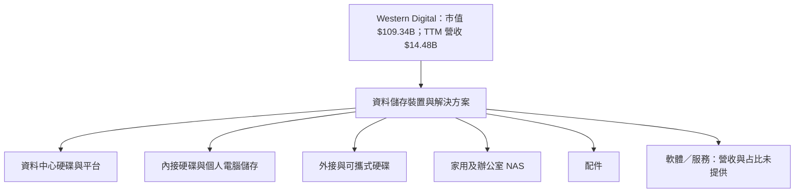
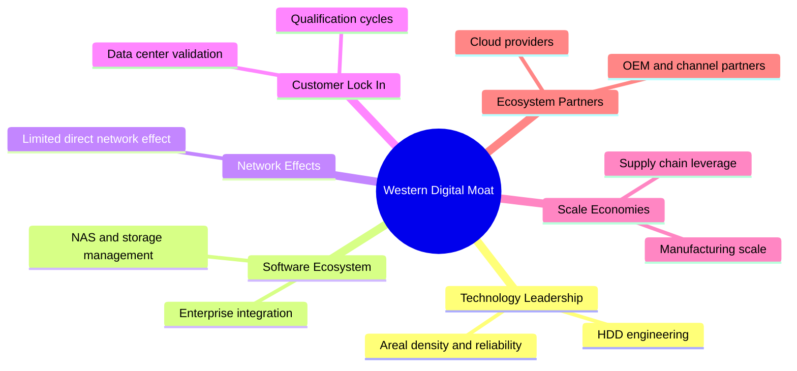
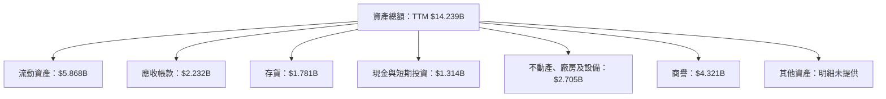
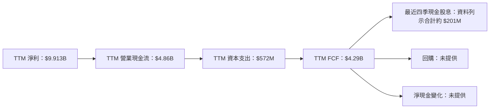
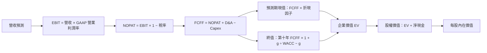
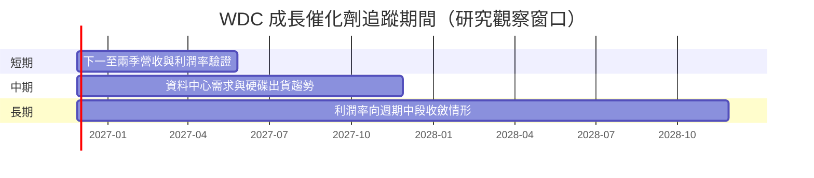
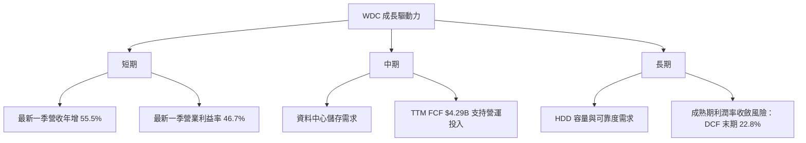
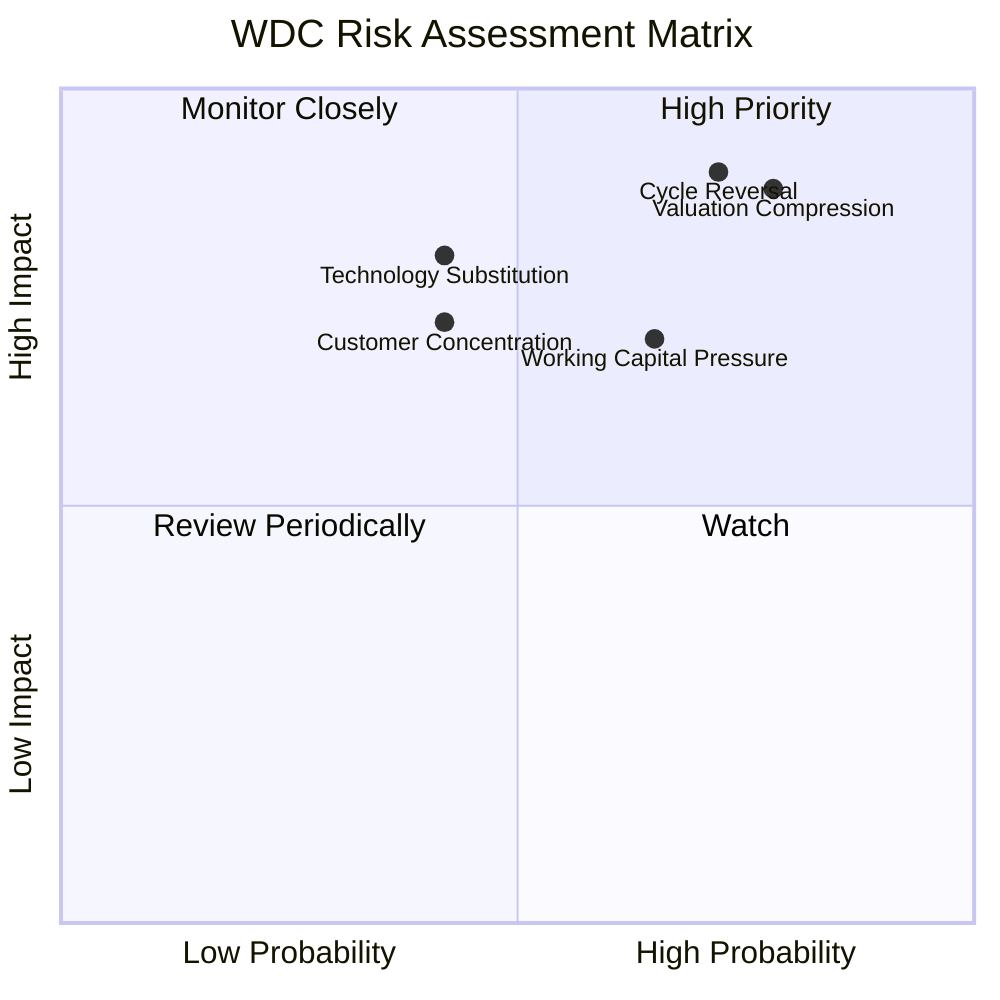
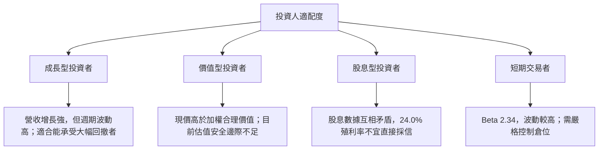

# WDC 基本面深度分析報告
> **報告日期**：2026-11-28 ｜ **語言**：繁體中文 ｜ **數據來源**：SEC 申報資料 (XBRL)、Yahoo Finance、Finviz、StockAnalysis、Roic.ai ｜ **分析師**：CFA 級機構研究

## 目錄

| # | 章節 | 核心結論 |
|---|------|----------|
| 1 | 執行摘要 | 賣出；加權合理價值 $206.20，MOS -41.7% |
| 2 | 公司概覽與商業模式 | HDD 需求與資料中心擴張提供成長動能；分部營收資料不足以量化護城河 |
| 3 | 損益表深度分析 | TTM 營收 $14.48B、TTM 成長 20.7%；最新一季年增 55.5% |
| 4 | 資產負債表分析 | 淨現金 $525M；營運資金週期較一年前延長 18 天 |
| 5 | 現金流量深度分析 | TTM FCF $4.29B、FCF Yield 3.92%；現金轉換低於淨利 |
| 6 | 獲利能力與資本效率 | ROIC 61.1% 高於 WACC 14.00%，但週期高峰獲利可能回落 |
| 7 | 相對估值分析 | 估值相對多數同業昂貴，且 P/S 高於自身五年中位數 |
| 8 | DCF 內在價值評估 | DCF 基準價值 $182.17；加權合理價值 $206.20 |
| 9 | 成長催化劑 | AI 與資料中心儲存需求可能延續，但 TAM 數據未提供 |
| 10 | 風險矩陣 | 週期反轉、估值壓縮與營運資金惡化為主要風險 |
| 11 | 投資建議 | 依 MOS 評級為賣出；現價高於 DCF 基準及加權合理價值 |

---

## 1. 執行摘要

WDC 2026-11-27 收盤價為 **$292.11**。TTM 營收 $14.48B、TTM 營收年增 20.7%、最新一季年增 55.5%，TTM FCF 為 $4.29B；ROIC 61.1% 高於採用的 WACC 14.00%。但估值三角驗證後的**加權合理價值為 $206.20，MOS 為 -41.7%**，符合規則 20 的🔴**賣出**門檻；DCF 基準價值 $182.17，現價相對該 DCF 價值溢價約 60.4%。營運表現強，但股價已反映高成長預期，估值風險凌駕短期獲利改善。

### 1.0 一頁式投資儀表板（Portfolio Manager 30 秒速讀）

| 項目 | 內容 |
|------|------|
| **投資論點（3 句）** | ① TTM 營收 $14.48B、年增 20.7%，最新一季年增 55.5%，需求動能仍強。② TTM FCF $4.29B、ROIC 61.1%，顯示現階段資本效率高。③ 加權合理價值 $206.20，較現價 $292.11 低 $85.91，MOS -41.7%，估值風險偏高。 |
| **綜合評分** | **6.2/10**（引用 1.1 評分卡；六項算術平均） |
| **財務健康** | 🟡 淨現金 $525M，但速動比率 0.867、CCC 由 34 天升至 52 天 |
| **ROIC vs WACC** | 61.1% vs 14.00%（目前創造價值；價差 47.1 個百分點） |
| **FCF 趨勢** | 近年由負轉正，TTM FCF $4.29B；FCF Yield 3.92% |
| **估值** | Forward P/E 7.34x ｜ EV/EBITDA 17.261x ｜ FCF Yield 3.92% |
| **DCF 內在價值（基準）** | $182.17 ｜ 現價相對 DCF 折溢價 **+60.4%** |
| **安全邊際（MOS）** | **-41.7%**＝($206.20 − $292.11) ÷ $206.20；🔴小於 10% |
| **預期報酬（基準情境 12M）** | DCF 基準情境相對現價 **-37.6%** |
| **關鍵風險（前二）** | HDD 價格與需求週期反轉；市場預期與估值倍數下修 |
| **評級 + 信心度** | 🔴 **賣出** ｜ 信心：中（營運數據強，但來源間部分比率有差異） |

### 1.1 綜合評分卡（全報告唯一）

| 維度 | 評分（1–10） | 主要依據（引用數字與其來源章節） |
|------|--------------|----------------------------------|
| 成長性 | 8.5 | TTM 營收成長 20.7%、最新一季年增 55.5%（第 3 章）；需求斜率亮眼，但單季增速不宜直接外推 |
| 獲利能力 | 8.5 | TTM 營業利益率 39.4%、ROIC 61.1%，高於 WACC 14.00%；F-Score 6/8（第 6 章） |
| 財務健康 | 7.0 | 淨現金 $525M；流動比率 1.434、速動比率 0.867；CCC 52 天（第 4 章） |
| 估值 | 2.0 | MOS -41.7%；P/S 7.7x，高於五年中位數 1.2x（第 7、8 章） |
| 護城河 | 6.0 | HDD 產品與企業客戶關係構成一定進入障礙，但市場份額、分部毛利與合約資料未提供（第 2 章） |
| 管理層與資本配置 | 5.0 | FY2026 SBC $204M、稀釋股數測試未通過；回購資料未提供（第 3、6 章） |
| **綜合評分** | **6.2** | 六項算術平均：(8.5 + 8.5 + 7.0 + 2.0 + 6.0 + 5.0) ÷ 6 = 6.17，四捨五入為 6.2 |

### 1.2 五大投資論點 + 三大核心風險

| 類型 | 項目 | 具體依據 | 信心度 |
|------|------|----------|--------|
| 🟢 **投資論點①** | 營收動能加速 | TTM 營收成長 20.7%；最新一季營收年增 55.5%，季度營收由 $3.02B 升至 $4.38B | 🟢 高 |
| 🟢 **投資論點②** | 利潤率處於高檔 | TTM 營業利益率 39.4%，最新一季 46.7%；產能利用率、產品組合與定價改善可能帶來營業槓桿 | 🟢 高 |
| 🟢 **投資論點③** | 現金流恢復 | TTM OCF $4.86B、資本支出 $572M，依規定定義的 TTM FCF 為 $4.29B | 🟢 高 |
| 🟢 **投資論點④** | 資本效率高 | ROIC 61.1%，較 14.00% WACC 高 47.1 個百分點 | 🟢 中高 |
| 🟢 **投資論點⑤** | 淨現金與負債下降 | 淨現金 $525M；FY2026 年末總債務 $1.05B，低於 FY2025 的 $4.71B（財報摘要） | 🟡 中 |
| 🟡 **風險①** | 週期高峰獲利可能回落 | DCF 假設營業利益率由 39.4% 逐步回落至 22.8%，反映高峰利潤率難以永久維持 | 🟡 中 |
| 🔴 **風險②** | 估值高於內在價值 | 加權合理價值 $206.20，現價 $292.11，MOS -41.7%；DCF 基準 $182.17 | 🔴 高衝擊 |
| 🔴 **風險③** | 營運資金占用上升 | CCC 由 34 天升至 52 天；DSO、DIO 均增加，可能壓低未來現金轉換 | 🟡 中高 |

### 1.3 快速統計卡片

| 指標 | 公司實際值（期間） | 同業中位數 | 狀態 |
|------|--------------------|------------|------|
| 營收成長（TTM） | **20.7%** | — | 🟢 |
| 營收成長（最新一季年增） | **55.5%** | **377.9%** | 🟡 |
| 毛利率（TTM） | **52.6%** | **80.0%** | 🟡 |
| 營業利益率（TTM） | **39.4%** | — | 🟢 |
| ROIC（TTM） | **61.1%** | — | 🟢 |
| Forward P/E | **7.3379407x** | **3.2x** | 🟡 |
| FCF Yield（TTM） | **3.92%** | — | 🟡 |
| Piotroski F-Score | **6 / 8** | — | 🟢 |

### 1.4 投資結論

```text
╔══════════════════════════════════════════════════════════════════╗
║                    📊 投資結論摘要                               ║
╠══════════════════════════════════════════════════════════════════╣
║  評級：🔴 賣出（依加權合理價值 MOS 門檻）                        ║
║  價格（2026-11-27 收盤）：$292.11                               ║
║  DCF 內在價值（基準）：$182.17（現價溢價約 +60.4%）             ║
║  安全邊際 MOS：-41.7%（以加權合理價值 $206.20 為分母）          ║
║  加權合理價值（8.8）：$206.20                                   ║
║  DCF 情境價值：                                                  ║
║    悲觀情境：$100.40（-65.6%）                                  ║
║    基準情境：$182.17（-37.6%）                                  ║
║    樂觀情境：$313.26（+7.2%）                                   ║
║  綜合評分：6.2/10（引用 1.1）                                   ║
║  適合投資人：已有部位者可追蹤基本面；不適合追價型價值投資人      ║
╚══════════════════════════════════════════════════════════════════╝
```

---

## 2. 公司概覽與商業模式

### 2.1 業務結構與收入來源

公司資料描述 WDC 提供以 HDD 技術為基礎的資料儲存裝置與解決方案，包括資料中心硬碟、內接與外接硬碟、NAS 及配件。最新季度營收為 $4.38B；TTM 營收為 $14.48B。**各產品線營收、毛利及占比未提供**，因此不以推估比例拆分。



公司披露的摘要未提供業務分部金額及占比；以上分類反映產品範圍，不代表營收比例。WDC 的財務表現對 HDD 出貨量、平均售價及資料中心需求變化敏感。

### 2.2 市場份額

市場份額數據未提供，無法以可靠比例製作市占表或圓餅圖。以公司規模觀察，WDC TTM 營收為 $14.48B，最新一季營收年增 55.5%；但 STX、SNDK 與 MU 的最新季度營收成長率分別為 61.0%、377.9% 及 379.3%，產品組合不同，不能直接視為同一市場的市占比較。

### 2.3 競爭護城河分析



### 2.4 護城河強度

| 護城河項目 | 強度（強／中／弱） | 證據（引用數字或事實） | 會削弱它的情況 |
|------------|--------------------|------------------------|----------------|
| 技術與可靠度 | 中 | 產品涵蓋資料中心、內接、外接與 NAS 儲存；具體專利、故障率及研發成果量化資料未提供 | SSD 在成本、容量或性能上持續取代 HDD |
| 軟體生態系統 | 弱至中 | NAS 等產品有軟硬體整合特性，但軟體／服務營收未提供 | 客戶改採標準化通用儲存方案 |
| 網路效應 | 弱 | 儲存產品本身不具明顯直接網路效應 | 無法將硬體裝機基礎轉化為服務收入 |
| 客戶鎖定 | 中 | 企業級硬碟需經客戶驗證與系統整合；客戶集中度與續約資料未提供 | 客戶切換供應商，或大型客戶採購集中化 |
| 規模效應 | 中 | FY2026 營收 $12.92B，TTM 營收 $14.48B | 需求下滑造成產能利用率降低、固定成本吸收不足 |
| 生態夥伴 | 中 | 產品透過 OEM、經銷與通路銷售；主要客戶數據未提供 | 大型雲端客戶自研或更換供應商 |

1.1「護城河」評分 **6.0/10**，原因是公司有長期硬體設計、企業驗證與規模經濟，但欠缺可量化市占、產品分部利潤與服務收入證據。

---

## 3. 損益表深度分析

### 3.1 年度收入成長趨勢（近 4 年）

```text
╔══════════════════════════════════════════════════════════════════╗
║              Western Digital 年度收入趨勢（FY2023–FY2026）      ║
╠══════════════════════════════════════════════════════════════════╣
║  FY2023  $6.255B  ██████████░░░░░░░░░░░░░░░░  YoY：基期        ║
║  FY2024  $6.317B  ██████████░░░░░░░░░░░░░░░░  YoY：+1.0%  🟡   ║
║  FY2025  $9.520B  ████████████████░░░░░░░░░░  YoY：+50.7% 🟢   ║
║  FY2026  $12.919B █████████████████████░░░░░  YoY：+35.7% 🟢   ║
╠══════════════════════════════════════════════════════════════════╣
║  FY2023–FY2026 營收 CAGR：約 +27.3%                              ║
╚══════════════════════════════════════════════════════════════════╝
```

FY2024 營收僅成長 1.0%，其後 FY2025、FY2026 分別成長 50.7% 與 35.7%，顯示近期營收復甦明顯。FY2023 至 FY2026 CAGR 以 `(12.919 ÷ 6.255)^(1/3) − 1` 計算，約為 27.3%。這種快速回升可能來自儲存需求與價格／產品組合改善，但 HDD 產業週期性高，不能將近兩年增速直接視為長期趨勢。

### 3.2 季度收入趨勢分析

| 季度（截至） | 營收 | QoQ 成長 | YoY 成長 | 備註 |
|--------------|------|----------|----------|------|
| 2025-12-31 | $3.02B | — | — | 對比前季營收未在此表列示 |
| 2026-03-31 | $3.34B | +10.6% | — | QoQ 按已列季度營收計算 |
| 2026-06-30 | $3.75B | +12.3% | — | QoQ 按已列季度營收計算 |
| 2026-10-02／最新季度 | $4.38B | +16.8% | +55.5% | 最新一季年增率為單季 YoY，不是 TTM |

最新一季營收由 $3.75B 增至 $4.38B，QoQ 成長約 16.8%，同時年增 55.5%。連續季度擴張與資料中心需求有關的可能性高，但分部營收資料未提供，無法量化各需求來源貢獻。

### 3.3 利潤率演變分析

以下 FY 年度毛利率與營業利益率以各年度財報數據相除計算；TTM 與最新季度則採核心財務資料的已核定數值。不同資料來源的營業利益率口徑存在差異，分析估值時以核定的 TTM 39.4% 為準。

| 利潤率指標 | FY2023 | FY2024 | FY2025 | FY2026 | 趨勢 | 評估 |
|------------|--------|--------|--------|--------|------|------|
| **毛利率** | 22.2% | 28.1% | 38.8% | 48.9% | ↗️ 連續改善 | 🟢 |
| **營業利益率** | -6.1% | 1.5% | 22.4% | 35.6% | ↗️ 由虧轉盈、擴張 | 🟢 |
| **TTM 營業利益率** | — | — | — | **39.4%** | 高於 FY2026 年度水準 | 🟢 |
| **最新季度營業利益率** | — | — | — | **46.7%** | 單季高於 TTM | 🟢 |

FY2023 至 FY2026 毛利率提升，與需求回升、產能利用率改善、產品組合與價格恢復相符；營業利益率擴張幅度高於營收成長，反映固定成本吸收改善。但單季 46.7% 已高於 TTM 39.4%，若產業供需回到較平衡狀態，利潤率可能向中期水準回落。DCF 因此採用營業利益率由 39.4% 逐步降至第十年 22.8%，而非假設高峰水準永久維持。

### 3.4 費用結構分析

完整營業費用科目及成本拆分未提供，不適合製作費用圓餅圖。可觀察到 FY2026 研發費用為 $1.16B，占當年營收 $12.919B 約 **9.0%**（`1.16 ÷ 12.919`）；此比例代表持續研發投入，但尚不足以完整推導研發以外的費用結構。

```text
╔══════════════════════════════════════════════════════════════════╗
║                     可核對的費用資料                            ║
╠══════════════════════════════════════════════════════════════════╣
║ FY2026 營收：      $12.919B                                      ║
║ FY2026 研發費用：  $1.160B  約占營收 9.0%                       ║
║ 其他營業費用明細：未提供，故不製作完整費用比例圖                ║
╚══════════════════════════════════════════════════════════════════╝
```

### 3.5 季度 EPS 趨勢與盈餘品質（Quality of Earnings）

過去四季的 EPS 預估值與實際值欄位均為缺值，故無法判定逐季超預期或不及預期。StockAnalysis 列示的季度 EPS 實際值與最新季年增率如下；估值預期差異不應以營收或 EPS 年增率替代。

| 季度 | EPS 實際值 | EPS 年增率 | 預估／實際比較 |
|------|------------|------------|----------------|
| 2025-12-31 | $4.67 | N/A | N/A（預估 EPS 缺值） |
| 2026-03-31 | $8.20 | +482.92% | N/A（預估 EPS 缺值） |
| 2026-06-30 | $8.21 | +984.10% | N/A（預估 EPS 缺值） |
| 2026-10-02／最新季度 | $4.63 | +50.86% | N/A（預估 EPS 缺值） |

| 盈餘品質項目 | 數值／佔比 | 評估 |
|--------------|-----------|------|
| 股權薪酬 SBC / 營收 | TTM SBC 約 $230M；約 **1.59%** | 🟡 佔比不高，但仍造成股東稀釋；Piotroski 稀釋股數測試未通過 |
| SBC / 營業現金流 | 約 **4.73%**（$230M ÷ $4.86B） | 🟡 SBC 不足以解釋主要現金流，但不是可忽略成本 |
| FCF / 淨利（現金轉換率） | 約 **43.3%**（$4.29B ÷ TTM 淨利 $9.913B） | 🔴 淨利高於自由現金流，現金轉換偏弱 |
| 一次性／非經常性損益 | N/A；FY2026 淨利 $9.30B 高於營業利益 $4.60B，需調節項明細 | 🟡 有明顯差距，但無資料證明差額屬一次性 |
| 有效稅率異常 | **4.9%** | 🟡 低稅率提高報告淨利，DCF 採用同一稅率，若常態稅率上升則估值下降 |
| 資本化支出 vs 費用化 | TTM Capex $572M；資本化明細 N/A | 🟡 未見足夠資料判斷費用遞延或資本化政策影響 |

TTM 淨利以 StockAnalysis 列示的 $9.913B 計算；資料來源間的淨利與年度數據口徑不同，需由後續 SEC 申報資料核對。就現有數據，FCF 大幅低於淨利，應以現金流而非單看 EPS 評價獲利品質。低有效稅率與年度淨利高於營業利益的差額，是估值需要保留折價的理由。

---

## 4. 資產負債表分析

### 4.1 資產結構分解

以下節點列出資料所提供的總資產與主要資產科目；不將未披露細項反推成完整資產結構。



資產負債表數據包含不同報表日期與資料來源；其中 TTM 資產總額 $14.239B，年度 FY2026 資產總額 $13.861B。兩者口徑與日期不同，不應混為同一時點。

### 4.2 流動性與營運資金分析

| 流動性指標 | 數值 | 評估 |
|------------|------|------|
| 流動比率 | 1.434 | 🟡 短期流動資產高於流動負債，但緩衝並不寬裕 |
| 速動比率 | 0.867 | 🟡 扣除存貨後低於 1，資金周轉依賴存貨銷售與應收回收 |
| 現金及短期投資 | $1.31B | 🟢 有現金緩衝 |
| 淨現金 | $525M | 🟢 現金高於總債務 |

營運資金天數照抄 QUALITY FIGURES：

| 指標 | 最新 TTM | 一年前 TTM | 變化 | 解讀 |
|------|----------|------------|------|------|
| DSO 應收帳款天數 | 56 天 | 41 天 | +15 天 | 🟡 收款週期延長；可能反映客戶付款條件或銷售組合變化 |
| DIO 存貨天數 | 95 天 | 70 天 | +25 天 | 🔴 存貨占用增加；需求預測誤差或備貨擴張將提高跌價風險 |
| DPO 應付帳款天數 | 99 天 | 77 天 | +22 天 | 🟡 延長付款可能提供資金緩衝，但不能單獨視為議價力提高 |
| CCC 現金轉換週期 | 52 天 | 34 天 | +18 天 | 🔴 營運資金回收變慢；對現金流的影響需持續觀察 |

DSO、DIO、DPO 是以期末餘額除以 TTM 流量計算，並非平均餘額口徑。存貨與應收天數同時增加，是比單看流動比率更值得追蹤的營運訊號。

### 4.3 債務結構分析

不同來源的債務與現金餘額存在差異：核定財務數據列示總債務 $789M、淨現金 $525M；另一財務摘要列示總債務 $922M、淨現金 $392M。以下以核定口徑為主，不將兩組數據混算。

```text
╔══════════════════════════════════════════════════════════════════╗
║                   Western Digital 債務健康診斷                   ║
╠══════════════════════════════════════════════════════════════════╣
║  總債務：       $789M       🟢 核定財務數據口徑                  ║
║  現金及短期投資：$1.31B      🟢 高於核定總債務                    ║
║  淨現金：       $525M       🟢 正淨現金                           ║
║  Debt / EBITDA：N/A（未提供可一致核對的 EBITDA 口徑）             ║
║  利息保障倍數： N/A（未提供利息費用及同期間 EBIT 調節資料）       ║
╚══════════════════════════════════════════════════════════════════╝
```

FY2026 年末年度財務摘要列示現金 $1.58B、總債務 $1.05B；債務由 FY2025 的 $4.71B 降至 FY2026 的 $1.05B。由於不同期間的現金與債務數字有差異，後續判斷應以同一報表日期的 10-Q／10-K 重新核對。

### 4.4 股東權益趨勢

```text
╔══════════════════════════════════════════════════════════════════╗
║                  股東權益變化（年度財務資料）                   ║
╠══════════════════════════════════════════════════════════════════╣
║ FY2023  $11.84B  ████████████████████████                        ║
║ FY2024  $11.05B  ██████████████████████                          ║
║ FY2025   $5.54B  ███████████                                     ║
║ FY2026   $8.86B  ██████████████████                              ║
╚══════════════════════════════════════════════════════════════════╝
```

FY2025 股東權益降至 $5.54B，FY2026 回升至 $8.86B。變動幅度較大，除淨利外也可能受資本交易、業務結構與會計項目影響；權益變動調節表未提供，故不將全部變動歸因於單一項目。

---

## 5. 現金流量深度分析

### 5.1 現金流量瀑布圖

TTM 核定自由現金流依指定口徑為營業現金流減資本支出；股息、回購及淨現金變化使用資料包中可核對的項目，未提供者不填入估計金額。



### 5.2 FCF 轉換率趨勢

| 期間 | FCF | 淨利 | FCF / 淨利 | 說明 |
|------|-----|------|------------|------|
| FY2023 | -$1.23B | -$1.68B | 約 73.2% | 兩者皆為負值，正比率不代表健康現金轉換 |
| FY2024 | -$781M | -$798M | 約 97.9% | 虧損階段，需與虧損幅度一併觀察 |
| FY2025 | $1.28B | $1.86B | 約 68.8% | 盈利恢復，但現金仍低於淨利 |
| FY2026 | $3.51B | $9.30B | 約 37.7% | 淨利大幅高於 FCF，需檢查非現金及一次性項目 |
| TTM | $4.29B | $9.913B | 約 43.3% | 現金轉換低於 100%，品質尚需持續驗證 |

### 5.3 自由現金流趨勢

| 期間 | 自由現金流 | 趨勢 |
|------|------------|------|
| FY2023 | -$1.23B | 🔴 |
| FY2024 | -$781M | 🔴 |
| FY2025 | $1.28B | 🟡 |
| FY2026 | $3.51B | 🟢 |
| TTM | $4.29B | 🟢；FCF Yield 3.92% |

FY2026 FCF 較 FY2025 增加，與營收回升及營運現金流改善一致；但 FY2026 淨利高達 $9.30B，遠高於 FCF $3.51B，因此現金流比淨利更適合作為分配能力檢驗。

### 5.4 資本配置評估

| 配置項目 | 可觀察資料 | 評估 |
|----------|------------|------|
| 資本支出 | TTM $572M；FY2026 $418M | 目前相對 TTM 營收約 3.9%，DCF 假設逐步降至營收 3.0% |
| 股息 | FY2026 現金股息支付 $184M；資料另列最近四季股息支付 | 有現金分配，但資料庫所列 24.0% 殖利率與派息資料不一致，不宜當作正常化股息率 |
| 回購 | N/A（資料未提供） | 無法評估回購是否抵銷稀釋 |
| 研發 | FY2026 $1.16B | 研發支出支持產品迭代，但投資回報資料未提供 |
| 留存現金 | N/A | 無完整資本配置調節表 |

完整、同一口徑的資本配置比例資料不足，故不製作 pie chart。可確認的是公司已有正 FCF，但尚無足夠回購與現金用途資料評估資本配置效率。

---

## 6. 獲利能力與資本效率

### 6.1 ROE / ROA / ROIC 趨勢

| 指標 | 可用期間與數值 | 評估 |
|------|----------------|------|
| ROIC | TTM 61.1% | 🟢 高於 WACC 14.00%，目前創造經濟價值 |
| ROE | TTM 107.2%（QUALITY FIGURES）；另一來源列示 129.6% | 🟡 來源口徑不同，採 QUALITY FIGURES 數值做杜邦分析 |
| ROA | TTM 25.9% | 🟢 獲利相對資產規模高 |
| 歷年 ROIC／ROE／ROA 序列 | N/A（缺少同一計算口徑的完整歷史資料） | 不與未提供的產業均值相比 |

ROE 超過 100%，不應單獨解讀為持續性資本效率；獲利循環、權益基數及非營業項目都會影響該比率。較適合用 ROIC 與資金成本比較，並同時留意現金轉換率。

### 6.2 ROIC vs WACC 分析（核心價值創造判斷）

```text
╔══════════════════════════════════════════════════════════════════╗
║                    ROIC vs WACC 深度分析                         ║
╠══════════════════════════════════════════════════════════════════╣
║  WACC（折現率；採用核定數值）：14.00%                            ║
║  ├── 無風險利率 Rf（10Y 美債）：4.94%                            ║
║  ├── 市場風險溢酬 ERP：5.00%                                     ║
║  ├── 原始 Beta：2.34；調整後 Beta：1.90                         ║
║  ├── 股權成本 Ke：4.94% + 1.90 × 5.00% = 14.44%                 ║
║  ├── 資料核定 Ke：14.42%                                         ║
║  ├── 稅前債務成本：20.91%；稅率：4.9%                            ║
║  ├── 權重：股權 99.3%；債務 0.7%                                 ║
║  └── 計算 WACC 14.46%，受 7%–14% 區間限制後採用 14.00%           ║
║                                                                  ║
║  ROIC（TTM）：61.1%                                               ║
║  ROIC − WACC = 61.1% − 14.00% = +47.1 個百分點                   ║
║  ROIC / WACC = 61.1% ÷ 14.00% = 4.36 倍                          ║
║                                                                  ║
║  ROIC 61.1%  ▓▓▓▓▓▓▓▓▓▓▓▓▓▓▓▓▓▓▓▓▓▓▓▓▓▓▓▓▓▓                    ║
║  WACC 14.0%  ▓▓▓▓▓▓▓                                             ║
║  結論：目前 ROIC 高於 WACC，代表正在創造股東價值。               ║
╚══════════════════════════════════════════════════════════════════╝
```

核定 WACC 原始計算值為 14.46%，因設定的 7%–14% 上限而採用 **14.00%**。Beta 原始值 2.34 依規則採調整 Beta：`⅔ × 2.34 + ⅓ = 1.893…`，核定為 1.90。CAPM 以未四捨五入 Beta 得到資料列示 Ke 14.42%；手動以 1.90 代入得到 14.44%，差異來自 Beta 顯示精度。ROIC 61.1% 高於 WACC 47.1 個百分點，支持目前價值創造判斷；但 ROIC 是週期高峰時點的 TTM 指標，不能直接外推至長期。

### 6.3 杜邦三因素分解

| 因素 | 數值（TTM） | 解讀 |
|------|-------------|------|
| 淨利率 | 69.2% | 高淨利率是 ROE 高於 100% 的主要來源；稅率與淨利／營業利益差異需留意 |
| 資產週轉率 | 1.02 | 資產每年約周轉一次 |
| 權益乘數 | 1.52 | 有財務槓桿，但不是 ROE 超高的主要驅動 |
| **ROE** | **107.2%** | `69.2% × 1.02 × 1.52 = 107.2%`（依核定 DuPont 數值） |

### 6.4 財務體質：Piotroski F-Score

核定分數為 **6 / 8**；一項測試因缺少資料不納入分母，故不是 9 項完整可判定分數。

| 測試 | 結果 | 解讀 |
|------|------|------|
| ROA > 0 | ✅ 通過 | TTM 資產報酬為正 |
| 營業現金流 > 0 | ✅ 通過 | TTM OCF $4.86B |
| ROA 高於一年前 | ✅ 通過 | 獲利改善 |
| 營業現金流 > 淨利（應計品質） | ❌ 未通過 | 淨利高於現金流，與 43.3% 現金轉換率一致 |
| 長期負債 ÷ 總資產低於一年前 | — 無法判定 | 缺少判定資料 |
| 流動比率高於一年前 | ✅ 通過 | 短期流動性改善 |
| 稀釋股數未增加 | ❌ 未通過 | 股數稀釋對每股價值有負面影響 |
| 毛利率高於一年前 | ✅ 通過 | 產品毛利改善 |
| 資產週轉率高於一年前 | ✅ 通過 | 資產使用效率改善 |

---

## 7. 相對估值分析

### 7.1 同業估值比較表格

同業估值依 Yahoo Finance 的 Peer multiples。STX、SNDK、MU 業務組合不同，尤其 SNDK 與 MU 的記憶體產品比重會令倍數比較失真；以下只用作市場相對定價參考。

| 估值指標 | **WDC** | **STX** | **SNDK** | **MU** | 本公司評估 |
|----------|---------|---------|---------|-------|-----------|
| **Trailing P/E** | 9.583661x | 26.7x | 5.5x | 8.1x | 🟡 位於同業範圍內；來源另列歷史快照 11.3x |
| **Forward P/E** | 7.3379407x | 7.9x | 2.4x | 3.2x | 🟡 高於同業低倍數公司，反映對 WDC 前瞻獲利定價較高 |
| **P/S Ratio** | 7.550308x | 8.5x | 3.4x | 5.5x | 🔴 高於同業中位數 5.5x |
| **EV/EBITDA** | 17.261x | 20.2x | 4.3x | 6.4x | 🔴 高於同業中位數 6.4x |
| **最新季度營收年增** | 55.5% | 61.0% | 377.9% | 379.3% | 🟡 WDC 成長為正但低於三家中位數 |
| **TTM 毛利率** | 52.6% | 50.4% | 80.0% | 80.7% | 🟡 高於 STX，但低於 SNDK、MU |

Peer multiples 的同業中位數分別為：Trailing P/E 8.1x、Forward P/E 3.2x、P/S 5.5x、EV/EBITDA 6.4x。公司自身 P/E 與 EV/EBITDA 在不同資料區段存在快照差異，故相對比較採當前估值區塊數字；估值方法回推價格則採固定的核定估值方法輸出。

### 7.2 歷史估值區間分析

```text
╔══════════════════════════════════════════════════════════════════╗
║                  WDC 五年估值區間（TTM 倍數）                    ║
╠══════════════════════════════════════════════════════════════════╣
║ P/E       6.3x ├─────────● 11.3x ────────│中位數 13.5x─────┤62.5x║
║                         現值百分位：38%                           ║
║ P/S       0.4x ├──────────────────────│中位數 1.2x──● 7.7x─┤16.0x║
║                         現值百分位：85%                           ║
║ EV/EBITDA 4.5x ├─────────────────│中位數 14.9x──● 19.6x───┤96.5x║
║                         現值百分位：69%                           ║
╚══════════════════════════════════════════════════════════════════╝
```

P/E 現值低於自身五年中位數，但 P/S 位於歷史第 85 百分位、EV/EBITDA 位於第 69 百分位，表示股價相對營收及企業價值的定價不低。由於歷史估值受虧損年份與周期波動影響，不能只以單一倍數判斷便宜。

### 7.3 情境價值（Bear / Base / Bull）

以下數值照抄 DCF MODEL 的 Scenarios，非另行設定目標價。

| 情境 | 第 1 年營收成長 | 期末營業利潤率 | WACC | 每股價值 | 相對現價 | 機率 | 會發生的條件 |
|------|----------------|----------------|------|----------|----------|------|--------------|
| 🔴 悲觀 | 10.3% | 19.4% | 15.00% | $100.40 | -65.6% | 25% | 需求成長快速降溫、定價回落、利潤率向較低週期水準收斂 |
| 🟡 基準 | 20.7% | 22.8% | 14.00% | $182.17 | -37.6% | 50% | 首年延續 TTM 成長，之後成長與利潤率逐步回歸成熟水準 |
| 🟢 樂觀 | 31.0% | 25.1% | 13.00% | $313.26 | +7.2% | 25% | 資料中心需求與供應紀律延續，成長和末期利潤率均高於基準 |

機率加權參考值為 **$194.50**，但第 8.8 節及評級採用固定基準方法的加權合理價值，而非機率加權 DCF 情境值。

### 7.4 相對估值隱含價格區間

```text
╔══════════════════════════════════════════════════════════════════╗
║               估值方法回推價格與當前股價位置                    ║
╠══════════════════════════════════════════════════════════════════╣
║ 同業 EV/EBITDA      $105.24 ────────────────● $292.11            ║
║ 同業 P/S            $213.28 ────────●────────● $292.11           ║
║ 分析師共識目標價    $591.08              （高於現價）             ║
║ DCF 基準            $182.17 ────────────────● $292.11            ║
╚══════════════════════════════════════════════════════════════════╝
```

- **同業 EV/EBITDA：$105.24**，以 STX、SNDK、MU 的同業中位數 6.4x 乘以 WDC TTM EBITDA，再加回淨現金，依固定估值方法輸出。
- **同業 P/S：$213.28**，以同業中位數 5.5x 乘以 WDC TTM 營收，依固定估值方法輸出。
- **分析師共識：$591.08**，為 24 位分析師平均目標價；高於現價 102.3%，但其假設與分布未提供，故僅依固定權重 10% 納入三角驗證。

---

## 8. DCF 內在價值評估（Discounted Cash Flow）

### 8.0 估值推理鏈（Thinking Logic）

**Step 1 — 價值由哪些變數決定？**  
本模型以 WDC 現有儲存主業現金流為估值主體，TTM 營收 $14.48B；產品線與新業務營收占比未提供，因此不額外加入「第二成長曲線」或選擇權價值。模型最敏感的變數是 WACC、長期成長率與長期營業利潤率；敏感性矩陣顯示 WACC 變動對每股價值的影響最大。

**Step 2 — 模型選擇**

| 決策點 | 本報告採用 | 理由（含數字） | 曾考慮但否決 | 否決理由 |
|--------|-----------|----------------|--------------|----------|
| 現金流定義 | FCFF | 以 EBIT、稅、折舊與資本支出預測，並用 WACC 折現為企業價值 | FCFE | 未依股東融資後現金流建模 |
| 預測期 N | 10 年 | DCF MODEL 固定設定 10 年；營收成長由 20.7% 線性降至 3.0% | 5 年 | 與既定模型不符，不能改動程式輸出 |
| 終值方法 | Gordon Growth | DCF MODEL 以永續成長率 3.0% 計算 | 退出倍數作主估值 | 模型未提供退出倍數終值，不能自行建立 |
| EBIT 基礎 | GAAP EBIT | TTM 營業利益率 39.4% 為模型起點 | 非 GAAP EBIT | 無必要，且會改變模型口徑 |

**Step 3 — 關鍵假設推導**

- **營收成長**：錨點為 TTM 成長 20.7% → DCF 第一年沿用最新 TTM 增速，之後線性降至第十年 3.0% → 採用首年 20.7%、末年 3.0% → 否決將 55.5% 最新季度年增率直接延續十年，因它是單季成長率而非 TTM。
- **期末營業利益率**：錨點為 TTM 39.4% → 考量目前最新季度 46.7% 高於 TTM，將高峰逐步向近五年財年中位數收斂 → 採用第十年 22.8% → 否決永久維持 39.4%，以避免把週期高峰當成長期常態。
- **永續成長率 g**：模型採 3.0%，低於 WACC 14.00%，符合長期成熟企業成長率需低於折現率的條件 → 否決高於 3.0% 的基準假設，避免終值被過度放大。
- **預測期 N**：採 10 年，與模型固定設定一致 → 否決自行縮短或延長，因程式已提供完整逐年 FCF 與敏感度。
- **Capex / 營收**：TTM Capex 為 $572M、占 TTM 營收約 3.9%；模型由第 1 年 3.9% 緩降至第 10 年 3.0% → 否決假設資本支出立即大幅下降，保留維持營運的投資需求。
- **GAAP EBIT 與 SBC**：模型採 GAAP EBIT，SBC 已作費用 → 採用組合 **(A)**，FCFF 不再扣 SBC、股數不再額外稀釋 → 否決 GAAP EBIT 再扣 SBC或另加年稀釋率，避免重複計算成本。
- **WACC**：採核定值 14.00%，模型輸入的計算值 14.46% 受 7%–14% 區間限制 → 不自行改用 14.46%，以維持資料庫設定一致。
- **稅率與 D&A**：有效稅率採核定 4.9%，D&A/營收採 TTM 2.7%；皆為模型輸入。營運資金未建模，不能另加估計數。

**Step 4 — 最脆弱一環**  
長期 EBIT 由 39.4% 回落至 22.8% 的路徑高度影響終值；若成長及利潤率低於悲觀情境，估值可降至模型悲觀價值 $100.40。

**Step 5 — 計算路徑圖**



### 8.1 模型假設總表（Model Inputs）

| 假設項目 | 採用值 | 依據／來源 | 敏感度 |
|----------|--------|-------------|--------|
| 預測期長度 **N** | 10 年 | DCF MODEL 固定設定；逐年營收、FCFF 與折現值均有輸出 | 🟡 中 |
| 營收成長 | 第 1 年 20.7%，第 10 年 3.0% | TTM vs prior TTM 成長 20.7%；線性淡化至模型假設 3.0% | 🔴 高 |
| 營業利潤率 | 第 1 年 39.4% → 第 10 年 22.8% | 起點採 TTM 營業利益率；末期採近五個財年中位數（TTM included） | 🔴 高 |
| 有效稅率 | 4.9% | 核定最新年度有效稅率 | 🟢 低 |
| Capex / 營收 | 第 1 年 3.9% → 第 10 年 3.0% | 起點為 TTM Capex/營收；末期依模型規則淡化至至少 1.1×D&A | 🟡 中 |
| D&A / 營收 | 2.7% | TTM 比率，模型持平 | 🟢 低 |
| 營運資金變動 | 未建模 | DCF MODEL 明列 Working capital is not modelled | 🟡 中；未建模可能高估現金流 |
| EBIT 基礎 | GAAP EBIT | DCF MODEL 明列 GAAP EBIT | 🟡 中 |
| SBC 處理 | 組合 (A)：GAAP EBIT 已含 SBC，不再扣款、不另稀釋 | DCF MODEL 的提示設定 | 🟡 中 |
| 年稀釋率 | 0%（股數不再稀釋） | 與組合 (A) 配套；DCF MODEL 明列股數不再稀釋 | 🟡 中 |
| 永續成長率 g | 3.0% | DCF MODEL 假設；低於 14.00% WACC | 🔴 高 |
| 終值方法 | Gordon Growth | DCF MODEL 已提供終值計算 | 🔴 高 |
| WACC | 14.00% | 核定 Cost of capital；原計算 14.46%，受 7%–14% 區間限制 | 🔴 高 |

本章 FCFF 定義為 `NOPAT + D&A − Capex`；**不含營運資金變動**，因模型未建模 ΔWC。SBC 採組合 (A)：GAAP EBIT 已含 SBC 費用，所以 FCFF 不再扣 SBC、股數亦不另行放大，SBC 影響計入一次。

### 8.2 折現率推導（WACC）

```text
╔══════════════════════════════════════════════════════════════════╗
║                    WACC 推導（折現率）                           ║
╠══════════════════════════════════════════════════════════════════╣
║  股權成本 Ke（CAPM）：                                           ║
║  ├── 無風險利率 Rf：4.94%                                        ║
║  ├── 市場風險溢酬 ERP：5.00%                                     ║
║  ├── 原始 Beta：2.34；調整 Beta：1.90                            ║
║  ├── Beta 調整：⅔ × 2.34 + ⅓ = 1.893…，核定採用 1.90          ║
║  ├── Ke（核定）：14.42%                                          ║
║  └── 以顯示值計算：4.94% + 1.90 × 5.00% = 14.44%                ║
║                                                                  ║
║  債務成本 Kd：                                                   ║
║  ├── 稅前 Kd（核定）：20.91%                                     ║
║  ├── 有效稅率：4.9%                                              ║
║  └── 稅後 Kd = 20.91% × (1 − 4.9%) = 19.89%                     ║
║                                                                  ║
║  資本結構：                                                      ║
║  ├── 股權權重：99.3%                                             ║
║  ├── 債務權重：0.7%                                              ║
║  └── 計算 WACC 14.46%，上限約束後採用 14.00%                     ║
╚══════════════════════════════════════════════════════════════════╝
```

五步演算與資料限制：

1. **Ke（CAPM）**：`4.94% + 1.90 × 5.00% = 14.44%`；核定資料以較精細 Beta 計算列示 **14.42%**。  
2. **稅前 Kd**：核定成本為 **20.91%**；利息費用及平均計息負債的金額未提供，因此不能重建其分子、分母。此處照用核定的 Kd，不另估利息。  
3. **稅後 Kd**：`20.91% × (1 − 4.9%) = 19.88641% ≈ 19.89%`。  
4. **權重**：股權 99.3% + 債務 0.7% = **100.0%**；公司市值資料為 $109.34B，股數為 374.32M。權重依核定成本資料直接採用；債務快照與市值日期口徑不一，無法以目前不同來源債務數據重建完全一致權重。  
5. **WACC**：`99.3% × 14.42% + 0.7% × 19.88641%`  
   `= 14.31906% + 0.13920487% = 14.45826487% ≈ 14.46%`；受 7%–14% 區間限制，採用 **14.00%**。

10 年期美債殖利率、ERP 與 Beta 期間的日期細節未提供；Rf、ERP、Beta 採核定輸入。未另加規模或國別溢酬。第 6.2 節與本節同採用 WACC 14.00%。

### 8.3 逐年自由現金流預測（基準情境）

金額單位為 $B；折現因子依模型列示至三位小數。模型原始逐年數值照列，不以顯示後四捨五入值重建模型。ΔWC 未建模，不另列為數字列。

| 年度 | FY+1 | FY+2 | FY+3 | FY+4 | FY+5 | FY+6 | FY+7 | FY+8 | FY+9 | FY+10 |
|------|------|------|------|------|------|------|------|------|------|-------|
| 營收 | 17.47 | 20.74 | 24.21 | 27.79 | 31.35 | 34.75 | 37.84 | 40.46 | 42.47 | 43.75 |
| 營收 YoY | 20.7% | 18.7% | 16.7% | 14.8% | 12.8% | 10.9% | 8.9% | 6.9% | 5.0% | 3.0% |
| 營業利潤率 | 39.4% | 37.6% | 35.7% | 33.9% | 32.0% | 30.2% | 28.4% | 26.5% | 24.7% | 22.8% |
| EBIT（GAAP） | 6.89 | 7.79 | 8.65 | 9.42 | 10.05 | 10.50 | 10.74 | 10.73 | 10.49 | 10.00 |
| − 稅 | (0.33) | (0.38) | (0.42) | (0.46) | (0.49) | (0.51) | (0.52) | (0.52) | (0.51) | (0.49) |
| = NOPAT | 6.55 | 7.41 | 8.23 | 8.96 | 9.56 | 9.99 | 10.21 | 10.21 | 9.98 | 9.51 |
| + D&A | 0.47 | 0.56 | 0.65 | 0.75 | 0.85 | 0.94 | 1.02 | 1.09 | 1.15 | 1.18 |
| − Capex | (0.69) | (0.80) | (0.90) | (1.01) | (1.10) | (1.18) | (1.25) | (1.29) | (1.31) | (1.30) |
| **= FCFF** | **6.33** | **7.18** | **7.98** | **8.70** | **9.30** | **9.74** | **9.99** | **10.02** | **9.82** | **9.39** |
| 折現因子 @14.00% | 0.877 | 0.769 | 0.675 | 0.592 | 0.519 | 0.456 | 0.400 | 0.351 | 0.308 | 0.270 |
| **FCFF 現值 PV** | **5.56** | **5.52** | **5.39** | **5.15** | **4.83** | **4.44** | **3.99** | **3.51** | **3.02** | **2.53** |

預測期現值總和依模型為 **$43.95B**。逐項加總表格顯示的四捨五入 PV 為：  
`$5.56 + $5.52 + $5.39 + $5.15 + $4.83 + $4.44 + $3.99 + $3.51 + $3.02 + $2.53 = $43.94B`。  
模型合計為 **$43.95B**，兩者差 $0.01B，為逐項顯示取位造成的尾差。

**逐步演算（FY+1，代表年度）**

1. 營收：`$14.48B × (1 + 20.7%) = $17.47736B`；模型列示 **$17.47B**（底層未四捨五入輸入與顯示精度有尾差）。  
2. EBIT：`$17.47B × 39.4% = $6.882?B`；DCF MODEL 列示 **$6.89B**，採底層未四捨五入數值。  
3. 稅：`$6.89B × 4.9% = $0.33761B`，模型列示 **$0.33B**。  
4. NOPAT：模型列示 `EBIT − 稅 = $6.55B`。  
5. D&A：模型列示 **$0.47B**；依 2.7% × 營收的底層未取位數計算。  
6. Capex：模型列示 **$0.69B**。  
7. ΔWC：模型設定未建模，故不扣除。  
8. FCFF：模型列示 **$6.33B**，依 `NOPAT + D&A − Capex` 計算。  
9. 折現：因表內 FCFF 與折現因子均已取位，`$6.33B × 0.877 = $5.55291B`；模型 PV 列示 **$5.56B**，差異源自模型使用底層未四捨五入數值。

**合理性自檢**

- 預測 FCFF 由 FY+1 $6.33B 增至 FY+10 $9.39B，期間 CAGR 約 4.0%；歷史 FCF 由 FY2023 -$1.23B 轉為 FY2026 $3.51B，因起點為負，歷史 CAGR 不具數學可比性。模型對已恢復的現金流採溫和增長，但未建模營運資金，可能偏樂觀。
- FY+10 FCFF 利潤率：`$9.39B ÷ $43.75B ≈ 21.5%`；目前 TTM FCF 利潤率：`$4.29B ÷ $14.48B ≈ 29.6%`。同業最佳 FCF 利潤率資料未提供，不能判斷是否超越同業最佳水準。
- 預測期各年 FCFF 均為正；然而沒有 ΔWC 項目，CCC 延長對現金流的消耗未反映在模型中。

```text
╔══════════════════════════════════════════════════════════════════╗
║            自由現金流：歷史實際 vs 模型預測                      ║
╠══════════════════════════════════════════════════════════════════╣
║ FY2024（實） -$0.781B  ███░░░░░░░░░░░░░░░░░░░                   ║
║ FY2025（實） +$1.280B  ██████░░░░░░░░░░░░░░░                    ║
║ FY2026（實） +$3.510B  ███████████████░░░░░                    ║
║ FY+1（預）   +$6.330B  ██████████████████████░                 ║
║ FY+10（預）  +$9.390B  ██████████████████████████████          ║
╠══════════════════════════════════════════════════════════════════╣
║ 預測 FCFF CAGR 約 4.0%；歷史由負轉正，不宜直接比較 CAGR。       ║
║ 模型未納入營運資金變動，應將該項視為估值上行偏誤來源。          ║
╚══════════════════════════════════════════════════════════════════╝
```

### 8.4 終值計算（Terminal Value）

**適用性檢查：** `WACC 14.00% vs g 3.0% → WACC > g？✅`

DCF MODEL 只提供 Gordon Growth 終值；未提供退出倍數終值，因此不另造一組退出倍數計算。

| 方法 | 計算式 | 終值 TV | TV 現值 | 佔總 EV 比重 |
|------|--------|---------|---------|--------------|
| Gordon Growth | $9.39B × (1 + 3.0%) ÷ (14.00% − 3.0%) | $87.94B | $23.72B | 35.1% |
| 退出倍數法 | N/A（DCF MODEL 未提供） | N/A | N/A | N/A |

**逐步演算**

1. FY+N FCFF：FY+10 為 **$9.39B**。  
2. 分子：`$9.39B × (1 + 3.0%) = $9.6717B`；模型終值使用底層未四捨五入數字，列示 **$87.94B**。  
3. 分母：`14.00% − 3.0% = 11.00%`；以模型精度計算終值列示 **$87.94B**。  
4. PV(TV)：模型列示 **$87.94B × 0.270 = $23.72B**（使用未取位折現因子）。  
5. 終值占比：`$23.72B ÷ $67.67B = 35.1%`。

終值現值占 EV 35.1%，未高於 75% 警示線；但終值仍是估值的重要組成部分，g 與 WACC 的差距需納入敏感度判斷。

### 8.5 企業價值 → 每股內在價值（Bridge）

```text
╔══════════════════════════════════════════════════════════════════╗
║              企業價值 → 每股內在價值 橋接表                      ║
╠══════════════════════════════════════════════════════════════════╣
║  預測期 FCF 現值合計             +$43.95B                        ║
║  終值現值 PV(TV)                 +$23.72B                        ║
║  ─────────────────────────────────────────────                  ║
║  = 企業價值 EV                    $67.67B                        ║
║  + 淨現金                         +$0.53B                         ║
║  = 股權價值（模型列示）            $68.19B                        ║
║  每股價值（模型列示）              $182.17                        ║
║  2026-11-27 收盤價                 $292.11                        ║
║  折溢價（現價÷DCF價值−1）           +60.4%（溢價）                 ║
╚══════════════════════════════════════════════════════════════════╝
```

逐步演算：

1. **EV**：`$43.95B + $23.72B = $67.67B`。  
2. **股權價值**：`$67.67B + $0.53B = $68.20B`；模型列示 **$68.19B**，$0.01B 差異來自底層未四捨五入數值。  
3. **每股內在價值**：依模型原式，`股權價值 × 價格 ÷ 市值`；`$68.19B × $292.11 ÷ $109.34B = $182.17`。股數資料為 374.32M 股；模型將每股價值依市值與股價的比例換算。  
4. **折溢價**：`$292.11 ÷ $182.17 − 1 = +60.4%`。  
5. **本節不計算 MOS**：MOS 全報告只在 8.8 以加權合理價值為分母計算。

DCF 股權價值橋接採用淨現金 $0.53B。淨現金、總債務與現金時點依核定 TTM 數據；模型不另列少數股東權益。組合 (A) 採固定股數，不額外放大稀釋股數。

### 8.6 敏感性分析（WACC × 永續成長率）

矩陣數值照抄 DCF MODEL；括號內為相對 2026-11-27 收盤價 $292.11 的上行空間，百分比四捨五入至 0.1%。

| g（列）／WACC（欄） | 12.00% | 13.00% | **14.00%（基準）** | 15.00% | 16.00% |
|-----------|--------|--------|-------------------|--------|--------|
| **2.0%** | $211.85 (-27.5%) | $192.49 (-34.1%) | $176.33 (-39.6%) | $162.63 (-44.3%) | $150.88 (-48.3%) |
| **2.5%** | $216.61 (-25.9%) | $196.10 (-32.9%) | $179.12 (-38.7%) | $164.83 (-43.6%) | $152.63 (-47.7%) |
| **3.0%** | $221.90 (-24.0%) | $200.08 (-31.5%) | **$182.17 (-37.6%)** | $167.21 (-42.8%) | $154.51 (-47.1%) |
| **3.5%** | $227.82 (-22.0%) | $204.48 (-30.0%) | $185.51 (-36.5%) | $169.79 (-41.9%) | $156.54 (-46.4%) |
| **4.0%** | $234.47 (-19.7%) | $209.36 (-28.3%) | $189.19 (-35.2%) | $172.61 (-40.9%) | $158.74 (-45.7%) |

**逐步演算限制：**DCF MODEL 已提供敏感度矩陣，但未提供每個矩陣格的重估預測期 PV 與終值中間值。依規則 19 不自行另建模型，故不杜撰矩陣格的 PV／TV 中間值；格內價值以程式計算輸出為準。基準格為 WACC 14.00%、g 3.0%，價值 $182.17，與 8.5 一致。

**三情境 DCF（照抄模型輸出）**

| 情境 | 營收成長假設 | 期末營業利潤率 | 永續成長 g | WACC | 每股內在價值 | 相對現價 | 主觀機率 |
|------|-------------|----------------|------------|------|--------------|----------|----------|
| 🔴 悲觀 | 第 1 年 10.3% | 19.4% | DCF MODEL 未另列 | 15.00% | $100.40 | -65.6% | 25% |
| 🟡 基準 | 第 1 年 20.7% | 22.8% | 3.0% | 14.00% | $182.17 | -37.6% | 50% |
| 🟢 樂觀 | 第 1 年 31.0% | 25.1% | DCF MODEL 未另列 | 13.00% | $313.26 | +7.2% | 25% |
| **機率加權** | — | — | — | — | **$194.50** | **-33.4%** | **100%** |

情境輸出的逐年營收、期末 FCFF 與終值中間值未提供，因此不額外倒推或另建場景模型；上述每股價值與假設完全依 DCF MODEL 輸出。機率加權可核對為：`$100.40 × 25% + $182.17 × 50% + $313.26 × 25% = $194.50`（四捨五入）。

**敏感度結論**

- g 從 2.0% 升至 3.0%，WACC 固定 14.00%：`$182.17 − $176.33 = +$5.84`，約 **+3.3%**（相對 $176.33）。
- WACC 從 14.00% 升至 15.00%，g 固定 3.0%：`$167.21 − $182.17 = -$14.96`，約 **-8.2%**。
- 期末營業利潤率每 +1 個百分點的獨立價值變動，DCF MODEL 未提供單因子矩陣，故為 **N/A**，不另行試算。
- 就已提供的矩陣，WACC 變化對估值影響顯著；與 8.0 Step 1 所指的折現率及終值假設為主要敏感因子一致。

### 8.7 反推 DCF（Reverse DCF：市場在預期什麼）

市場價格反推值採 DCF MODEL 已計算輸出。其餘變數依模型基準固定；只放開一個變數求解。

**固定基準輸入**：WACC 14.00%、稅率 4.9%、Capex 比率依基準逐年淡化、營運資金不建模、N=10 年、固定股數／不額外稀釋。

| 求解的變數（一次一個） | 其餘變數設定 | 市場隱含值（令 DCF = 現價） | 基準假設比較 | 判斷 |
|------------------------|--------------|------------------------------|--------------|------|
| 第 1 年營收成長 | 利潤率及其他假設固定為基準 | 34.9% | 基準 20.7% | 🔴 需高於基準約 14.2 個百分點 |
| 固定營業利潤率 | 成長與其他假設固定為基準 | 44.4% | 基準由 39.4% 降至 22.8% | 🔴 高於基準路徑 |
| 永續成長率 g | 其餘變數固定為基準 | 未計算 | — | 單一未知數反推結果未提供 |
| 預測期長度 N | 其餘變數固定為基準 | 未計算 | — | 單一未知數反推結果未提供 |

已提供的兩個反推值由模型輸出，反推試算逐點軌跡未提供，無法在不另建模型下補列試算點。結論是：以 DCF 基準假設解釋 $292.11 股價，需要首年營收成長升至 34.9%，或長期固定營業利益率達 44.4%；這高於基準模型要求，意味現價反映相當樂觀的營運預期。

### 8.8 估值三角驗證與安全邊際

| 估值方法 | 隱含每股價值 | 上行空間（÷現價） | 權重 | 說明 |
|----------|--------------|-------------------|------|------|
| DCF（基準） | $182.17 | -37.6% | 40% | 10 年 FCFF、WACC 14.00%、g 3.0% |
| 同業 EV/EBITDA | $105.24 | -64.0% | 30% | 同業中位數 6.4x × TTM EBITDA，再加淨現金 |
| 同業 P/S | $213.28 | -27.0% | 20% | 同業中位數 5.5x × TTM 營收 |
| 分析師共識目標價 | $591.08 | +102.3% | 10% | 24 位分析師平均目標價 |
| **加權合理價值** | **$206.20** | **-29.4%** | **100%** | 週期性公司權重依固定方法設定 |

加權合理價值完整算式：

`$182.17 × 40% + $105.24 × 30% + $213.28 × 20% + $591.08 × 10%`  
`= $72.868 + $31.572 + $42.656 + $59.108`  
`= $206.204 ≈ $206.20`

公司類型為週期性公司，權重固定為 DCF 40%、同業 EV/EBITDA 30%、同業 P/S 20%、分析師共識 10%；方法均按核定輸出保留，無方法剔除。

安全邊際與上行空間：

- **MOS**＝`($206.20 − $292.11) ÷ $206.20`  
  `= -$85.91 ÷ $206.20 = -41.7%`
- **上行空間**＝`($206.20 − $292.11) ÷ $292.11`  
  `= -$85.91 ÷ $292.11 = -29.4%`

```text
╔══════════════════════════════════════════════════════════════════╗
║                  估值區間與安全邊際                              ║
╠══════════════════════════════════════════════════════════════════╣
║  $100.40 ─── $182.17 ─── $206.20 ─── $292.11 ─── $313.26        ║
║  悲觀DCF       基準DCF      加權合理值       現價        樂觀DCF  ║
║                                                                  ║
║  安全邊際 MOS = (加權合理價值 − 現價) ÷ 加權合理價值 = -41.7%  ║
║  MOS 評估：🔴 小於 10%，現價缺乏安全邊際                         ║
║  上行空間 = (合理價值 − 現價) ÷ 現價 = -29.4%                    ║
║                                                                  ║
║  評級：賣出；若以 MOS ≥ 10% 作為買入條件，價格須低於 $185.58     ║
║  （$206.20 × 90% = $185.58；此為 MOS 門檻計算，不是 DCF 目標價）║
╚══════════════════════════════════════════════════════════════════╝
```

第 8.8 節 MOS **-41.7%** 與 1.0 儀表板一致；不以 DCF 單一方法價值替代 MOS 分母。依規則 20，MOS 小於 -25% 對應賣出，未作質化調整。

> 🔎 **程式複算（Python，依本節各項自動重算）**
>
> 加權合理價值 = $182.17 × 40% + $105.24 × 30% + $213.28 × 20% + $591.08 × 10% = **$206.20**（權重合計 100%）
>
> 以價格 $292.11 計：MOS = **-41.7%**，上行空間 = **-29.4%**
>
> ✅ 與本節所寫數值一致。

### 8.9 DCF 模型的局限與失效條件

- **終值依賴度**：終值現值占企業價值 35.1%；估值仍受長期假設影響，但短期現金流約占 EV 64.9%。
- **最脆弱假設**：營收成長衰減路徑與長期 EBIT 利潤率。模型基準值 $182.17；悲觀情境每股 $100.40，若需求、價格與利潤率同步走弱，價值將明顯下移。
- **營運資金缺口**：CCC 由 34 天增至 52 天，模型卻不計 ΔWC；若營運資金占用擴大，DCF 可能高估現金流。
- **盈餘週期性**：歷史 FCF 曾為負值，近年才恢復正值；在週期高點使用 TTM 作起點，DCF 的外推可靠度有限。宜以 EV/EBITDA、EV/Sales 及週期中段獲利交叉驗證。
- **與第 10 章風險連結**：儲存需求下滑會壓低營收成長；價格競爭影響 EBIT margin；庫存累積與收款變慢會進一步放大模型未涵蓋的營運資金需求。

### 8.10 複算檢核表（Audit Trail）

| # | 檢核項目 | 檢查方式 | 結果 |
|---|----------|----------|------|
| 1 | 高／中敏感度輸入有推導說明 | 對照 8.0 Step 3 與 8.1 表 | ✅ |
| 2 | 假設均有來源 | 8.1 依據欄逐項列示；缺漏處標明未提供 | ✅ |
| 3 | WACC 五步算式齊全且算術正確 | 權重 99.3% + 0.7% = 100%；計算 14.46%，限幅後 14.00% | ✅ |
| 4 | Kd 分母與債務權重口徑一致 | 原始利息費用及平均負債未提供；照用核定 Kd 與權重，限制已揭露 | ⚠️ |
| 5 | WACC 與第 6.2 節一致 | 兩節均採 14.00% | ✅ |
| 6 | 逐年表年度數等於 N 且無省略 | 10 個年度欄，N=10 | ✅ |
| 7 | FY+1 算式可核對 | 因公開表格取位，模型底層數字與展示值有尾差，已揭露 | ⚠️ |
| 8 | PV 逐項加總 | 顯示數值合計 $43.94B；模型合計 $43.95B，差 $0.01B | ⚠️ |
| 9 | WACC > g | 14.00% > 3.0% | ✅ |
| 10 | 終值取 FY+10、折現 10 期 | DCF MODEL 終值按第十年及第十年折現因子 | ✅ |
| 11 | EV 至每股橋接 | EV $67.67B；橋接顯示尾差 $0.01B，照列模型股權價值與每股價值 | ⚠️ |
| 12 | SBC 三要素相容 | GAAP EBIT；無 −SBC 列；年稀釋率 0%，採組合 A | ✅ |
| 13 | 矩陣基準格等於 DCF 基準 | g=3.0%、WACC=14.00%，均為 $182.17 | ✅ |
| 14 | 矩陣格依模型輸出 | 各格照抄程式輸出；模型未提供中間重估值 | ✅ |
| 15 | 情境機率加總 | 25% + 50% + 25% = 100%；機率加權 $194.50 | ✅ |
| 16 | Reverse DCF 每列只放開一變數 | 已列兩個模型提供的反推值；逐點軌跡未提供，未自行試算 | ⚠️ |
| 17 | MOS 與折溢價分母一致 | MOS 用 8.8 加權價值；折溢價用 8.5 DCF 價值 | ✅ |
| 18 | 報告完整至第 11 章 | 已列出 11 章 | ✅ |
| 19 | 加權合理價值等於加權總和 | 未取整前 $206.204，列示 $206.20 | ✅ |
| 20 | 評級符合 MOS 門檻 | MOS -41.7%，對應賣出 | ✅ |

差異處理：展示精度造成的 $0.01B 尾差已明示，並未改寫 DCF MODEL 輸出；WACC 債務成本與 Reverse DCF 逐點試算缺少底層資料，故不自行補造。DCF 結論信心度為中。

---

## 9. 成長催化劑

### 9.1 催化劑時間軸

以下時間範圍是研究追蹤期間，不代表公司已承諾的產品發布或財測日期。



### 9.2 TAM 市場規模分析

N/A（TAM 數據未提供）。可量化的公司規模是 TTM 營收 $14.48B，TTM 成長 20.7%、最新一季年增 55.5%；需求擴張可能為公司帶來成長空間，但缺少 HDD、資料中心儲存與相關市場的可引用 TAM 數據，不能計算市場滲透率。

### 9.3 成長驅動力結構圖



短期主要催化劑是營收與利潤率的延續性；中長期則取決於資料中心儲存需求、HDD 對不同儲存媒介的相對競爭力，以及週期利潤率能否維持。

---

## 10. 風險矩陣

### 10.1 風險評分矩陣

機率與衝擊為分析師定性評估，不是公司財測；財務影響缺少公司分部敏感度時不假裝精確。



### 10.2 風險清單詳細分析

| # | 風險項目 | 發生機率 | 財務衝擊 | 風險評分 | 緩解措施 |
|---|----------|----------|----------|----------|----------|
| 1 | 🔴 **HDD 需求週期反轉** | 中高（定性） | 高；營收成長由 20.7% 下滑、利潤率向 DCF 末期 22.8% 收斂 | 🔴 高 | 追蹤季度營收、毛利率、產能利用與公司財測 |
| 2 | 🔴 **估值倍數壓縮** | 高（定性） | 高；加權合理價值 $206.20，現價 $292.11，MOS -41.7% | 🔴 高 | 以估值分批管理部位；避免把單季成長外推 |
| 3 | 🟠 **營運資金惡化** | 中高（定性） | 中高；CCC 增 18 天至 52 天，DSO +15 天、DIO +25 天 | 🟠 中高 | 追蹤庫存天數、應收帳款與 FCF/淨利 |
| 4 | 🟠 **技術替代與產品組合轉移** | 中（定性） | 高；若 HDD 需求被替代，長期營收與利潤率可能低於 DCF | 🟠 中高 | 檢視產品分部出貨、客戶採用與資本支出回報 |
| 5 | 🟡 **稅率及非營業項目波動** | 中（定性） | 中；有效稅率 4.9%，淨利與營業利益差額大 | 🟡 中 | 核對 SEC 報表稅務調節與一次性項目 |

---

## 11. 投資建議

### 11.1 最終評級與評分

加權合理價值 $206.20、MOS -41.7%，依規則 20 評級為🔴**賣出**；未作一級質化調整。公司品質綜合評分為 **6.2/10**，六項分數為成長性 8.5、獲利能力 8.5、財務健康 7.0、估值 2.0、護城河 6.0、管理層與資本配置 5.0；估值低分反映現價高於模型估值，不代表公司當期營運轉弱。

### 11.2 合理價值與隱含報酬率

| 估值依據 | 每股價值 | 相對現價報酬 | 機率 |
|----------|----------|--------------|------|
| 加權合理價值 | $206.20 | -29.4% | 不適用 |
| 🔴 DCF 悲觀情境 | $100.40 | -65.6% | 25% |
| 🟡 DCF 基準情境 | $182.17 | -37.6% | 50% |
| 🟢 DCF 樂觀情境 | $313.26 | +7.2% | 25% |

以上情境價值與報酬率照 DCF MODEL；加權合理價值使用 8.8 的固定估值方法權重計算。

### 11.3 買入時機與觸發因素

```text
╔══════════════════════════════════════════════════════════════════╗
║                  ✅ 買入觸發因素 Checklist                      ║
╠══════════════════════════════════════════════════════════════════╣
║  立即建立部位前，建議先確認：                                    ║
║  ☐ 股價回到加權合理價值 $206.20 附近或以下                       ║
║  ☐ 單季營收成長維持正值，且營業利益率未連續收縮                  ║
║  ☐ CCC 不再上升，DIO 開始回落                                    ║
║                                                                  ║
║  加碼觸發條件：                                                  ║
║  ☐ TTM FCF 持續為正且 FCF/淨利改善                              ║
║  ☐ ROIC 持續高於 WACC 14.00%                                     ║
║  ☐ 公司披露可核對的分部營收與產品需求成長                       ║
║                                                                  ║
║  減碼／退出觸發條件：                                            ║
║  ☐ 連續兩季營收年增轉負                                          ║
║  ☐ 營業利益率較最新季度 46.7% 明顯下滑且無需求解釋               ║
║  ☐ FCF 轉負、庫存天數持續上升或 ROIC 跌破 WACC                  ║
╚══════════════════════════════════════════════════════════════════╝
```

以上為監控門檻，不是公司指引；後續應以 SEC 10-Q／10-K 實際披露驗證。

### 11.4 投資人適配度分析



### 11.5 每季財報監控清單（Quarterly Watch List）

| 監控指標 | 最新基準 | 加碼觀察訊號 | 減碼／重新評估訊號 |
|----------|----------|--------------|--------------------|
| 營收成長 | TTM +20.7%；最新一季 YoY +55.5% | 成長維持正值且季度營收續增 | 連續兩季 YoY 轉負 |
| 營業利益率 | TTM 39.4%；最新季度 46.7% | 維持高於長期週期中段水準 | 連續季度收縮且營收同步放緩 |
| 毛利率 | TTM 52.6% | 持平或提升 | 連續下滑並伴隨價格競爭 |
| 資本支出 | TTM $572M | Capex 與需求、產能計畫匹配 | 支出增加但 FCF 持續轉弱 |
| FCF | TTM $4.29B；FCF Yield 3.92% | FCF 維持正值、現金轉換改善 | FCF 轉負 |
| 庫存／現金週期 | DIO 95 天；CCC 52 天 | DIO、CCC 逐季回落 | DIO 或 CCC 持續攀升 |
| SBC／稀釋 | SBC TTM 約 $230M；稀釋測試未通過 | SBC 占營收下降、股數穩定 | 稀釋加速且無回購抵銷 |
| ROIC | TTM 61.1% | 明顯高於 WACC 14.00% | ROIC 跌破 WACC |
| 管理層財測 | N/A（數據未提供） | 公司上修營收或利潤率展望 | 公司下修需求、出貨或獲利展望 |

### 11.6 反面論證：什麼會證明論點錯誤（What Would Change My Mind）

```text
╔══════════════════════════════════════════════════════════════════╗
║              ⚠️ 論點失效條件（Disconfirming Evidence）           ║
╠══════════════════════════════════════════════════════════════════╣
║  出現下列情況時，應重新檢視或退出投資論點：                      ║
║  ☐ 營收年增連續兩季低於 0%，代表需求反轉                         ║
║  ☐ TTM 營業利益率由 39.4% 下滑且連續兩季無法穩定                 ║
║  ☐ TTM FCF 轉負，或 FCF／淨利持續低於目前約 43.3%                ║
║  ☐ CCC 持續高於目前 52 天，且 DIO 高於目前 95 天                 ║
║  ☐ ROIC 跌破核定 WACC 14.00%，由創造價值轉為摧毀價值             ║
║  ☐ 稀釋股數持續增加，而營收或每股獲利未同步改善                  ║
║  ☐ 後續財報證明低稅率或非營業項目對當期淨利貢獻不可持續          ║
╚══════════════════════════════════════════════════════════════════╝
```

---

> **免責聲明**：本報告為 AI 自動生成，僅供研究參考，不構成投資建議。投資有風險，入市需謹慎。

---

## 資料與來源

| 項目 | 內容 |
|------|------|
| 價格 | 292.11 USD，2026-11-27 收盤（Yahoo Finance 日線） |
| 財務報表 | SEC 10-Q filed 2026-10-23，最新季度 2026-10-02（FY2027 Q1） |
| 有回應的資料來源 | SEC 申報資料 (XBRL)、Yahoo Finance、Finviz、StockAnalysis、Roic.ai |
| 由程式計算 | TTM 數字、WACC、DCF 模型、估值方法與權重、加權合理價值、MOS、評級門檻、F-Score、杜邦分解、營運資金天數、綜合評分 |
| 撰寫模型 | openai / gpt-6-luna |

> 本區塊由產生報告的程式依實際取得的資料填寫，非模型撰寫。「由程式計算」的數字不是模型的估計；其餘判斷（評分、情境、策略）是模型的分析。
