# WQTM 基本面深度分析報告
> **報告日期**：2026-11-13 ｜ **語言**：繁體中文 ｜ **數據來源**：Yahoo Finance、Finviz ｜ **分析師**：CFA 級機構研究

> **分析框架說明**：WQTM 是 WisdomTree Quantum Computing Fund，屬於被動管理、非分散型 ETF，不是營運公司。因此沒有可供分析的公司損益表、資產負債表、營業現金流、資本支出、SBC、ROIC 或 WACC；傳統個股 DCF 與杜邦分析不適用。本報告依基金框架評估價格、指數追蹤、持倉、費用、NAV 折溢價及流動性。未提供的數字均標示 **N/A**，不以推估冒充實際資料。

## 目錄

| # | 章節 | 核心結論 |
|---|------|----------|
| 1 | 執行摘要 | 2026-11-12 收盤價 $25.74；基金 NAV、費用、持倉與追蹤資料缺漏，無法計算公允價值與 MOS；暫採觀望 |
| 2 | 公司概覽與商業模式 | 被動追蹤量子運算相關指數的非分散型 ETF；指數、持倉及權重未提供，護城河不適用於基金本身 |
| 3 | 損益表深度分析 | ETF 無公司損益表；營收、利潤率、EPS 驚喜與盈餘品質均 N/A |
| 4 | 資產負債表分析 | ETF 無一般公司資產負債表；基金 AUM、現金、負債、NAV 均 N/A |
| 5 | 現金流量深度分析 | 公司 FCF 不適用；基金分配率資料為 0.0%，但總報酬與現金流資料不足 |
| 6 | 獲利能力與資本效率 | ROIC、WACC、ROE、ROA 不適用；不能據此判定 ETF 底層公司的價值創造能力 |
| 7 | 相對估值分析 | 顯示的 Trailing P/E 為 26.274237，但無持倉加權估值與同業倍數，無法有效相對估值 |
| 8 | DCF 內在價值評估 | DCF 不適用於 ETF；缺 NAV、持倉及估值輸入，DCF 價值、加權合理價值與 MOS 均 N/A |
| 9 | 成長催化劑 | 量子運算產業發展可能影響底層資產，但未提供成分股及曝險，催化劑只能列為待驗證因素 |
| 10 | 風險矩陣 | 主要風險為主題集中、估值波動及基金追蹤／流動性資料不足 |
| 11 | 投資建議 | 暫採觀望；先確認 NAV 折溢價、持倉、費用率、追蹤誤差與成交流動性，再決定配置 |

---

## 1. 執行摘要

### 1.0 一頁式投資儀表板（Portfolio Manager 30 秒速讀）

| 項目 | 內容 |
|------|------|
| **投資論點（3 句）** | ① WQTM 提供量子運算主題曝險，基金文件稱通常至少 **80%** 淨資產投資於指數成分股及／或經濟特性相近投資。② 2026-11-12 收盤價 **$25.74**，低於 52 週高點 $41.38 約 **37.8%**，反映價格波動顯著。③ 費用率、持倉、NAV 與追蹤誤差均 N/A，故無法判斷價格是否低於資產淨值或量化長期持有成本。 |
| **護城河評分** | **不適用**；基金本身是被動投資工具，不以營運公司的護城河評價 |
| **管理層／資本配置評分** | **N/A**；未提供基金費用、持倉調整、證券借貸及資本配置資料 |
| **財務健康** | N/A；基金 AUM、資產負債及流動性資料缺漏 |
| **ROIC vs WACC** | N/A；ETF 沒有公司層級 ROIC／WACC |
| **FCF 趨勢** | 不適用；基金沒有公司營業現金流或資本支出。FCF Yield N/A |
| **估值** | Trailing P/E **26.274237**；Forward P/E、EV/EBITDA、FCF Yield N/A。該 P/E 的基金／指數計算口徑未提供 |
| **DCF 內在價值（基準）** | N/A；ETF 估值應優先檢視 NAV、持倉估值及市場折溢價，所需資料未提供 |
| **安全邊際（MOS）** | N/A；加權合理價值不可得，故無法依定義計算 `(加權合理價值 − $25.74) ÷ 加權合理價值` |
| **預期報酬（基準情境 12M）** | N/A；無可稽核的 NAV、指數預測或合理價值基準 |
| **關鍵風險（前二）** | 量子運算主題／持倉集中風險；基金 NAV 折溢價與追蹤誤差無資料可監控 |
| **評級 + 信心度** | **暫定觀望** ｜ 信心：低。這不是按 MOS 門檻產生的正式評級，因 MOS 無法計算 |

**評級解釋**：評級門檻規定須依第 8.8 節 MOS 判定；但本 ETF 缺少 NAV、持倉及可用於估算合理價值的資料，MOS 為 N/A。因此不宣稱符合買入／賣出門檻，暫以「觀望」作為資料不足下的風險控制立場。

### 1.1 核心評分儀表板

下列評分反映**可分析程度與基金產品資訊透明度**，不是對量子運算產業或底層公司品質的評分。

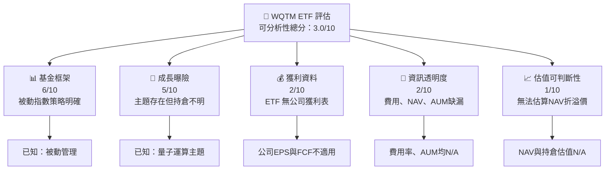

### 1.2 評分進度條視覺化

```text
╔══════════════════════════════════════════════════════════════╗
║              WQTM 基金資訊評估儀表板（1-10分）               ║
╠══════════════════════════════════════════════════════════════╣
║ 基金策略明確度  6.0 ▓▓▓▓▓▓▓▓▓▓▓▓░░░░░░░░  ★★★☆☆           ║
║ 主題曝險可理解  5.0 ▓▓▓▓▓▓▓▓▓▓░░░░░░░░░░  ★★★☆☆           ║
║ 持倉透明度      2.0 ▓▓▓▓░░░░░░░░░░░░░░░░  ★☆☆☆☆           ║
║ 費用／追蹤資訊  1.0 ▓▓░░░░░░░░░░░░░░░░░░  ★☆☆☆☆           ║
║ 估值可判斷性    1.0 ▓▓░░░░░░░░░░░░░░░░░░  ★☆☆☆☆           ║
║ 流動性資料      2.0 ▓▓▓▓░░░░░░░░░░░░░░░░  ★☆☆☆☆           ║
╠══════════════════════════════════════════════════════════════╣
║ 可分析性總分    3.0 ▓▓▓▓▓▓░░░░░░░░░░░░░░  🟡 資料不足       ║
╚══════════════════════════════════════════════════════════════╝
```

### 1.3 五大投資論點 + 三大核心風險

| 類型 | 項目 | 具體依據 | 信心度 |
|------|------|----------|--------|
| 🟢 **投資論點①** | 主題投資工具 | 基金摘要指出採被動指數策略，正常情況下至少 **80%** 淨資產投入指數成分股或經濟特性相近投資 | 🟡 中；未提供指數方法論 |
| 🟢 **投資論點②** | 可作主題配置工具 | ETF 結構可提供一籃子證券曝險；但實際持股數、前十大權重與集中度 N/A | 🟡 中 |
| 🟡 **投資論點③** | 價格已顯著低於近期高點 | $25.74 相對 52 週高點 $41.38 低 **37.8%**；這是價格事實，不代表低估 | 🟢 高 |
| 🟡 **風險①** | 主題與成分股集中 | 文件明示基金為 **non-diversified**；實際成分股及單一持倉比重未提供，難以量化集中度 | 🟡 中 |
| 🔴 **風險②** | 高波動與回撤 | 52 週價格區間 $23.18–$41.38；當前價格距高點 -37.8%，價格回撤可能延續 | 🟢 高 |
| 🔴 **風險③** | 基金品質與定價資訊缺漏 | 費用率、NAV、AUM、追蹤誤差、買賣價差及持倉資料均 N/A，無法評估持有成本或折溢價 | 🟢 高 |

### 1.4 快速統計卡片

公司指標不適用於 ETF；下表不以同業或 S&P 500 公司數據填補缺漏。

| 指標 | WQTM 實際值 | 行業均值 | S&P 500 均值 | 狀態 |
|------|-------------|----------|--------------|------|
| 收入 YoY 成長 | N/A | N/A | N/A | ⚪ 不適用 |
| 毛利率 | N/A | N/A | N/A | ⚪ 不適用 |
| 淨利率 | N/A | N/A | N/A | ⚪ 不適用 |
| ROE | N/A | N/A | N/A | ⚪ 不適用 |
| Forward P/E | N/A | N/A | N/A | ⚪ 缺資料 |
| Trailing P/E | 26.274237 | N/A | N/A | 🟡 口徑待確認 |
| 費用率 | N/A | N/A | N/A | 🔴 缺資料 |
| 分配殖利率 | 0.0% | N/A | N/A | 🟡 數據包所列 |
| NAV 折溢價 | N/A | N/A | N/A | 🔴 缺 NAV |

### 1.5 投資結論

```text
╔══════════════════════════════════════════════════════════════════╗
║                    📊 投資結論摘要                               ║
╠══════════════════════════════════════════════════════════════════╣
║  評級：暫定觀望；MOS 缺資料，不能套用正式估值門檻                 ║
║  價格（2026-11-12 收盤）：$25.74                                 ║
║  DCF 內在價值（基準）：N/A（ETF 不適用公司 DCF）                 ║
║  安全邊際 MOS：N/A（加權合理價值不可得）                          ║
║  目標價區間：N/A（沒有 NAV 與持倉估值，歷史價格不等於目標價）     ║
║  投資評分：3.0/10（資料可分析性，不代表標的品質）                 ║
║  適合投資人：能承受主題型波動、並可自行核查持倉與費用者           ║
╚══════════════════════════════════════════════════════════════════╝
```

---

## 2. 公司概覽與商業模式

### 2.1 業務結構與收入來源

WQTM 是基金，不是有營收部門的營運公司。基金提供的資料只指出被動追蹤指數與至少 80% 淨資產投資要求；指數名稱、成分股、費用收入、基金 AUM 與持倉明細皆未提供。

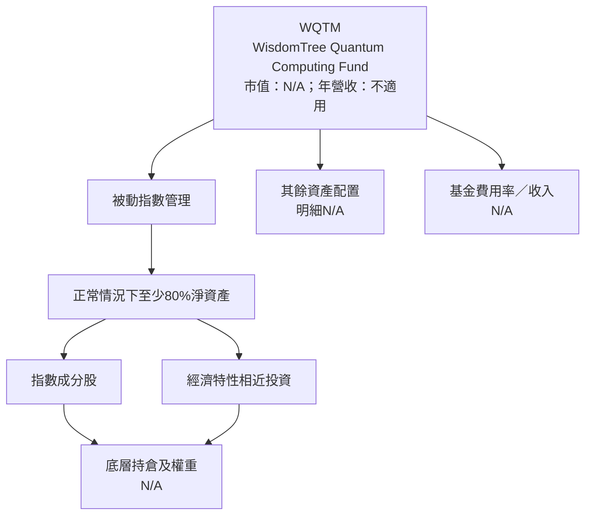

### 2.2 市場份額

沒有 WQTM AUM、量子運算 ETF 全市場資產規模或同類基金規模資料，不能計算市場份額。下圖只呈現**資料可得性**，不是市場份額。

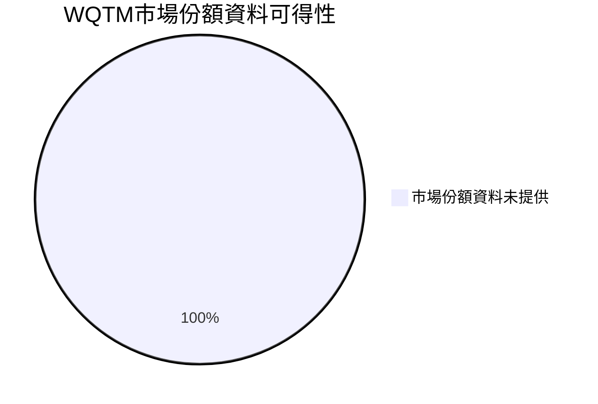

### 2.3 競爭護城河分析

ETF 的競爭力通常來自費用、流動性、追蹤品質、指數設計與品牌通路，而非營運公司式的技術或客戶鎖定。WQTM 相關數據多數未提供。

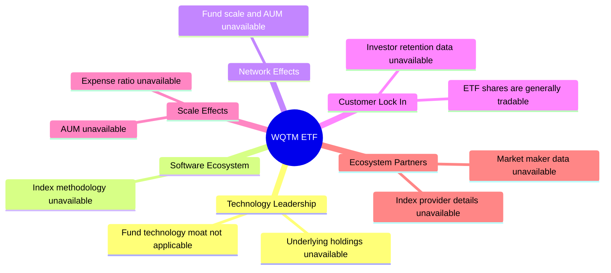

### 2.4 護城河強度評分

評分為產品資訊與可驗證競爭優勢的評估，不代表管理人能力高低。

```text
╔══════════════════════════════════════════════════════════════╗
║                WQTM ETF 競爭優勢可驗證性評分                  ║
╠══════════════════════════════════════════════════════════════╣
║ 指數方法透明度  2/10  ▓▓▓▓░░░░░░░░░░░░░░░░  🔴 未提供       ║
║ 規模經濟        2/10  ▓▓▓▓░░░░░░░░░░░░░░░░  🔴 AUM未知       ║
║ 費用競爭力      1/10  ▓▓░░░░░░░░░░░░░░░░░░  🔴 費用率未知    ║
║ 追蹤品質        1/10  ▓▓░░░░░░░░░░░░░░░░░░  🔴 誤差未知      ║
║ 流動性優勢      2/10  ▓▓▓▓░░░░░░░░░░░░░░░░  🔴 成交資料未知  ║
╠══════════════════════════════════════════════════════════════╣
║ 綜合可驗證優勢  1.6/10 ▓▓▓░░░░░░░░░░░░░░░░░ 🔴 證據不足      ║
╚══════════════════════════════════════════════════════════════╝
```

---

## 3. 損益表深度分析

### 3.1 年度收入成長趨勢（近 4 年）

ETF 沒有公司式年度營收；基金管理費收入若要分析，需管理費率與平均 AUM，兩者皆 N/A。

```text
╔══════════════════════════════════════════════════════════════════╗
║                 WQTM 年度營收趨勢：不適用                       ║
╠══════════════════════════════════════════════════════════════════╣
║ FY2023  營收 N/A  YoY N/A                                        ║
║ FY2024  營收 N/A  YoY N/A                                        ║
║ FY2025  營收 N/A  YoY N/A                                        ║
║ FY2026  營收 N/A  YoY N/A                                        ║
║ 4年 CAGR：N/A；基金 AUM、管理費率與年報資料均未提供             ║
╚══════════════════════════════════════════════════════════════════╝
```

### 3.2 季度收入趨勢分析

| 季度 | 基金營收／管理費收入 | QoQ | YoY | 備註 |
|------|----------------------|-----|-----|------|
| 最近一季 | N/A | N/A | N/A | 未提供基金財務報表及 AUM |
| 前一季 | N/A | N/A | N/A | 同上 |
| 前二季 | N/A | N/A | N/A | 同上 |
| 前三季 | N/A | N/A | N/A | 同上 |

因此不能計算季度營收 QoQ、YoY，也不能將基金份額價格漲跌解讀為基金營收成長。

### 3.3 利潤率演變分析

| 利潤率指標 | FY2023 | FY2024 | FY2025 | FY2026 | 趨勢 | 評估 |
|------------|--------|--------|--------|--------|------|------|
| 毛利率 | N/A | N/A | N/A | N/A | 不適用 | ETF 無產品毛利 |
| 營業利益率 | N/A | N/A | N/A | N/A | 不適用 | 無公司營業利益表 |
| 淨利率 | N/A | N/A | N/A | N/A | 不適用 | 無公司淨利資料 |
| 管理費率 | N/A | N/A | N/A | N/A | 無法判斷 | 費用率未提供 |

管理費率、營運費用與基金規模共同決定管理人經濟性，但不能用底層公司利潤率替代基金的費用資料。

### 3.4 費用結構分析

基金費用率、交易成本、證券借貸收入與其他費用均未提供。以下圖表表示「費用資料狀態」，不表示實際費用比例。

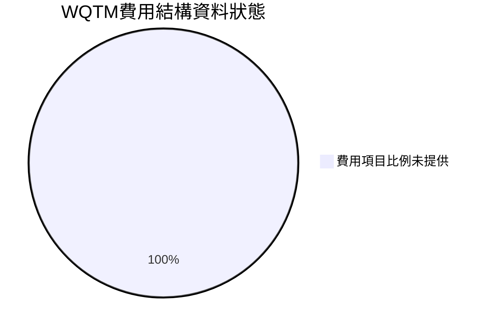

```text
╔══════════════════════════════════════════════════════════════╗
║                  基金費用結構資料檢查                        ║
╠══════════════════════════════════════════════════════════════╣
║ 管理費／費用率    N/A  ░░░░░░░░░░░░░░░░░░░░  未提供          ║
║ 交易成本          N/A  ░░░░░░░░░░░░░░░░░░░░  未提供          ║
║ 證券借貸收入      N/A  ░░░░░░░░░░░░░░░░░░░░  未提供          ║
║ 其他費用          N/A  ░░░░░░░░░░░░░░░░░░░░  未提供          ║
╚══════════════════════════════════════════════════════════════╝
```

### 3.5 季度 EPS 趨勢與盈餘品質（Quality of Earnings）

ETF 份額沒有營運公司的 EPS 驚喜；底層成分股盈餘與基金份額回報不是同一概念。數據包無最近四季 EPS surprise 資料。

| 盈餘品質項目 | 數值／佔比 | 評估 |
|--------------|-----------|------|
| 最近 4 季 EPS 超預期／不及預期 | N/A | ETF 不發布公司式 EPS；成分股資料未提供 |
| SBC／營收 | N/A | 基金層級不適用，成分股層級資料缺漏 |
| SBC／營業現金流 | N/A | 不適用／資料缺漏 |
| FCF／淨利 | N/A | 不適用 |
| 一次性／非經常性損益 | N/A | 無基金財務報表 |
| 有效稅率 | N/A | 未提供 |
| 資本化支出 vs 費用化 | N/A | ETF 無公司資本支出分析 |

**盈餘品質結論**：無法就基金或底層持倉評估 GAAP 盈餘含金量。基金投資人應以總報酬、分配、NAV、持倉估值及費用追蹤，而非將底層公司的單季 EPS surprise 當成 ETF 盈利能力。

---

## 4. 資產負債表分析

### 4.1 資產結構分解

基金淨資產與持倉明細未提供；「至少 80%」是基金投資政策門檻，不是實際資產配置比例。

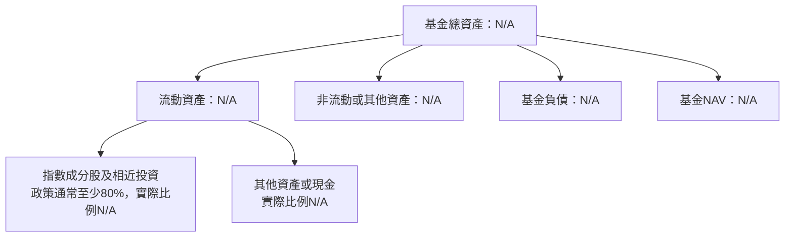

### 4.2 流動性指標分析

| 指標 | WQTM | ETF／同類均值 | 歷史趨勢 | 評估 |
|------|------|---------------|----------|------|
| 基金 AUM | N/A | N/A | N/A | 🔴 無法評估規模與清盤風險 |
| 日均成交量 | N/A | N/A | N/A | 🔴 無法評估交易流動性 |
| 買賣價差 | N/A | N/A | N/A | 🔴 交易成本未知 |
| NAV 折溢價 | N/A | N/A | N/A | 🔴 無法判斷成交價格是否偏離資產淨值 |
| 現金比例 | N/A | N/A | N/A | 🟡 資產配置未知 |

### 4.3 債務結構分析

ETF 不是普通營運公司；數據包中的「Net Cash / Debt $0.00」不應解讀為基金實際零負債，因現金與總債務欄位均為 N/A。

```text
╔══════════════════════════════════════════════════════════════════╗
║                    WQTM 基金資產負債診斷                         ║
╠══════════════════════════════════════════════════════════════════╣
║  基金總資產：      N/A      ░░░░░░░░░░░░░░░░░░░░  未提供       ║
║  基金總負債：      N/A      ░░░░░░░░░░░░░░░░░░░░  未提供       ║
║  基金 NAV：        N/A      ░░░░░░░░░░░░░░░░░░░░  未提供       ║
║  Net Cash / Debt：$0.00（數據包原值；基礎分項缺漏，不可驗證）   ║
║  Debt / Equity：   N/A                                           ║
║  Interest Coverage：N/A；不適用公司利息保障倍數                  ║
╚══════════════════════════════════════════════════════════════════╝
```

### 4.4 股東權益趨勢

ETF 投資人持有基金份額而非普通公司股東權益；基金淨資產取決於持倉市值、申購贖回與負債。歷史 NAV 未提供。

```text
╔══════════════════════════════════════════════════════════════════╗
║                    WQTM 淨資產／NAV 趨勢                         ║
╠══════════════════════════════════════════════════════════════════╣
║ FY2023 NAV：N/A  ░░░░░░░░░░░░░░░░░░░░                           ║
║ FY2024 NAV：N/A  ░░░░░░░░░░░░░░░░░░░░                           ║
║ FY2025 NAV：N/A  ░░░░░░░░░░░░░░░░░░░░                           ║
║ FY2026 NAV：N/A  ░░░░░░░░░░░░░░░░░░░░                           ║
║ NAV CAGR／申購贖回造成的規模變化：N/A                            ║
╚══════════════════════════════════════════════════════════════════╝
```

---

## 5. 現金流量深度分析

### 5.1 現金流量瀑布圖

以下公司現金流瀑布不適用於 ETF；基金層級現金流、分配及申購贖回資料未提供。


### 5.2 FCF 轉換率趨勢

| 年度 | FCF／Net Income | 解讀 |
|------|-----------------|------|
| FY2023 | N/A | ETF 無公司式 FCF／淨利轉換率 |
| FY2024 | N/A | 無基金財務報表 |
| FY2025 | N/A | 無基金財務報表 |
| FY2026 | N/A | 無基金財務報表 |

### 5.3 自由現金流趨勢

數據包所列 TTM FCF、營業現金流與資本支出均為 N/A。基金分配殖利率為 **0.0%**；分配殖利率不等於基金總報酬。

```text
╔══════════════════════════════════════════════════════════════════╗
║             WQTM：公司自由現金流不適用／資料不可得               ║
╠══════════════════════════════════════════════════════════════════╣
║ TTM OCF：N/A      ░░░░░░░░░░░░░░░░░░░░                           ║
║ TTM Capex：N/A    ░░░░░░░░░░░░░░░░░░░░                           ║
║ TTM FCF：N/A      ░░░░░░░░░░░░░░░░░░░░                           ║
║ FCF Yield：N/A    ░░░░░░░░░░░░░░░░░░░░                           ║
║ 數據包列示分配殖利率：0.0%；不代表底層資產無收益或總報酬為零       ║
╚══════════════════════════════════════════════════════════════════╝
```

### 5.4 資本配置評估

基金的資產配置權重與費用明細未提供，不能將公司回購、Capex 或股息分析套用到 ETF。

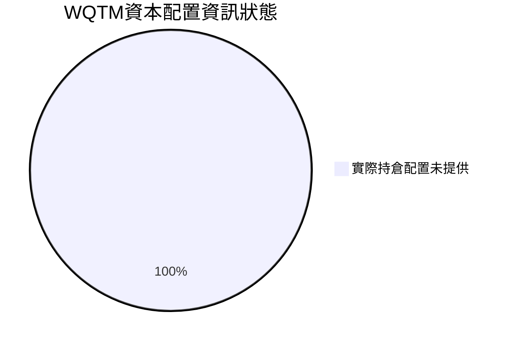

| 配置／資本使用項目 | 數值 | 評估 |
|--------------------|------|------|
| 指數成分股及相近投資 | 政策通常至少 80%；實際比例 N/A | 🟡 需核對最新持倉 |
| 現金及短期投資 | N/A | ⚪ 無法判斷 |
| 基金分配 | 殖利率 0.0% | 🟡 數據包值；分配紀錄未提供 |
| 管理費及營運費用 | N/A | 🔴 無法比較持有成本 |
| 基金申購／贖回 | N/A | ⚪ 無法評估資金流向 |

---

## 6. 獲利能力與資本效率

### 6.1 ROE／ROA／ROIC 趨勢

| 指標 | FY2023 | FY2024 | FY2025 | FY2026 | 評估 |
|------|--------|--------|--------|--------|------|
| ROE | N/A | N/A | N/A | N/A | ETF 不適用公司股東權益報酬分析 |
| ROA | N/A | N/A | N/A | N/A | 基金資產報酬應由 NAV 總報酬衡量，資料缺漏 |
| ROIC | N/A | N/A | N/A | N/A | 不適用基金本身 |
| 同業均值 | N/A | N/A | N/A | N/A | 未提供可比較樣本 |

### 6.2 ROIC vs WACC 分析（核心價值創造判斷）

```text
╔══════════════════════════════════════════════════════════════════╗
║                ROIC vs WACC：ETF 不適用                         ║
╠══════════════════════════════════════════════════════════════════╣
║  無風險利率 Rf：N/A（數據包未提供資本成本輸入）                  ║
║  ERP：N/A                                                        ║
║  Beta：N/A                                                       ║
║  債務成本 Kd：N/A（基金資產負債資料缺漏）                        ║
║  資本結構權重：N/A                                               ║
║  WACC：N/A                                                       ║
║                                                                  ║
║  基金 ROIC：N/A；應評估底層公司，而非基金份額本身                ║
║  EVA = ROIC − WACC：N/A                                          ║
║  結論：不能據此判定 WQTM 是否創造或摧毀股東價值                  ║
╚══════════════════════════════════════════════════════════════════╝
```

### 6.3 杜邦三因素分解

ETF 沒有公司淨利率、資產週轉率與財務槓桿三因素所構成的公司 ROE。基金總報酬應以持倉市值變化、分配及費用等因素拆解。

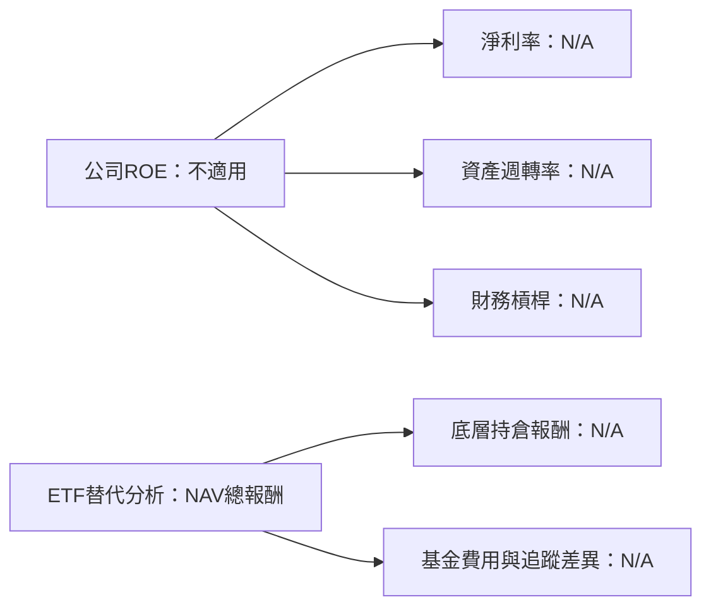

### 6.4 獲利能力儀表板

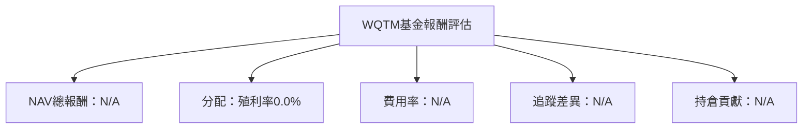

---

## 7. 相對估值分析

### 7.1 同業估值比較表格

WQTM 的同業 P/E、Forward P/E、P/S、EV/EBITDA 與 FCF Yield 未提供。量子主題 ETF 不是營運公司；基金之間比較應以費用率、AUM、流動性、追蹤差異、持倉與 NAV 折溢價為主。競品名稱只用作產品比較對象，並不表示其倍數資料已取得。

| 估值／基金指標 | **WQTM** | **QTUM** | **CHPX** | **第三同類產品** | WQTM 評估 |
|----------|----------|---------|---------|---------|-----------|
| Trailing P/E | 26.274237 | N/A | N/A | N/A | 🟡 數據包口徑未說明，需核實是持倉加權值 |
| Forward P/E | N/A | N/A | N/A | N/A | 🔴 不可比較 |
| P/S Ratio | N/A | N/A | N/A | N/A | 🔴 不可比較 |
| EV/EBITDA | N/A | N/A | N/A | N/A | 🔴 不適用基金本體 |
| FCF Yield | N/A | N/A | N/A | N/A | 🔴 不適用基金本體 |
| 費用率 | N/A | N/A | N/A | N/A | 🔴 核心比較資料缺漏 |
| AUM | N/A | N/A | N/A | N/A | 🔴 規模比較不可做 |
| 追蹤誤差 | N/A | N/A | N/A | N/A | 🔴 追蹤品質不可做 |

**同業倍數說明**：VERIFIED FIGURES 未提供 Peer multiples。依資料規則不以外部記憶或未驗證數字填補，因此倍數均列 N/A，而非以「估計值」冒充可比資料。

### 7.2 歷史估值區間分析

數據包未提供「Valuation vs own history」估值區間，因此歷史 P/E 區間及百分位均為 N/A。以下只呈現實際價格區間，不等於估值區間。

```text
╔══════════════════════════════════════════════════════════════════╗
║                 WQTM 52 週價格位置（不是估值百分位）              ║
╠══════════════════════════════════════════════════════════════════╣
║ 52週低點 $23.18 ── 現價 $25.74 ───────────────── 高點 $41.38      ║
║ 價格區間位置：(25.74−23.18)÷(41.38−23.18) = 14.1%               ║
║ 距52週高點：(25.74÷41.38)−1 = -37.8%                              ║
║ 歷史 P/E 區間／百分位：N/A；不能由價格區間反推                   ║
╚══════════════════════════════════════════════════════════════════╝
```

### 7.3 情境目標價（假設驅動，Bear／Base／Bull）

未提供 NAV、持倉估值、預期成長或基金折溢價資料，無法推導基本面目標價。以下不虛構營收 CAGR、營業利潤率或退出倍數；歷史價格也不作為估值目標。

| 情境 | 營收 CAGR | 營業利潤率 | 退出倍數 | 隱含目標價 | 相對現價 |
|------|-----------|-----------|----------|------------|----------|
| 🔴 悲觀 | 不適用 | 不適用 | 不適用 | N/A | N/A |
| 🟡 基準 | 不適用 | 不適用 | 不適用 | N/A | N/A |
| 🟢 樂觀 | 不適用 | 不適用 | 不適用 | N/A | N/A |

估值倍數選擇說明：基金估值應以 NAV、持倉加權基本面與基金交易折溢價為核心；公司 EV/EBITDA、EV/Sales 或 FCF Yield 不適用於 WQTM 基金本體。

### 7.4 相對估值隱含價格區間

```text
╔══════════════════════════════════════════════════════════════════╗
║               相對估值隱含價格：目前不可計算                     ║
╠══════════════════════════════════════════════════════════════════╣
║ Forward P/E 回推：N/A   ──┤現價 $25.74├──  N/A                  ║
║ EV/EBITDA 回推：  N/A   ──┤現價 $25.74├──  N/A                  ║
║ EV/Sales 回推：   N/A   ──┤現價 $25.74├──  N/A                  ║
║ FCF Yield 回推：  N/A   ──┤現價 $25.74├──  N/A                  ║
║ 原因：持倉、NAV、倍數及基金追蹤資料缺漏                         ║
╚══════════════════════════════════════════════════════════════════╝
```

---

## 8. DCF 內在價值評估（Discounted Cash Flow）

> **適用性結論**：WQTM 是 ETF，沒有可用於公司 DCF 的營收、EBIT、FCFF、稀釋股數或公司資本結構。ETF 的每股資產價值應以 NAV 為核心，而不是把基金份額當成營運公司的股權現金流。數據包亦未提供 NAV、持倉與費用率，所以不能製作可複算的 DCF，也不能以假設數字硬造每股內在價值。

### 8.0 估值推理鏈（Thinking Logic）

**Step 1 — 價值由哪些變數決定？**

WQTM 的合理交易價應由「底層持倉公允價值（透過 NAV 反映）＋基金追蹤品質及費用影響＋市場供需造成的折溢價」決定。數據包只提供基金至少 80% 淨資產投資於指數成分股及相近投資的政策，沒有實際持倉比重；因此不能確認各部分佔基金價值比例。主導估值的可驗證變數應是**NAV 相對市價的折溢價**，但 NAV 缺漏，故估值鏈無法完成。

**Step 2 — 模型選擇**

| 決策點 | 本報告採用 | 理由（含數字） | 曾考慮但否決 | 否決理由 |
|--------|-----------|----------------|--------------|----------|
| 現金流定義 | 不適用 | ETF 無公司 FCFF／FCFE 資料 | FCFF／FCFE DCF | 缺營收、EBIT、稅、資本支出與營運資金 |
| 預測期 N | 不適用 | 沒有基金或成分股財測 | 5 年公司 DCF | 缺底層持倉財務資料 |
| 終值方法 | 不適用 | 無可預測的 ETF FCFF | Gordon Growth | WACC 與 FCFF 均不存在 |
| 價值基礎 | 理論上採 NAV | ETF 價格應與每份 NAV 比較 | 公司 EPS／DCF 倍數 | 基金份額不是公司股權 |

**Step 3 — 關鍵假設推導**

營收 CAGR、期末營業利潤率、有效稅率、Capex／營收、D&A／營收、ΔWC、SBC、稀釋率、永續成長率與 WACC 均為 **N/A**。這些不是可合理估計但缺一個數字的欄位，而是 ETF 公司 DCF 的模型輸入本身不適用。若擅自填入數值，會把不存在的公司現金流模型包裝成精確估值。

**Step 4 — 最脆弱一環**

本案不是某個 DCF 假設偏差，而是缺少 NAV 與成分股持倉，導致無法建立估值；若不補齊這些資料，任何每股內在價值與 MOS 都不可稽核。

**Step 5 — 計算路徑圖**

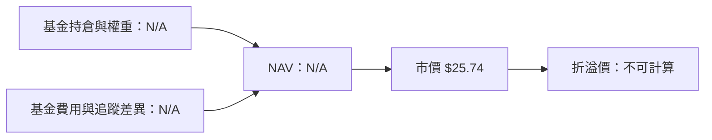

### 8.1 模型假設總表（Model Inputs）

| 假設項目 | 採用值 | 依據／來源 | 敏感度 |
|----------|--------|-------------|--------|
| 預測期長度 N | N/A | ETF NAV 分析不使用公司 DCF 預測期 | 🟢 不適用 |
| 營收 CAGR | N/A | ETF 非營運公司，底層持倉財測缺漏 | 🔴 不可建模 |
| 營業利潤率 | N/A | 沒有 ETF 公司營業利益 | 🔴 不可建模 |
| 有效稅率 | N/A | 基金財務資料未提供 | 🟢 不適用 |
| Capex／營收 | N/A | ETF 沒有可用的公司 Capex | 🟡 不適用 |
| D&A／營收 | N/A | ETF 無公司損益及現金流資料 | 🟢 不適用 |
| ΔWC／營收增額 | N/A | ETF 不適用公司營運資金假設 | 🟢 不適用 |
| EBIT 基礎 | 不適用 | 無 GAAP／非 GAAP EBIT | 🟡 不適用 |
| SBC 處理 | 不適用 | ETF 本身無可供建模 SBC | 🟡 不適用 |
| 年稀釋率 | N/A | 未提供 ETF 份額變動資料 | 🟡 不適用 |
| 永續成長率 g | N/A | 無終值 FCFF 與 WACC | 🔴 不適用 |
| 終值方法 | 不適用 | 不採 Gordon Growth／退出倍數 | 🔴 不適用 |
| WACC | N/A | VERIFIED FIGURES 明示 ETF 無 WACC | 🔴 不適用 |

**FCF 定義與 SBC 防呆**：本 ETF 不使用 FCFF 或 FCFE DCF，因此 (A)、(B)、(C) SBC 組合均不適用；不會為基金份額虛構公司股數稀釋率。

### 8.2 折現率推導（WACC）

```text
╔══════════════════════════════════════════════════════════════════╗
║                 WACC 推導：不適用於 ETF                           ║
╠══════════════════════════════════════════════════════════════════╣
║ 無風險利率 Rf：N/A                                                ║
║ ERP：N/A                                                          ║
║ Beta：N/A                                                         ║
║ 股權成本 Ke：N/A；無法用 CAPM 推導                                ║
║ 債務成本 Kd：N/A；基金計息負債資料未提供                          ║
║ 股權／債務權重：N/A                                               ║
║ WACC：N/A；VERIFIED FIGURES 明示基金無 WACC                       ║
║ ROIC 比較：N/A；與第 6.2 節一致                                   ║
╚══════════════════════════════════════════════════════════════════╝
```

**逐步演算檢查**：CAPM、債務成本、資本權重及 WACC 五步均不適用；不能以假設利率或市場 Beta 補成公司資本成本。

### 8.3 逐年自由現金流預測（基準情境）

| 年度 | FY+1 | FY+2 | FY+3 | FY+4 | FY+5 |
|------|------|------|------|------|------|
| 營收 | N/A | N/A | N/A | N/A | N/A |
| 營收 YoY | N/A | N/A | N/A | N/A | N/A |
| EBIT | N/A | N/A | N/A | N/A | N/A |
| NOPAT | N/A | N/A | N/A | N/A | N/A |
| D&A | N/A | N/A | N/A | N/A | N/A |
| Capex | N/A | N/A | N/A | N/A | N/A |
| ΔWC | N/A | N/A | N/A | N/A | N/A |
| FCFF | N/A | N/A | N/A | N/A | N/A |
| 折現因子 | N/A | N/A | N/A | N/A | N/A |
| FCFF 現值 | N/A | N/A | N/A | N/A | N/A |

預測期 FCF 現值合計：N/A。沒有基期營收或 FCFF，無法逐年計算營收、稅、現金流、折現因子或 PV，也無歷史 FCF CAGR 可供合理性檢查。

```text
╔══════════════════════════════════════════════════════════════════╗
║            自由現金流：ETF 不適用／數據包未提供                  ║
╠══════════════════════════════════════════════════════════════════╣
║ 近年實際 FCF：N/A      ░░░░░░░░░░░░░░░░░░░░                     ║
║ FY+1 預測 FCFF：N/A    ░░░░░░░░░░░░░░░░░░░░                     ║
║ FY+5 預測 FCFF：N/A    ░░░░░░░░░░░░░░░░░░░░                     ║
║ FCF CAGR／FCF 利潤率：N/A                                          ║
╚══════════════════════════════════════════════════════════════════╝
```

### 8.4 終值計算（Terminal Value）

適用性檢查：`WACC N/A vs g N/A → WACC > g？不適用`

| 方法 | 計算式 | 終值 TV | TV 現值 | 佔總 EV 比重 |
|------|--------|---------|---------|--------------|
| Gordon Growth | N/A | N/A | N/A | N/A |
| 退出倍數法 | N/A | N/A | N/A | N/A |

終值需要第 N 年 FCFF 或 EBITDA；兩者皆不存在於 ETF 層級資料，因此不計算。

### 8.5 企業價值 → 每股內在價值（Bridge）

```text
╔══════════════════════════════════════════════════════════════════╗
║              DCF 企業價值 → 每股內在價值橋接                     ║
╠══════════════════════════════════════════════════════════════════╣
║ 預測期 FCF 現值合計：N/A                                         ║
║ 終值現值 PV(TV)：N/A                                             ║
║ 企業價值 EV：N/A                                                 ║
║ + 現金及短期投資：N/A                                            ║
║ − 總債務：N/A                                                    ║
║ 股權價值：N/A                                                    ║
║ ÷ 稀釋後流通股數：N/A                                            ║
║ DCF 每股內在價值：N/A                                            ║
║ 當前股價（2026-11-12 收盤）：$25.74                              ║
║ 折溢價：N/A（缺少 DCF 內在價值）                                 ║
╚══════════════════════════════════════════════════════════════════╝
```

依定義，DCF 橋接各項無法計算；ETF 的應用替代方法是比較每份市場價格與同日 NAV。**本節不計算 MOS**；MOS 僅能在 8.8 有加權合理價值時計算。

### 8.6 敏感性分析（WACC × 永續成長率）

WACC、g、FCFF 與股數均不適用，因此不能生成有意義的 Gordon Growth 敏感性矩陣。

| g／WACC | WACC N/A | WACC N/A | WACC N/A | WACC N/A | WACC N/A |
|-----------|---------|---------|---------|---------|---------|
| g N/A | N/A | N/A | N/A | N/A | N/A |
| g N/A | N/A | N/A | N/A | N/A | N/A |
| g 基準 N/A | N/A | N/A | N/A | N/A | N/A |
| g N/A | N/A | N/A | N/A | N/A | N/A |
| g N/A | N/A | N/A | N/A | N/A | N/A |

三情境 DCF、機率加權價值與每 1pp 的 WACC／g／利潤率敏感度均 N/A。原因不是模型結果相同，而是模型無法建立。

### 8.7 反推 DCF（Reverse DCF）

現價只有一個數字方程式，但本案連基準 FCFF、WACC 與終值均無法建立。故不能由 $25.74 反解營收 CAGR、利潤率、g 或預測期 N。

| 求解變數 | 固定輸入 | 市場隱含值 | 公司歷史實際 | 判斷 |
|---------|----------|-------------|--------------|------|
| 營收 CAGR | WACC、利潤率、g、N 均無基準 | N/A | 不適用 | 無解 |
| 期末營業利潤率 | CAGR、WACC、g、N 均無基準 | N/A | 不適用 | 無解 |
| 永續成長率 g | CAGR、利潤率、WACC 均無基準 | N/A | 不適用 | 無解 |
| 預測期 N | 其餘 DCF 輸入均無基準 | N/A | 不適用 | 無解 |

### 8.8 估值三角驗證與安全邊際

| 估值方法 | 隱含每股價值 | 上行空間（÷現價） | 權重 | 說明 |
|----------|--------------|-------------------|------|------|
| DCF | N/A | N/A | N/A | ETF 不適用公司 DCF |
| 同業 Forward P/E | N/A | N/A | N/A | 同業倍數未提供 |
| EV/EBITDA 倍數 | N/A | N/A | N/A | 不適用基金本體 |
| FCF Yield 回推 | N/A | N/A | N/A | 不適用基金本體 |
| 分析師共識目標價 | N/A | N/A | N/A | 數據包未提供 |
| **加權合理價值** | **N/A** | **N/A** | 無法配置 | NAV 與持倉資料缺漏 |

加權合理價值公式：`Σ（方法價值 × 權重）`。本案各方法價值及權重都無法取得，故不能構造加權總值，也不能計算 MOS。

```text
╔══════════════════════════════════════════════════════════════════╗
║                  估值區間與安全邊際                              ║
╠══════════════════════════════════════════════════════════════════╣
║ 估值區間：N/A ───────── 現價 $25.74 ───────── 合理價值 N/A        ║
║ MOS = (加權合理價值 − 現價) ÷ 加權合理價值：N/A                  ║
║ 上行空間 = (合理價值 − 現價) ÷ 現價：N/A                         ║
║ DCF 折溢價 = 現價 ÷ DCF價值 − 1：N/A                             ║
║ 建議買入區間：N/A；未取得 NAV 前不以歷史低點取代公允價值         ║
╚══════════════════════════════════════════════════════════════════╝
```

### 8.9 DCF 模型的局限與失效條件

- **終值依賴度**：N/A；無法計算 EV 或終值現值比例。
- **最脆弱的假設**：沒有可用 DCF 假設；核心缺口是 NAV、持倉權重、管理費率與追蹤誤差。
- **不適用情境**：ETF 不應直接套用營運公司 DCF；應優先使用 NAV 折溢價、持倉加權估值、費用率、AUM、成交價差與追蹤差異。
- **與第 10 章風險矩陣連結**：持倉集中會影響底層資產淨值；高波動會拉大市價短期波動；追蹤或流動性問題會使市價偏離 NAV。

### 8.10 複算檢核表（Audit Trail）

| # | 檢核項目 | 檢查方式 | 結果 |
|---|----------|----------|------|
| 1 | 高／中敏感度輸入完整推導 | DCF 模型不適用；必要輸入均列 N/A | ✅ 已揭露不適用 |
| 2 | 每個假設都有來歷 | 8.1 逐項列明資料缺漏或不適用原因 | ✅ |
| 3 | WACC 五步算式與權重 | WACC 不適用，沒有虛構輸入 | ✅ |
| 4 | Kd 分母與 D 範圍一致 | 基金計息負債與債務權重資料未提供 | ✅ 不適用 |
| 5 | WACC 與第 6.2 節同值 | 兩節皆為 N/A | ✅ |
| 6 | 預測年度數與 N 一致 | N 不適用；未宣稱有預測期 | ✅ |
| 7 | FY+1 九步現金流算式 | 基期營收與 FCFF 不存在 | ✅ 不適用 |
| 8 | 預測期 PV 加總 | 各年 PV 均 N/A | ✅ 不適用 |
| 9 | WACC > g | WACC、g 均不適用 | ✅ 不適用 |
| 10 | 終值以 FY+N 現金流為基礎 | 沒有終值計算 | ✅ 不適用 |
| 11 | EV 至每股價值橋接 | EV、現金、負債、股數均無法建立 | ✅ 已列 N/A |
| 12 | SBC 三要素相容性 | DCF 不適用，不使用 SBC 組合 | ✅ 不適用 |
| 13 | 敏感性矩陣基準格 | DCF 敏感性矩陣不適用 | ✅ 不適用 |
| 14 | 矩陣有效格 | WACC／g 缺失，未填造數值 | ✅ |
| 15 | 三情境機率合計 | 未構造 DCF 情境 | ✅ 不適用 |
| 16 | 反推 DCF 一次一變數 | 因沒有基準 DCF 輸入，無法反推 | ✅ 已揭露 |
| 17 | MOS／折溢價口徑 | MOS、DCF 折溢價均 N/A；未混用 | ✅ |
| 18 | 報告完整至第 11 章 | 已列出 11 章 | ✅ |
| 19 | 加權價值可複算 | 估值方法與權重不可得，未構造加權值 | ✅ 不適用 |
| 20 | 評級符合 MOS 門檻 | MOS N/A；明確說明暫定觀望不是正式 MOS 評級 | ✅ 已揭露 |

---

## 9. 成長催化劑

### 9.1 催化劑時間軸

以下是投資人應追蹤的**條件式觀察項目**，不是已確認將發生的公司事件。基金持倉、指數公告與產業曝險資料未提供。

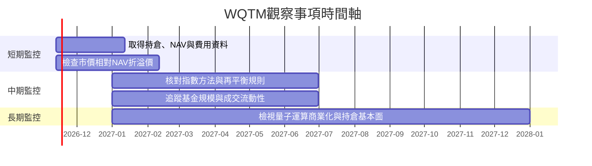

### 9.2 TAM 市場規模分析

沒有 WQTM 指數定義、底層持倉與各持倉收入來源，無法將量子運算市場規模直接換算為基金可實現收入。TAM 不是 ETF 管理人收入，也不代表基金持有公司能取得的營收。

```text
╔══════════════════════════════════════════════════════════════════╗
║                WQTM TAM 與收入曝險：資料狀態                     ║
╠══════════════════════════════════════════════════════════════════╣
║ 量子運算市場 TAM：N/A；數據包未提供且未指定估計口徑              ║
║ WQTM 實際相關持倉比重：N/A                                       ║
║ 底層公司量子運算收入占比：N/A                                    ║
║ 基金管理費收入：N/A；AUM 與費用率缺漏                            ║
║ 可確認的投資政策：正常情況下至少80%投資於指數相關資產             ║
╚══════════════════════════════════════════════════════════════════╝
```

### 9.3 成長驅動力結構圖

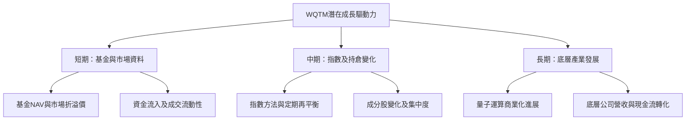

---

## 10. 風險矩陣

### 10.1 風險評分矩陣

機率與衝擊分數為定性研究評估，不是歷史頻率估計。依照要求，quadrantChart 標題、軸、象限及數據點名稱使用英文。

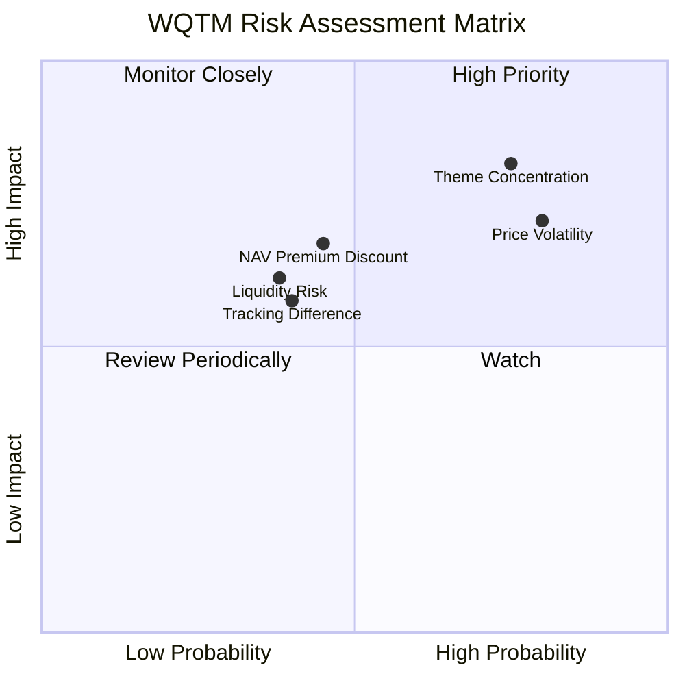

### 10.2 風險清單詳細分析

| # | 風險項目 | 發生機率 | 財務衝擊 | 風險評分 | 緩解措施 |
|---|----------|----------|----------|----------|----------|
| 1 | 🔴 **主題與非分散風險** | 中高；定性判斷 | 可能造成較大 NAV 波動；成分股權重 N/A，無法量化收入衝擊 | 🔴 8/10 | 取得完整持倉與前十大權重；控制主題倉位上限 |
| 2 | 🔴 **底層股票估值與價格波動** | 高；近一年價格區間已達 $23.18–$41.38 | 現價比 52 週高點低 37.8%；回撤可能擴大 | 🔴 8/10 | 分批配置、事先設定組合風險預算，避免以跌幅推論低估 |
| 3 | 🟠 **市價偏離 NAV** | 中；NAV 未提供 | 折溢價未知，交易價格可能不等於資產價值 | 🟠 7/10 | 下單前查同日 NAV 與 iNAV；避免在價差擴大時追價 |
| 4 | 🟠 **追蹤誤差與費用侵蝕** | 中；費用與追蹤數據缺漏 | 長期報酬可能落後指數，幅度 N/A | 🟠 6/10 | 核對年度費用率、追蹤差異與證券借貸政策 |
| 5 | 🟡 **流動性與買賣價差** | 中；成交量／價差 N/A | 交易成本可能提高，極端行情下影響退出 | 🟡 6/10 | 使用限價單，檢查平均成交量與買賣價差 |
| 6 | 🟡 **指數方法及持倉定義不透明** | 中；方法論未提供 | 可能與投資人理解的「量子運算純度」不同 | 🟡 6/10 | 閱讀指數規則、持倉分類與再平衡公告 |

---

## 11. 投資建議

### 11.1 最終綜合評級雷達圖

評分著重目前可驗證資訊，不代表底層量子運算公司實際品質。

```text
╔══════════════════════════════════════════════════════════════╗
║                 WQTM 最終評估雷達（1-10分）                  ║
╠══════════════════════════════════════════════════════════════╣
║ 基金策略可理解度  6.0 ▓▓▓▓▓▓▓▓▓▓▓▓░░░░░░░░  ★★★☆☆           ║
║ 價格資料可得性    6.0 ▓▓▓▓▓▓▓▓▓▓▓▓░░░░░░░░  ★★★☆☆           ║
║ 持倉透明度        2.0 ▓▓▓▓░░░░░░░░░░░░░░░░  ★☆☆☆☆           ║
║ 費用及追蹤資料    1.0 ▓▓░░░░░░░░░░░░░░░░░░  ★☆☆☆☆           ║
║ 估值可判斷性      1.0 ▓▓░░░░░░░░░░░░░░░░░░  ★☆☆☆☆           ║
║ 風險可量化性      2.0 ▓▓▓▓░░░░░░░░░░░░░░░░  ★☆☆☆☆           ║
╠══════════════════════════════════════════════════════════════╣
║ 可分析性總分      3.0 ▓▓▓▓▓▓░░░░░░░░░░░░░░  🟡 觀望          ║
╚══════════════════════════════════════════════════════════════╝
```

### 11.2 目標價與隱含報酬率

| 情境／參考值 | 價格 | 相對 $25.74 報酬 | 權重 | 說明 |
|--------------|------|------------------|------|------|
| 估值悲觀情境 | N/A | N/A | N/A | 無法建立基本面假設 |
| 基準合理價值 | N/A | N/A | N/A | NAV 與持倉資料缺漏 |
| 估值樂觀情境 | N/A | N/A | N/A | 無法建立持倉與產業預測 |
| 52 週低點參考 | $23.18 | -9.9% | 不適用 | 歷史交易價格，不是目標價 |
| 52 週高點參考 | $41.38 | +60.8% | 不適用 | 歷史交易價格，不是合理價值 |

報酬計算依據：低點情境 `(23.18 ÷ 25.74) − 1 = -9.9%`；高點情境 `(41.38 ÷ 25.74) − 1 = +60.8%`。歷史極值僅供價格波動參考，不應視為未來目標價或估值區間。

### 11.3 買入時機與觸發因素

```text
╔══════════════════════════════════════════════════════════════════╗
║                  ✅ WQTM 配置觸發因素 Checklist                  ║
╠══════════════════════════════════════════════════════════════════╣
║  目前立場：先補足基金資料；不以價格低於高點作為單獨買入理由       ║
║                                                                  ║
║  重新評估／初始配置前：                                          ║
║  ☐ 取得最新持倉、前十大權重與指數方法論                           ║
║  ☐ 取得費用率、AUM、日均成交量與買賣價差                          ║
║  ☐ 核對同日 NAV，確認市價折溢價處於可接受範圍                     ║
║  ☐ 檢查追蹤差異與分配政策，區分總報酬與現金分配                   ║
║                                                                  ║
║  加碼條件：                                                      ║
║  ☐ 持倉與投資主題符合投資人原定配置目的                           ║
║  ☐ 費用、流動性及 NAV 折溢價經核實後仍可接受                      ║
║  ☐ 底層持倉基本面支持估值，而非僅因價格回落而加碼                 ║
║                                                                  ║
║  減碼／重新檢視條件：                                            ║
║  ☐ 前十大持倉或單一持倉集中度超出投資組合風險上限                 ║
║  ☐ 市價相對 NAV 出現明顯溢價，或買賣價差顯著擴大                  ║
║  ☐ 指數規則偏離原投資目的，或追蹤差異持續惡化                     ║
╚══════════════════════════════════════════════════════════════════╝
```

### 11.4 投資人適配度分析

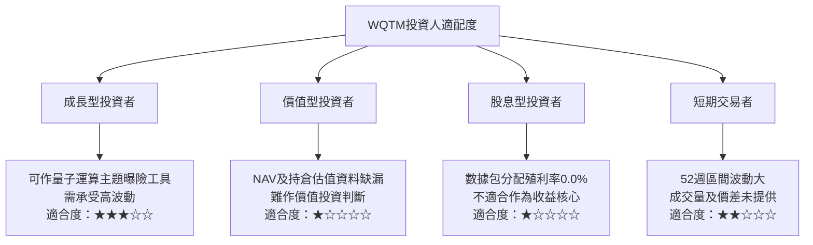

### 11.5 每季財報監控清單（Quarterly Watch List）

WQTM 是 ETF，以下監控基金資料與底層持倉，而非把公司營收、Capex 或 EPS 直接套用於基金。

| 每季／定期追蹤項目 | 目前資料 | 加碼／正向觸發條件 | 減碼／風險觸發條件 |
|-------------------|----------|--------------------|--------------------|
| 指數與基金持倉 | N/A | 持倉與主題曝險清晰且符合配置目的 | 持倉分類偏離投資目的或集中度超限 |
| 前十大持倉比重 | N/A | 符合個人組合風險上限 | 超過事前設定的單一產業／個股風險上限 |
| 基金費用率 | N/A | 與同類產品比較後具競爭力 | 費用上升或長期明顯高於同類 |
| AUM | N/A | 規模與市場流動性穩定改善 | AUM 持續縮小或出現產品存續疑慮 |
| 買賣價差與成交量 | N/A | 日常交易成本可接受 | 價差擴大、成交量不足以支援預定部位 |
| NAV 折溢價 | N/A | 市價接近 NAV，折溢價穩定 | 折溢價擴大且持續，尤其溢價買入 |
| 追蹤差異 | N/A | 實際表現接近指數扣除費用後水準 | 滾動 12 個月差異顯著惡化；需先取得資料再設定量化門檻 |
| 分配與總報酬 | 分配殖利率 0.0% | 以 NAV 總報酬及分配合併評估 | 不以單期分配變化替代總報酬判斷 |
| 底層持倉基本面 | N/A | 持倉公司收入、現金流與商業化進展改善 | 持倉公司融資稀釋、現金消耗或商業化延遲 |

### 11.6 反面論證：什麼會證明論點錯誤（What Would Change My Mind）

```text
╔══════════════════════════════════════════════════════════════════╗
║             ⚠️ 論點失效條件（Disconfirming Evidence）            ║
╠══════════════════════════════════════════════════════════════════╣
║  本主題配置論點在下列情況成立時應重新檢視或退出：                ║
║  ☐ 最新持倉顯示量子運算曝險與基金名稱／投資目的不一致             ║
║  ☐ 前十大持倉集中度超過投資組合既定上限                           ║
║  ☐ 取得資料後，滾動12個月追蹤差異持續惡化且無可解釋原因           ║
║  ☐ 基金費用率、價差或NAV溢價使長期持有成本不具競爭力              ║
║  ☐ 底層公司商業化進展延遲，且營收、現金流或融資狀況惡化            ║
║  ☐ 最新NAV與市價出現持續且擴大的偏離                               ║
║  ☐ 基金規模或流動性下降至不符合預定交易需求                        ║
║  ☐ 資料缺口持續存在，導致持倉、費用與追蹤品質無法獨立核實          ║
╚══════════════════════════════════════════════════════════════════╝
```

> **免責聲明**：本報告為 AI 自動生成，僅供研究參考，不構成投資建議。價格與基金資訊可能變動；投資前應查閱最新基金公開說明書、持倉、NAV、費用率與指數方法論。投資有風險，入市需謹慎。